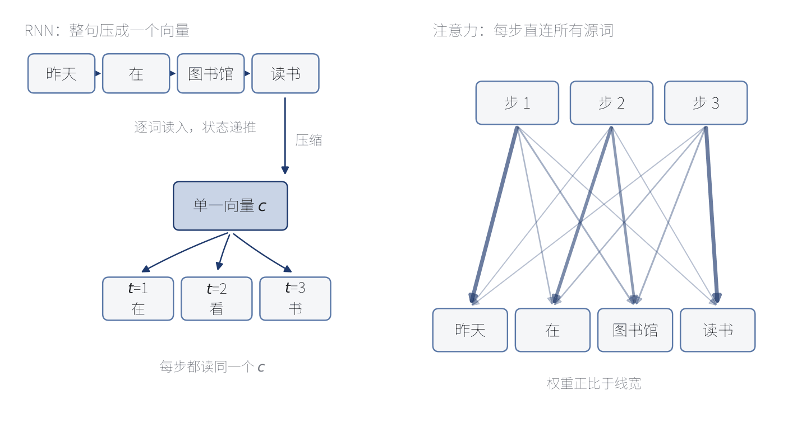

## 从计数到预测下一个词

要弄清今天的模型为什么长成这样，最好回到它最初要解决的那个问题。这个问题在深度学习之前很久就被提出来了，而且提得相当朴素：给定前面若干词，下一个词该是什么。围绕它的每一次解法更替，都在后来的架构里留下了一个零件。

### 一句话的下半截

设想你在读一句话的前半截：“今天的天气真……”。后面可能接“好”，也可能接“糟”，但几乎不会接“冰箱”。你对下一个词的判断并非凭空而来，它来自你读过的所有句子，以及这些句子在类似场合反复出现的方式。

语言模型要做的，就是把这种直觉变成一个可以计算的东西。用概率写下来，一段长度为 $n$ 的文本出现的可能性，可以拆成一串条件概率的乘积：

$$P(w_1,w_2,\dots,w_n)=\prod_{t=1}^{n}P(w_t\mid w_1,\dots,w_{t-1})$$

这个式子在教科书里出现过无数次，含义却常被轻轻带过。它真正说的是：**把“理解语言”换成“预测下一个词”**。如果模型能在足够多的场合把下一个词猜准，它就被迫学到语法、搭配、事实，甚至某些推理链条，因为这些东西正是让下一个词变得可预测的原因。反过来，一个只会背句子的模型在没见过的句子上立刻露馅，困惑度就会升上去。

这里有个容易被忽略的细节：条件里保留的是**全部**历史。$w_t$ 依赖前面每一个词，而不是最近几个。语言中确实存在长距离依赖，“我昨天在图书馆借的那本讲罗马帝国的书，到现在还没……”后面该接“看完”，这个判断需要跨过二十多个词。能否高效地利用全部历史，是后来所有架构竞争的焦点。

#### 数出来的概率

在神经网络流行之前，人们真的去数。假设只让每个词依赖前一个词，那么

$$P(w_t\mid w_{t-1})=\frac{c(w_{t-1},w_t)}{c(w_{t-1})}$$

$c(\cdot)$ 表示在语料中出现的次数。这就是二元语法（bigram）。把条件放宽到前两个词，就是三元语法，依此类推。做法朴素，效果却不差：在几个亿词的语料上，三元模型已经能生成语法上过得去的句子。

问题出在稀疏性上。词的组合数量随阶数指数增长，而语料是有限的。五万词的词表能组成二十五亿个二元组，几十亿词的语料看起来很大，摊到每个组合上，绝大多数仍然是零。零概率是致命的：语言模型算的是一整句话的概率，只要有一个因子是零，整句就是零。

举个最小的例子。假设语料只有三句话：

> 我 喝 咖啡
>
> 我 喝 茶
>
> 他 喝 水

那么“喝”后面接“咖啡”的概率是 1/3。现在来一句“我喝牛奶”，“牛奶”在语料里没出现过，按公式概率是 0，整句话的概率也变成 0。可这是一句完全正常的话。

平滑（smoothing）要做的就是把这个 0 变成一个小正数。做法是：不把全部概率都分给见过的组合，留出一小部分，分给没见过的。像切蛋糕，先给到场的人每人一块，再从每块上削下一点，留给没到场的人。

最简单的做法叫加一平滑。假设词表有五万个词，也就是“喝”后面可能接的候选一共有五万个。给每个候选的计数都加 1：见过的“咖啡”“茶”“水”从 1 变成 2，没见过的四万九千九百九十七个词从 0 变成 1。分母也跟着变：原来是 3 次真实出现，现在再加上给五万个候选各记的一次“虚拟出现”，变成 $3+50000$。所以“牛奶”的概率被估成 $1/(3+50000)$，约等于五万分之一。

0 确实变成了正数。但这个办法很粗：真实数据只有 3 次，虚拟计数却有 5 万次，见过的组合被稀释得厉害；而且所有没见过的词拿到的都是同一个 1，“牛奶”和“冰箱”没有区别，可前者显然更可能跟在“喝”后面。

Kneser-Ney 平滑把这件事做得细一些，分两步。

第一步是折扣。对每个出现过的组合，不把数出来的次数全部算进去，而是扣掉一个固定的少量 $D$。“喝咖啡”出现了 100 次，就按 99.25 算；“喝茶”只出现 1 次，就按 0.25 算。每个组合都削掉一点，削下来的总量正好留给没见过的组合。这叫绝对折扣（absolute discounting）。$D$ 取多少不是推导出来的，而是在语料上试出来的经验值，二元语法通常取 0.75 左右。

第二步是回退：削下来的质量按什么比例分给没见过的词？一个自然的想法是按词的总频率分，牛奶出现得多就多分一点。这里有个陷阱。“San Francisco”里的“Francisco”总频率可能不低，可它几乎只出现在“San”后面，把它当成一个到处都能出现的词就错了。反过来，“吃”前面可以出现“我、你、他、爱、想、能、敢、别”等很多不同词，它能出现在很多种前接上下文里，才适合当回退的候选。

所以 Kneser-Ney 不用原始词频，而用接续计数：数一个词前面出现过多少种不同的词，记作 $N_{1+}(\cdot\,w)$。“Francisco”的接续计数很小，前面几乎只有“San”；“吃”的接续计数很大，因为“我吃、你吃、他吃、爱吃、想吃、能吃、敢吃、别吃”等前接词很多。用这个分布做回退，分给“吃”的概率才合理。

也就是说，当前面出现了“San”时，下一个词基本上就能确定是“Francisco”。而前面出现了“睡”时，后面接“牛奶”的概率总是比“Francisco”更大（虽然当前“睡牛奶”也不对，但概率上总比“睡Francisco”要好得多）。

两步合起来就是那个公式：

$$P_{\mathrm{KN}}(w_t\mid w_{t-1})=\frac{\max\bigl(c(w_{t-1},w_t)-D,\,0\bigr)}{c(w_{t-1})}+\lambda(w_{t-1})\,P_{\mathrm{cont}}(w_t)$$

第一项是见过的组合打折之后的概率；第二项是回退，按权重 $\lambda$ 把剩下的质量分给没见过的组合。$\lambda$ 不是拍脑袋定的，它正好等于折扣削下来的那部分。设“喝”后面一共出现过 $N$ 种不同的词，每种各削掉 $D$，总共削掉 $D\cdot N$；再除以“喝”的总计数，就是削掉的比例：

$$\lambda(w_{t-1})=\frac{D\cdot N_{1+}(w_{t-1},\cdot)}{c(w_{t-1})}$$

第一项各项加起来是 $(c-D\cdot N)/c$，第二项总和是 $\lambda=D\cdot N/c$，两者相加正好是 1，概率没有凭空多出来，也没有丢。回退分布 $P_{\mathrm{cont}}$ 则是把接续计数归一化：

$$P_{\mathrm{cont}}(w)=\frac{N_{1+}(\cdot\,w)}{\sum_{w'}N_{1+}(\cdot\,w')}$$

分母是所有词的接续计数之和，保证它自己也是一个合法的概率分布。

一句话概括：见过的组合按打折后的频率算，没见过的组合按“这个词能在多少种上下文里出现”来分剩下的概率。

补丁终归是补丁。平滑只处理“没见过的组合”，模型的容量仍然被阶数锁死：三元模型看不到跨越四个词以上的依赖，无论语料多大。

不妨把参数账算一遍。词表五万，二元前缀有 $5\times10^4$ 的平方那么多种，每一种后面都要存一个五万维的分布，乘起来是 $5\times10^4$ 的三次方，也就是一百二十五万亿个参数。即便用剪枝和量化压到万分之一，也还有一百多亿，而它能表达的仍然只是“最近三个词”。神经网络把这件事的复杂度从 $O(V^n)$ 换成了 $O(Vd+d^2n)$：$Vd$ 是词嵌入，$d^2n$ 是几层宽度为 $d$ 的网络权重；五万词、三百维的嵌入加上几层宽度数百的网络，参数量在千万级，却能覆盖任意长的上下文。差距不在常数，在增长方式。

衡量语言模型好坏的标准也是那时候定下来的：困惑度（perplexity），

$$\mathrm{PPL}=\exp\left(-\frac{1}{N}\sum_{t=1}^{N}\log P(w_t\mid w_{<t})\right)$$

它可以理解成“模型在每个位置上平均要在多少个词里犹豫”。困惑度 100，意味着模型的不确定程度相当于在 100 个候选词里均匀猜。这个指标今天仍在使用，只不过主角换成了神经网络，语料换成了万亿级 token。

困惑度和压缩率是同一件事的两种说法。把语料看成比特流，一个理想的语言模型能给每个 token 分配越准确的概率，编码它所需的比特就越少；交叉熵的数值（以 2 为底）直接就是每个 token 的平均编码长度，困惑度是它的指数。训练语言模型因此在信息论意义上有明确的目标：用参数去逼近语料的真实分布，把“意外”压到最低。这个视角在后面讨论缩放定律时会反复出现：损失曲线下降的那一点点，对应的是实打实的压缩率提升。

我们把用前面的 $n−1$ 个 token 预测下一个 token的语言模型称为 n-gram 模型。 

### 词向量：把词放到空间里

统计方法把所有词当作彼此无关的符号。“猫”和“狗”在计数时没有任何相似性，尽管它们出现在几乎相同的语境里。2003 年，Bengio 等人提出的神经概率语言模型换了个思路：先给每个词一个稠密向量，再用这些向量去预测下一个词。

模型结构很直接：把前 $n-1$ 个词的向量拼起来，过一层隐藏层，输出词表上的概率分布。训练目标仍是最大化语料的对数似然。真正带来变化的不是这层网络，而是**词向量本身在训练中被顺带学了出来**。因为要预测“喝”后面接什么，模型不得不让“咖啡”和“茶”的向量靠得近一些，因为它们在预测下一个词时扮演相似的角色。

这种“分布式表示”带来的泛化是统计方法做不到的：即使“猫在垫子上睡觉”从未出现，只要模型见过“狗在垫子上睡觉”，它就能给这句话一个不低的概率，因为“猫”和“狗”的向量本来就接近。参数共享把数据稀疏的问题从组合层面转移到了向量层面。

顺带说一句，Bengio 这篇论文里已经出现了后来很多设计的雏形：用向量而不是 one-hot，用共享的嵌入矩阵，用神经网络代替查表。它没有引起立刻的轰动，因为以当时的算力，训练这样一个模型慢得让人失去耐心。

把词的token ID转换到向量的过程被叫做词嵌入（Word Embedding）。输入与输出共享 (Weight Tying) 是最常见的一种共享形式，指的是模型的输入嵌入矩阵与输出层的投影矩阵是同一个矩阵。输入嵌入矩阵 $E$ 负责将输入的 token ID 转换成稠密的向量表示。输出投影矩阵 $W$ 负责将模型内部计算出的隐藏向量，映射回词表空间，以计算下一个词的概率分布。权重绑定就是令 $W = E^T$（或直接共享参数）。核心逻辑是，既然输入嵌入定义了从“词”到“语义空间”的映射，而输出投影本质上是在执行一个反向或相关的映射，那么让这两个映射共享参数是合理的。

### 循环：让历史压缩进一个状态

真正让神经网络语言模型实用起来的，是循环神经网络（Recurrent Neural Network，RNN）。它不再固定看前 $n-1$ 个词，而是一个词一个词地读，每读一个就更新一个隐状态：

$$h_t=\tanh(W_h h_{t-1}+W_x x_t+b)$$

隐状态可以看作对“读到目前为止的所有内容”的压缩。序列多长都行，参数量不随长度增长，这比前面介绍的 n-gram 优雅得多。但压缩是有损的：所有历史被挤进一个固定维度的向量，越早的信息越容易被后来的输入覆盖。

不过语言模型不能只产出隐状态，它要给出下一个词的概率。每个时刻把 $h_t$ 送进一个输出投影，得到词表上的分数，再 softmax 成概率：

$$\hat y_t=W_y h_t,\qquad p_t=\mathrm{softmax}(\hat y_t)$$

$W_y$ 的形状是 $d\times V$，$V$ 是词表大小。训练时把真实的下一个词 $x_{t+1}$ 当答案，这一步的损失是交叉熵：

$$L_t=-\log p_t[x_{t+1}]$$

整句话的损失是各步之和，$L=\sum_{t=1}^{T}L_t$。每个时刻喂进去的都是真实的 $x_t$，不是模型上一步的预测，这叫 teacher forcing。于是一条长度为 $T$ 的序列一次给出 $T$ 个预测任务，每个位置都在学“下一个词是什么”。

训练就是对这个 $L$ 做反向传播。麻烦在于 $W_h$ 不是只用一次：每个时刻的 $h_t$ 都经过它，而 $h_t$ 又喂给下一刻。对 $W_h$ 求导，要把每个时刻的贡献加起来：

$$\frac{\partial L}{\partial W_h}=\sum_{t=1}^{T}\frac{\partial L_t}{\partial h_t}\frac{\partial h_t}{\partial W_h}$$

这里要小心：$W_h$ 是一个矩阵，梯度要对它的每个元素分别求。固定其中一个元素记作 $w$，先看 $\partial h_t/\partial w$。$h_t$ 对 $w$ 的依赖有两条路：当前这一步直接用 $w$ 算 $h_t$；$h_{t-1}$ 本身也依赖 $w$。两条都要算。把“固定 $h_{t-1}$、只看当前这一步”的导数记作 $D_t$，合起来就是

$$\frac{\partial h_t}{\partial w}=D_t+\frac{\partial h_t}{\partial h_{t-1}}\frac{\partial h_{t-1}}{\partial w}$$

$D_t$ 是当前这一步的直接贡献，第二项是 $h_{t-1}$ 随 $w$ 变、再传进 $h_t$ 的那部分。右边第二项里的 $\partial h_{t-1}/\partial w$ 又是同样的结构，可以继续往下展开。记 $D_k$ 为第 $k$ 步把 $h_{k-1}$ 当常数时对 $w$ 的直接导数，$J_k=\partial h_k/\partial h_{k-1}$，一直展开到 $h_1$：

$$\frac{\partial h_t}{\partial w}=D_t+J_tD_{t-1}+J_tJ_{t-1}D_{t-2}+\cdots+J_tJ_{t-1}\cdots J_2D_1$$

以 $t=3$ 为例，三项分别是：$w$ 在第三步直接影响 $h_3$；在第二步影响 $h_2$、再经 $J_3$ 传到 $h_3$；在第一步影响 $h_1$、经 $J_2J_3$ 传到 $h_3$。

写成求和：

$$\frac{\partial h_t}{\partial w}=\sum_{k=1}^{t}\Bigl(\prod_{i=k+1}^{t}J_i\Bigr)D_k,\qquad \prod_{i=k+1}^{t}J_i=\frac{\partial h_t}{\partial h_k}$$

对 $W_h$ 的每个元素都做一遍，就得到整个 $\partial h_t/\partial W_h$。所以 $\partial h_t/\partial h_k$ 不是把 $\partial h_t/\partial W_h$ 换掉了，它是求和里的一项：第 $k$ 步的那份 $W_h$ 的影响，要经过 $h_k\to h_{k+1}\to\cdots\to h_t$ 才能传到 $h_t$，这段传播就是 $\partial h_t/\partial h_k$。$W_h$ 被所有时刻共享，对它的导数必须把“哪一步的 $W_h$”逐个分开算，再把每条传播链乘起来。

前馈网络里每层参数只出现一次，求导只穿一层；循环网络里同一个 $W_h$ 在每个时刻都出现，梯度就得穿两次、三次，直到 $T$ 次，链自然就长了。

链上每一环是

$$\frac{\partial h_i}{\partial h_{i-1}}=\mathrm{diag}\bigl(1-\tanh^2(\cdot)\bigr)W_h$$

$\mathrm{diag}(1-\tanh^2(\cdot))$ 是 tanh 的导数，$W_h$ 是同一个矩阵。代回去，从 $t$ 到 $k$ 的梯度就是 $t-k$ 个这样的矩阵连乘：每一步都乘一次 $\mathrm{diag}(1-\tanh^2(\cdot))W_h$。

这个乘积里有两个因素在起作用，任何一个都能让梯度失控。先是激活函数。$\tanh'(x)=1-\tanh^2(x)\le 1$，大多数时候还明显小于 1；一旦 $h_i$ 落进饱和区，导数接近 0，单步雅可比就接近零。换成 sigmoid 更糟：$\sigma'(x)\le 0.25$，每步最多乘 0.25，$0.25^{20}\approx 9\times10^{-13}$，二十步之后梯度基本没了。这也是传统 RNN 用 tanh 而不是 sigmoid 的原因，但 tanh 自己也会饱和。

再是权重矩阵。即使激活导数接近 1，$W_h$ 的谱半径只要略小于 1，乘几十次就趋近于零（$0.9^{50}\approx0.005$）；略大于 1，乘几十次就爆掉（$1.1^{50}\approx117$）。

两个因素叠在一起，长程依赖就学不动了：梯度要么在回传路上衰减到零，要么放大到数值溢出。这与“状态装不下”是两回事——即使隐状态足够大，梯度也传不回去。

LSTM 的关键改动，是把长期记忆从这条“反复乘矩阵”的路径上挪开。它把状态拆成两部分：对外输出的 $h_t$，和一条只做加减的记忆带 $c_t$。三个门都读当前输入与上一步隐状态，各自输出一个 0 到 1 之间的向量：

$$f_t=\sigma(W_f[h_{t-1},x_t]+b_f),\quad i_t=\sigma(W_i[h_{t-1},x_t]+b_i),\quad o_t=\sigma(W_o[h_{t-1},x_t]+b_o)$$

$$\tilde c_t=\tanh(W_c[h_{t-1},x_t]+b_c),\qquad c_t=f_t\odot c_{t-1}+i_t\odot\tilde c_t,\qquad h_t=o_t\odot\tanh(c_t)$$

其中 $\sigma$ 是 sigmoid 函数，把值压到 0 到 1 之间；$\odot$ 表示逐元素相乘；$W$ 与 $b$ 是待训练的参数，$\tilde c_t$ 是这一步准备写入记忆带的新候选值。

遗忘门 $f_t$ 决定记忆带上的旧值留多少，输入门 $i_t$ 决定新候选值写多少，输出门 $o_t$ 决定这一步从记忆带里读出多少。真正起作用的是 $c_t$ 那条**加法**路径。对 $c_t=f_t\odot c_{t-1}+i_t\odot\tilde c_t$ 求导，只有第一项含 $c_{t-1}$：

$$\frac{\partial c_t}{\partial c_{t-1}}=\mathrm{diag}(f_t)$$

这里没有 $W_h$，也没有 tanh 的导数，只有一个逐元素的门。往回传 $k$ 步，梯度乘的是 $\prod_{j=1}^{k}\mathrm{diag}(f_{t-j})$，也就是一串 0 到 1 之间的数。这一串数解释了两件事。

**为什么能缓解消失**：如果某个维度上的信息需要记住很久，网络可以把对应的 $f$ 学到接近 1，梯度乘 $0.99$ 一百次还有 $0.37$，信息就传回去了。普通 RNN 的所有维度共用同一个 $W_h$，做不到“这一维记住、那一维清空”；门是逐维度的，这是它比矩阵灵活的地方。

**为什么能缓解爆炸**：$f_t$ 是 sigmoid 的输出，最大不超过 1，所以这条路径上的梯度乘积只会变小或不变，不会变大。普通 RNN 的谱半径只要略大于 1，几十步就能放大上千倍；记忆带在结构上没有这个放大项。这就是“恒定误差传送带”这个说法的来历：$f=1$ 时梯度原样穿过，既不衰减也不放大。

但边界要说清楚：LSTM 只保证记忆带这一条路径不爆炸，梯度还要经过输出门、tanh 和各个门自己的权重矩阵，那些路径仍可能出问题，所以训练 LSTM 时梯度裁剪照样要用。它解决的是“长期记忆的梯度传不回去”，不是“所有梯度问题”。这也是 LSTM 能在机器翻译、语音识别上统治多年的原因：它让模型第一次可以稳定地学几百步之前的信息。

但它改变的只是梯度路径，不是“把整段历史压进一个向量”这件事本身。

编码器-解码器结构把这个矛盾推到了台面上。2014 年，Sutskever 等人用两个 LSTM 做机器翻译：编码器把整句源语言读成一个向量，解码器从这个向量出发逐词生成目标语言。句子一长，效果明显下降。原因不难想到：解码器每一步拿到的都是同一个向量，它必须同时记住“主语是什么”“时态是什么”“前面译到哪了”。一个几百维的向量承担不了这么多。

### 注意力：一次对症的修补

Bahdanau 等人在 2014 年底给出的办法，是让解码器每一步自己去源句里“看”一遍，而不是只依赖那个被压扁的向量。具体做法是给解码器的当前状态与每个源词算一个相关性分数，归一化成权重，再对源词向量加权求和：

$$e_{tj}=a(s_{t-1},h_j),\qquad \alpha_{tj}=\frac{\exp(e_{tj})}{\sum_{k}\exp(e_{tk})},\qquad c_t=\sum_j \alpha_{tj}h_j$$

$c_t$ 就是这一步的上下文向量，$a(\cdot)$ 是一个小的前馈网络，它的参数与整个翻译模型一起端到端训练：对齐不是标注出来的，而是在“把下一个词译对”这个目标下被反向传播逼出来的。翻译到“银行”时，权重会集中到源句里对应的词上，其他位置几乎不看。这个机制解决的不只是长句问题，它还提供了一个可解释的中间产物：对齐关系直接写在注意力权重里。代价是解码每一步都要对全部源位置算一遍分数：原来每步只读一个固定向量，现在要读 $T_s$ 个位置，整句解码的计算量从 $O(T_t)$ 变成 $O(T_sT_t)$，这个代价在 Transformer 里被完整继承下来。

注意力最初是挂在 RNN 上的一个附件。它让模型在解码的每一步都能回看整个输入，梯度路径从“穿过几十个时间步”变成“一步直达”，长程依赖的传播距离大幅缩短。回头看，这是通往 Transformer 的最后一级台阶：既然注意力已经能承担信息路由的主要工作，循环还有必要吗？

### 从理解到预测：路线的分岔

到这里，语言模型的技术积累基本齐了：分布式表示、深层网络、注意力。接下来的分岔在于，人们到底想让模型做什么。

一条路是“理解”。2018 年的 BERT 用 Transformer 的编码器，把句子里的词随机遮住一部分让模型去猜，训练出的表示在分类、抽取、问答等任务上刷新了一圈纪录。它把预训练加微调变成了标准范式：先在大语料上学会语言，再在少量标注数据上适配具体任务。另一条路是“生成”。同年 OpenAI 的 GPT 用解码器，只做一件事：根据前文预测下一个词，不做任何特定任务的改造。

两条路的分歧不在网络结构，而在目标函数对数据的用法。BERT 能看到左右两侧的上下文，因此更擅长判断；GPT 只能看左侧，因此必须学会把一切任务都写成“续写”的形式。2019 年的 GPT-2 用 15 亿参数、40GB 网页文本训练，展示了零样本迁移的苗头：不微调，只把任务描述塞进提示里，模型就能接着往下写。这个现象当时被不少人当作巧合。

真正的转折发生在 2020 年。GPT-3 把参数量推到 1750 亿，训练数据推到 3000 亿 token，然后在论文里系统地展示：只要把任务写成几个例子加一句提示，模型在许多任务上的表现会随规模平滑上升。它没有发明新结构，用的还是 2017 年那个 Transformer，但它证明了一件事：**当目标足够简单、数据足够多时，规模本身就是一种方法**。

这句话说起来轻松，代价是接下来五年整个领域的工程重心都变了：从设计结构，转向设计数据、设计并行、设计稳定性、设计对齐。而这些工作之所以可能，前提是 Transformer 恰好是一种特别“吃规模”的结构。下一章回到 2017 年那篇论文，看看它到底改了什么，以及这些改动为什么正好适合今天的硬件。
