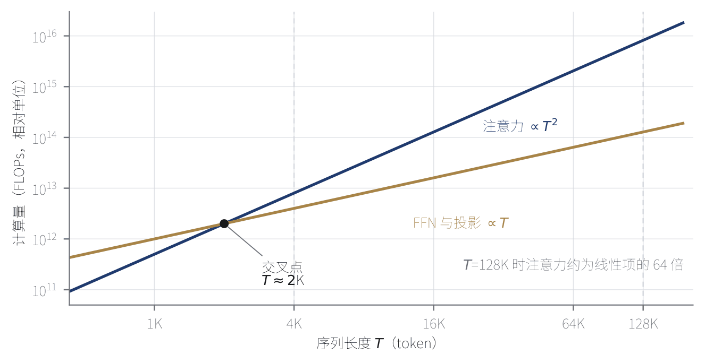
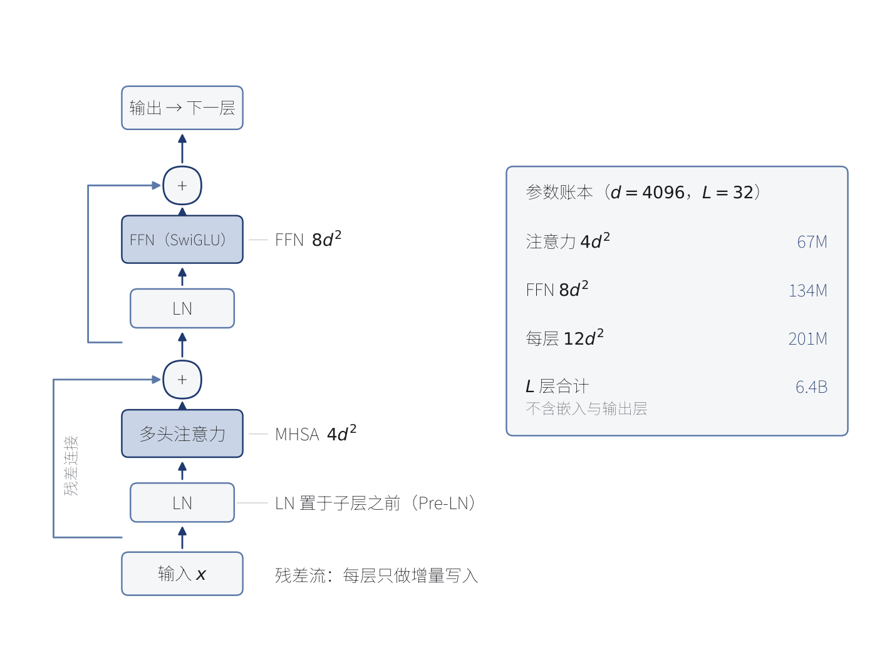

## 结构没变，代价变了

2017 年那篇论文的标题很直白：Attention Is All You Need。八个作者，八块 P100，训练三天半，在英德翻译上比当时最好的模型高出一个多 BLEU。今天回看，它的贡献常被简化成“提出了注意力”，这并不准确。注意力两年前就有了，Transformer 真正做的事是**把循环彻底删掉**。

删掉循环带来的连锁反应，比注意力本身更深远。

### 每个位置同时说话

循环网络的每一步依赖上一步，一条长度为 $T$ 的序列必须走 $T$ 次串行计算。Transformer 把任意两个位置直接连起来，第 $t$ 个位置和第 $s$ 个位置之间的路径长度是常数 1，整条序列可以一次性喂进矩阵乘法。训练时，一个 batch 里的所有序列、序列里的所有位置，全部并行。这个改变让 GPU 从“被串行依赖卡住”的状态里解放出来。GPU 的强项本来就是一次算很多个互不相关的乘加。

代价也很清楚。两两比较意味着注意力矩阵有 $T^2$ 个元素，序列翻倍，计算翻四倍，显存也翻四倍。这个二次项在 2017 年不是问题，因为句子只有几十个词；等到上下文涨到几十万 token，它就成了整个系统设计的中心矛盾，后面用一整章来讲。




另一个代价藏在推理里。训练时可以并行，生成文本时却必须一个词一个词往外吐，每生成一个词都要重新算一遍它与所有历史位置的注意力。为了不重复计算，需要把历史位置的键和值缓存下来，这就是 KV 缓存。它的大小随上下文线性增长，成为长上下文服务中最先撞上的墙。

### 注意力在算什么

“位置之间直接相连”这个说法把最关键的一步跳过了。注意力具体做的事，可以完整地写成一次检索：每个位置拿自己的问题去问所有位置，谁挂出的标签跟问题匹配，就把谁的内容按匹配程度加权取回来。它之所以比检索更好用，是因为打分和加权都是矩阵乘法，整个操作可微，权重可以被梯度改。

输入是当前层残差流的一份快照 $X\in\mathbb{R}^{T\times d}$：$T$ 个位置，每个位置一个 $d$ 维向量。三个可学的投影把它变成三组向量，

$$\begin{aligned}Q&=XW^Q,\qquad K=XW^K,\qquad V=XW^V\\[2pt] W^Q,W^K&\in\mathbb{R}^{d\times d_k},\qquad W^V\in\mathbb{R}^{d\times d_v}\end{aligned}$$

$Q$ 的每一行是一个位置的查询（我在找什么），$K$ 的每一行是它挂出的标签（我这儿有什么），$V$ 的每一行是它实际交出的内容。注意 $K$ 和 $V$ 是两个独立的投影，不是同一个向量的两个名字。匹配的依据和搬运的内容可以不同：一个位置可以“因为它是人名”被找到，却交出“性别”这条信息。省掉这一层，被匹配上的位置就只能贡献自己的标签向量，模型表达不了“按什么找”和“取什么”分离的操作。

计算分三步。先打分，再归一化，最后按权重取值：

$$S=\frac{QK^{\top}}{\sqrt{d_k}},\qquad A=\mathrm{softmax}_{\text{row}}(S),\qquad O=AV$$

$S\in\mathbb{R}^{T\times T}$ 的元素 $S_{ij}=q_i\cdot k_j/\sqrt{d_k}$ 是位置 $i$ 对位置 $j$ 的打分；softmax 逐行做，于是 $A$ 每一行是一条概率分布，$\sum_j A_{ij}=1$；$O$ 的第 $i$ 行是 $V$ 各行按 $A_{i,:}$ 加权平均的结果。一句话：输出是“值”的凸组合，权重由“查询”和“键”的相似度决定。学到的全部内容就是那四个投影矩阵，$Q$、$K$、$V$、$A$ 都是它们和输入的临时产物。

```text
Q, K, V = X @ Wq, X @ Wk, X @ Wv      # 各 T×dk / T×dk / T×dv
S = Q @ K.T / sqrt(dk)                # T×T，S[i,j] = 位置 i 看位置 j 的分数
S = mask_fill(S, j > i, -inf)         # 因果掩码，训练时才需要
A = softmax(S, dim=-1)                # 逐行归一化，每行和为 1
O = A @ V                             # T×dv，第 i 行是 V 的加权平均
# 多头：以上四步对 h 组不同的 (Wq_i, Wk_i, Wv_i) 各算一遍
# 输出 = concat(O_1, ..., O_h) @ Wo    # T×(h·dv) 投回 T×d
```

缩放因子 $\sqrt{d_k}$ 不是装饰。设 $q$ 与 $k$ 的各分量独立、均值 0、方差 1，则点积 $q\cdot k=\sum_{i=1}^{d_k}q_ik_i$ 的均值为 0、方差为 $d_k$，量级随维度开方增长。原论文的 $d_k=64$，点积的标准差就是 8，softmax 的输入落在 $\pm 8$，指数一放大就接近 one-hot，只有最大那项拿到权重，其余全是零，梯度也跟着接近零。除以 $\sqrt{d_k}$ 把方差拉回 1，权重才有梯度可走。

原论文还对比了另一种打分方式：Bahdanau 在 2014 年用的加性注意力。它不做点积，而是把查询和键各做一次线性变换，把两个结果相加，过 tanh，再用一个向量点积成一个标量，

$$s(q,k)=v^{\top}\tanh(W_q q+W_k k+b)$$

叫“加性”，是因为两个变换先相加再进非线性。这个分数里没有 $q\cdot k$ 那种随 $d_k$ 增长的项，维度变大时尺度更稳。原论文的消融里，$d_k$ 小时加不加缩放差别不大，$d_k$ 变大之后，不加缩放的点积注意力就会输给它。

那为什么主流实现还是选点积？因为加性注意力要给 $T^2$ 个位置对逐个跑一个小网络，在 GPU 上凑不成一次大矩阵乘；点积能直接落进高度优化的 GEMM，常数差一到两个数量级。这也是为什么即使点积需要额外补一个缩放因子，大家仍然用它。后来所有高效注意力——分块、稀疏、线性近似——改的都是怎么算 $QK^{\top}$、要不要把矩阵整个写进显存，没有人去换打分函数。

因果掩码是另一处容易含糊的地方。训练时把 $j>i$ 的分数置为 $-\infty$ 再 softmax，这些位置的权重就精确等于 0；位置 $i$ 的输出只由 $1..i$ 决定，与自回归生成时“只能看左边”的约束一致。训练一次前向就把 $T$ 个位置全部算完，推理时却要一个 token 一个 token 地算，并把历史 $K$、$V$ 缓存下来复用——同一套公式，两种执行方式，这个错位是后面所有推理优化的起点。

多头的做法是把维度切开而不是把计算重复几遍。$d$ 维被分成 $h$ 份，每个头在 $d_k=d/h$ 的子空间里各有一套投影，各自算一遍上式，得到 $h$ 个 $d_v$ 维输出，拼回 $hd_v$ 维再乘一个输出投影 $W^O$ 投回 $d$ 维。参数账是 $3hd_kd$ 加 $hd_vd$，当 $d_k=d_v=d/h$ 时正好 $4d^2$。计算量与非多头版本相同：每个头花 $2T^2d_k$，$h$ 个头加起来还是 $2T^2d$。原论文取 $h=8$、$d_k=d_v=d/8=64$，正是为了“总计算量与全维单头相近”。

为什么要拆？因为一行 softmax 只给一条概率分布，一个头一次只能做一次凸组合；模型如果同时需要“跟着主语找动词”和“跟着上一句找指代”，一条分布装不下。$h$ 个头就有 $h$ 条独立分布，而且各自在不同的低维子空间里衡量相似度。原论文的消融里，单头比 8 头低 0.9 BLEU，头再加多则每个头的维度太小、学不到东西。

$T^2d$ 这个量级也是从上面三步来的。打分矩阵每个头有 $T^2$ 个元素、每个元素要 $d_k$ 次乘加，$h$ 个头合计 $2T^2d$ FLOPs；加权求和 $AV$ 再来一遍 $2T^2d_v$。而四个投影是 $8Td^2$。两者相等的位置在 $T=2d$：上下文短于这个尺度时逐位置的线性变换更贵，长于它之后注意力压倒一切。一个 $d=8192$ 的模型配 128K 上下文，单层注意力约 $5.6\times10^{14}$ FLOPs，是线性部分（$7.0\times10^{13}$）的八倍；换成同样宽度的短上下文，这个比例降到十分之一以下。显存账同样陡：$h\times T^2$ 个分数，$h=32$、$T=8192$、FP16 单层就要 4.3GB，而且反向传播还得留着它。分块计算、不把整个矩阵落地的做法（FlashAttention 那一类）省的就是这笔钱，这一章末尾只记结论，第七章展开。

### 残差流：一条贯穿始终的通道

把 Transformer 的一层拆开，会看到两个子层：多头注意力负责在位置之间搬运信息，前馈网络负责在每个位置上单独做变换。两个子层都套着残差连接：

$$x \leftarrow x+\mathrm{Attention}(\mathrm{LN}(x)),\qquad x \leftarrow x+\mathrm{FFN}(\mathrm{LN}(x))$$




这条 $x$ 的通道被称为残差流。它的维度从头到尾不变，每一层只是往上面加一点东西，不覆盖、不替换。把它想成一块公共黑板：注意力从黑板上读取需要的信息，算完之后把结果写回黑板；前馈网络则对每个位置的向量做一次非线性加工，也写回去。

写成式子更清楚。把第 $l$ 层两个子层的写入记作 $f_l$、$g_l$，则

$$x_L=x_0+\sum_{l=1}^{L}\bigl[f_l(\mathrm{LN}(x_{l-1}))+g_l(\mathrm{LN}(x_{l-1}))\bigr]$$

残差流里同时住着最初的词嵌入和每一层写过的东西：深度不是逐层替换，而是逐层叠加。任何线性读出 $Wx_L=Wx_0+\sum_l W(f_l+g_l)$ 都是各层贡献的直和，这也解释了为什么删掉中间某一层通常只让损失轻微上升——被删掉的是若干加数之一，不是链条上的一环。

代价是量级会累积。把残差流写成 $x_L=x_0+\sum_{l=1}^{L}\Delta_l$，$\Delta_l$ 是第 $l$ 层的写入。展开平方：

$$\lVert x_L\rVert^2=\lVert x_0\rVert^2+2x_0\cdot\sum_l\Delta_l+\sum_l\lVert\Delta_l\rVert^2+2\sum_{i<j}\Delta_i\cdot\Delta_j$$

若各层增量的均值接近 0、彼此近似不相关，交叉项在期望上接近 0，只剩

$$\mathbb{E}\lVert x_L\rVert^2\approx\lVert x_0\rVert^2+\sum_{l=1}^{L}\mathbb{E}\lVert\Delta_l\rVert^2\approx\lVert x_0\rVert^2+L\sigma^2$$

所以，平方范数的期望随层数 $L$ 线性增长：每多一层，就多加一份 $\sigma^2$；层数翻倍，它大致也翻倍。注意增长的是平方范数，范数本身按 $\sqrt{L}$ 增长，所以 80 层比 1 层大约大 9 倍，而不是 80 倍。

“不相关”这个条件不能省。若各层写入方向一致（正相关），交叉项全为正，平方范数会按 $L^2$ 增长，几十层就爆；若相互抵消（负相关），增长会慢于线性。真实模型的增量方向介于两者之间，线性增长是个可用的近似。

尺度漂移的后果是：越深的位置，残差流越大，后层的相对贡献被淹没。Pre-LN 把归一化放在每个子层的入口，让子层看到的输入尺度稳定，但主干本身仍然在长；所以模型结束时还要在输出前补一层归一化，把这个累积的尺度收回来。

这个图景在后面的章节里会反复用到。混合专家是把前馈网络换成许多个专家再按需激活；可解释性研究把残差流当作模型内部的“工作记忆”，从中读出概念的方向；甚至训练稳定性的很多技巧，本质上都是在控制写回黑板的量不要太大。

残差还有一个不那么显眼的好处：梯度可以沿着这条通道直接回传。一个 80 层的网络，如果每层都强制变换，梯度要穿过 80 次链式相乘，很容易消失；有了恒等映射，梯度至少有一条畅通的路径。这也是为什么深层 Transformer 能训得动，而同样深度的普通前馈网络很难。

### 归一化的位置之争

原论文把层归一化放在残差连接之后（Post-LN）：

$$x\leftarrow\mathrm{LN}\bigl(x+F(x)\bigr)$$

反向传播时，梯度要先穿过 LN，再穿过残差加法。LN 的雅可比在初始化时接近一个投影，谱范数接近 1，不会把梯度压小；而残差和随深度增长（上一节），于是越靠前的层，收到的梯度越大，量级随深度上升——这里不是消失，而是相反，靠近输入的层被更大的梯度冲击。训练刚开始参数还是随机的，这么大的一步能把权重直接推进激活函数的饱和区——tanh 的两端、softmax 的 one-hot 区、GELU 的负半轴，这些地方导数接近 0。一旦进去，后续梯度几乎为零，参数就没有动力再出来，这就是“回不来”。大梯度还可能让激活值和 logits 爆掉，出现损失尖峰甚至 NaN，只能回滚检查点重来。

warmup 就是不让第一步迈这么大：学习率从接近 0 开始，用前几千步让参数在初始化附近慢慢调整，等各层尺度稳定、梯度估计靠谱了，再升到目标值。代价是前期慢一些，但比一次爆掉再回滚便宜。

后来的实践把归一化挪到子层之前（Pre-LN）：$x\leftarrow x+F(\mathrm{LN}(x))$。残差主干成了纯加法，梯度沿恒等路径回传，不再被 LN 的雅可比逐层放大；每个子层看到的输入尺度也稳定，warmup 可以缩短到几百步。

Pre-LN 的代价是表达能力的细微损失：每条残差支路的输出没有经过归一化，深层累积后方差会变大。于是又有了在最终输出前加一层归一化、在注意力里对 query 和 key 额外做归一化（QK-Norm）等补丁。这些都是工程细节，但它们共同说明一件事：Transformer 的“深”不是免费的，稳定性是一层层调出来的。

### 多头与位置：两个容易被略过的设计

多头拆分和拼接的机制前面已经拆过，值得补的是它到底换来了什么。经验上不同头确实分工：有的盯相邻词，有的盯主谓一致，有的盯指代，也有的几乎只在自己位置上打转。这种分工不是设计出来的，是训练自己长出来的，所以头与头之间常常可以互换、可以删掉一两个而不影响多少性能，但没有哪两个头能被证明完全等价。

位置编码则是另一回事。去掉循环之后，模型对顺序完全无知：把句子打乱，注意力算出来的结果只是换了个排列。原论文用不同频率的正弦和余弦函数给每个位置一个向量，加到词嵌入上：

$$PE_{(pos,2i)}=\sin\left(\frac{pos}{10000^{2i/d}}\right),\qquad PE_{(pos,2i+1)}=\cos\left(\frac{pos}{10000^{2i/d}}\right)$$

选这种形式，是因为任意位置 $pos+k$ 的编码可以写成 $pos$ 的编码的线性变换，模型理论上能学到相对位置。这个设计后来被换掉了，因为它外推能力差：训练时最长 512，遇到 1024 就明显退化。今天主流模型用旋转位置编码（RoPE），把位置信息以旋转的方式乘进 query 和 key，相对位置自然出现在点积里。第六章会把这条演化线讲完，这里只需记住：位置信息不是附属品，它决定了模型能不能处理训练时没见过的长度。

### 前馈网络：被低估的三分之二

一个 $d$ 维的 Transformer 层，注意力部分的参数是 $4d^2$（query、key、value、输出四个投影），前馈网络是 $8d^2$（先升到 $4d$，再降回 $d$）。也就是说，三分之二的参数在一个逐位置的小型多层感知机里。

这个比例后来被反复调整。有的模型把前馈的扩张倍数从 4 降到 2.7，把省下的参数分给更多层；有的把门控线性单元（Gated Linear Unit，GLU）引进来，用一条支路做门控，效果更好但参数多了一半；混合专家则直接把这块最肥的肉切成很多份，每次只吃其中几份。为什么总是拿前馈网络开刀？因为它占据了大部分参数和大部分计算，却只做逐位置变换，不与上下文交互。用稀疏性替代密集计算，在这里最划算。

### 一张必须记住的账

后面讨论训练和推理时，会反复用到几个近似公式。记不住推导没关系，记住量级就够了。

参数量：每层约 $12d^2$，$L$ 层加上词表嵌入 $Vd$，总计约 $12Ld^2+Vd$。一个 $d=4096$、$L=32$ 的模型，参数量约 64 亿，与 7B 级别的开源模型对得上。

训练算力：每个 token 的前向计算约 $2N$ FLOPs（$N$ 为参数量），反向约是前向的两倍，所以训练总开销约 $6ND$，$D$ 是训练 token 数。这个公式解释了为什么训练预算总是被参数和数据两头拉扯。

推理算力：每生成一个 token 约 $2N$ FLOPs。一个 70B 模型生成一千个 token，纯计算是 $1.4\times10^{14}$ FLOPs，听起来不多，但它必须把 140GB 的权重从显存里读一遍，瓶颈在带宽而不在算力。

KV 缓存：$2\times L\times h_{kv}\times d_{head}\times T\times$ 字节数（$T$ 为上下文长度，系数 2 是键和值，$h_{kv}$ 是键值头数、$d_{head}$ 是每个头的维度）。满多头配置下 $h_{kv}d_{head}=d$，一个 70B 模型（80 层、$d=8192$）、8K 上下文、FP16，单个请求的缓存就是 $2\times80\times8192\times8192\times2$ 字节，约 21GB。换成 8 个键值头的 GQA，缓存降到 1/8，也就是 2.7GB；差别就是“每张卡只能放一个请求”和“一张卡放得下七个请求”。

这几个数字会在后面的每一章里以不同形式出现。架构上的许多“改进”，说到底是在这张账本上做加减法。

拿两个真实模型对一下账，感受会更具体。GPT-3 的 $d=12288$、$L=96$，按公式算出约 1750 亿参数，与论文一致；它的注意力每层有 96 个头，每个头 128 维。Llama 2 70B 的 $d=8192$、$L=80$，参数量约 650 亿，差额来自词表（32000）和更窄的前馈（扩张倍数 3.5 而非 4）。两者的差别不只是大小：GPT-3 用稠密前馈，每次推理都要过全部参数；Llama 2 70B 也是稠密模型，但它用分组查询注意力（GQA）把键值头从 64 减到 8，同样的上下文下缓存直接降到八分之一，21GB 变 2.7GB，这决定了它能不能在一张 80GB 的卡上同时跑几个并发请求。

这类账算多了会发现，模型设计从来不是“哪个结构更优雅”，而是“在给定的显存和带宽下，把哪部分计算花得更值”。

### 三条路线，一个胜出

Transformer 之后，社区沿着三种用法分头走了几年。

编码器路线以 BERT 为代表，用双向注意力加掩码语言建模，擅长把一句话压成一个表示，适合分类、抽取、检索。解码器路线以 GPT 为代表，用因果掩码，只能看左边，训练目标就是预测下一个词。编码器-解码器路线以 T5 为代表，把一切任务改写成“输入文本到输出文本”，结构上最通用。

到 2023 年前后， decoder-only 基本赢下了通用大模型这条赛道。原因不神秘：它的训练目标与数据形式完全统一，任何文本都能直接用，不需要构造输入输出对；它的推理过程就是续写，天然支持上下文学习；它的缩放行为最平滑，加大参数和数据就能稳定变好。而编码器-解码器多了一套交叉注意力，参数效率略低，工程上也更复杂。

但编码器没有消失。检索系统里的向量模型、多模态里的视觉编码器、语音里的声学编码器，仍然大量使用双向结构。它们要的是“表示”，不是“生成”。理解这一点，就不会把“decoder-only 赢了”误读成“编码器没用了”。

结构的故事讲到这里，还剩一个悬而未决的问题：为什么同样是这套结构，参数从一亿加到一千亿，能力会有台阶式的变化？这个问题在 2020 年前后由一组经验规律给出了部分答案，也让“堆规模”从一种粗暴做法变成了可以预算的工程决策。
