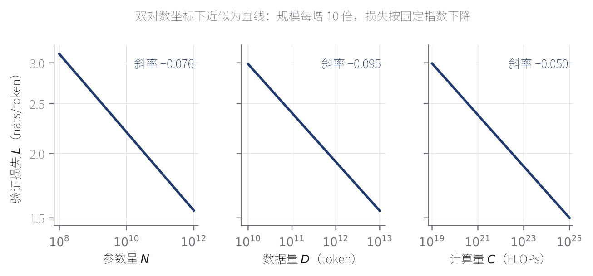
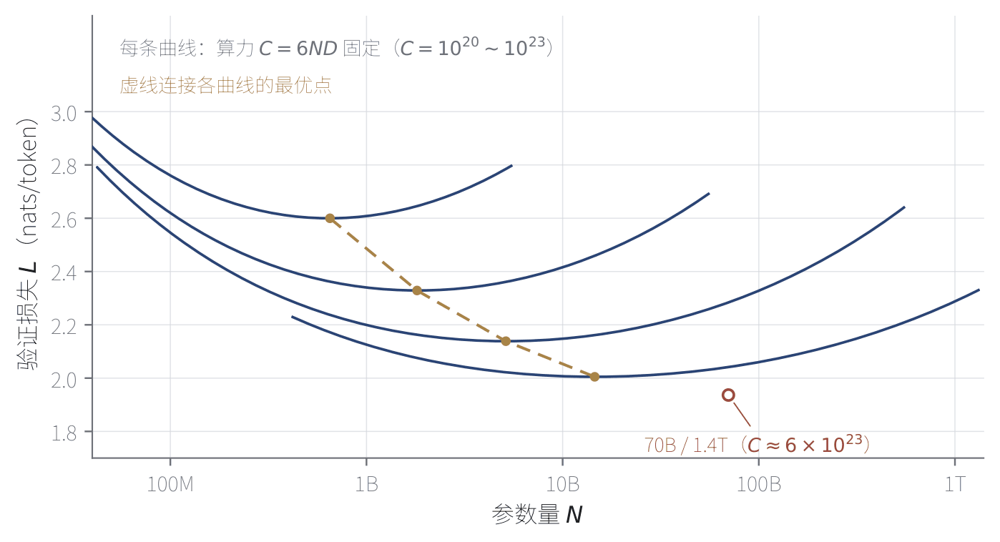

## 规模为什么有效：缩放定律与预算

2020 年之前，调模型更像手艺：加深一层、换个激活函数、加一点 dropout，然后看验证集。2020 年之后，这套手艺被一张曲线图取代了。图的横轴是计算量，纵轴是损失，画在双对数坐标上是一条直线。直线意味着幂律，幂律意味着可以外推：用几百万美元的小实验，预测几千万美元的大实验能到什么水平。

这件事对领域的影响，比任何单个模型都大。它把“要不要再投十倍算力”从赌博变成了估算。

### 三条幂律

Kaplan 等人在 2020 年的论文里，分别改变了参数量 $N$、数据量 $D$、计算量 $C$，发现测试损失都服从幂律：

$$L(N)\propto N^{-0.076},\qquad L(D)\propto D^{-0.095},\qquad L(C)\propto C^{-0.050}$$

指数都是负数，而且很小。参数量翻十倍，损失只下降约 16%。这个数字听起来令人沮丧，但它是在对数尺度上说的：损失从 3.0 降到 2.5，对应的是困惑度从 20 降到 12，生成质量的变化肉眼可见。

更重要的是，这三条曲线可以合成一个受计算预算约束的最优化问题。给定 $C\approx 6ND$，问怎么在 $N$ 和 $D$ 之间分配。Kaplan 的答案是：把大部分预算给参数，数据量增长得慢一些，大约 $N\propto C^{0.73}$。这个结论直接塑造了 GPT-3：1750 亿参数，只训练了 3000 亿 token，每个参数只摊到 1.7 个 token。

### 曲线是怎么拟合出来的

那三条幂律不是拍出来的，每一步都有可复现的实验设置。模型从 768 到 15 亿非嵌入参数，数据量从 2200 万到 230 亿 token（WebText2，BPE 词表 50257），上下文 1024，batch 512 条序列，训练 25 万步，Adam 加 3000 步线性 warmup 再接 cosine 衰减到零。每个模型都跟踪测试损失、不再下降就早停，因为一个训过头的点会把损失抬高，混进拟合里。形状的影响先被排除：固定参数量时，深宽比、头数、前馈倍数在很宽的范围内变动只带来百分之几的损失差异，所以可以只按 $N$ 一个变量组织实验。

单变量拟合的结果是双对数坐标下的三条直线，带常数项写成

$$L(N)=\left(\frac{N_c}{N}\right)^{0.076},\qquad L(D)=\left(\frac{D_c}{D}\right)^{0.095},\qquad L(C_{\min})=\left(\frac{C_{c,\min}}{C_{\min}}\right)^{0.050}$$

其中 $N_c=8.8\times10^{13}$、$D_c=5.4\times10^{13}$、$C_{c,\min}=3.1\times10^{8}$ PF-days。这些常数带着分词器和词表的印记，换个 BPE 词表就变，真正可迁移的只有指数。

把两条单变量曲线并成一个式子要满足三个约束：$D\to\infty$ 时退化成 $N$ 的幂律，$N\to\infty$ 时退化成 $D$ 的幂律，而且对大 $D$ 有 $1/D$ 的展开——过拟合项应该按样本数的倒数衰减。同时满足这三条的最简形式是不对称的：

$$L(N,D)=\left[\left(\frac{N_c}{N}\right)^{\alpha_N/\alpha_D}+\frac{D_c}{D}\right]^{\alpha_D}$$

同时拟合四个参数得到 $\alpha_N=0.076$、$\alpha_D=0.103$、$N_c=6.4\times10^{13}$、$D_c=1.8\times10^{13}$。$\alpha_D$ 比单变量时的 0.095 略大，因为这里两个变量在同时变。白话：损失由一个容量项和一个数据项拼成，数据项在外面包了一层指数，所以模型再大也压不掉“数据不够”带来的那部分。

训练时间那条形式一样：$L(N,S_{\min})=(N_c/N)^{0.077}+(S_c/S_{\min})^{0.76}$，$S_c=2.1\times10^{3}$。这里的 $S_{\min}$ 不是实际步数，要先折算。实际训练用的 batch 往往不是最优的，同样步数走的路不一样长，折算靠临界 batch 关系 $S/S_{\min}=1+B_{\text{crit}}/B$，而 $B_{\text{crit}}\propto L^{-4.8}$。不折算直接拿实际步数拟合，指数会偏。

有了 $L(N,S)$ 就能做预算分配。约束是 $C\approx6ND$，等价于 $S=C/(6NB)$。把 $S$ 代进去，对 $N$ 求偏导置零：

$$N_{\text{opt}}\propto C^{\alpha_C/\alpha_N},\qquad \frac{1}{\alpha_C}=\frac{1}{\alpha_N}+\frac{1}{\alpha_S}+\frac{1}{\alpha_B}$$

代入 0.076、0.76、0.21 得 $\alpha_C\approx0.052$，比值 0.68，与实测拟合的 $N\propto C^{0.73}$ 对得上；剩下的给数据，$D\propto C^{0.27}$。白话版：损失是两项之和，一项随参数变大而减小，一项随步数变多而减小；预算固定时两者此消彼长，最优点在两项的边际收益相等处。因为参数的指数 0.076 比步数的 0.76 小一个数量级，参数这一项的收益掉得很慢，于是钱几乎全给参数。这个结论后来被推翻，问题不在推导，在拟合所用的数据。

### Chinchilla 的修正

2022 年，DeepMind 用 400 多个模型、规模从 7000 万到 160 亿参数，把这件事重做了一遍。结论与 Kaplan 相反：参数量和数据量应该大致同比例增长，

$$N_{opt}\propto C^{0.5},\qquad D_{opt}\propto C^{0.5}$$

差别首先出在实验口径。Kaplan 的所有模型共用一条固定长度的学习率曲线，于是“只喂了一部分数据”的那些点在测量时还没退火完，损失里混着“学习率还没降下来”的成分，系统性地高估了小数据量下的损失。Chinchilla 给每个规模配四条不同长度的 cosine 周期（相差 16 倍），让周期长度与实际 token 数匹配，每个点都是该预算下的收敛值。

然后三条互不依赖的拟合路线同时走。第一条是训练曲线包络：对每个 FLOP 预算，在所有 $(N,D)$ 组合里找出损失最低的那个点，在 1500 个对数间隔的预算上重复一遍，再拟合幂律，得 $a=0.50$（自助法 10–90 分位 0.488–0.502）、$b=0.50$。第二条是 IsoFLOP 剖面：固定 9 个预算（$6\times10^{18}$ 到 $3\times10^{21}$ FLOPs），每个预算扫一组模型大小，对每条剖面拟合抛物线取最低点，再连起来拟合，得 $a=0.49$、$b=0.51$。第三条直接把损失写成参数和数据的函数，在 log 空间用 Huber 损失（$\delta=10^{-3}$）配 L-BFGS 拟合，多组初值取最优，得

$$\hat L(N,D)=E+\frac{A}{N^{\alpha}}+\frac{B}{D^{\beta}},\qquad E=1.69,\ A=406.4,\ B=410.7,\ \alpha=0.34,\ \beta=0.28$$

三项各有出处：$E$ 是数据本身的熵，模型再大也消不掉；$A/N^{\alpha}$ 是有限容量带来的逼近误差；$B/D^{\beta}$ 是只跑一个 epoch、只走有限步带来的优化与样本误差。这个分解不是凑的，论文附录从“贝叶斯最优分类器 → 受限函数类上的最优解 → 单 epoch 梯度下降的结果”三层误差推下来。

指数的落差比结论本身更该记住：$\alpha=0.34$、$\beta=0.28$ 比 Kaplan 的 0.076、0.103 大了三四倍。同一个物理量两次实验差这么多，说明这条曲线对训练条件极其敏感，它不是自然常数。

“每参数 20 个 token”是从拟合线里掉出来的，不是先验设定。把 $N_{\text{opt}}$ 与 $D_{\text{opt}}$ 的拟合式相除，比值在整个预算范围内近似不变；论文表格里 4 亿参数配 80 亿 token、10 亿配 202 亿、670 亿配 1.5 万亿，比值都在 20 到 22 之间。因为两个指数相等，比值不随预算变，而 $C\approx6ND=6\cdot(D/20)\cdot D$ 直接给出 $N=\sqrt{C/120}$。代入 Gopher 的预算 $5.76\times10^{23}$ FLOPs，得 $N\approx6.9\times10^{10}$——这就是“该用 700 亿而不是 2800 亿”的来源。

第二个分歧源是样本覆盖范围。Kaplan 的多数实验在 1 亿参数以下，Chinchilla 的多数模型在 5 亿以上；从各自的最后一个点外推到千亿参数，前者要跨的距离远得多，指数上的一点曲率会被放大。

按这个配方，Chinchilla 只有 700 亿参数，用了 1.4 万亿 token，在几乎所有评测上超过了 2800 亿参数的 Gopher，后者用的 token 数只有 3000 亿。

这场修正的意义不在于谁对谁错，而在于它暴露了一个事实：**缩放定律是实验拟合，不是第一性原理**。配方依赖于训练策略、数据质量、优化器，甚至依赖于你怎么定义“损失”。把它当成物理常数用，迟早要付代价。

### 推理成本改写配方

Chinchilla 的最优解只考虑训练算力。可模型训练一次，要服务几亿次请求，推理成本很快超过训练成本。于是配方又变了一次。

假设总开销是 $C_{train}+C_{infer}$，推理量与参数量成正比，那么参数越少、训练越久，单位请求的成本越低。这被称为“过度训练”（over-training）：故意用超过 Chinchilla 配比的数据去训一个小模型。Llama 3 的 8B 版本用了 15 万亿 token，每个参数接近 1900 个 token，是 Chinchilla 配方的近百倍。它的训练成本远高于“最优”，但推理便宜得多，部署在端侧或高并发场景里更划算。

反过来，如果一个模型只用于离线批处理，推理次数很少，那就该按 Chinchilla 配比甚至更“参数重”的配比来训。配方没有唯一答案，只有给定业务形态下的最优点。

### 数据开始不够用

当每个参数要配几百个 token 时，高质量文本很快见底。公开网页去重、过滤之后，英文高质量语料大约在 10 万亿 token 量级，而前沿模型的训练量已经逼近这个数。

应对办法有几种。一是重复使用数据，实验显示重复 4 轮以内损失几乎不增加，超过之后收益迅速衰减，模型开始“背”而不是“学”。二是合成数据：用强模型生成教科书、对话、推理过程，再拿去训练小模型。Phi 系列用这种办法，把 3.8B 的模型训到接近十倍参数模型的水平，代价是合成数据的分布偏差会被继承。三是提高数据质量而非数量，FineWeb、Dolma 这些开放数据集的工作表明，过滤和去重带来的收益，常常大于把数据量翻倍。

再往下走，就是多模态数据：图像、视频、音频、代码执行轨迹。文本不够，但世界的数据还很多，只是把它们变成可训练的 token 更贵。

### 自己拟合一条曲线

工业界不会直接套论文里的系数，因为那些系数是在特定数据、特定分词器、特定训练配方下拟合的。通常的做法是自己跑一组小规模实验：选五到六个尺寸（比如 70M 到 1B），每个尺寸配三到四个不同的 token 预算，每个点都调到接近最优的学习率和批量，然后按前面那个三项式拟合。

操作上有几个容易漏的点。每个尺寸的 cosine 周期长度要与它自己的 token 数匹配，否则得到的不是“该预算下的收敛值”，而是“中途快照”，这正是 Kaplan 那轮拟合被指出的问题。点数不用太多，但要拉得开：尺寸跨三个数量级、预算跨两个数量级，才能把指数从噪声里分离出来。拟合完不能只看 $R^2$，要留一批没参与拟合的点做验证，尤其是最大的那个点——它决定了外推是不是从最后一段就偏了。

这套方法还有两个容易踩的坑。一是小模型的训练配方往往不能直接迁移到大模型，学习率、初始化、正则化都要按 muP 一类规则换算，否则拟合出的指数会偏。二是数据分布会变：小实验用的可能是清洗得最干净的语料，大训练却要混入更多低质数据，曲线会在某个点之后向下弯。所以外推结果只能当参考，真正的决策还要留出余量。

### 损失与能力之间隔着一段距离

缩放定律拟合的是交叉熵损失，而使用者关心的是能力。两者相关，但不是同一个东西。损失从 2.2 降到 2.0，可能对应代码通过率从 20% 跳到 35%，也可能几乎不变，取决于这点损失降在哪些 token 上。如果模型把大部分进步花在了更好地预测网页模板、标点、常见句式上，基准分数不会动。

这也是后来数据工作变得如此重要的原因：同样的损失下降，来自高质量推理数据的部分比来自重复网页的部分值钱得多。损失是一个平均值，而能力藏在分布的尾部。

### 涌现：一个被指标放大的现象

2022 年前后流行一个说法：模型规模超过某个阈值，能力会突然“涌现”，比如三位数加法、多步推理，在小模型上接近零，到大模型上突然跳到 60%。这个说法支撑了很多“再大一点就会了”的判断。

2023 年有研究指出，这可能是度量方式造成的错觉。如果指标是精确匹配，模型输出从“完全错”过渡到“部分对”时，精确匹配率会长时间停在零，然后突然跳起来；换成 token 级的编辑距离或对数似然，曲线立刻变成平滑上升。也就是说，底层能力一直在连续变好，只是被一个阶跃式的指标遮住了。

这不意味着规模没用。它意味着两件事：第一，不要用单一阈值判断模型“会不会”某个能力；第二，真正需要关心的是曲线在不同任务上的斜率差异：有的能力随规模涨得快，有的几乎不动，后者往往需要数据或训练方式的改变，而不是更多参数。

### 一张预算表

把上面几节合起来，可以得到一个粗糙但实用的预算流程：先定推理成本上限，反推参数量；再定训练算力，按配比算出可用的 token 数；然后检查高质量数据够不够，不够就用合成数据或多轮训练补；最后用小规模实验拟合自己的缩放曲线，验证配方。

这套流程在工业界已经是标准动作。它不保证模型一定好，但能保证钱花在刀刃上。在动辄数千万美元的训练里，这一点比任何架构技巧都值钱。

还有一层反讽：当所有人都按同一套配方堆规模时，规模带来的相对优势会迅速被拉平。2023 年之后真正拉开差距的，往往不是谁多训了 20% 的 token，而是谁的数据更干净、谁的对齐更有效、谁的推理系统更便宜。缩放定律回答了“能到多好”，但没回答“怎么到”。

规模的故事讲到这里，有一个前提始终没被触碰：用来训练的那些 token，究竟是怎么来的。
