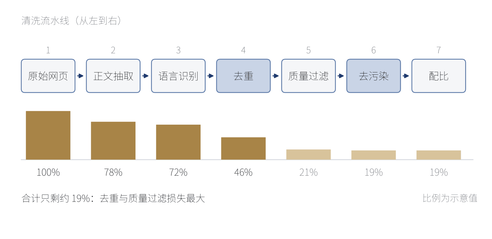
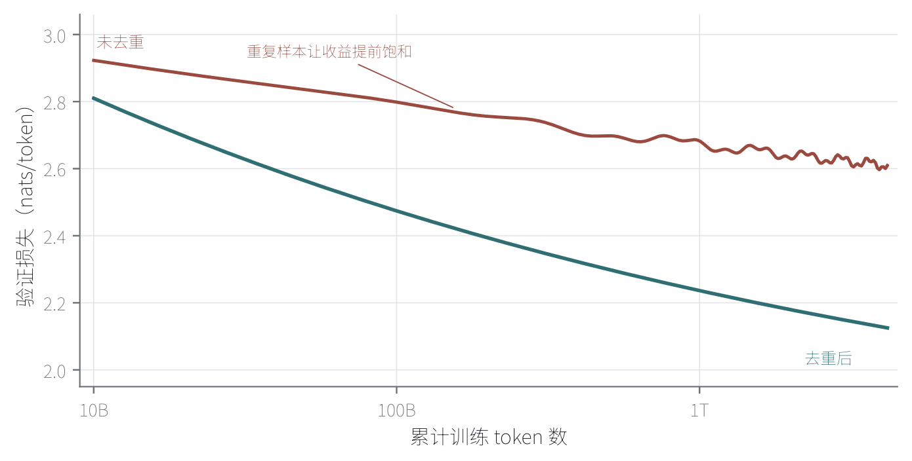

## 数据：从网页到训练语料

把 Common Crawl 的一个归档文件解开，随手挑一页看，多数人第一次都会有点意外。里面没有一篇文章，只有一层套一层的标签：导航菜单、cookie 同意提示、侧边广告、相关推荐、页脚版权声明，正文被挤在中间，占全部字符的比例常常不到三成。这些标签里有大量重复的字符串，而它们恰好会被模型当成语言来学。

Common Crawl 从 2007 年开始每个月抓一次公开网页，累计下来的原始数据以 PB 计。看起来取之不尽，但如果把原始字节直接喂给模型，训练会立刻跑偏：模型会花大量容量去记“点击这里订阅”和“版权所有”的排版规律，因为这些串在语料里出现得比任何真实句子都频繁。从这一堆字节到一个能用的训练集，中间隔着一整条流水线，而流水线上每一个阀门的开度，最终都会写进模型的能力里。

### 正文抽取：先把人写的东西找回来

流水线的第一步是把正文从页面结构里剥出来。做法有两类。一类靠规则和 DOM 树：找出包含文字最多的容器，剔除链接密度高的区块、导航和页脚。另一类靠统计模型：在大量人工标注的页面上训练分类器，判断哪一段文本像正文。开源工具里，trafilatura、Readability、jusText 分别代表这两种思路的不同配比，The Pile 用的是 jusText，Dolma 用的是 trafilatura。

抽取器的选择会让同一批网页产出规模相差两三成，更麻烦的是错误的分布并不随机：论坛帖子、问答页、代码仓库的 README、带公式的论文，这几类内容的结构和新闻页差别很大，为新闻页调好的抽取器往往把它们整段丢掉。而这些内容很大程度上就是模型学会“对话怎么进行”“代码长什么样”的地方。体裁构成就这样被一个预处理步骤决定了，而这一点很少写进技术报告。

抽完正文，还要判断这段文字是什么语言。常用的是 fastText 的语言识别模型，覆盖一百七十多种语言，单条文本的判定在毫秒级。麻烦出在短文本和近亲语言上：一句“今天很好”用中文、日文汉字写法、甚至部分韩文都能表达，字符集有重叠，模型给的概率会分散在几种语言上。实践中的做法是设一个置信度阈值，低于阈值的整页丢弃，代价是短页面几乎全被牺牲。

### Gopher 的三把尺子

语言识别之后，语料里还混着大量“是文字但不是好文字”的东西：自动生成的 SEO 垃圾、字符画、报错日志、只有标点的行。2021 年 DeepMind 训练 Gopher 时，把这套判断整理成了可以执行的规则，后来几乎所有开源语料都沿用了它的框架。

第一把尺子量长度和字符构成。整篇文档的词数要落在 50 到 10 万之间，平均词长在 3 到 10 个字符之间，含字母的词占比不低于八成。最后这条专门用来剔除符号表和数字表格。第二把尺子量“排版痕迹”：以省略号结尾的行不能超过三成，以项目符号开头的行不能超过九成，因为这两类特征几乎只出现在目录页和链接列表里。第三把尺子量重复：同一篇文档内重复行、重复段落的字符占比，以及重复的字符 n-gram 占比，超过阈值就整篇丢掉。

| 检查项 | 典型阈值 | 主要拦下的内容 |
|---|---|---|
| 词数 | 50–100000 | 导航页、超长日志 |
| 平均词长 | 3–10 字符 | 符号表、代码片段 |
| 含字母词占比 | ≥ 80% | 数字表格、字符画 |
| 省略号结尾行占比 | ≤ 30% | 目录、链接列表 |
| 重复行字符占比 | ≤ 30% | 模板页、机器生成页 |
| 停用词 | 命中常见虚词（C4） | 关键词堆砌页 |

C4 的思路更粗放，也更便宜：只保留以句号、问号、感叹号结尾的行，删掉含“javascript”“lorem ipsum”这类固定串的页面，再用一张脏词表做整页否决。这套规则跑得极快，代价是它连带切掉代码、表格和诗歌：凡是不以句号结尾的文本都不算数。C4 的规模因此被压到约 800GB、一千五百多亿 token，质量整齐，体裁单一。

规则能识别“不像自然语言”，却识别不了“是自然语言而没价值”。一篇营销软文、一份产品说明书，都完全符合上述所有阈值，情感树洞也不例外。要把它们分开，得让模型来打分。

### 重复：同一句话被数了很多遍

网页语料的重复程度超出直觉。一篇新闻会被几十家站点转载；同一份隐私政策挂在每个页脚，几年不变；同一段代码在无数教程里反复出现。模型在每个 batch 里反复见到同一段文字，等价于给这段文字偷偷加了权重，结果是它会被逐字背下来。那篇《Deduplicating Training Data Makes Language Models Better》(2021) 把这件事量化了：在 C4 上做去重之后，模型逐字复现训练句子的比例降到原来的几分之一，验证损失也更低。

去重分两个层次。精确去重找完全相同的子串，最彻底的做法是后缀数组。把整个语料拼成一个大字符串 $S$（实际上是 BPE token 序列的字节），构造后缀数组——把 $S$ 的每个后缀按字典序排好，得到一个整数数组。如果一段长度为 $k$ 的文本在 $S$ 里出现了两次，它对应的两个后缀开头必然相同，排序后就会相邻。所以只要从头扫一遍数组，比较每对相邻后缀的最长公共前缀，长度不小于 50 个 token 的就定位到一处重复，并按“保留首次出现、从后续文档里删掉这段”处理。这个查找流程对 $|S|$ 是线性的，内存约每个 token 8 字节（《Deduplicating Training Data Makes Language Models Better》2021 给出的实测值），一个 400 亿 token 的语料就是 320GB，这是它最主要的工程约束。50 这个阈值也不是拍的：论文把“一段长度 $k$ 的子串在语料里又出现过一次”的概率 $m(k)$ 画成曲线，发现 10 个 token 处就是拐点，10 以下的匹配占了全部 token 的九成，属于“两个不相干的人写出了同一串常用词”；人工检查 25 长度的匹配没有发现假阳性，于是再乘二取 50，留出余量。

代价是遇到“改了一个词”的转载就完全失效，而这恰恰是网页重复的主要形式。所以还需要近重复去重。

#### MinHash：把集合相似度压成一百个数

近重复的判据是两个文档 n-gram 集合的 Jaccard 系数。把文档 $i$ 切成所有 5-gram 词的集合 $S_i$（FineWeb 用英文分词器切词，不是按字节切），定义

$$J(S_i,S_j)=\frac{|S_i\cap S_j|}{|S_i\cup S_j|}$$

两两算 $J$ 是平方复杂度，一亿篇文档不可能。MinHash 的做法是给每个集合算一个很短的“签名”，让签名的相似度无偏地估计 $J$。任取一个随机置换 $\pi$，定义 $h_{\min}^{\pi}(S_i)=\min_{x\in S_i}\pi(x)$，即集合里最小的那个哈希值。一个可证的性质是

$$\Pr\bigl[h_{\min}^{\pi}(S_i)=h_{\min}^{\pi}(S_j)\bigr]=J(S_i,S_j)$$

白话：两个集合的并集里有一个最小元素，它要么同属于两边（概率正比于交集大小），要么只属于一边（概率正比于差集大小），两者之比就是 Jaccard。取 $k$ 个独立的置换，得到 $k$ 维签名，两篇文档在多少个维度上相等，除以 $k$，就是 $J$ 的无偏估计；估计的标准差约 $\sqrt{J(1-J)/k}$，$k=112$、$J=0.75$ 时约 0.04。把文档降成 112 个整数，剩下的事情是找哪些签名“几乎一样”。

LSH 把这件事变成查表。把 $k$ 个哈希切成 $b$ 个 band、每 band $r$ 个（$b\cdot r=k$），只要有一个 band 逐位相同就认定为候选重复对。一个 band 全同的概率是 $J^{r}$，没有一个 band 全同的概率是 $(1-J^{r})^{b}$，于是

$$P(J)=1-\left(1-J^{r}\right)^{b}$$

这条曲线是 S 形的，拐点在 $J\approx(1/b)^{1/r}$。FineWeb 取 $r=8$、$b=14$（共 112 个哈希），拐点 $J\approx0.72$，具体值是 Jaccard 0.7 时命中率 56%、0.75 时 77%、0.8 时 92%、0.85 时 98.8%。也就是说这套参数瞄准的是“至少 75% 相似”，0.8 以上基本不会漏。RefinedWeb 用了 9000 个哈希、450 个 band、每 band 20 行，曲线在 0.8 附近几乎是阶跃：0.75 时只有 76%，0.8 时 99%——更准，但签名维度大 80 倍，内存和比较开销跟着涨。

这就是参数选择的全部门道：$b$ 和 $r$ 不变总量、只改曲线形状。$r$ 大则曲线陡、漏检多；$r$ 小则召回高、候选对爆炸（每个 band 相同意味着一整块哈希碰撞，短文档尤其容易误中）。实际取值是在“漏掉多少真重复”和“候选池多大”之间摆的，不是优化出来的。

候选对还要过第二道。前面那篇《Deduplicating Training Data Makes Language Models Better》(2021) 用 9000 维签名做初筛，再算编辑相似度 $1-\mathrm{EditDistance}(x_i,x_j)/\max(|x_i|,|x_j|)$，超过 0.8 才判定重复；FineWeb 省掉这步，直接信 band 命中，但加了一步传递闭包：A 与 C 重复、B 与 C 重复，则 A、B、C 同簇，每个簇随机留一篇。传递闭包会把簇越滚越大，那篇论文在 C4 上找到了一个 25 万篇的簇。

去重的粒度也要选。文档级去重会把“同一模板下的不同内容”整篇删掉，行级去重会把模板句删掉但保留正文，段落级居中。FineWeb 的消融结论与直觉相反：逐快照独立去重后剩 20 万亿 token，效果明显优于全局去重（只剩 4 万亿 token，而且更差）。原因在去重的时间方向：全局去重从最新快照开始、按时间倒着做，同一篇文章一律留在最新快照里，老快照被删掉多达九成；论文拿 2013 年的快照验证过，被留下的那 10% 在广告密度、关键词堆砌、格式错乱上都比被删掉的 90% 更差。另一个观察是，真正有害的是那种几百上千篇的大簇（镜像站、模板页、爬虫垃圾），而只重复两三次的小簇删掉反而损失信息——重复本身是信号，一个说法被很多人写过，说明它在现实里重要。

### 质量分类器：把判断交给模型

规则和去重之后，剩下最大的一块问题是“值不值得学”。GPT-3 的做法是训一个二分类器：正例取 Wikipedia、WebText2、Books1/Books2 这类经过筛选的文本，负例取同一时段未过滤的 Common Crawl 随机抽样。用的是 fastText——词袋加 bigram 特征、线性分类器、层次 softmax，训练几分钟，打分能到每秒百万文档的量级。然后拿它给全部 Common Crawl 打分，按每个来源的得分分位点截断：Wikipedia 这类几乎全收，Common Crawl 只留得分最高的百分之十几。

The Pile 把这个模子改了一处：正例只用 OpenWebText2，不用整个 Pile（论文附录里说，把 Pile 全部当正例会让分类器的区分度下降，因为里面本就有大量网页文本），fastText 的 n-gram 开到 2。这两个选择的差别很能说明问题：正例选什么，分类器就学什么。选书籍与百科，学到的是“书面、结构清晰、少口语”；选 Reddit 外链，学到的是“人觉得有意思”。

更有野心的是“教育价值”这条线，FineWeb-Edu 是它的公开版本。标注阶段用 Llama-3-70B-Instruct 对从 FineWeb 某个快照里随机抽的 46 万个网页打 0 到 5 分，提示词用的是“逐条加分”式（满足一条加一分）而非“从五类里选一”，并明确要求“关注中小学水平的知识”——这一句是为了防止模型把所有 arXiv 摘要都打成最高分。打分要求先给理由再给总数，输出格式固定为 `Educational score: <n>`，方便正则抽取。

46 万条标注分成 41 万训练与 5 万验证。分类器不是直接微调大模型（15 万亿 token 全量打分跑不起），而是拿一个现成的句向量模型（Snowflake-arctic-embed-m）冻结住，只在上面训一个线性回归：20 个 epoch，学习率 $3\times10^{-4}$，输出取整到 0 到 5，按验证集 F1 选 checkpoint，最终 F1 是 82%。阈值取 3 时得到 1.3 万亿 token，是在 MMLU/ARC 的收益与 HellaSwag 的损失之间的折中点；把这个分类器跑遍 15 万亿 token 花了 6000 H100 小时。效果是 MMLU 从 33% 到 37%、ARC 从 46% 到 57%。

两层结构（大模型打标 + 小模型蒸馏）是所有这类过滤器的标准写法。大模型给出判断，小模型把判断压成一个能线性跑完的标量；前者的价值在于“能把判断标准写复杂”，后者决定了它能不能上规模。代价也很直接：小模型只能学到大模型在这 46 万个样本上表现出的偏好，教师被要求“聚焦中小学”，高等数学与专业文档就一律降分。

1.3 万亿 token 打败 15 万亿 token，说明在某个规模之后，数据的“密度”比“数量”更能决定结果。但它同时暴露了一个风险：分类器是一个代理指标，它奖励百科式、解释性的文字，结构越清楚分越高；而对话、口语、情绪表达和代码一律扣分。如果只用它，语料会向教科书收敛，模型也就只会写教科书。后来的做法通常是把高分配比控制在总 token 的一半上下，剩下的留给多样性和长尾。

还有一层更隐蔽的风险。分类器的训练样本是“人认为好”的文字，它的输出又决定了模型看什么，这构成一个反馈回路。一旦某个特征恰好与高分相关，比如段落里出现“综上所述”，生成这类文本的网页就会成批被保留，语料随之漂移。质量过滤从来不是中立的清洗。每一次阈值调整，都是一次倾向性选择。

### 三条流水线的实际参数

同一套思路落到参数上差别很大。把三个代表性公开语料的配置并列看一遍，比任何抽象描述都清楚。

| 环节 | CCNet (2019) | Pile-CC (2020) | FineWeb (2024) |
|---|---|---|---|
| 输入 | WET 纯文本 | WARC 原始 HTML | WARC 原始 HTML |
| 并行单位 | 5GB 一片，单快照 1600 片 | 按 WARC 文件切块 | 每个快照独立成流水线 |
| 正文抽取 | 不抽，按空行切段落 | jusText | trafilatura |
| 去重 | 段落级；小写、数字归零、去标点重音后取 SHA-1 前 64 位；跟 50 个分片（约 3% 语料）比对 | 文档级 MinHashLSH，10 个哈希，Jaccard 约 0.5 | 文档级 MinHash，5-gram，112 哈希 / 14 个 band×8 行，逐快照 |
| 语言识别 | fastText，分数 > 0.5，176 种语言 | pycld2（jusText 必须先知道语言）| fastText |
| 质量信号 | KenLM 5-gram（Kneser-Ney）困惑度，每语言按困惑度三等分 head / middle / tail，不硬删 | fastText（ngram=2）分类器，正例只用 OpenWebText2 | MassiveText 与 C4 规则，从 50 多条统计量里挑出 16 条阈值 |
| 产出 | 3.2TB 压缩文本，174 种语言，英文 5320 亿 token | 825GiB，22 个子集 | 15 万亿 token，96 个快照 |

三个时代的差别不在工具而在“删多少”。CCNet 的目标是给一百多种语言造语料，包括只有几十 MB 的低资源语言，所以它只排序不硬删：困惑度只用来把每个语言切成 head/middle/tail 三份，使用者自己决定取哪段。The Pile 用分类器删，但同时主张过滤要保守，它明确批评了 CC-100 式的语言模型过滤——把“太像 Wikipedia”和“太不像 Wikipedia”的都删掉，等于把语料的多样性一起削了。FineWeb 把每一步都做成可消融的实验，五十多个候选过滤器逐个跑小模型对比，只留下真正在验证集上有增益的那几个，结论是大部分流传甚广的规则其实没有可测量收益。

CCNet 还留下一个容易被略过的顺序决策：先去重、再判语言。英文的 cookie 提示、导航条、页脚版权声明会出现在所有语种的页面上，先按段落哈希把这些重复删掉，低资源语言的识别准确率明显上升（论文报告部分语言的文档数差到三倍以上）。代价是必须先把整份快照的段落哈希落盘，才能做跨分片比对；论文实测单快照处理约 9 小时、5000 个 CPU 核。

### 四种语料，四种取舍

把这几步拼起来，不同团队给出了不同答案。

| 语料 | 规模 | 来源 | 关键做法 |
|---|---|---|---|
| C4 | 约 800GB，1500 亿 token | 2019 年 4 月单次快照 | 句末标点规则、脏词表、三行窗口去重 |
| The Pile | 825GiB | 22 个子集 | 按来源手工配比，追求多样性 |
| Dolma | 3 万亿 token，11.5TB | 网页、代码、论文、书、百科、Reddit | 200TB 原始文本经分类器与规则筛选，Bloom filter 去重 |
| FineWeb | 15 万亿 token | 96 次快照（2013–2024） | 逐快照 MinHash 去重，明确否决全局去重，公开全部消融 |

C4 的优点是便宜、可复现，缺点是它把“网页”理解成了“新闻和博客”。The Pile 反过来，把 22 个来源按手工定的比例混在一起，其中学术论文、代码、专利、邮件列表各占一块，目的是让模型见过足够多体裁。这些比例是人拍脑袋定的，The Pile 论文自己也承认这一点。《Dolma》(2024) 把 200TB 原始文本压到 11.5TB、三万亿 token，同时把整个工具链开源，让“某一步过滤到底有没有用”第一次可以被外部复现。《FineWeb Datasets》(2024) 更进一步，它把自己当成一篇实验报告，连去重粒度这种别人一带而过的选择都拿出来做了对照，最后得出结论——大部分流传甚广的过滤规则，其实没有可测量的收益。

### 配比：比过滤更贵的一步

语料洗干净了，还要决定每种来源放多少。这件事的影响不比过滤小，但更难调：搜索空间是“各领域的采样概率”，每次评估都要训一个模型。

《DoReMi》(2023) 给了一个省钱的解法。先训一个 2.8 亿参数的小模型作为参照，再训另一个同规模的小模型，但用组分布鲁棒优化（Group Distributionally Robust Optimization，Group DRO）来调整各领域的采样权重：哪个领域的损失比参照模型差得多，就提高它的权重。2.8 亿的代理模型给出的权重，直接拿去训 80 亿参数的模型，在 Pile 上平均少样本准确率提升 6.5 个百分点，达到基线效果所需步数少了 2.6 倍。

这个方法的可迁移性来自一个经验观察：领域之间的相对难度在小模型和大模型上排序相似，所以小模型学不好的领域，大模型同样吃亏。省下的是“在 80 亿规模上反复做配比实验”的开销。风险出现在代理模型与数据规模不匹配的时候：权重会偏向那些“小模型容易记住”的领域，比如百科和代码，而低估需要长程推理的对话数据。

配比之上还有一层课程。训练的最后阶段，学习率通常会 cosine 衰减到接近零，这段时间里模型对数据的分布最敏感，梯度也最小。把高质量语料、指令数据、数学与代码在这个阶段提高比例，效果比在训练中期掺进去更明显，业界管这叫退火阶段。它的直觉类似淬火：结构已经成形，最后一遍用最纯的料把表层定型。代价是这段时间的数据必须提前准备好，而且一旦配错，前面几万亿 token 的投入没法回退。

::: {.keypoint}
**过滤、去重、配比都不是“把脏数据洗干净”的预处理，而是决定模型能力上限的建模决策。**同一批原始网页，换一套阈值和权重，训出来的是不同性格的模型。有的擅长写百科条目；有的能聊天，代码也写得漂亮，常识却稀薄。数据配方是模型设计的一部分，它比结构选择更难改，也更难被评测发现。
:::

### 语料定下来，还有一道关

到这里，语料在磁盘上是一堆 UTF-8 文本。模型看不见文本，它看见的是整数序列。同一段中文，用不同的分词器切出来可能是 800 个 token，也可能是 1600 个，而这个数字直接决定了训练成本、上下文能装多少内容、以及模型在算术和代码上会不会犯低级错误。切分方式看起来只是一个查表操作，它实际上决定了模型处理信息的颗粒度：一句话被切成多少段，模型就有多少次预测机会。
