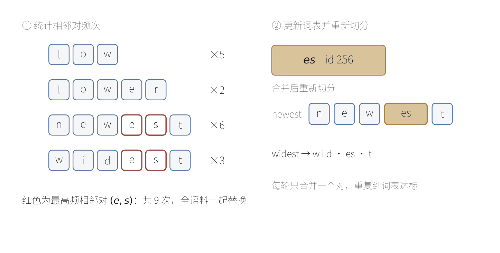
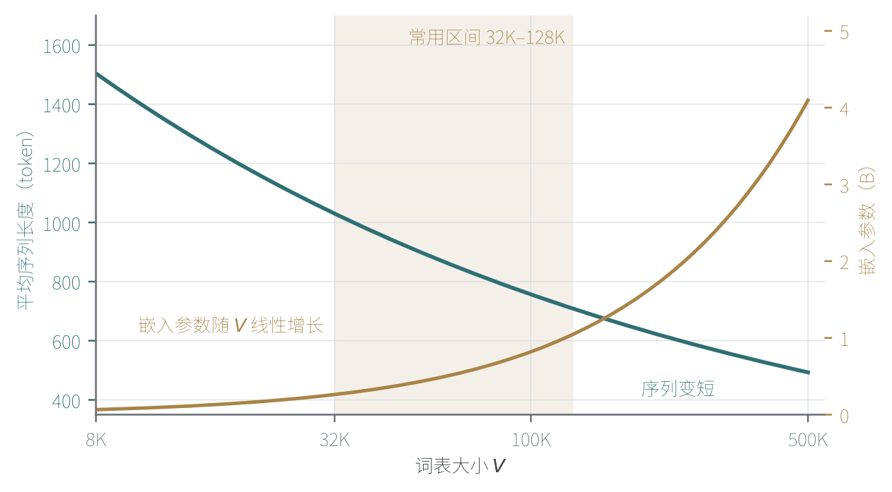

## 分词器：文本与数字的关口

同一个意思写两遍，一遍中文，一遍英文，丢进同一个接口，账单会给出一个不太舒服的答案：中文那一遍的 token 数往往更多，有时接近英文的两倍。费用按 token 结算，上下文窗口按 token 计数，训练成本也一样算。两种语言在信息量上并没有这么大的差距，多出来的部分是分词器加上去的。

分词器（tokenizer）做的事听起来简单：把字符串切成整数序列。它是整个流程里唯一一个不参与梯度下降的部件，训练前就固定下来，之后再也不改。正因为不改，它的缺陷会一直留在模型里。一个在分词阶段被切碎的概念，模型要花额外的层去重新拼起来；而训练语料里从没出现过的 token，嵌入永远停在初始化附近。

### 两条走不通的极端

最直接的做法是以词为单位。英文常用词五万个左右，看起来可控。问题是词表要覆盖什么：run、runs、running、ran 算四个词，专有名词、缩写、拼错的词、新造词各算一个；到了化学式和型号名，又是另一批。真要覆盖开放领域的全部词形，词表会膨胀到百万级。而且它有个无法修补的漏洞：任何没进词表的词都只能映射到一个“未知”符号，模型对它的全部信息就丢了。中文更麻烦，书面语没有空格，什么算一个“词”本身就有争议。

另一个极端是以字符为单位。词表缩到几十到几百，没有未登录词，任何文本都能表示。代价是序列长度。英文平均一个词四到五个字符，中文一个字就是一个字符，序列要长四倍以上。注意力的计算量随长度平方增长，序列长四倍，注意力部分贵十六倍，这个账在任何规模上都算不过来。字符级模型还得自己学着把字符组合成词，这层工作本来可以由词表替它做掉。

子词（subword）是这两条路之间的折中，想法很朴素：高频的整体保留，低频的拆成碎片。这样词表规模和序列长度都可控，未登录词也能用碎片拼出来。今天所有主流模型都走这条路，区别只在用什么算法切。

### BPE：从字符出发，一路合并

字节对编码（Byte Pair Encoding，BPE）最早是 1994 年一种数据压缩算法，2016 年被 Sennrich 等人搬到机器翻译上，用来解决罕见词和未登录词的表示问题，论文是《Neural Machine Translation of Rare Words with Subword Units》(2016)。

算法只有一句话：从字符表出发，反复把语料里出现次数最多的相邻符号对合并成一个新符号。

拿一个小语料走一遍。假设词表里只有四个词，词频分别是：

| 词 | 频次 | 初始切分 |
|---|---|---|
| low | 5 | l o w |
| lower | 2 | l o w e r |
| newest | 6 | n e w e s t |
| widest | 3 | w i d e s t |

统计所有相邻对的加权频次，(e,s) 和 (s,t) 各出现 9 次，(w,e) 8 次，(l,o) 和 (o,w) 各 7 次。两个 9 次并列，取哪个都合法，假设先取 (e,s)。这一合，newest 里的那 6 个 (w,e) 就没了——w 和 e 之间插进了一个 es，配对的成了 (w,es)——只剩 lower 贡献的 2 次，所以轮到第三高的时候，7 次的 (l,o) 才排到最前面：

第一轮把 e 和 s 合成 es，四个词变成 `l o w`、`l o w e r`、`n e w es t`、`w i d es t`，词表里多了一个符号 es。重新统计，(es,t) 现在是 9 次，第二轮合成 est。之后 (l,o) 七次合成 lo，(lo,w) 七次合成 low，(n,e) 六次合成 ne，(w,est) 六次合成 west。六轮下来，词表新增 es、est、lo、low、ne、west 六个符号，语料变成：

```text
low            →  low
lower          →  low e r
newest         →  ne west
widest         →  w i d est
```



BPE 的两个性质在这里都露了出来。优点是它完全由频率驱动，不需要语言学知识，换任何语言、任何符号系统都能跑。缺陷也是这一点：它不懂词法。`newest` 被切成 `ne` 加 `west`，因为 `west` 在别的词里凑够了频次；`low` 保住了整体，`lower` 却被拆开。BPE 学到的是统计上的常见片段。词根、词缀这些概念，它一个也没有。

#### 合并循环里的三个量

真正跑起来的 BPE 要维护三个量：符号表 $\Sigma$（就是词表，初值是语料里出现过的全部字符加一个词尾标记 `</w>`，这个词尾标记让“词中间的 s”和“词尾的 s”成为两个不同的符号；上文那个小例子为了看清合并顺序把它省了）、带权词表 $\mathit{words}$（每个词拆成符号元组，权重是它在语料里的出现次数）、相邻对的加权计数 $\mathit{pairs}$。计数按词频加权、不按位置计数，是这一步最容易做错的地方：`newest` 出现六次，它的每个相邻对就各加六，不是各加一。

```text
输入：词频表 freq{word: count}，目标词表大小 V
Σ      = 语料里出现的全部字符 ∪ {"</w>"}
words  = { (word 的字符序列 + "</w>") : count }
merges = []                              # 合并历史，列表下标就是优先级

while |Σ| < V:
    pairs = {}
    for (syms, c) in words:              # 只在词内统计，不跨词边界
        for i in range(len(syms) - 1):
            pairs[(syms[i], syms[i+1])] += c
    (a, b) = argmax(pairs)
    Σ.add(a + b);  merges.append((a, b))
    for (syms, f) in words:              # 把该对在词里的所有出现一起替换
        words[ replace_pair(syms, (a, b), a + b) ] += f
```

这段话里只有两处在动：`pairs` 每轮重算一遍，`words` 每轮被改写一遍。合并轮数是唯一的超参数，因为词表大小等于初始符号数加合并次数——Sennrich 等人原文就是这句话（《Neural Machine Translation of Rare Words with Subword Units》(2016)）。他们在 WMT 2015 英德数据上合并了 59 500 次：德语侧词表从 175 万种降到 6.3 万种，语料从 1 亿 token 涨到 1.12 亿 token，新测试集上的未登录词从 1079 个降到 0。收益不在总分上：同期单模型 BLEU 从 22.0 降到 21.5，八模型集成从 24.2 升到 24.5；真正动的是生僻词，它的 unigram F1 从 36.8 升到 40.9。压缩率与翻译质量之间没有免费的午餐，只是价钱付在了别处。

#### 编码：按优先级重放一遍

编码把训练得到的 `merges` 反过来用：规则表冻结，按优先级从小到大依次套。

```text
输入：词 w，合并表 merges（下标 = 优先级）
rank = { pair : i for i, pair in enumerate(merges) }
syms = list(w) + ["</w>"]
loop:
    cand = [(rank[(syms[i], syms[i+1])], i)
            for i in range(len(syms) - 1)
            if (syms[i], syms[i+1]) in rank]
    if cand is empty: break
    _, i = min(cand)                     # 优先级最高的那一对
    syms  = merge_all(syms, syms[i], syms[i+1])   # 该对的所有出现一起合
```

关键是“取优先级最高的那一对，并把它在串里的所有出现一起合并”。`es` 的 rank 一定小于 `est`，所以 `n e w e s t` 先变 `n e w es t`、再变 `n e w est`；顺序反过来就合不出 `est`。这套规则的确定性很强，同一份文本永远切成同一个样子。

它不是最优的。给定合并表，“哪种切法 token 最少”或“哪种切法似然最高”都要在整条串上做动态规划，而 BPE 只是把训练时定下的顺序重放一遍，先合的对永远优先，编码时没有商量余地。假设 `(a,b)` 的 rank 是 1、`(b,c)` 是 2，串 `abc` 必然切成 `ab` 加 `c`，`a` 加 `bc` 这条可能更省 token 的切法根本不在考虑范围内。换成“按词表做 DP 求最短编码”的分词器，token 数会少一点，可模型不认识那种切法：嵌入是按这套合并顺序学出来的，编码端临时给出一个更优解，等于往模型嘴里塞分布外的序列。训练和编码必须用同一套规则，这条约束比“更优”重要。

它可并行，是因为规则与位置无关。合并表训练完就是一张静态查表，一个词切成什么样只取决于它自己的字符和 rank 表，与文档里别处无关。一篇文档因此可以按空白和标点预切成一堆词，各词独立编码、多线程直接分片；同一进程里再加一层缓存，把“整词到切法”的映射存下来，高频词命中缓存后只有没见过的词才真跑一遍合并。反过来，若规则依赖全局状态（比如“这个片段在本句里是否已经出现过”），并行就得付出同步代价。几万条规则套完一篇文档，用优先队列维护相邻对分数的做法是 $O(n\log n)$，朴素重扫是 $O(n^2)$。

#### 字节级的变体

GPT-2 之后通行的做法是把初始符号表从 Unicode 字符换成 256 个字节值。文本先按 UTF-8 编码成字节串，再在字节串上合并。

它之所以能覆盖任意 UTF-8，原因很机械：UTF-8 保证任何合法文本都能编码成字节串，而词表初值包含全部 256 个字节，所以编码函数是全函数——最坏情况一路退回单字节，永远走不到 `<unk>`。这一点对开放域文本很关键，多语言、emoji、颜文字、从 PDF 里粘出来的怪字符都不会再丢信息。代价是粒度：一个汉字在 UTF-8 里占三个字节，最坏切成三个 token；四字节的字符最坏切四片。字节边界也不认字符边界，一个汉字可能被切成“两字节加一字节”两片，模型得自己学会把碎片拼回一个字。

GPT-2 的实现里多一步纯表示层的处理：把 256 个字节映射到 256 个可打印的 Unicode 码位（空格映射成 `Ġ`），于是 token 串可以当普通文本存进 JSON，空格也不会被预分词提前吃掉。这一步不改变合并算法，只是让字节序列能用文本形式表达。

工程上差一步，就会出现“声称复现了分词、却在个别字符上对不齐”的情况：词表相同、合并表相同，预切分的正则不同，切出来的 token 就不同。这类问题在对比实验里极难排查，所以书面报告里应该连预切分的正则一起交出。

### unigram：先给一大把，再往回砍

BPE 是自底向上加，unigram 语言模型是自顶向下减。Kudo 在 2018 年的《Subword Regularization》里给出了完整的形式化，配套的工具是 SentencePiece。

先准备一个“足够大”的种子词表，再用 EM 估每个子词的概率，然后反复砍掉边际贡献最小的子词，直到词表缩到目标大小。

种子词表由两部分拼成：语料里的全部单字符，加上出现频率最高的一批子串（用增强后缀数组可以一次扫出来，时间 $O(T)$、空间 $O(20T)$，$T$ 是语料大小）。单字符必须全留，它们保证任何输入都存在至少一种切法，不会出现“整句无解”。

模型假设子词之间独立，一个句子的概率就是各片概率的连乘：

$$P(x)=\prod_{i=1}^{M}p(x_i),\qquad x_i\in\mathcal{V},\qquad \sum_{w\in\mathcal{V}}p(w)=1$$

$x$ 是一个句子切出的子词序列，$M$ 是片数，$p(x_i)$ 是这片子词单独出现的概率。子词当然不独立，但正因为假设得这么简，才能把“切法”当作隐变量做精确推断。

训练目标是边际似然：语料里每句话有多种合法切法，我们只看到句子、看不到切法，要对所有切法求和，

$$\mathcal{L}=\sum_{s=1}^{|D|}\log\sum_{x\in S(X_s)}P(x)$$

$|D|$ 是语料里的句子数，$X_s$ 是第 $s$ 句，$S(X_s)$ 是这一句的全部合法切分（每一片都必须在 $\mathcal{V}$ 里）。求和落在对数里面，没法直接对 $p$ 求导得到闭式解，所以用 EM 迭代。**E 步**在切分格（lattice）上跑前后向：设 $\alpha[i]$ 是“前缀 $X_{1:i}$ 所有切法的概率之和”、$\beta[j]$ 是“从 $j$ 到句尾所有切法的概率之和”，那么从 $i$ 到 $j$ 这一片的后验是

$$c_{ij}=\frac{\alpha[i]\,p(X_{i:j})\,\beta[j]}{\alpha[|X|]}$$

**M 步**把这些后验当作期望计数，重算概率：

$$p(w)=\frac{\sum_{(i,j):\,X_{i:j}=w}c_{ij}}{\sum_{w'\in\mathcal{V}}\sum_{(i,j):\,X_{i:j}=w'}c_{ij}}$$

白话：E 步问“在这一句的所有切法里，这一片平均被用了几次”，M 步把答案除以总用量变成概率。分子分母都从整个语料累加，两三轮就基本收敛。

剪枝的判据不是“概率低了就砍”，而是“砍了之后语料似然会掉多少”。每轮 EM 收敛后，对每个候选 $w$ 算一次

$$\mathrm{loss}(w)=\mathcal{L}(\mathcal{V})-\mathcal{L}\big(\mathcal{V}\setminus\{w\}\big)$$

按 loss 从小到大排序，保留前 $\alpha\%$（论文取 $\alpha=80$；这个 $\alpha$ 与 E 步那个前向变量 $\alpha[i]$ 不是一回事，只是原文沿用了同一个字母），单字符无条件保留；一轮砍掉两成，重复到词表落到目标大小（常见 8k、16k、32k）。这个判据比按概率砍稳：一个概率很低但不可替代的子词（某个必须整体出现的词缀）删了损失很大，会被留下；一个概率不低但换成别的切法照样能解释语料的子词，损失接近零，会被删掉。

推理时的编码是一遍动态规划，把连乘换成连加：

```text
输入：句子 X（长度 n），词表 V 及概率 p，最长子词长 L
best[0] = 0;  back[0] = NIL
for j in 1..n:
    best[j] = -INF
    for i in max(0, j-L) .. j-1:
        if X[i:j] in V and best[i] + log p(X[i:j]) > best[j]:
            best[j] = best[i] + log p(X[i:j])
            back[j] = i
从 j = n 沿 back 回溯到 0，每一跳就是一片
```

复杂度 $O(nL)$，$L$ 是词表里最长子词的长度，实际几十。训练与推理在这里刻意不一致：推理走 argmax 拿唯一最优切分，训练时却按 $\tilde P(x)\propto P(x)^{\tau}$ 采样一条切法（为了与剪枝的 $\alpha$ 区分，这里记作 $\tau$）。$\tau$ 越小分布越平、采样越随意，官方示例里取 0.1；取到很大就退化成 Viterbi。同一个词每次出现切法都不同，模型见到的拼写变体更多，对罕见词和噪声更稳——这就是子词正则化。精确采样要在格上前向过滤、后向采样（FFBS），代价高；廉价近似是先取 $l$-best 再按概率抽一条（$l$ 是保留的候选条数，与上面的最长子词长 $L$ 无关）。BPE 一侧有对应技巧叫 BPE-dropout，编码时以概率 $p$ 丢弃每条合并规则，同一句话因此也能切出多种样子。

代价在训练成本上：每轮 EM 要在整个语料上跑前后向，每轮剪枝还要对每个候选估一次似然变化，实际实现里这一步用“去掉该子词后重跑一次前向”的近似。SentencePiece 报告 unigram 的训练与分词复杂度对输入规模是线性的，但常数比 BPE 大得多。

### WordPiece：用似然挑对，用最长匹配切

BERT 用的是这一种，30 000 词表（《BERT》(2018)），词中间的片段带 `##` 前缀，表示“接在前一片后面”，`##ing` 与词首的 `ing` 是两个不同的 token。

训练循环和 BPE 长得一样：初始单字符，反复合并一对符号，直到词表满。差别在挑哪一对。BPE 挑频次最高的，WordPiece 挑“合并后训练语料似然提升最大”的。两边似然都是各片概率连乘，把相邻符号 $a$、$b$ 合成 $ab$ 之后，语料似然的变化近似正比于

$$\mathrm{score}(a,b)=\frac{\mathrm{count}(ab)}{\mathrm{count}(a)\cdot\mathrm{count}(b)}$$

分子是 $a$、$b$ 相邻出现的次数，分母是两个符号各自出现次数的乘积。比值越大，说明这一对相邻的程度越超出“两个符号各按自己的频率碰在一起”的预期，是“一个整体”的证据；取 score 最大的一对合并，重复到目标词表大小。这个量是点互信息的一个变体，所以 WordPiece 学的是“搭配强度”而非“使用频次”：一个出现一百万次的常见对，如果两个符号本来就各自出现一千万次，score 是 $10^6/(10^7\times10^7)=10^{-8}$，一亿分之一，进不了词表；一个只出现一万次的固定搭配，若两个符号各自只出现一千次，score 是 $10^4/(10^3\times10^3)=0.01$，反而排在前面。频次驱动的 BPE 在这种情况下会做相反的选择。

编码端不走同一条路。WordPiece 训完之后只留下词表，不留概率，所以编码无法做 Viterbi，只能用贪心最长匹配：从词的左端开始，取词表里能匹配上的最长子串切下，剩下的部分逐个加 `##` 继续匹配。它和训练目标并不是同一件事：训练在最大化整个语料的似然，编码在每一步最大化“当前这一片有多长”。两套判据在大多数词上结论一致，遇到歧义就分叉，而分叉时 WordPiece 没有依据判断哪种切法更好。unigram 之所以能保住一致性，是因为它把 $p(w)$ 一起存了下来。

这就是三种算法真正的分野：BPE 存“合并顺序”，WordPiece 存“词表”，unigram 存“词表加概率”。存的东西越少，编码时能做的判断越少。贪心最长匹配的代价可以构造：一个过长的前缀吃掉了本可以和后面配成更常见整体的字符，后面只能切碎。BERT 英文版词表里没有汉字，中文文本整段变 `[UNK]`，是同一个问题的放大版——词表没覆盖到的地方，算法再精致也嵌不回去。

### SentencePiece：空格也是一个符号

上面三种算法都假设输入已经分好词，英文按空格切，中文按字切。这个假设在真实语料里站不住：网页文本里有全角空格、不间断空格、零宽字符，中文、日文、泰文根本不按空格分词。SentencePiece 的办法是把原始文本当成一串 Unicode 字符，空格在这里被换成一个特殊符号 ▁（U+2581），和其他字符一起参与切分。

这样一来，编码是纯字符级的可逆映射，解码时把 ▁ 换回空格就完全还原，不会出现“tokenize 再 detokenize 之后文本变了”的情况。中文和英文可以走同一套流程，不需要为每种语言写预分词规则。

论文把这条性质写成一条等式（《SentencePiece》(2018)）：

$$\mathrm{Decode}\big(\mathrm{Encode}(\mathrm{Normalize}(x))\big)=\mathrm{Normalize}(x)$$

原文的例子能看清每一步：原文 `Hello world.`，空白转义后是 `Hello▁world.`，切出来是 `[_He][llo][▁wor][ld][.]`，解码就是 `''.join(tokens).replace('▁', ' ')`。对照 subword-nmt 的做法（用 `@@` 标记“这个词还没完”），差别就出来了：`@@` 只能表达词内边界，无法区分“词间有空格”和“这里本来就没空格”，连续两个空格也必丢一个。所以那种表示不是无损的，每种语言都得写一套反解码规则。

空白转义只是第一步。真正让“无损”成立的是三件事一起：把空格当符号（信息不丢），把归一化做成可重现的映射（NFKC，编译成有限状态转换器，按最左最长规则匹配；也能用 TSV 自定义规则），把词表与参数全部打进模型文件（不依赖外部规则，换个 Unicode 版本也不会变）。直接后果是取消了预分词这个前置步骤：分词器必须先把句子切成“词”，日文、中文没有空格，这一步只能靠语言相关工具，而那些工具本身就会制造不可逆的改动。

顺带还有两个工程上的改进。BPE 在长度为 $N$ 的串上每轮重扫相邻对的朴素做法是 $O(N^2)$，SentencePiece 用二叉堆维护合并候选，降到 $O(N\log N)$。参数只给目标词表大小、不给合并次数，因为 unigram 那侧没有“合并次数”这个概念；统一成“词表多大”才能把两种算法放进同一个接口。

数字能看出取消预分词的价值。英日翻译上，词模型（八万词表）BLEU 20.06，换成 unigram 的 8k 共享词表升到 21.62；日英方向从 28.24 升到 29.55。给 unigram 加上预分词反而降到 20.86——预分词把日文的切分自由度提前锁死了，而那正是子词模型本该自己学的东西。

还有一个实用设计叫字节回退（byte fallback）：词表里额外保留 256 个字节符号，遇到未登录字符时退回字节序列表示。加上这一条，`<unk>` 就从词表里消失了，任何输入都能编码，任何编码都能还原。它和字节级 BPE 解决的是同一个问题，只是把字节放在了兜底位置而不是起点。

### 词表多大合适

词表大小要在嵌入参数、序列长度和压缩率之间找平衡。后两者是同一件事的两面：压缩率越高，同样的文本占的 token 越少。



往大里调，序列变短。压缩率上去了，同样一段文本占的 token 少，上下文窗口能装更多内容，训练时每个 token 覆盖的文本更多，等于变相降低了训练成本。嵌入参数则线性上涨：词表 $V$、隐藏维度 $d$，输入嵌入是 $Vd$ 个参数，输出层若不与输入共享，再加一份 $Vd$。Llama 2 的 $V=32000$、$d=4096$，一份嵌入约 1.3 亿参数；Llama 3 把词表加到 128256，同样的 $d$ 下一份就是 5.25 亿，两份加起来超过十亿，占了一个 8B 模型八分之一以上的参数。这些参数只负责查表，不参与任何上下文交互。

往小里调，序列变长，注意力开销按平方涨，长文档场景最先受不了。压缩率的收益还会递减：词表从 3 万加到 12.8 万，英文的字符/token 比大概从 4 提到 4.4 上下，提升有限；受益的主要是非英语，因为它们的常用片段终于能进词表了。

还有一笔不写在参数量里的账：词表尾部的那些 token，在整个训练语料里可能只出现几十次。它们的嵌入向量拿到的梯度极少，训练结束时仍然接近随机初始化。模型对它们的处理因此不稳定，遇到时容易输出无意义的结果。词表越大，这条长尾越长，这也是“词表不要盲目加大”的一个实际理由。

多语言的稀释问题就出在这里。一个 12.8 万的词表要分给几十种语言，如果训练语料里九成是英文，BPE 的合并几乎全部落在英文片段上，剩下的语言只能分到零头。同样一句印地语或斯瓦希里语，在英文为主的词表下会被切成大量字节级碎片，token 数是英文的三四倍。贵还只是表面。序列变长意味着同样的上下文窗口能装的信息变少，模型在这些语言上的有效容量被词表压掉了一截。中文介于两者之间，常用双字词能进词表，生僻字和专名仍要拆成单字甚至字节。

代码在 BPE 下有自己的切分规律。缩进用的连续空格、`self.`、`return`、`function` 这类高频片段会各自成为一个 token，于是缩进深度变成了一两个符号，模型对缩进的敏感度反而被放大。它因此能写出正确的缩进，也会在深层嵌套里数错层数。

数字是最容易出事的地方。早期分词器把 `1234` 这类常见数字串整块收进词表，结果是 `1234` 和 `1235` 变成两个毫不相关的向量，模型没有任何线索知道它们只差一。做算术时它只能从训练数据里硬记对应关系，进位规则学不到。Llama 2 之后的做法是把数字按一到三位一组强制切开，`1234567` 变成 `123`、`456`、`7`，既保留了局部分组，又让个位、十位、百位有稳定的表示。代价是数字变长了，一段全是数字的文本会消耗更多 token。

还有一种失效模式叫异常 token（glitch token）。词表是在语料之前定好的，两者来源不完全一致：某个字符串可能出现在分词器的训练数据里（比如论坛用户名），却在模型的实际训练语料里几乎不出现。这个 token 的嵌入因此一直停在初始化附近，没被训练过。模型遇到它时的行为无法预测，可能复读、拒答、输出乱码，甚至被当作后门触发词。SolidGoldMagikarp 就是被社区发现的著名例子——一个 Reddit 用户名，在 GPT-2 系的词表里是一个独立 token，模型对它完全没有概念。

::: {.keypoint}
**分词器把连续文本压成离散符号，这一步的粒度决定了后面所有计算的成本与分辨率。**词表大，序列短但参数多、稀有语言被稀释；词表小，覆盖全但序列长、注意力吃不消。它不参与训练，却是唯一一个训练开始后无法修改的组件。
:::

### 切完之后，顺序还没进来

到这里，一句话变成了一串整数。模型查表把这些整数换成向量，然后送进注意力。可是注意力本身对顺序一无所知：把输入的顺序打乱，它算出来的只是一组换了位置的加权和，分数完全一样。序列里第几个词、两个词隔多远，这些信息必须额外注入。怎么注入，以及注入的方式能不能撑住比训练时更长的文本，是下一件事。
