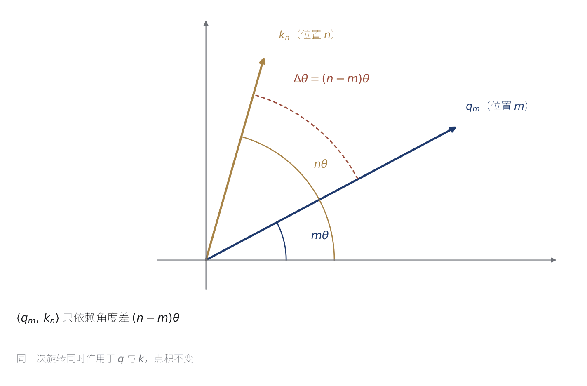
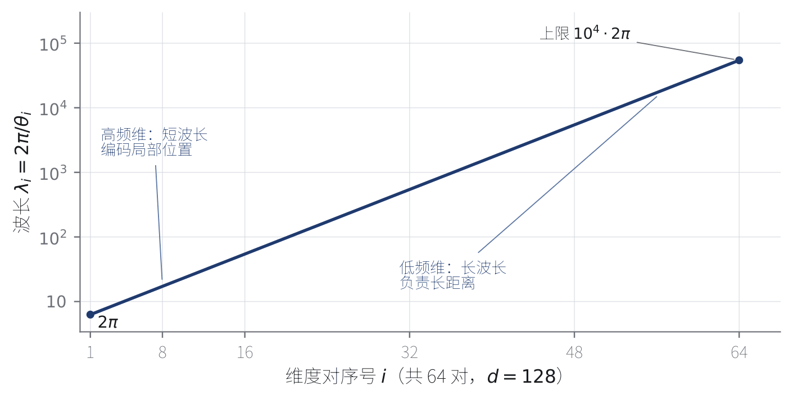

## 位置编码：从绝对到旋转

一个在四千 token 上训练完成的模型，如果把输入拉长到八千，通常不会只是“效果差一点”。检索类任务会先崩：本该被找到的那句话还在上下文里，模型的注意力却滑过去了，答案开始凭空编。困惑度也跟着跳，从个位数涨到十几。训练时见过的最长序列像一道看不见的墙，墙内的规律在墙外不成立。

这道墙不是模型容量的问题。参数和词表都没变，注意力的算法也照旧。变的是位置信息进入模型的方式：训练时每个位置都落在一个熟悉的坐标上，超出去之后，坐标变成了模型从没见过的数值，那里的注意力 pattern 没有任何训练信号约束过。

### 注意力天生不知道顺序

先把问题说清楚。自注意力的计算是

$$\mathrm{Attn}(X)=\mathrm{softmax}\left(\frac{XW_QW_K^\top X^\top}{\sqrt{d}}\right)XW_V$$

$X$ 的每一行是一个 token 的向量，$W_Q$、$W_K$、$W_V$ 是三组投影矩阵，这里的分母 $\sqrt d$ 里的 $d$ 是每头维度（下一节正弦编码里的同一个字母指模型维度，是两个不同的量）。如果用一个置换矩阵 $P$ 把输入的行打乱，那么 $\mathrm{Attn}(PX)=P\,\mathrm{Attn}(X)$：输出只是跟着换了顺序，每一行的数值一点没变。这就是置换等变。注意力只看“有哪些向量、彼此多相关”，完全不知道谁在前谁在后。

“狗咬人”和“人咬狗”在它眼里是同一个集合。要打破这种对称，必须往向量里注入与位置有关的信息，而且注入方式要让模型能分辨“第 3 个”和“第 5 个”，也能分辨“相隔 2 个”和“相隔 20 个”。

### 正弦编码：一个漂亮但走不远的构造

原论文的方案是给每个位置算一个向量，直接加到词嵌入上：

$$PE_{(pos,2i)}=\sin\left(\frac{pos}{10000^{2i/d}}\right),\qquad PE_{(pos,2i+1)}=\cos\left(\frac{pos}{10000^{2i/d}}\right)$$

$pos$ 是位置序号，$i$ 是维度序号，$d$ 是模型维度。分母里的 10000 是频率谱的底数：指数从 0 到接近 1，角速度就从 1 弧度每 token 一路降到 $1/10000$，对应波长从六个多 token 一直拉到六万个 token。不同维度用不同的频率：低维转得快，高维转得慢，整组向量像一组转速不同的指针，读出这组指针的角度就能确定位置。它们不占参数，理论上可以算到任意长的位置。

这个构造有一个很讨人喜欢的性质。位置 $pos+k$ 的编码可以写成位置 $pos$ 的编码乘以一个只依赖 $k$ 的旋转矩阵，相对位移于是在编码层面成了一个线性变换。模型只要学一个线性映射，就能实现“看前面第 $k$ 个词”这种操作，不必为每个绝对位置单独学一套权重。

性质是真的，实用性是另一回事。模型从来没有被要求去学那个线性映射，训练目标只是预测下一个词，这些正弦值怎么用，没有任何监督。训练长度 512 的时候，高频维在 512 个位置里已经转了几十圈，模型见到的每一种相位组合都在这个范围内。位置涨到 1024，高频维的相位开始和前 512 个位置重合：转满一圈又一圈之后，同一个角度既可能对应位置 3，也可能对应位置 516，编码本身不再能区分它们。低频维的问题是另一头：波长上万，512 个位置连十分之一圈都没走完，模型无从学到“远”这个概念，出了训练长度它仍然分不清 600 和 900。两头都失效，外推自然崩。

后来的模型大多换成了可学习的绝对位置嵌入，每个位置一个向量。它在训练长度内更灵活，代价是位置向量表的长度就是硬上限，多一个位置都查不到，而且这部分参数完全不共享，长尾位置学得很差。

### 相对位置：把“隔多远”直接写进注意力

2018 年，Shaw 等人换了个切入点：位置不必加在输入上，可以直接加在注意力分数里。对每一对位置 $(i,j)$，查一个与相对距离 $i-j$ 对应的向量，投影成一个标量偏置，加到 logits 上：

$$e_{ij}=\frac{q_i^\top k_j}{\sqrt{d}}+b_{\,i-j}$$

$b$ 是一张按距离索引的表。距离的取值范围是无限的，表必须有限，所以要做裁剪：超过 $\pm k$ 的距离共用同一个向量。T5 用的是另一种压缩方式，把距离分成 32 个桶，近处逐一分桶，远处按对数分桶，远距离的精度被主动放弃。

相对位置的好处很直接：模型学的是“隔三个词”和“隔三十个词”的区别，至于“第 3 位”还是“第 300 位”，它并不关心。序列长一点，只要相对距离还在表里，行为就应该一致。Transformer-XL 沿着这条路把内容项和位置项拆开，让缓存的历史片段也能得到正确的位置偏置。

代价藏在工程里。偏置矩阵是 $T\times T$ 的（$T$ 是序列长度），每层都要算一份，显存和带宽都不便宜；它还和 FlashAttention 这类融合算子不兼容，因为后者把注意力计算塞进一个 kernel 里，中间不落地。更麻烦的是它没有解决长距离的外推：裁剪半径之外的相对距离全部压成同一个值，模型看不到“更远”的差别。

### RoPE：把位置变成一次旋转

2021 年，《RoFormer》给了一个更干净的解法。既然注意力用的是点积，那就让位置参与点积的方式只留相对位移。做法是把 query 和 key 看成二维平面上的向量，按位置旋转一个角度。

先看二维。位置 $m$ 的 query 旋转 $m\theta$，位置 $n$ 的 key 旋转 $n\theta$：

$$q_m=R(m\theta)q,\qquad k_n=R(n\theta)k,\qquad R(\alpha)=\begin{pmatrix}\cos\alpha&-\sin\alpha\\ \sin\alpha&\cos\alpha\end{pmatrix}$$

两者的点积是

$$q_m^\top k_n=q^\top R(m\theta)^\top R(n\theta)k=q^\top R\big((n-m)\theta\big)k$$

第二个等号用了旋转矩阵的正交性：$R(\alpha)^\top R(\beta)=R(\beta-\alpha)$。结果只依赖 $m-n$，绝对位置被消掉了，相对位移以角度差的形式留在点积里。



把 $d$ 维拆成 $d/2$ 个二维平面，第 $i$ 个平面用角速度 $\theta_i$，坐标 $(2i,2i+1)$ 上的两个分量按自己的位置旋转：

$$\begin{aligned}(q_m)_{2i}&=q_{2i}\cos(m\theta_i)-q_{2i+1}\sin(m\theta_i)\\(q_m)_{2i+1}&=q_{2i}\sin(m\theta_i)+q_{2i+1}\cos(m\theta_i)\end{aligned}$$

$q$ 是不带位置的原向量，$q_m$ 是位置 $m$ 上旋转后的 query。整个 $d$ 维变换是一个块对角矩阵，每块是 $2\times2$ 的旋转。把这个分量式代进点积、逐对展开，得到《Extending Context Window via Positional Interpolation》(2023) 写成的那条式子：

$$\begin{aligned}q_m^\top k_n=\sum_{i=0}^{d/2-1}\Big[&(q_{2i}k_{2i}+q_{2i+1}k_{2i+1})\cos\big((m-n)\theta_i\big)\\[2pt] &+(q_{2i}k_{2i+1}-q_{2i+1}k_{2i})\sin\big((m-n)\theta_i\big)\Big]\end{aligned}$$

白话：点积里每一个二维平面贡献两项，一项是“同维相乘”的余弦项，一项是“交叉相乘”的正弦项，两者的系数只含 $m-n$。位置信息因此不是加在向量上的偏移，而是转成了一个相位差。式子里没有任何一个量单独依赖 $m$ 或 $n$，这是 RoPE 能直接替换掉绝对位置嵌入的全部理由。

第 $i$ 个平面的角速度按几何级数取，$\mathrm{base}$ 通常取 10000：

$$\theta_i=\mathrm{base}^{-2i/d},\qquad i=0,1,\dots,d/2-1$$

这里要分清两个量：角速度 $\theta_i$ 是单位位置的转角度数，波长 $\lambda_i$ 是这一维转完一整圈需要的 token 数，两者互为倒数乘上 $2\pi$：

$$\lambda_i=\frac{2\pi}{\theta_i}=2\pi\cdot\mathrm{base}^{\,2i/d}$$

#### 频率谱与最大波长

以 $d=128$、$\mathrm{base}=10000$ 为例：$i=0$ 那一对的波长是 $2\pi\approx6.3$ 个 token，转完一圈只要六个多 token；$i=63$ 那一对是 $2\pi\times10000^{126/128}\approx5.4$ 万个 token。相邻两维的波长固定相差 $10000^{2/128}\approx1.155$ 倍，也就是逐维递增 15.5%。整个频谱是一条等比数列，从一个词到五万个词，扫过的动态范围大约四个数量级。



这组波长决定了 RoPE 的能力边界。高频维转得快，相邻位置的相位差就明显，适合编码局部顺序；低频维转得慢，几万个位置之内相位差仍然可分辨，长距离的区分全靠它们。上图右侧标出的就是这么一件事：模型判断“这两个 token 隔了八千位”时，靠的是最后几维，前几维几乎不参与。

一个更有用的视角是把训练窗口长度 $L$ 和波长放在一起比，算出每一维在训练时转过多少圈：$r_i=L/\lambda_i$。$L=4096$ 时，$r_0\approx650$（同一个相位在窗口里重复出现几百次，模型根本无从知道是第几个周期），而 $r_{63}\approx0.08$（一圈的 8% 都没走完）。转不够一圈的维度，在整个训练窗口里每个位置都对应一个不一样的角度，它们携带的其实是绝对位置；转过很多圈的维度只能提供相对位置。《YaRN》(2023) 就是从这一点推出“哪些维该插值、哪些维不该动”的分组。粗略算一下：$d=128$ 时波长超过 4096 的是最后十几个维度，它们正是外推时最先失效的一批。

一旦序列长度超过最长波长，所有低频维的相位都绕回原点附近，不同的远距离开始重叠，模型再也分不开“隔了五万”和“隔了十万”。而要撑住长文本，真正需要的分辨率不在几万位那个量级，而在“八千位和八千零一位能不能分开”：这要求波长最长的那些维度在八千位之内还没转满一圈：转满了，相位就绕回原点，八千和八千零一被折成同一个角度；同时也要求它们在相邻位置上的相位差没有小到被其他维度的抖动盖住。

RoPE 还有几个附带的好处。它不增加任何参数；相对性使得同一套权重可以处理任意绝对位置；而且只作用于 query 和 key，value 不动，KV 缓存里存的内容不需要额外变换；旋转又是正交变换，不改变向量长度，数值上稳定。论文还证明了一个“远程衰减”性质：相对距离越大，$q_m^\top k_n$ 的上界越小，注意力天然倾向于近处，这与语言的局部性吻合，但也意味着远距离信息需要更强的信号才能被注意到。

#### 每一层都转一次

实际实现里，旋转在每一层、每一个注意力头里各做一次，用的 $\theta_i$ 相同。有人以为位置只在第一层注入一次，其实相反：每一层都在用同一组角度重新组织信息，位置关系是被反复施加的。

角度只与位置有关，与输入无关，所以 cos/sin 表可以预先算好，尺寸是 $L_{\max}\times d/2$，所有层、所有头共用：

```text
输入：单头的 q, k ∈ R^d，位置 m
inv_freq[i] = base ** (-2i/d)          # i = 0..d/2-1，训练前固定
cos[i] = cos(m * inv_freq[i])          # 预先对 [0, L_max) 全部位置算好
sin[i] = sin(m * inv_freq[i])

# 相邻两维一组（原始 RoPE 的写法）
q_even, q_odd = q[0::2], q[1::2]
q_rot[0::2] = q_even * cos - q_odd * sin
q_rot[1::2] = q_even * sin + q_odd * cos
k_rot 同法
score = (q_rot · k_rot) / sqrt(d)
```

有一处容易踩的坑：把哪两维配成一对，有两种同样合法的写法。一种是相邻两维一组（$(0,1),(2,3),\dots$，GPT-J 系列），另一种是前后半对半（$(0,d/2),(1,d/2+1),\dots$，GPT-NeoX、Llama 的 `rotate_half` 实现）。两者差一个固定的维度置换，数学上等价，但置换后的向量要乘不同的权重矩阵。训练时用哪一种，推理时就必须用哪一种；换错的话模型不会报错，只会突然变傻。

RoPE 没有要训的参数，训练信号与普通注意力完全一样：下一个 token 的交叉熵梯度反向传到 $W_Q$、$W_K$，模型自己决定怎么用这些被转过的分量。它不给位置单独开一条梯度通道，所以不存在“位置表示没训好”这种故障，也不存在把位置参数训得比词嵌入还大的问题。旋转插在 $W_Qx$ 之后、点积之前，而不是加在输入 $x$ 上，这三者的区别值得拆开看：加在 $x$ 上，位置会和词义混在同一个向量里，过一层前向网络就被搅匀，下一层拿到的已经不是“带位置的原向量”；加在注意力分数上（相对偏置的做法），就又回到了需要 $T\times T$ 矩阵、和融合算子不兼容的田地；乘在 $q,k$ 上最省，既保住了“相对位移只出现在点积里”，又不需要任何额外存储。

推理侧的开销比看上去小：cos/sin 表与输入无关，与层数、头数、batch 也无关，开场算一次就够；KV 缓存里存的是旋转后的 $k$，新 token 进来只算自己那一份 $O(d)$，历史部分不用重算。改变频率（插值、扩基频）在推理时也完全可以零成本，因为它只改预先算好的那张表。反过来，任何“每个 forward 都换 $s$”的动态方案都得把 KV 缓存改成存旋转前的向量，这不是优化细节，而是正确性问题。

### ALiBi：用距离直接扣分

另一条路更省事。同年，《Train Short, Test Long》(2021) 提出 ALiBi：什么都不加，只在注意力分数上按距离线性扣分，

$$e_{ij}=\frac{q_i^\top k_j}{\sqrt{d}}-m\,(i-j)$$

$m$ 是每个头自己的斜率，$i-j$ 是距离。不同头用不同的斜率，8 个头时取 $1/2,1/4,\dots,1/256$ 的等比数列：斜率大的头只看眼前，斜率小的头看得远。整个模型因此同时具备多种时间尺度，不需要任何位置参数。

它的卖点就是长度外推：训练在 1024，直接测 2048 甚至更长，困惑度几乎不涨。原因很直白，公式里没有任何依赖具体位置的量，距离变长只是让扣分变多，行为是连续的。BLOOM 用了这个方案。

代价是表达能力的损失。线性偏置只表达“越远越不重要”这一种先验，学不出“某些位置特别重要”这种结构，比如固定位置的分隔符、表格的列对齐。它在训练长度内的表现通常略逊于 RoPE，这也是它没能成为主流的原因。

### 把窗口拉长：插值、改频率、分段

RoPE 好用，但它的外推能力也不好：超过最长波长，相位重叠，注意力乱掉。让一个 4K 模型处理 128K，需要主动改造频率。下面几种方法改的是同一个东西——每个维度用多大的角速度，只是分派方式越来越细。

#### 位置插值：把坐标压回训练范围

最直接的想法是压缩坐标。《Extending Context Window via Positional Interpolation》(2023) 提出的位置插值（Positional Interpolation，PI）把位置序号除以扩展倍数 $s=L'/L$（$L$ 是训练长度，$L'$ 是目标长度），128K 的位置被压回 4K 的范围内：

$$m'=\frac{m}{s},\qquad f'(x,m)=f\Big(x,\frac{m}{s}\Big)$$

$f$ 是原来那套旋转函数，改写之后模型看到的最大角度还是训练时那个，只是分辨率下降了：原本隔 1 的两个位置现在隔 $1/s$。

它为什么能成，论文给了一个很直观的解释。把注意力分数看成三角基的展开 $a(s)=\mathrm{Re}\sum_j h_j e^{\mathrm{i}s\theta_j}$，其中 $s=m-n$，$h_j$ 由 $q,k$ 决定。三角基族足够丰富，能拟合任意函数：在 $[0,L]$ 里拟合出绝对值不超过 1 的曲线，到 $[0,L]$ 之外完全可以飙到几千。直接外推就是让同一个函数在没约束过的区间上自由跑，LLaMA 7B 的设置下拟合曲线出了 2048 就冲到 8000 量级；插值则只在原区间里取点，曲线光滑、有界。论文算出的上界比外推小约 600 倍。

这就是“少量微调就够”的原因：模型不需要学一套新的位置表示，只需适应刻度变细。论文用一千步在 Pile 上把 LLaMA 7B 到 65B 从 2048 扩到 32768，代价可接受。微调阶段没有新目标函数，就是继续做下一个 token 预测，只是把位置索引换成压缩后的；推理时 $s$ 按目标长度定成一个常数，整轮请求不再变。代价也很清楚：$s$ 越大刻度越粗，相邻 token 的相位差被压成原来的 $1/s$，局部顺序变糊；《YaRN》(2023) 观察到 $s$ 超过 8 之后即使微调也会明显退化。PI 还把短文本能力拉下去了一截：同样微调 400 步，LLaMA 7B 在 ARC-c 上从 51.0 掉到 44.8。

#### NTK-aware：只改基频

既然病灶是“所有维度被等比例拉伸”，那就让高频维少动、低频维多动。NTK-aware 插值不动位置，改基频：

$$b'=b\cdot s^{\,d/(d-2)},\qquad \theta_i'=b'^{\,-2i/d}$$

把 $b'$ 代回去，能得到一个很干净的形式：

$$\theta_i'=\theta_i\cdot s^{\,-2i/(d-2)}$$

$i=0$ 时指数是 0，最高频那一维的角速度一动不动；$i=d/2-1$ 时指数是 $-1$，最低频那一维恰好被除以 $s$，与 PI 完全一致；中间的维度按几何级数渐变。所以 NTK-aware 可以看成 PI 的一个“软版本”，把插值压力从全频谱均摊改成从高频到低频递增。

它比 PI 好在保住局部分辨率，代价是不好定值：$b'$ 该取多少没有理论答案，得实验试。Code Llama 把它直接取成一百万（论文里叫“调整基频”，ABF），就是这一步的经验化结果。

#### NTK-by-parts 与 YaRN：按波长分三段

《YaRN》(2023) 把上面那件事从“调一个数”改成“按波长分区”。先算每一维在训练窗口里转了几圈：

$$r_i=\frac{L}{\lambda_i}=\frac{L}{2\pi\,b^{2i/d}}$$

$r_i$ 小说明波长比窗口还长，这一维在训练时根本没转满一圈，携带的是绝对位置；$r_i$ 大说明它转过很多圈，只提供相对位置。于是定两个分界 $\alpha,\beta$，用一个斜坡函数把两者连起来：

$$\gamma(r)=\begin{cases}0,&r<\alpha\\ \dfrac{r-\alpha}{\beta-\alpha},&\alpha\le r\le\beta\\ 1,&r>\beta\end{cases},\qquad h(\theta_i)=\big(1-\gamma(r_i)\big)\frac{\theta_i}{s}+\gamma(r_i)\,\theta_i$$

$h(\theta_i)$ 是这一维最后用的角速度。三个区域对应三句话：波长比窗口长（$r<\alpha$）的维度全部除以 $s$，不让它外推；波长很短的维度（$r>\beta$）原样不动，保住局部顺序；中间的按比例混。Llama 系列上论文取 $\alpha=1$、$\beta=32$。

还有一处不在频率上的修正：插值把 logits 整体压小，softmax 出来的分布变平，注意力变散（熵上升）。YaRN 在 softmax 里加一个温度 $t$：

$$\mathrm{softmax}\Big(\frac{q_m^\top k_n}{t\sqrt{d}}\Big),\qquad \frac{1}{t}=0.1\ln s+1$$

这个 $1/t$ 是在 LLaMA 7B 到 65B 上拟合出来的，$s=16$ 时约为 1.28。实现上不用改 attention 代码，把 $q$、$k$ 同乘 $1/\sqrt{t}$ 即可，零额外开销。

数字：Llama 2 7B 用 $s=16$ 微调 400 步，到 64K 时 Proof-pile 困惑度 2.42；再用 200 步从 $s=16$ 的检查点推到 $s=32$，128K 上 2.37。同一张表里，只按 $s=16$ 扩到 64K 的模型再往 128K 测，困惑度会跳回两位数：频率改造的倍数必须对得上目标长度。另一个常被忽略的工程细节：如果用动态缩放（每次前向按当前长度取 $s=\max(1,l/L)$），KV 缓存必须存旋转前的向量，因为 $s$ 一变，每个 token 的 RoPE 都跟着变。

#### LongRoPE：把分区交给搜索

YaRN 的三分组是人工定的，$\alpha,\beta$ 也是经验值。《LongRoPE》(2024) 把“每一维该除以多少”直接当成优化变量，并另外引入一个位置上的非均匀性：最前面几个 token 不做插值。

$$\mathrm{RoPE}(n)=\Big[\cdots,\ \cos\big(I(\hat\lambda_i,\hat n)\cdot n\theta_i\big),\ \sin\big(I(\hat\lambda_i,\hat n)\cdot n\theta_i\big),\ \cdots\Big],\qquad I=\begin{cases}1,&n<\hat n\\ \dfrac{1}{\hat\lambda_i},&n\ge\hat n\end{cases}$$

$\hat\lambda_i$ 是第 $i$ 维的缩放因子（1 表示完全外推，$s$ 表示与 PI 相同；这个符号借了上面波长的形，与 $\lambda_i$ 不是一回事），$\hat n$ 是“前多少个位置保持原样”的阈值。前几个 token 在注意力里拿到的分数特别大（流式推理那条线上的观察），把它们挤进很窄的相位区域损失最大，所以留一块地不插值。

搜索空间里每个维度是一个缩放因子，$\hat\lambda_i\in[1.0,\,1.25s]$，按 0.01 的步长离散；另有一个阈值 $\hat n$——保留多少个位置不插值——候选取 0、1、2、4、8 一直翻倍到 256，共 14 个。$s=4$ 时的组合数就有 $400^{64}\times14\approx4\times10^{167}$，穷举不可能。用进化搜索：初始种群 64 个，其中三个直接放 PI、NTK、YaRN 的解，其余随机变异；每轮算困惑度、取前 32 做父代，变异 16 个、交叉 16 个，迭代 40 轮；每个个体只算 5 条 PG19 样本，并以 $\hat\lambda_i\le\hat\lambda_{i+1}$ 的单调约束砍掉大量无意义的组合（高频维少插值、低频维多插值，这是 NTK 理论给的方向）。

效果：LLaMA2-7B 在 PG19 上不微调直接测，8K/16K 的困惑度是 PI 10.65/20.49，Dynamic-NTK 10.21/23.29，YaRN 32.64/87.89，逐维搜索 9.37/11.34；64K 上 PI 是 72.54，搜索得到 3.22。YaRN 那两个数字偏高不是它本身不行，而是它的缩放固定按 $s$ 算，没微调时撑不到目标长度就崩了。

往后到两百万 token 靠的是渐进：先在 128K 的目标上搜一组因子，微调 400 步；换成 256K 的因子再微调 600 步；在微调完的 256K 模型上做第二次搜索，直接得到 2048K（512 倍），不再训练。最后还有一步容易被省略：极端扩展会把原窗口内的位置挤成一团，所以在 4K、8K 上再搜一组因子，推理时按输入长度切换。这背后是一个清楚的判断：位置外推没法靠调一个超参数解决，时间要花在频率谱的重新分配上，而搜索是目前唯一能自动做完这件事的办法。

### 不要位置编码会怎样

还有一条更彻底的路：什么都不加。因果掩码本身携带了位置信息——第 $t$ 个位置能看到 $t$ 个 token，第 $t+1$ 个能看到 $t+1$ 个，这个计数差异是结构性的，注意力完全可以从“能看到多少”推断出“我在哪”。这类模型被称为 NoPE。

《The Impact of Positional Encoding on Length Generalization in Transformers》(2023) 把它和四种主流方案放在一起比：1.07 亿参数的解码器，从头训练，十个推理与算术任务（复制、反转、加法、排序、SCAN、PCFG 等），训练长度卡在某个阈值以下，测试超出阈值。十项任务的汇总排名是 NoPE 0.69、T5 相对偏置 0.55、ALiBi 0.50、Rotary 0.33、绝对位置 0.22（平均倒数排名，越高越好）。

结果有点反直觉。在训练长度内，NoPE 的表现略差于 RoPE，注意力分布更平，局部顺序学得不够锐利。但在长度泛化上它明显更好：输入长度翻几倍，性能下降比 RoPE 平缓得多。原因不难理解，RoPE 把位置写死在一组固定频率上，超出范围就失真；NoPE 学到的是一种随上下文自适应的位置感，长度变了，这种感觉跟着变，不会撞到频率墙。

理论上 NoPE 并不真的“没有位置”：因果掩码让第 $t$ 个位置的注意力恰好落在前 $t$ 个 key 上，这个“能看到几个”的计数可以被写进隐状态，所以它能表示绝对位置；同理也能构造出只依赖相对距离的注意力。训练之后学到的更接近哪一种？论文用注意力图的距离度量对比：NoPE 的模式与 T5 相对偏置最接近，与绝对位置和 RoPE 最远，且这种接近在各层、各长度区间上都成立。换句话说，不给先验，模型自己从数据里长出来的是一种相对偏置，而且长出的那种还带双峰——同时看眼前和看开头，恰好是长文本需要的样子。论文还把实验推到 10 亿参数（上下文 1024，代码语料）：同分布上三种方案差不多，外推到两倍左右时 NoPE 与 ALiBi 都还能撑，Rotary 的困惑度直接爆炸；再长，ALiBi 更稳。

这条发现改变了对位置编码的理解：它不是必需品，而是一种先验。RoPE 强加的先验在训练分布内很有效，在分布外就变成约束。今天的模型仍然以 RoPE 为主，原因是工程生态——KV 缓存、FlashAttention、并行切分都围绕它优化过，而且训练长度内的收益足够大，长上下文可以靠继续训练和外推改造补上。

::: {.keypoint}
**位置编码决定了模型“能看多长”，不只是“知道谁在前”。**绝对编码给出坐标，相对编码给出距离，RoPE 把距离写进点积的相位差。任何基于固定频率的方案都有一条隐含的最大波长，超出它的位置关系会失去分辨率。长上下文能力的天花板，往往就卡在这组频率上。
:::

### 顺序解决了，代价还在

位置信息进来之后，注意力终于能区分“谁在前、隔多远”，一句话变成一个有序的序列。但它的计算方式没有变：每个 token 要和前面所有 token 算一次相关度，序列翻倍，计算翻四倍，缓存也翻倍。一个 128K 上下文的请求，光键值缓存就能吃掉几十 GB 显存。位置编码让长文本在语义上可行，注意力的二次代价却让它在物理上昂贵。接下来要处理的，就是这笔账。
