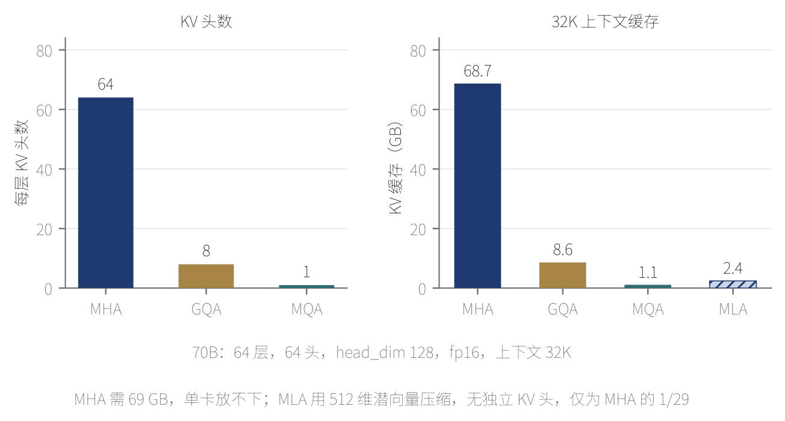
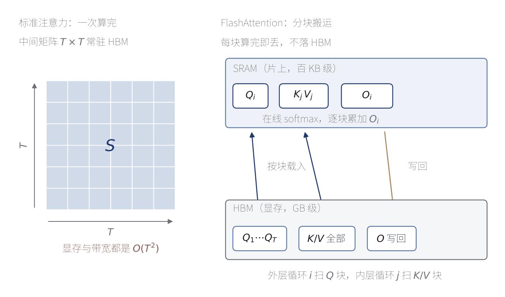

## 注意力的效率改造

一个 70B 模型要在 32K 上下文的场景里服务，账是这样算的：80 层，隐藏维度 8192，64 个注意力头，每头 128 维，FP16 存储。如果每个头都保留自己的键和值，每个 token 的缓存就是 $80 \times 64 \times 128 \times 2 \times 2$ 字节，约 2.6 MB。填满 32768 个位置，单个请求需要 86 GB。

一张 H100 的显存是 80 GB。模型权重还没装进去，一个请求的缓存已经放不下了。权重本身是 140 GB，本来就得拆到两张卡上。这组数字把长上下文的问题摆在了一个很具体的位置上：容量不够，与算法是否聪明关系不大。

### 缓存为什么会长成这样

生成是逐 token 进行的。每写一个词，都要拿这个位置的 query 去和前面所有位置的 key 做点积，得到权重后再加权所有的 value。前面那些位置的键和值不会因为新词出现而改变，重算一遍纯属浪费，所以要缓存。

$$\text{cache}=2\times L\times n_{kv}\times d_{head}\times T\times \text{bytes}$$

系数 2 是键和值两份，$L$ 是层数，$n_{kv}$ 是保留缓存的头数，$d_{head}$ 是每头的维度，$T$ 是已经处理过的 token 数。式子里除了 $n_{kv}$，其余各项都由模型尺寸和上下文长度决定，架构设计者改不动。围绕 KV 缓存做的所有工作，压的都是这个 $n_{kv}$，或者压它所乘的东西。

落到具体数字上：一个 token 在一层里存 $n_{kv}$ 个头、每头 $d_{head}$ 个数、键值两份、FP16 两字节，即 $4n_{kv}d_{head}$ 字节；MHA 下 32 KB，乘 80 层得 2.6 MB，与开头的数对得上。

再算这些字节买到了多少计算。解码一步、一层注意力，乘加是 $4Hd_{head}T$（$H$ 是 query 头数；打分 $2Hd_{head}T$，加权求和又 $2Hd_{head}T$），要读的缓存是 $4Tn_{kv}d_{head}$ 字节，两者相除得算术强度

$$\frac{\text{FLOPs}}{\text{bytes}}=\frac{H}{n_{kv}}$$

MHA 下这个数是 1，GQA-8 下是 8。H100 的 BF16 算力与带宽之比接近 300，即每读一个字节至少要做三百次乘加，才不会卡在带宽上。1 和 8 差了两个数量级，解码时张量核大部分时间在等数据。

一批请求放在一起，摊薄的是权重，不是缓存：$B$ 个请求（$B$ 是同时在跑的一批请求数）各占一份自己的 $T$ 个位置。单步耗时近似

$$t_{\text{step}}\approx\frac{B\cdot 4Ln_{kv}d_{head}T}{\text{BW}}$$

仍用 70B、GQA-8、8K 上下文：单请求 2.7 GB，一批 32 个共 86 GB，按 3.35 TB/s 光读缓存就要 26 ms；再加上这一批共用的 140 GB 权重（另一遍 42 ms），一步接近 70 ms，整批吞吐四百多个 token 每秒。这个数随上下文长度和 $n_{kv}$ 线性变化，是“长上下文贵”的具体形态。

权重与缓存谁占大头，取决于上下文和并发。单请求下两者相等的位置，GQA-8 在四十万 token 附近，MHA 在五万附近；一批 32 个请求、8K 上下文时，两者已经相当。所以短上下文、高并发时卡的是权重，长上下文时才是缓存——MQA 在 2019 年提出后迟迟未被采纳，与当时短序列、大批量的服务形态有关。

### 让所有头共用一份

Shazeer 在 2019 年写过一篇只有五页的论文，标题就是结论：《Fast Transformer Decoding: One Write-Head is All You Need》。多头注意力有 $H$ 组键值，解码时留一组就够。

这个做法叫多查询注意力（Multi-Query Attention，MQA）。记号上只改一处：键和值的投影从 $H\times d\times d_{head}$ 的张量变成一张 $d\times d_{head}$ 的矩阵，query 侧仍是每头一套，所有 query 头共享同一份 $K$ 和 $V$，缓存缩到 $1/H$。前向里 einsum 只是去掉了 $K$、$V$ 上的头维度，几行代码改完。

前面那个 70B 的例子，从 86 GB 掉到 1.3 GB；算术强度从 1 抬到 64，仍低于 300，但“读缓存”已从必然瓶颈变成可接受的开销。论文给的理论量是访存与计算之比：多头 $O(n/d+1/b)$，多查询 $O(1/d+n/(dh)+1/b)$，$n$ 是上下文长度、$d$ 是模型维度、$h$ 是头数（原文用小写，就是上面的 $H$）、$b$ 是批大小，那个随长度线性增长的 $n/d$ 被压成 $n/(dh)$。实验是 WMT14 英德上的 211M 模型：增量解码每 token 从 46 微秒降到 3.8 微秒，约 12 倍；BLEU 不吃亏，beam-4 下还略高（28.5）。

代价在表达能力上，而且不只是“略差”。不同的头本来可以在各自子空间里寻找不同的匹配模式，如今只能对同一组键做加权，区别只剩 query 侧。GQA 的论文补了一条：同等规模下 MQA 的训练也更容易不稳。这里有一处设计取舍值得记。想降缓存，最直觉的做法是砍头数，或者把每头维度 $d_{head}$ 调小。Shazeer 拿它们与 MQA 比过：要达到同样的解码速度，砍 $H$ 或砍 $d_k,d_v$ 的质量损失都比共享键值大得多。共享键值保住了 query 侧的表达，只放弃键值侧的多样性，是三选一里最便宜的。

从训好的多头检查点改过来，当时看着不可行，2023 年被 GQA 的 uptraining 补上了。即便如此，2019 到 2022 年间主流开源模型几乎都是标准多头：收益在短序列、低并发的服务形态里兑现不出来。

### 分组：一个可调的档位

2023 年的《GQA: Training Generalized Multi-Query Transformer Models from Multi-Head Checkpoints》把这条线补全了。把 $H$ 个 query 头分成 $G$ 组，每组共享一份键值。$G=H$ 退化成多头，$G=1$ 退化成 MQA，中间全是可选档位。

Llama 2 70B 取 $G=8$：64 个 query 头，8 组键值。缓存每 token 每层 $4n_{kv}d_{head}$ 字节，而 $n_{kv}=G$，总量严格正比于 $G$，于是从 86 GB 降到 10.7 GB，正好八分之一；算术强度变成 $H/G=8$。质量损失在常规评测上很难看出来。

迁移那一步是论文的另一半贡献，做法值得记：先把组内各个头的键投影、值投影按元素取平均，作为这一组共享的投影；再用原预训练算力的 5% 继续预训练，让模型适应新结构。三种初始化里取平均最好，挑一个头次之，随机初始化最差。T5-XXL 上做这件事花了约 600 个 TPUv3 芯片日。也就是说，换结构的代价可以只等于 5% 的重训。

$G$ 的价值在于它是一个连续档位。质量曲线在 $G\ge8$ 时基本贴着多头，再往下开始掉；工程上按显存预算挑档位，不必在“质量”和“能不能跑”之间二选一。Llama 2 70B、Llama 3 8B、Mistral 7B 都取 8，不是巧合。

实现上有一个容易踩的地方：缓存里只有 $G$ 份键值，而计算时要让 $H/G$ 个 query 头与它相乘。先物理复制成 $H$ 份再算（repeat_kv）会多读 $H/G$ 倍字节，把那点收益吐回去；正确的写法是在 kernel 里用整除映射到组号，直接广播。这个细节决定了 GQA 在实机上能不能拿到理论带宽收益。

GQA 今天基本是默认配置。下图把四种做法在同一个 70B 配置下的缓存大小并排放着，相差一个数量级以上。



### 把缓存压成一个潜向量

分组回答的是“留几份”，还有一条路是回答“每份存什么”。

DeepSeek-V2 的做法叫多头潜注意力（Multi-head Latent Attention，MLA）。缓存里不放每个头的键和值，只放一个 512 维的潜向量，再额外挂一段 64 维、专门携带位置信息的键。每个 token 每层只存 576 个数。作为对照，128 个头、每头 128 维的多头注意力，同一位置要存 32768 个数，两者相差约 57 倍。论文报告缓存减少 93%、推理吞吐提升到 5.76 倍；这两个数是相对自家上一代的 GQA 模型算的，不是相对上面那组 32768 个数的 MHA。

结构上先做一次下投影，键和值都从同一份摘要里生成：

$$c_t^{KV}=W^{DKV}h_t\in\mathbb{R}^{512},\qquad k_t^{C}=W^{UK}c_t^{KV},\qquad v_t^{C}=W^{UV}c_t^{KV}$$

$h_t$ 是这一层注意力的输入隐状态（5120 维），$c_t^{KV}$ 是每层每 token 只存这一份的潜向量，$W^{UK}$、$W^{UV}$ 把它展回 128 个头各自的键和值。query 侧也压一道（压到 1536 维），那是为了省训练时的激活，与缓存无关。

RoPE 是第一个障碍，而且是个硬障碍。位置信息以旋转矩阵的形式乘在键上，若直接把 $k_s=W^{UK}c_s$ 拿去旋转，注意力分数会变成 $q_t^{\top}R_{t-s}k_s$，这个与位置有关的矩阵就夹在 $W^{UQ}$（query 侧的上投影）和 $W^{UK}$ 中间。矩阵乘法不可交换，而 $R_{t-s}$ 又依赖 $s$，没法预合并成一个与位置无关的矩阵；生成到第 $t$ 步时，只能把前面 $t$ 个位置的键全部重新展开并旋转一遍。省下的缓存又用计算还了回去，MLA 的收益全部消失。

解耦的做法是给位置单开一条窄通道：每头额外 64 维的 query $q_t^{R}$，加一段所有头共享的 64 维 key $k_t^{R}$，两者都过 RoPE；压缩通道那 512 维一律不带位置。分数由两段拼起来：

$$q_{t,i}=\big[q_{t,i}^{C};\,q_t^{R}\big],\qquad k_{s,i}=\big[k_{s,i}^{C};\,k_s^{R}\big],\qquad s_{t,s}=\frac{q_{t,i}^{\top}k_{s,i}}{\sqrt{d_{head}+d_h^{R}}}$$

其中 $d_h^{R}=64$ 是那条位置通道的宽度。缓存因此是 512+64=576 个数，比纯压缩多出 12.5%。这 12.5% 是“能把吸收做成”付的门票，不是性能调优的结果。

吸收发生在两处，两处的矩阵结合顺序不一样。键那一侧，把 $k_s^{C}=W^{UK}c_s^{KV}$ 与 $q_t^{C}=W^{UQ}c_t^{Q}$ 代进点积：

$$q_{t,i}^{C\top}k_{s,i}^{C}=\big(W_i^{UQ}c_t^{Q}\big)^{\top}\big(W_i^{UK}c_s^{KV}\big)=c_t^{Q\top}\underbrace{\big(W_i^{UQ\top}W_i^{UK}\big)}_{\text{推理前算好}}c_s^{KV}$$

括号里的矩阵与位置、与序列长度都无关，上投影被并进了 query 侧，生成时不必把 $c^{KV}$ 展开成每头的键。值那一侧是线性的，可以把上投影推到加权求和之后：

$$\sum_s a_{t,s}\,v_{s,i}^{C}=W_i^{UV}\Big(\sum_s a_{t,s}\,c_s^{KV}\Big)$$

先对潜向量加权求和再上投影，于是 $W_i^{UV}$ 可以和输出投影 $W^O$ 预先乘在一起。两处合起来，推理图上根本不存在“每头的键和值”，只有 576 个数的缓存和几个合并过的矩阵——所谓“吸收”，就是把上投影从 runtime 搬到编译期。

代价有三处。训练图与推理图不同：吸收改变了矩阵乘的结合顺序，bf16 下两者数值不完全一致，上线前要逐层对拍；瓶颈维度 512 是超参，压得更小质量掉得快；推理侧还得配 KV 量化才能真正把 576 个数压进显存（部署版压到 6 bit 左右）。收益侧的数字是：MLA 在 7B、16B、250B 三个规模的对照里都优于 MHA，缓存只占 MHA 的 14%（小模型）和 4%（大模型）；相对用了 GQA 的 DeepSeek 67B，缓存减 93.3%、生成吞吐 5.76 倍。

换个直觉做法对比一下：也能把 32 KB 量化到 4 bit 变成 8 KB，那是线性收益；MLA 压的是要存的数的个数，57 倍，两者还能叠乘。

### 不改变算术，只改变搬运

前面三种做法都在减少要搬的字节。FlashAttention 换了角度，去压计算过程中对显存的反复读写，缓存本身一点不动。

标准注意力要先把 $T\times T$ 的分数矩阵算出来写回显存，再做 softmax，再读回来乘 $V$。$T=4096$、32 个头、FP16，这一个矩阵就是 1 GB，而且每一层都要写一遍读一遍。GPU 的片上 SRAM 每个 SM 只有一百多 KB，整卡加起来不过几十 MB，装不下这个矩阵，只能来回搬。

《FlashAttention: Fast and Memory-Efficient Exact Attention with IO-Awareness》(2022) 的做法是把一次矩阵乘拆成搬得动的块，让片上 SRAM 当工作台。给定 SRAM 容量 $M$（A100 每个 SM 192 KB，共 108 个），块大小按 $B_c=\lfloor M/(4d)\rfloor$、$B_r=\min(\lfloor M/(4d)\rfloor,d)$ 取，$d$ 是每头维度，分母里的 4 是键、值、分数、输出各占一份。$Q$ 与 $K,V$ 因此被切成 $T/B_r$ 和 $T/B_c$ 块。

难点在 softmax：它需要全局最大值和全局归一化和，分块时看不到全局。解法是“在线 softmax”，为每一行维护三个滚动量：当前最大值 $m_i$、归一化因子 $\ell_i$、未归一化的输出累加器 $O_i$。设第 $j$ 块分数为 $S_{ij}=Q_iK_j^{\top}/\sqrt{d}$：

```text
输入 Q, K, V（T×d），SRAM 容量 M
Bc = M // (4d),  Br = min(M // (4d), d)
O = 0, l = 0, m = -inf            # 输出累加器、归一化因子、当前最大值
for j in 1..T/Bc:                 # 外层走 K、V 块
    load Kj, Vj                   # 搬到 SRAM
    for i in 1..T/Br:             # 内层走 Q 块
        load Qi, Oi, li, mi
        Sij = Qi @ Kj.T / sqrt(d)
        mij = rowmax(Sij)
        Pij = exp(Sij - mij)
        lij = rowsum(Pij)
        mi_ = max(mi, mij)
        li  = exp(mi - mi_) * li + exp(mij - mi_) * lij
        Oi  = exp(mi - mi_) * Oi + exp(mij - mi_) * (Pij @ Vj)
        mi  = mi_
    store Oi, li, mi              # 反向只要这三样，S、P 不存
输出 Oi / li
```

两个修正因子 $e^{m_i-m_i'}$（伪代码里的 `exp(mi - mi_)`）是全部机巧所在。最大值一变，先前按旧最大值算出的指数和就整体偏了一个常数因子，要乘回去折算到新标尺下；分子 $O_i$ 乘同一个因子，相除时约掉。$\ell_i$ 从 0 开始、$m_i$ 从 $-\infty$ 开始，第一块进来时自然完成初始化。归一化只在最后除一次，中间不除——这是 FlashAttention-2 的改动，理由是除法属于非矩阵乘运算：A100 上矩阵乘峰值 312 TFLOPs，非矩阵乘只有 19.5 TFLOPs，一次非矩阵乘顶十六次矩阵乘。

得到的是精确结果而不是近似：softmax 对拼接后的向量可以分块递推，上面三个量正是 $\mathrm{softmax}([s^{(1)};s^{(2)}])$ 的充分统计量，递推是恒等变形。FP 下它甚至比朴素实现更稳，因为减的是滚动最大值。

访存账可以手算。外层每换一块 $K,V$，内层要把整个 $Q$ 走一遍，共 $T/B_c$ 遍，每遍读 $Td$ 个元素，于是 HBM 访问量 $\Theta(T^2d^2/M)$；朴素实现要把 $S$、$P$ 两个 $T\times T$ 矩阵写回再读回，是 $\Theta(Td+T^2)$。两者都是平方级，但前者分母上多了 $M$，$d=64$、$M$ 约 100 KB 时小一个数量级以上，实验里最多省 9 倍访存。

代价与边界：FLOPs 一个没少，反向还要重算 $S$、$P$，总 FLOPs 反而更多（GPT-2 medium 上 66.6 → 75.2 GFLOPs），但访存从 40.3 GB 降到 4.4 GB，墙钟从 41.7 ms 降到 7.3 ms。$M$ 是硬件常数，头维度 $d$ 越大块越小、重算越多；$T$ 不到几千时收益不明显。它也不改变 $O(T^2)$ 的计算量，长上下文的容量问题仍需别的手段。

下图对比了两条数据路径。速度来自两处：少了 HBM 往返；反向传播靠重算代替存下整个矩阵，激活显存从 $O(T^2)$ 变成 $O(T)$。原论文在 GPT-2 上报的端到端提速约 3 倍，FlashAttention-2 把并行切分改好之后，A100 上前向能跑到峰值的 50%–73%、反向 63%，端到端 225 TFLOPs/s（模型 FLOPs 利用率 72%）。



这里有一条容易忽略的判断：注意力的瓶颈不在乘加，在数据移动。$T=2048$、$d=128$ 时，每读一个字节只做几十次浮点运算，远低于 GPU 的算力带宽比。优化这类算子，先看 IO，再看 FLOPs。

训练与推理用的不是同一个 kernel。训练与 prefill 阶段是矩阵乘矩阵，分块策略如上；逐 token 解码时 $Q$ 只有一行，分块无从谈起，改成把 $K,V$ 沿序列切成多段、分给不同 SM 并行算再合并（split-K 或 flash-decoding），瓶颈又回到每步把全部缓存读一遍——这与前面几节的账是同一笔。

### 少看一些位置

如果连 $O(T^2)$ 的计算量也不想付，就得放弃“每个位置看所有位置”这个前提。

滑动窗口注意力是最保守的一种：每个 token 只看前后各 $w/2$ 个位置（解码时只看前面 $w$ 个），计算量从 $T^2$ 降到 $Tw$。带宽账同样简单：解码一步、一层，读的是 $4w\,n_{kv}d_{head}$ 字节，而不是 $4T\,n_{kv}d_{head}$；缓存也能只保留最近 $w$ 个位置，因为更早的键永远不会被读到。$w=4096$、$T=131072$ 时，两笔账同时压掉 32 倍。

Longformer (2020) 系统化了这件事，并补了两处。一是膨胀窗口：窗口内按间隔 $\delta$ 取位置，感受野从 $\ell w$ 变成 $\ell\delta w$（$\ell$ 是层数，$w$ 是窗口宽度），多层叠加能覆盖几万到十几万 token，算量不变。二是全局注意力：选少数几个位置（分类的 [CLS]、问答里的全部问题 token）与所有位置双向互看，这部分额外开销是 $O(n)$，因为全局位置的数量与 $n$ 无关。全局部分用单独一套 $Q_g,K_g,V_g$ 投影，初始化时与局部投影对齐，论文说这套额外参数对下游任务很关键。训练是分阶段的：序列长度和窗口每阶段翻倍、学习率减半，从 2048 走到 23040。

Mistral 7B 用 4096 的窗口配 32 层，理论感受野 $32\times4096$，约十三万 token；Gemma 2 交替排布 4K 的局部层和 8K 的全局层。窗口外的信息靠层与层之间的传递间接到达，每过一层衰减一次，真要精确取回远处某个细节时靠不住。

Sparse Transformer (2019) 是另一种参数化：一层里用两个头，一个看前 $l$ 个位置，另一个每隔 $l$ 个位置看一个，取 $l\approx\sqrt{T}$，合计复杂度 $O(T\sqrt T)$。这个“行列分解”来自图像——二维数据上，一行加一列就能连通全部像素。文本没有这种周期结构，所以论文在文本上换成了“固定模式”：局部 $l$ 个位置加 $c$ 个所有位置都能看的全局点，实际取 $l\in\{128,256\}$、$c\in\{8,16,32\}$。

换成直觉做法会怎样：随机丢弃注意力矩阵里的元素，稀疏度可以任意调，理论算量也能降到线性，但 GPU 按块取数，零散的非零元素取不到任何便宜，实测加速远低于理论值。这就是 BigBird (2020) 那类块模式稀疏必须按块对齐的原因：表达能力是一回事，访存能不能合并是另一回事。FlashAttention 的块稀疏版本把这层关系写成了公式，访存 $\Theta(Td+T^2d^2/(sM))$，$s$ 是非零块比例，稀疏度直接作用在平方项上。

有一条经验后来被反复验证：需要精确回忆的任务，比如从长文里原样取出一个名字、一段代码或一个数字，依赖少数几个“检索头”，它们必须能看到全部上下文。把这些层全换成局部注意力，长文问答会明显变差，困惑度几乎不动。Gemma 2 那种“局部为主、全局穿插”的排布，是沿这条经验做的折中：多数层便宜，少数层负责精确。

### 换成固定大小的状态

另一条路是把 softmax 换掉。softmax 注意力的输出是 $\sum_i \mathrm{softmax}(q^\top k_i)v_i$，必须对每个 $i$ 都算一遍，因为归一化把各项耦合在一起。如果把相似度换成一个可分解的核 $\phi(q)^\top\phi(k)$，结合律就能用上：

$$\sum_i \phi(q)^\top\phi(k_i)v_i^\top=\phi(q)^\top\underbrace{\sum_i\phi(k_i)v_i^\top}_{S}$$

和式里的 $S$ 与 $q$ 无关，可以增量维护，每读一个 token 就把它加进去：

$$S_t=S_{t-1}+\phi(k_t)v_t^{\top}\in\mathbb{R}^{d_\phi\times d_v},\qquad z_t=z_{t-1}+\phi(k_t)$$

$d_\phi$ 是特征映射 $\phi$ 的维度，$d_v$ 是 value 的维度，两个都是与上下文长度无关的常数；$S$ 是分子，$z$ 是分母——归一化必须一起维护，否则输出会随序列长度线性长大：

$$y_t=\frac{\phi(q_t)^{\top}S_t}{\phi(q_t)^{\top}z_t}$$

每步计算和显存都是常数，与上下文长度无关。这条路线叫线性注意力，Performer、Linformer、RWKV 都在这个家族里。训练时不能真的逐步扫（$T$ 步串行，GPU 利用率极低），而是分块：序列切成大小 $C$ 的块，块内用 $C\times C$ 的矩阵乘直接算，跨块只传 $S$、$z$ 两个状态，总代价 $O(Td^2+TCd)$，$T$ 上线性。

为什么不能靠分块把 softmax 也变成线性：softmax 的分母把所有位置耦在一起，分块后仍然要知道全局最大值与全局和，所以每来一个新块都得回头修正历史块。换掉归一化方式，才能让“历史”压缩成一个不需要修正的矩阵。

代价是状态被压成固定大小。$S$ 是 $d\times d$ 的矩阵，上下文再长也只有这么大，信息只能靠叠加保留。两段内容如果投影到相近方向，就会互相覆盖。2023 年有工作用“多查询联想回忆”这个合成任务量化了这一点：需要按键取值时，线性注意力和状态空间模型的准确率随序列变长迅速下降，softmax 注意力保持稳定。固定状态能记住大意，做不好精确查表。

Mamba (2023) 属于这条路线，只改了一个地方。状态空间模型原本是线性时不变系统：

$$h_t=\bar{A}h_{t-1}+\bar{B}x_t,\qquad y_t=Ch_t$$

连续形式是 $h'(t)=Ah(t)+Bx(t)$，离散化用零阶保持：$\bar{A}=\exp(\Delta A)$，$\bar{B}=(\Delta A)^{-1}\big(\exp(\Delta A)-I\big)\cdot\Delta B$，$\Delta$ 是步长。$\bar{A}$ 的每个对角元都在 $(0,1)$ 内，所以状态按指数遗忘，遗忘的速度由 $\Delta$ 决定。

$A$、$B$、$C$ 不随输入变时，整个系统等价于一个固定卷积，训练可以并行，但没法根据内容决定该记住什么、该忘什么。Mamba 让 $\Delta=\mathrm{softplus}(W_\Delta x_t)$、$B_t=\mathrm{Linear}(x_t)$、$C_t=\mathrm{Linear}(x_t)$ 都由当前输入算出来，这叫选择性。门控因此变成内容相关：遇到该记住的段落，$\Delta$ 变大，$\bar{A}\to1$、状态几乎不衰减，新信息大量写入；遇到无关的填充词，$\Delta\to0$、$\bar{A}\to0$，状态原地不动。

麻烦在于参数一旦随输入变，就不能再用固定卷积并行算，只能沿序列扫描。Mamba 的工程贡献是让扫描对硬件友好：$\Delta$、$B$、$C$ 与递推都在 SRAM 里算，中间状态不写进 HBM，只在最后把大小 $(B,L,D)$ 的输出写回，反向需要时重算。论文给的指标是：扫描比 PyTorch 的标准实现快 20–40 倍，3B 的 Mamba 在语言建模上追平同规模的 Transformer、并能赶上两倍于它的 Transformer，推理吞吐是后者的 5 倍。

一个容易被忽略的取舍：为什么不把 $A$ 也做成输入相关？因为 $A$ 只通过 $\Delta A$ 进入公式，控制了 $\Delta$ 就等于控制了 $A$ 的全部作用；多此一举只会增加参数量。论文把 $\Delta$ 视为 RNN 门控的推广，并给出对应关系：适当取值下，这个递推就是一个带遗忘门与输入门的门控 RNN。

### 混着用

纯 Mamba 的短板和线性注意力一样：精确检索弱。2024 年之后出现的做法是混搭。Jamba 是一个典型：52B 总参数、12B 激活参数，每 8 层里放 7 层 Mamba 和 1 层 Transformer，靠那 1 层注意力承担跨段落的精确取回，其余 7 层用常数状态处理常规计算，上下文开到 256K。

配比不是随手定的。注意力层的比例决定模型能容纳多少精确记忆，Mamba 层的比例决定长序列的边际成本。前者要够用，后者要多，平衡点由任务形态和上下文长度决定。到这一步，“注意力”已经变成一族机制的总称，各成员在状态大小与检索精度之间取不同位置。

::: {.keypoint}
KV 缓存、分块、稀疏、线性状态，改的都是数据放在哪里、要搬多少。取舍只有一条：状态越大越能精确回忆，状态越小越省带宽和显存。
:::

层的形状到这里定下来了，缓存开多大、窗口看多远，都有了各自的答案。剩下的问题是，把这样的层叠上六十遍、八十遍，用 $3\times10^{-4}$ 的学习率训几个月，凭什么不发散。
