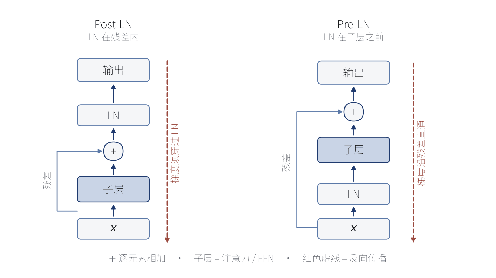

## 深层网络的稳定性

PaLM 的技术报告里有一节读起来不太像论文：训练 540B 模型的过程中，损失尖峰出现了二十多次。每次尖峰来临，损失在几十步内跳高一大截，然后停在那里不再下降。处理办法是从尖峰前约 100 步的检查点回滚，跳过接下来 200 到 500 个数据批次，然后继续。整个训练因此多花了不少算力。

这不是孤例。OPT-175B 的日志里记了三十多次人工干预，GPT-3 的论文提到过靠降低学习率压住梯度噪声。到了千亿参数这个量级，“能不能训完”和“结构好不好”变成了两个独立的问题。它们由不同的东西决定：一个由数值行为，一个由表达能力。数值这一关过不去，表达力的问题根本轮不到讨论。

### 归一化在残差内还是外

残差连接写成 $x\leftarrow x+F(x)$ 时，归一化有两种摆法：

$$\text{Post-LN}: x\leftarrow \mathrm{LN}\big(x+F(x)\big),\qquad \text{Pre-LN}: x\leftarrow x+F\big(\mathrm{LN}(x)\big)$$

原论文用的是前者。问题在反向传播时暴露：把第 $L$ 层的损失往第 $l$ 层传，梯度要穿过的是一串矩阵的连乘

$$\frac{\partial x_L}{\partial x_l}=\prod_{k=l+1}^{L}\frac{\partial x_k}{\partial x_{k-1}},\qquad \frac{\partial x_k}{\partial x_{k-1}}=\begin{cases}J_{\mathrm{LN}}\big(x_{k-1}+F(x_{k-1})\big)\big(I+J_F\big) & \text{Post-LN}\\ I+J_F\,J_{\mathrm{LN}}(x_{k-1}) & \text{Pre-LN}\end{cases}$$

关键在 $J_{\mathrm{LN}}$ 的形状。设输入为 $x$、标准差为 $\sigma$、归一化后的单位向量为 $\hat x$，LayerNorm 的雅可比约为 $\frac{1}{\sigma}(I-\hat x\hat x^{\top})$ 再右乘缩放 $g$。$I-\hat x\hat x^{\top}$ 是一个投影算子，特征值只有 0 和 1，谱范数恰好是 1：既不放大幅度，也不缩小幅度，只是把沿 $\hat x$ 方向的分量删掉。

Post-LN 因此是个坏消息。每个块都把输出重新归一化到固定尺度，回传时乘上一个谱范数约 1 的因子，深度上不衰减；输出端那层的梯度量级就与层数无关。论文算出的界是 $O(d\sqrt{\ln d})$，$d$ 是模型维度，$L$ 不在式子里。而越靠近底层的参数要额外乘上一串 $I+J_F$，量级一路往下掉。结果是同一次更新里，靠输出的层收到大梯度、靠输入的层收到小梯度，两端相差一个数量级，模型越深差得越多。层间失衡与“整体梯度大”是两件事，后者靠梯度裁剪能压住，前者压不住：裁剪是等比缩小所有层，比例不变。

Pre-LN 换掉了位置。归一化挪到子层入口，主干上是一条干净的加法通路，$\partial x_k/\partial x_{k-1}=I+J_FJ_{\mathrm{LN}}$，每层量级相当。代价是主干范数随深度线性增长（论文的界是 $(1+\frac{l}{2})d$ 到 $(1+\frac{3l}{2})d$），末端那个 final norm 把整体除以 $\sqrt L$ 量级的因子，于是最后一层的梯度变成 $O(d\sqrt{\ln d/L})$，随深度下降。层与层之间的比例因此是稳的。

这些都能在初始化时量出来。6 层到 14 层的模型里，Post-LN 最后一层前馈的梯度范数始终在 1.6 左右，不随深度变；Pre-LN 则随深度下降。warmup 的必要性也能量：IWSLT14 德英上，Post-LN 不 warmup 的 BLEU 只有 8.45，加 4000 步能到 34 上下；把 warmup 缩到 500 步、峰值学习率 $10^{-3}$，BLEU 掉到 2.77，同样 500 步配 $5\times10^{-4}$ 还有 31.16。Post-LN 对“前多少步用小学习率”极其敏感，warmup 长度与峰值学习率必须联合调，这在大模型上是笔实在的开销。

warmup 本身还有一层与归一化无关的作用。训练初期的参数是随机的，各层梯度方向彼此不一致，此时用大学习率，等于把一批互相抵消的更新同时放大，净位移不大，参数却已经跑出了初始化附近的良性区域；少数方向一致的梯度又会被过度步进。把学习率从零线性升上去，相当于用前几千步做一次隐式的方差估计，等各层尺度稳定了再加速。换成 Pre-LN 后这一条仍需要，只是长短自由得多：几百步足够，千层的模型也训得动，开源大模型因此绝大多数都是 Pre-LN 或它的变体。

代价有两处。一是主干的方差随深度累积：每层输出不经归一化就加进去，几十层之后尺度会涨，所以必须在输出端补一个 final norm，否则 logits 的量级不可控。工程上的补法是给残差分支的初始权重乘一个与层数相关的系数，GPT-2 用的是 $1/\sqrt{2L}$，每层写回黑板的量在初始化时就被压小，累加到第 $L$ 层时整体尺度才回到 $O(1)$。二是表达效率下降。主干的范数越来越大，后面层的输入被前面的和淹没，相对贡献变小，等效深度不如 Post-LN，同等规模下常常略差一点。DeepNorm (2022) 想在两者之间取位置：把残差写成 $\mathrm{LN}(\alpha x+F(x))$，$\alpha$ 按 $(2L)^{1/4}$ 随深度放大，既保留归一化又控制累积，把可训练深度推到 1000 层。下图把两种摆法画在一起，箭头标的是梯度回到输入的路径：Post-LN 的路径上横着两个 LayerNorm，Pre-LN 的路径上只有加法。

### 只算均方根

LayerNorm 做两件事：减均值、除标准差。RMSNorm (2019) 把第一件去掉了：

$$\mathrm{RMSNorm}(x)=\frac{x}{\sqrt{\frac{1}{d}\sum_i x_i^2+\epsilon}}\odot g$$

只除以均方根，再乘一个可学习的缩放 $g$，没有偏置，也不减均值。论文的论据是，LayerNorm 的收益主要来自缩放不变性，重新中心化的贡献很小，去掉不伤效果。

省下的东西具体到运算：前向时 LayerNorm 要算两次归约——均值一次、方差一次，而方差还得先减去均值；RMSNorm 只算一次平方和，没有减法。反向时 LayerNorm 的梯度要穿过“每个输出都依赖全体的均值与方差”这层耦合，要额外算一路对均值和方差的导，RMSNorm 只有平方和这一路。既然两个算子都是访存受限，省下的就是每层每 token 读写的那几个向量。实验里训练和推理提速 7% 到 64%，具体取决于模型和硬件；把 RMS 只拿前 6.25% 的维度估（pRMSNorm），效果与全量估计差不多，可见这个统计量本身就很不敏感。

还有一条隐式效果：输出与输入的尺度无关，权重整体放大一倍不会改变这一层的输出，等于把有效学习率按每层的尺度自动调了一遍。这是 RMSNorm 在深层模型里比“去掉归一化”稳定的原因。

代价是失去平移不变性。LayerNorm 的输出对输入加上一个常数向量不变，RMSNorm 会变。理论上这是损失：某些特征的整体偏移本应被归一化吸收掉。实践里模型并不依赖这个性质，偏置项本来就可以学。另一个隐含的变化是数值范围。减均值会把激活拉到零附近，除均方根不会，深层累积时残差流的均值可能慢慢漂移。这一点在几十层内不明显，上百层时需要靠 final norm 兜住。

RMSNorm 后来还多了一个用法：加在 query 和 key 上，按每个头的维度归一化，再算点积。这一手叫 QK-Norm，下面还会提到。

### 门控与前馈的账

前馈网络占一个 Transformer 层三分之二的参数，形式却一直很稳定：升维、激活、降维。

$$\mathrm{FFN}(x)=W_2\,\sigma(W_1x)$$

门控线性单元（Gated Linear Unit，GLU）在中间插了一条乘法支路：

$$\mathrm{FFN}_{\mathrm{SwiGLU}}(x)=W_2\Big(\mathrm{Swish}(W_gx)\odot W_1x\Big)$$

一条支路过 Swish 激活当门，另一条不过激活，两者逐元素相乘再降维。Swish 写作 $x\cdot\sigma(\beta x)$，负半轴不为零，比 ReLU 平滑。门控的作用是让一个通道去调制另一个通道：$W_gx$ 经激活后得到的向量 $b$ 对 $W_1x$ 的每个通道做一次与输入相关的缩放，而标准前馈网络里通道之间只有固定的线性混合，没有这种乘性交互。《GLU Variants Improve Transformer》(2020) 在 T5 的 span-filling 上比了八种搭配，524,288 步后的 log-perplexity 为：ReLU 1.677、Swish 1.683、GLU 1.663、GEGLU 1.633，SwiGLU 与 GEGLU 同居最好一档；65,536 步的短训练里 ReLU 1.997、SwiGLU 1.944、GEGLU 1.942。

账要算清楚。标准前馈是两个矩阵，$d\to4d\to d$，参数 $8d^2$。SwiGLU 是三个矩阵，若保持 $d_{ff}=4d$，参数变成 $12d^2$，多出五成。论文的做法是把 $d_{ff}$ 缩到 $\frac{2}{3}\times4d$，于是 $3\times d\times\frac{8d}{3}=8d^2$，参数与计算量都持平，改善不是“参数变多”换来的。换成直觉做法——只把激活函数换成更强的 GELU 或 Swish、仍用两个矩阵——参数与计算量同样对齐，但在上面那张表里它们分别只到 1.679 和 1.683，改善远不如加一道门；差异只能归到乘性结构上。Llama 2 70B 没严格照做，它取 $d_{ff}=28672$，是 $3.5d$，比持平配置多出约三成参数，换来的是更低的损失。

门控的收益还有一种更朴素的解释：Swish 在负半轴的梯度不为零，比 ReLU 平滑，深层堆叠时不容易出现整片神经元死亡。代价除参数之外，还有工程上的麻烦。三个矩阵要么先拼成一个再切，要么分两组切，张量并行和算子融合的写法都比两个矩阵受限。

### 让 logits 不要爆

注意力分数是 $q^\top k/\sqrt{d_{head}}$。$q$ 和 $k$ 的范数由前面的层决定，没有任何机制约束。训练久了，某些头会学到把两者的范数推大——这样 softmax 更尖锐，更像硬查找。分数能到 100 以上，$e^{100}$ 在 FP16 里直接溢出，在 BF16 里也会让 softmax 的梯度饱和到没有信息。

QK-Norm 的办法很直接：算点积之前，对 $q$ 和 $k$ 各做一次按头维度的归一化。归一化的轴是每个头自己的 $d_{head}$，不是整个隐层：softmax 在每个头上独立做，会爆的是头内的点积，归一化的维度必须与 softmax 的轴对齐，否则一个头里的极端值会被其他头的数据稀释掉。

上界可以算出来。若两边的均方根都归到 1，则 $\|q\|=\|k\|=\sqrt{d_{head}}$；由柯西–施瓦茨不等式 $|q^{\top}k|\le\|q\|\|k\|=d_{head}$，除以 $\sqrt{d_{head}}$ 后 logit 落在 $\pm\sqrt{d_{head}}$ 之内。128 维的头，上界约 11.3，与训练走到第几步无关。这是从源头限住范数，不是事后截断：Gemma 2 的软截断把超过 50 的 logits 用 $\tanh$ 压回去，那个位置的梯度同时被 $\tanh$ 的导数压到接近零，模型学到“这个头很强”却学不到“该多强”；QK-Norm 限制的是范数本身，梯度照常回传。Gemma 2 还额外把注意力分数超过 30 的压回去，两道锁一起上。

Chameleon 的实测把这条链子接上了。它的出发点是 softmax 的平移不变性：$\mathrm{softmax}(z)=\mathrm{softmax}(z+c)$，所以把 logits 整体推大不改变损失，但会改变量的值；多模态共用一套权重时，每个模态都靠推大自己的范数来“争”表示，到 bf16 的有效范围之外就发散。不加 QK-Norm，最后一层输出范数自训练早期就持续上升，发散可以迟至训练进度的 20%–30% 才显现，而范数失控是最早的预警信号。它用的是 LayerNorm，位置在 $q$、$k$ 投影之后、点积之前；ViT-22B 报告的是同一件事。

logits 变大的另一个后果是注意力分布变尖。softmax 的温度等效于在降低，一个头把几乎全部权重压到单个位置上，其余位置的梯度变成零。这种头在语料里常表现为“注意力沉没”，不管输入是什么，都把大部分权重给第一个 token。单个这样的头不算错误，一层里所有头都这样，这一层的信息通路就断了，损失会在附近震荡上很久。

还有一项约束落在 softmax 的分母上。记 $Z=\sum_j e^{s_j}$，正常训练时 $\log Z$ 应接近 0，因为正确 token 的概率被推到接近 1。但模型可以把所有 logits 一起往下推，让 $\log Z$ 越来越负，损失不变而数值变得脆弱。PaLM 加了一项 z-loss：

$$\mathcal{L}_z=10^{-4}\left(\log Z\right)^2$$

系数 $10^{-4}$ 很小，只在 $\log Z$ 偏离 0 时才起作用。它像一根很软的弹簧，把归一化项拴在 0 附近，防止 logits 整体漂移。

### 超参数怎么随宽度平移

训练大模型有个现实困难：学习率、初始化尺度这些超参数，在小模型上调好了，搬到十倍宽的模型上就不对。经验规律是宽度涨 $k$ 倍，最优学习率要降，降多少却因结构而异。于是每换一个规模就得重搜一轮，而大模型上的搜索本身就是一笔可观的开销。

《Tensor Programs V: Tuning Large Neural Networks via Zero-Shot Hyperparameter Transfer》(2022) 给了一套参数化方案，通称 muP（Maximal Update Parametrization）。出发点是一个“坐标检查”：宽度从 256 加到 4096，每个神经元的预激活、每步的更新量都应保持同一量级；若某一层随宽度发散、另一层随宽度塌缩，它们各自需要的学习率就会往相反方向漂移，一套超参不可能同时合适。

具体的规则按参数类型分三档。以 $\text{fan\_in}$ 为该矩阵的输入维度、宽度为 $d$：

| 参数 | 初始化方差 | Adam 学习率 |
|---|---|---|
| 嵌入矩阵（输入维度是词表） | 与宽度无关 | 与宽度无关 |
| 隐藏层矩阵（$d\to d$） | $1/\text{fan\_in}$ | 基准 |
| 输出矩阵（$d\to$ 词表） | $1/\text{fan\_in}^2$ | 基准除以 $d$ |

差别只在两行：输出层的初始化标准差从 $1/\sqrt d$ 降到 $1/d$，学习率再除以 $d$；嵌入层两项都不随宽度变。还有一条专门针对注意力：logits 改为除 $d$ 而不是除 $\sqrt d$。理由是 $q$ 与 $k$ 各维为 $O(1)$ 时点积是 $O(d)$，在常规参数化下 logits 会随宽度变大，softmax 跟着变硬；除 $d$ 才能把它拉回 $O(1)$。

Adam 的 $\epsilon$ 也得跟着改。更新量是 $\eta\,\hat m/(\sqrt{\hat v}+\epsilon)$，分母两项并列，$\epsilon$ 与梯度坐标同量纲。参数化把各张量的梯度坐标尺度挪动了，$\epsilon$ 若固定，就会在坐标尺度变小的地方反客为主：分母只剩 $\epsilon$，更新退化成 $\eta\hat m/\epsilon$，逐坐标归一化失效，学习率那一档缩放也等于白做。修法是把 $\epsilon$ 按与 $\sqrt{\hat v}$ 相同的比例缩放，即让它跟着参数组的学习率一起走。这一条靠坐标检查能拓出来：固定 $\epsilon$，把宽度从 256 扫到 4096，本该不变的更新幅度会在某一档之后开始塌。

验证手段就是坐标检查本身：扫一遍宽度，量每个预激活向量的坐标平均大小，不该有量随宽度爆炸或塌缩。结果是：从 40M 参数上搜出来的超参可直接用到 6.7B 的 GPT-3，调参成本只有预训练的 7%；从 13M 迁到 BERT-large，也超过了当时发表的数据。Cerebras-GPT 用这套方案训了一个系列，报告在 111M 上调好的超参一直用到 13B。代价是要改代码里的初始化和优化器分组，而且 muP 只覆盖宽度这一个维度，深度、批量大小、序列长度还得各自处理；深度上的迁移在 Pre-LN 上才靠谱。

### 数值格式与尖峰的来源

BF16 有 8 位指数、7 位尾数。指数位与 FP32 相同，能表示的范围相同，约 $10^{\pm38}$，不会溢出；代价是精度只剩 8 个有效位，相对误差大约千分之四。FP16 反过来：10 位尾数，精度够，最大却只有 65504，训练中一个不留神就溢出成 inf。

所以千亿级训练几乎都用 BF16 存激活和梯度，用 FP32 存优化器状态和主权重。理由在于 Adam 的二阶矩：$v$ 是梯度平方的指数平均，要累加几千步，千分之四的舍入误差会一点点攒成偏差，久而久之让某些参数的更新方向偏掉。BF16 还有一个被低估的好处：指数位与 FP32 一样宽，小梯度不会下溢成零，于是不必像 FP16 那样做 loss scaling（前向损失放大、反向梯度缩回），省掉一层容易配错的机制。FP16 的溢出风险正是它在大模型训练里退位的原因：一个执着于把 logits 推大的头，就足以让某层激活超过 65504。

尖峰不止一种来源，常见的几种还会混在一起。注意力 logits 或激活值突然变大，softmax 或 LayerNorm 的分母走到极端，反向传回来的梯度就异常。也可能某个批次的梯度范数远超正常值，比如数据里出现一段异常重复的文本，或者夹进一个特别长的样本，Adam 走一步迈得太远，把参数推进坏区域。再就是数值格式的边界：下溢让某些小梯度变成零，累积的动量方向失准。

工程手段大体三类。梯度裁剪把全局范数裁到 1.0：先对所有参数求一个统一范数 $\|g\|=\sqrt{\sum_p\|g_p\|_F^2}$，超过阈值 $c$ 就整体乘 $c/\|g\|$，各层按同一比例缩小、方向不变。它防不住尖峰，但把单步的最坏破坏量限住；代价是尖峰那个批次里真正有用的成分也被一起缩了，等于白走一步。它也会掩盖信号：裁剪率为零时日志里看不出任何异常，一旦持续大于零，说明常态梯度已经在阈值之上，阈值本身在起作用。回滚与跳过数据是 PaLM 和 OPT 的常规操作：回到一百步前的检查点，跳过几百个批次。这一步的代价常被低估。一个 70B 模型的完整检查点里有权重、梯度、Adam 的一二阶矩和主权重，按 FP32 存优化器状态算，单个检查点接近 1 TB；在两千张卡上重启一次进程、重新加载分片、把数据加载器跳到指定位置，十几分钟起步。一次回滚抵得上几小时的正常训练。降低学习率或延长 warmup 属于治标，但在缺乏解释时有效。

诊断比补救便宜，这是最值得先做的一步。可观察的量有五类，各有指向：全局梯度范数的分位数而不是均值（尖峰是尾部事件，均值看不出）；每层更新量与权重范数之比 $\|\Delta w\|/\|w\|$，正常在 $10^{-3}$ 量级，某一层突然大一个数量级，说明那一层在顶；注意力 logits 的最大值，QK-Norm 之后它有上界，越界即异常；$\log Z$，z-loss 的监控对象，漂到负值说明整体在推 logits；最后一层输出范数，Chameleon 用它预测发散，比损失早得多。都是按层、按时间记进日志画热图，尖峰之前往往能看到几十步的缓慢抬升。

PaLM 做过一个对照，值得记住：把尖峰附近那批数据取出来，换一个更早的检查点重训，不再出现尖峰。所以尖峰不是“坏数据”单独造成的，而是某批数据碰上某组参数的组合事件。这解释了为什么回滚有效（它同时换掉了数据顺序和参数状态），也解释了为什么单纯清洗数据防不住。

### 一个共同的形状

这些手段有一个共同点：限制单步更新的大小。模型能表达什么，一条也没有改变。稳定性工程做的是把训练过程圈在数值可用的区域里，剩下的交给优化器。约束不产生能力，只是把能力兑现的机会留住。

约束住之后，另一笔账还悬着。宽度翻倍，参数涨四倍，每步计算也涨四倍，训练和服务成本同步上升；而损失对参数的回报是对数的。如果想让容量再涨一个数量级而每个 token 的计算量原地不动，就得改动层的组织方式，让不同的 token 走不同的参数。
