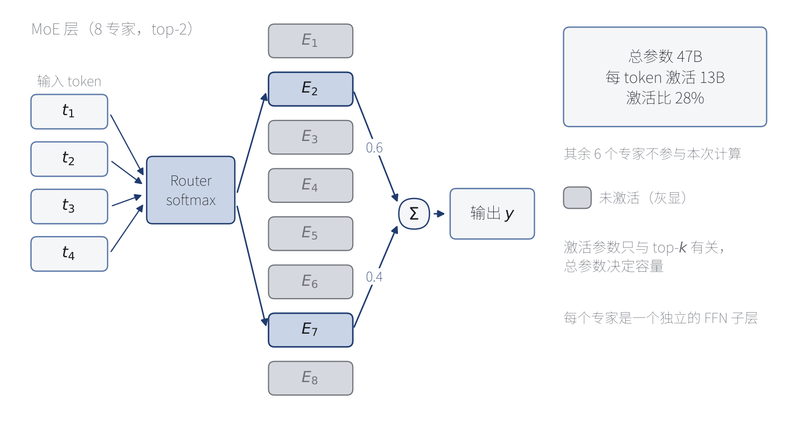
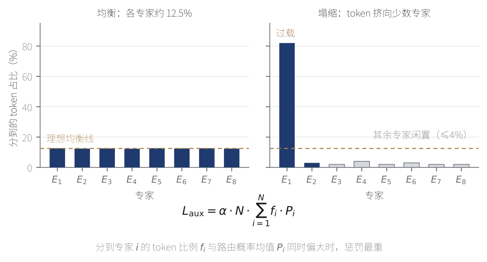

## 混合专家：用稀疏性换容量

Switch Transformer 在 2021 年给出的数字是这样的：把 T5 的前馈层换成 2048 个专家，总参数涨到 1.6 万亿，而每个 token 的计算量与 2.2 亿参数的 T5-Base 持平。论文的口径是同等算力下相对 T5-Base 有 7 倍以上的预训练加速；规模推到万亿之后，相对强调过的 T5-XXL 仍有 4 倍。

更大的模型更好，这件事早就知道。新的一点是：参数量和计算量第一次被拆成了两个可以分别调节的量。

### 绑在一起的两件事

稠密模型里，每个 token 都要过一遍全部参数，前向 FLOPs 就是 $2N$，$N$ 是参数量，没有例外。容量和成本因此是同一条曲线：想要更低的损失，就得加参数；加了参数，每个 token 就得更贵，训练和服务同步变贵。

损失对参数的回报又是对数的。从 10B 加到 100B，损失降下来的那一点，要用十倍的推理成本去换。到服务阶段这笔账很难看：一个万亿参数的稠密模型，生成一个 token 要 $2\times10^{12}$ FLOPs，按一张卡每秒 $10^{15}$ 次浮点运算算，理论上一秒五百个 token，这还没算权重读不完的带宽限制。

MoE 的想法很直接：让参数总量涨，让每个 token 只碰其中一小部分。把一个前馈层换成 $E$ 个专家，路由器给每个 token 挑 $k$ 个：

$$y=\sum_{i\in\mathcal{T}} g_i\,E_i(x),\qquad g_i=\frac{e^{s_i}}{\sum_{j\in\mathcal{T}} e^{s_j}},\qquad \mathcal{T}=\mathrm{TopK}(s)$$

$s=W_rx$ 是路由分数，$g_i$ 是重新归一化后的门控权重，$\mathcal{T}$ 是被选中的专家集合。激活参数大致是 $\frac{k}{E}$ 的前馈部分加上全部注意力。$E=64$、$k=2$ 时，前馈只有约 3% 被激活。

为什么拿前馈层开刀，而不是注意力？因为两者承担的任务不同。注意力要在位置之间搬运信息，每个 token 必须能看到同一序列里所有别的 token，把它切碎就等于截断上下文。前馈是逐位置变换，第 $t$ 个位置的计算与第 $t+1$ 个位置无关，怎么分组都不影响别的 token。于是前馈成了最自然的切分点：它占一个层三分之二的参数，却只需要局部信息。

### 路由：一次前向里的六步

$W_r$ 的尺寸是 $d\times E$，在 $d=4096$、$E=8$ 的配置下是三万多个参数，占整个模型的百万分之一不到。它却决定了每个 token 走哪条路。给出这一层 $T$ 个 token 的隐状态 $X\in\mathbb{R}^{T\times d}$，路由把 $X$ 变成同样形状的输出，中间是六个动作。

1. 打分。$s=XW_r\in\mathbb{R}^{T\times E}$，$s_{ti}$ 是 token $t$ 对专家 $i$ 的亲和度（affinity）。Switch 和 GShard 在 $E$ 维上做 softmax 得到概率 $p_{ti}$；DeepSeek-V3 改成对每个分量单独取 sigmoid，再在选中的几个专家之间归一化。
2. 取 top-k。$\mathcal{T}_t=\mathrm{TopK}(s_t,k)$。GShard 取 2，Switch 取 1，Mixtral 8x7B 取 2，DeepSeek-V3 取 8。
3. 算门控。$g_{ti}=p_{ti}/\sum_{j\in\mathcal{T}_t}p_{tj}$，只在选中的 $k$ 个上重新归一化。
4. 装箱。按专家把 token 归拢进 $E$ 个定长缓冲，每个缓冲 $c$ 行，装不下的丢掉。
5. 专家计算。$Y_e=\mathrm{FFN}_e(X^{\mathrm{in}}_e)$，$E$ 个形状相同的矩阵乘用一次批量矩阵乘算完。
6. 合并。$y_t=x_t+\sum_{i\in\mathcal{T}_t}g_{ti}\,\mathrm{FFN}_i(x_t)$。

```text
s   = softmax(X @ W_r)                   # T×E 亲和度
I   = topk(s, k)                         # T×k 选中的专家号
g   = gather(s, I); g = g / sum(g, axis=1)   # T×k 门控, 行内和为一
cnt = zeros(E)                           # 各专家已收 token 数
for t in 1..T:                           # 装箱, 每专家上限 c
    for j in 1..k:
        e = I[t, j]
        if cnt[e] < c: cnt[e] += 1; slot[t, j] = cnt[e]
        else:          slot[t, j] = -1           # 丢弃, 只走残差
for e in 1..E:
    Y[e] = FFN_e(pad(X[slot == e], c))           # 补齐到 c 行
out = X + sum over j of g[:, j] * gather(Y, slot)[:, j]
```

这套流程里没有一步告诉路由器“你选错了”。TopK 是个离散决定，梯度只能经由被选中专家的门控权重 $g_i$ 回传，选中与否本身拿不到梯度。路由器学到的第一件事是“给已经选中的这几个分多少”；至于“该选谁”，只有 $s_i$ 的相对大小间接带回来一点信号，很弱。这也是为什么路由这么容易塌缩、又必须靠外部约束（辅助损失或偏置）来管——它自身的梯度信号不足以维持分配。

第 3 步容易被当成多余的一步。softmax 是在全部 $E$ 个专家上算的，$E=256$、$k=8$ 时被选中的 8 个权重加起来通常只有零点几；直接把它乘到专家输出上，MoE 这一支的幅度会随 $E$ 变大而缩水，残差几乎把它淹掉。归一化之后 $\sum_i g_{ti}=1$，尺度与 $E$ 无关。Mixtral 的公式写成 $\mathrm{Softmax}(\mathrm{Top2}(xW_g))$ 就是这个意思：先取 top-2 的 logits，再只在这两个上做 softmax（《Mixtral of Experts》(2024)）。

第 4 步的定长缓冲是容量因子存在的原因。批量矩阵乘要求 $E$ 个专家喂进同样行数的矩阵，XLA 这类编译器还要求所有张量形状在编译期确定，于是每个专家必须预分配 $c$ 行，不足的补零、超出的丢弃。被丢的 token 没有消失，它的门控向量退化成全零，这一层对它等价于恒等映射，表示靠残差原样送到下一层。GShard 的算法把这一条写得很明白：两个专家都满了，$G_{s,e}$ 置零（《GShard》(2020) 算法 1）。

丢弃率是可以压到很低的，但有代价。Switch 报告在容量因子 1.25、配合辅助损失时丢弃率通常低于 1%（《Switch Transformer》(2021)）；ST-MoE 训练用 1.25、评测用 2.0（《ST-MoE》(2022)）。这两组数字不能说明丢弃无害。《Expert Choice Routing》(2022) 观察到 token 选择路由在训练早期单个专家的超容比例可达 20%–40%，那一段有相当比例的 token 完全没被这一层处理。MegaBlocks 干脆绕开这套约束：把专家计算写成块稀疏矩阵乘，每个专家吃多少 token 都行，不丢弃也不补零，代价是要自己写 GPU kernel，而且块尺寸必须对齐；在 Pile 上训练的对比里，它比 Tutel 的补零方案快 1.38 到 4.35 倍，微批余量多出 2 到 8 倍（《MegaBlocks》(2022)）。

下图把这次前向拆开了：一个 token 的隐状态进路由器，在 8 个专家里被选中 2 个，其余置灰，两个专家的输出按门控权重相加，回到残差流。整个替换只发生在前馈那一段，注意力和归一化原封不动。



丢弃规则还有一处不太显眼的副作用：容量计数器是按 token 在批内的顺序递增的，先到先得。同样是“这个专家满了”，排在前面的 token 进得去、排在后面的进不去，于是丢谁带上了顺序偏差。丢掉的 token 在这一层梯度为零，它携带的那部分分布在 MoE 层上等于欠训练。GShard 与 Switch 都用辅助损失把丢弃率压到 1% 以下，就是为了让这条偏差尽量少触发；MegaBlocks 与 DeepSeek-V3 干脆不丢，前者靠块稀疏 kernel，后者靠偏置把负载压住。

剩下第 2 步的 $k$ 为什么从 2 变回 1、又变回 2。GShard (2020) 用 top-2，好处是每个 token 至少有两条路径，梯度更稳，第二个专家也提供了“次优选择”的学习信号；代价是计算和通信都翻倍。Switch Transformer 改回 top-1，理由是省一半，而且规模够大时 top-1 不比 top-2 差。GShard 还有一处细节：第二个专家不是无条件派发，而是以正比于 $g_2$ 的概率随机决定发不发，权重很小的第二个专家直接省掉，把容量留给别人。四种主流方案摆在一起看，差别集中在“谁选谁”和“怎么保证齐”这两件事上。

| 方案 | 谁选谁 | 每 token 用几个专家 | 均衡手段与代价 |
|---|---|---|---|
| GShard (2020) | token 选专家 | ≤2，第二个按 $g_2$ 概率随机派发 | 辅助损失；每专家容量上限 $2N/(GE)$，超了丢 token |
| Switch (2021) | token 选专家 | 1 | 辅助损失；容量 $(T/E)\cdot\text{cf}$，超了丢 token |
| Mixtral (2024) | token 选专家 | 2 | top-2 上重新归一化；论文未讨论容量因子 |
| Expert Choice (2022) | 专家选 token | 可变，平均 $c$ | 结构保证每专家恰好 $k=nc/e$ 个，不丢弃 |

### 富者愈富

不加约束的路由会塌缩。原因是一个正反馈：某个专家在某批数据上碰巧好一点，路由器给它更多 token，它拿到更多梯度，变得更好，于是拿到更多 token。几千步之内，大部分 token 挤向少数几个专家，其余专家收不到梯度，等于不存在。

标准解法是辅助损失。把一批 $T$ 个 token 上的实际份额与路由器概率各算一个均值：

$$f_i=\frac{1}{T}\sum_{t=1}^{T}\mathbb{1}\bigl[\arg\max_j s_{tj}=i\bigr],\qquad P_i=\frac{1}{T}\sum_{t=1}^{T}p_{ti}$$

$f_i$ 是硬指标的均值，即真正分到专家 $i$ 的 token 比例；$P_i$ 是软概率的均值，即路由器愿意给专家 $i$ 的平均份额。完全均衡时两者都等于 $1/E$。损失取它们的点积再乘专家数：

$$\mathcal{L}_{\text{aux}}=\alpha\,E\sum_{i=1}^{E}f_iP_i$$

乘 $E$ 是为了让最小值恒等于 $\alpha$。均匀时 $\sum_i f_iP_i=E\cdot\frac{1}{E}\cdot\frac{1}{E}=\frac{1}{E}$，乘 $E$ 归一；这样换专家数不用重调 $\alpha$，公式里凭空多出的那个 $E$ 就是干这个的（《Switch Transformer》(2021) 式 4）。

梯度只从 $P_i$ 那一侧走，$f_i$ 当常数处理：

$$\frac{\partial \mathcal{L}_{\text{aux}}}{\partial s}=\alpha E\sum_{i}f_i\frac{\partial P_i}{\partial s}$$

白话：某个专家已经被塞得很满（$f_i$ 大），路由器再往上抬它的概率就要付更重的罚；空着的专家（$f_i$ 小）抬概率几乎不受罚。均衡是靠这个不对称推出来的，梯度并不告诉路由器“该选谁”，只告诉它“别再加给那个已经挤爆的”。

为什么不能直接惩罚概率，比如用 $\sum_i P_i^2$？因为路由器可以把概率在 $E$ 个专家上分得完全均匀，而 token 照样全流向同一个专家——top-k 只看相对大小，分数打平时 $\arg\max$ 退化成固定的那个下标，塌缩照旧。只有把不可导的实际计数 $f_i$ 乘进来，损失才看得见“token 到底去了哪”。GShard 的原文把这件事讲得更细：本来想最小化 $\sum_e (c_e/S)^2$，$c_e$ 是专家 $e$ 收到的 token 数，来自 top-2 的计数、不可导，于是用可导的平均门控 $m_e$ 替换其中一个因子，写成 $m_e\cdot(c_e/S)$——一个可导的近似乘一个不可导的实测量（《GShard》(2020) 算法 1）。

$\alpha$ 的量级有讲究。Switch 在 $10^{-1}$ 到 $10^{-5}$ 之间按十倍扫过，取 $10^{-2}$：大到能尽快把负载压平，小到不压过主交叉熵项。DeepSeekMoE 在 2B 上用 0.01，16B 降到 0.001，145B 用 0.003 再加一个 0.05 的设备级均衡项——专家级管“别塌缩”，设备级管“别让某张卡空等”，两个目标各配一个系数（《DeepSeekMoE》(2024)）。

辅助损失有个内在矛盾：它和语言建模的目标不一致。$\alpha$ 大了，路由被强行拉平，专家学不到专长；$\alpha$ 小了，均衡不住。还有更硬的问题。ST-MoE 用 FLOP 对齐 T5-XL 的配置做统计，基线六个随机种子里有两个发散，约占三分之一；把学习率调小、梯度裁得更狠都能稳住，但质量明显下降。真正解决问题的是在路由 logits 上加一个 z-loss：

$$\mathcal{L}_z=\frac{c_z}{B}\sum_{t=1}^{B}\Bigl(\log\sum_{i=1}^{E}e^{s_{ti}}\Bigr)^2,\qquad c_z=0.001$$

它只压 logits 的整体量级，不管分配，所以不和均衡目标抢方向；三个种子全部稳定，质量还略有提升（《ST-MoE》(2022)）。逻辑回归到一句话：门控的数值本身会飘，软 softmax 在 bf16 下更是如此，飘到一定程度 top-k 的次序就翻，梯度跟着抖。

两个辅助项都只在训练时加进总损失，推理时根本不计算，也不占算力；它们改变的是参数走向，不是某一次前向的结果。



上图两侧的对比就是这个式子在管的事：左边每个专家的柱高接近，右边所有 token 挤进两三个专家。

### 反过来，让专家挑 token

既然均衡这么难伺候，《Expert Choice Routing》(2022) 把选择方向翻了过来：不再让每个 token 挑专家，让每个专家去挑 token。

给定 $n$ 个 token 的表示 $X\in\mathbb{R}^{n\times d}$，先算亲和度 $S=\mathrm{Softmax}(XW_g)\in\mathbb{R}^{n\times E}$，然后沿 token 维取前 $k$ 个。方向要说清：token 选择是每一行取 top-$k$，专家选择是每一列取 top-$k$，$k$ 就是每个专家的容量，按

$$k=\frac{n\cdot c}{e}$$

定，$c$ 是容量因子（含义变成“平均每个 token 用几个专家”），$e$ 是专家数。输出三张表：索引 $I\in\mathbb{N}^{e\times k}$ 记第 $i$ 个专家选了哪 $k$ 个 token，门控 $G\in\mathbb{R}^{e\times k}$ 记对应权重，$I$ 的 one-hot 展开 $P\in\{0,1\}^{e\times k\times n}$ 当作置换矩阵把 token 搬到专家门口，$X^{\mathrm{in}}=P\cdot X$。算完再搬回去并按 $G$ 加权：

$$X_{\text{out}}[l,d]=\sum_{i,j}P[i,j,l]\,G[i,j]\,X_e[i,j,d]$$

两个 einsum 就是全部实现。$c=2$ 时它的计算量与 GShard top-2 相当，收敛速度是后者的两倍以上（到同样困惑度用的步数不到一半），每一步还快 20%，因为 top-2 的步时被最忙的那个专家拖着走。整个方法不需要辅助损失——每个专家收到的 token 数按定义等于 $k$，均衡是结构保证的。

代价在别处。一个 token 可能被零个专家选中，这一层对它没有贡献；也可能被七八个选中，每个 token 的实际算力变成可变的，批次内的负载反而不整齐。想给每个 token 加上限，就得解一个熵正则化的线性规划：最大化 $\langle S,A\rangle+H(A)$，约束是每列和为 $k$、每行和不超过 $b$、元素落在 $[0,1]$，用 Dykstra 算法在三个凸集之间轮流投影，论文取熵系数 0.001、最多 100 次迭代。更麻烦的是它要看到整批 token 才排得出顺序，自回归生成时做不到：生成第 $t$ 个 token 时，后面那些还没出现。所以专家选择路由能用在训练上，用不到推理里，这也是它没有被主流模型采用的原因。

### 一次前向，两次全交换

专家必须分布在不同设备上，否则放不下。一个八卡节点放 64 个专家，每卡 8 个，那么每个 token 都要被送到它选中的专家所在的卡，算完再送回来。

这是一次全交换（all-to-all）：每张卡把本地 token 按目标专家分组发出去，再接收别的卡发来的 token。一个 MoE 层有两次，去和回。字节数可以直接算：本地 $T$ 个 token、每 token 选 $k$ 个专家、隐维 $d$、bf16 两字节，单是发出的量就是 $2Tkd$，收回同样多；加上 combine 那一趟，一层四倍。

拿 DeepSeek-V3 代进去看量级。$d=7168$，top-8，fp8 一字节，每卡每步 4096 个 token：一层发出 $4096\times8\times7168\approx2.3\times10^{8}$ 字节，约 230MB。同一层每个 token 的计算量是 $2\times\frac{37\times10^{9}}{61}\approx1.2\times10^{9}$ FLOP，4096 个 token 是 $5\times10^{12}$，按 400 TFLOPS 有效算力是 12 毫秒；230MB 走在 50GB/s 的 InfiniBand 上是 4.6 毫秒。同一量级，这就是 V3 所说的跨节点专家并行“计算通信比接近 1:1”（《DeepSeek-V3》(2024)）。

于是 V3 加了节点限制路由：每个 token 最多送到 4 个节点，节点内走 NVLink（160GB/s），比 IB（50GB/s）快 3.2 倍；跨节点只传一份，进节点后再用 NVLink 分发到具体专家，平均每个节点摊到 3.2 个专家。再加上 DualPipe 把 all-to-all 和计算错开，通信才藏得住。

通信量与 token 数、隐藏维度、$k$ 成正比，与专家数无关；延迟却与拓扑强相关，跨节点走 InfiniBand 比节点内 NVLink 高一个量级。容量因子在系统层面还有第二个理由：不设上限的话，某张卡可能收到远超平均的 token，整批计算等它一个，尾部延迟被拉长。丢 token 在这里是一种保护。

### 切细，留一份公共的

DeepSeekMoE (2024) 提了两个改动，两个都保持专家总参数和每 token 计算量不变，动的只是参数怎么分配。

一是细粒度切分。标准 MoE 有 $E$ 个专家、激活 $k$ 个，组合数是 $\binom{E}{k}$。把每个专家的前馈隐层从 $d_{ff}$ 缩到 $d_{ff}/m$，单个专家参数变成约 $1/m$，专家数变成 $mE$，激活数相应改成 $mk$：

$$\binom{16}{2}=120\quad\longrightarrow\quad\binom{64}{8}=4\,426\,165\,368$$

账要对着算：激活的专家参数是 $mk\times\frac{1}{m}=k$ 份标准前馈，和切分前一样；总专家参数是 $mE\times\frac{1}{m}=E$ 份，也一样。变的只有组合数。组合更多，意味着每个 token 能拼出更贴合自己的那组参数，而不用为这个灵活性多付算力。

二是共享专家。留 $K_s$ 个专家对所有 token 都激活、不参与路由，路由侧的激活数从 $K$ 减到 $K-K_s$，计算量不变：

$$h_t=u_t+\sum_{i=1}^{K_s}\mathrm{FFN}_i(u_t)+\sum_{i=K_s+1}^{mE}g_{t,i}\,\mathrm{FFN}_i(u_t)$$

动机是不同专家在训练中会各自学到一些通用的语法和常识，重复占用容量；把这些公共知识收进一个始终在线的专家，路由专家就能专注差异化部分。论文的消融很能说明问题：把共享专家关掉、换成一个额外的路由专家（算力完全不变），Pile 损失从 1.808 涨到 2.414；共享与路由的比例试过 1、2、4 个共享专家，1:3 略好（1.806 对 1.808 与 1.811），所以放大时按 1:3 配。

具体账目：DeepSeekMoE 16B 是 2 个共享专家加 64 个路由专家，每个专家是标准前馈的 0.25 倍，每 token 激活 2 个共享加 6 个路由。激活的专家参数是 $(2+6)\times0.25=2$ 份标准前馈，总专家参数是 $66\times0.25=16.5$ 份，于是总参数 16.4B、激活参数 2.8B。还有两处工程细节：第一层的前馈不做 MoE，因为这一层的负载均衡收敛得特别慢；细粒度也没有继续往下切，专家再小下去，每次矩阵乘的算术强度不够、GPU 跑不满，省下的算力会被利用率下降吃掉。

### 把辅助损失拿掉

DeepSeek-V3 的规模是 671B 总参数、37B 激活，61 层，1 个共享专家加 256 个路由专家，top-8。它换掉了辅助损失，改用偏置。

亲和度用 sigmoid 逐元素算，不用 softmax：$s_{t,i}=\sigma(u_t^{\top}e_i)$，$e_i$ 是第 $i$ 个专家的质心向量。每个专家维护一个偏置 $b_i$，只加在选 top-k 用的分数上，不加在门控权重上：

$$\mathcal{T}_t=\mathrm{TopK}\bigl(\{s_{t,i}+b_i\}_{i=1}^{E}\bigr),\qquad g_{t,i}=\frac{s_{t,i}}{\sum_{j\in\mathcal{T}_t}s_{t,j}}$$

门控用的是没加偏置的原分数，所以被选中的专家拿到的权重仍反映真实亲和度，偏置只负责“让不让它进场”。

更新是控制回路，与梯度无关。每步训练结束统计这一批里各专家收到的 token 数，过载的减、欠载的加：

$$b_i\leftarrow b_i+\gamma\cdot\mathrm{sign}\bigl(\text{imbalance}_i\bigr),\qquad \gamma=0.001$$

$\gamma$ 叫偏置更新速度，前 14.3T token 用 0.001，最后 500B 直接归零。偏置不进入损失函数，不会和语言建模的目标打架；它也不改门控权重，只改谁被选中。论文报告这样做的模型在多数基准上优于辅助损失版本。

一点代价：偏置只按批次的统计调，管不了单个序列内部的极端不均衡，所以 V3 还留了一个权重极小（$10^{-4}$）的序列级均衡损失。全局靠偏置，局部靠这个微弱的约束。另外它训练和推理都不丢 token，一手靠偏置把负载压住，一手靠部署时冗余专家的摆法（《DeepSeek-V3》(2024)）。

### 显存与调度的账

MoE 省的是计算，不是显存。

671B 参数按 FP8 存是 671 GB。一张 H800 是 80 GB，八张卡加起来 640 GB，连权重都装不下。官方给出的部署方案里，预填充阶段用 32 张卡，解码阶段用 320 张卡，靠专家并行把 256 个路由专家分散到四十个节点上。而这 671 GB 里，每个 token 只用到 37B——计算量相当于一个 37B 的稠密模型，显存要按 671B 付。容量按总参数算，成本按激活参数算，显存又要按总参数付。三个数不再是同一个。

这个不对称带来推理上的独特困难。稠密模型每张卡的负载是固定的：张量并行把每个矩阵切开，每张卡算自己那一份，永远一样多。MoE 做不到这一点。一批请求进来，路由把 token 分给哪些专家取决于内容，某些专家可能被集中命中，它所在的卡成为瓶颈，其余卡在等全交换。批次越小，波动越大；批次大了，延迟又上去了。

工程上的应对有几类：冗余专家部署，把热门专家复制几份放到不同节点，减少跨节点流量；专家卸载，把冷专家放在主机内存，按需换入；按专家亲和度做请求调度，把会命中同一批专家的请求排在一起处理。模型一行不用改，改的是部署时的摆法。

训练与推理在这里第一次分道。训练时路由按整批统计，容量因子、丢弃率、辅助损失全是批级概念，一批几千个 token 摊平了抖动；推理时逐 token 前向，batch 常常是个位数，没有“整批”可看，容量因子从显存参数变成了延迟参数——它决定的是最忙那张卡要等多久，而不是要预留多少显存。这也是同一份权重在训练里丢弃率低于 1%、上线后却仍要做冗余专家部署的原因：训练统计的是平均，推理承受的是尾部。

训练侧的账又不同。稠密模型里每个参数每步都收到梯度，MoE 里一个专家可能一整批都没被选中，它的参数这一步就没动。反过来说，被选中的专家一次要处理比稠密模型多得多的 token，梯度噪声的统计特性完全变了。所以 MoE 对批次大小更敏感：批次太小，专家的梯度估计抖得厉害；批次大了，容量因子和全交换的缓冲又跟着涨。这也是 MoE 模型在微调阶段更娇气的原因之一，同样的学习率在稠密模型上没事，在 MoE 上可能直接把路由推塌。

还有一个常被拿来宣传、实际却没那么玄乎的点：专家到底学到了什么。最初的预期是按领域分工：有的专家专管代码，有的专管数学，还有的像是只处理法语。实际观察到的分工细碎得多，多数专家对应的是浅层模式，比如特定的标点、某些句式开头，或者几个高频词的搭配。路由只看当前这个位置的隐状态，没有全局视野去判断“这是不是一道数学题”，分工自然就落到了局部特征上。把专家想象成一排各有所长的顾问，不如想象成一本被撕成很多册的词典，每个 token 只去查其中几册。

::: {.keypoint}
MoE 把容量和计算解耦：总参数决定模型能装下多少知识，激活参数决定每个 token 花多少算力，而显存必须按总参数付。
:::

稀疏化把“一个稠密矩阵乘以输入”换成了“一次路由加若干个小矩阵”。它带来离散决策、随机负载、同步通信这些麻烦，没有一样是模型结构自己能消化的，得靠训练系统：怎么切分，怎么排布，怎么在几千张卡上把一次全交换压进几十毫秒，怎么在单卡故障时不丢掉整个训练状态。这些账比结构本身更难算。
