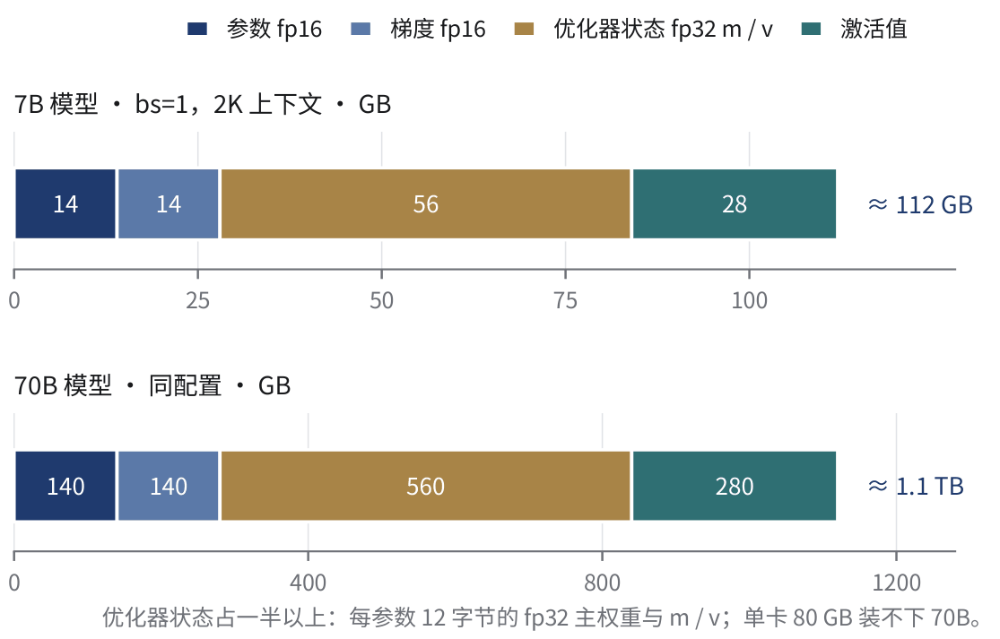
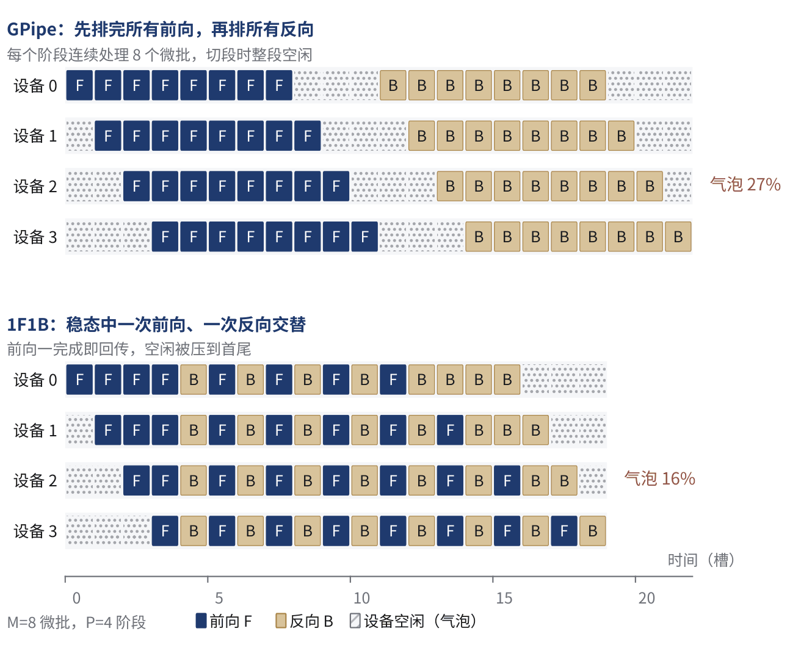
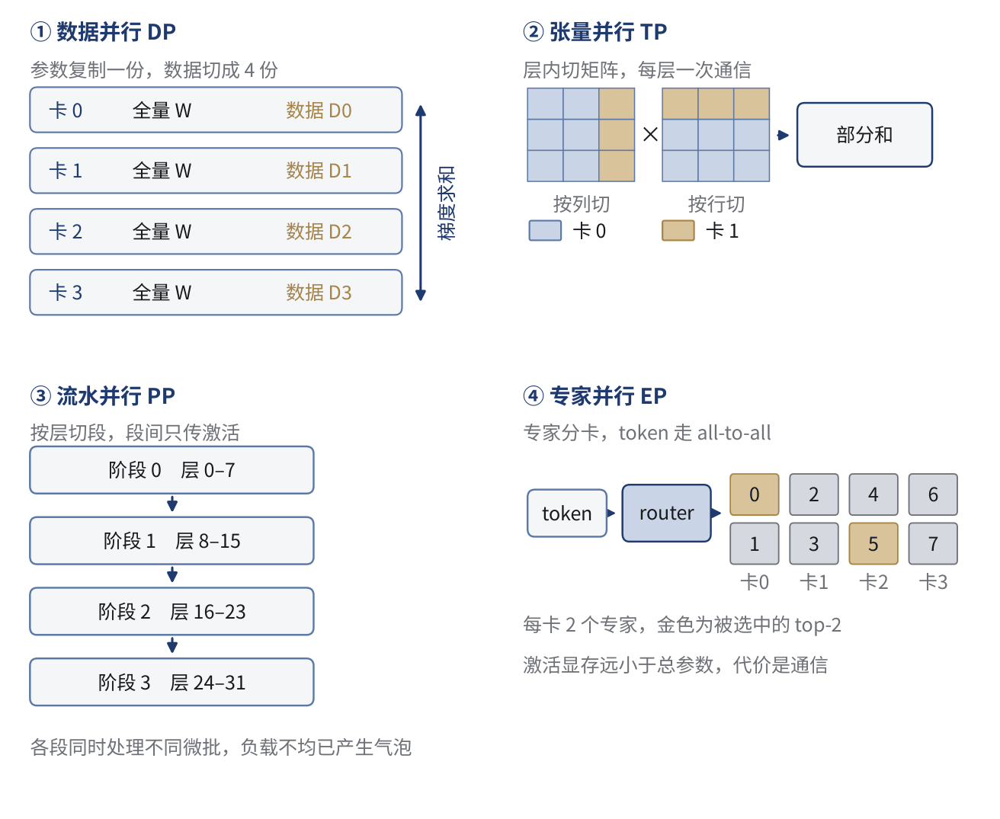

## 训练系统：并行、显存与通信

模型结构确定之后，真正决定能不能训出来的，是显存、带宽和通信。一个 7B 模型在纸上只占 14GB，放到训练框架里却要一百多 GB，这个差额解释了后面几乎所有的并行策略。先把账算清楚，再谈怎么切。

### 一张 112GB 的账单

把一个 70 亿参数的模型加载到 80GB 的 H100 上做推理，权重占 14GB，剩下的空间还够放不少 KV 缓存。同一张卡拿来做训练，程序往往在第一次反向传播之前就报显存不足，此时还没有计算任何激活值。

账要一项一项算。参数以 bf16 存，每个 2 字节，70 亿参数就是 14GB。反向传播要产出同样形状的梯度，再一份 14GB。Adam 优化器为每个参数维护一阶矩和二阶矩，两者都用 fp32，各 4 字节，合计 56GB。多数实现还会额外保留一份 fp32 的主权重，避免在 bf16 上反复累加导致更新量被吃掉，这又是 28GB。加起来 112GB，折合每个参数 16 字节。

这个 16 字节/参数的比例值得记住，它是估算训练显存的起点。70B 模型是 1.1TB，405B 是 6.5TB，单卡容量的增长远远追不上模型规模的增长，所以“把模型切开”成了唯一的出路。

上面那笔账只算了“与参数同寿命”的状态。前向传播过程中还有大量中间结果必须留到反向使用：每层归一化的输出、query/key/value、注意力分数矩阵、前馈网络的中间激活。它们的大小与批量和序列长度成正比，而注意力分数还额外带一个序列长度的平方项。

一层在隐藏维度 4096、序列长度 4096、批大小为 1 时，注意力分数是 $32\times4096^2$，约 5.4 亿个数；bf16 下超过 1GB。32 层全部保留就是 30GB 以上，还没算前馈网络那部分。把序列拉到 32K，这一项涨 64 倍。

这就是梯度检查点（gradient checkpointing，也叫激活重计算）的来由：前向时只保留每层的输入，反向时把该层重新算一遍。

检查点多密是个可优化的问题。设模型有 $L$ 层，把层切成 $L/s$ 段，段内激活全丢、只留每个段边界的输入；反向进到某一段时，先把这段的 $s$ 层重新前向算出来。峰值时手上同时有 $s$ 份段内激活与 $L/s$ 份边界，显存正比于

$$M(s)=\frac{L}{s}+s$$

对 $s$ 求极小得 $s=\sqrt{L}$，此时 $M=2\sqrt{L}$：80 层按每 9 层一个检查点切，激活占用从 80 份降到约 18 份。切得更碎则边界变多，切得更粗则段内峰值变高，两头都变差。

计算量的账很直接：前向 $2N$、反向 $4N$，合计 $6N$；重算意味着反向之前再跑一遍前向，多出 $2N$，变成 $8N$，正好多三分之一。省下四分之三的激活显存，换三分之一的时间，这笔交易在长序列训练里几乎总是划算的。

选择性重算（selective activation recomputation）走另一条路：不按段丢，只丢注意力矩阵这类“显存占比大、浮点运算占比小”的张量，代价通常压到 5% 以内。32 个头、长度 4096 的注意力分数占一层激活的绝大部分，而它的 FLOPs 只占几个百分点。省显存最划算的地方，往往和算得最多的算子并不重合。



上图把这两级模型的四类开销画出。优化器状态是最厚的一块，接近总账的四分之三；激活值则随批量和序列长度增长，在长序列训练里能反超前几项。

### 数据并行，以及它省不下的那部分

最自然的切法是数据并行：每张卡放一份完整模型，各自吃不同的数据，反向得到各自的梯度，再求平均。求平均这一步由集合通信完成，术语叫全归约（all-reduce）。

四种集合通信原语撑起了后面所有并行策略，字节数可以背下来。设张量大小为 $S$ 字节、卡数 $N$，环形实现下每张卡的收发量是：

| 原语 | 语义 | 每卡字节 | 用在哪 |
|---|---|---|---|
| AllReduce | 求和后每张卡都拿到全量 | $2S(N-1)/N$ | 数据并行梯度、张量并行 |
| ReduceScatter | 求和后每卡只留自己那一段 | $S(N-1)/N$ | ZeRO 的梯度、序列并行 |
| AllGather | 各段拼成全量，每人一份 | $S(N-1)/N$ | ZeRO-3 取参数 |
| AllToAll | 每张卡给每张卡发一段 | $\approx S$ | 专家并行 |

$N$ 大时 $(N-1)/N\to1$，口诀是：AllReduce 约两倍张量，ReduceScatter 与 AllGather 各约一倍，而“ReduceScatter + AllGather”合起来正好等于一次 AllReduce。环形全归约就是把这两步接起来：先转 $N-1$ 圈，每圈一张卡把自己那一段的部分和往前推，转完每张卡手上有完整的一段；再转 $N-1$ 圈把各段拼回去。所以每卡搬运 $2S(N-1)/N$，而不是 $S$。

代入一个 7B 模型：bf16 梯度是 14GB，一次全归约每张卡搬运 28GB。400Gb/s 的 InfiniBand 折算到每张卡是 50GB/s，耗时约 0.56 秒。

拿它和计算比。单卡一步处理 50 万个 token，前向加反向是 $6\times7\times10^9\times5\times10^5\approx2.1\times10^{16}$ FLOPs，按 400 TFLOPS 的有效算力算是 52 秒。通信占 1%，可以忽略。可如果每卡每步只有 5000 个 token，计算缩到 0.5 秒，通信反而成了大头，GPU 一半时间在等网卡。

这个比例只取决于每卡的 token 数，与模型多大无关：通信量正比于参数量，计算量也正比于参数量，两者相除，参数量被约掉。所以数据并行天然偏爱大 batch，GPT-3 用 320 万 token 的全局批，一半是为了这个。

工程上不会等梯度全部算完再发起通信。反向从最后一层往前算，每层的梯度一可用就攒进 25MB 左右的桶，桶满立刻发起全归约，让网卡工作和后续的反向计算重叠。做得好，通信几乎可以被藏住。

但数据并行解决不了显存问题：每张卡上仍然是完整的 112GB。

要省下这部分冗余，得换一套思路。每张卡都存着一模一样的优化器状态，那就切开分给不同的卡。《ZeRO》(2019) 把模型状态分成优化器状态、梯度、参数三堆，逐堆切分，切成三级。记参数量为 $\Psi$、数据并行度为 $N_d$，每卡常驻的字节数是：

| 阶段 | 切什么 | 每卡常驻 | 7B 模型、64 卡 |
|---|---|---|---|
| 基线 | 不切 | $16\Psi$ | 112 GB |
| 一 | 优化器状态 | $4\Psi+12\Psi/N_d$ | 29 GB |
| 二 | 加梯度 | $2\Psi+14\Psi/N_d$ | 15.5 GB |
| 三 | 加参数 | $16\Psi/N_d$ | 1.75 GB |

第一级把 12 字节的优化器状态（一阶矩、二阶矩各 4 字节，加 4 字节 fp32 主权重）按 $N_d$ 分开，参数和梯度仍是完整的 4 字节，7B 配 64 卡是 28GB 加 1.3GB。第二级连梯度也切，每卡只留自己那一片，代价是反向时不能直接累积完整梯度，得用归约散射把不属于自己的部分直接加走。第三级把参数也切掉，每卡只剩 $\Psi/N_d$ 个参数，算某一层之前要把这一层的参数从别的卡取回来（all-gather），算完丢掉：一次前向 all-gather、一次反向 all-gather、一次梯度 reduce-scatter，三步一共搬三倍梯度，而基线只搬两倍，多出五成。PyTorch 的 FSDP 就是这一级。

前两级通信量不变这点值得停一下。一级只切优化器状态，它本来就不参与通信；二级的 reduce-scatter 加 all-gather 与一次 all-reduce 字节数相同，只是分两步走。省下来的全是冗余副本，不是流量。

三级台阶的共同点是：它们切不开单独一层。一层本身就装不下时，ZeRO 帮不上忙。

### 张量并行：切进一层内部

一层 Transformer 的参数约 $12d^2$。$d=8192$ 时是 8 亿参数，按 16 字节的训练状态算要 13GB，再叠上这一层的激活，80GB 的卡就不剩多少余量。

《Megatron-LM》(2019) 给出的切法很具体。注意力里，query/key/value 的投影矩阵按列切，每张卡分到一部分注意力头，各自算自己那几个头的注意力，互不干扰；输出投影按行切，每张卡算出的部分和相加就是结果。前馈网络同理，第一个矩阵按列切，第二个按行切，中间的非线性逐元素进行，不需要通信。

切法的数学形式值得写出来。前馈层是两个矩阵加一个激活，$Y=\mathrm{GeLU}(XA)B$，$A\in\mathbb{R}^{d\times4d}$，$B\in\mathbb{R}^{4d\times d}$。把 $A$ 按列切成 $[A_1,A_2]$ 分给两张卡，每张卡算 $\mathrm{GeLU}(XA_i)$，拿到中间结果的一半列；再把 $B$ 按行切成 $[B_1;B_2]$，第 $i$ 张卡算 $\mathrm{GeLU}(XA_i)B_i$，两边相加才是 $Y$。激活是逐元素的，切开不影响结果；切分点落在激活之后，中间不需要任何通信，只有最后求和需要一次全归约。反过来若按行切 $A$，每张卡拿到的输入只有 $x$ 的一半，第一层就得先 all-gather 把输入拼全，通信提前到了入口。把切分点放在“能逐元素算”的位置，是张量并行省通信的全部技巧。

注意力同理：$d$ 维被分成 $h$ 个头，每个头的 $QK^{\top}$ 与 $\mathrm{softmax}$ 只在自己头内进行，头与头之间没有交互，所以按头切是天然的；输出投影按行切，最后全归约一次。

代价是每层两次全归约：注意力之后一次，前馈之后一次，反向传播再来两次。每次的数据量是 $b\cdot s\cdot h$，批 1、序列 4096、$h=8192$、bf16，是 64MB；一层四次是 256MB，80 层就是每步 20GB。

20GB 走在 InfiniBand 上要 0.4 秒，走在 NVLink 上只要 0.02 秒。H100 的 NVLink 单向带宽约 450GB/s，是跨机网络的近十倍。这个差距直接决定了张量并行的度数：它基本被“一个节点里有多少张卡”钉死，通常就是 8。Llama 3 的 405B 模型在 16384 张 H100 上训练，切法是张量并行 8、流水并行 16、数据并行 128，三个数相乘正好是卡数；这种相乘关系是配置的第一道硬约束，改一个维度就得按倍数动其他两个。

切得再细还有第二个损失：每张卡上的矩阵变小，GEMM 的算术强度下降，硬件跑不满。张量并行度 8 时矩阵还够大，到 32 就两头吃亏。

头数构成另一条硬约束。切分的最小单位是注意力头，为了省 KV 缓存把键值头压到 8 个的模型，张量并行度也就被钉在 8 以内。

### 流水并行：用气泡换显存

既然一层切不开，就沿着层切。把 80 层分成 16 段，每段 5 层放在一组卡上，一个微批从第一段走到最后一段，像流水线。

流水线的问题在开头和结尾。设每个微批在一段上花一个时间单位：第一个微批从第 1 段走到第 $p$ 段要 $p$ 步，这 $p-1$ 步里前面已经算完的段在等；最后一个微批走完，又空出 $p-1$ 步。稳态期每段都在忙；两头各空 $p-1$ 个时间单位，整条线一共要花 $m+p-1$ 个时间单位。所以空转的占比是

$$\frac{p-1}{m+p-1}$$

$p$ 是段数，$m$ 是微批数。8 段配 8 个微批，气泡占 47%，一半多的算力在空转；32 个微批降到 18%；128 个微批才到 5%。所以流水并行必须配大 batch，而大 batch 又会碰到收敛上的上限。



16 段的流水线要配 64 个以上微批，气泡才降到 20% 以下。这些微批共享一次参数更新，等于全局批被放大了几十倍，而学习率通常按全局批来定，于是流水并行会反过来牵制优化器的超参选择。

《GPipe》(2018) 用的是最直白的排法：$m$ 个微批全部前向做完，再统一反向。它的气泡与后面这些调度一样，都是 $(p-1)/(m+p-1)$，并没有更小；代价在显存，同时活着的 $m$ 份激活全部要留着，等于把流水并行省下的显存又还回去了。一前一后（one forward one backward，1F1B）调度改的是顺序而不是总量：每个微批前向完，尽早排上它的反向，在途微批数封顶为 $p$。

```text
阶段      时间单位          每段在做什么                    在途微批数
填充      1 .. p-1          依次拿到自己的第一个微批        1 -> p-1
稳态      p .. m            交替做 1 次前向、1 次反向      恰好 p
排空      m+1 .. m+p-1      依次交回最后一个微批            递减到 0
```

气泡没有变，因为填充和排空依旧各占 $p-1$ 步；变的是峰值显存，从 $m$ 份激活降到 $p$ 份。这是流水并行里最实用的一条经验：同样的算力利用率，换个顺序就能少存几倍的激活。上图对比了这两种排法。

再往前一步是交错式流水，让一张卡负责 $v$ 个不相邻的段，气泡缩到 $(p-1)/(v m+p-1)$，代价是段间通信次数翻倍。近年还有把气泡用于计算权重梯度的方案，用显存换掉那部分空转。

段数还受到两条约束。一是层数要能均匀分，80 层切 16 段刚好每段 5 层，切 12 段就余下 8 层。二是各段显存天然不均：第一段多一个词嵌入表，最后一段多一个输出头与 loss 计算，再加填充阶段积压的微批，首尾两段总是先爆。《Llama 3》(2024) 的处理是把层重新排一下，首尾两段少放几层，中间段多放几层，让每张卡的显存峰值对齐。

流水并行的通信很省：只在段边界传激活，一个微批一次 $b\cdot s\cdot h$，与层数无关。它和张量并行的分工依据也在这里：张量并行沿宽度切，通信密集但没有空闲；流水并行沿深度切，通信稀疏但有空闲。

### 序列、上下文与专家

序列维度也能切。张量并行下，归一化、dropout 这类逐位置操作其实每张卡都存了完整副本，序列并行把它们按 token 分给各卡，省下一小块显存。

真正处理长上下文的是上下文并行：把序列切成几段，每卡持有一段，计算注意力时别的卡的键和值通过环形传递送过来，边转边用在线 softmax 累积部分结果，这就是《Ring Attention》(2023) 的思路。通信量每层每卡约 $2sd$，与张量并行同量级，但可以和后一段的计算重叠。它解的是张量并行解不了的问题：张量并行度受头数与节点带宽钳在 8，而序列长度可以无限长，上下文并行度随卡数线性增长。Llama 3 训练 128K 上下文时用的就是它，配置表里写作 CP=16。

混合专家带来另一种切法。专家并行把不同专家放在不同卡上，token 经全对全（all-to-all）通信送到对应专家，算完再送回来，每层两次。字节数上一章算过：一层 $4Tkd$，只与本地 token 数、$k$、隐维成正比，与专家数无关。好处是总参数可以远超单卡容量：DeepSeek-V3 总参数 671B，每个 token 只激活 37B，靠 64 路专家并行把 256 个专家摊到跨 8 个节点的卡上。麻烦在于负载不均，某个专家收到的 token 多，其余卡只能等；工程上用容量因子加丢弃、用辅助损失或偏置把分布压平。全对全还有一个性质：它的流量取决于路由结果，是动态的、不规则的，很难像全归约那样做静态的带宽规划，往往需要专门的通信库调优。



上图把四种切法并排放在一起：数据并行整份复制，张量并行在层内横着切矩阵，流水并行沿深度竖着切层，专家并行按专家分家。真实的训练配置几乎都是其中两种以上的组合，Llama 3 那样的大模型同时用了三种。

### 精度、重算与 419 次中断

fp16 的指数只有 5 位，能表示的最小正规数是 $2^{-14}\approx6\times10^{-5}$，最大 65504；再小的数掉进非正规区，精度迅速流失，到 $2^{-24}$ 以下直接变零。而梯度常在 $10^{-8}$ 量级，不进任何处理就下溢成零，参数拿不到更新。

损失缩放（loss scaling）就是给梯度整体搬家。做法是四步：

1. 前向照常算，拿到 loss 之后乘上 $2^{k}$ 再启动反向。链式法则让所有梯度同比放大 $2^{k}$，从 $10^{-8}$ 搬到 fp16 能表示的中段。
2. 反向用放大过的梯度算，梯度累加与跨层传递都在这个尺度上完成，不会中途下溢。
3. 更新前把梯度除回 $2^{k}$，参数实际拿到的更新量与不缩放时一样。优化器状态（Adam 的一二阶矩）一直存在 fp32 里，不经过 fp16，不受缩放影响。
4. $k$ 是动态的。一旦某步的梯度出现 inf 或 nan（$2^{k}$ 太大、乘完上溢），就跳过这一步的参数更新、把 $k$ 减一；连续一两千步没溢出则把 $k$ 加一。跳步是关键：溢出那一步的梯度已经不可用，宁可丢一步，也不能拿 inf 去污染权重和优化器状态。

这套机制的全部成本是一个超参和一个判据，但它依赖一个前提：同一批参数的梯度量级大致相当。MoE 或长尾数据里个别专家 / 个别 token 的梯度夸张得厉害时，“全部放大”的假设就不成立，这也是 fp16 训练在稀疏模型上更敏感的原因。

bf16 换了个取舍：指数给 8 位，范围和 fp32 一致（最大约 $3.4\times10^{38}$），不需要缩放；尾数只剩 7 位，有效精度不如 fp16 的 10 位。因为梯度累加和优化器状态都在 fp32 里，这点精度损失可以被吸收。这也是 2022 年之后 bf16 成为默认选择的原因：省心比省位更重要。

fp8 把这条路走到更远。8 位要在指数和尾数之间分，主流两种切法：E4M3（4 位指数、3 位尾数，最大 448）精度高、范围窄，E5M2（5 位指数、2 位尾数）反过来。通常的配方是前向用 E4M3、反向的梯度用 E5M2；DeepSeek-V3 因为缩得够细，全部张量都用 E4M3（《DeepSeek-V3》(2024)）。

fp8 能不能用，全压在缩放因子上：一个张量共用一个 scale，还是切成小块各用一个。逐张量量化下，一个极端大的激活值会把整张量的精度拖垮；V3 的选法是激活按 $1\times128$ 的 tile、权重按 $128\times128$ 的块各自在线求最大绝对值再定 scale，于是每 128 个元素共享一组缩放，异常值只污染自己那一块。代价是硬件不原生支持：GPU 只支持逐张量量化，缩放得在 Tensor Core 与 CUDA Core 之间来回搬，V3 为此把累加间隔定在 128 个元素、累加用 fp32。它用这套方案跑完 14.8 万亿 token，全程没有需要回滚的损失尖峰。

再稳的系统也会坏。《Llama 3》(2024) 报告 405B 训练跑了 54 天，记录到 419 次意外中断，有效训练时间约 90%。原因有显存颗粒故障和网卡掉线，也有整个节点变慢的情况，还有最难查的静默数据错误——算错了但不报错。对策是把检查点写得更勤更快：405B 的完整训练状态一份就是 6.5TB，只能异步写、分片写；同时监控损失和梯度范数的异常，一旦发现不同步就整体回滚到最近的检查点。

90% 的有效时间意味着十分之一的算力被浪费。在 16384 张卡的规模上，这个比例对应的是数百万美元。

### 给定集群，怎么选

判断可以按顺序走。先看 16 字节乘参数量的状态加激活能不能放进一张卡，能就单卡，最简单。放不下但一层能放进一个节点，用张量并行 8，外面套数据并行，显存仍紧就叠 ZeRO 的一、二级。一层都放不进节点，沿层切流水，段数要整除层数，微批数至少是段数的四倍，否则气泡吃掉收益。还装不下，比如万亿参数这个量级，就上 ZeRO-3 或专家并行。序列长度是另一条独立的线：超过 8K 要考虑上下文并行，超过 32K 基本是必需项。

贯穿这条路径的原则只有一句：把通信最密的维度放进带宽最高的域。张量并行每层四次全归约，只能留在 NVLink 里；数据并行每步一次，跨机可以接受；流水并行每微批一小块，跨机也无妨。

切得好不好有一个现成的指标：模型浮点利用率（MFU），即 $6ND$ 除以实际耗时与设备峰值的乘积。Llama 3 405B 报告的是 38% 到 43%。低于 30%，通常说明某个维度切得不合适，或者通信没有和计算重叠上。

::: {.keypoint}
四种并行都是用不同的资源换显存：张量并行花带宽，流水并行花空闲，ZeRO 花带宽，重算花算力。选型不是找最优解，而是看哪种资源还剩余量。
:::

到这里，一个模型已经能在几千张卡上把几万亿 token 读完。它学会的是把前文的分布延续下去，而这个能力本身还不构成一个可用的产品：它不知道什么时候该回答，什么时候该停。接下来的问题从系统转到了行为。
