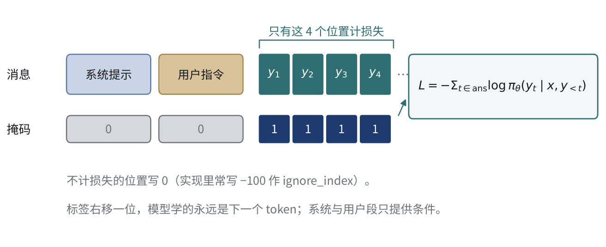

## 指令微调：把续写变成对话

预训练结束的模型，本质上是一个极其熟练的续写器。它能接住任何开头，却不知道什么时候该停、该回答谁、该按什么格式回答。把这种能力变成可用的助手行为，是监督微调要解决的事，而它的难点不在模型，在数据。

### 它只会接着往下写

把“写一封请假邮件，说明我下周一到周三住院做手术，手头的工作已经交给李工”这句话喂给一个刚预训练完的模型，得到的结果往往让人哭笑不得：它可能接着写第二封、第三封邮件，也可能在落款之后另起一段，编出一个新的主题行。内容不算离谱，格式甚至很像样，就是没有一封是给你用的。

这不奇怪。预训练的目标只有一个：给定前面的文本，预测下一个 token。网页上“写一封请假邮件”这句话出现的地方，多半是一堆模板的目录，或者教人怎么写邮件的文章。模型学到的最合理的延续，就是继续罗列、继续示范。它没有“有人在向我提要求”这个概念，因为在它见过的全部文本里，所有句子都只是等待被接下去的半截话。

指令微调（supervised fine-tuning，SFT）改的就是这件事。训练数据从“任意文本”换成“指令与回答”的成对样本，损失函数一点没变，还是交叉熵，只是被最大化的对象从 $P(\text{任意后文}\mid\text{任意前文})$ 收窄成了 $P(\text{回答}\mid\text{指令})$。数据量也小得不成比例：2022 年的《Training language models to follow instructions》里，SFT 阶段只用了 13000 条提示；Llama 2 用了 27540 条；LIMA 只用 1000 条。而它们的预训练语料是万亿 token 量级。SFT 花掉的算力不到预训练的千分之一，改变的却是模型的外在行为。

### 把对话压成一段文本

对话在产品里是一串带角色的消息，模型看到的却始终是一条扁平的 token 序列。两者之间需要一层约定，这就是对话模板（chat template）。

ChatML 的写法很典型：每条消息前面放一个特殊标记加角色名，后面放结束标记。

```text
<|im_start|>system
你是一个严谨的技术助手。<|im_end|>
<|im_start|>user
解释一下什么是梯度检查点。<|im_end|>
<|im_start|>assistant
梯度检查点是一种用计算换显存的技巧……<|im_end|>
```

Llama 2 用的是另一套：`[INST]` 包住用户轮，系统提示嵌在 `<<SYS>>` 里；Llama 3 换成了 `<|start_header_id|>user<|end_header_id|>`。形式不同，作用一样——给“谁在说话”和“说到哪里为止”提供无歧义的边界。

为什么非要用特殊 token，直接写“用户：”就不行？因为后者本身是正常文本，模型在网页上见过太多“用户：”出现在正文里的例子，边界就糊了。特殊 token 在分词器里被登记为不可切分的独立符号，正常文本永远拼不出它，边界因此是硬的。代价是词表里多出几个条目，以及分词器与模型必须严格配套。

模板的一致性比设计更重要。训练时用的模板和推理时拼的模板必须逐字节相同：少一个换行、角色名从“assistant”改成“AI”，输入就落到了训练分布之外，模型可能开始复读模板，或者干脆把角色标记当成正文往外写。这类问题在工程里极常见，排查起来却很费时间，因为损失曲线一切正常。

### 只对回答算损失

一条训练样本拼好之后是一整条序列：系统提示、用户问题、助手回答。如果对全部位置都算交叉熵，模型会同时学会生成用户那一轮。推理时它答完一段，很可能自己接上“user:”，然后替用户再问一个问题，再自己回答。这种自问自答在早期开源模型上很容易复现。

另一个理由是效率。一个 500 token 的提示配 50 token 的回答，如果全部计入损失，九成的梯度花在建模提示上，而提示的分布预训练早就学过。这既浪费容量，也会把模型往“复述输入”的方向推。

所以标准做法是掩码：只保留回答段的损失，其余位置的标签置成一个不会被计入的哨兵值。PyTorch 的交叉熵有一个 `ignore_index` 参数，默认值是 -100，实现上就是把提示段整段填成 -100。

这件事的目标很窄：把一条已经拼好的 token 序列变成一组标签，使得梯度只在助手写出来的那些位置产生。输入是长度 $T$ 的 `input_ids` 和一张“哪段属于谁”的区间表，输出是等长的 `labels` 与一个标量损失。设掩码 $m_t\in\{0,1\}$ 在助手段为 1、其余为 0，损失写成

$$\mathcal{L}(\theta)=-\frac{\sum_{t=1}^{T-1}m_{t+1}\log\pi_\theta(x_{t+1}\mid x_{1:t})}{\sum_{t=1}^{T-1}m_{t+1}}$$

下标错开一位是必须的：位置 $t$ 的 logits 预测的是 $t+1$ 的 token，所以一个 token 计不计入损失，看的是 $m_{t+1}$ 而不是 $m_t$。分母只数被保留的位置，既不是 $T$，也不是样本条数，下面会看到这个选择本身带着一个偏好。

构造分四步。先把消息列表按模板渲染成字符串，同时记下每个特殊标记出现的字符偏移；再分词，把字符偏移换算成 token 偏移，这里要定一条明确规则——只取完全落在区间内的 token，或按首字符归属——训练与推理必须用同一条，否则边界两侧会差一两个 token；然后把每一段助手内容的 token 位置置 1，包含它结尾的 `<|im_end|>`；最后把其余位置的 `labels` 填成 -100。

```text
labels = input_ids.clone()
for (role, i0, i1) in segments:      # token 半开区间
    if role != "assistant":
        labels[i0:i1] = -100
labels[input_ids == pad_id] = -100
m = (labels[:, 1:] != -100).float()  # 掩掉的不计
lp = log_softmax(logits[:, :-1])
lp = lp.gather(2, labels[:, 1:].clamp(min=0).unsqueeze(-1))
loss = -(m * lp.squeeze(-1)).sum() / m.sum().clamp(min=1)
```

回答末尾的结束标记也在助手段内，它必须计入损失：那是模型学会“说完就停”的唯一依据，掩掉它，模型会一直写到上下文用完为止。反过来，角色标记 `<|im_start|>assistant` 本身通常属于提示侧，因为它由模板生成、不由模型生成，学它没有意义。

多轮样本里，每一轮助手发言都要保留，不能只留最后一轮。一条四轮对话如果只对末轮计损失，模型见过的高质量回答少了一半以上，而且容易学成“只看最后一句就问什么答什么”。另外一个容易被忽略的点是：轮与轮之间插入的模板标记（下一轮的 `<|im_start|>user`）落在提示侧，模型一旦在这些位置也计损失，就会在答完之后自己续写用户提问。

也有反其道而行的例子。Llama 2 的 Ghost Attention 为了让系统提示只在第一轮出现、后续轮仍遵守它，会把前面所有轮（包括助手发言）的损失全部置零，只对最后一轮计损失。这里的取舍很清楚：他们训练的是“在长对话末轮仍然服从首轮指令”，而不是“完整复现整段历史”。同一份数据，掩码位置不同，学到的行为就不同。



上图把一条样本的三段和掩码位置画在一起。示意图里三段长度相近，实际数据不是这样：提示常常几百到几千 token，回答只有一两百。

单条样本往往只有几百 token，单独跑一次前向很浪费，训练框架会把几条样本首尾相接塞进同一条定长序列，这就是打包（packing）。打包本身不难，难在让几条样本在注意力里互不可见。做法是构造块对角掩码：第 $i$ 条样本占的区间是 $[s_i,e_i)$，位置 $t$ 允许注意的集合就只有它自己所在的区间，其余位置置 $-\infty$ 再 softmax。位置编号也要按样本各自从 0 重新数，否则第二条样本的第一个 token 会带着“我在第 800 位”的错觉，而推理时它明明在第 0 位。

```text
pos_ids = concat([arange(e_i - s_i) for each sample])       # 每条从 0 数
attn_mask[t, u] = 0 if same_sample(t, u) and u <= t else -inf
```

这两处写错都不会报错，损失曲线照常下降。前一条样本的回答能看见后一条样本的指令时，模型学到的是“先偷看下一题的题干再作答”，验证集上只是分数低一点，很难归因。检查手段很土但有效：拿一条样本单独前向一次，再把它放进打包序列里前向一次，两次的 logits 在数值上应当一致，差超过 $10^{-3}$ 就说明掩码或位置编号漏了。

打包还带来两个隐性代价。一条 4096 的序列里如果塞进一条 3000 token 的长样本，剩下的空隙只够放一条短样本，长度分布因此被截断采样；把短样本拼在一起又会改变梯度里长回答与短回答的比例。另外，`labels` 里跨样本边界的那一位必须强制填 -100：位置 $e_i-1$ 的 logits 预测的是下一条样本的第一个 token，让它参与损失等于教模型“上一段话说完就该接另一个任务”。

最后一个选择是损失怎么归约。上面的公式是 token 级平均，一条 2000 token 的回答对梯度的贡献是 100 token 回答的二十倍，效果上等于给长回答加了权重。改成样本级平均（每条样本先除以自己的 $\sum m_t$，再对样本取均值）就是每条等权，短样本的话语权立刻上升。两者没有对错，但会改变模型学到的长度分布，切换时要在同一份验证集上比。

训练轮数与数据量是一对。数据少可以多跑几轮，InstructGPT 在 13000 条提示上跑了 16 个 epoch，学习率 $9.65\times10^{-6}$、批大小 32，并在微调时掺入 10% 的预训练数据来稳住语言模型能力；数据多则通常两轮就够，Llama 2 用 27540 条标注、学习率 $2\times10^{-5}$、权重衰减 0.1、批大小 64、序列长度 4096，只跑 2 个 epoch。分界不在条数，而在“模型是否开始背样本”：训练损失继续降、留出集上的损失反而抬头，就是该停的位置。

### 一千条为什么可能够

2023 年的《LIMA》做了一个当时看来很激进的实验：只用 1000 条样本做指令微调，不做任何偏好学习，其中 750 条取自社区问答里评分最高的回答，250 条由作者手写。在人类偏好评测里，它超过了用 5 万多条自动生成数据训练的 Alpaca 65B。

作者由此提出一个说法：对齐主要是一种表面行为，知识在预训练阶段就已经学完了，指令微调只是教会模型“以助手的姿态说话”。这个判断未必全对，但它解释了一个反复被观察到的现象：SFT 数据的质量与多样性，比数量重要得多。

好的 SFT 数据大致有几个共同点：任务类型铺得开，不要九成都是问答；回答风格统一，像同一个人写的；格式干净，没有从网页抄来的残留符号；内容不夸张，不编造。反面的信号也很一致：模板化的开头（“当然可以，以下是……”）、机械的分点、每段长度雷同。这类数据喂多了，模型的语气会变得又空又腻，而且很难在后训练里洗掉。

工业界的 SFT 集通常在十万到百万量级，因为要覆盖工具调用、长文档、多语言、代码等专门场景，一千条盖不住。但对通用对话能力而言，边际收益衰减得很快。训练轮数上，十万条量级的数据跑两三轮就到位，再多就开始背样本：训练损失继续降，验证集上的表现反而变差。

### 用强模型造指令

人工写一千条已经不易，要几万条就得另想办法。2022 年的《Self-Instruct》给出一条流水线：人工写 175 个种子任务，让模型照着这些任务的样式生成新的指令、输入和输出，过滤掉与已有样本过于相似的、格式坏的、内容空洞的，剩下的拿去微调。他们用这套办法造出 5.2 万条数据，微调后的 GPT-3 在一组指令遵循评测上比原始版本高出 33 个百分点。

今天的合成数据流水线复杂得多，骨架还是这几步：种子、生成、过滤、配比。过滤是最关键的一环。规则能挡掉一部分：长度异常、重复 n-gram、拒绝回答、与种子过于相似。模型打分能挡掉另一部分，判断回答是否正确、是否切题。代码和数学任务还多一道执行验证：跑一遍，答案对不上就丢弃。这道关卡是文本任务没有的，也是代码数据质量普遍高于通用对话数据的原因之一。

合成数据的风险在于分布坍缩。学生模型学到的不只是答案，还有老师的口头禅、句长习惯、回避方式；用同一批模型反复自我生成，几轮之后多样性会明显下降，罕见表达被磨平，错误也被固化。可行的缓解是保留相当比例的真实人工数据做锚点，并且在每一轮生成后重新做去重和多样性检查。

### 多轮、工具与那些不计损失的位置

多轮对话的训练样本是一条更长的序列，每一轮助手发言都是一段需要计损失的区域，前面所有轮次都是上下文。长对话会超出上下文窗口，常见处理是从最早的一轮开始截断，系统提示始终保留。截断本身会带来偏差：模型见到的大多是“对话刚开始”的样子，长对话后段的表现会变差。

系统提示那一轮承载的东西比看上去多。角色设定、语气要求、安全策略、工具列表都塞在这里，而它在训练数据里的写法五花八门，长度从一句到上千 token 不等。结果是模型对系统提示的服从度很不均匀：短的、常见的指令跟得很好，长的、结构复杂的复合要求容易丢一半。想让模型稳定遵守某类系统提示，最可靠的办法是在 SFT 数据里就以那个形态反复出现。

工具调用把格式要求推到了极致。助手这时输出的是一段结构化的调用，函数名加参数，通常是 JSON。运行时执行这个调用，把结果作为一条新消息插回上下文，角色是工具，然后模型继续生成。这条链路里，调用的函数名和参数必须逐字符正确，所以这部分一定要计损失；工具返回的内容是外部塞进来的，不计损失。

训练数据里还需要失败案例：参数类型错了、工具报错、返回空结果。只教成功路径的模型，一旦工具出错就会陷入循环，反复发起同一个调用。真实系统里这类数据往往是人工构造的，成本不低，但它决定了智能体能不能跑完长任务。

### 配比、遗忘与它学不到的东西

SFT 的数据分布很窄，几万条对话相对于万亿 token 的预训练语料，是一个极小的偏移。偏移带来一个副作用：基座模型的其他能力会退化。长文写作变得潦草，多语言能力下降得最明显，代码补全也开始丢细节。这叫灾难性遗忘，在只做 SFT 的模型上很容易测出来：拿微调前后的模型跑同一组基座评测，分数往往掉几个点。

常见的对策有几种。在 SFT 数据里掺入 1% 到 10% 的预训练语料，让模型在学格式的同时不忘语言模型的本行（InstructGPT 用的是 10%）；把学习率压到 $10^{-5}$ 量级，比预训练小一到两个数量级；限制轮数；或者用低秩适配（LoRA）只训练一小部分参数，基座权重保持冻结。这些手段各有代价，掺预训练数据会稀释指令信号，LoRA 的表达能力有限，实际配比通常靠小规模消融实验定。判定遗忘是否可接受，不能只看对话体验，要拿一组固定的基座评测跑微调前后两个版本，看分数掉在哪里、掉多少。

还有一个更根本的限制：SFT 教不会模型它本来不知道的事实。在 SFT 数据里出现一两次的知识，模型往往只学会了在同样的问法下复述，换个说法就问不出来，再追问细节就开始编。

::: {.keypoint}
SFT 改变的是回答的形式与时机，不是模型掌握的事实。指望用几百条指令数据注入新知识，得到的往往是更流利的幻觉。
:::

要真正注入知识，得靠继续预训练，或者把知识放在检索到的上下文里。SFT 能教的是“什么时候回答、答多长、用什么语气、怎么排版、什么时候该说不知道”，这些都属于行为，不属于知识。

行为的问题解决之后，新的问题浮出来：同一道题可以写出十个都不错的答案，SFT 只会把概率推向被选中的那一个，它没有语言去表达“这个比那个好”。而人类给不出唯一的标准答案，却很容易判断两份答案哪份更顺眼。
