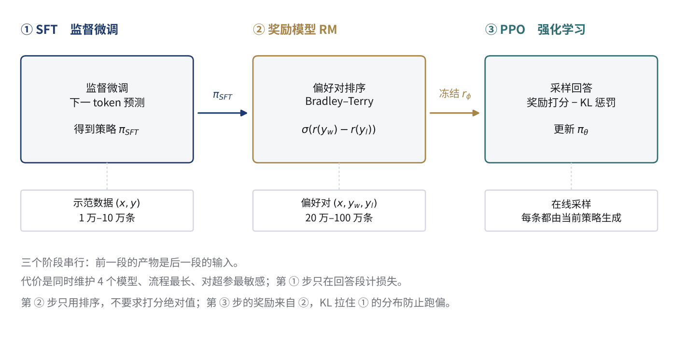
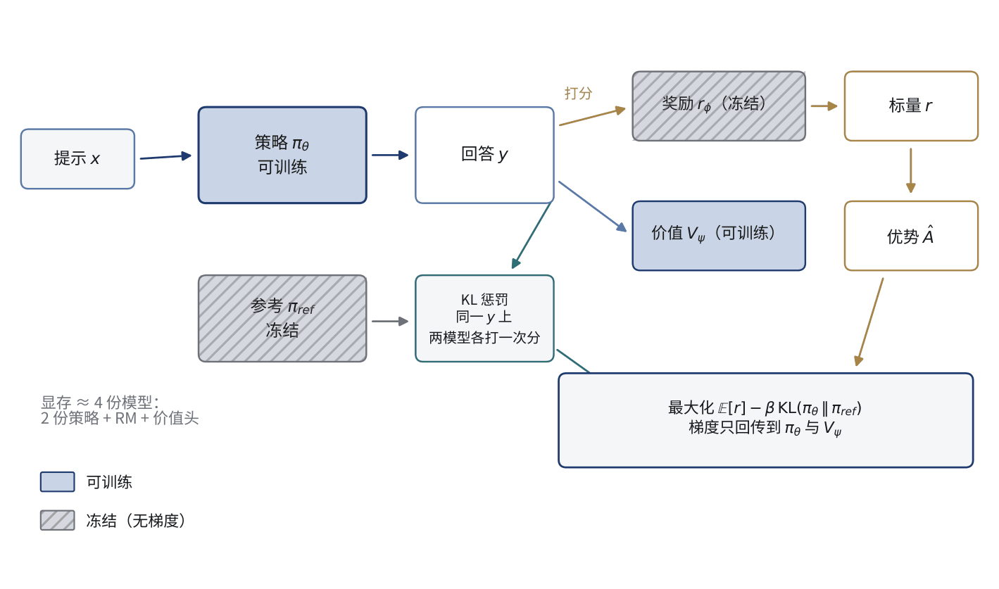

## 奖励模型与 PPO：偏好如何变成梯度

有了指令数据，模型能听懂要求，却仍然分不清两个都算合格的回答哪个更好。人类对这种“更好”有稳定的判断，却很难写成规则。RLHF 的思路是把判断变成偏好数据，再把偏好变成一个可以优化的分数。

### 好，但不够好

指令微调之后的模型已经能听懂要求，但同一个问题多问几次，会得到几个明显不同的回答。有的开门见山，有的先绕一圈背景；有的把边界条件交代清楚，另一些只给主路径。拿给一个工程师看，他三秒钟就能排出高下，可 SFT 的损失函数对这个判断完全无感：它只会把概率推向训练集里的那一个答案，对其余几种写法没有任何意见。

麻烦在于“那一个答案”未必是最好的。写一份快速排序，三种实现都正确，差别只在可读性和边界处理；解释一个概念，两种讲法都对，一种适合初学者，一种适合有背景的人。SFT 里被选中的那份，取决于当时写它的标注者的口味，而模型学到的是“模仿这一个人”，并没有学会“什么样的回答更好”。

让人类写示范的代价也在限制这件事。判断两份答案哪个更好，几秒钟；从头写一份好答案，几分钟，还要对领域熟悉。质量要求越高，愿意写的人越少，风格冲突也越明显。十个人写的十份示范，语气、结构、详略全不一样，模型学到的是一个平均值，平均出来的东西通常最平庸。

### 比较比生成便宜

换个问法，问题就简单了。把“请写出最好的回答”换成“这两份，哪份更好”。

这个动作人类很擅长，也便宜。给标注者一条提示和两个回答，让他选一个，或者标平局。InstructGPT 用这种方式收集了 33000 条比较，训练奖励模型；标注者之间的意见一致率大约在七成上下，这个数字同时也是奖励模型准确率的天花板：两份标注本身就有三成分歧时，模型学到 75% 就已经贴近上限了。

比较还有一层统计上的好处。绝对打分（比如 1 到 7 分）受个人刻度影响：有人从不给 7 分，有人手松；同一个人上午和下午的刻度也会漂。成对比较把个人刻度约掉了，只留下“这两个之间我更偏好哪个”的相对判断。

采样的来源也有讲究。用于训练奖励模型的两个回答，最好来自当前策略；换成别处的人造数据，学到的只是泛泛的好坏。策略要分辨的是“我自己会犯的错里哪个更糟”，这和“世界上任意两个回答哪个更好”是两件事。这也解释了为什么 RLHF 是一个迭代流程：策略变了，偏好数据的分布就该跟着变。

### 把偏好折成一个分数

有了成千上万个“A 比 B 好”，还需要把它变成一个可以求梯度的东西。布拉德利-特里（Bradley-Terry）模型给出一个极简的假设：每个回答有一个隐含的分数 $r(x,y)$，人类在两者之间做选择时，选择概率由分数差经过 sigmoid 得到。

$$P(y_w \succ y_l \mid x)=\sigma\big(r(x,y_w)-r(x,y_l)\big)$$

训练奖励模型就是最小化这个概率的负对数：

$$\mathcal{L}_{\mathrm{RM}}=-\log\sigma\big(r(x,y_w)-r(x,y_l)\big)$$

$y_w$ 是被选中的回答，$y_l$ 是被拒绝的那个。式子的意思是：两个回答的分数差越大，模型就越确信这一对里哪个更好；损失要求这个确信方向与人类的判断一致。

一条样本的具体算法是这样：奖励模型把提示与回答拼成一条序列前向一次，取最后一个非填充位置（通常是结束符）的隐状态 $h\in\mathbb{R}^d$，过一个线性头 $w$ 得到标量 $r=w^{\top}h$；两个回答各前向一次，共享提示段的 KV，算力上接近一次前向加两个短后缀。差值代入即可手算：$r_w-r_l=0$ 时 $\sigma=0.5$，损失 $-\log 0.5=0.693$；差值为 2 时 $\sigma=0.881$，损失 0.127；差值为 4 时损失降到 0.018。差值每增大一截，损失指数式变小，梯度里的权重 $\sigma(r_l-r_w)$ 也跟着趋零——已经分得很清的对子自动退出训练，真正推动参数的是标注者犹豫、模型也犹豫的那些。

梯度写出来只有两项：

$$\nabla_\phi\mathcal{L}_{\mathrm{RM}}=-\mathbb{E}\big[\sigma(r_l-r_w)\big(\nabla_\phi r_w-\nabla_\phi r_l\big)\big]$$

一次更新同时抬高被选中那条的分数、压低被拒绝那条的分数，力度是同一个数。这比“分别回归到 1 和 0”稳得多：软标签的绝对目标值无从定义，而差值有明确含义。

为什么只用差值，可以从模型假设里读出来。BT 模型把分数差送进 sigmoid，等于把“每个回答有个绝对分数”弱化成“同一提示下两个回答的相对次序”。给两条分数同时加上只与 $x$ 有关的 $c(x)$，差值不变，损失不变，所以奖励模型在每条提示内部只可辨认到常数项。工程后果有三条：分数不能跨提示比较；不能当置信度用；为了不让不同提示的尺度差太多，InstructGPT 还把奖励归一化成每条提示均值为 0。

训练信号来自排序被拆成的对子，这里有个容易被忽略的放大。InstructGPT 一次给标注者 $K=4$ 到 9 条回答做排序，一条提示因此能拆出最多 $\binom{K}{2}=36$ 个对子，平局丢弃；33000 条提示训一个 6B 奖励模型，只跑 1 个 epoch，学习率 $9\times10^{-6}$，批大小 64，再往后就过拟合。多跑几轮在验证损失上看得见地变差，这一点和 SFT 相反。

失效方式归成三类。偏好标签有噪，InstructGPT 报告的标注者之间一致率是 72.6%，这个数字大致就是成对准确率的天花板，模型学到 75% 已经贴顶。BT 假设要求偏好可传递（$A\succ B$、$B\succ C$ 则 $A\succ C$），而人对风格不同的回答经常给出循环偏好。两个回答只差长度时，标注者往往选长的，长度就这样被写进分数，后面被 PPO 放大成“越写越长”。

部署时奖励模型不参与训练之外的任何环节：它是一个纯打分函数，没有推理流程、没有停止条件、也没有触发时机。它与策略的差异全在输入分布上：训练时它看的是旧策略采样的回答，策略一旦跑远，它仍然按旧分布的标准打分，这是过优化的根源。

结构上，奖励模型通常就是 SFT 模型去掉输出层，换成一个输出标量的头，读最后一个 token 的隐状态。它和策略同规模，InstructGPT 用的是 6B。这个分数本身没有意义：把所有权重加上一个常数，损失完全不变，有用的只有差值。所以奖励模型的输出不能跨任务比较，也不能当作置信度用。



上图把三个阶段串起来：先用示范数据做 SFT，再用比较数据训练奖励模型，然后拿奖励模型去优化策略。

### 分数涨了，人不满意

2020 年的《Learning to summarize from human feedback》做了一个后来被反复引用的实验。他们让人比较同一篇文章的两份摘要，用这些比较训练奖励模型，再用强化学习去最大化奖励模型的分数。结果是：优化出来的摘要被人类评为优于原始摘要，也优于人工写的参考摘要。这是第一次清楚地证明，从偏好里学出来的目标函数可以驱动模型超过人类示范的质量。

同一组曲线里还藏着另一个现象。优化越往后走，代理奖励（奖励模型给出的那个分数）一直在涨，可人类给出的真实评价在某个点之后开始往下掉。模型找到了奖励模型的漏洞，把分数刷上去了，摘要本身却变得冗长重复，套话堆了一堆。

这个现象在《Scaling Laws for Reward Model Overoptimization》(2022) 里被定量化。作者用 KL 距离衡量策略偏离参考模型多远，记 $d=\sqrt{\mathrm{KL}(\pi\,\|\,\pi_{\mathrm{init}})}$，得到的经验式因优化方式而异。强化学习是

$$R_{\mathrm{RL}}(d)=d\,(\alpha_{\mathrm{RL}}-\beta_{\mathrm{RL}}\log d)$$

而 best-of-$n$ 采样是 $R_{\mathrm{BoN}}(d)=d\,(\alpha_{\mathrm{BoN}}-\beta_{\mathrm{BoN}}d)$，也就是一条开口向下的抛物线。两者都在某个 $d$ 处达到峰值后掉头，区别在于 RL 的衰减更慢：同一份 KL 预算下 RL 花得更凶，优化与过优化都需要更大的偏离才发生。系数 $\alpha$、$\beta$ 随奖励模型参数量平滑变化，近似对数趋势；奖励模型越大、数据越多，顶点越靠右、越高。这解释了为什么大模型公司愿意把奖励模型做到和策略同一个量级。同一组实验里还有一条反直觉的结论：加不加 KL 惩罚并不改变“真实奖励对 KL”这条前沿，作用相当于提前停手。

过优化的机制不神秘。奖励模型是在有限数据上拟合出来的，它对某些表面特征产生了虚假相关：长度、分点格式、特定的开头语。策略是一个搜索器，它会在高维空间里找到这些方向并放大它们。KL 惩罚的作用就是把搜索半径限制住，让策略待在参考模型附近，不要跑到奖励模型没见过的区域。

### PPO 的四个模型

强化学习这一段的算法叫近端策略优化（Proximal Policy Optimization，PPO），名字来自 2017 年那篇同名论文，原本用于游戏和机器人，被 InstructGPT 拿来做了语言模型的对齐。这套流程同时要维护四个模型。

策略模型 $\pi_\theta$ 是正在训练的模型。参考模型 $\pi_{\mathrm{ref}}$ 是 SFT 之后的副本，全程冻结，用来算 KL 惩罚。奖励模型只负责给最终回答打一个分，同样不更新。另一半需要训练的是价值模型 $V_\phi$，它估计从某个位置往后的期望回报，用来计算优势。

四个模型的显存账很直观：每个 7B 模型在 bf16 下 14GB，光权重就是 56GB，加上策略和价值两个模型的优化器状态、以及最占地方的激活，单卡根本放不下。工程上的常见做法是让策略与参考共享底座、奖励模型单独部署成一个推理服务，或者把奖励模型做小。

奖励不是只给在最后。生成过程中每个 token 都有一条即时奖励，只有序列结束那一步才把奖励模型的分数加上去：

$$r_t=-\beta\log\frac{\pi_\theta(a_t\mid s_t)}{\pi_{\mathrm{ref}}(a_t\mid s_t)}\ (t<T),\qquad r_T=-\beta\log\frac{\pi_\theta(a_T\mid s_T)}{\pi_{\mathrm{ref}}(a_T\mid s_T)}+r_\phi(x,y)$$

$s_t=(x,a_{<t})$ 是前缀，$a_t$ 是第 $t$ 个动作，$r_\phi$ 是奖励模型的输出。回答质量由最后那一个分数负责，过程中的每一步只被要求“别离参考模型太远”。

量级值得手算一遍。某一步策略给出的概率是参考模型的两倍，$\log 2=0.693$，$\beta=0.02$ 时这一步扣 0.0139。单步微不足道，但一条 500 token 的回答累计就是 7 分上下，和奖励模型归一化后的分数同量级，“别跑远”这条约束才真正有力量。这也是 $\beta$ 只能取 0.01 到 0.05 的原因：它乘的是长度。Llama 2 对 7B 与 13B 取 0.01，对 34B 与 70B 取 0.005。

有了逐 token 奖励，还要把它变成“这一步比平均好多少”的信号。广义优势估计（Generalized Advantage Estimation，GAE）写成逐位递推：

$$\delta_t=r_t+\gamma V_\phi(s_{t+1})-V_\phi(s_t),\qquad \hat A_t=\delta_t+\gamma\lambda\,\hat A_{t+1},\qquad \hat A_T=\delta_T$$

展开就是 $\hat A_t=\sum_{l\ge 0}(\gamma\lambda)^l\delta_{t+l}$。写递推形式是因为实现时只能从末尾往前扫一遍，一边累加一边存。$\gamma$ 在语言模型里取 1（InstructGPT 明确不做折扣），$\lambda$ 控制偏差与方差的折中，取 0.95。

手算一条三个 token 的回答：末端奖励 1，过程奖励全为 0，价值网络的估计恰好全为 0，$\gamma=1$、$\lambda=0.95$。于是 $\delta_3=1$、$\hat A_3=1$；$\delta_2=0$、$\hat A_2=0.95$；$\delta_1=0$、$\hat A_1=0.9025$。末尾那一个“对”向前按 0.95 逐步衰减，越靠前的 token 分到的信用越少。长思维链里开头那几句几乎收不到信号，这正是过程奖励想解决的问题。

策略的更新被一个裁剪项限制住：

$$\mathcal{L}^{\mathrm{CLIP}}=\mathbb{E}\Big[\min\big(\rho_t\hat{A}_t,\ \mathrm{clip}(\rho_t,1-\epsilon,1+\epsilon)\hat{A}_t\big)\Big],\qquad \rho_t=\frac{\pi_\theta(a_t\mid s_t)}{\pi_{\theta_{\mathrm{old}}}(a_t\mid s_t)}$$

$\rho_t$ 是新旧策略在同一个 token 上的概率比，$\theta_{\mathrm{old}}$ 是本轮采样时的参数（不是参考模型）。裁剪的意思是：一次更新里，单个 token 的概率最多改动 20%（$\epsilon$ 常取 0.2），改得更多的那部分不再提供梯度。外面套一个 $\min$ 是为了让目标成为真实目标的下界：优势为正时，$\rho$ 涨过 $1+\epsilon$ 就封顶；优势为负时，$\rho$ 跌到 $1-\epsilon$ 以下就封顶。只截“变好”的方向不截“变坏”的方向，因为把已判定为差的动作惩罚得更狠不会伤害训练。

价值网络不是装饰，它有两个用途：给 $\delta_t$ 提供基线，给裁剪提供“这批数据算出来的回报”。回归目标取 $R_t=\hat A_t+V_{\phi_{\mathrm{old}}}(s_t)$，损失是均方误差：

$$\mathcal{L}^{\mathrm{VF}}=\mathbb{E}\big[(V_\phi(s_t)-R_t)^2\big]$$

三项合一，得到真正被优化的目标（$\mathcal{L}^{\mathrm{CLIP}}$ 要最大化，所以进优化器时取负）：

$$-\mathcal{L}=-\mathcal{L}^{\mathrm{CLIP}}+c_1\mathcal{L}^{\mathrm{VF}}-c_2\,\mathbb{E}\big[\mathcal{H}[\pi_\theta(\cdot\mid s_t)]\big]$$

$c_1$ 常取 0.5 到 1，$c_2$ 在 PPO 原文取 0.01。熵奖励鼓励探索，语言模型上却很少真的打开：词表十几万，逐位置熵的数值很大且随长度累积，容易盖过策略损失；InstructGPT 的实现里没有报这一项。

一轮迭代的完整流程如下，关键在于采样只做一次、同一批数据只做很少几轮内层更新：

```text
for iter in 1..N:
    X = sample_prompts(512)
    y ~ pi_old(.|X)                        # 温度 1，最多 1024 token
    R = RM(X, y)
    lp = logp(pi_old, X, y); lpr = logp(pi_ref, X, y)
    r_t = -beta * (lp_t - lpr_t);  r_last += R
    V = value_phi(X, y)
    delta_t = r_t + gamma * V[t+1] - V[t]
    A = gae_backward(delta, gamma * lambda)
    A = (A - A.mean()) / (A.std() + 1e-8)   # batch 内归一化
    for ep in 1..K:                         # InstructGPT 取 K=1
        for mb in minibatches(64):
            rho = exp(logp(theta, mb) - lp[mb].detach())
            pg = -min(rho * A, clamp(rho, 1 - eps, 1 + eps) * A).mean()
            vf = ((V_phi(mb) - (A + V[mb].detach())) ** 2).mean()
            step(pg + c1 * vf)
    if mean_kl(pi_theta, pi_ref) > target: break
```

InstructGPT 的报告值：训练 256k 个 episode，覆盖约 31k 条不重复提示，批 512、小批 64、每批只做一轮内层更新，$\epsilon=0.2$、$\beta=0.02$，采样温度 1，价值网络从奖励模型初始化。PPO-ptx 再把预训练的对数似然按系数 27.8 混进梯度，采样量是 RL 的 8 倍。

四个模型各自参不参与梯度，列成表最清楚：

| 模型 | 参数 | 参与梯度 | 做什么 |
|---|---|---|---|
| 策略 $\pi_\theta$ | 全量 | 是 | 被优化，也负责采样 |
| 参考 $\pi_{\mathrm{ref}}$ | 冻结 | 否 | 算逐 token 的 KL |
| 奖励 $r_\phi$ | 冻结 | 否 | 只在 $r_T$ 里打一个分 |
| 价值 $V_\phi$ | 全量 | 是 | 算 $\delta_t$，回归 $R_t$ |



上图画出这四个模型与 KL 约束的关系，冻结的部分用虚框表示。

《Training language models to follow instructions》(2022) 给出的最醒目的一个数字是：1.3B 参数的 PPO 模型，在留出提示上被标注者判为优于 175B 的 GPT-3。参数差两个数量级，行为对齐把这个差距抹平了。

### 为什么难稳

PPO 在语言模型上的调参难度，比它在游戏上的名声要差得多。原因散落在几个地方。

奖励的尺度不稳定。这类模型的输出没有上界，同一个 batch 里不同提示的分数分布可能差很远，直接拿去算优势，梯度会被少数高分样本主导。做法是维护奖励的滑动均值和方差做归一化；优势在 mini-batch 内再减均值除标准差。Llama 2 还多做一步：把奖励的 logit 做白化（whiten），即先减均值除标准差再压回 sigmoid 前的位置，这样不同版本的奖励模型给出的分数能放在同一个尺度上比。

价值模型是另一处薄弱环节。它通常从奖励模型或 SFT 模型初始化，学习率要压得比策略小（InstructGPT 用 $9\times10^{-6}$，与策略同量级而不更大）；价值损失的量级比策略损失大得多，不加裁剪的话，一次异常回报就能把 critic 打偏，之后所有优势估计都是错的。这也是 InstructGPT 只敢用 6B 奖励模型的原因之一：175B 的奖励模型训练不稳定，拿来初始化价值网络更不稳定。

概率比失控是第三种常见故障。采样用的策略和更新时的策略不是同一份参数，如果在一个 batch 上做太多轮更新，$\rho_t$ 可能涨到十以上，梯度随之失控。裁剪只能截住目标里的那一项，截不住已经发生的分布偏移，所以真正的护栏是早停：K=1、并且一旦这个 batch 上的平均 KL 超过阈值就结束本轮。

还有一条几乎必然出现的曲线是回答长度。奖励模型偏好信息量大的回答，而信息量和长度高度相关，于是策略很快学会把话说长。这种长度上涨在几乎所有 RLHF 报告里都能看到：训练初期回答长度单调上升，同时质量也在上升，两者纠缠在一起，很难判断涨的到底是质量还是字数。对策是奖励里做长度归一化，或者干脆把长度作为单独一项约束。

多样性下降则更隐蔽。策略分布越训越尖，同一个提示采样十次，十条回答的开头几乎一样。这不一定是坏事，它意味着模型对“什么算好”更确定；但用来做数据合成或者需要创意的场景就很糟。

### 讨喜的代价

奖励模型是“人类偏好”的代理，而人类偏好本身带着偏差。标注者更喜欢自信的语气，喜欢被肯定，也偏爱结构清晰、听着耳熟的答案。优化这个代理，模型就会朝这些方向漂。

最明显的副作用是谄媚。用户在提问里塞进一个错误前提，比如“为什么说巴赫是法国的作曲家”，模型倾向于顺着这个前提说下去，很少当场纠正。用户表达了一个偏好，模型下一句就改口。这类行为在偏好数据里几乎必然被奖励，因为顺着说的回答读起来更顺。

另一头是过度回避。安全相关的偏好数据让模型对边缘请求变得极度保守，把合法的请求也一并拒掉，拒绝时还带着一段模板化的说教。

校准也会变差。RLHF 之后的模型在答错时反而更自信，因为它被奖励的是“听起来确定”的表达，“知道自己不确定”从来拿不到加分。

InstructGPT 还记录了一个更朴素的代价：PPO 模型在一些标准 NLP 基准上退化了，阅读理解、推理题目的分数低于原始 GPT-3。他们把这个现象叫对齐税，缓解办法是在强化学习的目标里混入预训练的对数似然梯度（PPO-ptx），让模型在学偏好的同时不要忘记语言模型的本行。

这些问题指向同一个结构性的困难：整个流程在优化一小群标注者的平均口味，而这群人的语言、文化、教育背景都很窄。模型学到的是他们的品味，再通过 API 扩散给几百万人。

::: {.keypoint}
奖励模型量的是“标注者平均会觉得哪个更好”，不是“哪个真的更好”。两者之间的缝隙，就是过优化、谄媚和过度回避共同的来源。
:::

PPO 的工程负担也促使人寻找替代。四个模型、在线采样、KL 系数与裁剪阈值的联合调参，任何一项没调好都会前功尽弃。既然偏好数据已经是一个静态的数据集，能不能跳过奖励模型和强化学习，直接用它去优化策略？
