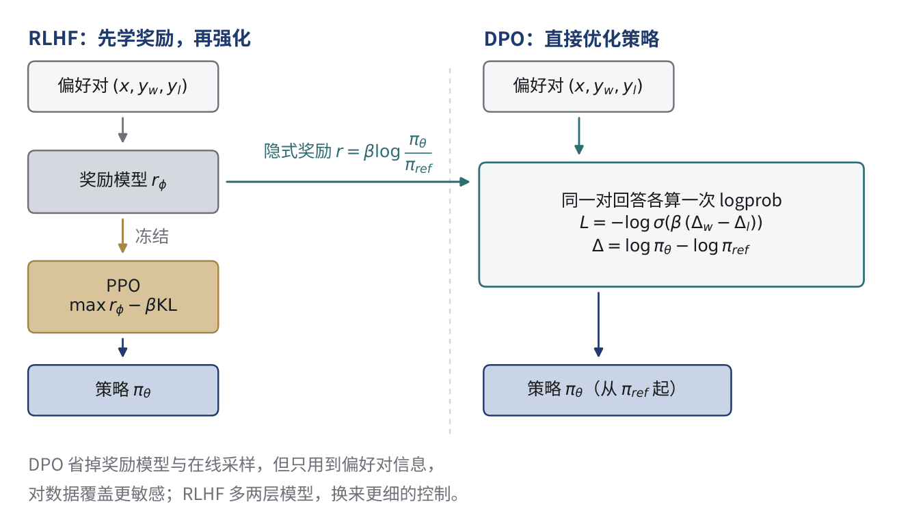

## 直接偏好优化及其家族

2023 年把 RLHF 完整跑一遍，是对工程耐力的考验。Llama 2 的对齐流程里同时驻留四个 70B 量级的网络：策略、参考、奖励、价值。按 FP16 计算，光权重就是 560GB，加上梯度、优化器状态和激活，必须切到几十张卡上，还要在训练循环里调度四次前向。任何一个环节出问题，无论是奖励模型学到了长度偏好、价值网络的估计失真，还是 KL 系数没调好，表现出来的都是训练曲线上一次找不到原因的塌陷。

更别扭的是流程的间接性。人类标注的是“A 比 B 好”，这份信号先被压成一个奖励模型的标量输出，策略再去最大化这个标量。中间隔了一层，而这一层最不稳定：奖励模型只在有限的数据上可信，策略一旦走出这片区域，它给出的分数就没有意义。

2023 年 5 月的一篇论文把这个中间层拆掉了。《Direct Preference Optimization: Your Language Model is Secretly a Reward Model》(2023) 提出的问题很直接：既然奖励模型本身是从偏好对里学出来的，而 PPO 又只是在最大化它，那么能不能绕过奖励模型，直接用偏好对优化策略？答案是能，推导只用了两步代数。

### 从约束目标到闭式解

先写下 RLHF 实际在优化的东西。给定提示 $x$ 和策略 $\pi$ 生成的回答 $y$：

$$\max_{\pi}\ \mathbb{E}_{x\sim\mathcal{D},\,y\sim\pi(\cdot\mid x)}\big[r(x,y)\big]-\beta\,\mathbb{D}_{\mathrm{KL}}\big(\pi(\cdot\mid x)\,\big\|\,\pi_{\mathrm{ref}}(\cdot\mid x)\big)$$

前一项要回答的奖励尽量高，后一项罚它离参考模型 $\pi_{\mathrm{ref}}$ 太远。$\beta$ 是这两件事的汇率：$\beta$ 大，宁可少拿奖励也不许跑偏；$\beta$ 小，允许为了奖励牺牲原有的说话方式。参考模型通常是 SFT 之后的模型，它代表“还像个正常助手”这个约束。

这个目标有闭式解。把 KL 展开，固定 $x$ 后逐 $y$ 看，问题变成

$$\max_{\pi}\ \sum_y \pi(y)\Big[r(y)-\beta\log\frac{\pi(y)}{\pi_{\mathrm{ref}}(y)}\Big]\quad\text{s.t.}\ \sum_y\pi(y)=1$$

引入拉格朗日乘子 $\lambda$（这里只是个待定的辅助量，和后面各个方法超参里的 $\lambda$ 无关），对 $\pi(y)$ 求偏导置零：

$$r(y)-\beta\log\frac{\pi(y)}{\pi_{\mathrm{ref}}(y)}-\beta+\lambda=0$$

解出 $\pi(y)=\pi_{\mathrm{ref}}(y)\exp\big(r(y)/\beta\big)\exp\big(\lambda/\beta-1\big)$。最后那个因子与 $y$ 无关，它的作用就是把整组权重拉回到和为 1，于是得到

$$\pi^{*}(y\mid x)=\frac{1}{Z(x)}\,\pi_{\mathrm{ref}}(y\mid x)\exp\!\left(\frac{r(x,y)}{\beta}\right)$$

其中 $Z(x)=\sum_{y}\pi_{\mathrm{ref}}(y\mid x)\exp\big(r(x,y)/\beta\big)$。

注意这条逐点条件说的是什么：奖励每高一分，概率乘 $e^{1/\beta}$。指数形状不是猜出来的，它是“奖励减 $\beta\log$ 比值后必须处处相等”这一个条件的解。

说白了，最优策略就是把参考模型的分布按奖励的指数重新加权：奖励高的回答涨得快，奖励低的跌得快，$\beta$ 控制这个重新加权的陡峭程度，作用相当于温度。$Z(x)$ 只是个归一化常数，把所有 $y$ 的权重拉回到和为 1。

这一步值得多看一眼，因为它说明了一件反直觉的事：在 KL 约束下，最优策略的形状仍由参考模型决定，奖励只做倾斜，不会把概率全压到奖励最高的那一个回答上。KL 项的作用也在这里显现：它让策略保留参考模型的支撑集，不至于退化成只会说一句话。

### 把奖励消掉

闭式解可以反解出奖励。两边取对数：

$$r(x,y)=\beta\log\frac{\pi^{*}(y\mid x)}{\pi_{\mathrm{ref}}(y\mid x)}+\beta\log Z(x)$$

任何满足上面那个最优形式的策略，都对应唯一一个奖励函数（差一个只与 $x$ 有关的常数）。反过来也成立：如果用一个参数化的策略 $\pi_\theta$ 去逼近 $\pi^*$，那么

$$\hat r_\theta(x,y)=\beta\log\frac{\pi_\theta(y\mid x)}{\pi_{\mathrm{ref}}(y\mid x)}$$

就是一个可以随时算出来的奖励。这就是“隐式奖励”（implicit reward）这个名字的由来：不需要单独训一个网络，策略本身的概率比就是奖励。

接下来接上偏好模型。RLHF 里假设人类偏好服从 Bradley-Terry 形式，即

$$p(y_w\succ y_l\mid x)=\sigma\big(r(x,y_w)-r(x,y_l)\big)$$

$\sigma$ 是 sigmoid，$y_w$ 是被选中的回答，$y_l$ 是被拒绝的那个。把隐式奖励代进去，$r$ 里的 $\beta\log Z(x)$ 在两项相减时正好抵消——这个常数项消掉，是整个推导能成立的关键，因为它本来就没法算（要对词表上所有序列求和）。

代完得到

$$\mathcal{L}_{\mathrm{DPO}}=-\mathbb{E}_{(x,y_w,y_l)\sim\mathcal{D}}\log\sigma\left(\beta\log\frac{\pi_\theta(y_w\mid x)}{\pi_{\mathrm{ref}}(y_w\mid x)}-\beta\log\frac{\pi_\theta(y_l\mid x)}{\pi_{\mathrm{ref}}(y_l\mid x)}\right)$$

逐项看：$\pi_\theta(y\mid x)$ 是当前策略给整条回答的概率，等于各 token 条件概率的乘积，实际计算时用对数求和；分母上的 $\pi_{\mathrm{ref}}$ 是冻结的参考模型，训练全程不变；两个对数比之差就是隐式奖励之差；$\sigma$ 把它压成 0 到 1 的概率，取负对数就是交叉熵。

于是训练只需要三样东西：一个 SFT 模型当初始化和参考，一批 $(x,y_w,y_l)$ 三元组，以及一次额外的前向。没有奖励模型，也没有价值网络；采样循环和 PPO 的裁剪、优势估计同样不需要。整个损失是一个可以直接反传的分类损失，和 SFT 的工程量几乎相同。

### 梯度在做什么

把损失对参数求导，形式上很干净：

$$\nabla_\theta\mathcal{L}=-\beta\,\mathbb{E}\left[\sigma\big(-\hat\Delta\big)\Big(\nabla_\theta\log\pi_\theta(y_w\mid x)-\nabla_\theta\log\pi_\theta(y_l\mid x)\Big)\right]$$

其中 $\hat\Delta$ 就是括号里那个隐式奖励之差，展开写是 $\hat\Delta=\beta\log\frac{\pi_\theta(y_w\mid x)}{\pi_{\mathrm{ref}}(y_w\mid x)}-\beta\log\frac{\pi_\theta(y_l\mid x)}{\pi_{\mathrm{ref}}(y_l\mid x)}$。这个式子说的是：提高 $y_w$ 的似然，压低 $y_l$ 的似然，力度由 $\sigma(-\hat\Delta)$ 决定。

权重可以手算。$\hat\Delta=0$（模型完全分不清）时权重 $\sigma(0)=0.5$；$\hat\Delta=2$（已经分得清）时 $\sigma(-2)=0.119$；$\hat\Delta=-1$（判反了）时 $\sigma(1)=0.731$。取值恒在 0 到 1 之间，判反的样本贡献最大，判对的样本自动退场，不需要额外的采样策略去挑“难样本”。

还有一处不在公式里、但影响很大的细节：$\log\pi_\theta(y\mid x)=\sum_t\log\pi_\theta(y_t\mid x,y_{<t})$ 是对整条序列求和，梯度里的两项也都是求和。一条 400 token 的回答，梯度范数天然是 100 token 回答的四倍，而 $\sigma$ 权重只与差值有关、与长度无关，长回答在优化里占的份量就系统性偏大。这是 DPO 长度偏好最直接的机制来源，比“数据里长回答被选中得多”更隐蔽：即便偏好对里长度平衡，梯度也不平衡。

这个权重项是 DPO 的关键设计。当模型已经认为 $y_w$ 明显更好（$\hat\Delta$ 很大），权重趋近于零，这一对样本几乎不再产生梯度；当模型判断反了（$\hat\Delta$ 为负），权重接近 1，梯度最大。训练于是自动集中在“模型还分不清”的样本上，分得清的不再浪费算力。这一点和 PPO 里用优势函数调节更新幅度是同一个思路，只是这里不需要价值网络去估计基线：差值本身充当相对量。

也正因为只看差值，DPO 有一个常被观察到的现象：被选中的回答，其绝对似然在训练中也可能下降。只要 $y_l$ 的概率掉得比 $y_w$ 更快，损失就在下降，可模型的整体分布已经偏移了。在偏好数据覆盖面窄、训练轮数多的时候，这种偏移会表现为语言质量退化：回答变得更短，也更套路化，偶尔在一些无关的措辞上集体改变。这是 DPO 与 PPO 的实质区别。PPO 至少有一个显式的 KL 惩罚项在每一步约束策略，DPO 的 KL 约束是被“烘焙”进损失形式的，只在最优解处严格成立。

### β、参考模型与训练细节

$\beta$ 在 DPO 损失里身兼两职。它原本是 KL 约束的汇率，进损失之后又成了隐式奖励的尺度，整个损失可以写成 $-\log\sigma(\beta\hat\Delta')$，其中 $\hat\Delta'$ 是两个对数比之差。$\beta\to 0$ 时，把 sigmoid 在 0 附近一阶展开，$\sigma(\beta\hat\Delta')\approx\frac{1}{2}+\frac{\beta\hat\Delta'}{4}$，损失对差值近似线性，梯度不被饱和压住，但模型需要把概率比拉得很开才能把损失降到零——等价于允许更远的偏离，也更容易把噪声当成信号学进去。$\beta$ 变大则 sigmoid 更陡，同样的对数比换算成更大的奖励差，模型停在较小的偏离量上。两个方向与它在 KL 项里的作用方向一致，所以 $\beta$ 不只是尺度，它真正决定允许多大偏离。原论文用 $\beta=0.1$，后续工作在噪声大的偏好集上会压到 0.01，选择取决于数据里有多少对子是真的。

参考模型的选择不复杂但容易忽略：它必须取 SFT 之后那个模型。用基座当参考，等于要求策略不要偏离预训练分布，而非不要偏离指令微调后的行为，学出来的东西会带上基座的续写腔调。参考模型全程冻结，只做前向，因此显存上多一份权重、算力上多一次前向；这是 DPO 相对于“纯 SFT”的全部额外开销。

超参上，DPO 的学习率比 SFT 小一到两个数量级，常见 5e-7；训练轮数一到三轮，再多就开始过拟合偏好对；batch 里把 chosen 和 rejected 拼成一条序列做一次前向是标准做法，因为两者共享 prompt 的 KV，能省一半 prefill。偏好数据的规模通常在几万对量级，UltraFeedback 一类数据集是 6 万条左右，早期工作用它训 7B 模型就能明显改善对话质量。

### 离线数据带来的三个问题

DPO 最根本的限制不在损失函数，在数据。整个训练过程不采样，只反复看同一批 $(x,y_w,y_l)$。

第一个问题是分布偏移。这批偏好对由某个行为策略产生，通常是 SFT 模型或更强的闭源模型。训练中 $\pi_\theta$ 会逐渐离开那个分布，但数据不会跟着更新。于是模型学到的是“在旧分布上，这两个回答哪个更好”，而它自己的输出已经跑到别处去了。这个差分信号能不能外推，没有任何保证。PPO 之所以要在线采样，是为了让奖励模型始终评估策略当下的输出。

第二个问题是对噪声的敏感。Bradley-Terry 假设偏好可以由一个标量奖励解释，这意味着偏好关系必须是可传递的：若 A 优于 B、B 优于 C，则 A 必须优于 C。真实标注里这条经常不成立：标注者对不同风格的容忍度不一致，同一个回答在不同人眼里好坏相反。当数据不满足模型假设时，损失不会停下来告诉你，它会去拟合那些无法被一个标量解释的差异，把噪声当信号放大。长度是最典型的混杂因素：标注者偏向长回答，DPO 就把“长”当成“好”的一部分学进去。

第三个问题是它只优化相对关系，不提供绝对锚点。奖励模型的分数有绝对含义（尽管是学出来的），隐式奖励只有一个可辨识到常数项的比值。这让 DPO 很难和别的信号拼在一起用，比如把奖励模型分数、规则奖励、长度约束混在一个目标里。

### 家族：四种不同的修补

围绕这三个问题，2023 到 2024 年长出了一批变体。它们的差别可以归到三个维度：要不要参考模型、数据是成对还是单条、损失里的 margin 怎么定。

《A General Theoretical Paradigm to Understand Learning from Human Preferences》(2023) 提出的 IPO（Identity Preference Optimization）针对的是过拟合。DPO 的 sigmoid 在偏好确定性很高时会把隐式奖励差推向无穷，模型于是拼命拉大两个回答的概率比，即便它已经分得很清。IPO 换了个假设：把 sigmoid 换成恒等映射，也就是让偏好概率与奖励差成正比，不再压进 0 到 1 之间。这样把“最优性条件”当方程去解，得到的就不是“越大越好”，而是一个固定目标值，损失取方程两边之差的平方：

$$h_\theta(y_w,y_l)=\log\frac{\pi_\theta(y_w\mid x)\,\pi_{\mathrm{ref}}(y_l\mid x)}{\pi_\theta(y_l\mid x)\,\pi_{\mathrm{ref}}(y_w\mid x)},\qquad \mathcal{L}_{\mathrm{IPO}}=\mathbb{E}\left[\left(h_\theta-\frac{1}{2\beta}\right)^2\right]$$

$h_\theta$ 就是 DPO 里那个对数比之差，与前面符号的对应关系是 $h_\theta=\hat\Delta/\beta$。目标不再是把差距推大，而是把它推到固定值 $1/(2\beta)$；超过也会被罚，这从结构上挡住了无限拉大。代价是它假设偏好是确定的（$p=1$），真实标注里的平局与噪声会被当成“应当拟合的间距”处理；同时平方损失在偏差很大时给出很大梯度，训练初期容易振。

KTO（Kahneman-Tversky Optimization，2024）改的是数据形式。它不需要成对比较，只要有单条回答和“好/不好”的二元标签。作为损失的变量只有一个隐式奖励 $r_\theta=\log\frac{\pi_\theta(y\mid x)}{\pi_{\mathrm{ref}}(y\mid x)}$ 和一个参照点 $z_0$（整批样本到参考模型的 KL 估计），效用函数分段取值：

$$v(x,y)=\begin{cases}\lambda_D\,\sigma\big(\beta(r_\theta-z_0)\big), & y\ \text{好}\\[2pt] \lambda_U\,\sigma\big(\beta(z_0-r_\theta)\big), & y\ \text{坏}\end{cases},\qquad \mathcal{L}_{\mathrm{KTO}}=\mathbb{E}\big[\lambda_y-v(x,y)\big]$$

$\lambda_y$ 按标签取 $\lambda_D$ 或 $\lambda_U$。机制上的关键是 $z_0$。它不是一个自由参量，而是“模型对一般回答有多偏爱”的基线，实现上用同一微批次里错配的样本对 $\{(x_i,y_{i+1})\}$ 估一个共享值，并截断到非负；错配而不是用原对，是因为原对里的回答往往是刻意挑的好/坏样本，奖励幅度不代表性。拿掉 $z_0$，模型只需把所有好样本的似然一起抬高、坏样本一起压低，不需要区分“哪一点让它好”，而 KL 基线存在时，粗放地抬高总似然会让 $z_0$ 跟着涨，反而拿不到收益。原论文默认 $\lambda_D=\lambda_U=1$，消融里试过前景理论原始的 1.33；在好样本只占一成时仍能追上 DPO，这是它最大的工程价值。

ORPO（Odds Ratio Preference Optimization，2024）动的是流程。它把 SFT 和偏好对齐压成一步：在标准的监督损失之外，加一项基于几率比（odds）的惩罚，

$$\begin{aligned}\mathrm{odds}_\theta(y\mid x)&=\frac{\pi_\theta(y\mid x)}{1-\pi_\theta(y\mid x)}\\[2pt] \mathcal{L}_{\mathrm{OR}}&=-\log\sigma\!\left(\log\frac{\mathrm{odds}_\theta(y_w\mid x)}{\mathrm{odds}_\theta(y_l\mid x)}\right)\\[2pt] \mathcal{L}&=\mathbb{E}\big[\mathcal{L}_{\mathrm{SFT}}+\lambda\,\mathcal{L}_{\mathrm{OR}}\big]\end{aligned}$$

几率比在这里的作用是把“推高好回答”和“压低坏回答”写成同一个比值：分母里的 $1-\pi_\theta$ 让惩罚随坏回答的概率下降而自动减弱，不会把它往零死命推。梯度可以分成两项，一项是 $\sigma$ 给出的“判错了就加大力度”，另一项是 $\frac{\nabla\log\pi_\theta(y_w)}{1-\pi_\theta(y_w)}-\frac{\nabla\log\pi_\theta(y_l)}{1-\pi_\theta(y_l)}$，分母让低概率那一侧得到更大的梯度。原论文把 $\lambda$ 从 0.1 拉到 0.5、1.0 做了一组对照，结果很清楚：$\lambda=0.1$ 时被拒回答的对数概率几乎不降，收益全部来自抬高被选回答；$\lambda=1.0$ 时两侧同时被推低、间距拉得更开，MT-Bench 上的开放型任务变好而数学、推理类掉分。具体取 0.1（OPT）、0.2（Llama-2 7B）还是 0.25（Phi-2），取决于要的是“适应风格”还是“拉开差距”。实现上还要小心一点：这里的 $\pi_\theta$ 是整条序列的似然，数值上接近零，要换成平均对数似然再进 sigmoid，否则整个比值会退化成常数。

SimPO（Simple Preference Optimization，2024）去掉的东西更多。它注意到 DPO 的隐式奖励是整条序列的对数概率之和，长度直接进入奖励，长回答天然占优；于是改用长度归一化的平均对数概率当隐式奖励，同时加一个目标 margin $\gamma$：

$$\mathcal{L}_{\mathrm{SimPO}}=-\log\sigma\left(\frac{\beta}{|y_w|}\log\pi_\theta(y_w\mid x)-\frac{\beta}{|y_l|}\log\pi_\theta(y_l\mid x)-\gamma\right)$$

$|y|$ 是回答的 token 数，除以它就把“总概率”换成“每 token 平均概率”。为什么非归一不可，可以看一个极端情况：两份内容相同的回答，一份把一句话拆成三段写、多出三十个连接词，DPO 的隐式奖励是对数概率求和，多出三十项就直接改写了奖励值——长度不是偏好信号，却在公式里充当了奖励。归一化后，比的是“平均每个 token 有多大概率”，长度优势被抹平。

$\gamma$ 的机制与“多推一点”相反。BT 里加 margin 等价于要求 $r_w-r_l\ge\gamma$ 才算拟合到位，sigmoid 在差距远超 $\gamma$ 后饱和、梯度消失，所以它真正的效果是“差距够大就停下来”，同时抑制把某一对的比值无限拉大的过拟合。取大了会让本来判对的对子也被罚，原论文观察到质量先升后降，最优在 0.5 到 1.5 之间，$\beta$ 在 2.0 到 2.5 之间。

没有参考模型却不崩，原论文给了三条支撑：学习率小（在 $3\times10^{-7}$ 到 $1\times10^{-6}$ 之间搜，批 128，只跑 1 个 epoch）、偏好数据本身覆盖多领域、以及模型对新数据的鲁棒性；实测得到的 KL 与有参考模型的 DPO 同量级。这是一条值得记住的工程判断：KL 约束不一定非要用一个参考模型实现，“小步走 + 多样数据 + 单轮”是另一种约束方式，代价是一旦数据窄或学习率放大，就没有任何东西拦着模型跑远。同一批实验里也能看到另一面：偏好优化普遍会掉数学类基准分数，SimPO 并不例外。

| 方法 | 需要参考模型 | 数据形式 | 关键机制 |
|---|---|---|---|
| DPO | 是 | 成对 | 隐式奖励之差过 sigmoid |
| IPO | 是 | 成对 | 平方损失，固定 margin |
| KTO | 是 | 单条 + 二元标签 | 参照点与损失厌恶 |
| ORPO | 否 | 成对 | SFT 损失加几率比惩罚 |
| SimPO | 否 | 成对 | 长度归一化 + 目标 margin |

这五个方法的共同前提是：偏好来自人，因此只能间接观察，必须用一个概率模型去假设它和奖励的关系。这个假设是所有麻烦的来源：噪声、不可传递、长度混杂，都是“用人的判断当监督信号”的固有代价。

但有一类任务不需要这个假设。一道数学题的答案对错，一段代码能不能通过单元测试，都可以用规则直接判定，不需要标注者，也不需要 Bradley-Terry。当奖励可以被验证时，整条技术路线会换一副样子：不再需要参考模型来约束偏离，因为奖励本身不会奖励胡说；也不再需要偏好对，因为可以对同一个问题采样很多次，用通过率当信号。这条路把 RL 重新推回了中心，并且顺带解释了 2024 年底之后推理模型的能力跃升。
