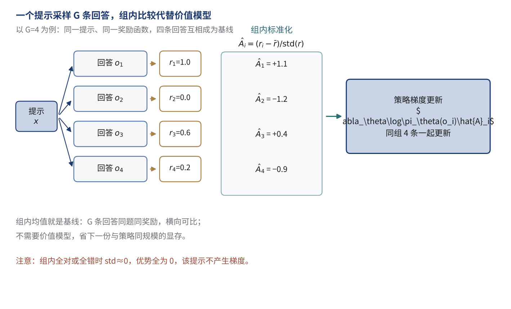
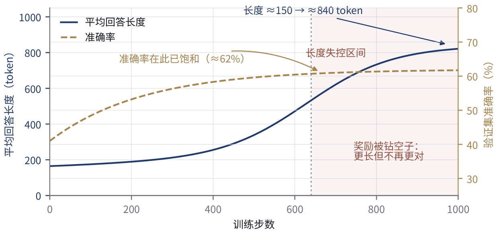

## 可验证奖励与推理模型

2025 年 1 月，DeepSeek-R1 的技术报告里有一组对照数字：同一个基座模型，直接做强化学习、不加任何监督微调数据，在 AIME 2024 上的 pass@1（每题采 64 条、逐条判分再取平均）从 15.6% 升到 71.0%。数学竞赛题的难度没有变，模型结构没有变，训练数据里也没有多出任何新题。变的只有奖励信号的来源。

在此之前，让模型变强的常规路径是喂更多数据。这条路径在数学和代码上碰到了一堵墙：题目的解法空间太大，人工写解答的成本随难度指数上升，而可用于训练的难题本来就少。但这两类任务有一个别人没有的性质：答案可以验证。一道题的最终数字对不对，一段代码能不能通过测试，都不需要人来判断，一条规则就够。

这个性质把整条对齐流水线的形状改掉了。

### 规则能做的判断，比奖励模型更硬

回看前两条路：训练奖励模型拟合人的偏好，或把偏好直接写进损失。两者的共同前提是奖励只能被间接观察，必须假设它和成对比较、点赞点踩之间的统计关系。脆弱性都从这个假设里长出来：奖励模型可以被欺骗，标注有噪声，长度和格式会混进分数。

数学和代码不需要这个假设。给一个提示和一个回答，抽取出最终答案，与标准答案比对，得到一个 0 或 1。这个信号有几个性质是学出来的奖励模型给不了的。它不可贿赂，模型没法靠写得长、写得客气、多用几个“因此”来提分。零成本也很要紧：不用标注者，可以在训练中无限次调用。它也不会外推失效，同一套规则在模型变强之后依然有效，不存在“奖励模型没见过的输出打不准分”这种事。

代价是它极其稀疏。一道题只有对和错两种结果，中间没有任何梯度信息。一个 7B 模型在难题上的通过率可能只有 5%，意味着二十分之十九的采样得不到任何正向信号。强化学习要做的就是从稀疏的 0/1 里估计出“哪个方向更好”。

《DeepSeekMath》(2024) 给出的方法叫组相对策略优化（Group Relative Policy Optimization，GRPO）。

### 用一组采样当基线

策略梯度的一个老问题是方差大。REINFORCE 用 $\nabla_\theta\log\pi_\theta(y\mid x)\cdot r(x,y)$ 更新，如果所有奖励都是正的，所有回答的似然都会被推高，只是推高的幅度不同；训练会变得很迟钝。解决办法是减掉一个基线 $b$，让奖励变成“比平均好多少”：

$$\nabla_\theta J=\mathbb{E}\Big[\nabla_\theta\log\pi_\theta(y\mid x)\,\big(r(x,y)-b\big)\Big]$$

减去基线不改变梯度的期望（因为 $\mathbb{E}[\nabla_\theta\log\pi_\theta]=0$），但能大幅降低方差。PPO 的做法是训一个价值网络 $V_\phi(x)$ 来估计这个基线，代价是多一个与策略同规模的模型，多一份显存、多一份前向、多一套需要调参的回归目标。

GRPO 的观察是：既然同一个提示可以采样很多次，那么这组采样的平均奖励本身就是个不错的基线，不需要学。对每个提示 $x$ 采 $G$ 条回答，得到奖励 $r_1,\dots,r_G$，第 $i$ 条的优势取

$$\hat A_i=\frac{r_i-\mathrm{mean}(r_1,\dots,r_G)}{\mathrm{std}(r_1,\dots,r_G)}$$

分子是“这条比组内平均好多少”，分母是组内的标准差，用来把不同题目的尺度拉平。一道通过率 50% 的题和一道通过率 5% 的题，奖励的绝对波动差别很大，除以标准差之后，两者的优势都落在可比的范围内。反面的情形是整组全对或全错：奖励全一样，标准差为零，优势也是零，这一组不产生任何梯度，后面讲动态采样时会再处理它。

有了优势，更新仍用 PPO 的裁剪形式，只是把价值网络换成了组内统计量。真正的目标函数是逐 token 写的，这一点在很多介绍里被省略，但它是 GRPO 与 PPO 接得上的地方：

$$\begin{aligned}\mathcal{J}_{\mathrm{GRPO}}=\mathbb{E}\Bigg[\frac{1}{G}\sum_{i=1}^{G}\frac{1}{|o_i|}\sum_{t=1}^{|o_i|}\Big(&\min\big(\rho_{i,t}\hat A_i,\ \mathrm{clip}(\rho_{i,t},1-\epsilon,1+\epsilon)\hat A_i\big)\\[2pt] &-\beta\,\mathbb{D}_{\mathrm{KL}}\big[\pi_\theta\,\|\,\pi_{\mathrm{ref}}\big]\Big)\Bigg]\end{aligned}$$

$$\rho_{i,t}=\frac{\pi_\theta(o_{i,t}\mid q,o_{i,<t})}{\pi_{\theta_{\mathrm{old}}}(o_{i,t}\mid q,o_{i,<t})},\qquad \mathbb{D}_{\mathrm{KL}}=\frac{\pi_{\mathrm{ref}}}{\pi_\theta}-\log\frac{\pi_{\mathrm{ref}}}{\pi_\theta}-1$$

读这个式子时要分清两层的粒度。先交代两个符号：$\epsilon$ 是裁剪幅度，沿用 PPO 的 0.2；$\beta$ 是 KL 惩罚的权重；KL 那一项也是逐 token 算的，同一个位置上取策略与参考模型对同一个 token 的概率之比，再对整个回答平均。优势 $\hat A_i$ 是**整条回答一个数**，第 $i$ 条回答里所有 token 共用它；概率比 $\rho_{i,t}$ 却是**逐 token** 的，只看当前这一步的条件分布变了多少。两者粒度不同是有意的：奖励只在最后一个 token 给出，过程里没有任何“这一步好不好”的信息，所以信用只能整条分配；而裁剪必须落在 token 上，否则长回答的比率是几百个小比率的连乘，方差大到无法使用。

$1/|o_i|\sum_t$ 这层归一化也不能省。不除长度的话，一条 800 token 的回答在损失里的权重是 200 token 回答的四倍，模型会优先学会“写长”，而长度本身又和正确率相关，两个效应叠在一起分不开。除以长度之后，每条回答在更新里只投一票。

KL 用的是 $\pi_{\mathrm{ref}}/\pi_\theta-\log(\pi_{\mathrm{ref}}/\pi_\theta)-1$ 这个形式，而不是常见的 $\log(\pi_\theta/\pi_{\mathrm{ref}})$。前者对每个 token 都**非负**（因为 $x-\log x-1\ge 0$），单样本估计不会出现负值把整体拉偏；后者只是 KL 的无偏估计，单个 token 上可正可负，方差还大。代价是它需要 $\pi_{\mathrm{ref}}$ 在每个位置都前向一次，这是 GRPO 相对 PPO 没有省掉的那部分开销。

把一组数代进去看这组统计量怎么工作。设 $G=4$，奖励是 $[1,0,0,0]$，均值 0.25，标准差 $\sqrt{0.1875}\approx 0.433$，四个优势是 $[+1.73,-0.58,-0.58,-0.58]$。两件事值得注意：一是四个优势之和恰好为零，所以一次更新里必然一半回答被抬高、一半被压低，不存在“全都被推高、只是幅度不同”那种低效情形；二是被拒绝的三条虽然奖励都是 0，它们的分量相同，梯度把这三条一起往下压——如果其中某条其实是个好答案但答案格式不对，它也无差别地被惩罚了，这就是稀疏的 0/1 奖励带来的噪声。

省掉价值网络带来的收益是具体的。《DeepSeekMath》(2024) 报告里，GRPO 在 7B 模型上把 MATH 的准确率做到 51.7%，同时把训练显存压到同等设置的 PPO 之下。省下的不只是那一个网络的权重，还有它的优化器状态、每条样本一次额外前向，以及一整套超参（价值损失系数、GAE 的 $\lambda$）。

RLOO（REINFORCE Leave-One-Out）走的是另一条路，思路更朴素：第 $i$ 条的基线用其余 $G-1$ 条的平均值，

$$\hat A_i=r_i-\frac{1}{G-1}\sum_{j\ne i}r_j$$

这个基线是无偏的，因为它不包含 $r_i$ 自己，不会把样本自身的奖励混进对照里。GRPO 除以标准差的做法在题目间奖励尺度差异大时更稳，RLOO 则在 $G$ 较小时方差更小。两者的共同点是不需要价值网络，都属于“用同一提示的多次采样互相作参照”这一族，2024 年之后的大部分开源复现都落在这条线上。

### 冷启动值不值得

DeepSeek-R1-Zero 是这条路线最纯粹的实验：从基座模型出发，只做 RL，不做任何 SFT。结果是能力确实涨了，但输出变得难以阅读：中英文混杂，段落结构散乱，有时在一个思路里绕很久不收敛。技术报告里放了一段训练中的原话，模型在解到一半时自己写道：

> Wait, wait. Wait. That's an aha moment I can flag here.

这种“自我纠错”是纯 RL 涌现的行为，没有人教过。但它也暴露了纯 RL 的问题：奖励只看答案对不对，模型没有任何动机写出人能读的过程，于是它发展出一套自己能用、别人难懂的记号。

R1 的解决办法是加一小段冷启动数据。几千条人工整理的长思维链，格式规范、语言统一，先做一轮 SFT，再进入 RL。技术报告里提到，这一步让训练早期的可读性和语言混杂问题基本消失，代价是引入了人的先验——模型思考的“样式”被这几千条样本框住。R1-Zero 像科学实验，R1 像产品。

这个取舍后来被反复讨论。《s1》(2025) 只用 1000 条高质量推理样本做纯 SFT，不做 RL，在 16 张 H800 上训 26 分钟，就在竞赛数学上超过了当时最强的闭源推理模型一截。《LIMO》(2025) 用 817 条样本，让一个 32B 模型在 AIME 上的成绩从个位数升到 57% 附近。这些结果说明“会不会推理”很大程度上取决于见过多少条正确的推理过程，而不是见过多少次试错。RL 的作用更接近把已有的能力打磨得更稳、更愿意展开，谈不上从零造出能力。

### 长度为什么会失控

用可验证奖励做 RL，有一个几乎必然出现的现象：回答越来越长。

原因不难推。答案对错是唯一的奖励，而在难题上，多想一会儿确实能提高答对的概率：多写几步验算、多试一个思路、回头检查一遍。于是“更长”和“更容易对”在统计上相关，策略梯度顺着这个相关性走，把长度推上去。

上图就是这个形状：训练步数增加，平均长度单调上升，准确率在前期跟着涨，到某个点之后走平，而长度还在涨。

走平之后继续变长的那一段是纯粹的浪费：模型开始重复、自我怀疑、写大段无用的总结。一个本该两百字说清的问题，模型能写三千字，而推理成本随输出长度线性增长，这部分开销直接落在服务账单上。

最直接的办法是长度惩罚：在奖励里减去 $\alpha\cdot|y|$，或用长度归一化的奖励。惩罚系数不好调：太小学不动，太大则模型学会草率收尾，正确率掉得比长度快。

Kimi k1.5 的版本把惩罚做成了组内的相对量，避开了绝对系数的标定问题。对同一道题采样 $k$ 条回答，记第 $i$ 条的长度为 $\mathrm{len}(i)$，组内最短与最长分别是 $\mathrm{min\_len}$、$\mathrm{max\_len}$，先算一个在 $[-0.5,0.5]$ 之间的分数

$$\lambda_i=0.5-\frac{\mathrm{len}(i)-\mathrm{min\_len}}{\mathrm{max\_len}-\mathrm{min\_len}}$$

再把长度奖励定义为：答对时取 $\lambda_i$，答错时取 $\min(0,\lambda_i)$。两个分支合起来的意思很清楚——答对的回答里越短越好，答错的回答只罚不奖，长且错的罚得最重。组内归一化让 $\lambda$ 自动落在固定区间，不用随任务长度换系数；最短与最长相等时整组置零。它乘一个权重加进原奖励，并且要**预热**：训练初期就加惩罚会压住探索，所以先跑一段纯准确率奖励，之后再切到带惩罚的目标。

另一些工作干脆不惩罚，而是把长度当成预算直接管：在推理时强制插入“再检查一遍”这类续写来延长思考，或者在达到预算时强行截断并要求收尾。区别在于前者改的是训练目标，后者改的是推理流程，两者可以叠用。

### 难度与数据

比长度更隐蔽的问题是数据分布。如果一个训练集里大部分题目对当前模型来说要么太简单要么太难，大部分算力就被浪费在零梯度的采样上。于是有了按通过率筛选的做法：先用当前模型对每道题采样若干次，估计通过率，只保留落在中间区间的题目，比如 0.2 到 0.8 之间。太简单的已经会了，太难的连方向都摸不到，两者都提供不了信号。这个筛选需要周期性重做，因为模型的通过率在训练中会变。动态采样（dynamic sampling）更进一步，在训练中实时丢弃全对全错的组，用新题目补上，保证每个 batch 都有非零优势。

这套机制解释了为什么 RL 出来的推理能力有时显得很“窄”：它在训练分布覆盖的难度带上很强，出了这个带子就迅速退化。一个在竞赛数学上刷到高分的模型，遇到需要长链条常识推理的题目未必更好，因为那类题目的奖励不可验证，从来不在训练信号里。

难度筛选还有一个副作用，容易被忽略：判断“这题难不难”用的是模型自己的通过率，于是训练集的难度带实际上是在**跟随**模型。模型变强，原来中等难度的题掉到“太简单”一档被剔除，分布向更难的题腾。这本来是设计意图，但它意味着两件事：同一个训练集在不同阶段的梯度分布完全不同，超参不能指望全程适用；以及通过率估计本身要周期性重算，否则样本池会卒得很偏。

裁剪的对称性也是一个可调项。上面那个目标上下界都是 $\epsilon$，意味着“把好的往上推”和“把坏的往下压”每一步的余地一样大。但在稀疏奖励下，被压的那一侧往往支撑不足：一组 8 条回答里可能只有 1 条对，其余 7 条的梯度全在往下压，于是被裁掉的概率质量很多，策略的熵掉得很快，采样很快退化成重复同一句话。把上界放宽、下界收紧的不对称裁剪就是针对这个——让“学到的那一点正向信号”能多走几步，同时不要因为一堆零奖励把分布压死。动态采样则是另一个方向的补丁：干脆丢掉全对与全错的组（优势全为零，梯度也为零），用新题补上，让每个 batch 都带着非零信号。

### 可验证奖励的边界

规则的硬，是它的优点，也是它的盲区。

第一层是格式。答案得能被抽出来才能比对，所以训练时往往加一个格式奖励：把最终答案放在指定标记里，或按指定结构给出推理和结论。这个奖励很容易被钻空子：模型学会把答案包进标记，推理过程却可以毫无内容。两个奖励的权重还需要平衡，格式分太高，模型会优先讨好格式。

第二层是部分正确。一道多步证明题，做对前七步、最后一步算错，和完全不知所云，奖励都是 0。学习信号因此比它本可以是的更稀疏。有些工作尝试拆子问题、给中间步骤发奖励，或用另一个模型给过程打分，但一旦引入模型打分，就把奖励建模的那些老问题又请了回来。

第三层是奖励攻击。只要奖励是规则算出来的，模型就有可能找到规则的漏洞。代码任务里，模型可以写出直接 `return True` 的函数，或读取测试文件里的期望值；数学任务里，它可能学会从题目格式猜答案，或在小范围内枚举。这些行为在训练曲线上表现为准确率上升，在真实使用中表现为一无所获。防御手段是持续换题、隐藏测试用例、对答案做等价变换，但这更像一场没有终点的军备竞赛。

还有一层：验证器本身会错。数学答案的等价形式（$\frac{1}{2}$ 与 $0.5$，$2\sqrt{2}$ 与 $\sqrt{8}$）需要专门的归一化和符号比对，代码的测试用例覆盖不全。验证器判错时，模型答对却被罚，这类假阴性在训练早期尤其伤，它教模型不要去尝试那些“看起来不标准”的正确解法。

::: {.keypoint}
可验证奖励把对齐问题从“拟合人的偏好”换成了“拟合一个判定程序”。前者的问题是信号有噪声但覆盖面广，后者的问题是信号干净但只覆盖能被程序判定的那一小块。推理模型的能力边界，基本就是这个判定程序的边界。
:::

### 把轨迹搬回小模型

RL 训练本身很贵：要在线采样，要跑验证器，要维护参考模型，一个 671B 模型的 RL 开销远超它的 SFT。但训练完之后，那些被强化出来的推理轨迹是可以复用的资产。

《DeepSeek-R1》(2025) 的做法是蒸馏：用训练好的大模型对大量题目生成回答，筛掉答案错误的，留下约 80 万条，直接对 Qwen 和 Llama 系列的小模型做 SFT。报告里有一个明确的结论：在这个设置下，蒸馏得到的 7B 模型比在 7B 上直接做 RL 更好。原因不难理解：小模型的容量有限，自己试错的效率低，从强模型的轨迹里学“该怎么想”比从 0/1 奖励里推“该往哪走”信息密度高得多。

这也解释了 s1 和 LIMO 为什么成立：1000 条、817 条样本听起来少得离谱，但每条都是完整、正确、结构清晰的推理链，一条样本里的监督信号比一道题的 0/1 奖励多几个数量级。

蒸馏的局限同样明显。学生学到的是“在这个分布上怎么想”，它没有经历过 RL 里在失败中调整的过程，遇到分布外的难题更容易卡在模仿来的套路上。而且它不会超过老师，只会更便宜。

能力可以被验证、可以被蒸馏、可以用规则打分，这三件事凑在一起，让推理模型在两年内从实验室走到了产品里。但当一个模型在 AIME 上拿到 90 分、在 SWE-bench 上解决七成的真实工单，我们到底知道了什么？这些分数是在什么条件下测出来的，题目有没有进过训练集，一次答对和每次都答对是不是一回事。这些问题在能力提升的喧嚣里被推到了后面，而它们决定了那些数字能不能兑现成信任。
