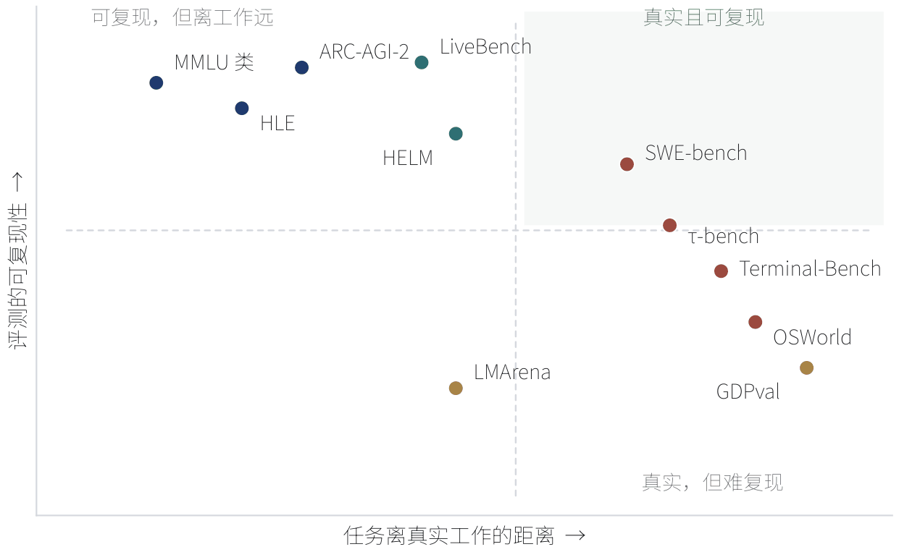
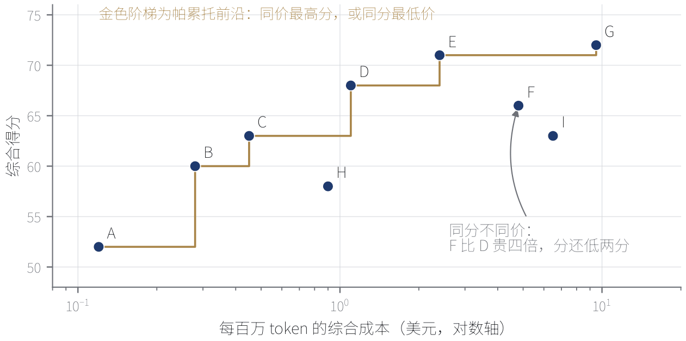

## 榜单：排名在测什么

一张模型卡上通常并排放着几个数字：MMLU 88.7，Arena Elo 1420，SWE-bench Verified 72%，每百万 token 输入 0.3 美元。四个数字来自四套完全不同的测量，量纲不同，样本不同，跑分的人也不同，但它们被放在一起，暗示着一种可以互相换算的能力排序。榜单做的就是这种换算：把一堆异质的测量压成一个名次，让采购、媒体和竞争对手有一个共同的参照点。

问题在于，压缩一定丢信息。丢掉了什么，决定了这个名次能不能用。

### 五种榜单，五种问题

按“测什么”和“谁来测”，市面上常见的榜单大致分五类。

**学术基准汇总榜**。把 MMLU、GPQA、GSM8K、HumanEval 这些静态题集的分数加总或平均，排一个总名次。Hugging Face 的 Open LLM Leaderboard 是这一类最出名的代表，2024 年换过一版题库，把 BBH、MATH Level 5、IFEval、GPQA、MuSR、MMLU-Pro 六项放进来。它的优点是便宜、可复现、任何人提交都能跑；缺点是题目固定，训练数据一旦覆盖，分数就失真。

**人类偏好竞技场**。LMArena（原 Chatbot Arena）让用户在两个匿名回答里选一个，用 Bradley-Terry 模型把胜率拟合成 Elo 分。它测的是“人更喜欢哪个回答”，不是“哪个回答更正确”。2024 年加入风格控制之后，长度和格式的加成被部分剥离，但“讨喜”与“正确”仍然是两件事。

**第三方综合评测**。HELM 把准确率、校准、鲁棒性、公平性、效率放在同一张表里；OpenCompass、SuperCLUE、C-Eval 覆盖中文场景；Artificial Analysis 把质量、价格、速度画在同一张散点图上；LiveBench 每月换题，专门对抗污染。这一类不追求单一排名，追求“多角度看同一批模型”。

**任务型与工程型**。SWE-bench Verified 给 500 个真实 GitHub issue，看模型能不能改对代码并通过隐藏测试；Terminal-Bench 在命令行环境里跑多步任务；OSWorld 操作真实桌面；τ-bench 模拟用户与客服智能体的多轮对话，用数据库最终状态判分。它们测的是“能不能把事做完”，分数低得多，区分度也高得多。

**前沿能力与经济价值**。Humanity's Last Exam 用 2500 道专家题把天花板顶上去；ARC-AGI-2 测抽象推理；GDPval 直接取 44 个职业、9 个行业的真实工作产出，让行业专家盲评。这一类不追求覆盖广度，追求“离真实工作还有多远”。

| 类型 | 代表 | 测什么 | 主要偏差 |
|:--------------|:----------------|:-------------------|:----------------|
| 学术基准汇总 | Open LLM Leaderboard | 静态题集准确率 | 污染、题目饱和 |
| 人类偏好 | LMArena | 成对胜率 → Elo | 风格偏好、投票人群 |
| 综合评测 | HELM、OpenCompass、LiveBench | 多维指标 | 权重选择、成本高 |
| 任务型 | SWE-bench、τ-bench、OSWorld | 端到端完成率 | 环境脆弱、判分苛刻 |
| 前沿/经济价值 | HLE、ARC-AGI-2、GDPval | 专家题、真实产出 | 样本少、评分贵 |

榜单还有生命周期。一个基准刚出现时区分度很好，两三年后前沿模型普遍接近满分，它就从“能力测量”退化成“入场券”。MMLU 在 2020 年是前沿，2024 年之后 90% 已成常态，于是有了 MMLU-Pro 的十选项版本和 HLE 的专家题；HumanEval 的函数级题目被填满后，评测重心移到了 SWE-bench 的仓库级任务，再移到 Terminal-Bench 的多步命令行任务。看一个榜单，先看它处在生命周期的哪一段：上升期的榜单项尖，饱和期的榜单只说明“没掉队”。

### 一个分数里藏着什么

同样是“MMLU 85”，两次测量可能差出好几个百分点，因为分数是好几件事的联合结果：题目版本、提示模板、少样本示例、答案抽取规则、采样预算、以及跑分用的推理框架。

先看统计误差。准确率的标准误是 $\sqrt{p(1-p)/n}$。1000 道题、准确率 50% 时，标准误约 1.6 个百分点；200 道题则接近 3.5 个百分点。这意味着两个模型相差 2 分，在 200 题的基准上完全可能是噪声。榜单通常不报置信区间，读者也就默认那些小数点后一位是有效的。

竞技场的 Elo 是另一套算法，值得单独一节。这里先说一个后果：偏好不构成全序。A 赢 B、B 赢 C，不代表 A 一定赢 C，所以 Elo 榜适合分档（1400 分和 1200 分是两个水平），不适合做精细排序；榜单上相邻两名那几分的差，统计上通常没有意义。它的更新式、Bradley-Terry 拟合和区间估计放在后面展开。

再看采样预算。同一个模型，贪心解码、采样 8 次取多数、采样 64 次再用验证器重排，分数可以差十几分。有的榜单允许提交方自选解码方式，有的统一用贪心；不写清楚，分数就不可比。2026 年有研究把这件事概括成一句话：分数是模型、评测框架、诱导预算、采样人群和污染状态的联合属性。榜单只公布模型和分数，其余四项被折叠进了那个数字里。

最后是框架差异。同一份权重，用不同的 prompt 模板、不同的答案解析、不同的 few-shot 数量，分数会漂移。社区里出现过同一模型在两个榜单上差 5 分的情况，追查下去往往只是 system prompt 不一样。

### 名次是怎么算出来的

榜单上那几分的差到底意味着什么，要从打分方式往回推。Elo 原本是给国际象棋棋手排名的：每个棋手一个分数 $R$，两两对局的期望胜率由分差决定：

$$E_A=\frac{1}{1+10^{(R_B-R_A)/400}},\qquad R_A\leftarrow R_A+K\,(S_A-E_A)$$

$S_A$ 是实际结果，赢记 1、平记 0.5、输记 0，括号里是“超出预期多少”。$K$ 是步长：$K$ 大，单场结果把分数拉得狠，名次变动快、噪声大；$K$ 小，分数平滑，但对真正变强的模型反应慢，新模型要打上几百场才能爬到它该在的位置。

这个更新式有两个性质。分数是相对量：所有人加同一个常数，预测概率不变，所以“1400 分”单独没有意义，只有差值有意义。差值可以换成胜率：400 分是 91%，100 分是 64%，5 分是 50.7%——榜单上相邻两名的“5 分差距”，本质是“打一百场赢五十一场”。另一个性质是在线更新的路径依赖：同样的对局集合，换个顺序喂进去，最终分数不同，而且这种更新给不出置信区间。

Arena 后来换掉了在线 Elo，改用批量拟合的 Bradley-Terry 模型（BT）。BT 假设模型 $i$ 赢 $j$ 的概率

$$P(i\succ j)=\sigma(\theta_i-\theta_j)=\frac{1}{1+e^{-(\theta_i-\theta_j)}}$$

$\theta$ 是每个模型一个待估系数，令 $\theta_1=0$ 定标，否则整体平移不改变概率。给定 $T$ 场对局 $(a_t,b_t,h_t)$，$h_t\in\{0,1\}$ 表示 $a_t$ 是否获胜，最小化二元交叉熵

$$\hat\theta=\arg\min_\theta-\sum_{t=1}^{T}\Bigl[h_t\log\sigma(\theta_{a_t}-\theta_{b_t})+(1-h_t)\log\bigl(1-\sigma(\theta_{a_t}-\theta_{b_t})\bigr)\Bigr]$$

这里没有隐藏步骤：把每场对局看成一条样本，特征是两个模型的 $\pm1$ 指示向量，不带截距、每个模型一个系数，上式就恰好是一个逻辑回归的负对数似然。所以任何逻辑回归库都能拟合 BT，“竞技场分数”就是那组系数乘上 $400/\ln 10$ 再平移到 1000 附近。对 $\theta_i$ 求导并令其为零，得到的是矩条件“模型 $i$ 的期望胜场等于实际胜场”，这也是 BT 能用迭代法（MM 算法）解的原因。

有一个不显眼的前提：比较图要连通。如果几个模型只在自己小圈子里互打过，它们的 $\theta$ 可以整体加减一个常数而不改变似然，榜单却会把它们排进同一个序列。

置信区间有两种算法。pivot bootstrap：有放回地从 $T$ 场对局里重抽 $T$ 场，重拟合一次 BT，重复几百次，取 $\hat\theta$ 的 2.5% 与 97.5% 分位。三明治（sandwich）标准误：不重采样，直接用 Huber-White 稳健协方差算渐近正态区间，好处是不要求 logistic 形式真的成立。Arena 两种都试过，最后部署三明治，因为大样本下它的区间更窄。

有了区间，“名次”的定义也得改。Arena 报的是近似排名

$$R_m=1+\sum_{m'\ne m}\mathbf{1}\{\inf C_{m'}>\sup C_m\}$$

只有当一个对手的置信下界都高过我的上界，才算它排在我前面。这个定义保守，副作用是区间越宽越占便宜：一个对局很少、区间很宽的模型很难被别人“显著超过”，名次就容易虚高；一个对局很多、区间很窄的模型位置被钉死，稍有不如就被挤下去。这是排名幻觉的第一个来源：读者看的是名次，而名次是区间宽度的函数，不只是能力的函数。

第二个来源与统计无关，与提交规则有关。如果一家厂商能在公开发布前私下测 $N$ 个变体、只把最高分的那个放到榜上，榜上那个数字就不再是一次无偏估计，而是 $N$ 次带噪估计的最大值。《The Leaderboard Illusion》(2025) 用模拟量了这个偏差：变体真实水平都设在 1200 分附近，测 20 个再挑最好的，最高分比只测一个时高出约 50 分。现实也对得上：2025 年 4 月之前的一个月内，Meta 在 Llama 4 发布前私下测了 27 个变体；按对局量估算，Google 与 OpenAI 各拿到全部数据的 19.2% 与 20.4%，83 个开放权重模型加起来只占 29.7%（统计范围是 2024 年 1 月到 2025 年 4 月，约 200 万场对局、42 家厂商、243 个模型）。数据多的玩家区间更窄、模型选择更充分，这套优势会自己累积。

第三个来源是题目分布。BT 假定每个模型有一个全局强度，实际强弱依赖题型：A 在代码题上压住 B，B 在写作题上压住 A。谁的投票人群更像某一类用户，谁的名次就更靠那一边。模型下架还会把比较图打出空洞，历史对局仍留在似然里、新对局却补不上，排名就会整块漂移。

### 刷榜：动机与手法

刷榜不是道德问题，是激励问题。榜单影响融资、采购、股价和内部考核，自然有人去优化分数而不是优化能力。古德哈特定律在这里体现得很彻底：当一个指标成为目标，它就不再是一个好指标。

手法大致有五类，按隐蔽程度递增。

**训练集污染**。最常见。把基准题目、答案、甚至解题过程混进预训练数据，模型在测试时等于开卷。2026 年的一篇综述把污染分成五种：直接泄漏（题目原文进训练集）、派生泄漏（改写、翻译、生成同分布题）、时间泄漏（训练数据截止晚于题目发布时间）、分布泄漏（在同类题上过拟合）、以及获取型泄漏（通过 API 反复探测测试集）。只留一个私有测试集，只能堵住第一种。

**对裁判过拟合**。竞技场和 LLM-as-judge 类榜单尤其明显。模型学会写更长、更有结构、更多小标题的回答，因为人类和裁判模型都偏爱这种形式；学会在开头复述问题、在结尾总结，因为评分模板喜欢。这类优化不提升正确性，只提升“看起来对”。

**私有测试与选择性披露**。《The Leaderboard Illusion》(2025) 记录了竞技场的一个结构性问题：少数厂商能在公开发布前拿到私有变体反复测试，挑最好的那个提交，甚至在成绩不理想时撤回。其他人只能提交一次，看到的还是公开榜。同一套规则下，信息不对称让排名系统性地偏向有资源的玩家。

**只报最好配置**。一个模型有十种推理预算、三种工具调用模式，模型卡只报最高的那组数字，不报默认配置。读者以为买到的是榜单上的模型，实际拿到的是默认档。

**版本漂移**。榜单题目悄悄更新、判分脚本修 bug、模型悄悄换 checkpoint，都会让历史分数失去可比性。严肃的榜单会给每次评测打上日期和版本号，不严肃的榜单连“这是哪一版”都说不清。

评测是要花钱的。跑一遍 SWE-bench 要起容器、装依赖、执行测试，几千条任务下来是实打实的算力；GDPval 请行业专家盲评，单条成本以百美元计；竞技场靠用户免费投票，代价是样本自选、人群有偏。谁付这笔钱，决定了榜单的倾向：厂商自建的榜倾向于展示优势项，第三方机构的榜需要赞助或订阅，学术榜依赖基金和志愿者。读到一张榜，不妨先问一句“这是谁出的钱”，答案往往能解释它的选题和口径。

### 榜单的实际意义

说了这么多问题，榜单仍然有用。它的价值不在于精确排序，而在于几件更朴素的事。

还有一个常被忽略的事实：不同榜单之间的相关性很高，但排序不稳。把主流模型在 MMLU、GPQA、Arena、SWE-bench 上的名次放在一起，前五名往往还是那几家，但具体谁第一，换个榜就变。这说明榜单测到的很大一部分是共同因子（模型规模、数据质量、训练投入），而不是各自的专长。真正有信息量的是偏离：一个模型在代码榜上明显高于它的综合名次，那才是它的特点。

**粗筛档位**。一个模型在 SWE-bench 上 20%，另一个 70%，这个差距是真实的，不需要看置信区间也知道前者做不了复杂仓库任务。榜单适合回答“它在哪个量级”，不适合回答“它比另一个强 0.3 分”。

**成本-性能决策**。Artificial Analysis 那类把价格和分数画在一起的图，比单纯的名次有用得多。一个排第 5、价格是第 1 名十分之一的模型，对大多数业务是更好的选择。榜单如果只排名次不标成本，等于假设预算无限。

**回归测试**。对自己团队而言，榜单最大的用处是固定版本的回归：这次改动让 GPQA 掉了 3 分，是噪声还是真的退化？把公开基准当成一套外部回归集，比每次重新造题便宜。

**分项诊断**。总分掩盖结构。一个模型总排名中等，但代码和数学很强、长文写作很弱，这个信息比名次有用。好的榜单会给分项，好的读者只看分项。

**采购尽调**。看榜单时要问：题目版本是什么、谁跑的、采样预算多少、有没有置信区间、成本和延迟是多少、日期是哪天。五个问题里有两个答不上来，这个分数就只能当参考。

它替代不了私有评测。公开基准的分布和你业务里的输入分布不同，判分标准也不同；榜单不测你的延迟要求、不测你的失败模式、不测你的成本约束。一个在榜单上排前十的模型，在你的场景里可能因为一个格式问题不可用。

工业界的选型通常是两段式：先用公开榜把候选从几十个缩到三五个，再用自己的私有集做 PoC。公开榜负责排除明显不合适的（成本太高、能力档位不够、许可证不满足），私有集负责回答“在我的输入上表现如何”。跳过第一段会浪费大量时间，跳过第二段则可能选中一个“榜上很强、业务里不能用”的模型。

### 怎么读，怎么建

读榜的顺序可以固定下来：先看日期和版本，再看分项，再看成本和延迟，最后才看名次。名次是给别人看的，前三项是给自己用的。

如果要做自己的评测，几百条领域题就够了，但有几件事必须做对。题目要从真实业务里采样，不要自己编；判分标准要写成可执行的规则，能自动判就自动判，不能自动判就双人盲评；固定模型版本、提示模板和解码参数；用 pass@1 看能力，用 pass$^k$ 看稳定性——τ-bench 提出的这个指标衡量的是“连续 k 次都成功”的概率，一个单次 90% 的智能体，十次全对的概率只有 35%，这个差距在生产环境里是致命的。最后，定期换题，保留一份从不公开的私有集。

榜单是地图，不是领土。它能把明显不合适的选项排除掉，能在预算谈判时提供一个锚点，能让你发现自己在某个维度上落后。但它选不出“最好的模型”，因为“最好”取决于你要它做什么。这件事只能由你自己的评测回答。
