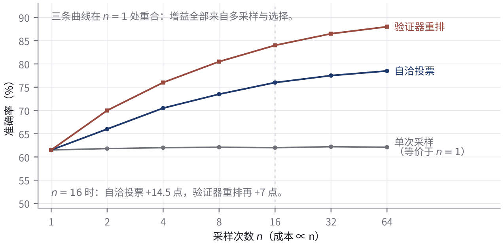

## 测试时计算：多想一会儿

把同一道竞赛题连着问五遍，会得到五个不同的解答过程：两三个答案一样，另外几个各说各话。采样有随机性，换个种子结果就变，并不稀奇。有意思的是后来被证明有效的那一步：不改模型，把这五遍都算完，再对答案投票。正确率就这么抬了上去。

投票这个动作几乎没有技术含量，管用的前提在更前面。模型得真的算出不同的东西，且其中至少有一条是对的。多写几个 token、多走几条路径，就可以把单次前向里用不上的算力兑换成准确率。这条通道从 2022 年起被当成独立的缩放维度，与参数量、数据量并列。

### 深度不够，长度来补

一个 $L$ 层的 Transformer 做一次前向，串行计算的步数就是 $L$。层与层必须依次执行，第 30 层的输出要等第 29 层算完。于是模型在吐出第一个 token 之前，能做的运算量有一个硬上限：几十次矩阵乘法，问题再难也只有这么多。

对“这句话是褒义还是贬义”这类判断，这个预算绰绰有余。问“17 乘 23 等于多少”也还行，乘法表在参数里。改成“一个班 40 人，男生比女生多 4 人，男女生各多少”，模型要在一次前向里完成建模、消元、回代，误差随步数累积。2022 年的实验显示：同一个模型直接给答案，在小学数学题上只有一成多正确；让它先写步骤，正确率翻了几倍。

把中间结果写进上下文，下一步前向就能读到。串行步数因此从 $L$ 变成 $L$ 乘以生成的 token 数：写 200 个 token 的推导，等于把网络的深度临时放大两个数量级。这套解释后来被反复验证。参数量固定时，思维链（Chain of Thought，CoT）带来的增益与题目所需的推理步数正相关，与模型对题目的熟悉程度负相关；答案能在参数里直接查到的，写步骤反而多余。

《Chain-of-Thought Prompting》(2022) 给出的做法是最原始的形态：在提示里放八个带解题步骤的样例，模型就会模仿着写。有效的前提是它见过足够多的步骤化文本，教材、习题解答、代码注释都算。这点常被略过。CoT 并非凭空长出的新能力，它只是把预训练时学到的推导文风激活了出来。同一年另一篇工作报告了一个更省事的发现，只在问题后加一句 Let's think step by step，GSM8K 上的准确率就从 17.9% 升到 40.7%（《Large Language Models are Zero-Shot Reasoners》(2022)）。一句话值二十多个点。

把这条提示拆开看，它是一串三元组。每条样本是 $(x_i,r_i,y_i)$：$x_i$ 是题面，$r_i$ 是一段自然语言推理，$y_i$ 是最终答案；提示把这八条拼起来再挂上待解的那道题 $x$，模型要续写的就是 $r$ 和 $y$。八条样例全部人工撰写，论文明确说没做过提示工程，格式统一成算式结尾加一行 `The answer is X`，抽答案时只匹配最后一行。除了 AQuA 那道选择题换用四条训练集样例，其余算术任务共用同一套八条。推理时就是普通解码：贪心，不采样，没有额外的触发与停止规则，生成到换行为止。便宜的地方也在这里——不训练，不改权重，多花的只是输出 token。

两处消融最能说明它的机制。其一把中间步骤换成“只输出算式”：GSM8K 上几乎没有提升，说明难点不在把文字转成算式，而在把题意一步步拆开；但在一步两步就解完的题上，只给算式就够了。其二把中间步骤换成与算式等长的省略号串：同样的 token 数、同样的前向次数，却不给任何语义，结果与直接作答持平。这两组对照说明增益来自“用自然语言写出中间量”，不来自“多算了几个 token”。算力解释只对了一半。

规模是硬门槛。这篇论文里 CoT 只在千亿参数（100B）以上才转正：参数量小的模型也能写出通顺的步骤，但步骤之间不成立，准确率反而低于直接作答。

代价同样直接。生成 200 个 token 的延迟是生成 20 个的十倍，成本同比例上涨。误差传播更难处理：前面某一步算错，后面沿着错误前提推下去，结论仍然写得很有信心。分解步骤把一个“可能对”的答案变成了一串“必须每步都对”的链条，这个脆弱性在后来的长思维链模型里表现为想得越久越容易中途跑偏。

### 采样多次，然后投票

单条路径可能错，多条路径的错误方向往往不一样。自洽性（self-consistency）把这种观察变成算法：用较高的温度采样 $m$ 条完整推理链，抽出各自的最终答案，取出现次数最多的那个。

《Self-Consistency》(2022) 在 PaLM 540B 上报告的数字有说服力：GSM8K 上贪心解码的 CoT 是 56.5%，采样 40 条再投票是 74.4%。基线和上限都没变，模型没变，题也没变，只是把一次采样换成了四十次。同一方法在 SVAMP、AQuA 上有十到二十个点的提升，在需要多步算术的任务上最明显。

写成式子：采样 $m$ 条 $(r_i,a_i)$，$r_i$ 是第 $i$ 条推理链，$a_i$ 是这条链给出的最终答案；把推理链当隐变量边缘掉，意思是只对答案求和、把链的成绩算到它最后的答案头上

$$a^\star=\arg\max_{a\in\mathcal{A}}\sum_{i=1}^{m}\mathbf{1}[a_i=a]$$

$\mathcal{A}$ 是这 $m$ 条链里出现过的答案集合，$\mathbf{1}[\cdot]$ 是指示函数，方括号里成立取 1、不成立取 0，$m$ 是采样条数。求和这一步就是在数票：不管中间怎么绕，只看最后落在哪个答案上，谁落得多选谁。采样参数不是随手设的：PaLM 540B 用温度 0.7、top-$k=40$，UL2-20B 与 LaMDA-137B 用温度 0.5、top-$k=40$。温度太低，$m$ 条几乎一样，投票退化成一个样本；温度太高，正确的推理也被打散，边际收益提前饱和。论文只扫到 40 条，曲线在这个区间内仍在涨但已明显变平。

一个自然的改进是给票加权，按每条链的似然而不是一人一票。论文试过，GSM8K 上是 74.1% 对 74.4%，反而略低；归一化加权在别的任务上互有胜负。不加权就能打平，说明信号主要在“答案出现的频次”里，不在“某条链写得多顺”里。这也解释了它为什么便宜：不需要第二个模型来打分。



上图把三条曲线放在一起。纯采样那条是平的，取第一条就是它。多数投票随采样次数大致按对数上升，四十次之后趋缓。带验证器重排的曲线起点更高、斜率更陡，不过会撞到验证器本身的天花板。

为什么投票管用？如果每条路径独立地以概率 $p$ 得到正确答案，错误答案又分散在大量不同的值上，多数票正确的概率随 $m$ 上升。关键在后半句：错误必须分散。要是模型有一个稳定的错误模式，比如总把“每个”读成“总共”，那 40 条路径会一致地错，投票只会强化错误。自洽性在答案空间大、错误模式多样的算术题上有效，在二选一的判断题上收益有限。

投票还要求答案能被规整成同一个符号：$1/2$、$0.5$、“一半”得映射到同一个键，表达式要先化简再比。工程上这一步比算法本身更容易出错，不少“自洽性没效果”的报告，根子在抽取脚本把等价答案判成了不同类。

### 谁来判对错

数学题的答案好判，开放问题的答案不好判。想在写作、方案设计这类任务上做重排，就需要一个能打分的东西：验证器（verifier）。

最粗的版本是结果奖励模型（Outcome Reward Model，ORM）：给问题与完整解答打一个分，用它从 $N$ 条候选里挑最好的——$N$ 是每题先采样的解答条数，下面说的 best-of-$N$ 就是这个数。它只看终点——标注成本因此低得多，知道最终答案对不对就够了。

更细的版本是过程奖励模型（Process Reward Model，PRM）：给每一步打分。理由在于搜索需要中间信号。只有终点分，$N$ 条完整路径里只能挑一条，中途无法剪枝；有了逐步的分，才能做束搜索，把算力集中在有希望的分支上。

两者的训练信号差别只在标签的粒度。ORM 的输入是整条解，输出一个标量，损失是二分类交叉熵；PRM 在每一步末尾那个 token 的位置上预测一个“这一步对”的 token，损失是各步相加

$$\mathcal{L}_{\mathrm{PRM}}=-\sum_{i=1}^{K}\bigl[y_{s_i}\log r_{s_i}+(1-y_{s_i})\log(1-r_{s_i})\bigr]$$

$K$ 是步数，$s_i$ 是第 $i$ 步末尾那个 token 的位置，$y_{s_i}\in\{0,1\}$ 是这一步的标签，$r_{s_i}$ 是模型在该位置给出的“对”的概率。这样训练不用改结构，一次前向就能拿到全解各步的分数。

单步分数要聚合成一个解分才能比大小，聚合法有三种：各步概率相乘（要求每步都对）、取最小值（最弱一步决定）、取最后一步的分数。前者是 Let's Verify 的选择，中者是 Math-Shepherd 的选择；后来的测试时计算工作发现最后一步的分数最好用，理由是逐步奖励本来就稀疏，“到目前都没错”这件事已经展现在最后一个位置上。这不是实现细节，换个聚合法，best-of-$N$ 的结果会跟着变。

标签从哪来是这套方法的分水岭。人工标法很贵，量级见下一段；自动标法把补全器当裁判：从第 $i$ 步用补全器续写 $M$ 条完整解（Math-Shepherd 取 $M=8$），数其中有多少条最终答对。硬估计只问“有没有一条对”，软估计直接用答对比例。拿 160 条人工标注的步做对照，硬估计在 $M=4$ 时的标注准确率是 86%；$M$ 再大反而下降，因为继续采样会把偶然蒙对也算成潜力。

《Let's Verify Step by Step》(2023) 系统比较了这两种做法。他们雇人标注了 80 万步级别的过程数据（PRM800K），每个标注单元是一个解题步骤，标成正面、负面或中性。结论有两层：在 MATH 测试集的 500 道题上，用 PRM 引导搜索比用 ORM 重排准确率更高；过程监督训出的验证器泛化也更好，在没见过的题目分布上仍然判得准。具体数字：每题采 1860 条候选，PRM 重排解出 78.2%，ORM 72.4%，多数投票 69.6%。差距全在挑，不在生成。

代价藏在标注里。标一个最终答案只需判断对错，标一条二十步的解答要读懂每一步，还要判断“这一步写法奇怪但等价”这类情况。80 万步的标注量靠外包团队加一套规范，成本在百万美元量级。过程标注本身也有歧义：一个步骤算“正确”，是指它在数学上成立，还是指它在通往正确答案的路上？

验证器还有一个结构性上限。检查一个证明是否成立通常比想出一个证明容易，但这个不对称只在验证器比生成器知道得更多时成立。两者若是同一个模型，验证就退化成了自我确认。

这个上限有实测。在 MATH 上用 Llama-3-8B 反复采样，100 条时覆盖率 82.9%，采到 10000 条升到 98.44%——几乎每道题都至少有一条正确解躺在样本里。但同一批样本交给多数投票或奖励模型去挑，只从 40.50% 挠到 41.41%（《Large Language Monkeys》(2024)）。生成侧的天花板还很高，选择侧已经撞墙。

### 搜索：把采样变成树

有了逐步打分，采样就可以组织成搜索。最直接的是束搜索：设每题生成 $N$ 个候选、束宽 $M$，先从题面采样 $N$ 条第一步，用 PRM 打分，只留前 $M$ 条；再从每条留存的候选各采样 $N/M$ 条下一步，凑回 $N$ 条，重新打分、重新截断；重复到解结束或轮次上限（那篇工作里是 40 轮）。最后在手头的 $N$ 个完整解上做加权投票：同一最终答案的分数相加，取总分最高的答案，而不是取单条最高分的解。这一步容易被写成“取最高分那条”，但两者选出的答案并不总是相同。

比束搜索更一般的是树搜索。《Tree of Thoughts》(2023) 把中间状态写成 $s=[x,z_1,\dots,z_i]$——题面加上已生成的想法串，然后要求实现者回答四个问题：一个想法切多细（十字谜一个词、24 点一行算式、写作一段提纲）；每个状态往外生成几个候选（同一提示独立采样，或用一条“提议”提示一次列出 $k$ 个）；怎么给状态估值（让模型单独打分，或让它在一组状态里投票选出最有希望的）；用什么搜索算法。论文给了两个实例：广度优先，每层按估值保留前 $b=5$ 条，深度上限 $T=3$；深度优先，沿最有希望的分支往下走，估值低于阈值 $v_{\mathrm{th}}$ 就剪枝并回溯到父节点。在 24 点游戏上，GPT-4 直接提示解出 4%，CoT 也是 4%，ToT 到 74%。

蒙特卡洛树搜索把这套动作固化成四步循环，每一步都有明确的量：

```text
选择  从根节点按 UCB 下行到叶节点 s
       a* = argmax_a [ Q(s,a) + c * sqrt( ln N(s) / N(s,a) ) ]
扩展  从 s 采样 k 个后继状态，挂到树上
模拟  从新节点用生成器滚到解尾，把最终答案的对错当回报 R
回传  沿路径更新 N(s,a) += 1,  Q(s,a) += (R - Q(s,a)) / N(s,a)
```

$N(s,a)$ 是这条边走过的次数，$N(s)$ 是从状态 $s$ 出发走过的总次数——分子里的它让同一状态下被冷落的动作分数偏高，$Q$ 是这条边的平均回报，$c$ 控制探索：$c$ 大，没试过的分支更容易被选中；$c$ 小，搜索收敛到当前看好的分支。公式里的根号是关键：分母小（试得少）时惩罚项大，逼着搜索去碰冷门分支。用 PRM 时模拟可以省掉——PRM 对这一步的分数直接当 $R$。测试时计算那篇论文里的“前瞻搜索”就是删掉随机探索的版本：束搜索的每步向下多滚 $k$ 步，用滚到头的 PRM 分数代表当前步的价值，$k=0$ 退回普通束搜索。作者的说法很直白：PRM 已经训好且冻结，MCTS 那些为了学值函数而加的随机性没必要保留，测试时该利用而不是探索。

搜索与采样的差别在于算力怎么花。采样把预算平摊在所有完整路径上，一条路走到黑；搜索把预算压在看起来有希望的前缀上，能提前砍掉走不通的分支。在解题这类有明确中间状态的任务上，中等难度且预算不大的区间里，搜索明显比平铺采样划算；预算加大、题目变简单，这个优势会反过来。

不过搜索有一个自噬的倾向。它优化的是验证器的分数，正确答案的概率并不在目标里。搜索越深、候选越多，越容易找到验证器的漏洞。某类格式、某种语气、某个长度——都能把分数刷上去而答案仍然错。这是一场主动的对抗，在验证器的盲区里做梯度上升。

《Scaling LLM Test-Time Compute》(2024) 把测试时计算分成两类用法：密集的过程搜索，分布式的采样加修订，再测每种在什么条件下划算。其一，在小模型上投入大量测试时计算，可以让它超过参数量大十四倍的模型，但仅限难度适中的题；题太简单，验证器判不出高下，题太难，验证器也救不回来。其二，让模型修订自己的答案，效果不如独立采样后重排，因为模型缺乏定位错误的能力，修订往往只在原答案附近打转。

### 预算怎么分

难度这个变量比预想的重要。同一套搜索策略，简单题采到第四条就稳定正确，后面六十条全是浪费；难题上要采上百次才见到第一条正确路径。固定预算的搜索因此是低效的，预算必须按题分配。

分配需要一个难度信号。采样的一致性最容易算：把 $N$ 条答案聚类，看最大簇占比。PRM 的分数分布也可以用，看各条路径的平均分是否接近。实在不行，就单独训一个难度预测器。

《Scaling LLM Test-Time Compute》(2024) 里那个计算最优的策略就建立在这个信号上：对每道题先采 2048 条，算 pass@1，按分位数切成五档（这是“事后”的难度，部署时没有答案），再用同一个验证器给这 2048 条打分、按平均分切同样的分位。两种切法在小预算区间给出的策略接近，预算拉高后预测难度的那份会掉一些——难度估错，档位就分错了。这一点比难度定义本身更重要：难度可以从模型自己的输出里读出来，不需要标注。

有了分档，策略就能按档选，而结论与直觉有一处相反。简单题（一、二档）加大预算做束搜索反而变差，因为验证器在简单题上几乎总判对，继续按它的分数优化只是在放大它的伪特征；中等难度（三、四档）束搜索稳定优于 best-of-N；最难的一档什么方法都推不动，多花的算力买不到东西。按这个规则分配，用 16 次生成能接近 best-of-N 64 次的水平。这实际是把第 14 章的长度与难度课程搬到推理时：模型要学会对不同难度的问题写不同长度的解，调度器要学会对不同难度的问题花不同的算力。

把横轴换成对数刻度，多数曲线在相当一段区间内近似直线：覆盖率随采样次数的对数近似线性上升，可以用幂律拟合（《Large Language Monkeys》(2024)）。直线有两个用处。一是外推：手头只有 16 条采样的点，能估 256 条会在哪；有效范围是“还没饱和”的那一段，曲线开始变平就说明这种方法的账已经算完了。二是比斜率：同样的算力增量，斜率大的方法买到更多。

实践里最难的是校准。模型的自我报告往往过度自信，它说“我很确定”与实际正确率的相关性不强。一个补救办法是用采样的一致性代替自我报告：16 条采样给出 16 个不同答案，无论模型嘴上怎么说，这题对它就是难的。这个信号不需要额外训练。

### 把预算拧成一个旋钮

前面的方法都在“选”：多采样、多搜索，再从候选里挑。另一条路是让模型把思考本身写长，长度直接当旋钮。《s1》(2025) 的整套方法只有两个动作，都作用在一个标记上：模型每段推理结束时都会生成一个“结束思考”的分隔符。

限制预算时，一旦思考 token 数超过上限，就在当前位置强行插入这个分隔符，模型于是认为思考结束，转入作答。追加预算时反过来：抑制这个分隔符的生成，同时往推理痕迹末尾追加一个 `Wait`，模型读到“等等”，多半会回头检查前面几步，一段本来要结束的推理就这样继续下去。两个动作都不改权重，只在解码时干预。触发条件是“想结束”或“超预算”，停止条件就是新的预算上限——预算因此可以精确到 token，而不是只能选采样条数。

这套行为是训出来的，不是提示出来的。他们从 16 个来源收 59029 道题，按质量（去掉格式坏的样本，剩 51581 道）、难度、多样性三条筛到 1000 道（s1K），用更强的模型生成推理痕迹，在 16 张 H100 上微调 26 分钟，得到 s1-32B。

效果上，在 AIME24 上把预算一路推高，准确率从 50% 升到 57%，超过了它自己不干预时的上限——是外推出来的，不只是把已有能力摆到明面上。代价也明确：强行截断会让模型在没想完时作答，准确率掉；`Wait` 追加太多次会退化成重复同一段话，等于空转。消融里，只用最长的轨迹、只取最多样的样本、随机抽 1000 条，三种做法在 AIME24 上平均掉约 30%。选数据这件事比调预算更影响上限。

### 把搜索结果收回去

测试时计算绕不开一个经济问题：它按查询收费。一次 64 条采样的搜索，成本是单次生成的 64 倍，日均百万次调用的服务不可能这么跑。

于是有了蒸馏：用搜索生成大量轨迹，筛出答案正确的那些当微调数据，训一个一次前向就能给出好答案的模型。这个做法在数学和代码上都被验证过，32 条采样的搜索能力可以被压进单次生成，推理成本回到原来的水平。再往前一步是迭代，用蒸馏后的模型重新搜索，生成新轨迹，再蒸馏一次，每一轮的上限由当前模型的覆盖率决定。

《Large Language Monkeys》(2024) 把覆盖率测得很清楚。在 SWE-bench Lite 上，DeepSeek-Coder-V2-Instruct 单次采样只解决 16% 左右的题（15.9%），采样 250 次能把至少有一条正确解的比例推到 56%。两个数字之间的落差就是测试时计算的空间，也是蒸馏的上限：模型先得能采样出正确答案，才有东西可学。覆盖率随采样次数大致按对数增长，看不到饱和，但增速在放慢。

::: {.keypoint}
测试时计算买到的不是新的推理能力，而是把模型已经具备、藏在采样分布尾部的能力挑出来的机会。收益由覆盖率决定，成本由验证器决定：没有可靠的对错信号，多算只会让人更自信地错。
:::

蒸馏也有损失。学生学到的是这条路径的写法，至于它为什么对，模型并没有学到。它会模仿长篇推导的表面形式，包括那些对正确性毫无贡献的部分，于是回答变长、延迟上升，换到分布外的题目上仍然掉。更微妙的是，“何时该多想”这个决策被一并抹平了：学生模型对每道题都写同样长的解。

到这里，故事的轮廓清楚了。一个能产生多样路径的生成器，一个能判断对错的验证器，一个会分配预算的调度器，三者里最难的是验证器。数学和代码成为这条路线的主战场，靠的是它们自带答案检查：数学题有标准答案，代码有单元测试。跟“更需要推理”没什么关系。

代码还多给了一样东西：它可以直接跑。程序执行起来，输出对不对立刻知道，不需要人判断。
