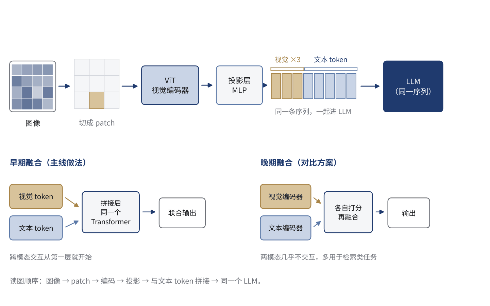

## 多模态：把图像与声音接进语言模型

让一个视觉语言模型数一张合影里有几个人，它常给出一个自信的错数。描述场景、读图里的招牌、回答“左边的人穿没穿外套”都不成问题，一数数就出错。问题不出在看不懂。图像进入模型时已经被切成几百块，每块压成一个向量，块与块之间原本精确的空间关系，只剩下位置编码里的一点残余。

这种失败暴露了多模态的核心工程问题：怎么把另一种模态的信号塞进一个只为离散 token 设计的序列模型，同时不让信息在接口处丢掉。

### 图切成块

2020 年，ViT 把图像当成一句话处理。输入是一张 $x\in\mathbb{R}^{H\times W\times C}$ 的图，块大小 $P\times P$，块数由分辨率直接决定：

$$N=\frac{HW}{P^{2}}$$

224×224 配 16×16 是 196 块，配 14×14 是 256 块。每块按行拉平成 $P^2C=768$ 维向量，乘一个可训练的投影矩阵 $E$ 映射到模型维度 $D$，最前面拼一个可学习的分类 token，整体再加上一份位置嵌入：

$$z_0=\left[x_{\text{class}};\,x_p^{1}E;\,\dots;\,x_p^{N}E\right]+E_{\text{pos}},\qquad E_{\text{pos}}\in\mathbb{R}^{(N+1)\times D}$$

这个序列进 $L$ 层标准编码器——前置 LayerNorm、多头自注意力、GELU 两层前馈、残差——最后只取分类 token 那一位的输出接分类头。ViT-B/16 取 $D=768$、12 层、12 头，共 86M 参数，规模刻意与 BERT-base 对齐，好让“换个输入模态、结构不动”这句话成立。

位置嵌入用的是最朴素的 1D 可学习查表：第 $i$ 块加第 $i$ 行向量。论文试过 2D 感知的位置编码，没有测出明显收益，原因大概是切块之后 patch 之间只剩顺序关系，二维先验从哪来都要靠数据补。代价是 patch 的空间结构不在结构里，只在参数里，于是换个分辨率微调时位置表就对不上——$N$ 变了，行数也变了。论文的处理是按原图坐标对位置嵌入做 2D 双线性插值；这也是整个模型里除“切块”之外唯一手工注入二维结构的地方。

成本随 $N$ 变化，而且是两处同时变。自注意力每层要算 $N\times N$ 的相似度矩阵，计算量 $O(N^{2}D)$，patch 边长减半，$N$ 变四倍，注意力部分变十六倍，前馈部分只变四倍。把 $P$ 压到 1、一个像素一个 token，$N=50176$，单层注意力矩阵就有 25 亿个元素，没有实用价值；反过来把 ResNet 的特征图当 token（论文里的混合架构），$N$ 可以压得很小，但卷积的归纳偏置又被请了回来。ViT 的整个论证就架在这个折中上：先接受 $N$ 不大、块内信息靠线性映射硬吃，再把规模堆到数据能补回先验的程度。

《An Image is Worth 16x16 Words》(2020) 的结论在当时并不显然：卷积网络的两种归纳偏置，局部连接与平移等变，被普遍认为对视觉不可省。实验显示，在中等规模数据上 ViT 确实不如 ResNet；在 3 亿张图的 JFT-300M 上预训练之后，它超过了所有卷积模型。数据够多时，那些偏置可以从数据里学出来，架构不必预先写死。ViT-H/14 在 ImageNet 上到 88.55%，训练用的是 4096 的批和 0.1 的权重衰减。

一个概念上的别扭之处：文本的 token 有语义边界，一个词就是一个单位；patch 是人切出来的，一个可能横跨物体边缘，另一个可能整块是天空。模型得自己学会把跨块的形状拼起来。

### 把图和文放进同一个空间

CLIP 解决另一个问题：怎么让图像的表示和语言对齐，使得“狗”这个词和狗的照片在同一个空间里靠近。

做法是双塔加对比学习。图像塔 $f$ 与文本塔 $g$ 各出一个向量，各自乘一个投影矩阵落到同一个 $d_e$ 维空间并做 L2 归一化，然后在一个 batch 内算所有配对的内积：

$$\ell_{ij}=\frac{1}{\tau}\,z_i^{\top}t_j,\qquad z_i=\frac{W_i f(x_i)}{\|W_i f(x_i)\|},\quad t_j=\frac{W_t g(y_j)}{\|W_t g(y_j)\|}$$

$\tau$ 是温度，越小分布越尖。CLIP 没把它当超参，而是存一个对数参数随训练一起学，初值取 $1/0.07\approx14.3$，并裁剪到使 logits 的放缩倍数不超过 100，否则前期容易发散。归一化之后内积就是余弦相似度，温度再把它放大到 softmax 能用的范围。

损失是同一张 $\ell$ 矩阵上两个方向的交叉熵，标签都是“第 $i$ 个”：

$$L=\frac{1}{2}\left[\frac{1}{N}\sum_{i}\mathrm{CE}\left(\ell_{i,:},\,i\right)+\frac{1}{N}\sum_{j}\mathrm{CE}\left(\ell_{:,j},\,j\right)\right]$$

按行做 softmax 是“给这张图从 $N$ 段文本里挑一段”，按列做是“给这段文本从 $N$ 张图里挑一张”。白话：把对角线那 $N$ 个格子的分数顶上去，其余 $N^2-N$ 个格子压下去。梯度也只做这件事——第 $i$ 行的 softmax 概率 $p_{ij}=e^{\ell_{ij}}/\sum_k e^{\ell_{ik}}$，损失里只有 $-\log p_{ii}$ 一项，对 $\ell_{ii}$ 的梯度是 $p_{ii}-1$，对 $\ell_{ij}\,(j\neq i)$ 的梯度是 $p_{ij}$，都是“离目标还有多远”的直接度量，没有额外设计。

两个方向各算一次，是因为两个方向的负样本集合不同：图像 $i$ 面对的是批内其余 $N-1$ 段文本，文本 $j$ 面对的是其余 $N-1$ 张图。只做单向会丢掉一半信号，而两路 embedding 已经算好，多出来的只是一个转置 softmax，几乎免费。

批量因此不能小。负样本只从批里来，批为 $N$ 时每个正样本对应 $N-1$ 个负样本；32768 就是三万多，1024 只剩一千。CLIP 用 32768 的批、AdamW、32 个 epoch，数据是网上爬来的 4 亿图文对（《CLIP》(2021)）。代价是一张 $N\times N$ 的相似度矩阵：32768 的平方是 10.7 亿个元素，单卡放不下，所以相似度计算本身也得切碎，每张卡只算自己那部分 embedding 需要的子块。这是“批要大”最物理的来由：不是收敛快，而是负样本靠批内凑，批大等于负样本库大。

另一个被换掉的选择是让文本塔逐词生成图像描述。论文试过这个做法：63M 参数的文本 transformer 学 ImageNet 类别的速度比词袋基线慢三倍；改成“只判断哪段文本配哪张图”的对比目标，效率又好四倍。差别在于后者不要求重建措辞，只要求把配对的拉近，而同一张图配十种写法都算对。

最有名的那个数字来自零样本分类：在 ImageNet 上不做任何微调，把 1000 个类名写成“a photo of a {class}”，取相似度最高的那个，准确率 76.2%，与全监督训练的 ResNet-50 持平。

任务形式也跟着变了。分类从“在固定标签集里选一个”变成了“在一段文本里找最像的”，标签成了自由文本，词表开放。检索、零样本检测、图文匹配，都从这一个能力里长出来。代价是对措辞敏感：同一组权重，把类名换成一句模板化的描述，ImageNet 上就能多出几个点。

局限同样清楚。对比学习只对齐全局语义，不建模细粒度关系：CLIP 分得清狗和猫，分不清“狗在猫左边”。计数也不行，图里的小字几乎无能为力。这些短板直接决定了后来视觉语言模型在图表、文档、计数任务上的表现。

### 把 softmax 换成 sigmoid

对比损失的分母要跨越整个批，这带来两个后果：每张卡都得拿到全部 embedding（一次 all-gather），并且损失的定义依赖批的组成——批一变，任务就变。SigLIP 把 $N^2$ 个配对拆成 $N^2$ 个独立的二分类：

$$L=\frac{1}{N}\sum_{i=1}^{N}\sum_{j=1}^{N}-\log\sigma\!\left(z_{ij}\left(-t\,x_i^{\top}y_j+b\right)\right)$$

$x_i,y_j$ 是归一化后的图像与文本 embedding，$z_{ij}=+1$ 表示配对、$-1$ 表示不配对，$t$ 是可学习温度（初值 $\log 10$，即 $t=10$），$b$ 是可学习偏置（初值 $-10$）。白话：每个格子单独回答“这一对配不配”，配就往 sigmoid 的 1 端推，不配就往 0 端推，谁也不看别人。

两个初始化值有讲究。$N^2$ 里正样本只有 $N$ 个，负样本 $N^2-N$ 个；16000 的批是 2.68 亿个负样本对 16000 个正样本。偏置从 0 开始，负样本项会主导损失，前期梯度全花在纠正这个先验上。把 $b$ 初始到 $-10$，等于一开始就说“先假设不配”。论文的消融里，去掉偏置或把偏置初始化成 0，各任务都稳定更差。

好处直接换算成显存。没有全局归一化，就不必 all-gather 全部 embedding，内存只与分块大小有关；同样四张 TPUv4 能放下 4096 的批，CLIP 式损失只放得下 2048。批小时 sigmoid 明显更好，16k 以上差距收窄，两边都在 32k 附近饱和；批推到一百万也没有额外收益。SigLiT 用四张 TPUv4、冻结公开的 g/14 图像塔，两天训到 ImageNet 零样本 84.5%（《Sigmoid Loss for Language Image Pre-Training》(2023)）。

代价是丢掉批内的竞争。softmax 里抬高一个正样本会顺带压低同行的负样本，等于自带难负样本挖掘；sigmoid 每个格子独立，难负样本得另外造。副作用反倒有个好处：逐对独立的损失对标签噪声更宽容，论文在故意加噪的图文对上测过，退化曲线比 softmax 平。

### 把视觉压进少量 token

把 CLIP 特征直接喂给语言模型有一个尺寸问题。ViT-L/14 在 336 分辨率下输出 576 个 token，每个 1024 维。这些 token 若全部塞进上下文，成本相当于五百多个词，而它们携带的信息可能只有一句话那么多。

BLIP-2 的做法是在中间放一个可学习的瓶颈。它冻结图像编码器，冻结语言模型，只训练中间一个叫 Q-Former 的小模块。模块里有一组固定的可学习查询 $Q\in\mathbb{R}^{K\times d}$，取 $K=32$；图像编码器给出的特征序列 $X_v\in\mathbb{R}^{M\times d}$ 当键和值，查询只从它里取信息：

$$A=\mathrm{softmax}\!\left(\frac{QW_Q\,(X_vW_K)^{\top}}{\sqrt{d}}\right),\qquad \mathrm{out}=A\,(X_vW_V)$$

关键是注意力矩阵的形状：$K\times M$，而不是 $M\times M$。于是不管原图多大，输出永远是 $K$ 行，每个查询给一个向量，下接若干层后变成固定 32 个 token。复杂度对 $M$ 是线性的，而自注意力对 $M$ 是平方的。

结果是 32 个 token 装下了一张图。整个模型只有 1.88 亿参数可训练，零样本 VQA 上比可训练参数多五十几倍的 Flamingo-80B 还高 8.7 个点（《BLIP-2》(2023)）。

这个模块顶掉的是最简单的做法：把 patch 特征按 2×2 邻域求平均，576 个变 144 个，再一层变 36 个。池化不用训练、不增参数、不挑输入分辨率，但它对所有位置一视同仁——图里该保留的是招牌上的字还是天空，它不知道。查询式压缩把“该看哪里”交给训练信号：查询在图文对比、图文匹配、图像描述三个目标下被推着去取与文本相关的特征。代价是它得训，而且 $K$ 成了新的超参：定小了信息装不下，定大了和直接用 patch 没区别。

设计的要点是解耦：进入语言模型的视觉 token 数与图像分辨率无关。分辨率再高，进来还是 32 个。代价也落在这里——32 个向量装不下细节，BLIP-2 在需要读小字、数物体、定位的任务上明显弱。

Q-Former 分两阶段训练。第一阶段用图文对比、图文匹配、图像描述三个目标，让查询向量学会提取与文本相关的视觉信息；第二阶段把它的输出接到冻结的语言模型上，用语言建模目标训练，让这些向量落在模型能读的位置。

### 一层投影就够

LLaVA 把中间模块进一步简化：不要 Q-Former，只要一层线性投影。记视觉编码器的输出矩阵为 $Z_v\in\mathbb{R}^{576\times 1024}$，投影矩阵 $W\in\mathbb{R}^{4096\times 1024}$，拼进序列的视觉部分是

$$H_v=Z_vW^{\top},\qquad H_v\in\mathbb{R}^{576\times 4096}$$

$4096$ 是 Llama/Vicuna 的词嵌入维度。$W$ 只有 4.2M 参数，占 7B 模型的万分之六。然后 $H_v$ 与文本 token 的嵌入按图像在前、指令在后的顺序拼成一个序列，用标准的下一 token 预测训练，损失只在回答那一段上算，视觉与提问部分不计入（《Visual Instruction Tuning》(2023)）。

一层矩阵就能用，说明 CLIP 的视觉特征与词嵌入空间已经足够接近，只差一个线性变换。这个结论值得停一下：换成一个更深的 MLP 桥，参数量与训练成本都算上涨，而当时更稀缺的是快速迭代数据的能力——投影层轻到可以几小时重训一次，省下的算力被拿去多做几轮数据实验。反过来，如果视觉塔没经过图文对齐训练（比如从监督分类的 ResNet 起步），同样的线性层接不上，得用 Q-Former 那种带查询的模块硬扭。

上图左边是这条路径：patch 进 ViT，投影，然后与文本拼接。下方那两条并排的流程是另一种接法，后面再说。

训练数据是这项工作更重要的贡献。他们把 COCO 的标注、检测框、区域描述喂给纯文本的 GPT-4，让它生成对话、详细描述、复杂推理三类指令数据，共 15.8 万条。视觉指令数据没有一条是人标的，全部由语言模型从已有标注改写而来，成本降了一个量级。

训练也分两步，两步的学习率差两个数量级，原因是可训的东西不一样。先冻结两端只训投影层：59.5 万条过滤过的 CC3M 图文对转成“描述这张图”的单轮对话，学习率 $2\times10^{-3}$、批 128、训一个 epoch，八张 A100 上四小时跑完。再联合微调：投影层与语言模型都开，视觉塔仍冻结，数据是 15.8 万条指令，学习率降到 $2\times10^{-5}$、批 32、三个 epoch，十小时。第一步只动 4.2M 参数，学习率可以开大；第二步动的是整个 7B，只能小步。

能力从哪来也就清楚了。视觉理解来自 CLIP，语言与推理归语言模型，指令跟随则靠微调数据。投影层只负责接线，它不“理解”图像，只是把一组向量搬到另一个坐标系。

代价是序列变长，而且这项开销会跟着 KV 缓存放大。Llama-7B 每层 4096 维、32 层、FP16 存键和值，一个 token 的 KV 约 0.5MB，576 个视觉 token 单是缓存就是 300MB 左右；预填充阶段每个 token 约 $2N$ 次浮点运算，7B 模型下 576 个 token 是 8 TFLOPs 上下。这与它们携带的信息量不成比例：576 个视觉 token 大致相当于 400 个汉字，而一张风景照的内容一句话就说完了；可同样这 576 个 token 用在文档截图上又不够，一张 A4 按 300dpi 扫描切出来是四万多块。多图、多轮、叠加长文档，很快撞上上下文上限，而且注意力要在视觉与文本之间分配，文本指令的权重被稀释。

### 把视觉留在旁边

Flamingo 选了第三种接法：视觉 token 不进文本序列，而是在语言模型里新插一层交叉注意力，让文本主去读。选这个接法的前提是两端全冻结：语言模型不能动，否则预训练能力会退；视觉塔也不动，只训练中间新加的部分。

新插的块叫带门控的交叉注意力加前馈（gated cross-attention dense），它在残差上加两项：

$$y\leftarrow y+\tanh(\alpha_{\text{xattn}})\,\mathrm{attn}\left(q=y,\,kv=x\right),\qquad y\leftarrow y+\tanh(\alpha_{\text{dense}})\,\mathrm{ffw}(y)$$

$y$ 是当前层的语言特征，$x$ 是 Perceiver Resampler 给出的 64 个视觉 token（就是 Q-Former 那种查询式压缩的另一个实现，查询数固定 64，键和值是视觉特征拼上查询本身）。注意查询来自文本、键值来自视觉，方向与自注意力相反。$\alpha_{\text{xattn}}$ 与 $\alpha_{\text{dense}}$ 是每层两个标量，初始化为 0。

初值取 0 而不是接近 0，是这套设计里最要紧的一步。$\tanh(0)=0$，所以训练第一步，两个新项的输出精确为零，整个新块是恒等映射，模型输出与原本的语言模型逐位相同。换成随机初始化会怎样：新加的交叉注意力一开始就往残差里注入随机投影过的视觉向量，相当于在预训练模型每一层上加一份噪声，损失会先尖尖地跳一下，冻结的主干被这份噪声推着跑；因为主干冻结、梯度只能从后面往前传，这个跳变恢复得很慢。论文的消融里，去掉 0 初始化的 tanh 门控，综合分数掉 4.2%，而且出现了训练不稳。

$\tanh$ 而不是直接用 $\alpha$，是为了给门控：有界，不会随着训练把视觉分支放大到失控；又足够平滑，能从 0 附近爬出来。论文画了门控绝对值随训练的变化：所有层都从 0 迅速长起来，深处长得更大，说明视觉信息确实被用了，而不是被门控关死。

插入频率是另一项预算。每层都插效果最好，但可训参数与时间线性上涨；每四层插一块能省 66% 的训练时间，只掉 1.9 个点。最后的排法是：9B 每隔四层插一块，80B 每隔七层插一块。

与拼接方案相比，这个接法的代价和好处都很清楚。视觉 token 不占文本序列的位置，所以一张图只贡献 64 个键值对，五张图也才 320 个，不把上下文拉长，文本的自注意力开销完全不变；代价是图像只能被“读取”，不能参与自注意力的全序列交互，而且新加的层是白纸，得从零学“怎么读”。推理时也没有额外的中断点：视觉在每次前向都参与，不需要生成特殊的触发 token。

### 视觉 token 的账

把数字摊开，矛盾就清楚了。336×336 的图 576 个 token；448 上是 1024 个；一张 A4 文档按 300dpi 扫描是 2480×3508，同样密度切块是四万多 token。视频更夸张：一帧 576，每秒 30 帧就是一万七，一分钟一百万。

压缩的账很好算。token 数正比于面积除以块面积，把 2×2 相邻块合成一个，压缩率固定 4 倍；像素重排（pixel shuffle）把 $r\times r$ 个块的特征在通道维拼接再线性降维，压缩率 $r^2$，$r=3$ 时 576 降到 64。这两类做法都只看局部，好处是不用训、不挑输入，坏处是不管内容——把一片天空和一行小字压成同样的比例。查询式压缩（Q-Former 的 32、Perceiver Resampler 的 64）把压缩率写死在查询数上，同时让“压哪里”变成可学的。三类方法叠起来也常见：先池化到四分之一，再查询压到 64。

于是有了各种压缩手段。

池化与重采样最直接：不管原图多大，输出固定几十到几百个 token。Q-Former 是它的代表，Perceiver Resampler 是同一思路的另一个实现。token 合并走另一条路，相邻且特征相近的 patch 在进入模型之前合并，压缩率随内容自适应，大片天空压得狠，密集文字压得轻。层级处理把分辨率变成按需资源：先看低分辨率全图，判断该细看哪里，再对局部裁剪放大。旁路交叉注意力则干脆不让视觉 token 进文本序列，视觉特征留在另一组注意力层里当键和值，文本通过交叉注意力去读。

难办的地方在于压缩率与细节的冲突。场景描述 64 个 token 就够，读一张发票的金额栏可能要两千个。所以真实系统按任务路由分辨率，而不是统一压到最小。上传的是截图就走高分辨率路径，是风景照就走低分辨率。

### 早期融合与后期拼接

上面这些做法都属于后期拼接：模态各有各的编码器，中间靠投影层或查询层缝合。

优点是工程上舒服。视觉编码器可以换，语言模型可以换，两边都用当时最好的，训练只需训中间的接口和一部分参数。缺点是视觉信息在接口处被一次性压扁——模型再也不能回头看图。图像与文本的交互只发生在语言模型的注意力里，深度有限。输出端也只有文本。

Chameleon 选了另一条路：从预训练第一天就把两种模态混在一个序列里。图像先被 VQ-VAE 离散成 token，与文本 token 共用一个词表的不同区段，然后就是标准的下一 token 预测，没有独立的视觉编码器，也没有投影层（《Chameleon》(2024)）。

好处是原生的。任意交错的图文序列都能处理，可以“看图说话再画图”，跨模态注意力在每一层都发生，一个模型同时做理解与生成。

代价在三处。离散化有损，重建质量受码本大小限制，细纹理先丢一遍。模态竞争，图像 token 与文本 token 的梯度尺度不同，两种损失互相拉扯，得仔细调配比。训练不稳定，Chameleon 为此加了 QK-Norm 和一整套归一化调整，还把图像 token 的输出分布单独处理。

还有一条中间路线：视觉 token 保持连续，但同样早期融合，文本位置用交叉熵、图像位置用扩散损失。这条留到下一章。

### 声音

Whisper 的出发点很朴素：语音识别卡在标注上。人工转写的音频只有几千小时，网上带字幕的视频有几十万小时，字幕质量参差但大体对得上。

他们用 68 万小时这样的弱监督数据训了一个编码器-解码器。输入是 30 秒音频的 80 通道对数梅尔频谱，3000 帧，两层步长为 2 的卷积把它降到 1500 帧；解码器自回归输出文本，序列开头用特殊 token 指定任务：转写还是翻成英文、什么语言、要不要时间戳。

一套权重做完多语言转写、翻译、语种识别、时间戳预测，靠的就是这些控制 token。数据规模换标注质量，这条路在语音上验证得最彻底：模型在完全没见过的语言上也能给出可用的转写。

语音接进对话模型有两条路。级联是把识别、语言模型、合成串起来，工程简单，但延迟叠加，识别错误一路传下去，而且模型听不到语气。端到端是把音频编码成 token 直接进模型，语气、停顿、情绪都保留，代价是要处理流式：不能等整句说完再开始，要能在被打断时停下，还要判断什么时候该开口。

### 时间这一维

视频不是很多张图。相邻帧几乎相同，逐帧处理是巨大浪费；动作有先后，顺序错了语义就变；一个镜头可能几分钟，而问题只关于其中三秒。

通行做法是稀疏采样加时间位置编码：每秒取一帧或几帧，每帧照常切 patch，另给每个 patch 一个时间标识。3D patch 把时间也切块，连续两帧的同一位置合成一个 token，压缩率直接翻倍。即便这样，一分钟的视频仍然轻易过万 token，长视频的可行性基本上是在分辨率和帧率之间做减法换来的。

难点在两处。需要看完整段才能回答的问题，比如这段视频里谁先动手，等价于长上下文问题，帧数一多 token 就爆。另一类问题要精确定位，比如第三分钟发生了什么，那就要求细粒度的时间表示，而稀疏采样恰好把这段信息丢了。

音频与视频合在一起还有对齐问题：口型与语音、说话人分离、背景音里的关键信息。把两个编码器的输出拼起来解决不了，模型得学到跨模态的时间对应关系。

图像、声音、视频都被切成 token 塞进同一个序列，用同一个下一 token 目标生成，这是过去几年多模态的主流形态。图像生成却走了另一条路。它不逐个 token 采样，一次前向产出整张图，再逐步修正。
