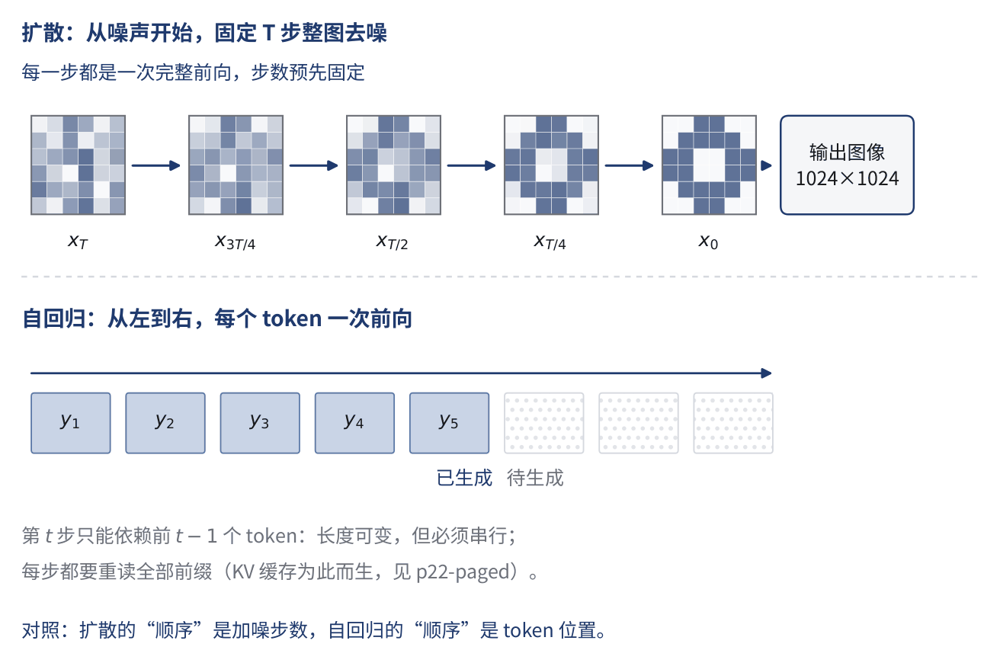

## 扩散与统一建模

2020 年，一篇论文在 CIFAR-10 上把生成质量指标 FID 做到 3.17，超过了当时最好的生成对抗网络。方法看起来很奇怪：它不学“怎么画一张图”，而是学“怎么把噪声一点点去掉”。训练时不断往图上加噪，让网络猜这次加的是什么；生成时从纯噪声出发，把猜出来的噪声减掉，重复一千次（《Denoising Diffusion Probabilistic Models》(2020)）。

一千次前向换一张图，在任何在线服务里都不可接受。三年之后，这条路却成了图像生成的主流，因为它在另外两个维度上赢了：训练稳定，覆盖整个分布的多样性也好。生成对抗网络靠一个判别器提供信号，训练是两个网络的博弈，容易塌缩到少数几种模式。扩散的损失是固定的回归，训练与采样解耦，一个模型能把分布铺开。

### 加噪容易，去噪难

前向过程是一个固定的马尔可夫链，每一步往数据里加一点高斯噪声：

$$q(x_t\mid x_{t-1})=\mathcal{N}\left(\sqrt{1-\beta_t}\,x_{t-1},\ \beta_t I\right)$$

$\beta_t$ 是这一步的噪声强度，原文取从 $10^{-4}$ 线性升到 $0.02$ 共 1000 步；两个数是为数据缩放到 $[-1,1]$ 选的，保证 $x_T$ 与标准正态的 KL 只有每维 $10^{-5}$ 比特量级。余弦时程是后来的改进（Nichol & Dhariwal 2021），不在这一篇里。步数足够多、每步足够小，$x_T$ 的分布与标准正态几乎不可区分，数据的信息被彻底打散。

这个链有一个方便的性质：不用一步步算，可以直接跳到任意时刻。令 $\alpha_t=1-\beta_t$，$\bar\alpha_t=\prod_{s\le t}\alpha_s$，则

$$x_t=\sqrt{\bar\alpha_t}\,x_0+\sqrt{1-\bar\alpha_t}\,\epsilon,\qquad \epsilon\sim\mathcal{N}(0,I)$$

说白了，第 $t$ 步的图就是原图乘一个越来越小的系数，再叠上一层越来越厚的噪声。训练时随机抽一个 $t$，一次就能造出对应的样本。

反向过程要学的就是这个式子的逆：给定一张带噪图，猜出叠在上面的噪声是什么。严格的反向分布 $p(x_{t-1}\mid x_t)$ 要积分整个数据分布才求得出来，实际做法是把它近似成一个对角高斯，均值和方差都由网络给出，于是每一步采样就是

$$x_{t-1}=\mu_\theta(x_t,t)+\sigma_t z,\qquad z\sim\mathcal{N}(0,I)$$

DDPM 没有让网络直接预测 $x_{t-1}$ 或 $x_0$，它预测的是 $\epsilon$，再由 $\epsilon$ 反推均值。把预测的噪声代回前向式解出 $x_0$，就得到实际用的递推：

$$x_{t-1}=\frac{1}{\sqrt{\alpha_t}}\left(x_t-\frac{1-\alpha_t}{\sqrt{1-\bar\alpha_t}}\,\epsilon_\theta(x_t,t)\right)+\sigma_t z$$

读法：先按当前噪声比例把预测的噪声减掉，再乘 $1/\sqrt{\alpha_t}$ 把尺度放回上一时刻，最后叠一份新噪声。$t=1$ 时 $\sigma_1 z$ 置零，因为终点本身就是数据，不再加噪。

为什么让网络猜噪声而不是猜原图，理由是数值尺度。$t$ 很大时 $x_t$ 几乎全是噪声，让网络从纯噪声里回归原图，目标值的方差极大；预测噪声则是一个“减去已知量”的任务，目标始终是标准正态，量级稳定。

方差不参与学习。所有实验里 $\sigma_t^{2}$ 都取常量 $\beta_t$，虽然完整的变分目标允许把它交给网络。原文的消融显示这么做的代价：在 CIFAR-10 上把方差交给网络学（配完整下界损失）得到 FID 13.22，固定方差配简化损失是 3.17，而且后者还有几组配置因为训练不稳定、采样分数越界而没跑出结果。多一组可学参数在这里是负担。后来 Nichol & Dhariwal (2021) 把方差改成“学习值与后验方差的插值”，才把这个结论反转过来。

### 一个被简化掉的损失

按变分推断推下去，最大化的下界逐项都是 KL 距离。因为前向的后验 $q(x_{t-1}\mid x_t,x_0)$ 是高斯，模型的 $p_\theta(x_{t-1}\mid x_t)$ 也是高斯，所以每一项有闭式解，化简后就是两个均值的加权平方距离：

$$L_{t-1}=\mathbb{E}_q\left[\frac{1}{2\sigma_t^{2}}\left\|\tilde\mu_t(x_t,x_0)-\mu_\theta(x_t,t)\right\|^{2}\right]+C$$

第一步只到这里：它没说均值该用什么参数化。第二步把 $x_t=\sqrt{\bar\alpha_t}\,x_0+\sqrt{1-\bar\alpha_t}\,\epsilon$ 代进去，后验均值里的 $x_0$ 可以用 $x_t$ 和 $\epsilon$ 解出来，两边一减，$x_t$ 的项全消掉，只剩噪声之差：

$$L_{t-1}-C=\mathbb{E}\left[\frac{(1-\alpha_t)^{2}}{2\sigma_t^{2}\alpha_t(1-\bar\alpha_t)}\left\|\epsilon-\epsilon_\theta(x_t,t)\right\|^{2}\right]$$

也就是说，“猜均值”与“猜噪声”是同一件事的两种写法，差别只在于前面的权重系数——这个系数只跟步数有关，与网络和数据都无关。DDPM 把这个系数整个丢掉，用最朴素的均方误差：

$$L_{\text{simple}}=\mathbb{E}_{t,x_0,\epsilon}\left[\left\|\epsilon-\epsilon_\theta\left(\sqrt{\bar\alpha_t}x_0+\sqrt{1-\bar\alpha_t}\epsilon,\ t\right)\right\|^2\right]$$

一句话：随便挑一个噪声等级，把图和噪声混起来，让网络猜混进去的是哪一份噪声，猜错多少算多少。完整的训练循环只有几行：

```text
repeat:
    x0 = 一批训练图，缩放到 [-1, 1]
    t  ~ Uniform({1, ..., T})
    e  ~ N(0, I)
    xt = sqrt(abar[t]) * x0 + sqrt(1 - abar[t]) * e
    loss = || e - eps_theta(xt, t) ||^2
    theta <- theta - lr * grad(loss)
```

抽一张图、均匀抽一个 $t$、抽一份 $\epsilon$、对 $\|\epsilon-\epsilon_\theta(\sqrt{\bar\alpha_t}x_0+\sqrt{1-\bar\alpha_t}\epsilon,\,t)\|^2$ 做一步下降。没有对抗、没有采样、没有停止条件，一个 batch 就是一次独立回归。

反直觉的地方在于，去掉理论权重之后样本质量反而更好。一种解释是简单损失降低了对小 $t$ 的重视，而那些几乎无噪声的步对感知质量贡献很小，把容量花在那里是浪费。目标函数的形式比它的理论出处更能决定结果，这是“推导正确”与“实际好用”分家的一个干净例子。

采样仍然是一千步，每步一次完整的前向。生成一张 512 的图要调用一千次网络，比自回归生成一千个 token 还慢，而且这还是在像素空间里算。

### 少走几步

DDIM 不碰训练，只改采样。它构造了一族非马尔可夫的反向过程，保持边缘分布 $q(x_t\mid x_0)$ 不变，但允许相邻两次采样之间跨过若干步。同一个训练好的模型，采样步数可以从 1000 降到几十，质量几乎不掉（《Denoising Diffusion Implicit Models》(2020)）。

具体改动落在联合分布上。DDPM 的反向过程把“下一步去哪”完全交给当前状态，DDIM 先拿当前状态反推一个 $x_0$ 的估计，再从这个估计出发问到目标步：

$$\hat x_0=\frac{x_t-\sqrt{1-\bar\alpha_t}\,\epsilon_\theta(x_t,t)}{\sqrt{\bar\alpha_t}},\qquad x_{t-\Delta}=\sqrt{\bar\alpha_{t-\Delta}}\,\hat x_0+\sqrt{1-\bar\alpha_{t-\Delta}-\sigma_t^{2}}\,\epsilon_\theta(x_t,t)+\sigma_t z$$

右边三项可以逐个读：第一项是“估计的答案按目标步的系数缩放”，第二项是把预测的噪声方向按比例带过去，第三项是可选的新噪声。$\sigma_t$ 由参数 $\eta\in[0,1]$ 决定：

$$\sigma_t(\eta)=\eta\sqrt{\frac{1-\bar\alpha_{t-\Delta}}{1-\bar\alpha_t}}\sqrt{1-\frac{\bar\alpha_t}{\bar\alpha_{t-\Delta}}}$$

$\eta=1$ 时方差恰好回升到 DDPM 的后验方差，整个式子退化成上一节的递推；$\eta=0$ 时 $\sigma_t=0$，噪声项整个消失，每一步都是对同一个方向做确定性插值，同一个起点永远得到同一张图。

能跳步的原因在训练目标里。$L_{\text{simple}}$ 只要求网络在单个 $(x_t,t)$ 上猜对 $\epsilon$，它不管这个 $x_t$ 是从 $t-1$ 走过来的还是从 $t-50$ 走过来的；只要 $\bar\alpha$ 序列一致，$q(x_t\mid x_0)$ 就一致，模型在跳步上给出的 $\epsilon$ 估计依然有效。换句话说，训练把“怎么走”与“走多少步”解耦了，采样步数变成了纯推理侧的旋钮。DDPM 也能在子序列上采样，但它的递推里每一步都要注入一份与外推步长匹配的噪声，跳过一步就把噪声比例弄错，原论文把一千步降到一百步时 FID 已经明显变差；DDIM 用同一个 $\hat x_0$ 重新参数化，跳步时只换系数，所以掉得慢。

代价是误差累积的快慢。$\Delta$ 越大，单步里被丢掉的曲率越多，二十到五十步内质量与一千步几乎不可区分，十步以下开始糊。原论文报的加速是十到一百倍；同一时期一张 2080 Ti 采样五万张 32×32 的图要二十小时，GAN 不到一分钟。这个差距才是后来所有少步数方法要解决的问题。

确定性带来一个副作用：隐空间可以做插值，两张图的起点之间线性过渡，中间帧是有意义的渐变；反过来也能把图编码回 $x_T$，因为轨迹可逆。

更本质的看法来自连续时间。训练学到的其实是一个得分函数 $\nabla_x\log p_t(x)$，它定义了一条概率流常微分方程；$\eta=0$ 的 DDIM 就是对这个方程做欧拉法，步长可以比训练时的离散化粗得多。沿着这个思路，DPM-Solver 一类的方法用二阶、三阶求解器把步数压到十步以内。

这个视角也解释了后来那些一步生成的蒸馏模型为什么可能：起点到终点是一条确定的轨迹，可以训一个网络直接学这条轨迹的积分，把一千步折成一步。一致性模型就把这件事写成了约束：同一条轨迹上的任意两点，经过网络后应该映到同一个 $x_0$，于是训练目标成了“相邻两点的输出要一致”，自己给自己当老师（《Consistency Models》(2023)）。

### 把条件拧紧

有条件生成比无条件多一个输入 $c$，但只把 $c$ 喂进去，样本往往“不够像”。原因很具体：模型学的是 $p(x\mid c)$，它在所有符合 $c$ 的图里均匀采样，包括那些边缘的、模糊的、同时像好几个类别的。想让它往“典型”那边偏，需要一个旋钮。

无分类器引导的做法是在训练时就把旋钮的位置留出来。同一个网络，每个样本以概率 $p_{\text{uncond}}$ 把 $c$ 替换成一个空标记 $\varnothing$，于是它同时学会 $\epsilon_\theta(z,c)$ 和 $\epsilon_\theta(z,\varnothing)$，没有额外参数。采样时把两个预测线性组合：

$$\tilde\epsilon(z,c)=(1+w)\,\epsilon_\theta(z,c)-w\,\epsilon_\theta(z,\varnothing)$$

写成另一种形式更好懂：$\tilde\epsilon=\epsilon_\theta(z,\varnothing)+(1+w)\left[\epsilon_\theta(z,c)-\epsilon_\theta(z,\varnothing)\right]$，即“无条件预测加上一个被放大 $(1+w)$ 倍的条件方向”。很多实现把 $(1+w)$ 记作 guidance scale $s$，$s=1$ 就是不引导。

为什么是减法而不是直接乘一个系数，有一个贝叶斯解释。$\nabla\log p(z\mid c)=\nabla\log p(z)+\nabla\log p(c\mid z)$，而隐式分类器 $p(c\mid z)\propto p(z\mid c)/p(z)$，所以两者的差就是分类器对数似然对输入的梯度。把条件得分乘以 $1+w$、无条件得分乘以 $w$ 再相减，等价于把这个隐式分类器的梯度也放大 $1+w$ 倍，而分类器不需要另外训。严格说这个“梯度”未必是某个标量函数的梯度（网络输出的 $\epsilon$ 不保证是保守场），所以它不能真的当成分类器引导来理解，但这恰好是它比分类器引导更锐的原因：没有哪个真实分布对应它，它可以把概率质量推到数据分布之外。

强度的影响可以直接测。在 128×128 的 ImageNet 类条件生成上，$w$ 从 0 扫到 4：FID 先降后升，最好在 $w=0.1$ 到 $0.3$ 之间；Inception Score 单调上升，最好在 $w\approx4$。两个指标的偏好相反，部署时选哪个取决于要“好看”还是“多样”。$w$ 大时颜色过饱和、背景变简单、同一提示反复出同一种构图，就是分布被压窄的外观。

代价有两处。训练时丢掉的那些条件样本白跑了，等于可用数据少了一成（原文 $p_{\text{uncond}}$ 取 0.1）；推理时每步要跑两次前向，无条件那一路的提示嵌入与输入无关、可以预先算好缓存，但每步的矩阵乘法仍多一倍。后来的蒸馏方法专门针对这一点：把引导后的模型煮进一个不引导的模型，推理成本减半。

换成直觉做法会怎样：直接在训练好的条件模型上把 $\epsilon$ 乘大一点，或者把采样噪声调小，能不能得到同样效果？早期实验的结论是不能：前者把图像推向过饱和的模糊，后者只降低随机性而不改变条件强度。必须有一个独立的无条件预测做参照，才能“把条件方向单独拿出来放大”。

把这几节的东西并成一个采样循环，DDPM、DDIM、CFG 的差别就落在几个常数上：

```text
x = N(0, I)
for t, t_prev in pairs(reversed(steps)):     # steps 是 [1, ..., T] 的子序列
    e_c = eps_theta(x, t, c)                 # 条件预测
    e_u = eps_theta(x, t, null)              # 无条件预测，每步一次
    e   = e_u + s * (e_c - e_u)              # s = 1+w，不引导时 s = 1
    x0  = (x - sqrt(1 - abar[t]) * e) / sqrt(abar[t])
    if t_prev == 0: return x0                # 最后一步直接输出估计
    x   = sqrt(abar[t_prev]) * x0 + sqrt(1 - abar[t_prev]) * e + sigma_t * z
```

几个常数的含义：`steps` 取全部一千步且 `sigma_t` 取后验标准差，就是 DDPM；`steps` 只取二十到五十个、`sigma_t = 0`，就是 DDIM；`s > 1` 就是 CFG。训练与推理的不对称也在这里：训练时 $t$ 从全区间均匀抽、每步只看一张图；推理时 $t$ 只经过选定的子序列、每步必须从纯噪声开始向下走到底，而且一旦选了 $\eta=0$，就没有任何“重试”的余地——输出完全由初始噪声和提示词决定。

### 搬到隐空间

像素空间的浪费很明显。一张 512×512 的彩色图是 78 万维，每一步去噪都在这个维度上做矩阵乘法，而其中大部分维度在描述人眼几乎分辨不出的高频细节。

潜空间扩散（Latent Diffusion）先训一个变分自编码器，把图压到 64×64×4，一万六千维，压缩约 48 倍；扩散过程在这个隐空间里跑，结束后由解码器还原成像素（《High-Resolution Image Synthesis with Latent Diffusion Models》(2021)）。

算力降了一到两个数量级，同样的卡能训更大的模型、更高的分辨率。另一个好处常被忽略。感知压缩丢掉了高频细节，隐空间里的表示更接近语义，扩散模型学的是构图、物体、关系，纹理交给解码器。这与“先定结构再超分”的直觉一致。

代价是上限被编码器锁住。文字、人脸、细小纹理在压缩时会被抹掉，需要额外的精修阶段或更高分辨率的解码器补回来。后来那些在图上写不对字的模型，毛病多半出在自编码器上，跟扩散过程关系不大。

Stable Diffusion 的结构就是这个配方：隐空间扩散加 U-Net，文本条件通过交叉注意力注入每一个下采样与上采样块。它把训练成本压到了学术界能承受的范围，也让这一路线在 2022 年之后迅速扩散到图像之外的领域。

### 用 Transformer 换掉 U-Net

U-Net 的卷积结构天生适合图像：局部感受野、多尺度、平移等变。但它的归纳偏置也把模型锁在了固定的分辨率与拓扑上。

DiT 把 U-Net 换成标准 Transformer。256×256 的图经 VAE 编到 32×32×4，再切成 $p\times p$ 的 patch（$p=2,4,8$），序列长度 $T=(I/p)^2$：$p=4$ 是 64 个 token，$p=2$ 是 256 个。每个 patch 线性投影到 $d$ 维，加正弦位置编码，过 $N$ 层标准块，最后用线性解码器把每个 token 还原成 $p\times p\times 2C$ 的张量——多出来的那个因子 2 是噪声与协方差两路输出（《Scalable Diffusion Models with Transformers》(2022)）。

条件注入用了一种叫 adaLN-Zero 的做法。时间步嵌入与类别嵌入相加，过一个 SiLU 加线性层，一次输出六组参数：

$$\gamma_1,\beta_1,\alpha_1,\gamma_2,\beta_2,\alpha_2=\mathrm{MLP}(c+t)$$

块内的计算于是变成

$$\begin{aligned}h&\leftarrow h+\alpha_1\odot\mathrm{Attn}\left(\gamma_1\odot\mathrm{Norm}(h)+\beta_1\right)\\[2pt] h&\leftarrow h+\alpha_2\odot\mathrm{MLP}\left(\gamma_2\odot\mathrm{Norm}(h)+\beta_2\right)\end{aligned}$$

$\gamma$ 是逐维缩放，$\beta$ 是逐维平移，$\alpha$ 是残差分支上的门控。普通 adaLN 只有前两组，它们自己是可学习参数；adaLN-Zero 多出 $\alpha$，并把生成这六组参数的 MLP 最后一层零初始化。

零初始化带来一个干净的开局：$\alpha=0$ 时两个残差分支的输出都被乘成零，整个块退化成恒等映射，刚开训的 DiT 等价于一个只有嵌入与解码器的浅网络。训练信号再从零开始把这六个参数一点点抬起来。这与上一章 Flamingo 把 $\tanh$ 门控初始到 0 是同一个思路：在冻结或新插入的部分上，先保证“什么也不做”，再让它学“该做什么”。

换成其他条件注入方式会怎样，论文把三种都跑了一遍。把 $t$ 和 $c$ 当两个额外 token 拼进序列（in-context），几乎不增算力，但条件 token 与图像 token 抢注意力；加一层交叉注意力（cross-attention），表达力最强，代价是多 15% 的 Gflops，118.6 变 137.6。adaLN 家族不增算力，代价是所有 token 共用同一组 $\gamma,\beta$，也就是条件只能调“整层的风格”，不能调“每个位置看什么”。在 400K 步的对比里，adaLN-Zero 的 FID 几乎是 in-context 的一半，这组差异不是靠算力解释得了的。

结论比结构本身重要：DiT 也服从缩放定律。模型从 0.3 Gflops 的 S/8 到 118.6 Gflops 的 XL/2，FID 单调下降，且同样算力下大模型更划算。更细的一条是：参数不变、只把 patch 从 4 改到 2，算力翻四倍，FID 也降，说明起作用的是前向计算量而不是参数量。卷积的归纳偏置不是必需的，只要数据和算力够。XL/2 在 256×256 类条件 ImageNet 上把 FID 从 3.60 推到 2.27，代价是七百万步训练。

### 画一条直线

扩散的加噪过程是一条从数据到噪声的弯曲路径，采样必须沿着它一步步走。流匹配换了个提法。它跳过逐步去噪，直接学一个速度场，把噪声分布沿预设的路径搬到数据分布。最简单的一组预设是让均值和标准差都随时间线性变：

$$x_t=\left(1-(1-\sigma_{\min})t\right)x_0+t\,x_1,\qquad u_t(x_t\mid x_1)=x_1-(1-\sigma_{\min})x_0$$

$x_0$ 是噪声，$x_1$ 是数据，$\sigma_{\min}$ 是噪声端保留的一点点方差（取 0 就是严格直线）。$u_t$ 是这条路在 $x_t$ 处的速度，也就是从当前点指向数据点的方向。训练目标就是让网络去拟合这个速度（下面取 $\sigma_{\min}=0$ 化简）：

$$L=\mathbb{E}_{t,x_0,x_1}\left\|v_\theta(x_t,t)-\left(x_1-x_0\right)\right\|^{2}$$

白话：在两个端点之间连一条直线，让网络在任意中间点上指出“往数据那边走的方向和速度”。采样就是把 $v_\theta$ 当常微分方程的右端，从 $t=0$ 积到 $t=1$，每一步 $x\leftarrow x+\Delta t\,v_\theta(x,t)$。

能这么直接回归，需要一个不太显然的结论。真正想要的是边缘速度场——它需要对所有配对 $(x_0,x_1)$ 求期望，算不出来；而能采样的只有逐样本的条件速度场。流匹配证明了两者的梯度相同，所以拿逐样本的目标去优化，收敛到的是同一个解（《Flow Matching for Generative Modeling》(2022) 定理 2）。这一步与扩散里的“去噪得分匹配等价于得分匹配”是同一个套路：用一个可采样的条件目标，顶掉不可采样的边缘目标。

好处有三个。路径直，误差随步长线性累积，采样步数少，一到四步的模型大多出自这一族。目标简单，不用设计 $\beta_t$ 的时间表，训练信号就是两点之差，也不需要推导变分下界。与最优传输结合还能把配对关系选得更好，让路径尽量不相交，从而减少积分时的拐弯。

换成扩散的路径会怎样：那也是一条从数据到噪声的路径，只是标准差按 $\sqrt{1-\bar\alpha_t}$ 弯曲地走，速度场在整个时间区间里方向变好几次，同样精度需要更多步。但弯曲并非全无好处，扩散的每一小步都注入新噪声，模型只需拟合局部去噪，任务比“拟合全局直线”更容易学；流匹配把难度集中到了速度场的准确性上，路径越直，错误越容易被一步放大。两派的差别不再是“生成模型对不对”，而是“把误差花在采样步数上还是花在单步精度上”。

后来那些开源的高分辨率图像模型，大多是 Transformer 主干加流匹配目标，采样二三十步出图。

### 两种生成顺序



上图把两条路线的时间结构并排放着。上半部分是扩散：从一块纯噪声出发，每一步都改一点，二十步之后成形，所有像素是同时被决定的。下半部分是自回归：从左到右，一个 token 一个 token 地定，每个 token 都依赖前面所有 token。

这个差别牵出一串后果。

| 维度 | 扩散 | 自回归 |
|---|---|---|
| 生成顺序 | 全部位置并行，多步迭代 | 逐 token 串行 |
| 表示 | 连续向量 | 离散词表 |
| 似然 | 变分下界，不精确 | 精确可算 |
| 可控性 | 修补、引导、结构条件都自然 | 靠前缀，粒度粗 |
| 变长输出 | 需要额外的长度建模 | 天然支持 |

似然那一行值得多说一句。自回归模型能直接算出任意序列的概率，于是困惑度、压缩率这些指标都有明确含义；扩散模型只有下界，评估只能靠 FID、CLIP 分数这类间接指标，这也是图像生成的评测一直比语言模型混乱的原因。

可控性那一行则是扩散的长处。已知区域固定、只对未知区域去噪，就是图像修补。有条件与无条件两个预测之差放大条件的影响，是无分类器引导。再接一个额外的条件分支控制边缘或姿态，就得到 ControlNet。这些能力都长在“逐步去噪”这个形式里，不需要后期另加补丁。

### 能不能统一

如果一套表示既能读图又能画图，参数可以共享，工程可以合并，模型也能用生成来辅助推理。这个动机推动了两个方向。

一个是离散统一。Chameleon 把图变成 token，和文本共用一套下一 token 预测，代价是量化损失与模态竞争，图像质量受码本限制。

另一个是混合目标。同一个 Transformer，文本位置用交叉熵，图像位置用扩散损失，两套损失按位置在同一个序列上切换。难点在尺度。扩散损失的数值范围与交叉熵差一到两个数量级，权重得靠调。注意力还要同时处理离散与连续两种表示。两种目标的收敛速度也不一样。

更根本的困难在表示上。理解要的是抽象语义，一张图压成几十个概念就够了；生成要的是细节保真，同一个表示必须能还原出每一个像素。两件事对表示的要求方向相反，一个被压得很抽象的向量画不出准确的文字。目前的统一模型大多在这条张力上做取舍：要么理解强、生成糊，要么生成清晰、理解停在表面。

评测也缺一套共同语言。理解有 VQA、检索、描述，生成有 FID、人工偏好，两组指标测不出同一个能力，于是“统一”到底统一了什么，很难说清。

无论走哪条路线，账都记在同一处：参数、显存、每一步的延迟。一张图要几十步前向，一段视频要几千个 token 的注意力，一个 70B 模型光权重就占 140GB。把这些塞进一张卡、一个请求几十毫秒的预算里，需要另一套完全不同的手段。
