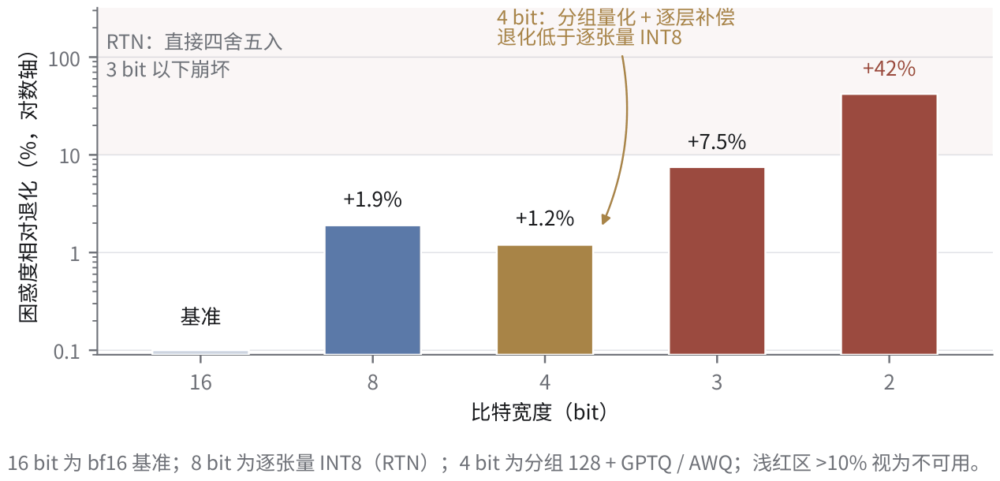
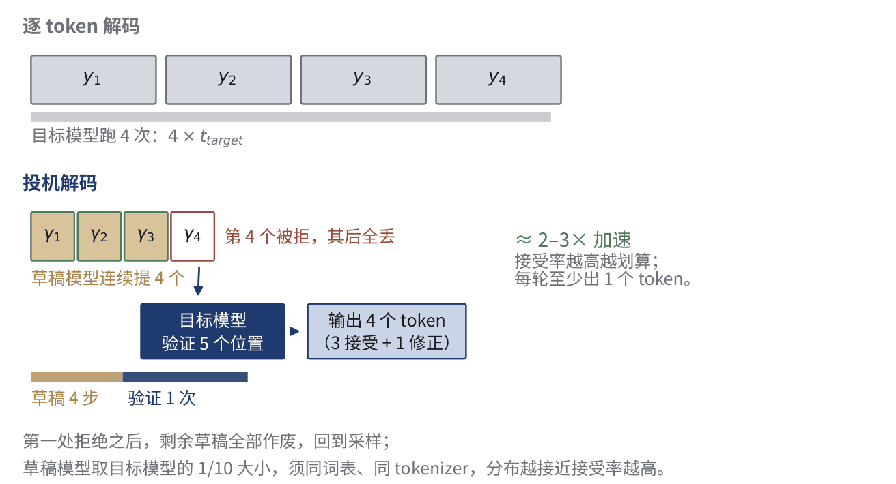

## 蒸馏、剪枝与量化

2023 年春天，有人在单张 48GB 显卡上微调了一个 65B 的模型。此前做同样的事，官方估算要 780GB 显存，十几张 A100 捆起来才够。差距来自把权重从 16 位浮点压到 4 位。

模型能不能用，往往由参数占多少字节决定，聪明与否是后话。70B 模型的 FP16 权重是 140GB，单卡装不下；压到 4 位是 35GB，一张 80GB 的卡装得下，还能留出空间放 KV 缓存。蒸馏想让更少的参数复现同一个函数，剪枝要在已有参数里找出多余的。量化问的是每个参数留几位，投机解码则干脆不动模型，用多算几步换掉串行的等待。

### 软标签里多出来的信息

蒸馏的出发点是：老师的输出不只是一个答案，还有一整条分布。一张猫的图片，老师给“猫”0.9、“狗”0.08、“汽车”0.0001。硬标签只说“这是猫”，软标签还说“它有点像狗，但完全不像汽车”。后一句定义了类别间的几何关系，而这层关系被硬标签丢掉了。

Hinton 在 2015 年把它写成了损失函数。设老师在第 $i$ 类的 logit 为 $z_i$，温度 $T$ 下的软分布是

$$q_i=\frac{\exp(z_i/T)}{\sum_j \exp(z_j/T)}$$

温度把分布压平。同一对类别的概率比是

$$\frac{q_i}{q_j}=\exp\left(\frac{z_i-z_j}{T}\right)$$

温度不改变 logit 差的符号与大小关系，只改变对比度。两个 logit 相差 2.2 时，$T=1$ 下概率差 9 倍，$T=4$ 下只差 1.7 倍；原本只有千分之一量级的那些类别，在分母里被放大到能看得见，暗知识（dark knowledge）才浮出水面。“猫像狗”这条信息不在最高的那个 logit 里，在第二名与第三名之间。

学生用同一个温度算出 $p_i$，损失是两项交叉熵的加权和，蒸馏那项乘上 $T^2$：

$$L=(1-\lambda)\,\mathrm{CE}\left(y,p^{T=1}\right)+\lambda\,T^{2}\left(-\sum_i q_i\log p_i\right)$$

$T^2$ 不是凑出来的。对软化后的交叉熵求学生 logit 的导数，链式法则会带出两次 $1/T$：

$$\frac{\partial}{\partial z_i^{(s)}}\left(-\sum_j q_j\log p_j\right)=\frac{1}{T}\left(p_i-q_i\right)$$

乘上 $T^2$ 之后梯度变成 $T(p_i-q_i)$，与 $T=1$ 时只差一个 $T$ 因子，量级不随温度塌掉。不乘的话，梯度按 $1/T$ 缩小：把 $T$ 从 2 调到 4，蒸馏项的有效权重就减半；与 $T=1$ 相比则是四分之一。同一个 $\lambda$ 在不同温度下管的事差四倍，实验之间没法比。

温度本身需要调。$T$ 小了退化回硬标签，$T$ 大了所有类别趋于均匀，软分布里携带的区分信息被摊薄；在语言模型这种几万维的输出上，这个天平比图像分类更难拿。

语言模型上有个结构性的麻烦：每个位置都输出一个几万维的分布，一条 512 token 的序列就是 512 个监督信号，而它们全建立在“前缀由老师给定”这个假设上。推理时前缀来自学生自己，前面写错一个词，后面就落到没见过的分布上。

《DistilBERT》(2019) 是这条路上最早的完整答案。它把 BERT-base 的 12 层砍到 6 层，初始化时取老师的第 1、3、5、7、9、11 层，同时去掉 token 类型嵌入与 pooler；损失由三项相加：软分布的蒸馏、真实标签的掩码语言建模、学生与老师隐状态的余弦距离。最终参数量减 40%，推理快 60%，GLUE 平均分保留 97%。

消融里有一个结果值得停一下：去掉软分布那项只掉 0.31 分，去掉余弦距离掉 2.96 分，去掉掩码语言建模掉 1.46 分，而换成随机初始化掉 3.69 分。也就是说，在这个规模上真正值钱的是层层对齐学生与老师的隐状态、以及从老师权重出发的初始化，而不是软标签本身。层数减半后，学生浅层与老师浅层学的东西差不多，逐层对齐等于把一个已知的解法按比例缩下来；而软标签只提供输出端的约束，投影层没对齐时它传递的信号已经变形了。

序列级蒸馏换了思路：让学生自己生成，再让老师对这些句子打分，学生在这个分布上做极大似然。它同时缓解了错位和数据两个问题，代价是丢掉分布：只取老师的 argmax 当标签，学生只学到“老师会这么说”。《On-Policy Distillation of Language Models》(2023) 把两者放进一个框架：在学生自己生成的前缀上算 KL，再混入一部分老师生成的序列。纯离轨的蒸馏在分布外的前缀上最脆弱，纯在轨的版本梯度噪声大，混合最好。

### 删掉哪些权重

剪枝的核心判断很旧：一个权重重要不重要，看删掉它之后输出偏多少。问题在于“删掉”在硬件上意味着什么。把 70B 模型里九成的权重置零，参数量少了一个数量级，可 GPU 做稠密乘法时照样要把零读进来乘一遍。稀疏矩阵要有专门的核心才快，而 NVIDIA 的稀疏张量核心只认一种图案：每四个连续权重里留两个。

非结构化剪枝的代表是《SparseGPT》(2023)。它把问题写成逐层的重构误差：给定这一层的输入激活 $X$ 和原权重 $W$，找一个只保留 $p$ 比例非零的 $\hat W$，使输出尽量不变：

$$\min_{\hat{W}}\ \|WX-\hat{W}X\|_2^{2}$$

这个目标有闭式解，但完整求解要反复求逆，几百亿参数的模型跑不起。于是它退回逐列贪心，每处理一列就做两件事：决定这一列哪些权重置零，然后用剩下的权重把误差补回来。补偿量的来源是二次近似的极值条件。把第 $j$ 列的某个权重 $w_j$ 置零，造成的输出误差正比于 $w_j$，最优的补偿是把误差按权重之间的相关性摊到其余列上。具体做法是把这一层的重构误差在补偿量 $\delta$ 上展开成二次型（一次项来自 $\delta^{\top}Hw$，二次项来自 $\delta^{\top}H\delta$），再加上“第 $j$ 个位置必须归零”这一个约束求极小，解出来就是

$$\delta_{u}=-\frac{w_j}{[H^{-1}]_{jj}}\,[H^{-1}]_{:,j},\qquad \text{误差}=\frac{w_j^{2}}{[H^{-1}]_{jj}}$$

$H=2XX^{\top}$ 是这一层重构误差的 Hessian，只跟输入激活有关，跟权重无关——这一点让它可以跨行共享：$d_{\text{row}}$ 行的权重矩阵只需要算一次逆，复杂度从 $O(d_{\text{row}}d_{\text{col}}^{3})$ 降到 $O(d_{\text{col}}^{3})$，这是能把 175B 塞进单卡的关键。

误差表达式顺带解释了为什么不能只看幅值。分母 $[H^{-1}]_{jj}$ 度量第 $j$ 个输入通道与其他通道的冗余度：这个通道被别的通道线性表示得越好，分母越大，删它越便宜。一个幅值很小的权重如果坐在一个独特的通道上，删了代价很高；一个幅值很大的权重如果坐在一个高度冗余的通道上，删了几乎无感。只看 $|w_j|$ 等于假设所有通道互不相关。

工程上有三处为了让它在 175B 上跑得动：$H^{-1}$ 用 Cholesky 分解预先算好，避免反复求逆累积数值误差（模型超过几十亿参数时，逐列更新几乎必然让矩阵变成非正定）；权重更新按 128 列一批做，批内完整更新、批内误差累加后一次性摊到后面的列，把零碎的向量操作变成矩阵乘法；剪枝掩码也每 128 列重选一次，而不是一开始定死，这样前面的权重更新能被后面的选择看见。

成本与结果是：校准数据只要 128 段 2048 token 的 C4 文本，OPT-175B 与 BLOOM-176B 在单张 A100 上不到 4.5 小时剪完。OPT-175B 在 60% 稀疏度下困惑度几乎不升，2:4 与 4:8 这两种硬件友好图案下的困惑度增量分别是 0.39 与 0.11。重训一个 175B 模型的成本比剪枝本身高四个数量级，这一点决定了一次性剪枝的实用价值。

《Wanda》(2023) 做得更省。它的重要性分数是

$$S_{ij}=|W_{ij}|\cdot\|X_j\|_2$$

即权重绝对值乘以所在输入通道的激活范数，在每行内部比较、按比例保留。$\|X_j\|_2$ 是在校准集上跨所有 token 统计的。没有 Hessian，没有权重更新，一次前向就能算完所有分数。

两项相乘而不是相加，背后是输出误差的分解：第 $i$ 个输出神经元的输出是 $\sum_j W_{ij}x_j$，去掉一项造成的偏差正比于 $|W_{ij}|\cdot|x_j|$；对 token 取期望就得到 $|W_{ij}|\cdot\|X_j\|_2$（严格说是均方意义下的一个上界近似）。只看权重幅值会误判：一个很小的权重乘上很大的激活，对输出的贡献可能超过一个大权重配小激活。加上激活这一项，等于把“权重多大”换成了“这个连接实际传了多少信号”。

在哪个范围内比较，重要性不亚于分数本身。Wanda 按输出通道（权重的每一行）分组，每组删掉相同比例的最小分数；换成整层或全网统一阈值，等于允许某些输出神经元被删光，而大模型里少数几个异常通道一旦被删，下游整条链就塌。论文试过全模型比较、逐层比较、逐输出比较，前两者在 LLaMA 上明显更差，而在图像分类模型上没有这个差异——这个现象只在大模型上出现。

50% 稀疏度上它和 SparseGPT 打平，在 2:4 这种硬件友好的约束下还略好，而耗时差一个数量级。

结构化剪枝删的是整块：注意力头、前馈通道、整层。矩阵维度真的变小，稠密核心才能吃到红利；代价是粒度粗，伤到的功能更多，通常要几百亿 token 的重训才能恢复。

### 每个参数需要几位

一个 FP16 权重占两个字节，其中 10 位尾数。绝大多数权重挤在零附近，尾数的低位实际上在表示噪声。换成 8 位整数，精度损失通常测不出来，显存和带宽直接减半。



最朴素的映射是仿射量化。给定要量化的张量，先定两个参数，再逐元素映射：

$$s=\frac{x_{\max}-x_{\min}}{2^{b}-1},\qquad z=\mathrm{round}\!\left(-\frac{x_{\min}}{s}\right)$$

$$x_q=\mathrm{clamp}\!\left(\mathrm{round}\!\left(\frac{x}{s}\right)+z,\ 0,\ 2^{b}-1\right),\qquad \hat x=s\,(x_q-z)$$

$s$ 是相邻两个格点的距离（缩放因子），$z$ 是“实数 0 落在哪个格点上”（零点），$x_q$ 是存下来的整数，$\hat x$ 是反量化回来的近似值。白话：把 $[x_{\min},x_{\max}]$ 等分成 $2^{b}-1$ 段，每段一个格点，存“落在第几段”，反量化时再乘回去。

对称量化把零点钉死在编码区间的中点——无符号编码里是 $z=2^{b-1}$，有符号编码里就是 $0$——于是实数 0 总能精确落在格点上。这样只需存一个缩放 $s=\max|x|/127$，把 $[-\max|x|,\max|x|]$ 映到 $[-127,127]$。好处是矩阵乘法里不用处理偏移：两个带零点的张量相乘会炸出四个交叉项，得用额外的整数指令补，而对称量化只有一个乘加。代价是全为正的激活（比如 ReLU 或 GELU 后的输出）白白浪费一半区间，有效位少一位。

量化误差的量级可以直接算。均匀格点下舍入误差大致服从 $[-s/2,s/2]$ 的均匀分布，方差 $s^{2}/12$；关键是它相对于信号的大小，即相对误差约 $s/(2|w|)$。同一批权重里，大权重与小权重的绝对误差一样，相对误差差很多，而模型对相对误差敏感——这就是后文所有方法反复折腾“怎么给不同通道分不同的 $s$”的原因。

比对称与否更要紧的是粒度。整个张量共用一个 $s$，会被几个极大值拖累，其余权重的有效位数被压得很低。三种粒度逐级变细：每张量一个 $s$；每个输出通道（权重矩阵的一行）一个 $s$，这在权重上几乎免费，因为反量化可以提前合到矩阵乘的 epilogue 里；每 $g$ 个连续权重一个 $s$ 加一个零点，$g$ 常取 128。分组不是免费的：每组要额外存一个 16 位的 $s$ 和一个 4 位的零点，共 20 位，摊到 128 个权重上是 0.156 位，所以 g128 实际是 4.15 位。

激活上做不到逐通道。每通道一个缩放意味着矩阵乘前要对输入做一次逐列重缩放，而列的范围又随 token 变，硬件上无法提前合入；所以激活通常用逐 token（动态）量化，每次前向现算。

麻烦出在激活的异常值上。《LLM.int8()》(2022) 做 8 位推理时发现，模型规模到 6.7B 前后会出现一次“相变”：大约 25% 的层里出现少数几个特征通道，数值比其他维度大二十倍以上，并且系统性地固定在那些维度上。它们占全部特征不到 0.1%，但删掉它们会抽走注意力 20% 以上的概率质量。用 per-tensor 的 $s$ 去覆盖这些极值，其余 99.9% 的数值被压成个位数。当时的解法是混合精度分解：把这些维度（模型不超过 13B 时最多七个）单独用 FP16 算，其余走 INT8，结果是 8 位下与 16 位逐位同精度，显存只降 1.96 倍而不是 2 倍。

《SmoothQuant》(2022) 换了个思路，不再拆精度，而是把难度从激活搬到权重：

$$Y=\left(X\,\mathrm{diag}(s)^{-1}\right)\left(\mathrm{diag}(s)W\right)$$

激活的每一列除以 $s_j$，权重的每一行乘以 $s_j$，乘积不变，动态范围被重新分配。$s_j$ 取

$$s_j=\frac{\max|X_j|^{\alpha}}{\max|W_j|^{1-\alpha}}$$

$X_j$ 是第 $j$ 个输入通道在校准集上的最大幅值，$W_j$ 是对应的权重行。$\alpha=0$ 不搬，激活的异常值原封不动；$\alpha=1$ 把平滑任务全推给权重，激活全部通道的峰值被拉到同一水平，但权重的峰值反过来被拉高，权重那边又难量化了。$\alpha=0.5$ 是两边各担一半的折中，OPT 与 BLOOM 全系在这个点附近最好；GLM-130B 的激活异常值更重（约 30% 的通道），得用到 0.75。

这是恒等变换，不引入近似，却让 W8A8 在 175B 上变得可行：端到端约 1.5 倍的加速与 2 倍的显存下降，代价是需要在校准数据（512 句 Pile）上统计一次激活分布，并且 $s$ 得能合进上一层（否则多一次逐列乘）。

4 位权重量化没有这种余地，只有 16 个格点，单个权重的舍入误差必须靠其他权重补偿。《GPTQ》(2022) 的做法是把量化写成与剪枝同一个形式：逐列处理，每量化完一列，就把这一列的舍入误差摊到还没量化的列上：

$$\delta_{F}=-\frac{w_q-\mathrm{quant}(w_q)}{[H^{-1}]_{qq}}\,[H^{-1}]_{:,q},\qquad H=2XX^{\top}$$

$w_q$ 是当前要量化的权重，$\mathrm{quant}(\cdot)$ 是舍入到格点，$X$ 是这一层在 128 段 2048 token 的 C4 文本上统计的输入激活，$H^{-1}$ 只在初始化时算一次、逐列用高斯消元更新。白话：这一列舍入错了多少，就按列之间的相关性把误差分摊给别人，让整层输出尽量不变。逐列扫完一层的循环大致如此，剪枝与量化共用这一个骨架：

```text
H_inv = cholesky_inverse(2 * X @ X.T + damp * I)
for j in range(d_col):
    w   = W[:, j]                              # 这一列所有输出通道的权重
    w_q = dequant(quantize(w, scale[j], zero[j]))
    err = (w - w_q) / H_inv[j, j]               # 舍入误差，按曲率归一化
    W[:, j+1:] -= err[:, None] * H_inv[j, j+1:] # 摊给右边的列
    W[:, j] = w_q                              # 这一列定死
```

`damp` 是加在对角线上的小量，防止 $H$ 奇异；`quantize` 就是上一节的仿射映射。把 `w_q` 换成 0 就是剪枝；把 `err` 只摊给掩码允许保留的位置，就是带掩码的剪枝。

与剪枝不同的只有一处：剪枝把权重置零，量化把它推到格点上，而两者都是“固定一个值，然后补偿”。正因为形式一样，后来的 SparseGPT 能把剪与量合并到一次遍历里。工程上的三项改动与 SparseGPT 几乎完全对应：固定的列顺序（原来的贪心选列在千亿参数上并不比顺序好多少，但省掉一次全局搜索）、每 128 列一批做惰性更新、用 Cholesky 预计算 $H^{-1}$ 保数值稳定。

结果是 OPT-175B 与 BLOOM-176B 在单张 A100 上约 4 小时压完。4 位下 OPT-175B 的 WikiText2 困惑度只升 0.03，而直接舍入（RTN）升 2.2，反而比 10 倍小的全精度 13B 模型更差；3 位下 RTN 彻底崩盘，GPTQ 还能维持可用。每 128 个权重共享一组缩放（group-wise）时，3 位平均只多 0.15 位，困惑度还能再降 0.1 左右；换成更细的 128 分组比 1024 分组也只多这么点开销，这是 3 位能用的关键。

AWQ 从另一头入手，先问“哪些通道根本不能碰”。第一步要把“哪 1% 重要”搞清楚。把 1% 的通道留在 FP16、其余压到 3 位，困惑度从 43.2 降到 13.0（OPT-6.7B）；但留下来的是哪 1% 很关键——按权重幅值挑，与随机挑差不多；按对应激活的幅值挑，才真正救回来。也就是说，重要的不是权重本身有多大，而是它接的是哪条激活通道。

判断出来之后，直接留高精度不行（混合精度在硬件上难做），于是改成缩放。第一步是误差分析：把 $w$ 乘上 $s>1$、同时把对应的 $x$ 除以 $s$，乘积不变；舍入误差的绝对量不变，但 $w$ 变大之后相对误差小了 $s$ 倍，而 $x$ 是 FP16 的，除不引入误差。所以把重要通道放大，就等于给它们在格点上争取到了更细的分辨率。

第二步是搜一个标量。逐通道的缩放取

$$s_j=\left(s_{X,j}\right)^{\alpha},\qquad \alpha=\arg\min_{\alpha}\ \left\|\mathrm{quant}\left(W\mathrm{diag}(s)\right)\mathrm{diag}(s)^{-1}X-WX\right\|$$

$s_{X,j}$ 是第 $j$ 个输入通道在校准集上的平均幅值（逐通道一个数），$\alpha\in[0,1]$ 用二十个格点网格搜。全部通道共用一个 $\alpha$，不逐通道调——这个参数化很偷懒，好处是不过拟合校准集：$\alpha$ 只决定“往哪个方向偏”，不具体到每个通道怎么偏。

两种方法的分歧在保护谁。GPTQ 逐列看重构误差，误差大的列优先得到补偿，等于“哪里错了补哪里”；AWQ 不看逐列的误差，只看激活幅值定一个全局缩放，不碰舍入误差的分配。结果是 AWQ 在 3 位下更稳，尤其在指令微调与多模态模型上，因为它的校准信号更粗（只要通道均值），不容易把校准集的特性背下来；代价是它没利用权重之间的相关性，同样的 4 位下比 GPTQ 略差。两者也能叠：先用 AWQ 定缩放，再用 GPTQ 定舍入。

浮点 8 位（FP8）走另一个方向：保留指数结构，只砍尾数。E4M3 用 4 位指数、3 位尾数加 1 位符号，动态范围约 $2^{\pm 8}$；E5M2 范围更大但更粗。H100 的张量核心原生支持这两种格式，吞吐是 FP16 的两倍。训练时用它做前向和反向的矩阵乘法，主权重仍是 FP32，靠延迟缩放稳住：用历史 amax 的滑动平均定缩放因子，避免每步同步。推理侧的 FP8 更像 INT8 的替代品：范围宽，异常值不用特殊处理，精度不如 INT8 均匀。

### QLoRA 的两个细节

《QLoRA》(2023) 让 65B 进 48GB，靠的是两处设计。

第一处是数据类型。常规 4 位整数量化把区间均匀切分，可预训练权重的分布近似正态，中间密、两边疏，均匀格点在中间浪费、在两边不够。NF4（4-bit NormalFloat）直接把 16 个格点放在标准正态的分位点上：

$$q_i=\frac{1}{2}\left(Q_X\!\left(\frac{i}{2^{k}+1}\right)+Q_X\!\left(\frac{i+1}{2^{k}+1}\right)\right),\qquad i=0,\dots,2^{k}-1$$

$Q_X$ 是标准正态的分位数函数，$k=4$。白话：把正态曲线下的面积均分成 $2^{k}+1$ 份，每个格点站一份的中间，于是每个格点覆盖的概率质量相等，对正态数据是信息论意义上最优的。还有一个实现细节：对称分位点没有精确的零，而零值（填充、死神经元）要零误差地表示，所以实际用的是把负半区与正半区各取 $2^{k-1}$ 个再拼起来、去掉重复那个零的不对称版本，正好用满 16 个位模式。量化时按 64 个权重一块，每块存一个绝对最大值做缩放，把这块权重归一化到 $[-1,1]$ 再查表。

第二处是那些缩放常数本身的开销。65B 按 64 一块，就有十亿个 absmax，每个用 FP32 存是 4GB，占量化后权重的十分之一还多。双重量化（double quantization）把这十亿个常数再量化一次：每 256 个为一块，块内用 8 位，块间存一个 FP32 缩放。一层套娃把每参数平均位数从 4.5 降到 4.127，65B 上省出约 3GB，正好卡在“塞得进”与“塞不进”之间。

配合梯度检查点和分页优化器，结果是 65B 在单张 48GB 卡上可训，且在对话基准上追平 16 位微调。这里要留一分清醒：LoRA 的参数只占千分之一，能学的是低秩增量，全量微调能改的东西它改不了。QLoRA 解决的从来不是“效果一样好”，而是“在给定显存里能不能开始”。

### 用一次多算几步

投机解码不压缩模型，它压缩时间。

自回归的第 $t$ 步只产出一个 token，而这一步的矩阵乘法里 GPU 的算力利用率常常不到 1%——瓶颈在读 140GB 权重，不在算。既然算力闲着，就让它多算几个位置：用一个小模型先连续猜出 $\gamma$ 个 token，再把这 $\gamma$ 个连同前缀一次性喂给大模型，一次前向验证全部 $\gamma+1$ 个位置的概率。



《Fast Inference from Transformers via Speculative Decoding》(2022) 的关键是输出分布不变：对第 $i$ 个草稿 token，取随机数 $r$，若 $r<\min(1,p_i/q_i)$ 就接受（$p$ 是大模型的概率，$q$ 是草稿模型的概率），反之则以正比于 $\max(0,p_i-q_i)$ 的分布重采样一个并丢掉后面的草稿。猜对白赚，猜错退回。

收益取决于接受率 $\alpha$ 和成本比 $c$。每轮期望产出的 token 数是

$$\mathbb{E}[\text{tokens}]=\frac{1-\alpha^{\gamma+1}}{1-\alpha}$$

白话：草稿每多被接受一个，概率就乘一次 $\alpha$，所以连续接受 $k$ 个的概率是 $\alpha^{k}$；把 $k$ 从 0 到 $\gamma$ 的期望加起来，就是上面这个等比数列的和。分子里的 $\gamma+1$ 是因为草稿全被接受时，大模型那次验证前向还会自己多吐一个 token。

$\alpha=0.8$、$\gamma=4$ 时这个值是 3.36；草稿模型的开销若是大模型的十分之一，一轮总成本是 $1+4\times0.1=1.4$ 次大模型前向，净加速约 2.4 倍。$\alpha$ 掉到 0.6，同样配置只剩 1.7 倍。草稿模型的挑选标准因此落在分布上，规模是次要的。

《Medusa》(2024) 在目标模型最后一层接出几个头，第 $k$ 个头直接预测 $t+k$ 位置的 token，各头的预测组成候选树，用一次带树形掩码的注意力验证所有路径。主干冻结，只训这几个头。问题是头与头之间没有自回归依赖，接受率随 $\gamma$ 迅速衰减。

《EAGLE》(2024) 把草稿搬到特征空间：把上一层的输出隐状态与当前 token 的嵌入拼起来，过一个小自回归头预测下一个特征，再从特征里取出 token。它复用了目标模型已经算出的特征，单步的信息量更大，接受率更高。EAGLE-2 把固定候选树改成按上下文动态调整深度与宽度。

### 叠加时会互相拆台

这些手段摞在一起，收益不会简单相加。最直接的冲突在量化与投机解码之间。草稿模型如果也量化到 4 位，输出分布会偏离目标模型，而接受率取决于两个分布有多接近；目标模型量化后，验证用的概率也变了，所谓“分布完全一致”只在量化后的模型上成立。经验是草稿保持较高精度、目标模型量化，反过来则得不偿失。

剪枝与量化的误差也会叠加。剪枝改的是权重的位置，量化改的是精度，两者在同一批参数上各做一次近似，误差累积到同一层输出。50% 稀疏加 4 位量化，困惑度退化大致等于两者单独作用之和，没有爆炸，也没有免费的部分。这也是工业界偏爱 2:4 的原因：硬件原生支持。

蒸馏常常是最后一道修补：剪枝或量化之后的模型用原模型做老师再训几亿 token，能把掉下去的部分拉回来大半。此时蒸馏承担的是纠偏，把压缩造成的分布偏移拉回来。

回到开头那张显卡：65B 进 48GB，靠的是 NF4 的格点设计、双重量化省下的 0.37 位、分页优化器的换入换出，以及 LoRA 只训千分之一的参数。每一步都只贡献一点，合起来跨过了一个硬件门槛。稀缺的是显存和带宽，精度反倒够用。这也让下一个问题更尖锐：上下文从 4K 涨到 128K，KV 缓存会比权重还大，那时该压的又是另一样东西。
