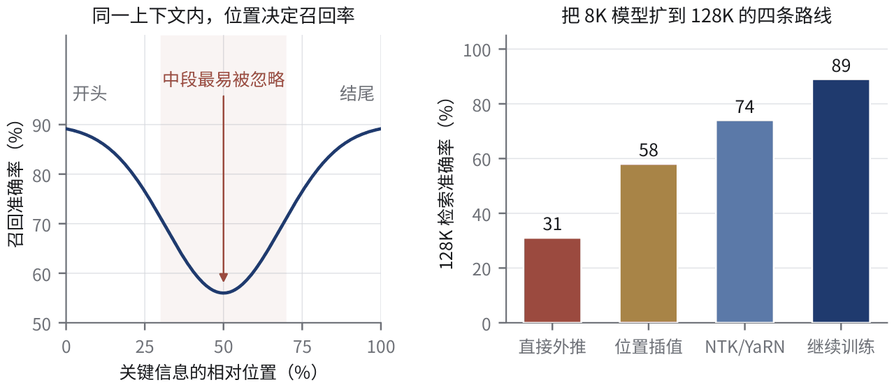

## 长上下文：窗口变长之后

把一个 70B 模型的上下文从 4K 拉到 128K，权重一个字节没变，KV 缓存却从 1.3GB 涨到 40GB。这 40GB 要从显存里划出来，且随并发数线性叠加。窗口变长带来的第一件事不是能力，而是账单。

2023 年前后，主流模型的支持长度从 4K 一路涨到 32K、128K，个别模型标到 1M。宣传页上的数字容易做，把数字变成可用的能力要难得多。位置编码会在训练长度之外失效，注意力的二次项会让算力曲线陡起来，长文档语料本来就不多，显存则被缓存吃光。四件事必须一起解决，缺一件，窗口就只是个数字。

### 外推不是插值

旋转位置编码（RoPE）把位置写进 query 和 key 的相位里：第 $m$ 个位置的向量旋转 $m\theta_i$，不同维度用不同的角频率 $\theta_i$。两个位置的点积只依赖角度差 $(m-n)\theta_i$，相对位置因此是内生的。这套设计在训练长度内很干净，出了边界就出问题：模型只见过 $m\theta_i$ 落在某个区间内的组合，一旦 $m$ 超出训练长度，相位转到了训练时从未出现过的角度上，注意力分数变成噪声。于是有了一个用词上的区别：把没见过的长度折回训练区间叫插值，指望模型自己走到区间外叫外推；下面几种方法都选了插值，差别只在怎么折。

这些方法都在改 RoPE 的频率谱，推导放在第 6 章，这里只记它们的差别与代价。位置插值把位置序号换成 $m/s$，$s$ 是扩展倍数，32K 就把 4K 的位置压回训练区间；所有频率一起被压，相邻 token 的角度差变成原来的 $1/s$，近距分辨率下降，需要一千步左右的微调补回来。NTK 感知的做法不动位置，只把角频率 $\theta_i=\mathrm{base}^{-2i/d}$ 里的基数 $\mathrm{base}$ 调大，等效于按维度非线性缩放：高频维波长短、被拉伸的比例小，低频维被拉长，长距离重新可分。YaRN 给每个维度一个斜坡系数，波长短于训练长度的维保持原样、居中的做线性插值、更长的直接拉伸，再在注意力 logits 上乘一个温度因子补偿分布变平带来的熵上升，把 128K 的继续训练数据降到此前方法的十分之一量级。LongRoPE 逐维搜索倍数，扩到两百万量级，再在原始长度上做一轮恢复训练，把被拉长的频率对短文的影响收回来。

这几条路的推理接口是同一个：模型结构不动，只在算 RoPE 角度时换一套映射。KV 缓存里存的是旋转之前的 key，换方案时对缓存里的 key 重新施加一次旋转即可，不必重建。差别全在“哪个维度乘多少”，以及要付多少微调数据。它们共享一个假设：模型已经学到了位置的语义，只需要重新标定坐标轴。训练数据里根本没有的长依赖，标定得再准也补不出来。

另一条路线是把注意力的连接变稀。滑窗注意力让每个 token 只看最近的 $w$ 个位置，计算量从 $O(T^2)$ 降到 $O(Tw)$，再插入少量全局 token 负责跨段传递信息。代价是多跳：第 1 段的信息要传到第 10 段，得经过中间每一跳，每跳都有损耗。这类结构在 2020 年前后很热闹，位置插值和全注意力成熟之后退居次要，但在极端长度和流式输入里仍有位置。

《LongLoRA》(2023) 把稀疏化搬到了微调阶段，做法比上面这些省得多。设组大小 $G$，把序列按 $G$ 切成若干组，只在组内做注意力，算量从 $O(T^2)$ 降到 $O(TG)$。问题是组与组之间完全不通信，长距离依赖被切断，困惑度随长度恶化。补通信的办法是平移：一半的注意力头用原分组，另一半把自己头里的 token 序列整体挪 $G/2$，于是位置 $[G/2,\,3G/2)$ 这一组在前一半头里被切开、在后一半头里被连起来，信息靠错位跨过组边界。

```text
# qkv 形状 (B, T, 3, H, D)，把头切成两半，后一半的 token 维平移 G/2
qkv = cat((qkv.chunk(2, dim=3)[0],
           qkv.chunk(2, dim=3)[1].roll(-G // 2, dims=1)), dim=3)
out = self_attn(qkv.view(B * T // G, G, 3, H, D))   # 组内仍是标准注意力
out = cat((out.chunk(2, dim=2)[0],
           out.chunk(2, dim=2)[1].roll(G // 2, dims=1)), dim=2)
```

两行 `roll` 就是全部改动：切头、平移、把 token 维折进批维。论文在 LLaMA-2 7B 上用 RedPajama 微调，PG19 验证集的困惑度给出了一组干净的对照：全注意力在 8K/16K/32K 上是 8.02/8.05/8.04，只用单一分组模式是 8.29/8.83/9.47，加上平移分组后回到 8.04/8.03/8.08。一个平移就把差距补平，说明失效点确实在跨组通信，而不在组内注意力的表达力。

这里的设计取舍在推理：训练用稀疏分组，推理换回全注意力。这要求稀疏模式不能把模型带偏，否则推理时换成全注意力会崩，平移的作用正是防止模型过拟合到某一种固定分组。滑窗注意力做不到这一点，它是结构，推理时也只能滑窗。论文还测出另一件事：只调 LoRA 的低秩矩阵不够，秩 8 时困惑度 11.44，加到 256 仍是 11.98，而把归一化层和嵌入层放开后降到 8.12，接近全参数微调的 8.08。长上下文的适配不是“低秩就够了”，位置尺度变化需要这些层跟着动。

### 长度是一段一段加上去的

继续预训练是绕不过去的一步。直接在 4K 上训完的模型拿去跑 128K，位置插值能让困惑度不爆炸，但长距离检索仍然接近随机。原因在数据：4K 的样本里，任意两个 token 之间最多隔 4K，模型没机会学习“在第 100 页记住一个人名，在第 300 页用它”这种模式。

做法是长度课程：先在 4K 上训完主体，再用几百亿 token 在 32K 上继续，末尾用更少的数据在 128K 上收尾。每一阶段的长文档比例逐步提高，短样本也要保留，只喂长文本会让模型在短任务上退化。打包（packing）也有讲究：把多篇文档拼成一条长序列能提高利用率，但必须用注意力掩码隔开，否则模型会学到跨文档的虚假依赖，这种污染在评测里看不出来，在实际使用中表现为莫名其妙的串味。

合成数据补上了另一块。真实长文档稀缺，于是有工作用强模型把短文档改写成需要跨章节引用的长文本，或者构造“把针埋进干草堆”式的检索样本。这类数据能教会模型定位，但教不会它做全局推理。针的形状太规整：一句与上下文毫不相干的事实，一个近乎唯一的句式，模型只需局部匹配就能找到。换成需要比对三处证据、或者统计全文出现次数的任务，同一批模型的表现会明显下滑，而后者才是合同审阅、代码库理解这类场景真正需要的能力。

### 把序列切到多张卡上

长度到了几十万 token，单卡的显存装不下激活，也装不下缓存。数据并行复制整个模型，张量并行把每层的矩阵切成几块，流水并行则按层把模型分成若干段。三种办法动的都是权重与层，没人动序列，所以都解决不了“一条序列太长”的问题。

序列并行把 token 维度切开，每张卡负责一段。麻烦在注意力：第 $i$ 段的 query 需要和所有段的 key、value 相乘。朴素做法是先做一次全收集，把各段的 KV 汇聚到每张卡上，通信量随长度线性增长，卡越多，通信越成为瓶颈。

《Ring Attention》(2023) 把这件事改成了流水。它能成立，靠的是分块注意力的一个性质：一个 query 块对一组 KV 块的注意力可以按任意顺序累加，只要把每块的 softmax 统计量正确合并。在线 softmax 用两个统计量记录累加状态——已见块的最大 logit $m$ 与指数和 $\ell$——外加一份已经累加的输出 $O$，新块进来时按

$$m'=\max(m,\,\tilde m),\qquad \ell'=e^{m-m'}\ell+e^{\tilde m-m'}\tilde\ell,\qquad O'=\frac{e^{m-m'}O+e^{\tilde m-m'}\tilde O}{\ell'}$$

重标定已有的输出 $O$。$\tilde m,\tilde\ell,\tilde O$ 是新块自己的三个量。顺序无关，就可以把内层循环拆到不同设备上。

设每张卡分到长度 $c$ 的 query 块，共 $N_h$ 张卡，它们围成一个环。

```text
每张卡：切出自己的 query/key/value 块（长度 c）
for layer in layers:
    O, m, l = 0, -inf, 0
    K_cur, V_cur = 本卡的 K, V
    for step in 1 .. N_h-1:              # 所有卡同时执行
        O, m, l = flash_step(Q_local, K_cur, V_cur, O, m, l)
        send K_cur, V_cur to next card
        recv K_next, V_next from prev card
        K_cur, V_cur = K_next, V_next
    O = O / l                            # 用最终分母归一化
    O = FFN(O)                           # 逐位置计算，不通信
```

每一步传的是 $4cd$ 字节（两块 KV，bf16），算的是 $4dc^2$ FLOPs。要让通信藏在计算后面，需要

$$\frac{4dc^2}{F}\ \ge\ \frac{4cd}{B}\quad\Longleftrightarrow\quad c\ \ge\ \frac{F}{B}$$

$F$ 是单卡算力，$B$ 是卡间单向带宽，$F/B$ 就是这台机器的算术强度门槛。A100 配 NVLink（312 TFLOPS、300 GB/s）只要块长约 1K token；同样是 A100 走 InfiniBand（12.5 GB/s）就要 24.5K。这就是为什么 Ring Attention 在 NVLink 域内好用，跨节点得先把带宽算清楚。单卡激活从 $O(T)$ 降到 $O(c)$：一层要存当前 query 块、当前 KV 块、正在接收的 KV 块和输出，六块，共 $6bch$ 字节（$b$ 是每个元素的字节数，$h$ 是隐藏维，就是上面的 $d$），与序列长度无关。反过来，这六块也定了下限：每张卡手里至少要有 $6c$ 个 token 的序列——论文把这条记作最小序列长度 $s=6c$——$c=1$K 时就是六千多个 token 起步。

代价在两头。块大小必须大于 $F/B$，块大小又受单卡显存限制，两边一夹，低带宽集群上就跑不动长序列。环上没有冗余路径，任何一张卡慢下来，整条流水都等它，所以卡间的负载要均匀，序列切分不能太碎。它换来的是精确注意力，不是近似：32 张 A100 上 7B 模型做到 100 万 token 上下文，是此前省显存方案的 32 倍；TPUv4-512 上到 3000 万 token。LLaMA-13B 在 32 张 A100 上微调到 512K，线检索任务在 512K 长度上仍然保持高准确率。工程上常见的组合是节点内用张量并行切权重、节点间用序列并行切 token，两层一起把单卡负担压下去，代价是两套通信叠在同一条关键路径上。

### 缓存比权重更贵

推理时的显存账更难算。缓存的大小可以精确算出来：

$$\text{KV}_{\text{token}}=2\times L\times H_{kv}\times d_{head}\times b$$

2 是 key 与 value 两份，$L$ 是层数，$H_{kv}$ 是 KV 头数，$d_{head}$ 是每头维度，$b$ 是每个元素的字节数（fp16 为 2）。乘上序列长度 $T$ 和并发数 $B$ 才是总占用（这里的 $B$ 是批里的请求数，与上一节的卡间带宽无关）。70B 模型用分组查询注意力（GQA），8 个 KV 头、每头 128 维、80 层，每 token 是 $2\times80\times8\times128\times2=327{,}680$ 字节，约 320KB；128K 上下文就是 40GB。权重那一头也不轻：70B 的 fp16 权重是 140GB，单张 80GB 卡根本放不下，按 8 卡张量并行切开，每卡 17.5GB，剩下约 62GB 装缓存。一个 128K 请求的缓存摊到 8 卡是每卡 5GB，于是每张卡大约能同时挂十来个这样的请求。

GQA 是这里最划算的一刀。它让多个 query 头共享一组 KV 头，缓存直接按共享比例缩小。MQA 把共享做到极致，所有头共用一个 KV，缓存降到几十分之一，但表达能力受损，训练时容易出现注意力头退化。GQA 取中间，8 组是常见选择，在质量和显存之间留了余地。

量化是第二刀。KV 缓存对精度不像权重那么敏感，8 位几乎无损；再往下要小心，key 的量化误差会直接进 softmax 的 logits，异常值的影响被指数放大。有工作对 key 按通道量化、对 value 按 token 量化，2 位下仍能维持可用质量，但需要在长上下文任务上重新验证：短评测看不出的退化，在长距离检索上会很显眼。

第三刀是驱逐。注意力分数在长序列上高度稀疏，多数 token 只在被生成的瞬间有用。重击者（Heavy Hitter）类的做法按历史累积的注意力权重保留一小部分 token，其余丢掉。驱逐最容易踩的坑是“只留最近的”，下面这一节把它的失效机制拆开看。

### 只留最近的窗口为什么会崩

先看一组数。Llama-2-13B 在 PG-19 第一本书（65K token）上，稠密注意力的困惑度是 5641，只保留最近 1024 个 token 的窗口注意力是 5158——两者都很差，窗口法并没有因为省显存而变得更糟，但也没救回来。奇怪的是，在窗口里再塞回最前面 4 个 token，困惑度直接降到 5.40；而每生成一个 token 就重算整个窗口的滑窗重算方案是 5.43，两者几乎持平。《StreamingLLM》(2023) 就是从这个现象出发的。

问题出在 softmax 的分母上。注意力的权重是

$$a_i=\frac{\exp(s_i)}{\sum_{j\in\mathcal{V}}\exp(s_j)}$$

分母要对所有可见位置求和，而且不能为 0。当前 query 与历史都不太匹配时，模型仍须把这一份概率质量放到某个地方。训练时哪些位置最适合当这个接收端？最早的那几个 token：因果掩码让位置 0 对后面所有位置都可见，位置 100 只对 100 之后可见，“永远可见”的初始 token 因此被训练成了默认的垃圾桶。论文把前 4 个 token 换成换行符再测，困惑度仍能恢复（5.60 对 5.40），说明起作用的是绝对位置，不是内容。删掉它们不是丢了一条信息，是把 softmax 的分母挖走了一块，所有后续位置的权重分布都跟着偏移。

缓存因此分成两段：4 个固定的 sink 位置，加最近 $L-4$ 个 token 的滑动窗口（这一段的 $L$ 指窗口总预算，不是层数）。新 token 进来写进滑动段，滑动段满了就弹出最老的一个。关键的一步是位置重编号：缓存里实际是 $[0,1,2,3,6,7,8]$ 时，喂给 RoPE 的位置是 $[0,1,2,3,4,5,6,7]$，而不是它们在原文中的编号。RoPE 的 key 要在施加旋转之前缓存，每次解码对滚动缓存里的 key 重新施加一次旋转；ALiBi 则直接用连续的线性偏置，不用跳跃的偏置。

```text
step(t, kv_t):
    if len(sink) < 4:  sink.append(kv_t)      # 前 4 个位置永久保留
    else:              window.append(kv_t)    # 滚动段
    if len(window) > L - 4: window.popleft()  # 丢掉最老的
    pos = range(len(sink) + len(window))      # 按缓存内位置编号
    K = rope(sink.k + window.k, pos)
    out = attn(q_t, K, sink.v + window.v)
```

为什么是 4 个而不是 1 个：Llama-2-7B 在 400K token 上，$0{+}4096$ 的困惑度是 3359.95，$1{+}4095$ 降到 11.88，$2{+}4094$ 是 10.51，$4{+}4092$ 是 9.59，$8{+}4088$ 是 9.54。一个不够，四个基本到位，再加收益递减。原因在预训练：Llama-2 只在段落前加 `<s>`，而分块发生在加标记之前，起始 token 并不统一，模型只能用开头几个位置一起当 sink。论文另外验证了预训练时加一个专门的占位 token（160M 模型从头训）可以让推理时只需一个 sink。

设计取舍最清楚地体现在“为什么不重算”。重算窗口质量好（5.43），但每生成一个 token 都要对 $L$ 个位置重跑一次注意力，复杂度 $O(TL^2)$；StreamingLLM 用 4 个常驻位置换来不重算，复杂度 $O(TL)$，在 400 万 token 上比它快 22.2 倍。另一个取舍是位置重编号：按原文绝对位置算，第 100 万个 token 的相位远超训练范围，RoPE 又失效了；按缓存内位置算，位置永远落在训练区间内，代价是模型无法知道“绝对隔了多远”，窗口外的距离感被抹平。

失效条件很硬：窗口外的信息真的丢了，需要回查的任务（“前面第 3 段提到的金额是多少”）做不了。它不是上下文扩展，可注意的范围仍然只有 $L$；论文自己也把它归在长度外推这一类，而不是“更好地利用长上下文”。

### 把历史压成一个矩阵

驱逐是丢掉历史，还有一条路是把历史压成一个固定大小的状态。《Infini-attention》(2024) 在每个注意力头里挂一个关联矩阵 $M_s\in\mathbb{R}^{d_{key}\times d_{value}}$ 和一个归一化向量 $z_s\in\mathbb{R}^{d_{key}}$，随段递推。段长 $N$（论文取 2048），第 $s$ 段的 query/key/value 直接复用点积注意力已经算好的那套投影，不额外算。

读的时候拿 query 去查矩阵：

$$A_{mem}=\frac{\phi(Q)\,M_{s-1}}{\phi(Q)\,z_{s-1}}$$

$\phi=\mathrm{ELU}(\cdot)+1$，保证非负；分母是每个 query 一个标量，用来归一化。白话就是：query 与历史所有 key 算相似度，加权平均它们的 value——这正是线性注意力的形式，只是“对全部历史求和”被改写成“对矩阵做一次乘法”。写完一段再更新：

$$M_s=M_{s-1}+\phi(K)^\top V,\qquad z_s=z_{s-1}+\sum_{t=1}^{N}\phi(K_t)$$

$\phi(K)^\top V$ 是一个 $d_{key}\times d_{value}$ 的外积和，把这一段所有 key-value 绑定一次性写进矩阵。矩阵容量有限，同一个 key 反复写会饱和，所以论文还给了 delta 规则：先读出旧值，只写差值，

$$M_s=M_{s-1}+\phi(K)^\top\Big(V-\frac{\phi(K)M_{s-1}}{\phi(K)z_{s-1}}\Big)$$

已经存在的绑定不会被重复累加。合并时把局部注意力输出 $A_{dot}$ 与记忆检索结果按每头一个标量的门控加权：

$$A=\sigma(\beta)\odot A_{mem}+\big(1-\sigma(\beta)\big)\odot A_{dot}$$

$\beta$ 是可训练参数，$\sigma$ 是 sigmoid。训练后的可视化把头分成两类：门控值 $\sigma(\beta)$ 接近 0 或 1 的专职头（只看局部或只看记忆），和 $\sigma(\beta)\approx0.5$、也就是 $\beta\approx0$ 的混合头；每层至少保留一个短程头，保证信号能一路传到输出。

代价与数字：每头每层的记忆是 $d_{key}(d_{value}+1)$ 个元素，与序列长度无关，这才叫“有界”。论文的 12 层小模型在 PG19 上困惑度 9.65，比 Memorizing Transformers 的 11.37 低，而记忆占用是后者的 1/114；1B 模型插进这套机制后，在 100 万 token 的 passkey 检索上满分；8B 模型在 50 万 token 的书摘任务上刷新 SOTA。训练要走 BPTT（对记忆状态反传），配合梯度检查点才能把显存压下来，这是它比标准微调贵的地方。

失效条件：固定大小的矩阵装不下需要逐字回忆的细节，它存的是“模糊的加权平均”，不是可检索的索引。passkey 这种“一个孤立事实反复被问”的任务正好适合它，绑定只写一次，读的时候信噪比高；需要比对具体措辞的任务不适合。位置编码只加在读写之后的 Q、K 上，记忆里存的是去掉位置的内容，所以它也分不清“早先”和“更早”。

前面几种压法可以叠加，但边界不同。GQA 改的是模型结构，得在预训练时就定下来；量化与驱逐可以在推理时开关，适合按任务调；压缩记忆要改注意力层，得靠继续预训练或微调把它训出来。驱逐与多轮对话的冲突最明显：上一轮丢掉的段落，这一轮想回查也找不回来了，常见补救是在驱逐前把被丢弃的部分写成摘要重新放回上下文，代价是多一次生成。

### 宣称的长度与有效的长度

评测先要问的是“多长算长”。《Lost in the Middle》(2023) 给了一个不舒服的答案：把相关文档放在上下文的不同位置，准确率画出来是一条 U 形曲线——放在开头或结尾，模型答得好；放在中间，准确率明显掉下去，有时比不给文档还差。这个现象在专门为长上下文训练的模型上同样存在，只是谷底浅一些。

“大海捞针”式的测试把一句事实埋在长文本里，问模型那句话是什么。它好通过，因为只需要一次词面匹配，且答案位置固定、干扰项弱。真正难的是多跳与聚合：从三段分散的证据里推出一个结论，或者统计全文出现的次数。

《RULER》(2024) 把这些任务拆成四类共 13 个配置，每个配置都用参数控制难度，所以长度和难度可以分开扫。检索类 8 个：单针 3 种针型（词-数字配重复噪声、词-数字配论文正文、32 位 UUID），多键 3 种（堆里再埋 3 个干扰针；整段堆全是干扰针的 line retrieval；键值都是 UUID 的 KV retrieval），多值 1 个（同一个键对应 4 个值，要求全取回），多查询 1 个（4 个不同键全取回）。多跳追踪是一个变量链：`VAR X1 = 12345` 后面接 4 条 `X2 = X1`、`X3 = X2` 的绑定语句，散在全文各处，要求把所有指向这个值的变量名都列出来。聚合类两个：常见词抽取（10 个词各出现 30 次，其余词各 3 次，要求返回这 10 个）与高频词抽取（按 Zeta 分布 $\alpha=2.0$ 采样词频，返回 top-3）。问答类把 SQuAD 与 HotpotQA 的短文题稀释到目标长度，分别代表单跳与多跳。

每个长度（4K 到 128K，六档）生成 500 个样本，评分用召回率：模型输出里是否出现目标串，并在输入末尾接一个答案前缀，防止模型拒答或展开解释。有效长度的定义是一条固定的线：以 Llama-2-7B 在 4K 上的 13 任务平均分 85.6% 作为阈值，所有模型用同一条线，取平均分仍高于它的最大长度。这里容易读错——不是“各自 4K 得分的 85%”，而是一个绝对分数线，否则基线很低的模型反而容易“达标”。

用这把尺子量 17 个模型，结果是：几乎所有模型在单针大海捞针上接近满分，但到 32K 就有一半掉到线下；除了 Gemini-1.5-Pro（有效长度超出了测试上限），没有一个能在自己宣称的长度上保持。Yi-34B 宣称 200K，在干扰针堆满全场的极端版本上，256K 时掉了 40 分，错误模式很有代表性：它能圈到大体位置，但定位不到具体那个键，于是把附近的干扰值抬了回来。另外两个随长度浮现的毛病是：越来越依赖参数知识（不看上下文直接答），以及在非检索任务上直接从上下文照抄。

为什么用合成任务而不是真实长文档：真实评测集的长度不好控，且模型可能早就从预训练里见过材料，分不清是读懂了还是记住了。合成任务把参数知识这条路堵住，代价是它测的是“能不能在长上下文里做这几类操作”，而不是“能不能读懂一份真实合同”。两类评测不能互相替代。

下图左边是位置与准确率的关系，右边是几种长度扩展方法在 128K 上的表现。两条信息放在一起，说明“支持 128K”和“在 128K 上还能用”是两件事。



退化有几个来源。训练数据里长距离的依赖本来就稀疏，模型学到的多是局部连贯，全局一致的部分很少。注意力在长序列上被稀释，softmax 把权重摊到几万个位置上，真正相关的几个 token 分不到足够的份额；位置编码压缩之后角度差变小，局部次序和远处的相对位置都变得模糊。这些因素叠加，效果就是开头和结尾清楚，中间模糊。

### 该装进去，还是该去查

成本对比能帮助判断。一次 prefill 的浮点运算大致分两块：权重部分约 $2NT$，注意力部分约 $4LT^2d$，其中 $N$ 是参数量、$T$ 是序列长度、$L$ 是层数、$d$ 是隐藏维。70B 模型、80 层、$d=8192$，$T$ 取 4K 时注意力只占总量的不到一成；到 128K，注意力项反而是权重项的两倍多，算力开始被二次项主导。从 4K 到 128K，token 数涨 32 倍，总算力涨约一百倍。检索方案把上下文压到 4K 到 8K，同样的请求，prefill 算力差出一个数量级，首 token 延迟也差出几倍。

但检索有自己的开销和失败模式。切块、向量化、建索引是一次性成本，每次查询要算 embedding、做近邻搜索、重排，多出几十毫秒；切块会把跨段落的论证切断，召回的片段可能恰好缺了关键的那一句；它依赖查询与文档的字面或语义相似度，而很多问题需要“把全文读完才知道该看哪里”。

需要全局聚合、跨文档比较、对全文风格或结构做判断的任务，长上下文更合适：把整份材料交给模型，让它自己决定看哪里。需要精确查找、知识频繁更新、语料规模远超窗口的任务，检索更合适。介于两者之间的，常见做法是混合：先检索缩小范围，再把几十 K 的候选材料放进上下文，让模型在较小的窗口里做多跳推理。

决定成本的不只是单次请求，还有缓存能不能复用。同一份长文档被反复提问时，前缀缓存能让后续请求跳过 prefill，长上下文的边际成本骤降；而每个请求都换一份材料，这笔钱就要一次次重付。这个问题把视线引向服务端：显存怎么分页、请求怎么排队、缓存怎么共享，决定了长上下文究竟是能力还是负担。
