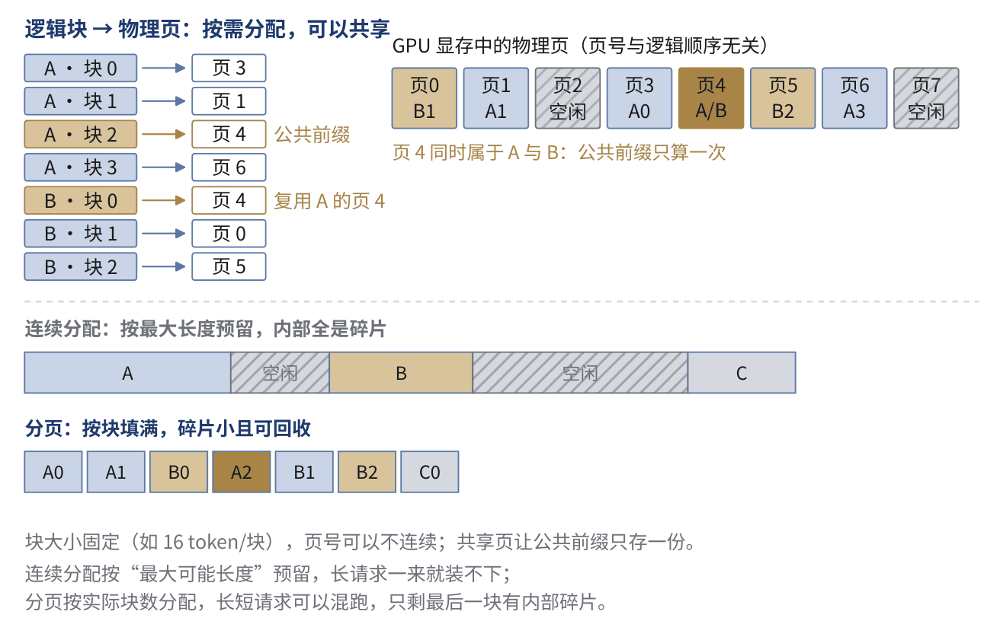
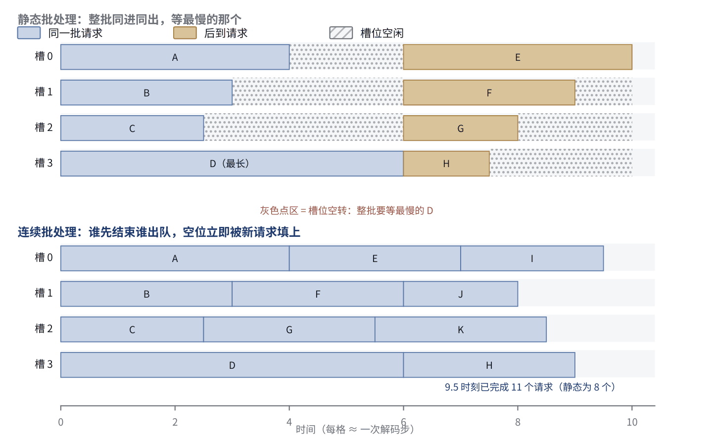

## 推理引擎：算力闲着的那部分

一张 A100 有 312 TFLOPS 的 FP16 算力，2TB/s 的显存带宽。把它的算力除带宽，得到 156：每从显存读一个字节，得做 156 次浮点运算，才不至于让算力空等。而一个 13B 模型在批大小为 1 时生成一个 token，每读一个权重只做两次运算。带宽被榨干，算力用掉不到百分之一。

这个比例决定了推理系统的全部设计。所谓引擎，做的基本是一件事：想办法让每个字节的读取服务更多计算，或者让等待的时间被别的请求填满。前者靠批处理，后者靠调度；两者都受同一个东西限制：KV 缓存占的显存。显存不够，批就开不大；批开不大，带宽就用不满。

### 两个阶段，两种性格

一次请求分两段。预填充（prefill）把整条 prompt 一次性过一遍，每个 token 的隐状态与前面所有 token 做注意力，计算是矩阵乘矩阵，形状方正，算术强度随序列长度上升。解码（decode）每次只处理一个新 token，要与缓存里所有历史做注意力，计算退化成矩阵乘向量，每读一个权重只用一次。同一张卡，两个阶段的瓶颈完全不同：预填充是算力密集，解码是带宽密集。

批处理对解码之所以重要，就在这一点上。批大小为 $B$ 时，每个权重字节能摊到 $2B/b_w$ 次运算（$b_w$ 是单个权重元素的字节数，fp16 取 2），算术强度随批线性上升：

$$\text{强度}=\frac{2B}{b_w}\ \ge\ \frac{P_{\text{flops}}}{B_{\text{bw}}}=156\quad\Longleftrightarrow\quad B\ \ge\ 156$$

批大小 32 时强度是 32，虽然仍低于门槛，但已经离算力峰值近了一个数量级。批要到 150 以上，解码才真正变成算力密集。问题是显存：每个请求都要一份 KV 缓存，批越大，缓存越多，权重和缓存抢同一块显存。

预填充的代价也不小。一条 32K 的 prompt，它可能占掉几百毫秒到几秒，这段时间里 GPU 忙于一个大矩阵乘法，其他请求只能等着。预填充决定了首 token 延迟（Time to First Token，TTFT），而解码速度决定每个 token 的间隔（Time Per Output Token，TPOT）。两个指标对应两种用户感受：等多久开始出字，以及字出得顺不顺。

吞吐随批大小的增长不是一条直线。批从 1 加到 32，权重读取被摊薄了 32 倍，吞吐几乎线性上升；过了算力临界点，再加批只能靠多算，曲线开始弯曲；再往上，KV 缓存把显存占满，换页和抢占出现，吞吐反而下降。这条倒 U 形曲线是每个引擎调参的起点：最优点通常落在显存、带宽、算力刚好平衡的地方，批大小未必最大。

### 缓存被切成了碎片

能开多大并发，由一条不等式决定：

$$\underbrace{B\cdot T\cdot 2LH_{kv}d_{head}b}_{\text{KV 缓存}}+\underbrace{M_{\text{weight}}}_{\text{权重}}+\underbrace{M_{\text{act}}}_{\text{激活}}\ \le\ M_{\text{gpu}}$$

$B$ 是在跑的请求数，$T$ 是每条序列的当前长度（按最长的那条算，保守），$L$ 是层数，$H_{kv}$ 是 KV 头数，$d_{head}$ 是每头维度，$b$ 是每个元素的字节数。70B 的典型配置（80 层、8 个 KV 头、头维 128、fp16）每 token 是 320KB，一条 128K 的序列就是 40GB。三项里权重是常数，激活只占几 GB，能动的只有中间那项——引擎的全部精力都花在“同样的显存装下更多 token”上。

最早的推理系统按请求能生成的最大长度预留缓存：来了一个请求，先按 2048 个 token 的位置把显存占住。实际输出可能只有 50 个 token，剩下的 1998 个位置空着，却不能被别人用。一个 13B 模型、批 32，光预留就能吃掉几十 GB。

碎片还有第二种。每个请求的缓存要连续存放，长短不一的请求反复进出，显存里留下许多无法利用的小空洞。分配器看到总量够，却找不到一块连续的空间，只能拒绝新请求。vLLM 论文的实测把这笔浪费量了出来：已有的几个系统里，真正装着 token 状态的缓存只占 20.4% 到 38.2%，剩下的全是预留、内部碎片与外部碎片。

《Efficient Memory Management for LLM Serving with PagedAttention》(2023) 借了操作系统分页的思路。把缓存切成固定大小的块，每块存 16 个 token 的 key 和 value；每个请求维护一张块表，记录逻辑块到物理块的映射。第 $t$ 个 token 的 KV 落在哪里，由两个式子决定：

$$\text{phys}=\text{block\_table}\left[\lfloor t/P\rfloor\right],\qquad \text{slot}=t\bmod P$$

$P$ 是每块的 token 数（vLLM 默认 16）。逻辑块连续，物理块不必连续，注意力核函数按块号去取就行。写入时只做一件事：当前逻辑块没分配就申请一个，写满再申请下一个。

```text
append(seq, kv_t):
    i = t // P
    if i not in seq.block_table:
        seq.block_table[i] = alloc_physical_block()   # 不要求连续
    write(kv_t, phys=seq.block_table[i], slot=t % P)

fork(parent) -> child:                    # 并行采样、束搜索
    child.block_table = copy(parent.block_table)
    for blk in child.block_table: ref[blk] += 1

write_shared(seq, i, kv):                 # 写共享块前先复制
    blk = seq.block_table[i]
    if ref[blk] > 1:
        ref[blk] -= 1
        new = alloc_physical_block(); copy_block(blk -> new)
        seq.block_table[i] = new; ref[new] = 1
    write(kv, seq.block_table[i], ...)
```



上图里，两个请求共享了开头的一段块，各自的块表在分叉处指向不同的物理块。这种共享不需要拷贝：引用计数为零时才释放，需要写入时才复制一份再改（copy-on-write）。并行采样、束搜索、多轮对话的前缀复用，都落在同一个机制上，区别只在何时 fork、何时 append。

浪费因此只剩一种：每个序列的最后一个块填不满，平均浪费 $P/2$ 个 token。$P=16$、平均序列长 2048 时，这部分不到 0.4%；外部碎片为零，因为所有块等大。论文报的总体浪费从六成降到 4% 以下，同样的显存能放下更多请求，吞吐提高两到四倍。共享单独能省多少也有数：并行采样 6.1% 到 9.8%，束搜索 37.6% 到 55.2%（ShareGPT 上分别是 16.2% 到 30.5% 与 44.3% 到 66.3%）——束搜索的候选序列共享大半前缀，省得最多。

块表带来一次间接寻址，注意力核函数要按块号去取不连续的缓存。工程上的做法是给每个块分配一个 warp 去读，保证合并访问，并支持批内变长序列；这部分开销被写进专门的核函数里，代价远小于省下的显存。

块的大小是个纯粹的权衡。块越大，块表越短，寻址开销越小，但最后一个块的平均浪费接近半块，且两个序列能共享的最小粒度变粗；块越小，碎片越少，寻址越频繁。论文在 ShareGPT 上测出 16 到 128 都能跑到最好，在 Alpaca 这种短序列上 16 和 32 好，再大就明显退化，因为序列本身比块还短。16 是个能兼顾两头的默认值。

### 批不是一次组好的

静态批处理按批提交：一个批里的请求必须同时开始、同时结束，等最长的那个生成完，整个批才能释放。生成长度服从重尾分布，短请求早就结束，它的槽位却要空等到最后。批越大，浪费越明显，GPU 的利用率曲线在批的后半段塌下去。

连续批处理（continuous batching）把调度粒度从请求降到了迭代。每一步解码结束，调度器检查队列：有请求完成就立刻释放它的槽位，有新请求就立刻填进去。批的组成每一步都可能变，GPU 不再等待最慢的那一个。

下图对比了两种调度在时间轴上的差别。



实现上的难点在注意力。批里的序列长短不一，位置各不相同，缓存块也分散，普通的三维张量装不下。解决办法是把变长序列压成一维，用块表和位置索引在核函数内部还原。分页缓存和连续批处理因此必须一起做。

真正的麻烦在预填充和篡码混在一起的时候。先看成本比例：在批大小为 1 时，解码每 token 的成本是预填充的 200 倍（LLaMA-13B、A6000、序列长 1024），批 2 时是 100 倍，批 18 时降到 16.7 倍。这个比例说明的是“同一个 token 有多贵”，而预填充一次要吞几千个 token，解码一次只吞一个。一批里混进一条 4K 的 prompt，这一批的执行时间就由它决定，本来二十毫秒一步的解码被拉到几百毫秒。这是“先来先服务、赶上就混”不可行的原因，也是静态批处理之外的另一层不公平。

分块预填充（chunked prefill）把长 prompt 切成计算量相等的块（不是 token 数相等，因为注意力部分随长度增长），每步只放一块，剩下的槽位挂解码请求。块大小怎么定：太小，预填充自己打不满 GPU，切得越碎总时间越长；太大，剩下的槽位挂不了几个解码，起不到掩护作用。《Sarathi》(2023) 的做法是先量出这台机器上预填充打满算力所需的长度，再按应用的 prefill/decode token 比例反推块大小，然后用“解码最大化”组批——一块预填充加尽量多的解码。

```text
loop:
    batch = []
    if prefill_queue 非空:
        batch += next_chunk(prefill_queue.head(), size=chunk_size)
    while 还有空槽 and decode_queue 非空:
        batch += decode_queue.pop()        # 每请求 1 个 token
    if batch 为空: break
    step(batch)                            # 一次前向，批内变长靠块表支持
    回收已完成的请求；把新到的请求分别入队
```

一条 32K 的 prompt 被切成 8 块，每块 4K，夹在解码步骤之间执行，长 prompt 不再独占 GPU。论文报的数是：LLaMA-13B 在 A6000 上解码吞吐最高 10 倍，端到端 1.33 倍；LLaMA-33B 在 A100 上解码 4.25 倍，端到端 1.25 倍；用在流水并行上，微批之间的气泡减少 6.29 倍，端到端 1.91 倍。

代价有两层。第一层在首 token 延迟：切得越碎，新请求等得越久，但已经在生成的请求体验更平滑，这是同一份算力在两类用户之间的分配，没有两全的参数。第二层容易被忽略：切成 $N$ 块后，算第 $k$ 块要把前 $k-1$ 块的 KV 从 HBM 再读一遍，总量是 $N+(N-1)+\cdots+1=O(N^2)$ 个块，不切时是 $O(N)$。上下文越长这笔重读越贵，所以分块预填充只是把干扰摊薄，不是消除它。

显存不够时还要处理抢占。新请求进来而缓存已满，调度器得挑一个在跑的请求腾地方：把它的块换出到 CPU 内存，等有空位再换回来，或者干脆丢掉、之后从头重算。换出保住已有进度，但走 PCIe 搬运几十 GB 很慢；重算省下带宽，却要把预填充再做一遍。重算并不等于白做：已经生成的 token 可以拼回原 prompt，一次预填充就能把全部位置的 KV 重建出来，所以它比“逐步重算”便宜得多。vLLM 的测量结果是，重算的延迟从未超过换出的 20%；但块很小时换出会碎成大量小传输，PCIe 带宽用不满，两者在 16 到 64 的块大小上差不多。回收的粒度也不是单个块：一个序列的块要么全换出要么全留，束搜索里的几个候选要一起调度，因为它们共享块。选哪条路看块大小与带宽：块小、PCIe 慢，就重算；块大、序列长、重算的预填充开销超过搬运，才换出。

### 相同的前缀不必重算

系统提示往往有几千 token，每个请求都一模一样。多轮对话里，历史每轮都在重复。如果每次都从头算一遍注意力，等于把同一段计算做了几千次。

前缀缓存（prefix caching）按块记录已经算过的键值：请求进来时，把 token 序列按块切开，逐块查表，命中的块直接复用缓存，只对没命中的部分做预填充。因为因果注意力的性质，位置 $t$ 的 KV 只由 $x_{1:t}$ 决定，前缀只要逐 token 相同，缓存就完全等价，不需要任何近似。这也是它和“语义缓存”的区别：后者靠相似度判断能不能复用，会引入误差。

《SGLang》(2023) 把这件事做得更彻底，用一棵基数树（radix tree）管理所有缓存的前缀：树的每条边是一段 token，节点上挂着对应的物理页（它把页大小设成 1 个 token，复用粒度最细）。新请求的处理分四步：

1. 从根开始，沿着树找与自己的 token 序列逐位相同的最长路径，遇到分叉或不同就停，得到命中长度 $l_{\text{hit}}$；
2. 前 $l_{\text{hit}}$ 个 token 的 KV 直接引用，只对后 $T-l_{\text{hit}}$ 个 token 做预填充；
3. 把新算出的部分插入树：命中路径的末端如果是一条更长的边，就把它劈成两段，中间插入新节点；没命中就开一个新分支；
4. 回收时从引用计数为 0 的叶子开始，按最近使用时间淘汰。先收叶子、后收祖先，公共前缀因此能留到最后。

多个请求共享系统提示时，它们共用同一条根路径；对话分叉时，分支各自生长。正在跑的请求不能被淘汰，所以每个节点挂一个引用计数，计数为零才可回收。缓存和运行中的请求共享同一个显存池，不预先划一块固定大小的缓存区：等得久的请求多了，系统会把缓存全逐出去，换成更大的批。

```text
match(root, tokens):
    node, i = root, 0
    while i < len(tokens):
        e = node.child_starting_with(tokens[i])
        if e is None: break
        j = 0
        while j < len(e.label) and i+j < len(tokens):
            if e.label[j] != tokens[i+j]: break
            j += 1
        if j < len(e.label):
            e = split(e, j)          # 在 j 处把边劈成两段，e 变成前半段
        node, i = e.child, i + j
    return node, i                    # 命中 i 个 token
```

这套结构还改变了调度的目标。既然命中能省掉大量预填充，调度器就应该把能命中长前缀的请求排在一起跑。SGLang 的做法是按匹配长度排序，长的先执行（longest-shared-prefix-first）。论文证明了一个离线情形下的结论：按基数树的深度优先顺序访问请求，缓存命中率最优，而按匹配长度排序等价于深度优先。代价是贪婪排序会饿死短前缀请求，公平性得另外加约束。这类场景在真实业务里很常见：客服、代码补全、文档问答，几乎都有一条长长的公共前缀。

命中率能到多少有实测：各类基准上 50% 到 99%，缓存感知调度平均达到最优命中率的 96%；完全没有命中时，树操作的开销是 74.3 秒里的 0.2 秒，不到 0.3%，所以可以默认开着。线上部署一个月的统计是 LLaVA-Next-34B 命中 52.4%、Vicuna-33B 命中 74.1%，后者首 token 延迟平均降 1.7 倍；整体吞吐在多个基准上最高 6.4 倍。

真正的代价不在元数据，而在显存。缓存下来的页占着地方，而这些页本可以拿去开更大的批。SGLang 的选择是让两者抢同一个池子：等待的请求多到一定程度，就把缓存全逐出去换成批大小。所以命中率不是一个越高越好的指标，它要和当前负载一起看：低峰期留缓存，省的是重复计算；高峰期逐缓存，换的是并发。一个只出现一次的长 prompt 命中率为零，但它占的页仍会挤掉别的请求，这笔账得靠调度器算。

### 三个目标互相挤压

吞吐、首 token 延迟、token 间隔，三者不可能同时最优。要提高吞吐，就把批开大，代价是每个请求分到的算力变少，token 间隔变长。压低首 token 延迟则要优先跑预填充，正在生成的请求会被拖慢。至于 token 间隔的平稳，只能靠把预填充切碎，代价是新请求的等待被拉长。

《DistServe》(2024) 换了个指标来衡量这件事：有效吞吐（goodput），只统计同时满足两个约束的请求，每秒能完成多少，再按卡数归一：

$$\text{goodput}=\frac{\big|\{\,r:\ \mathrm{TTFT}(r)\le S_{\text{ttft}}\ \wedge\ \mathrm{TPOT}(r)\le S_{\text{tpot}}\,\}\big|}{T_{\text{wall}}\times N_{\text{gpu}}}$$

$S_{\text{ttft}}$、$S_{\text{tpot}}$ 是服务水平目标，$T_{\text{wall}}$ 是测量窗口，$N_{\text{gpu}}$ 是投进去的卡数。不达标的请求一个也不算，于是“多开批、把平均吞吐做高”这条老路立刻失效：平均吞吐很好看，但把 TPOT 拉出红线之后，分母里的卡全都白花。

用这把尺子量，混跑的代价很具体。13B 模型、单张 A100、要求 90% 的请求达标，混跑最多 1.6 rps；把两个阶段放到独立的卡上，预填充单卡 5.6 rps、解码单卡 10 rps，按 2:1 配卡就是 3.3 rps/卡，2.1 倍。差距的根源是约束互相拉扯：混跑时一次预填充会把同一批里所有解码的 token 间隔拉长，为了守住 TPOT 只能把批开小，批一小 TTFT 又守不住。

DistServe 的做法是把两个阶段拆到不同的机器上。预填充节点专门跑大矩阵乘法，解码节点专门跑带宽密集的小步骤，各自按自己的瓶颈配置并行策略和批大小。拆开之后，两边的调参逻辑完全不同：预填充 512 token 就能打满一张 A100，加批不提高效率、只拉长所有人的等待，所以批要小，并行上更愿意用层内切分缩短单次执行时间；解码是带宽密集，批越大越划算，但受 TPOT 与显存双重约束，并行方案要随批大小变。两个阶段的扩缩容也彼此独立。

代价是多了一次 KV 传输。13B 模型每 token 的缓存约 800KB（40 层、40 个 KV 头、头维 128、fp16），512 token 的 prompt 就是 400MB 上下，跨机还能忍；长上下文请求是几十 GB，网络带宽成了新约束。Mooncake 的做法是把传输和计算叠起来：预填充按层做完就把这一层的 KV 发出去，解码端收到一层就能开工，不必等整个预填充结束。

《Mooncake》(2024) 把这套拆分推到以缓存为中心。它有一个全局调度器（Conductor），为每个请求挑一对预填充/解码实例，挑的依据是“能从缓存池里捞回多少 KV”：命中多就走那个预填充节点，哪怕它在别的机架上。缓存池分三层（GPU 显存、CPU DRAM、SSD），用 RDMA 连起来，热块复制到多个节点避免取用拥塞，冷块换出。两个阶段的目标函数也分开写：预填充在 TTFT 约束下最大化缓存复用，解码在 TBT（token 间时延）约束下最大化吞吐。论文报的数：长上下文场景下吞吐最高提升 525%，线上 Kimi 集群多接了 75% 的请求。

### 投机解码在引擎里的位置

投机解码在单请求下收益明显：草稿模型连猜几步，目标模型一次验证，延迟降到一半。但把它放进引擎，账要重算。

验证 $\gamma+1$ 个位置，计算量是一次前向的 $\gamma+1$ 倍。批大小为 1 时，这一步仍然是带宽密集，多算几个位置几乎不增加时间，收益是纯赚。批一大，解码本来就接近算力密集，验证的计算量变成实打实的开销，加速比迅速缩水。投机解码与批处理争的是同一份算力：前者用空闲算力换延迟，后者用空闲算力换吞吐。

调度也会变复杂。每个请求每步接受的 token 数不一样，批里的序列长度因此异步增长，块表要跟着动态扩展；草稿模型本身要占显存，挤占的正是 KV 缓存的空间。工程上的折中是按负载切换：低并发时开投机解码压延迟，高并发时关掉它保吞吐。

把这些手段串起来，引擎做的其实是一个资源置换的游戏。分页把碎片换成了容量，连续批处理把等待换成了吞吐。前缀复用省下的是重复计算，分块预填充则把延迟的尖刺摊平。投机解码换的是更短的等待，拿的是闲置算力。每一步都在某个维度上让步，换另一个维度上的收益。而所有这些置换的价格，最终都会出现在一张按 token 计费的账单上——那张账单怎么算，取决于模型在哪跑、跑多少、和谁一起跑。
