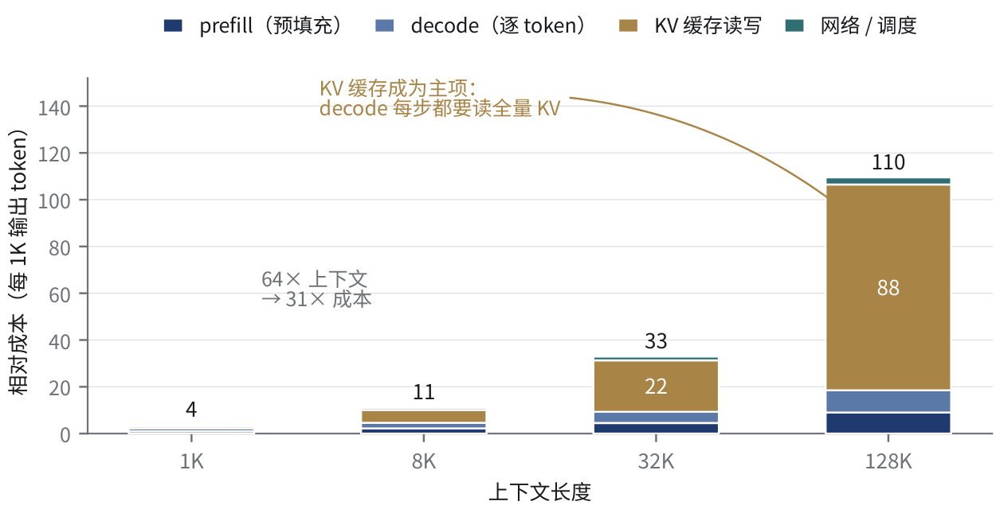

## 服务成本：一张账单

假设一个客服系统每天处理 43 万次对话，平均每次输出 400 个 token，一天累计 1.7 亿个输出 token。把这些 token 摊到一台八卡节点上，边际成本三十几美元。但如果把同一批请求改成串行处理，同一台机器的账单会涨到一万五千美元。

同一批硬件、同一批请求、同一个模型，成本差了两个数量级。差别只在于一次权重读取被多少条请求摊薄。推理服务的工程形状基本由这条公式决定：调度器为什么长那样，并行策略为什么那样选。定价里输出比输入贵三五倍，也是同一个道理。

### 权重读取决定地板

70B 模型的 FP16 权重是 140GB。生成一个 token，模型必须把这 140GB 从显存读进计算单元，因为每个参数都要参与一次乘加。读一遍的时间由显存带宽决定，H100 是 3.35TB/s，除下来 42 毫秒。

$$t_{\text{step}}=\frac{2N\ \text{字节}}{\text{带宽}}=\frac{140\ \text{GB}}{3.35\ \text{TB/s}}\approx 42\ \text{ms}$$

这里的时间不是算出来的，是搬出来的。一条请求独占一张卡时，每秒最多吐 24 个 token，而且这个上限与模型多聪明、提示词写得多好毫无关系。

读 140GB 数据，做 $2N=1.4\times10^{11}$ 次浮点运算，算术强度是 1 FLOP/字节。H100 的 FP16 稠密算力是 990 TFLOPS，带宽 3.35TB/s，两者相除得到 295 FLOP/字节，这是硬件希望达到的比例。实际只做到 1，意味着算力空转了 99.7%。

批处理就是把分子做大。B 条请求共享同一次权重读取，算术强度变成 B：读一遍权重，算 B 个 token。B=8 时强度是 8，B=64 时是 64。要真正填满算力，B 得接近 295。这个数字解释了推理框架为什么宁可在队列里攒请求，也不肯空着卡跑：攒够批次换来的不只是那一点线性吞吐，还把空转的算力捡了回来。

$$C_{\text{1M}}=\frac{10^6}{B}\cdot\frac{t_{\text{step}}}{3600}\cdot p_{\text{node}}$$

$C_{\text{1M}}$ 是每百万输出 token 的成本，$B$ 是批大小，$p_{\text{node}}$ 是节点小时价。八卡 H100 节点按 16 美元一小时算，批大小 256、上下文 2K 的配置下，一步约 11 毫秒，每秒出两万多个 token，摊下来每百万 token 两毛美元出头。批大小为 1 时，同样一台机器每秒只出四五十个 token，每百万 token 接近 90 美元。

上限也不是无限的：批大小受显存和延迟双重夹击。八卡一共 640GB 显存，权重占 140GB，剩下 500GB 给 KV 缓存；上下文 2K 时单条请求的缓存是 0.64GB，理论上能塞 700 多条。可批越大，一步的计算时间越长，用户等第一个字的时间也越长。

### 一个 token 的时间下界

把 KV 缓存算进来，一个 decode token 的时间有个闭合写法。模型参数 $N$，每个 token 的 KV 缓存 $\kappa$ 字节，上下文长度 $\ell$，批大小 $B$，硬件有效算力与有效带宽分别是 $\eta_c P$ 与 $\eta_b\,\text{BW}$（$\eta_c$ 是模型浮点利用率，$\eta_b$ 是带宽利用率，下一节给定义）：

$$t_{\text{tok}}(B)=\max\left(\frac{2N}{\eta_c P},\;\frac{2N/B+\kappa\ell}{\eta_b\,\text{BW}}\right)$$

两项是两块地板。左边是算力地板：每个 token 都要过 $2N$ 次浮点运算，与批大小无关。右边是搬运地板：一步要把权重和这一批请求的全部历史 KV 从显存读一遍，摊到 $B$ 个 token 上，于是权重那部分随批大小衰减，KV 那部分不衰减。两项取大，谁大谁说话。

代入八卡 H100 节点（聚合后 $P=7.9\times10^{15}$、$\text{BW}=26.8$ TB/s，$N=7\times10^{10}$，$\kappa=320$ KB），三个量的大小是这样的。算力地板在 MFU 40% 时是 $1.4\times10^{11}/(0.4\times7.9\times10^{15})\approx44$ 微秒，折合每秒两万多个 token——前面那笔账的上限就是它。权重项在批 256 时是 20 微秒，批 1 时是 5.2 毫秒。KV 项只随 $\ell$ 变：2K 时 24 微秒，32K 时 390 微秒，128K 时 1.6 毫秒。短上下文是算力受限，成本靠批大小摊薄；长上下文是搬运受限，批再大也摊不掉，每 token 成本钉在 KV 上。

拐点在哪，也因此能写出来。权重项与 KV 项相等时 $\frac{2N}{B}=\kappa\ell$，即

$$B^{\star}\approx\frac{2N}{\kappa\ell}$$

2K 上下文 214，32K 14，128K 只有 3.4。这个式子说明一件容易被误判的事：把上下文从 2K 拉到 32K，不只是显存多占一点，批处理的收益区间整个塌掉——拐点从两百多掉到十几个，过了拐点每 token 的时间还有九成花在搬 KV 上。前面那个 295 是零上下文时的 roofline 比值，上下文越长，实际拐点离它越远。

估算一次请求的成本，按这六步走。

1. 数出 $N$、$\kappa$、$\ell$、输入长度 $T$、输出长度 $G$，其中 $\kappa=2\times L_{\text{层}}\times H_{\text{kv}}\times d_{\text{head}}\times$ 每个元素的字节数。
2. prefill 时间 $t_p=2NT/(\eta_c P)$。
3. decode 每步要搬的字节 $M=2N+B\kappa\ell$，搬运时间 $t_m=M/(\eta_b\text{BW})$。
4. decode 每步的算力时间 $t_c=2NB/(\eta_c P)$，取 $t_{\text{step}}=\max(t_m,t_c)$。
5. 单请求每 token 时间 $t_{\text{step}}/B$，乘 $G$ 得 decode 总时长 $t_d$。
6. 成本 $=(t_p+t_d)/3600\times p_{\text{node}}$，$p_{\text{node}}$ 是节点小时价。

不这么算会错在哪，有个具体例子。只数权重：140GB 在 26.8TB/s 上 5.2 毫秒一步，批 100 时摊成每 token 52 微秒。加上 KV：32K 上下文、批 100，一步要搬 1.14TB，42 毫秒出 100 个 token，每 token 425 微秒。差八倍，而后者才是真实成本。反过来，只数 KV 也会错：批 1、上下文 2K 时 KV 才 0.64GB，权重占九成九。

### 两块利用率指标

硬件利用率有两条互不相通的尺子。

模型浮点利用率（Model FLOPs Utilization，MFU）是实际完成的模型 FLOPs 除以硬件峰值：

$$\text{MFU}=\frac{\text{实际模型 FLOPs/s}}{\text{峰值 FLOPs/s}}$$

训练时这个指标比较诚实，PaLM 540B 报告的训练 MFU 是 46.2%，已经接近当时工程实践的极限，剩下的损失来自通信、重算和流水线气泡。推理的 prefill 阶段也能达到相近水平。

单条请求、不攒批的 decode，MFU 常常只有 1% 上下：算术强度 1，roofline 要求 295，差两个数量级。批一大它就升上来，批 64、上下文 2K 时约 17%，批 256 时到 40%——那时算力已经真成瓶颈了。所以 MFU 低本身不说明系统有问题，得连着批大小一起看；一个健康的服务系统，prefill 阶段盯 MFU，decode 阶段盯 MBU，两者同时低才是真的出了问题。

这时要看的是模型带宽利用率（Model Bandwidth Utilization，MBU），即实际达到的显存带宽除以峰值带宽：

$$\text{MBU}=\frac{\text{实际字节/s}}{\text{峰值带宽}}$$

大模型、大批量的 decode 通常能把 MBU 做到六成到八成。用 MFU 去评价一个 decode 系统，就像用马力评价一艘船的载重，尺子选错了。

两个指标和 $t_{\text{tok}}$ 的两项一一对应。把 $t_{\text{step}}$ 代进去，

$$\text{MFU}=\frac{2NB}{t_{\text{step}}P},\qquad \text{MBU}=\frac{2N+B\kappa\ell}{t_{\text{step}}\,\text{BW}}$$

两者之比等于算术强度除以硬件的 roofline 比值，$\frac{\text{MFU}}{\text{MBU}}=\frac{2NB}{2N+B\kappa\ell}\cdot\frac{\text{BW}}{P}$。同一台机器上两个指标不可能同时高，除非算术强度正好落在拐点上。批 64、上下文 2K 时，八卡节点上 MFU 约 17%、MBU 六到八成，两个数字一起看，才说明系统是“搬不动”而不是“算不够”。只看 MFU 会把这种配置误判为浪费，而它恰恰是 decode 最经济的运行点。

还有一个口径问题。$2N$ 只数了权重矩阵，没数注意力。长上下文下前缀注意力的开销是每 token 每层约 $4d\ell$ 次浮点运算，2K 上下文时相当于 $2N$ 的 4%，32K 时占到六成。各家报 MFU 时是否把这一项算进分子并不统一，跨论文比这个数字之前要先看分子分母各算了什么，否则几十个点的差距可能只是统计口径不同。

### prefill 与 decode 是两种生意

把一次请求拆成两段，成本结构完全不同。

prefill 要一次性处理整段输入。每个 token 都要过全部权重，但权重可以留在片上复用，所以算术强度由块大小决定，与批大小无关：读一遍权重，算 T 个 token。喂 2K 的输入，强度就是 2000，远超 295 的拐点，计算受限。这时 MFU 能到 40% 左右，一百万个输入 token 的成本也在两毛美元一档。

prefill 的时间有个同样简单的式子：$t_p=2NT/(\eta_c P)$，$T$ 是输入长度。它和 decode 的差别在于分母里没有批大小——一条 2K 的输入在八卡节点上就要 $2.9\times10^{14}$ 次浮点运算，按 MFU 40% 算是 90 毫秒，计算单元已经吃满。再往批里加请求，只会让总时间按比例延长，单位成本一点不降。

decode 每步只出一个 token，强度退回批大小。上下文一长，还有第二笔账：每一步都要把整条历史的 KV 缓存读一遍。70B 模型（80 层、GQA 8 个 KV 头、每头 128 维）每个 token 的缓存是 320KB，32K 上下文就是 10GB，128K 是 42GB。批大小 100、上下文 32K 时，一步要读 1TB 的缓存，权重那 140GB 反而成了零头。

上图把这个结构拆成四块。上下文 1K 时，权重读取压倒一切，KV 缓存不到 1%；到 8K 时缓存开始有分量；32K 之后，缓存读取成为主要开销；128K 时网络传输也浮出来——缓存大到装不进单机，只能在节点之间搬。

两段的批处理方向相反。《DistServe》(2024) 把使 prefill 达到计算受限的输入长度记作 $L_m$，结论是只有短于 $L_m$ 的请求才值得攒批，长请求攒批只是推迟自己的首 token。decode 那边相反：批 64 时吞吐还在涨，而 token 间延迟只涨 2%（《Splitwise》(2023) 在 BLOOM-176B 上的测量）。两边单价的差距，《SARATHI》(2023) 给了量级：小批时 decode 的每 token 成本可以达到 prefill 的 200 倍。

两段生意的脾气也不一样。prefill 是长时间占用计算单元的大块任务；decode 的活更碎，每几十毫秒就要准时交付一次。把它们塞进同一批 GPU，prefill 一进来就会打断 decode 的节奏，token 间延迟（Time Per Output Token，TPOT）抖成锯齿。工程上有三条路：把 prefill 切成小块与 decode 混跑，也就是分块预填充；把两类任务拆到不同的 GPU 池；把 KV 缓存搬出单机。《DistServe》(2024) 走的是第二条，它把目标写成“在延迟约束下最大化有效吞吐”。

拆开之后还有一个新问题：prefill 算出的 KV 缓存要搬到 decode 节点上。这段传输量不小，于是有了《Splitwise》(2023) 的按阶段配硬件：prefill 用算力强的卡，decode 用带宽和显存大的卡，两类机器的比例按负载调。再往前一步是《Mooncake》(2024) 的做法：把 KV 缓存做成跨节点的池子，用 CPU 内存和 SSD 兜住，让相似的请求直接复用别人算过的前缀。它把缓存从“单机优化”变成了“集群级资源”。

### 批大小与延迟的交换

延迟有两个数：首 token 时间（Time To First Token，TTFT），用户按下回车到看见第一个字；token 间延迟（TPOT），之后每个字之间的间隔。人读字的速度大约是每秒十几个 token，所以 TPOT 在 50 到 100 毫秒之间，体感就是流畅的。

批大小在拐点之前几乎不花延迟的钱。批大小从 1 涨到 100，一步的时间仍是读一遍权重的时间，42 毫秒上下，只是同一步里多算了 99 个 token。用户感受到的 TPOT 不变，吞吐涨了 100 倍。这是推理服务里最划算的一段区间，所有调度器都在拼命往这里塞请求。

过了拐点，账就变了。批大小 300 以上，计算时间开始压过读取时间，一步的时间随批大小线性上升，TPOT 跟着涨。到批大小 1000，一步要三四十毫秒的计算加读取，TPOT 逼近人能忍受的边缘。

于是容量规划的目标要改成“在延迟约束下吞吐最大”，单看吞吐最大没有意义。这个量有个名字，叫有效吞吐（goodput）：只统计那些满足 TTFT 和 TPOT 约束、真正被用户接受的请求。

::: {.keypoint}
服务的容量由有效吞吐决定，不由峰值吞吐决定。一个把 TPOT 拖到 300 毫秒的系统，吞吐数字再漂亮也是在生产事故。
:::

### 并行策略在服务端的取舍

训练时并行是为了装下模型和加速迭代，服务时并行的目的变了：降低单请求延迟，或者提高单位硬件的吞吐，两者常常冲突。

张量并行（Tensor Parallelism，TP）把每层的矩阵按列或按行切开，分到多张卡上。权重被分摊，每张卡要读的字节数按比例下降，所以 TP 能直接压低单步时间。TP=8 时每卡只读 17.5GB，地板从 42 毫秒降到 5.2 毫秒。代价是每层要做两次全归约（all-reduce），80 层就是 160 次。NVLink 上单次全归约在几十微秒量级，加起来 5 到 10 毫秒，把地板又推了回去。实测的单流速度因此停在每秒四五十个 token，离理论值差三倍。

这也是 TP 通常被限制在单机八卡内的原因：跨机走 IB 网络，带宽掉一个数量级，全归约的延迟会吃掉全部收益。

流水并行（Pipeline Parallelism，PP）按层切分，第 1 到 10 层在卡 A，第 11 到 20 层在卡 B。它省显存，但一条请求仍要顺序穿过所有阶段，延迟不降反升；而且 decode 阶段每步只有一个 token，microbatch 太少，流水线气泡填不满。所以 PP 在服务端主要用于跨机扩展容量，不适合压延迟。

数据并行（Data Parallelism，DP）最简单：每张卡放一份完整模型，各服务各的请求。它不降延迟，只加吞吐，而且权重冗余占显存。当模型能装进单卡或单机时，DP 加 TP 的组合是默认选择。

取舍可以压成一句：想要低延迟就加 TP，想省显存就加 DP，PP 只在模型装不下时才值得考虑。这些手段都不解决根本问题，成本杠杆在批大小和缓存命中率上。

### 拆不拆：三条路与判据

两个阶段的脾气相反，混在一批里必然互相拖。三条路都有人走，代价各不相同。

第一条是切块混跑。《SARATHI》(2023) 把长 prefill 切成等大小的块，每块和一个尽量满的 decode 批拼在一起，让 decode 搭 prefill 的便车。收益实在：LLaMA-13B 在 A6000 上 decode 吞吐提升最多 10 倍，端到端 1.33 倍。代价在 KV 重读：一个 prefill 切成 $N$ 块，第 $i$ 块做注意力时要把前面所有块的 KV 从显存重读一遍，总读取量是 $N+(N-1)+\cdots+1=O(N^{2})$，不分块时是 $O(N)$。上下文越长，这笔账越难看。

第二条是拆到两组机器上。prefill 实例只做首 token，算完把 KV 传给 decode 实例，两边从此互不干扰。判据不是“哪个快”，而是三个可算的量。

其一，两条 SLO 谁更紧。TTFT 紧，prefill 需要张量并行把单步时间压下去；TPOT 紧，decode 需要更多副本而不是更大的 TP，因为它卡在带宽上，副本线性加吞吐。《DistServe》(2024) 就在这个空间里枚举：对每种层间、层内并行组合跑一次模拟，算出每卡有效吞吐，取最优者，再按到达率复制：

$$n_p=\left\lceil\frac{R}{g_p}\right\rceil,\qquad n_d=\left\lceil\frac{R}{g_d}\right\rceil$$

$g_p$、$g_d$ 是两类实例各自的每卡有效吞吐，$R$ 是到达率，$n_p$、$n_d$ 是各需要的卡数。搜索空间是 $O(NM^{2})$（$N$ 为单实例节点数上限，$M$ 为单节点卡数），论文报告最大规模下 1.3 分钟内解完。

其二，拆开之后的传输账。要搬的是这条请求全部位置的 KV，$2L H_{\text{kv}}d_{\text{head}}\ell$ 个元素（前面那个 2 是 K 和 V），折成字节就是 $\kappa\ell$。2K 上下文 0.64GB，400Gb/s 的 IB 上 13 毫秒；32K 就是 200 毫秒，比 prefill 本身还长。所以拆分能不能成，全看这笔传输能不能藏进计算里。《Mooncake》(2024) 的做法是逐层搬：prefill 算完一层就传一层，传输与后面几层的计算重叠，净增时间接近零。

其三，收益多大。《DistServe》在同一组实验里给了直接对照：13B 模型、输入 512、输出 64、单张 A100，混跑时每卡有效吞吐 1.6 请求/秒，只跑 prefill 5.6，只跑 decode 10；配成两 prefill 一 decode 后每卡 3.3，是混跑的 2.1 倍。整体上论文报告同等延迟约束下可服务 7.4 倍的请求，或把 SLO 收紧 12.6 倍。

第三条是不拆，直接把 KV 缓存做成集群资源。《Mooncake》用 CPU 内存与 SSD 兜住 KV，按前缀哈希复用别人算过的部分，Kimi 的线上负载因此多接了 75% 的请求，模拟场景下吞吐提升最多 525%。这条路顺手解决了过载：请求到达时先比两侧谁更紧，紧的那侧过不了 SLO 就直接拒掉，而不是等 prefill 白算完再在 decode 排队。论文把这条叫早拒绝，负载用预测出的 TTFT、TBT 与 SLO 的比值衡量，而不是当前队列长度——后者会把负载曲线打成振荡。

选择可以压成一句：单机能装下、上下文不长，切块混跑最省事；两条 SLO 一紧一松、传输带宽够，拆开；请求有大量共享前缀，先做缓存池再谈拆分。

### 路由与级联

如果一个模型能处理 80% 的请求，为什么每个请求都要走最大的那个？

模型路由（model routing）把请求分给不同规模的模型。判定器可以是一个小分类模型，也可以是一个便宜的模型先看一眼。设小模型处理占比为 $p$，单位成本 $c_s$，大模型 $c_l$，则平均成本是

$$\bar{c}=p\,c_s+(1-p)\,c_l$$

$p$ 从 0 提到 0.6，平均成本就降到原来的四成多。收益之大，几乎所有商用 API 都在内部做这件事，只是分层方式不同：按任务类型硬分，按输入长度切段，也有让模型自己判断难度的。

级联（cascade）比路由多一层保险：先让小模型答，再用一个验证器判断答案是否可靠，不可靠就升级到大模型重答。它的成本是

$$\bar{c}=c_s+\alpha\,(c_s+c_l)$$

$\alpha$ 是升级率。升级率 20% 时，平均成本还是比全走大模型低一半以上。级联的风险全在验证器上：一个总是说“可以”的验证器会把级联退化成纯小模型，质量悄悄掉下去，账单却很好看。

这条思路的边界在于判定准确率。路由错判的代价并不对称：把难题误判成简单，用户直接看到错误答案；把简单题误判成难，只多花点钱。所以阈值的设定应该偏向保守，而这件事很难在离线评测里调准，因为线上请求的分布每周都在变。

### 缓存与容量

同一套系统提示、同一份文档、同一段对话历史，在成千上万个请求里被反复 prefill。前缀缓存（prefix caching）把算过的 KV 按前缀哈希存下来，命中时直接跳过这段计算。命中率对成本的影响是二阶的：直接省掉 prefill 的算力和时间；省下的显存又能让给更大的批，TTFT 也从几百毫秒压到几十毫秒。

命中率的分布极不均匀。共享系统提示的请求能到九成以上，长文档问答的场景里，同一份文档被不同用户问到时也能命中。真正拉低平均值的是那些一次性输入，它们不但不命中，还会把缓存挤出去。

容量规划要把这些量串起来算。给定 QPS、输入输出长度分布、TTFT 与 TPOT 的上界，先算 decode 需要多少 token/s，再算 prefill 需要多少 token/s，各自除以单节点的能力，加上冗余系数。

举个具体的例子。QPS 为 5，平均输入 2000 token、输出 400 token，则 decode 需要 2000 token/s，prefill 需要 10000 token/s。单节点在满足 TPOT 80 毫秒的前提下能出两万 decode token/s，一个节点足够；prefill 单节点在 MFU 40% 时能处理两万多 token/s，半个节点够用。于是两个节点（一个 prefill、一个 decode）加三成余量，能撑住这个负载，一天的成本几十美元。

麻烦在峰谷比。上面的 QPS 是日均值，白天的峰值往往是均值的四到六倍，而机器按峰值买、按全天付钱。于是容量规划的真实目标变成了提高峰值的有效吞吐：更激进的批处理、更高的缓存命中率、把长请求挪到低峰时段。这些手段都不改变模型，只改变同一批硬件能接住多少请求。

成本压到这一步，剩下的杠杆就不在服务系统里了。上下文短下来，KV 缓存和 prefill 的成本一起降。要让上下文变短，就得让模型只在需要的时候才去取外部知识。这件事有它自己的一套工程，也有一套代价。
