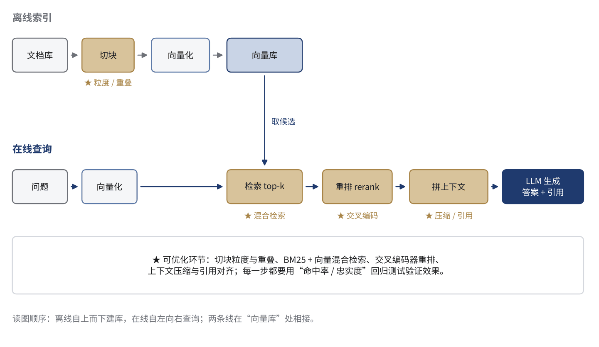

## 检索与记忆

把公司三万字的员工手册丢给模型，问年假怎么算。它会给出一个语法通顺、结构完整、数字错误的答案。这类错误有个共同点：模型不是推理错了，是权重里根本没有这条信息，而它不会承认这一点。

权重是训练结束那一刻的互联网快照，平均、模糊、滞后。要让它答对，最直接的办法是把手册里的相关几段找出来，放进上下文；继续加参数解决不了这件事。这个动作叫检索增强生成（Retrieval-Augmented Generation，RAG），《Retrieval-Augmented Generation for Knowledge-Intensive NLP Tasks》(2020) 把它写成“检索器 + 生成器”的联合模型：给定问题 $x$，先从文档库里取回 $k$ 个段落 $z$，再以 $z$ 为条件生成答案；下面式子里的 top-$k$ 就是这个 $k$。

$$p(y\mid x)=\sum_{z\in \text{top-}k}p_\eta(z\mid x)\,p_\theta(y\mid x,z)$$

答案的概率是对所有候选段落求和：检索器给每段一个权重，生成器在每段条件下各写一个答案，再按权重相加。这篇论文在 Natural Questions 上把 exact match 做到 44.5，此前的闭卷模型在 30 上下。十几个点里，绝大部分来自它终于看到了原文。

### 求和顺序与检索器的梯度

上面那个式子是 RAG-Sequence：假设整句答案都来自同一段，对段落的求和放在乘积外面。把求和挪到乘积里面，就是 RAG-Token：

$$p_{\text{tok}}(y\mid x)\approx\prod_{i}\sum_{z\in\text{top-}k}p_\eta(z\mid x)\,p_\theta(y_i\mid x,z,y_{<i})$$

两类模型的差别不在数学，在“一段到底”还是“每句可换”。前者适合答案集中在一处的问答，后者允许第一句引 A 段、第二句引 B 段，代价是解码时每一步都要对 $k$ 段各算一次分布。求解也不一样：token 版是标准的逐步归一化，可以直接塞进 beam search；sequence 版拆不开，得对每段各跑一遍 beam，再对“没出现在某个 beam 里的假设”补一次前向把概率补全（原论文叫 Thorough Decoding），或者干脆近似为 0（Fast Decoding）。

训练信号只有 (问题, 答案) 对，没有任何人标过“该用哪段”。所以检索器靠边缘似然拿梯度：一段被检索到、且能让答案概率变高，它就往“更容易被检索”的方向走。真正的困难在文档侧：文档编码器的参数一变，整个索引就过期。

两种应对都有。RAG 选择冻结——文档编码器与索引不动，只微调查询编码器与生成器，代价是文档侧的表示永远停在初始状态。REALM 选择真把梯度传进去，并把这种传递写成可解释的形式：

$$\nabla_\phi\log p(y\mid x)=\sum_{z}r(z)\nabla_\phi f(x,z),\qquad r(z)=\left[\frac{p(y\mid z,x)}{p(y\mid x)}-1\right]p(z\mid x)$$

$f(x,z)$ 是查询与文档的内积得分，$r(z)$ 是这段文档的“超额贡献”。一段文档让答案概率高于平均水平就得到正梯度，反之得到负梯度。为了不让索引无限期陈旧，REALM 用两个并行作业：训练器每走数百步把参数快照发给索引器，索引器在后台重算所有文档向量，算完再换回来。另外三个工程手段值得一提：只掩实体和日期这类需要世界知识的跨度，因为被遮住的正是检索该补上的；在 top-$k$ 里加一个空文档，允许模型说“不需要检索”；语料与知识库同源时排除原文自身，否则检索器会学成字符串匹配。

这套设计的取舍在“谁定义相关”。只用 BM25 结果作固定输入，检索器永远学不到生成器缺什么；反过来每步重建索引，成本不可接受。冻结与异步重建就是这两端之间的两个点。

### 一条流水线，五处漏水

把 RAG 拆开，至少五道工序：解析文档、切块、向量化建索引、检索、重排，然后才是拼进上下文生成。每一道工序都有损失，而损失是乘起来的。



上图里每道箭头都可以换成更贵的模型。

设切块保留关键信息的概率 0.9（解析造成的损失算在这一项里），检索召回 0.8（建索引的近似也算在这里），重排没把正确块挤掉 0.9，拼装时没被截断 0.95，生成器正确使用 0.9。乘起来 0.55。每一环单看都“还行”，端到端的正确率只剩一半。这个乘法结构解释了为什么 RAG 调优那么难：某一环提升五个点，端到端只涨两三个点；某一环掉到 0.5，其他环节做得再好也没用。排查时的第一步是把五环指标分开记，否则所有 bad case 看起来都像“模型不行”。

### 切块决定了天花板

检索的基本单位是块（chunk），它切得好不好，直接决定后面所有环节的上限。

固定长度切块最常见：每 512 个 token 一刀，相邻块重叠 10% 到 20%，避免一句话被腰斩。简单、可预测、和上下文预算对得上，代价是不尊重文档结构：表格被切成两半，代码丢了函数签名。

语义切块按标题、段落、句子边界下刀，块长在 200 到 1000 之间浮动。它依赖解析质量：HTML 的标题层级、PDF 的版面还原差一点，切块就崩。常见折中是先按结构切，再把过短的块合并上来，把过长的块按句子拆开。

块长本身有个最优点。太短，向量只覆盖一个局部，指代丢光：“它的有效期是三年”这一块，没人知道“它”是什么；太长，一个块里混了三四个主题，向量变成这些主题的平均。多数问答场景下 256 到 512 token 最优。

父子块（small-to-big）绕开了这个矛盾：用 128 token 的小块建索引，命中的是精确的那句话；返回时取它所属的 1024 token 父块，让生成器看到完整上下文。检索精度按小块算，生成质量按大块算。代价是存储翻倍，以及父块里可能混进无关内容。

落到实现上，切块是一组带判据的规则，不是随手按 token 数截断。

1. 先按文档结构切段落，标题、表格、代码块各自独立，不跨边界合并。
2. 段落超过上限 $L_{\max}$ 时按句子边界继续切，句子是原子单位；单句仍超限才退到 token 级硬切。
3. 段落短于下限 $L_{\min}$ 时与相邻段合并，优先向后合；合并后仍不足，就附上所在小节的标题路径。
4. 每个块前置一行来源（文档标题、小节标题、更新时间），这行在嵌入与生成时都参与。
5. 相邻块保留 $L_{\text{ov}}$ 个 token 的重叠，切口落在句子边界上。

三个阈值不是搜出来的，各有物理含义。$L_{\min}$ 由“消解指代所需的最小上下文”定：一个块里写着“它的有效期是三年”而先行词在上一块，这块单独看就是废的。$L_{\max}$ 由向量的主题单一性定：块里混进三个主题，嵌入就成了三者的平均，和谁都不像。$L_{\text{ov}}$ 只用来补被切断的句子，一成到两成够用，再大只是让索引里的重复变多。

原始论文的选择可以当参照。《Dense Passage Retrieval》(2020) 把维基百科按 100 词固定长度切成 2100 万段，并提到试过按自然段切，检索与端到端效果都更差；《RAG》(2020) 沿用同一个切分。这两个数字说明固定长度在开放域问答里并不差：问题短、答案落在一两句话内，块越短越好定位。合同、手册这类任务相反，小块会切掉适用条件，这时父子块或“块+标题路径”比调长度更有效。

换成直觉做法（把整节甚至整篇文档当一个块）会怎样：向量被全篇的平均语义稀释，检索退化成“找对文档、找错位置”；生成器拿到两万字上下文后，答案又落在中间那段（后面会讲到的 U 形曲线），两头都输。

### 稀疏与稠密：两种不同的“像”

传统检索靠词频。BM25 给每个查询词算一个分数，三项相乘：词频饱和项、逆文档频率、长度归一化。

$$\text{score}(q,d)=\sum_{i}\text{IDF}(q_i)\cdot\frac{f(q_i,d)\,(k_1+1)}{f(q_i,d)+k_1\left(1-b+b\frac{|d|}{\text{avgdl}}\right)}$$

$f$ 是词在文档里出现的次数，$|d|$ 是这篇文档的长度，$\text{avgdl}$ 是全库文档的平均长度；$k_1$ 控制饱和速度（词出现十次不该比出现五次强一倍），$b$ 控制长度惩罚（长文档天然容易命中）。这套公式从 1994 年用到现在，没被淘汰，因为它在一个方向上极强：精确匹配。产品型号、错误码、人名、法律条款编号，只要字面一样，BM25 就一定找得到。

它的弱点在另一头：换个说法就失效。用户问“怎么退订”，文档写的是“取消订阅”，两个词没有一个重合。

稠密检索（Dense Passage Retrieval，DPR）用双塔结构补这一头：查询和段落各过一个 BERT 得到向量，用点积算相似度。训练靠对比学习，一个正样本配一批负样本。负样本怎么选很关键。随机负样本太容易，模型学不到细粒度区分；从 BM25 结果里挑出“看起来像但不正确”的段落作为难负样本（hard negative），提升明显。

《Dense Passage Retrieval for Open-Domain Question Answering》(2020) 在 Natural Questions 上报的前 20 召回率是 78.4%，BM25 是 59.1%。近二十个点的差距，来自“退订”和“取消订阅”这类语义对应。

两种方法失效的场景几乎不重叠，于是混合检索成了默认做法：两路各取 50 到 100 条，用倒数排名融合（Reciprocal Rank Fusion，RRF）合并。

$$\text{RRF}(d)=\sum_{r\in\text{检索器}}\frac{1}{k+\text{rank}_r(d)}$$

它只看排名不看分数，不必把 BM25 分数和余弦相似度归一到同一量纲；$k$ 常取 60，用来压住头部排名的绝对优势。这一手的作用比看上去大：单路排第一只能拿到 $1/61$，两路分别排第一、第二能拿到 $1/61+1/62$，两路都在前列的文档会稳定压过任何单路的第一名。换句话说，RRF 奖励的是“两套不相关的方法都认为相关”。

换成“分数归一化后加权求和”会怎样：min-max 归一依赖当前候选集的最小最大值，新进来一条异常分数就能把整批分数压缩；BM25 与余弦的分布形状也不同，一个是长尾，一个挤在 0.7 到 0.9 之间。RRF 绕开了这两件事，代价是完全不用分数里的置信信息。

### 双塔的损失长什么样

两个编码器各自独立：查询过 $E_Q$，段落过 $E_P$，都取 BERT 的 [CLS] 位置（原文用 base、uncased，$d=768$），相似度取内积 $s(q,p)=E_Q(q)^{\top}E_P(p)$。不取余弦也不要紧，向量归一化后两者等价。

训练数据里的负样本不单独枚举，而是从一个 batch 里借出来的。设一个 batch 有 $B$ 个（查询，正段落）对，拼成矩阵 $Q\in\mathbb{R}^{B\times d}$ 与 $P\in\mathbb{R}^{B\times d}$，得分矩阵 $S=QP^{\top}$ 是 $B\times B$ 的。对角线是正样本，其余 $B^{2}-B$ 个位置全部当作负样本，于是每步只跑 $2B$ 次编码，却拿到了 $B^{2}$ 个对比：

$$L(q_i)=-\log\frac{\exp s(q_i,p_i^{+})}{\exp s(q_i,p_i^{+})+\sum_{j\ne i}\exp s(q_i,p_j^{-})}$$

这就是原文的式 (2)，与温度取 1 的 InfoNCE 同形。分母里再塞进一条 BM25 挑出的难负样本（字面重合但不含答案），就得到论文的最佳配置。行内其他正段落与这一条难负样本性质不同，前者是“未标注”，后者是“已知不对”，两者一起压才把决策边界推得够紧。

训练与推理的形状完全不同。训练时两个编码器都更新、都见负样本；推理时段落侧只算一遍、存进索引，查询侧一次前向加一次最大内积搜索就结束。这个不对称才是双塔存在的理由：相似度必须可分解，才能把段落表示预计算。原文对此说得很直：多层交叉注意力更准，但分解不了，就不能建索引。

代价与失效点也在同一处。批内负样本的难度随批大小变化，批小了负样本太容易，模型学到的只是“不要搞错主题”；批大了显存线性涨，而同一个 batch 里未被标注的相关段落会被当成负样本推开，这类假负例在热门主题上尤其多。领域一变（法律、代码），BM25 挑出的难负样本本身就不“难”了，因此适配新领域时选自哪些负样本比调学习率重要。

### 向量模型怎么适配领域

通用 embedding 模型是在通用语料上训的，到了垂直领域会失灵。“consideration” 在法律合同里是“对价”，在通用语料里是“考虑”；代码库里 `get` 和 `fetch` 的区别，通用模型分不清。

适配有三条路。第一条是继续对比学习，用领域内的（查询，正样本）对微调。数据来源通常是搜索日志里的点击、客服问答对，或者用大模型从文档反向生成的问题。几百到几千对就能见效，因为底座已经会编码语言，缺的只是“这个领域里什么算相似”。

重挖负样本是另一条路。同一份合同的其他条款、同一个 API 的其他方法，字面上高度重合，通用模型会把它们判成相似。把这类“相邻但无关”的段落当难负样本喂进去，模型才能学到关键区别。

更根本的改法是换训练目标：有些场景要的是“能回答问题”，语义最像的段落未必能回答问题。用生成器的反馈训练检索器更贴近最终指标，代价是链路长、不稳定。

选型时别只盯着排行榜：公榜第一名和第十名差两三个点，落到业务上可能一个都不算数。标准得由自己那几百条标注过的真实查询来定。

### 候选从一亿条压到一百条

向量的麻烦不只是存储，还有扫描。1024 维、一亿个块，光向量本身就是 400GB；精确检索要把查询与每一条都算一次内积，$10^{8}\times1024\approx10^{11}$ 次乘加，单次查询几十毫秒，一台机器一秒只能服务几十个用户。索引要解决的就是把这个数压到百万量级，代价是接受一点召回损失。

分层可导航小世界图（Hierarchical Navigable Small World，HNSW）是召回最高的一类做法，结构是一叠图。每个点被抽一个最高层号 $\ell=\lfloor-\ln U\cdot m_L\rfloor$（$U$ 是 0 到 1 的均匀随机数，$m_L=1/\ln M$ 是层数归一化因子），层号越大点越稀，顶层只有几个点当入口。插入新点时：

1. 从顶层入口出发，在当前层贪心走到离新点最近的顶点，下一层从它继续。
2. 走到第 0 层，用大小为 $\mathit{efConstruction}$ 的候选堆做束搜索，得到一批近邻。
3. 从候选中挑 $M$ 个做邻居，挑法不是“取最近的 M 个”，而是逐个检查：若某个候选与已选邻居的距离比与新点的距离还近，就丢掉它——否则邻居全挤在同一方向上，图会长成一条链。
4. 双向连边，任一顶点的出度超过 $M_{\max}$ 时重跑一次上面的剪枝。

查询时上层只做贪心（每层留 1 个候选），到第 0 层把候选堆放宽到 $\mathit{ef}$ 个，直到候选里最近的那个也比结果集里最远的那个远才停。$\mathit{ef}$ 是精度与延迟的旋钮：等于 $k$ 时召回最低，通常要取 $k$ 的几倍；$\mathit{efConstruction}$ 只影响建图质量，不影响查询速度。论文的结论是查询代价随规模对数增长。

代价在内存：每个顶点存 $M$ 条双向边，每条 4 字节 id，一亿条、$M=32$ 就是 $10^{8}\times32\times2\times4\approx25.6$ GB。这个数不小：1024 维向量压到 int8 后一亿条是 100GB 上下，图本身相当于它的四分之一，而它只是索引的骨架，不含向量。图还不好改：删一个点要把它的边补上，边写边查的场景下这个代价很难接受。

倒排文件（Inverted File，IVF）走另一条路：先用 k-means 把一亿条聚成 $\sqrt{N}$ 个簇（约一万个），查询时只扫最近的 $\mathit{nprobe}$ 个簇，扫描量变成 $N\cdot\mathit{nprobe}/\mathit{nlist}$。$\mathit{nprobe}$ 取一，扫描量降一万倍，但簇边界上的目标会漏掉——这是 IVF 的固有误差，不是调参能解决的。

乘积量化（Product Quantization，PQ）解决存储：把 $D$ 维向量切成 $m$ 段，每段单独做 256 个中心的 k-means，于是一个向量变成一个 $m$ 字节的码。距离不用解压：查询向量的每一段先与 256 个中心算距离，得到 $m\times256$ 的查找表，之后每个候选只需 $m$ 次查表相加（这套做法叫非对称距离计算）。1024 维 FP32 是 4KB，$m=64$ 时 64 字节，$m=128$ 时 128 字节，一亿条落在 6 到 13GB，可以全放内存。

真实系统几乎都是组合：IVF 负责缩范围，PQ 负责缩存储，返回的前几百条再用原始向量或重排模型复核——因为 PQ 算出的距离只是近似，它能把对的分到候选里，却排不准。选型看三个数：规模百万级、内存宽裕，用 HNSW，召回最高；上亿且内存紧，用 IVF-PQ；数据天天变，先想清楚删除路径，别默认 HNSW。

### 重排：用贵的模型看少数候选

双塔的问题在于查询和文档从不照面：各自编码成向量，交互只发生在末尾那一次点积。可相关性常常藏在词与词的对应关系里，向量把这种关系压平了。

重排器（reranker）用交叉编码（cross-encoder）：把查询和候选段落拼成一条序列，一起过 Transformer，输出一个相关性分数。每一层注意力都能让查询词和段落词互相看见，精度比双塔高出一截。

代价是它不能预计算。100 个候选就要 100 次前向，每次 512 token，一亿参数的重排模型下大约 $10^{13}$ FLOPs，在 A100 上几十毫秒；候选升到 1000 条就是几百毫秒，用户等不了。

输入构造很直白：`[CLS] 查询 [SEP] 段落 [SEP]`，取 [CLS] 位置的表示过一个线性层，得到一个标量。负样本从 BM25 高分但未标注的段落里取，与正样本拼成一条训练样本，损失是对候选集做 softmax（或逐对的二分类交叉熵），目标不是拟合绝对分，而是把正样本排到前面。

输入里那个查询必须真的与段落一起进注意力，这是它和双塔的全部差别，也带来一个额外好处：同一查询下算出的分数彼此可比。双塔的余弦分数跳查询就不可比（不同查询的向量模长不同），你没法说“大于 0.6 就收”；重排的分数可以卡阈值，于是“一条候选都不够相关”这种情形能被识别，而不是硬塞五条进去。

失效点集中在截断。重排模型吃不下整篇长文，通常只取前 512 个 token，若答案在后面，这篇就会被系统性低估——这也是“加了重排反而降分”最常见的原因。另一个隐患是训练分布：若训练集里的正样本都比较短、关键词密集，线上那些啰唆的长文档会整体掉分。

标准做法是两级：召回用便宜的向量检索取 100 条，重排用贵的交叉编码器选出 5 条。召回的职责是“别漏”，重排的职责是“排准”，调参方向也跟着分：召回率不够就放宽 top-k，精度不够就换更大的重排器。

### 拼进上下文的顺序与噪声

检索到的东西怎么摆，影响不比检索本身小。

《Lost in the Middle》(2023) 做过一组实验：把答案放在 20 篇文档的不同位置测准确率。结果是 U 形：答案在开头或结尾时最高，落在中间时低二十个点以上。模型对上下文的两端更敏感，中间的内容容易被忽略。

对策是把最相关的排在首尾，次相关的塞中间；多轮对话还要考虑时间顺序，把最近的放末尾。

第二个问题是噪声。多塞几条候选看起来更保险，实际上无关段落会稀释注意力，还可能诱导模型把不同段落的事实拼接成一个错误答案。经验是 3 到 8 条，宁少勿多。

第三个问题是指令注入。检索回来的内容是不可信输入，里面可能写着“忽略之前的指令”。用明确的分隔符把它包起来、在其后重申任务约束，是基本防御；更彻底的做法是把检索内容当数据而不是指令组织，比如统一放进带编号的引用块，要求生成时标注来源。给每段配上来源、日期、适用版本也有好处。模型看到“2021 年版”会知道它可能过期。

### 让模型自己决定何时检索

固定流水线有个隐含假设：每个问题都需要检索。实际上“1 加 1 等于几”不需要，闲聊不需要，而“上周三的会议纪要说了什么”必须检索。

《Self-RAG》(2023) 把这件事交给模型自己判断。做法是在词表里加四类反思标记（reflection token），每类有固定的取值集合与固定的输入：

| 标记 | 输入 | 取值 | 判什么 |
| --- | --- | --- | --- |
| Retrieve | $x,\,y_{<t}$ | yes / no / continue | 这一步需不需要检索 |
| ISREL | $x,\,d$ | relevant / irrelevant | 这段对问题有用吗 |
| ISSUP | $x,\,d,\,y$ | fully / partially / no support | 答案被这段支撑吗 |
| ISUSE | $x,\,y$ | 1 到 5 | 这个答案好用吗 |

“输入是什么”决定了每个标记能判什么。ISREL 只看问题与段落，所以它判的是“这段话与问题有没关系”，不是“能不能回答”；ISSUP 才把答案拉进来，所以“相关但不支持”这种情形能单独表达。四类合起来才是一个完整的自评。

训练分两步，目的是把评论模型的判断能力搬到生成器自己身上。先用 GPT-4 给（问题，段落，答案）三元组打上四类标签，据此训一个评论模型 $C$（Llama2-7B）；再用 $C$ 离线给语料里的每句话插上标记，得到约 15 万条指令数据；最后用标准的下一个 token 预测训生成器 $M$，此时标记已经在词表里，对 $M$ 而言“输出一个反思标记”与“输出一个词”没有区别。关键在这一句：训练时评论模型在线，推理时不需要它，成本只在造数据那一步。

推理是逐片段的，一个句子算一个片段。

```text
输入 x, 已生成片段 y_{<t}; 超参 τ, K, 束宽 B
p_ret = P(Retrieve=yes | x, y_{<t}) / P(Retrieve∈{yes,no,continue} | ...)
if p_ret > τ:
    D = R(x, y_{t-1}, K)                    # 取 K 段
    for d in D:
        采样 y_t^d ~ M(· | x, d, y_{<t})
        s_rel = 归一化后的 P(ISREL=relevant | x, d)
        s_sup = 归一化后的 P(ISSUP=fully   | x, d, y_t^d)
    f(d) = p(y_t^d | x, d, y_{<t}) + w_rel·s_rel + w_sup·s_sup
    取 f 最高的 B 个片段；可硬性剪掉 ISSUP=no support 的候选
else:
    采样 y_t ~ M(· | x, y_{<t})，只算 s_use
```

打分式里的第一项是生成概率，后两项是模型给自己打的分：

$$f(y_t,d)=p(y_t\mid x,d,y_{<t})+\sum_{G}w_G\,s_t^G,\qquad s_t^G=\frac{p_t(\hat r)}{\sum_{i=1}^{N_G}p_t(r_i)}$$

$\hat r$ 是该类标记里“最想要”的那个取值（比如 ISREL 取 relevant），$N_G$ 是该类的取值个数，把它们归一化是因为四类标记各自的概率尺度不同。原论文的默认权重是 $w_{\text{ISREL}}=1.0$、$w_{\text{ISSUP}}=1.0$、$w_{\text{ISUSE}}=0.5$，检索阈值 $\tau=0.2$，束宽 2，每次取 10 段、实际用前 5 段。白话：一段候选能不能进答案，取决于它接得顺不顺，以及模型对它“相关、有支撑、有用”三个自评的加权和。想要引用准确就把 ISSUP 的权重调高，不用重训；这也是它比 RLHF 便宜的地方——偏好改在解码时，不改在参数里。

训练与推理有一处不可避免的错位：训练时的标记来自评论模型，推理时来自生成器自己，两者的校准不同。评论模型说“fully supported”的概率分布，搬到生成器身上可能整体偏高或偏低，于是阈值从评论模型直接搬过来往往不对。$\tau=0.2$ 这个偏低的默认值就是这个错位的体现：宁可多检，不可漏检，代价是多花算力、多引入噪声。

代价与边界写清楚：每生成一句都要对 $K$ 段各跑一次前向，算力与显存按 $K$ 倍涨，论文靠 vLLM 的批处理把延迟压下去；标记判错的后果不对称，ISSUP 误判为“不支持”会剪掉正确段落，误判为“支持”则把幻觉留下来；而且它必须重训模型，不能套在只给 API 的模型上——那种场景只能外挂一个判断器，多一次模型调用。

它解决的问题不只是省钱。不该检索时强行检索，会把无关段落塞进上下文，反而拉低准确率；而固定 top-$k$ 的流水线没有任何机制发现“这次检索白做了”。

### 长上下文能不能取代检索

上下文窗口涨到 128K 之后，一个自然的想法是把整份文档库塞进去，绕过检索。

先算成本。128K 输入的 prefill 是 $2.56\times10^{5}\times N$ 次浮点运算（就是 $2NT$，$T$ 取 128K），70B 模型下约 $1.8\times10^{16}$，在 MFU 40% 的八卡节点上要 5.6 秒；4K 输入只要 0.18 秒，差三十倍。更要命的是 KV 缓存：128K 上下文单条请求 42GB，一个节点剩下 500GB 显存只够放十几条，并发量从几百掉到十几个。

效果也未必兑现：标称支持 128K 的模型，实际能用多长是另一回事。《RULER》(2024) 用长度可控的合成任务测了一批长上下文模型，多数在标称长度的一半甚至四分之一处就开始掉点。能读进去和能用上，是两件事。

于是分工大致清楚了：需要全局把握的任务（整本书的摘要、跨十份文档的对比）适合长上下文，因为检索很难保证“该看到的都看到了”；需要精确引用、事实频繁更新的任务适合检索，因为上下文里塞满过期文档比没有更糟。实际系统里两者叠着用：检索从百万级文档里挑出十几份，长上下文把这十几份读完并做交叉推理。

### 记忆的分层

检索解决的是“外部知识”，还有一类信息来自交互本身：用户上周说过什么、任务进行到哪一步、哪些做法试过并且失败了。

这三种记忆在这里有直接的对应。工作记忆就是当前上下文窗口，容量有限，随时被覆盖。情景记忆存的是带时间戳的经历，“3 月 12 日用户要求把报告改成英文”。语义记忆再往上提炼一层，存的是稳定事实，“这位用户偏好要点式回答”。

《MemGPT》(2023) 把这套分层做成了系统调用。主上下文（main context）相当于内存，装着当前对话和系统指令；外部上下文（external context）相当于磁盘，存着完整历史与文档库。模型通过函数调用在主上下文里读写，上下文快满时系统插入一条内存压力警告，由模型决定把哪段写回外部、把哪段调进来。

$$\text{主上下文}=\text{系统指令}+\text{工作区}+\text{FIFO 队列}$$

三块里只有工作区能直接改，而且只能过函数调用改；队列由系统自己追加。

《Generative Agents》(2023) 走另一条路：所有经历写进一条“记忆流”（memory stream），检索时按新近性、重要性、相关性三个分数加权。重要性由模型自己打 1 到 10 分，“结婚”比“吃早饭”分高。攒够一批记忆后触发反思，生成更高层总结再写回流里。25 个角色靠这套机制在没有脚本的情况下维持了两天的社会行为。

真正难的是写入端。原始对话直接入库，检索时全是噪声；提炼成一句事实，又容易丢上下文。折中做法是双写：原始片段留档，同时写一条带实体和时间的摘要，检索走摘要，需要细节时回原片段。

到这里，检索和记忆把“知道什么”这件事解决得差不多了。可还有一类任务，光知道不够——它要求模型连续做二十步操作，每步的结果影响下一步，中途还要改主意。这类任务的失败方式完全不同，它们不发生在检索环节，而发生在时间轴上。
