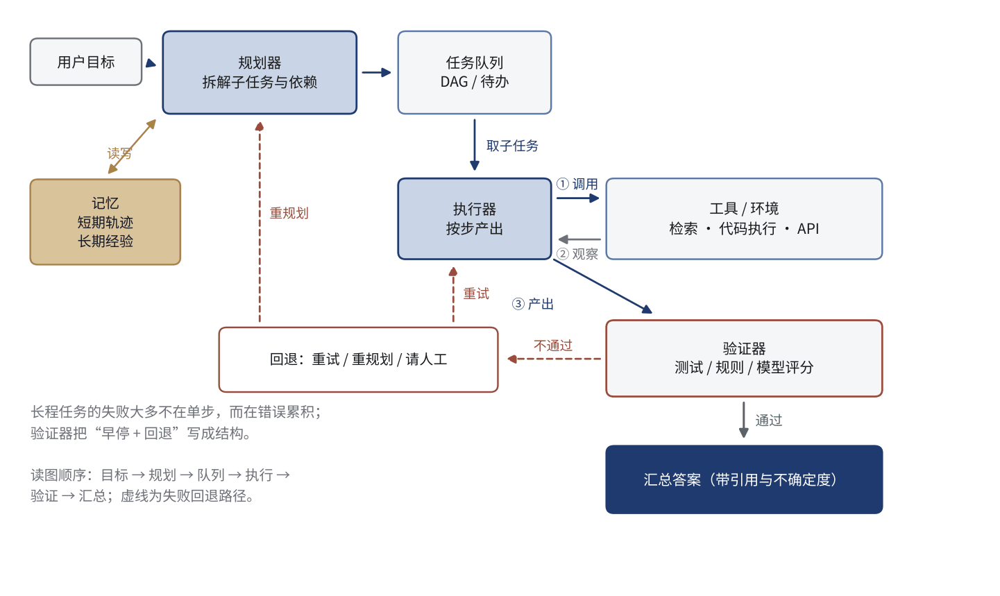

## 智能体：三十步之后

2023 年 10 月，《SWE-bench》(2023) 给模型出了一份卷子：2294 个来自 12 个 Python 仓库的真实 GitHub issue，要求模型交出补丁，且必须让仓库原有的测试通过。发布时最好的模型解决率是 1.96%。这些 issue 全部来自真实合并过的 PR，每一条都有人解决过。

到 2025 年，同一张卷子的头部成绩已经爬到七成以上。中间发生的事值得拆开看。模型写代码的能力提升了，但更大的变化在用法：从一次答完，改成读文件、跑测试、看报错、改代码，一圈一圈转。

一次前向传播产生不了三十步的因果链。要让模型完成这种任务，得给它一个可以反复回到环境的循环。这就是智能体（agent）的全部秘密，剩下的都是工程。

### 四件套与一个循环

一个能干活的最小系统由四样东西组成：模型、工具、循环、记忆。

模型负责决策，工具负责把决策变成对世界的动作（读文件、发请求、执行命令），循环负责把动作的结果送回模型，记忆负责让十步之前的信息在第二十步仍可取到。缺任何一件，系统就退化成一次问答或一段脚本。

循环的形状很朴素：

```text
state = 初始上下文
while not done:
    action = model(state)
    if action 是终止信号: break
    obs = execute(action)
    state = state + action + obs
```

真正难的是三个判断：什么时候停、工具报错怎么办、状态太长怎么办。第一个最容易被低估，模型有很强的倾向在没做完时宣布完成，因为“完成”在训练数据里总紧跟在一段像样的总结之后。对策是给终止条件加硬约束：必须有一条通过的测试、必须产出指定文件，否则循环不许退出。

### ReAct：让推理和环境交替

《ReAct》(2022) 之前，两条路是分开的：思维链让模型在内部连续推理，工具调用让模型直接输出动作。前者容易凭空编造中间事实，后者缺少对全局的把握。

ReAct 把两者交错起来，每一步先写一句“想法”（Thought），再给一个“动作”（Action），环境返回“观察”（Observation），然后进入下一步。在 HotpotQA 这类需要多跳检索的任务上，这个交错结构让模型能在检索到一半时修正方向：第一跳查错了人，第二跳的查询词可以改。论文报告的对比里，它同时优于纯思维链和纯动作策略，在 AlfWorld 这种几十步交互的环境里成功率远超行为克隆基线。

交错的用处是让观察有机会推翻前提，而不只是把思考拉长。思维链一旦写下一个错误事实，后面全在错误的前提上展开；ReAct 每步都有机会被环境打脸。

它自己的失败模式也很固定：格式漂移，几轮之后忘了输出规定的结构；原地打转，反复执行同一个动作；观察过长，一次读到两千行日志，把上下文挤爆。这三种都有工程手段压住，压不干净。

### 计划与反应

纯反应式策略在长任务上会迷路：每一步都局部最优，二十步之后离目标很远。于是有了先规划再执行的做法：让模型先输出一份步骤清单，再逐步执行。

计划的作用是压缩。把“把这个仓库的日志模块换成结构化输出”这样一句模糊目标，压成六条可检查的步骤，每一步的上下文负担都轻了，执行时不必反复回想全局目标。

代价是计划建立在执行前的那一刻理解上。如果第一步就发现有五个调用方而不是两个，原计划立刻失效。纯计划式系统在这里会硬着头皮往下走，因为它把计划当成了承诺。

实际有效的结构是分层：一份粗粒度的计划，加上每完成若干步就重新规划一次的机制。重规划的触发条件比计划本身更重要。出现预期外的错误、连续两步没有进展、发现了计划里没提到的依赖，这些信号该由执行器上报，不能等模型自己意识到。

分层长什么样，可以看两个具体实现。《Generative Agents》(2023) 把计划写成（时间，地点，动作）三元组，分三级展开：先一段日级纲要，再把每个时段展成小时级条目，最后展成 5 到 15 分钟粒度的具体动作。生成时给模型的上下文是人物设定、最近生活的摘要、当天已排好的那一部分。效果不在“更详细”，而在每一级的输出都落进一次能写好的长度——让它一次排满一整天，它会写出自相矛盾的日程。执行是反应式的：每步拿最近的观察去比对当前条目，出现计划没覆盖的事件就地插入并重排后续，而且只重排当前小时，不动日级纲要。

在连目标都没有的开放环境里，计划得由环境状态逆推。《Voyager》(2023) 的自动课程就是这么做的：候选任务由库存、已学技能、已完成与失败过的任务清单共同条件化，提示里还写一条约束——“下一个任务不能太难，因为我可能还没有必要的资源或技能”。靠这套机制它在 Minecraft 里拿到的物品种类比前人系统多 3.3 倍，科技树关键节点快 15.3 倍。

分解得好不好，两条判据就能卡住。每个子目标必须能被一个验证器判定——测试通过、文件存在、命令返回 0；判不了的子目标不是子目标，是意图。单个子目标的执行记录要能装进一次上下文的零头，装不下说明还应继续拆。按这两条卡，“把这个模块换成结构化输出”会被拆成“改接口、改五个调用点、跑测试、比日志字段”四步，而不是“先分析再实现”这种分完等于没分的两段。

循环的形状因此是三层：粗计划、当前子目标、单步动作；每层都可能触发重规划，但回到的层次不同。

```text
plan = decompose(goal)              # 每项 (子目标, 验收条件, 依赖)
k = 0; fails = 0
while not done:
    s = next_step(plan[k])
    obs, ok = execute(s)
    if ok and verify(plan[k]): k += 1; fails = 0; continue
    fails += 1
    if fails >= 2 or 发现计划外依赖 or 步数 > 1.5 * 计划估值:
        plan = replan(plan, obs, plan[:k], 失败原因)
        k, fails = 0, 0
    if 步数 > 预算 or 连续 3 次重规划无进展: abort
```

四个触发条件里只有第一个靠验证器，其余三个靠记账：依赖清单、步数估值、上次重规划后的状态。这些量必须由执行器统计，模型自己数不准——它对“已经做了多少步”几乎没有感知。

取舍在计划的粒度上。每步都预先写死，错一步就全废，而且模型会把计划当承诺，看到与计划不符的观察也往下走；完全不规划，二十步之后离目标很远。粗计划加局部重排是中间点，代价是计划本身占上下文、重规划会丢掉已完成的推理链，以及模型有很强的倾向把“计划里有这一步”当成“这一步已经对了”。

### 反思的收益与自欺

《Reflexion》(2023) 加了一个更省的机制：任务失败后，让模型写一段复盘，说清为什么失败、下次该怎么改，把这段话存进记忆，下一次尝试时带上。在 HumanEval 上，GPT-4 的 pass@1 从 80% 提到 91%，提升来自那些第一次写错、看了测试报错后能定位到具体边界条件的题。

机制本身值得拆开。一轮尝试由三样东西构成：一条轨迹 $\tau$（动作与观察的序列）、一个外部评估器给的二值信号 $r$、以及一段由模型自己写的反思 $e$。$r$ 从测试来，不看模型的自我评价；$e$ 要写成第一人称、指名到具体动作，比如“我第二次取锅时把锅放进了烤箱，它应该在台面上”，而不是“我应该更仔细”。这句要求不是文风问题：只写“错了”的反思，下一轮拿不到任何可改的东西。

反思写进一个固定容量的记忆，下一轮把它拼回提示。容量很小：编程任务只留 1 条，ALFWorld 与 HotpotQA 留 3 条。这个上限不来自理论，来自实测——反思堆多了之后，模型会把不同试次的教训混着用，反而掉分。同一道题连续失败 3 次就放弃，换下一题。

验证器从哪里来，是这套方法最脆的一环。编程任务里它自己生成单元测试：用思维链写一组测试与说明，用抽象语法树解析筛掉语法错的，最多取 6 条组成测试集；测试不过就不算做完。这层是自举的，验证器也是模型写的，所以它会错。Rust 最难的那 50 题上，基线 60%、加上反思 68%；把测试生成去掉只剩 52%，比基线还低；把反思去掉则与基线持平。两个消融说明测试和反思缺一不可，而测试更重要——没有测试，模型连“现在这版到底对不对”都判不了，只能把每轮都跑完，改来改去反而越改越差。测试本身错得多少也能量：MBPP Python 上“测试全过但答案错”的比例是 16.3%，HumanEval Python 只有 1.4%，而在 MBPP 上 Reflexion 恰好没超过基线。

关键在于反馈信号从哪来。Reflexion 的实验中，提升几乎全部依赖执行反馈（单元测试过没过、环境有没有报错）。没有外部信号、只靠模型自己评价自己的时候，收益接近于零，甚至为负。

原因不难理解。模型对自己输出的评价有一个稳定的乐观偏差：它会认为一段有 bug 的代码“逻辑清晰”，会认为一个漏掉分支的方案“覆盖了主要情况”。让它基于这种评价去反思，等于让它把错误的自信写成一条经验，下次更自信地犯错。

所以反思要接在可验证的信号上：测试、编译器、类型检查、外部 API 的返回码、人类的否决。这些信号的用处是指出错在哪一行；只说一句“错了”，反思拿不到原料。

为什么不直接拿这些信号去微调参数：一个任务只有三到五次尝试，样本量根本不够，而反思文本还能被下一个任务复用、被人读、被换到别的模型上。代价也很明确：记忆是个滑动窗口，长任务里最早那几条教训会被挤出去，于是同一个错误可以在第二十步重演；反思把失败归因写错时，这条错误归因会被当成经验反复使用，而没有任何机制会去质疑一段自然语言。

### 记忆：换页判据与检索打分

记忆得解决两个不同的问题：什么该留在上下文里，以及需要时怎么找回来。前者是换页，后者是检索。

《MemGPT》(2023) 把上下文切成三块固定预算：系统指令（只读）、工作区（读写，存用户偏好与关键事实）、FIFO 队列（滚动历史）。换页的判据是两个阈值，都用占上下文窗口的比例表示。到 70% 时，系统往队列里插一条内存压力警告，告诉模型“快满了，该动手了”；到 100% 时，系统不等模型，直接驱逐队列里 50% 的消息，并用旧摘要加被驱逐的消息生成一份新的递归摘要，放在队列首位。两个阈值分工明确：前者给了模型一次自救机会，后者保证上下文永远不会真的溢出。

被驱逐的东西不是消失了。全部消息一直在 recall storage（消息数据库）里，可以按关键词与时间找回；需要长期保留的长文本存到 archival storage（任意长文本对象库）。模型操作这两个库靠四个函数：追加或改写工作区、搜索 recall、插入 archival、搜索 archival。其中搜索函数带分页——返回条数按剩余 token 预算算，而不是一次把命中的五十条全塞回去。这个细节是必需的，否则一次检索就能把上下文撞爆。

还有一个机制容易被忽略：模型可以在一次输出里声明“我还需要一轮”，于是函数调用执行完直接接上下一轮推理，不必等外部再发一条消息。多步检索因此能在一轮对话内完成。

与操作系统的类比到此为止：真系统的换页由缺页中断触发，这里没有中断，只有一条自然语言警告，换不换全看模型怎么理解它。模型忽略了警告也不致命（100% 处系统兜底），但忽略之后丢的是哪段信息，就不再由它决定了。递归摘要本身也会失真：每一代摘要都丢掉一些细节，而“丢掉的是不是关键”当时无法判断。

什么该回来，是另一个问题。《Generative Agents》(2023) 把检索写成一个三部分的分数：

$$\text{score}(m)=w_{\text{rec}}\,\tilde r(m)+w_{\text{imp}}\,\tilde i(m)+w_{\text{rel}}\,\tilde s(m)$$

$\tilde r$、$\tilde i$、$\tilde s$ 分别是新近性、重要性、相关性，各自在候选集上做 min-max 归一化，三个权重原文都取 1。新近性是按沙盒小时计的指数衰减，底数 0.995：隔一小时乘 0.995，隔一天乘 0.887。重要度由模型在写入时打一个 1 到 10 的整数，“收拾房间”得 2，“向暗恋对象表白”得 8，只算一次，不在每次检索时重算。相关性是嵌入余弦。

三路分数带来的一个副作用是分数不可跨查询比较：min-max 归一化依赖候选集，同一个查询换一批候选，分数的含义就变了，因此这套分数只能用于排序，不能当阈值。

写回去的内容也有判据。最近感知到的事件的重要度之和超过 150 时触发一次反思：取最近 100 条记录，让模型提三个“这些材料能回答的显著问题”，以每个问题为查询检索相关记忆，再要求它抽出五条带引用的洞见，连同被引用的编号一起写回流里。引用是关键，它让一条高层判断可以追到具体事件；没有引用的反思，下一轮无法被验证。实测这套机制每天触发两三次。

《Voyager》(2023) 把记忆换成更硬的东西：技能库里存的不是描述，而是可执行的代码。键是程序描述的嵌入，值是程序本身，新任务来了先检索 top-5 相似技能再拼提示。新技能入库前要过自验证（用环境反馈与一个批评模型判定任务是否完成），不过不入库。程序作为记忆有三个好处：可执行，不必让模型重新推导；可组合，新技能直接调用旧技能，能力因此累积；省 token，一段五十行的函数比五百字的描述更短也更精确。代价是记忆只能装“能用代码表达”的东西，而写代码本身会错。

### 多智能体：分工与上下文隔离

一个自然的想法是把任务拆给几个角色：规划者定方案，执行者写代码，挑毛病的事交给审查者。

收益来自两处。上下文隔离：审查者只看补丁和需求，不看执行过程中那两万字的试错记录，判断不会被过程污染。并行：互不依赖的子任务同时跑。

成本主要来自通信。每次交接都要把上下文压成一段话传过去，压的过程丢信息，传的过程花 token，三角色流水线的消耗通常是单智能体的三到五倍。更麻烦的是错误传播：规划者的一个错误假设被执行者忠实执行，再被审查者在一个错误框架里审查，三层都“同意”，因为它们建立在同一个错误前提上。

角色不是人格设定，是三个可以写进代码的东西：输入可见性（能看到哪些文件、哪些历史）、工具权限（能调哪些工具、能不能写）、输出契约（必须交回什么格式的东西）。三者一定下来，分工就是一张数据流图，而不是“让三个模型聊一聊”；也只有这样，每个角色的上下文才能被独立裁剪、独立计费、独立重跑。

通信传的是结论，不是过程。执行者交回“改了哪三个文件、测试从 3 个失败变 0 个失败、新增一个依赖”，审查者拿这些加原始需求就能判断；把完整轨迹传过去，它既贵，又会把错误的前提一起带过去。多智能体唯一稳定的收益就在这里——不是“多个脑子更聪明”，而是“每个脑子只看该看的东西”。

《Generative Agents》(2023) 展示了另一种用法：25 个角色各有记忆流，靠观察、计划和反思维持社会行为。它的通信是纯自然语言的：每个角色把自己的动作写成一句话广播到所在空间，别人观察到这句话就当成一条记忆写进自己的流里，没有共享内存，也没有结构化消息。信息因此会像传染病一样在角色间扩散，也会在传递中变形——这正是它想模拟的东西，不是它想优化的东西。拿它当多智能体效率的证据是误读。

在工程任务上，多智能体的收益并不稳定。同样的 SWE 任务，单智能体加长上下文与三角色流水线的成绩常常在误差范围内重合，而后者贵三倍。稳定的收益只出现在两类场景：需要独立视角的审查，以及可以真正并行的子任务。

### 屏幕上的智能体

有一类智能体不通过 API 操作，而是像人一样看屏幕、点鼠标。任何有界面的软件都能用，包括那些永远不会开放接口的内部系统，这一点很诱人。

难点是坐标。屏幕是 1920×1080 的像素网格，模型看到的是缩放后的截图，输出的是一个坐标点。在 1000 像素宽的图上偏 20 个像素，映射回原图就是 40 个像素，足以点错相邻的按钮。把画面切成小块、先选区域再选元素，是常见的缓解办法。

状态是另一个难点。网页有 DOM 可读，桌面软件只有像素；点了按钮之后，界面是加载中还是没反应，只能靠截图判断。于是每步都要等、都要重截，一次操作 2 到 5 秒，三十步就是两分钟。

《OSWorld》(2024) 用真实的虚拟机测了这件事：多个应用、跨应用任务、初始状态可快照。发布时人类完成率 72.36%，最好的模型 12.24%。差距出在长任务的稳定性上：单步 90% 的正确率，二十步之后只剩 12%，单个操作的准确率反倒不那么要紧。

### 评测照出了什么

三个基准各自照出了一个侧面。

《SWE-bench》照的是仓库级理解。要修一个 issue，模型得先找到相关文件（跨几十万行代码），理解调用链，写出不破坏其他测试的补丁。判据是隐藏测试，客观且难以糊弄。问题也在这里：测试通过不等于修对了；而公开仓库的 issue 与对应 PR 大多在训练数据里出现过，污染难以彻底排除。后来的 Verified 子集人工筛出 500 条，部分缓解了这个问题。

《WebArena》(2023) 照的是可复现性。它自建了四个仿真实站（电商、论坛、代码托管、内容管理），状态可重置，任务有明确的功能判据。发布时 GPT-4 的成功率 14.41%，人类 78.24%。它暴露的问题很具体：模型会点进正确的页面，然后找不到那个需要展开的菜单。

《OSWorld》照的是开放环境。真实操作系统、真实应用、任意任务，没有为模型裁剪过的接口。它的低分说明一件事：GUI 操作更接近一个带延迟、带副作用、状态部分可观测的控制问题，“看图说话”只是它的表面。

《AgentBench》(2023) 换了问法：不测某个领域做得多好，而是测同一批模型在八类环境里能不能当智能体。八类分三种接地：代码（操作系统、数据库、知识图谱）、游戏（卡牌、横向思维题、家务）、网页（购物、浏览）。指标本身就不统一：操作系统看成功率，知识图谱看答案 F1，卡牌看胜率，最后把各任务的分数被全体模型的倒数均值加权平均成一个总分。29 个模型的结果里，商用头部与 70B 以下开源模型的差距主要来自长程推理与指令遵循，而不是代码能力——在代码上训过的模型，在代码类环境里未必更强。

三个基准的共同点是判据可验证。这点比分数更重要：可验证意味着可以拿它做强化学习的奖励，也意味着失败可以被归因到具体步骤。共同的盲区是只测单次成功，不测恢复能力，也不计成本。一个花四十步、二十美元、重试三次才做成的系统，和一次做成的系统，榜单上同分。

### 长程任务的四种塌陷

把失败案例摊开，反复出现的是四种，它们会叠在一起。



上图是长任务常见的回路，其中的回退边常常比前进边更长。

目标漂移。任务进行到第二十步，最初那句“不要改动公开 API”已经沉到上下文深处，模型开始顺手重构。对策是把不可协商的约束放进每次调用的系统提示，而不是只在开头说一遍。

上下文腐化。一次错误的观察（比如把测试报错读错了行号）留在上下文里，后续每一步都基于它推理，还会被反复引用、越引越像事实。上下文不会自动纠错，它只会累积。对策是给关键事实加校验点，发现不一致时显式作废。

错误累积。单步正确率 95% 听起来不错，五十步之后整体成功率是

$$0.95^{50}\approx 0.077$$

不到 8%。要把五十步的整体成功率做到六成，单步得达到 99%。这个不等式解释了为什么智能体在十步任务上表现惊艳，在五十步任务上频频翻车——它要求的不是“更聪明一点”，而是把单步错误率压一个数量级。

验证缺失。系统不知道自己做完了没有。没有测试、没有断言、没有对照物，模型只能靠“看起来对了”来判断，而“看起来对了”正是它最不可靠的能力。

::: {.keypoint}
模型决定智能体的能力上限，验证决定它的可靠性上限。缺了验证，更多步数只会把错误放大。
:::

### 检查点与恢复

长任务总会被打断：步数到顶、进程被杀、工具挂了、人叫停。能不能接着做，取决于有没有把状态写到上下文之外。

一个够用的检查点只有四样东西：任务清单（哪几项已完成、哪项在做）、每项完成的凭证（通过的测试名、产出的文件路径与其哈希、关键命令的输出摘要）、环境快照的引用（容器镜像、提交号、数据版本）、未决假设清单（“这个函数只有两个调用方”这类还没验证的前提）。前两样回答“做到哪”，第三样让人能回到同一个环境，第四样是恢复后第一批要验证的东西。

写点有判据：不可逆操作之前必须写（改数据库、发请求、覆盖文件），其余按“验证通过”写，不按时间写。按时间写会积出一堆半成品状态，而恢复时最难的恰恰是判断某个做到一半的动作算不算数。

恢复是重放，不是续写。先读检查点，把环境恢复到快照，再逐条重跑已完成的验证（测试、类型检查、文件存在性）；跑不过的那一项以及它之后的所有项一律作废重做，最后才把未决假设逐条验证、清掉已被推翻的。重跑看着浪费，但它是唯一能发现“上下文里写着测试通过、代码其实已被改过”的手段。《OSWorld》(2024) 给每个任务配可快照的初始状态，用意也在这里：没有可重置的起点，同一次失败无法复现，也就无从判断恢复后到底回到了哪里。

代价在两处。检查点太密，写盘与验证的开销就追上任务本身；太稀，回退距离长，一次崩溃丢掉半小时工作。工程上的经验值是每个能独立验证的里程碑一个点，也就是计划里那四到六步的量级。

### 上下文管理与协议

长任务的第一资源是上下文：它同时是工作台、记事本和档案柜。

几种被反复验证有效的手法。摘要：把已经完成的十步压成三行结论，丢掉过程。压缩比通常在十比一上下，代价是细节丢失，所以摘要里要保留数字、文件名、错误码这类不可再生的信息。

外部文件：把中间结果写进文件，需要时读回。文件系统是免费、无限、精确的记忆，比上下文可靠得多。

子任务隔离：把一段探索交给子智能体，只让它返回结论。主上下文干净，代价是结论外的信息全丢。

结构化清单：把计划外化成待办列表，完成一项就勾掉一项，给模型一个外部进度参照，减少“我以为做完了”。

工具接入的标准化是另一条线。在模型上下文协议（Model Context Protocol，MCP）出现之前，每个应用要为每个工具写一遍适配，M 个应用配 N 个工具就是 M×N 份工作。这套协议把关系改成 M+N：工具方实现一个服务端，应用方实现一个客户端，中间用 JSON-RPC 传消息，工具的描述、参数模式、返回格式都有统一写法。

协议解决的是接线，不解决选择。工具一多，光是描述就吃掉几千 token，模型在五十个工具里选错的概率远高于在五个里选。常见做法是按任务阶段动态挂载，把“全量注册”改成“按需加载”，这又回到了上下文预算那笔账。

智能体把模型的输出变成了对世界的动作，动作带来后果，后果需要判断对错。判断对错的依据是验证，验证的依据是评测，而评测的可信度取决于我们怎么读那些报告。一份技术报告里，哪些数字是真的，哪些是被挑选过的，这件事有自己的方法。
