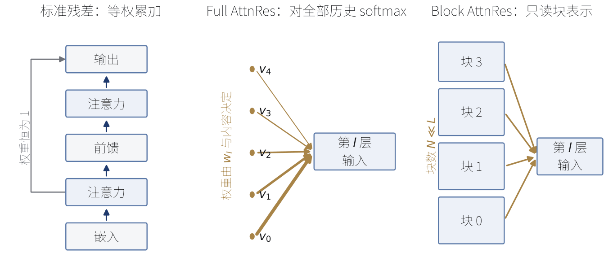

## 残差流上的注意力

ResNet 在 2015 年给出残差连接时，理由是梯度：让梯度绕过变换层直接回传，深层网络才训得动。这个解释流行了十年，也遮蔽了残差的另一半作用。把 $h_l=h_{l-1}+f_{l-1}(h_{l-1})$ 展开，第 $l$ 层的输入其实是嵌入与之前所有层输出的等权和：

$$h_l=h_1+\sum_{i=1}^{l-1} f_i(h_i)$$

也就是说，残差不仅是一条梯度通道，还是一套跨深度的信息聚合规则。只是这套规则的权重全部固定为 1，没有谁来决定哪一层的输出更值得读。

### 一条只加不减的通道

序列方向上的混合早就可学习了。注意力给每个位置一组由内容决定的权重，MoE 给每个 token 一组由路由决定的专家。深度方向却一直停在等权相加。这个不对称带来三个后果，Kimi 团队在《Attention Residuals》(2026) 里把它们列得很清楚。

第一，无法选择。注意力和前馈需要的上下文并不相同，可它们读到的都是同一个累积状态。第二，损失不可逆。早期层写进残差流的信息被后续输出一层层覆盖，深层的注意力再想回看也看不到原始版本。第三，输出膨胀。层数越深，单层输出要盖过前面所有层累积的和，就得把幅度越写越大；PreNorm 下隐状态的范数随深度近似线性增长，每一层的相对贡献反而被稀释。

第三条有一个很直接的证据：在训好的模型里，删掉相当一部分层，性能掉得并不多。这些层并非没学到东西，而是它们写进残差流的量太小，被前面的累积淹没了。训练稳定性那一章讲过的 final norm、$1/\sqrt{2L}$ 初始化、DeepNorm，都是在给这个膨胀打补丁。

### 把深度当成序列

既然问题出在“等权”，解法就自然是“学一组权重”。Attention Residuals（AttnRes）的做法借用了注意力本身：把每一层看作深度方向上的一个位置，让当前层对所有历史层的输出做一次 softmax 加权。

$$h_l=\sum_{i=0}^{l-1}\alpha_{i\to l}\,v_i,\qquad
\alpha_{i\to l}=\frac{\exp\!\big(q_l^\top \mathrm{RMSNorm}(k_i)\big)}{\sum_{j=0}^{l-1}\exp\!\big(q_l^\top \mathrm{RMSNorm}(k_j)\big)}$$

其中 $v_i=k_i$，$i=0$ 时取词嵌入，其余取第 $i$ 层的输出；$q_l=w_l$ 是每一层自己学习的一个 $d$ 维向量，不从输入算出来。这个细节很关键：查询是固定的参数，所以任意一组层的路由权重可以并行算，不必等前面的层算完。

把一次前向拆开，第 $l$ 层的路由只有五步，全部是逐 token、逐层独立的小运算：

1. 把深度方向的历史堆成矩阵 $S_l=[h_1;\,f_1(h_1);\,\dots;\,f_{l-1}(h_{l-1})]\in\mathbb R^{l\times d}$，第 0 行是词嵌入，第 $i$ 行是第 $i$ 层的输出；
2. 对 $S_l$ 逐行做 RMSNorm 得到键矩阵 $K_l$，它只用来算分；第 5 步加权时用的仍是 $S_l$ 的原始行，值不做归一化；
3. 用该层自己的查询 $w_l$ 与 $K_l$ 逐行点积，得到 $l$ 个打分 $u_{i\to l}=w_l^\top K_l[i]$；
4. 在 $i$ 维上做 softmax，得到 $\alpha_{i\to l}$；
5. 用同一组权重对 $S_l$ 的行加权求和，得到 $h_l$，再送进本层的注意力和前馈。

值和键是同一个向量（$v_i=k_i$），所以整套机制只多出一个 $d$ 维查询和一份 RMSNorm 权重，没有额外的投影矩阵。这也解释了它为什么便宜：$l$ 个源之间的权重是 $l$ 个标量，标准残差是 $l$ 个固定的 1。

初始化有一个必须交代的细节：所有 $w_l$ 初始化为零向量。这样训练第一步的 $l$ 个打分全部相等，$\alpha_{i\to l}=1/l$，AttnRes 精确退化成等权平均，也就是标准残差。选择能力是训练中从“均匀”这一点上长出来的。论文报告，随机初始化会带来训练初期的震荡，所以这一步不是可选项。

分母里的 RMSNorm 是为了防止幅度大的层垄断权重。这也解释了为什么不能直接对原始输出做点积：PreNorm 下各层输出的尺度差异很大，不归一化的话，softmax 会被少数几层吃掉。

把标准残差、Highway、各种门控残差放在一起看，它们都是 $h_l=\alpha_l h_{l-1}+\beta_l f_{l-1}(h_{l-1})$ 的特例，等价于深度方向上的线性注意力：只读最近一个状态，权重是标量或逐元素门。AttnRes 把它换成了对全部历史的 softmax。序列方向上从线性注意力到 softmax 注意力的那一步，在深度方向上又发生了一次。

这套权重学出来是什么样子，有几篇后续工作做了探测。一个反复出现的模式是：浅层倾向于把权重分给词嵌入和最初几个块，深层则集中在少数几个中间块上，而不是均匀铺开。路由熵随深度下降，说明模型确实在用“选择”而不是“平均”。也有工作提醒不要过度解读：路由权重可读，不等于它就是因果解释，消融之后模型的补偿路径会立刻改变权重的分布。可解释性研究里讲过类似的教训，这里同样适用。

还有一点容易被误会：深度注意力不替代序列注意力。序列方向的注意力处理的是“看哪个位置”，复杂度随上下文长度平方增长；深度方向处理的是“看哪一层”，复杂度随层数平方增长。层数通常几十，上下文动辄几万，长度上就差了两三个数量级，平方之后差得更远。AttnRes 不会让长上下文变便宜，它改的是另一条轴。

### 显存与通信：Block AttnRes

Full AttnRes 在单机训练里几乎不花额外代价：每层的输出本来就要留着做反向传播。但大模型训练不会这么理想。激活重计算会把中间结果丢掉再算一遍，流水并行要把每一层的输出传给下一个 stage。此时保留全部 $L$ 层输出意味着 $O(Ld)$ 的显存和通信，规模一大就不可接受。

Block AttnRes 的办法是分段。把 $L$ 层按每 $S$ 层分成 $N$ 块，块内的层输出求和成一个块表示，跨块时才做注意力：

$$b_n=\sum_{j\in\mathcal B_n} f_j(h_j),\qquad b_n^{(i)}=\sum_{j<i,\;j\in\mathcal B_n} f_j(h_j)$$

$\mathcal B_n$ 是第 $n$ 块包含的层号，$b_n^{(i)}$ 是块内前 $i$ 层的部分和。历史源从 $L$ 个降到 $N$ 个，显存和通信都变成 $O(Nd)$。Kimi 的 48B 模型用 6 层一块，54 层分成 9 块，加上词嵌入一共 10 个深度源。块内用普通残差累加有一个顺带的好处：块内的层看到的仍然是“词嵌入 + 所有已完成层的输出”，与标准 Transformer 完全同构，已有的融合算子和算子库不用改。

推理时块表示相当于一份被所有层共享的 KV 缓存，朴素做法是每层都去读一遍，$L\times N$ 次访存。因为 $w_l$ 是参数、不依赖输入，同一块内 $S$ 层的查询可以堆成一个矩阵一次读完。这就形成了论文的两阶段计算：

1. 阶段一把块内 $S$ 个查询堆成 $Q\in\mathbb R^{S\times d}$，对已缓存的 $n$ 个块表示做一次批量注意力，输出连同行最大值 $m$ 和 log-sum-exp $\ell$ 一起存下；
2. 阶段二块内逐层顺序回看：第 $l$ 层用当前部分和 $b_n^{(i)}$ 单独算一次块内注意力（此时键和值都是 $b_n^{(i)}$），再用 online softmax 与阶段一的结果合并；
3. 合并后的 $h_l$ 送进第 $l$ 层，算出 $f_l(h_l)$ 并累进部分和，$i\leftarrow i+1$，回到第 2 步直到块内算完。

合并式是逐元素的，这也是它能融进相邻 kernel 的原因：

$$h_l=\frac{e^{m^{(1)}-m}o^{(1)}+e^{m^{(2)}-m}o^{(2)}}{e^{m^{(1)}-m}\ell^{(1)}+e^{m^{(2)}-m}\ell^{(2)}} ,\qquad m=\max(m^{(1)},m^{(2)})$$

上标 (1) 是跨块部分、(2) 是块内部分，$o$ 是未归一化的加权和。一句白话：两段 softmax 各算一半，用各自的行最大值把指数重新对齐，再把分子分母分别相加——等价于对“$n$ 个块加一个部分和”这 $n+1$ 个源做一次联合 softmax。阶段二的访存与标准残差相当，额外成本全在阶段一的跨块读上，而它被 $S$ 层摊薄了。论文给的单层总量是 $(N/S+3)d$ 次读加 $2d$ 次写，典型配置（$L=128$、$N=8$、$S=16$）下合计 $5.5d$。

流水并行下还有一处通信优化。交错流水把一个物理 stage 切成 $V$ 个虚拟 stage（$P$ 是物理 stage 数，所以虚拟 stage 一共 $C=PV$ 个），朴素做法是每次切换都重传全部历史块，每个 token 的通信量是 $\frac{C(C-1)}{2}N_pd$（$N_p$ 是每个物理 stage 产出的块数）。既然同一个物理 stage 会连续处理多个虚拟 stage，把收到的块留在本地缓存，后续切换只传“上一个虚拟 stage 同位置之后新增的块”，总量就降到 $\frac{P(P-1)}{2}N_pd+(V-1)\frac{P}{2}N_pd$，单次传输的峰值从 $O(C)$ 降到 $O(P)$，一个 $V$ 倍的改进，正好能和 1F1B 稳态的计算重叠。论文报告的端到端开销在流水并行下不到 4%，16K 预填充时每卡额外显存不到 0.3GB。

块大小是一个纯折中。$S=1$ 就是 Full；$S$ 越大越省显存和通信，但历史源越粗、越接近等权累加。论文的扫描显示，16 层模型上 $S=2,4,8$ 的验证损失都在 1.746 附近（Full 是 1.737，baseline 是 1.766），到 $S=16,32$ 就退回 baseline 的水平。还有一条更省的做法是滑窗，只保留最近 $W=8$ 层加词嵌入，损失 1.764——比 baseline 好一点，但远不如块注意力。这两组数字合起来说明一件反直觉的事：真正起作用的不是“能看到很多近处的层”，而是“能挑到远处的层”，所以按块汇总（保留全部历史、但压缩粒度）比截断窗口更划算。

这套机制也改变了对“深”的看法。过去加层数的收益递减，一部分原因不是容量不够，而是新层写进残差流的信息被前面的累积淹没；为了让自己的输出起作用，深层只能把幅度越写越大，训练随之变脆。AttnRes 把“能不能被读到”从幅度竞争里解耦出来：一层的输出是否有用，由路由权重决定，不由它的范数决定。论文的缩放实验显示，增益在不同规模上一致存在，这通常意味着它改的是训练动力学，而不只是某个尺寸下的巧合。

### 效果与代价

这套机制在 Kimi Linear 的 48B 总参数、3B 激活参数模型上做了完整预训练，数据量与配方和原模型一致（1.4 万亿 token，4096 上下文，Muon 优化器，WSD 学习率）。同一套配方下，AttnRes 版本在大多数评测上都有提升：

| 基准 | 原模型 | AttnRes |
|---|---|---|
| MMLU | 73.5 | 74.6 |
| GPQA-Diamond | 36.9 | 44.4 |
| BBH | 76.3 | 78.0 |
| MATH | 53.5 | 57.1 |
| HumanEval | 59.1 | 62.2 |

GPQA 上的 7.5 个百分点最显眼，这类需要多步科学推理的题目，恰好依赖早期层保留的原始信息。论文还报告了两个训练侧的变化：各层输出的幅度更均匀，梯度在不同深度上的分布也更平均。换句话说，PreNorm 稀释的问题被从机制上缓解了，而不只是靠初始化技巧压住。

代价分三块。参数上，每层只多出一个 $d$ 维查询和一份 RMSNorm 权重，量级是 $2d$。这里有两个数字容易混：$5.5d$ 和 $34d$ 是每 token 每层残差通路上的显存访存量，不是参数量。多流残差那一支的参数量随流宽走（静态版每层 $n^2+2n$ 个标量，动态版约 $nd(2n+2)$），两者差在访存：多流要把 $n$ 条流搬进搬出，AttnRes 只多读几个块表示。

| 方案 | 每层额外参数 | 每 token 残差访存 | 深度权重的来源 |
|---|---|---|---|
| 标准残差 | 0 | $3d$ | 恒为 1 |
| mHC（四流） | 24 标量或 $nd(2n+2)$ | $34d$ | 学到的双随机混合矩阵 |
| Block AttnRes（$N=8$） | 约 $2d$ | $5.5d$ | 每层一个查询向量，softmax |

算力上，Full 版本是 $O(L^2d)$，但深度远小于序列长度，绝对量不大；Block 版本把跨块部分压到 $O(N^2d)$。工程上，真正的成本是训练框架要改：激活重计算、流水并行、检查点格式都得知道“层输出要留着”，这不是换个模块就能解决的。推理侧报告的额外延迟是不到 2%。

失效条件主要不在数学上，而在规模上。层数很少（四到六层）时没有多少深度历史可挑，剩下的是纯开销；128K 预填充下块表示本身占显存，不分片的话 8 个块、128K token 要 15GB，得沿序列维切片才降到每卡 1.9GB。更麻烦的是一个未解的争议：AttnRes 论文在 Kimi Linear 上报告全面提升，Delta Attention Residuals 在 Qwen3 式架构上却报告累积状态路由在 7.6B 上比 baseline 还差（PPL 18.58 对 17.43），而把源换成增量后回到 16.00。两边差的不是结论，是源的定义：前者路由块级累积和，后者路由子层增量。这提醒一件事——“深度路由有用”目前还不是一个稳定的结论，它取决于拿什么当候选。

从系统角度看，AttnRes 还有一处让人放心的地方：它不动 KV 缓存。序列注意力的缓存按上下文长度线性增长，是推理成本的大头；深度路由只影响前向计算内部的信息流，缓存的结构、大小、分页方式都不变。这意味着它可以和现有的推理引擎共存，不需要重写 PagedAttention 那一套。相比之下，任何改动注意力本身的结构（比如换位置编码或改头数）都会牵动缓存布局，迁移成本高一个量级。

### 更早的一条路：把残差流拓宽

AttnRes 不是第一个动残差的。在它之前，Hyper-Connections 系列选了一条完全不同的路：既然一条残差流不够用，那就把它加宽成 $n$ 条并行的流。

具体做法是把每个 token 的隐向量复制 $n$ 份，堆成一个矩阵 $H\in\mathbb R^{n\times d}$，层与层之间的连接从“加一个数”变成三个小矩阵：

$$h_0=a_m^\top H,\qquad \hat H=A_rH+b\,T(h_0)^\top$$

$a_m\in\mathbb R^n$ 把 $n$ 条流加权成一个 $d$ 维的层输入 $h_0$；$T$ 是层本身（注意力或前馈）；$\hat H$ 是写回后的新矩阵，它由两部分组成——$A_r\in\mathbb R^{n\times n}$ 把旧流混合一遍，$b\,T(h_0)^\top$ 把本层输出按 $n$ 个标量 $b_i$ 分别写进每一条流。原来那个恒等于 1 的残差权重，现在变成了 $A_r$ 加 $b$ 一共 $n^2+n$ 个可学标量，再加 $a_m$ 的 $n$ 个，每层合计 $n^2+2n$ 个——$n=4$ 时是 24 个。这是静态版的账；要让这些系数随输入变（dynamic HC 与 mHC 都这么做），就把它们交给一次线性投影去算：把 $n\times d$ 的矩阵展平成 $nd$ 维向量，投影到 $2n+2$ 维，再加一层 tanh 和一个小初值缩放。此时每层参数是 $nd(2n+2)$，四流、$d=4096$ 时约十六万个，仍然是 $O(nd)$ 而不是 $O(d^2)$。

也可以把这套矩阵拆成两种连接来看。深度连接是“层输出与某条流之间的加权”，宽度连接是“同一层里各条流之间交换信息”。前者相当于把残差权重变成可学的，后者是标准残差根本没有的维度：第一条流学到的特征可以横向传给第二条流。论文报告，加宽后的模型相邻层隐向量的余弦相似度明显下降，而标准残差模型的这个相似度偏高——这通常意味着后层在重复前层已经算过的东西。

问题出在稳定性。$A_r$ 没有任何约束，多层复合之后 $\prod A_r$ 的增益会沿深度指数放大：27B 模型上测到的最大增益接近 3000。前向信号被放大 3000 倍，反向梯度同样如此，训练崩不崩只是时间问题。

mHC 的修法是把 $A_r$ 投影到双随机矩阵的流形上（也叫 Birkhoff 多面体）：

$$\mathcal P(A_r)=\{A_r\mid A_r\mathbf 1=\mathbf 1,\;\mathbf 1^\top A_r=\mathbf 1^\top,\;A_r\ge 0\}$$

两个约束各负责一件事：行和为 1 保证前向时每条流拿到的总量不放大，列和为 1 保证反向时每条流收到的梯度不放大，非负则排除正负相消的路径。三条合起来使谱范数不超过 1，跟恒等映射一样安全，但不再禁止流间交换。$n=1$ 时双随机退化成标量 1，恰好回到标准残差。

投影用 Sinkhorn-Knopp 迭代做，不需要解优化问题：先把 $A_r$ 过指数函数变成全正矩阵 $M^{(0)}=\exp(\tilde A_r)$，然后交替归一化行与列，

$$M^{(t)}=T_c\bigl(T_r(M^{(t-1)})\bigr)$$

$\tilde A_r$ 是这一层学到的原始混合矩阵，$T_r$、$T_c$ 分别是把每行、每列除以其和。理论上这套迭代收敛到双随机矩阵，实现上只跑 20 次就停——不跑满的代价是列和略有偏差，因此反向增益略偏离 1；论文测到复合映射的最大增益从 HC 的近 3000 降到 1.6。除了 $A_r$，$a_m$ 和 $b$ 也被约束为非负（用 sigmoid），避免系数一正一负把信号抵消掉。

效果上，27B MoE 模型（扩张率 4）里 mHC 比 baseline 最终损失低 0.021，BBH 从 43.8 升到 51.0（HC 是 48.9），DROP 从 47.0 升到 53.9（HC 51.6）。它和 AttnRes 的取舍很清楚：HC/mHC 把宽度当成新的自由度，每条流是一份独立的累积状态，混合矩阵决定它们怎么共享；代价是每 token 的残差访存从 $3d$ 涨到 $34d$，而且这份开销在推理时一直存在。AttnRes 不拓宽，只把“读哪一层”变成可选的，所以访存只多 $2.5d$。两者并不互斥，但争的是同一笔预算。

### 一个正在分叉的家族

AttnRes 提出后不到一年，围绕它的变体已经分成几条线，各自修一个具体问题。

**宽度方向**：单查询让所有特征子空间共用一套深度权重，而子空间越多，它们想读的层越可能不一致。Multi-Head Attention Residuals（MHAR）的做法简单到只有一行 reshape：把 $d$ 维查询 $w_l$ 塑形成 $H\times(d/H)$，第 $h$ 个头用自己的 $d/H$ 维子查询在自己的子空间里算一次深度 softmax，再把 $H$ 组加权和拼回去。$H=1$ 精确回到 AttnRes，参数量增加为零，路由 FLOPs 只多 0.5% 到 1.2%。论文在 100M、350M、1B 三个规模上从零训练，相对 baseline 的验证损失是 $-0.061$、$-0.149$、$-0.140$，每个规模都是四个对比方法里最好的。头数是一个真实的设计轴而不是免费旋钮：损失随 $H$ 呈 U 形，$H=4$ 或 $8$ 是平坦的最优点，$H=16$ 会吐回三分之一到一半的收益。这里和 AttnRes 自己的消融对得上——它在 16 层模型上试过 $H=16$，损失从 1.746 退到 1.752——区别只在头数与 KV 组数的比例。Multi-Stream Attention Residuals 走得更远，它维护多条残差轨迹，用多尺度因果卷积给不同头提供不同的上下文视角。

**路由质量**：Delta Attention Residuals 指出，直接对累积隐状态做路由会塌缩。原因是 $h_i$ 是累加和，相邻两项共享越来越长的公共前缀，打分 $w^\top\mathrm{RMSNorm}(h_i)$ 与 $w^\top\mathrm{RMSNorm}(h_{i+1})$ 越来越接近，softmax 于是趋于均匀——Qwen3-0.6B 规模上深层最大权重只剩 0.2，选择能力名存实亡。它的改法是换候选：既然每层的贡献是增量 $v_i=h_{i+1}-h_i$，那就对增量路由，并改用加法形式

$$\hat h_l=\tilde h_l+\sum_i \alpha_{i\to l}\,v_i,\qquad \alpha_{i\to l}=\mathrm{softmax}\bigl(w_l^\top\mathrm{RMSNorm}(v_i)\bigr)$$

$\tilde h_l$ 是当前的残差流，路由只往上加东西、不替换它。这个形式带来两个好处：加法保住了恒等通路，因此预训好的 Transformer 可以把新增投影零初始化后直接微调过去；候选之间差异大，路由保持尖锐，最大权重从 0.2 回到 0.6，平均最大权重从 0.35 升到 0.62。7.6B 规模上，baseline 的 PPL 是 17.43，AttnRes 18.58，Delta Block 16.00，而路由参数只多了 589.8K（占 0.008%）。Role-Decoupled Attention Residuals 修的是另一个方向：把“查询和键决定去哪匹配”与“值决定取什么内容”拆开，允许两者读不同的深度。

**成本方向**：Low-Rank Attention Residuals 把路由用的键降到 $r$ 维（$r<d$），值仍是全维，计算路由分数的开销随 $r$ 而不是 $d$ 增长；Block 版本再把块数压到十几个，实际开销已经接近普通残差。

**循环结构**：Looped Transformer 把同一组层反复执行，残差流会被几十次迭代反复覆盖，出现“潜空间过度思考”：后面的循环把前面已经推对的中间结果冲掉。Loop-Native Attention Residuals（InfiLoop）给循环专门设计残差，让模型在成千上万次测试时迭代后仍能保持状态。

**数值稳定**：深度 softmax 会放大注意力汇和激活异常值，低比特量化时尤其明显。OASIS 在 token 和深度两个层面都把 softmax 换成 Softmax1（分母多一个 1，等价于给“什么都不看”留一个空位），让权重不必全部挤在真实分支上。只做到这一步还不够：两个层面各自归一化，深度路由仍可能把权重分给没带信息的层。它于是把 token 层面的空概率传下去——对每个源分支 $i$，把各注意力头分给空位的概率平均成 $r_{i,t}=\frac1H\sum_h\tilde p^{(\ell,i,h)}_t$，再减去跨分支均值 $\bar r_t$ 得到中心化统计量，然后用它修正深度路由的原始打分 $g^{\text{old}}_{i,t}$：

$$g^{\text{new}}_{i,t}=g^{\text{old}}_{i,t}-\lambda\,(r_{i,t}-\bar r_t),\qquad \lambda\ge 0$$

含义很直白：一个分支内部的注意力头如果大多在“看空”，说明它没贡献有价值的内容，就把它的深度权重调低；反之调高。减均值是为了让修正只改变分支之间的相对顺序，不整体抬高或压低概率。词嵌入那条分支没有注意力头，不参与修正。只改路由、不改训练目标，所以可以直接加载到已训好的模型上。

再往前追，这条路线的起点是上一节讲过的《Hyper-Connections》(2024) 与《mHC》(2025)，《xHC》(2026) 进一步扩展了连接模式。AttnRes 可以看作把“多流混合”换成了“对历史做注意力”，参数更省，解释性也更好：路由权重直接暴露在每一层的前向计算里，可以像注意力图一样读。

回头看，残差连接是 Transformer 里最后一块权重固定的结构。序列混合、专家选择、归一化位置都已经被改造成可学习的，只有深度聚合还停在 2015 年的形式。AttnRes 及其家族做的事情，是把这块也打开。它是否会成为下一代模型的标配，取决于两件事：训练框架愿意为它改多少，以及更长上下文、更多模态的模型是否真的需要“回看早期层”的能力。至少目前，Kimi 把它放进了主线模型，DeepSeek 和几家做长上下文的团队也在跟进类似的结构。

如果说这一章改的是模型内部的信息通路，那么下一章改的是模型外面的生成流程。两者看起来无关，却在同一件事上相遇：都在用更少的计算，换更长的有效路径。
