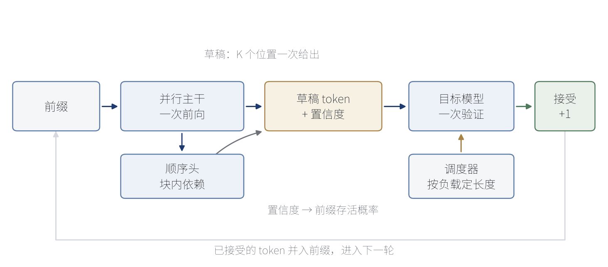

## 投机解码的第二代

第二十一章讲过投机解码的基本框架：小模型先草拟几个 token，大模型一次前向全部验证，按拒绝采样接受最长的合法前缀。这个框架在数学上是干净的，不改变输出分布；工程上却一直有个尴尬：草稿越长，接受率掉得越快，验证的计算也越浪费。2026 年之后，这条路线分成两个战场：草稿器怎么在并行与块内依赖之间取舍，以及验证的长度和形状怎么随负载调整。前者决定“草稿值多少钱”，后者决定“验证花多少钱”。

### 草稿器的两难

最早的草稿器是自回归的。EAGLE 系列在目标模型的隐藏状态上接一个轻量头，逐 token 草拟，每一 token 都以前一个草稿为条件。这样草稿内部有依赖，接受率高；代价是草拟延迟随块长线性增长，块一长，省下的验证时间又被草拟吃回去。

并行草稿器（Medusa 一类）换了个方向：一次前向同时输出多个位置的候选，草拟延迟几乎与块长无关。但各位置是独立预测的，块内没有依赖，越靠后的位置越容易偏，整块能活下来的概率随块长指数下滑。论文里管这个现象叫后缀衰减，背后的原因叫多峰碰撞：同一个前缀下目标分布可能有几个合理的续写（“of course”和“no problem”），独立草稿各位置分别押一个，就拼出“of problem”这种谁也不想要的组合。

于是出现一个剪刀差：块越长，理论上限越高，实际接受长度却越短；验证的计算按块长付，收益按接受长度收。生产系统里，这个差值直接变成账单。

可以用一个简化的模型看清这个剪刀差。假设块内每个位置的接受概率独立且都等于 $\alpha$，那么长度为 $k$ 的草稿一轮能产出（包括被拒绝后补上的那一个）的期望 token 数是

$$\mathbb{E}[\text{tokens}]=\frac{1-\alpha^{k+1}}{1-\alpha}$$

$\alpha=0.8$ 时，$k=4$ 是 3.36 个，$k=8$ 是 4.33 个，$k=16$ 也只有 4.89 个，块长翻四倍，收益不到一半。而验证的计算是按 $k$ 付的：把草稿成本比 $c$ 也算进去，加速比是

$$\frac{1-\alpha^{k+1}}{(1-\alpha)(kc+1)}$$

分母随 $k$ 线性长大，分子却顶在 $1/(1-\alpha)$ 的天花板上。真情况更糟：$\alpha$ 本身随位置下降，曲线比这个公式还平。

后缀衰减到底有多严重，可以看 DSpark 论文按位置拆开的条件接受率。代码域第一个位置 0.87、第八个仍有 0.78，对话域从 0.72 掉到 0.63——单看这条曲线，衰减不算致命。但整块存活是这些数的连乘，八个位置乘完只剩两成上下，这才是块长加上去却没用的真正原因。两个量必须分开报：条件接受率回答“这个位置准不准”，前缀存活率回答“这块草稿能换回几个 token”。

### 接受与拒绝：两步保住分布

所有后续改动都建在一个不变的基础之上，这两步值得拆开看。设某一位置目标模型的分布是 $p(x)$，草稿的是 $q(x)$，两者定义在同一个词表上。top-k、温度这类采样设置要先各自并进分布里，因为“分布相同”指的是并入之后的分布。草稿从 $q$ 采一个 token $\hat x$，然后：

1. 抽一个均匀随机数 $r\sim U(0,1)$，若 $r<\min\bigl(1,\;p(\hat x)/q(\hat x)\bigr)$ 就接受；
2. 若拒绝，从“剩下的分布”里重采一个 token 顶上这一位：

$$p'(x)=\frac{\max\bigl(0,\,p(x)-q(x)\bigr)}{\sum_{x'}\max\bigl(0,\,p(x')-q(x')\bigr)}$$

被拒绝位置之后的所有草稿作废，从新 token 往后重新草拟。

为什么这样输出分布不变，算一下就清楚。任意 token $x$ 最终被写出来只有两条路：从 $q$ 采到并被接受，概率是 $q(x)\min(1,p/q)=\min(p,q)$；或者首位被拒后从 $p'$ 重采到。拒绝的总概率是 $1-\sum_{x'}\min(p,q)$，而残余分布的总质量是 $\sum_{x'}(p-q)_+=1-\sum_{x'}\min(p,q)$，两数相等，于是

$$\Pr[x]=\min(p,q)+(p-q)_+=p(x)$$

白话：接受那一支恰好付清了 $p$ 与 $q$ 的公共部分，$p$ 多出来的那部分由重采样补齐，两块拼起来正好是 $p$。既然每一位都精确等价于从 $p$ 采样，整条序列的分布当然也精确等价——这是投机解码“无损”的全部依据。

由此得到三个工程约束。第一，必须拿到 $q$ 的完整分布。如果草稿只保留 top-10 的 logits，截断后的 $q$ 与 $p$ 都要重新归一化再比，否则 $p'$ 会算错，输出就悄悄偏了——很多开源实现“号称无损、实测有偏”都是这里。第二，随机数消耗是每位置一个，批处理时是一整个张量的均匀噪声。第三，一块 $\gamma$ 个位置是链式的：第 $i$ 位用的是条件分布 $q_i(\cdot\mid\hat x_{<i})$ 与 $p_i(\cdot\mid\hat x_{<i})$，单位置接受率等于 $1-\frac12\sum_x|p_i-q_i|$（两分布的总变差距离），整块存活是这些数连乘。所以“接受率”这个词实际上指向两个量：条件接受率与前缀存活率，报指标时必须说清是哪一个。

这套判据没有训练信号，它是纯推理期的采样校正，跟草稿怎么训无关。触发条件是逐位置比较，停止条件是第一次拒绝；若一整块全部被接受，目标模型那一次前向会顺手多给出一个 token（论文里叫 bonus token，它的分布就是第 $\gamma+1$ 位的 $p$，不用再校正），所以每轮至少前进一个 token，最坏情况也不会比不用差。在温度 0 时判据退化成确定性的“草稿是否等于目标 argmax”，此时一致性是平凡的，不需要这套随机化。

设计取舍就在这里。一个直觉做法是“草稿有把握就收”，比如 $q(\hat x)>0.5$ 就接受——这会系统性地偏向草稿的高概率区，模型的多样性被草稿器的偏好吃掉。另一个直觉做法是“只在目标比草稿更看好时才收”，即 $p(\hat x)>q(\hat x)$；它看着保守，实际上把分布尖锐化了：接受事件本身就与“$p$ 在该处更大”相关，结果长尾被系统性削掉。真正能同时保证不偏和不浪费的只有 $\min(1,p/q)$ 加残余重采样这一组，而它的代价是必须拿到两个分布的完整概率。

### 半自回归：把两头的便宜都占住

DeepSeek 在《DSpark: Confidence-Scheduled Speculative Decoding with Semi-Autoregressive Generation》(2026) 里给出的解法不复杂：草稿的主干保持并行，只在输出端接一个很轻的顺序模块。

并行主干一次算出块内所有位置的隐藏表示，这一步的延迟与块长无关；顺序模块只在这些表示上做几步很小的自回归修正，把相邻 token 的转移关系补进去。因为它只处理已经算好的表示，参数量和计算量都很小，不会把并行省下的时间吃掉。论文的报告里，这个结构把后缀衰减明显压平，同样的块长下接受长度高于纯并行草稿器，草拟速度又远快于纯自回归。

具体到公式，并行主干对第 $d$ 个位置给出基础 logits $\ell_d$（它看不到块内已采样的 token），顺序模块在这个 logits 上加一个前缀相关的转移偏置，得到条件分布

$$q(x_d\mid x_0,x_{<d})=\frac{\exp\bigl(\ell_d(x_d)+\phi(x_0,x_{<d},x_d)\bigr)}{\sum_{v\in V}\exp\bigl(\ell_d(v)+\phi(x_0,x_{<d},v)\bigr)}$$

$x_0$ 是上一轮验证结束后目标模型给出的锚点 token，$V$ 是词表，$\phi$ 是转移偏置。$\phi$ 的取法决定顺序模块的重量。DSpark 默认用的是 Markov 头，只让 $\phi$ 依赖前一个 token，并把它拆成低秩两项：

$$\phi(x_{d-1},\cdot)=W_1[x_{d-1}]\,W_2,\qquad W_1\in\mathbb R^{|V|\times r},\;W_2\in\mathbb R^{r\times|V|}$$

$W_1$ 相当于一张查表，把前一个 token 映成 $r$ 维向量（默认 $r=256$），$W_2$ 再把它投回词表。直接学一个 $|V|\times|V|$ 的转移矩阵在十万级词表上是存储灾难，低秩分解把每步开销压到两次小矩阵乘。一旦第 1 位采到“of”，第 2 位就会把“course”抬高、把“problem”压低，多峰碰撞就是这样被拆开的。另一个可选实现是 RNN 头，用门控循环把块内完整前缀压进一个状态 $s_d$，再拼上主干隐状态算偏置；论文报告它在短块上相比 Markov 头只有边际收益，实现却复杂得多，所以没有做默认。

这个设计还有一个副作用值得注意：草稿器的输出不再是一个边缘分布的乘积，而是带块内依赖的联合分布，即 $q(x_{1:k}\mid x_0)=\prod_d q(x_d\mid x_0,x_{<d})$。验证仍然用标准的拒绝采样，分布的正确性不受影响（每一位的条件分布都是全的，公式里没有做近似），但“草稿有多准”变成了一个需要重新标定的量：每个位置的接受概率不再独立，得按前缀存活的联合概率来算。



### 验证长度是一个调度问题

DSpark 的另一半是调度。传统做法给所有请求一个固定的草稿长度，或者按一个离线测出来的表来定。这两种做法都忽略了一件事：验证的边际成本随负载变化。

轻载时，GPU 的批没填满，多验证几个 token 几乎不花钱，验证得越长越划算。重载时，每个 batch 槽位都很贵，验证一个大概率被拒绝的 token，等于占着本可以服务别人的位置。同样一段草稿，在两种负载下的最优验证长度可能差好几倍。

DSpark 的做法是给每个请求算一个“前缀存活概率”：一个轻量置信头在位置 $d$ 输出一个标量 $\hat c_d\in(0,1)$，表示“在之前全部被接受的条件下，这一位也能过”的条件概率；连乘得到

$$c_{i,d}=\prod_{k\le d}\hat c_{i,k}$$

它同时也是“第 $d$ 位能被验到”的概率。把批次里所有请求的所有位置按 $c_{i,d}$ 全局降序排列，逐个放行并查询引擎的吞吐曲线，直到再加一个位置会使总吞吐下降就停。这个贪心之所以成立，靠的是两件事。一是 $c_{i,d}$ 对 $d$ 单调不增，于是从 $d-1$ 扩到 $d$ 的边际收益正好是 $c_{i,d}$，而前缀约束自动满足（父节点的 $c$ 不小于子节点，排序时一定先排到）。二是引擎的吞吐曲线在相关区间内足够平滑（近似单峰），此时逐步提早就停才等于全局最大；真实机器的曲线是阶梯状的，所以工程上还要额外做平滑和异步近似。

这里有一处必须交代的细节，否则无损性会被悄悄破坏：调度决策不能用到未来的草稿 token。置信头的输入包含前一个 token 的编码，而那个 token 是本轮现采的，所以“看完整个块再回头做全局搜索”等于把后面的信息泄露给了前面的准入决策。实现上用提早就停：一旦吞吐下降就立即断开搜索，截断只依赖到当前步为止的前缀。这个细节看上去只是工程处理，实际上它决定了“分布不变”还成不成立。

这个改动听起来只是调参，效果却很直接。在 DeepSeek-V4 的生产流量里，与原来的多 token 预测基线（MTP-1）相比，同等吞吐下每用户生成速度提升 60% 到 85%。更关键的是它改变了帕累托前沿：在严格的交互延迟约束下，原来的系统会为了保住吞吐而牺牲速度，现在可以同时守住两头，一些以前开不出来的服务档位变得可行。

要理解 DSpark 的位置，得看它替换掉的基线。DeepSeek-V3 起用的多 token 预测（Multi-Token Prediction，MTP）让模型在训练时额外预测后面几个 token，推理时把这些额外的头当草稿：草稿器与主干共享，不多占显存，但草稿长度在训练时就固定了。DSpark 把“固定长度的草稿”换成了“可调度的草稿”。

草稿器怎么训，决定了它的上限。常见做法是蒸馏：用目标模型在大量真实请求上采样，把草稿器训成“给定同样的前缀，输出接近目标分布”的模型。但离线蒸馏有一个错位：训练时草稿看到的是目标模型的输出，推理时看到的是自己（可能已经错了）的草稿。更稳的做法是 on-policy 蒸馏：让草稿器自己生成，再用目标模型给这些自己生成的序列打分，反复纠正。代价是训练流程更复杂，要同时跑两个模型，采样成本也高。

收益还与任务类型强相关。代码、结构化输出、模板化文案的下一步比较确定，接受率高，投机解码能拿到两三倍加速；开放闲聊的下一步分布很散，接受率低，加速可能只有一成多。DSpark 论文里按领域分别报接受长度，就是这个原因。部署时如果只用一个全局草稿长度，等于用代码场景的参数去服务闲聊流量，两头都不讨好。

### 多头草稿：Medusa 与 EAGLE

把草稿成本降到零的第一个思路是不要草稿模型。Medusa 直接在目标模型最后一个隐状态上接 $K$ 个解码头，第 $k$ 个头负责预测 $t+k+1$ 位置的 token（第 0 位仍由原来的语言模型头给）。每个头是一层带残差的前馈：

$$p_t^{(k)}=\mathrm{softmax}\bigl(W_2^{(k)}\,\mathrm{SiLU}(W_1^{(k)}h_t)+h_t\bigr)$$

$h_t$ 是位置 $t$ 的末层隐状态，$W_1^{(k)}\in\mathbb R^{d\times d}$，$W_2^{(k)}\in\mathbb R^{d\times|V|}$。初始化的选择决定了这套东西能不能直接用：$W_2^{(k)}$ 初始成原语言模型头，$W_1^{(k)}$ 初始成零，于是每个头的初始输出精确等于原模型的下一个 token 分布，微调只是从这里往外走。训练目标是对应位置的交叉熵，按 $\lambda_k=0.8^k$ 加权——越远的头越不准，权重就得越小。

$K$ 个头各自给出 top-$s_k$，把它们做笛卡尔积就得到候选集合，所有候选拼成一棵树。树怎么进注意力是一个掩码问题：把候选中所有节点排成一个序列，位置编号按它在树中的深度给（不是按序列下标），掩码矩阵 $M_{ij}=1$ 当且仅当 $j$ 是 $i$ 的祖先；于是每个节点只能看到自己的前缀，不同分支互不影响，一次前向就能把整棵树验证完。以“根 $A$ 下挂 $B,C$、$B$ 下再挂 $D$”为例，四行的掩码和位置编号是：

```text
query\key   A  B  C  D      pos
    A       1  0  0  0       0
    B       1  1  0  0       1
    C       1  0  1  0       1
    D       1  1  0  1       2
```

兄弟节点 $B$ 与 $C$ 互相看不到，但它们看到的 $A$ 是同一份 KV，所以堆成一批不浪费显存；位置编号让 $B$ 和 $C$ 共享同一个位置增量，这正是“同一前缀下的两个候选”。用笛卡尔积时节点数是 $\sum_{k=1}^{K}\prod_{i=1}^{k}s_i$，但这个数不是越大越好：论文用一张标定集估计每个头第 $i$ 个候选的准确率 $a_k(i)$，一条路径的期望接受长度是 $\prod_j a_j(i_j)$，然后从根开始每次贪心加入一个与当前树相连、准确率最高的节点，直到节点数用完。

Medusa 在验证上还做了一处让步，值得单独说。标准拒绝采样在温度升高时效率会下降：即使 $p=q$，两个独立采样也会互相拒绝。它于是提出“典型接受”：只要候选 token 在目标分布下的概率足够高，就收：

$$p_{\text{orig}}(x_{n+k}\mid x_{<n+k})>\min\bigl(\epsilon,\;\delta\exp(-H(p_{\text{orig}}))\bigr)$$

$H$ 是目标分布在该位置的熵，$\epsilon$ 是硬阈值，$\delta$ 是熵相关的系数。阈值取两者中较小的那一个，所以熵越高、阈值越低：分布越平，越多种续写都算合理，放行就应该越宽。白话：一个 token 只要不是“目标模型几乎不可能写出来的东西”就留下。代价是严格的无损性没了——这也是它和 EAGLE 最大的分歧。

EAGLE 走的是另一条路：草稿仍然自回归，但回归的对象从 token 换成特征。输入是目标模型倒数第二层的特征序列，加上错开一位的 token 嵌入，两者拼成 $2d$ 维后用一层全连接压回 $d$ 维，再过一个 Transformer 解码层预测下一个特征，最后用目标模型的 LM 头取出 token。为什么要多喂一个“错一位”的 token：特征不确定性的根源是采样，给定了 $f_t$ 之后下一个特征仍可能分岔成“am”或“always”，把已采的 token 一并输入就把这个岔口堵上了。论文报告这个改动把加速比从 1.9 倍提到 2.8 倍，草稿准确率约 0.8，Medusa 约为 0.6。训练时还会给特征加 $U(-0.1,0.1)$ 的均匀噪声，模拟推理时特征不准的情况。

《EAGLE-3》(2025) 把这个设计又推翻了一半：既然最终要的是 token，那就不应该让草稿去拟合特征。它去掉特征预测损失，只留 token 层的损失，输入也从“只取顶层特征”改成“低、中、高三层特征拼接后过一层全连接压回 $d$ 维”，所以草稿模型能看到比“下一个 token 的 logits”更多的信息。代价是训练与推理的输入分布不同了：推理第 2 步拿不到目标模型的特征（那些 token 还没被验证），只能把上一步草稿自己的输出 $a$ 当作输入。解法叫“训练时测试”：训练里就把这个替换过程重现一遍，并把注意掩码改成只允许每个位置看自己的祖先，与推理时的树掩码一致。这样草稿模型在自己生成的错误状态上也见过，接受长度才能随训练数据一起长。论文报告最高 6.5 倍加速，比 EAGLE-2 快约 1.4 倍。

### 一棵树能换回多少 token

树草稿的收益可以算出来，而算出来的结果比“多几条路径”直观得多。设树 $\mathcal T$ 的每条边 $u\to v$ 都有一个接受概率 $\alpha_v$（就是 $\min(1,p_v/q_v)$ 的期望值），那么一次验证能接受的 token 数等于最长被全部接受的路径的长度。把它换成对节点的求和：

$$\mathbb E[\text{accepted}]=\sum_{v\in\mathcal T}\Pr[\text{$v$ 的整条路径都被接受}]=\sum_{v\in\mathcal T}\prod_{u\in\text{path}(v)}\alpha_u$$

白话：每一个节点对期望的贡献就是它能被验到的概率，而“能被验到”要求它路上每一段都没被拒。这个式子直接说明了树为什么有用：一条链上的节点贡献是递减的乘积，而树里的兄弟节点各自从头算，把“第一位就猜错”的风险分散到了多条路径上。它也说明了树为什么不能无限宽：验证成本按节点数付，而新增节点的贡献随深度指数衰减，所以节点预算应该优先给浅层和高概率分支。

TreeSpark 把这件事做成了一个完整的训练框架。它的草稿器沿用 DSpark 的并行主干，但把修正头改成“父节点条件”：主干在每个深度 $d$ 只给一份 logits $\ell_d(x)$，每个父节点 $u$ 用自己的 token 嵌入修正它，

$$z_d(u)=\ell_d(x)+W e(t_u),\qquad q_{d}(\cdot\mid u,x)=\mathrm{softmax}\bigl(z_d(u)\bigr)$$

$e(t_u)\in\mathbb R^r$、$W\in\mathbb R^{|V|\times r}$ 是与主干嵌入、输出投影都无关的一套小参数。这样一次主干前向就能支撑任意多个父节点的分支，分支只多花一次轻量头计算。建树时每个前沿父节点提 top-$k$（$k=4$），所有孩子进候选池并按路径概率打分，同一深度上分数最高的 $k$ 个组成下一层前沿；深度 $B=7$ 之后在全局池里按分数取最多 $N=32$ 个节点——候选最多 100 个，加上锚点一共 33 个验证位置。

训练侧的两个损失值得看，因为它们修的是“树里哪些分支值得留”这个普通交叉熵管不到的问题。存活损失只监督被装进预算的边，并用参考路径的目标概率 $m_v$ 加权：

$$\mathcal L_{\text{surv}}=-\frac{\sum_{v\in E}m_v\log q_v}{\sum_{v\in E}m_v+\epsilon}$$

$q_v$ 是草稿在该节点的条件概率，$E$ 是被装进预算的非根节点集合。路径质量小的后代即使被留下来，权重也小，因为它们存在的唯一意义是给一条没希望的前缀铺路。覆盖损失管另一端：有些候选目标模型很想选，却刚好卡在本地 top-$k$ 的边界外，永远进不了树。它对每个展开过的父节点算一个 hinge，把目标概率高但分数离边界太近的 token 往里拉，并用 $c$ 封顶以限制大偏差的影响。两个损失一起用，TreeSpark 比 DSpark 的平均接受长度高 23.4% 到 31.6%。

JetSpec 修的是另一个漏洞：并行草稿的各位置是独立边缘分布，拼出的树可能“每一层都合理，合起来不自洽”。它的做法是在并行头内部就强制因果信息流：

$$h_i^{q}=\mathcal M_q\bigl(x,\,h^{x},\,h_{<i}^{q}\bigr),\qquad q_i=\mathrm{softmax}(Wh_i^q)$$

$h^x$ 是从冻结目标模型融合来的特征，$h_{<i}^{q}$ 是草稿头里更早位置的隐状态。注意这里没有逐位串行前向：因果掩码让所有位置在一次前向里同时算出，但每个位置的表示都依赖前面的位置，所以分布是“因果耦合”的而不是独立的。训练用前向 KL 蒸馏到目标分布（论文报告反向 KL 明显更差，因为它把概率挤到少数模式上）。建树用最优优先：分数是累计对数概率 $s(v)=\sum_{u\in\text{path}(v)}\log r_{d(u)}(y_u)$，每次弹出分数最高的可展开节点、加 $W$ 个孩子再塞回去，直到节点预算用完。这个组合的价值在预算大时才显现：16 个草稿 token 时它只是与同行持平，到 256 个 token 时 MATH-500 上端到端加速 9.64 倍，平均接受长度 10.7。原因回到那个期望式：只有当预算足够大、树能覆盖到足够多个合理分支时，“分支之间不互相矛盾”才开始值钱。

### 无历史的草稿

上面所有方法都隐含一个前提：草稿器要把历史读一遍。智能体负载把这个前提推到了极限——输入动辄几万 token，输出只有几十个 token，一轮接一轮。论文测到两件事：这类负载下原本在 GSM8K 上有五六个接受长度的草稿器，到 SWE-Bench 上只剩一到两个；同时，草稿器自己的 KV 缓存要跟着接受结果不断更新、跨轮保留，这笔维护费占到端到端延迟的 10% 到 20%。两件事同源：草稿器在重复造目标模型已经造过的东西。

《DLite》(2026) 的做法是干脆不造。每一轮草稿的输入只有三样：目标模型某一层的隐状态、当前锚点 token、$K$ 个占位符。隐状态要先加一个可学的深度嵌入，标识它来自哪一层，

$$z_t^{(l)}=h_t^{(l)}+e_{\text{depth}}^{(l)}$$

位置编号也换成局部的：历史与锚点都记为 0，$K$ 个占位符记 1 到 $K$。于是草稿器的注意力只在“锚点 + 块内”这个小窗口里算，不维护任何历史 KV，每轮从最新的目标隐状态重建。并行主干丢失的是块内依赖，于是再接一个低秩循环头把它补回来：

$$s_T=g\bigl(s_{T-1},\,E(x_{t+T-1})\bigr),\qquad q(x_{t+T}\mid h_T,s_T)\approx p_T(x_{t+T}\mid x_{<t},x_{t:t+T-1})$$

$h_T$ 提供目标模型已经算好的上下文，$s_T$ 补上块内前缀，两者拼起来就凑齐了自回归预测所需的信息。注意它是在隐空间做循环的，不像 DSpark 那样先把每个位置投到全词表再循环，十万级词表下这一步省掉的 $D\times|V|$ 投影在高并发时不可忽略。

训练上有一个坑：直接拿目标模型做 KL 蒸馏效果很差（论文图里那条曲线几乎不降），因为两个模型的预测条件差得太远——目标模型是在完整历史上自回归，草稿器是用压缩隐状态并行预测。解法是两阶段：先训一个“同构”的、保留历史 KV 的老师（结构跟 DLite 一样，只是多一份历史缓存，用普通交叉熵训），拿它做一次前向 KL 弥合结构差；再拿目标模型直接对齐。最终结果是 2 到 6 的接受长度，比 DSpark 高最多 70%，SWE-Bench 上端到端约 2 倍。

### 同代技术的地图

DSpark 不是孤立的。围绕“草稿质量”和“验证调度”两个轴，还有几条值得记住的支线。

**调度轴**：AdaSpark 把验证宽度和接受概率都做成在线学习：不预先测表，而是在服务过程中拟合每个宽度的时间成本与每个候选的接受率，随流量变化自动调整。它和 DSpark 的区别在于要不要离线标定：前者把曲线当未知量边服务边估，后者信任一次标定好的成本表。

**草稿结构轴**：ReaDy 针对混合线性注意力模型：这类模型的循环状态本身就是对历史的压缩，可以直接当作草稿的上下文，不必再维护一份完整的 KV。这和 DLite 共享同一个判断：草稿器不该重建目标模型已经算过的东西，区别只是 DLite 复用的是隐状态，ReaDy 复用的是循环状态。

**系统轴**：投机解码与连续批处理、分块预填充、前缀缓存之间会互相干扰。草稿变长会改变批的组成，验证的额外计算会打乱预填充与解码的配比；反过来，批越大，验证的边际成本越低，最优草稿长度又变长。真正落地时，调度器必须把这些量放在一起算，而不是给投机解码一个独立模块。

验证本身仍然是拒绝采样，没有人去动这条正确性底线：所有新一代方法改的都是草稿和调度，投机解码的输出分布仍然与目标模型逐位相等。

也有不该用的时候。批已经很大、GPU 已经跑在算力临界点附近时，解码本身不再是带宽瓶颈，投机解码省下的那点带宽换不来额外吞吐，反而多占了显存和调度复杂度。模型很小、单次前向本来就快时，草稿器的固定开销占比过高，收益同样有限。这类场景下，老老实实做连续批处理，比叠一层投机解码更划算。

### 代价在哪里

这套技术的成本不在推理，而在训练和集成。草稿器要单独训练，训练数据要覆盖目标模型的实际输出分布；置信度头需要标定，否则前缀存活概率会系统性偏高，调度器就会过度验证。半自回归结构还带来一个工程约束：草稿器的顺序模块不能太深，否则并行省下的延迟会被它吃掉，这个平衡点依赖硬件和块长，换一个部署环境就要重调。

评测也变复杂了。只报“平均接受长度”会掩盖调度的影响：同样的接受长度，在不同负载下对应的吞吐可能差一倍。比较务实的指标是固定延迟约束下的每用户 token 速率，或者固定吞吐下的尾延迟。这也是 DSpark 论文选择报 60% 到 85% 的原因，它报的是端到端的用户体验，不是单点算法指标。

把这一章和上一章放在一起看，会发现一个共同的思路：模型的能力已经足够，接下来的收益来自“不要浪费”。AttnRes 不让早期层的信息白白被淹没，DSpark 不让验证的计算白白花在必然被拒绝的 token 上。两者都在既有预算里挤出有效路径，这也是当下大多数工程改进的真实形态。
