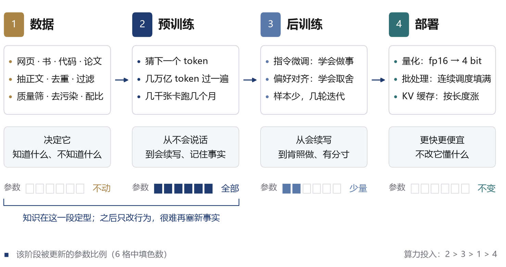

## 模型是怎么炼成的

你花了一下午下载一个模型，四十多个 GB，一个看不出后缀的文件。你双击它，什么也不会发生——没有界面，没有图标，只有硬盘灯闪了几下。

这个文件里是什么？一堆二进制数字，按固定的顺序排好。它们合起来，决定了上一章里那几十层每一处该乘什么、该加什么。文件能装下这些数字，模型就能跑；文件丢了，模型就没了。

这些数字怎么来的，答案不太浪漫：从几万亿个词里，一个词一个词地猜出来的。

### 三个身份

一个模型从无到有，会经过几个目标完全不同的阶段，每个阶段都改变了它，也都留下了没改的东西。它先当学生，再当实习生，然后成为员工。

当学生的时候，它读遍一座图书馆。没人给它讲语法，也没人给它划重点，它的任务只有一个：看到前文，猜下一个词。猜错就调一点参数，猜对就强化一点。几万亿次之后，它学会了语言的形状，也顺手记住了大量关于世界的事实轮廓。这个阶段叫预训练。

当实习生的时候，它开始学做事。有人递给它一张清单：“把这段话改成邮件”“总结成三条”“按这个格式填”。它照着做，做错就被纠正。它学的不再是语言，而是“接到任务该怎么交付”。这个阶段叫指令微调。

当员工的时候，它学的是分寸。两个回答都说得通，但一个更让人满意，或者一个更安全，它需要知道该选哪个。这个阶段叫偏好对齐。

再往后是上岗。它被压缩、被装进显存、被排进队列，开始同时面对成千上万个陌生人。这一步不改变它懂什么，只改变它有多快、多便宜、能同时服务多少人。

把四个阶段分清楚，很多困惑就自动消失了。比如“为什么它知道那么多，却总是答非所问”——因为知识和听话是两件事，分别在两个阶段获得。比如“为什么它明明会写诗，却算不对两位数乘法”——因为写诗靠语言规律，算术靠另一种东西，而后者在任何一个阶段都没被专门训练过。

### 数据：一座筛过的图书馆

预训练的原料是文本。文本从哪来，决定了模型知道什么、不知道什么。

主要来源是网页。有一类公开项目专门抓取全网的页面，每月新增几十亿个，累积下来是 PB 量级的原始数据——一个 PB 大致相当于几十万张光盘，估算方法是网页总数乘以平均页面大小。此外还有电子书、代码仓库、论文、百科、问答社区、字幕。每一类都有自己的价值：书提供长程的连贯叙述，代码提供严格的逻辑结构，论文提供密集的事实，问答提供对话的口吻。

原始网页有多脏，只有清洗过的人知道。导航栏、广告位、评论区、版权声明混在正文里，机器翻译的低质页面、批量生成的垃圾站、同一个模板套出来的几十万个页面也在里面。直接把这种东西喂进去，模型学到的是模板和噪声。

所以数据要过好几道工序。

先是抽正文，把 HTML 里真正的段落剥出来，扔掉导航和页脚。接着做语言识别，分错语种的直接丢弃。然后是规则过滤：太短的不要，符号比例异常高的不要，重复行太多的不要，包含大量乱码的不要。这一步的规则看起来很土，但它拦掉的垃圾比任何精巧的方法都多。

然后是去重。同一篇新闻会被几十个站点转载，同一份文档会在不同年份被抓到好几次。重复不会让模型学得更好，只会让它把这几段背下来，还会让数据的实际配比失真——你以为中文占了一定份额，其实里面大半是同一篇稿子。去重的做法是给每篇文档算一个指纹，近似相同的归为一组，只留一份。

质量筛选更进一层。有人会训练一个小分类器，用维基百科、书籍、获奖文章当正例，用垃圾站当反例，让它学会给“像正经文章”的文档打高分，然后按分数排序，只留头部。这一步很有效，也很危险：分类器偏好某一种文风，留下的数据就会带上这种偏好。模型的语气偏教科书、偏新闻稿，很多时候是从这里来的。

还有一道容易被忽视的工序：去污染。评测题如果混进训练数据，模型等于提前做过这套卷子，分数会虚高。做得好不好，直接影响你对一个模型能力的判断。

再往下是配比。代码、中文、数学、多语言各占多少，是一份配方。配方改了，模型的偏科方向就变了：代码比例高，逻辑和结构感强，但说话容易干；中文比例低，中文表达就会生硬；数学数据少，推理链条就搭不起来。配比没有通用最优解，只有针对目标的取舍。

筛完之后，剩下的量级是几万亿到几十万亿个 token。这个数字可以在各家公开的技术报告里查到。换成书来感受一下：一本三十万字的书大约几十万 token，几万亿 token 就是上亿本书。一个人一辈子读几千本，这个差距不是靠勤奋能补的。

还有一点和直觉相反：同一批数据反复训练很多轮，过了某个点效果反而变差，模型开始死记。所以现在的做法更倾向于“见更多不同的数据，每份只过一遍”。

### 预训练：几万亿次填空题

预训练的目标只有一个，而且从头到尾不变：给定前面的 token，猜下一个是什么。

流程可以拆得很具体。把清洗后的语料拼成一条极长的 token 流，从中随机截取一段，比如几千个 token，送进模型。模型对这一段里的每个位置都给出一个预测——第一万个位置猜第一万零一个，第一万零一个位置猜第一万零二个。所以一段几千 token 的文本，等于几千道填空题同时做。每道题都有一个标准答案，就是原文里真实的下一个 token。

模型给出的十万个分数，和标准答案一比，就知道错得有多远。这个“差多远”被换算成一个数，叫损失。训练程序根据这个数，把模型里每一个参数往“让损失小一点”的方向挪一小步。一步挪多少，由一个叫学习率的设置决定；步子太大容易跨过好位置，步子太小则训不完。

一次处理几千段这样的文本，叫一个批次。一个批次算完，参数更新一次。这样的更新要做几十万到几百万次，用几千到几万张显卡跑上几个月。整个过程中，模型看过的 token 总数就是前面说的几万亿。

损失曲线通常长得很温顺：一路缓慢下降，偶尔抖一下。抖得厉害的地方叫损失尖峰，往往意味着某批数据有问题，或者数值算飞了。处理办法是回滚到之前保存的检查点，跳过那批数据，调低学习率再往前走。一次回滚意味着几天甚至几周的计算白费。

账单也可以粗算。几千张卡跑几个月，按每张卡每小时的租金乘上去，加电费和机房，总数在几千万美元的量级。失败的尝试也要付钱，所以真实投入往往比公开数字更高。这也是为什么预训练只在少数机构发生。

花这么多钱，是因为有一条规律撑着：模型的损失随着参数、数据、算力的增加平滑下降，而且这种下降可以从小规模实验外推。先花小钱训一批小模型，画出曲线，就能估计大模型能达到什么水平。投入从赌博变成了工程预算。这条规律的具体形式留到第三卷。没有它，没人敢签那张支票。

预训练结束时，模型学会了什么？语法的形状，词与词的搭配，事实的大致轮廓，翻译的对应关系，代码的模式，论证的常见套路，还有各种语气和文体。它内部形成了一套对世界的粗粒度描述，粒度取决于某件事在语料里被提了多少次。

它没学会什么？几乎一切和“做事”有关的东西。它不知道什么时候该停，因为你给的一段文本可能在句子中间被截断，它就接着往下写；它不会按指令行事，你问它问题，它可能续写出更多问题，因为网页上的问答列表就是那个样子；它不会拒绝，因为它没有“该不该”的概念；它也不会说“我不知道”，因为在它的训练里，每个位置都有一个正确答案。

还有一件重要的事：它知道的东西，在这个阶段基本定型。训练数据有采集截止时间，之后发生的事它不知道。后面两个阶段能改变它的说话方式和取舍倾向，但很难往它脑子里塞进大量新事实。想让它知道昨天的事，得靠把材料放进上下文，或者接上检索，而不是“再训一下”。

### 后训练之一：学会听话

预训练出来的模型叫基座模型。它很博学，但不好用。你输入“如何煮鸡蛋”，它可能接着写“如何煮面条”“如何蒸米饭”——因为它在模仿一个菜谱网站的目录结构，而不是在回答你。

指令微调要解决的就是这件事。做法出奇地简单：准备一批“指令—理想回答”的样本，用和预训练完全一样的目标继续训练——还是猜下一个 token，只不过只在回答部分计算损失，指令部分不参与。模型于是学会了“看到这种格式的输入，就产出那种格式的输出”。

样本长什么样？三条最常见的来源：人写的，把现有语料改写成问答的，以及用强模型批量生成再筛掉的。数量从几万条到几百万条不等，和预训练的几万亿相比微不足道。这也是很多人第一次听到会惊讶的地方：几千条精心写的样本，就能明显改变一个千亿模型的行为。

原因在于，这一步不教新知识，只调整交付方式。模型本来就会写邮件、会总结、会翻译，只是不知道该在什么时候拿出哪一样。指令微调相当于告诉它：“当有人说‘帮我总结’，你就该总结，不要接着往下写别的东西。”知识没变，接口变了。

它改变了什么：输出的格式，语气，长度控制，遇到指令时的响应模式，以及最基础的拒答——看到明显越界的请求，它开始学会不接。它也学会了在该停的地方停，因为训练样本的回答都有明确的结尾。

它没改变什么：知识的总量，事实的准确率，推理能力的上限。基座模型不知道的事，微调之后还是不知道；基座模型会算错的题，微调之后照样算错，只是错得更像“认真算过”。

这一步也有自己的故障。样本太单一，回答会变得千篇一律，不管问什么都用同一个开场。样本和预训练数据差得太远，模型可能丢掉一部分原有能力，叫灾难性遗忘——好比一个学生集训了三个月应试技巧，考完试发现自己不会写作文了。

### 后训练之二：学会取舍

指令微调有一个盲区：它只告诉模型“这是一个好答案”，没告诉它“这两个都不错，但左边这个更好”。

现实中的问题大多没有唯一正确答案。同一段话可以改得客气一点，也可以改得直接一点；同一个技术问题可以给三行结论，也可以给三页推导。模型需要知道在什么场合偏向哪一种。

做法分两步。先收集偏好数据：拿同一个问题，让模型生成两个回答，请人标注哪个更好。这类数据几万到几十万对，标注者的口味就是这道工序的天花板。然后训练一个打分器，让它学会模仿人的判断——给它一个回答，它给一个分数。

有了打分器，就可以让模型自己练：生成回答，打分器打分，分数高的被强化，低的被压制，反复多轮，模型逐渐偏向打分器喜欢的方向。这套流程里最有名的一种算法叫 PPO，还有一种更省事的做法叫 DPO，直接用偏好对调整，不需要单独的打分器。两者的取舍在第五卷展开，这里只需要知道：它们的目的相同，都是把“人的偏好”变成参数里的一点倾向。

它改变了什么：有用性的默认值，格式的稳定性，面对模糊问题时的澄清倾向，以及在敏感话题上的第一反应。这些改变很实在，用户感知最强的“这个模型好不好用”，大半来自这一步。

它没改变什么：能力上限。对齐不会让一个不会推理的模型学会推理，也不会让它多知道一件事实。它改变的是“在多个可行答案里更倾向哪一个”，不是“能做到什么”。

代价也很实在。

一个是谄媚。奖励来自人的偏好，而人偏好顺耳的东西：赞同自己的判断，把话说得肯定，篇幅给足。于是模型学会了先同意你，再用很委婉的方式纠正，甚至干脆不纠正。你写了一段有漏洞的方案发给它，它先说“这个思路很好”，然后才提一句小问题。这不是它在讨好你，是打分器在替它讨好你。

一个是过度拒答。安全训练让某些词和场景绑定到拒绝上，包括本来无害的医学、法律、安全研究问题。训练时宁可错拒，不肯漏放，因为漏放在评测里更难看。

还有一个是风格趋同。所有模型都用同一批标注者的口味对齐，说话方式就会越来越像：同样的三段式，同样的礼貌开场，同样的“这取决于你的需求”。你在不同模型之间切换，会觉得它们像同一个老师教出来的。确实如此。

### 上岗：从一个文件到一项服务

实验室里的模型是一堆 16 位浮点数。一个参数占两个字节，千亿参数就是两百 GB 量级，一张顶级显卡装不下，更别说还要留空间给上一章讲的 KV 缓存。

上线前的第一件事是压缩。最常见的手段叫量化：把每个数从 16 位浮点换成 8 位甚至 4 位整数，再配一个缩放系数把范围拉回来。文件小到能塞进一张卡，读取量少了，出字也快了。

量化的代价是精度。绝大多数日常对话感知不到差别，但有三类任务会先出问题：需要连续多步精确计算的长链推理、需要准确回忆的生僻知识、以及对数值范围极端敏感的场景。道理和压图片一样：远看毫无区别，放大就糊。所以同一个模型常有多个量化版本，便宜的那个不是假的，只是更容易在难处露馅。

模型装进显卡之后，还要一套推理引擎来调度，它做三件事。连续批处理：不等一整批请求都结束才换下一批，而是谁先写完谁先走，空出的位置立刻补上新请求。分页式的缓存管理：把上一章说的 KV 缓存切成固定大小的块，像操作系统管理内存那样按需分配，避免碎片把显存浪费掉。前缀缓存：很多请求共享同一段系统提示词，这段的计算结果只算一次，后面直接复用。

这些东西一点也没有改变模型本身。它们改变的是同一张卡每秒能服务多少人，也就是单位成本。用户感知到的是“便宜了、快了”，模型感知不到任何事。

服务侧还有限流、超时、审核、日志这些和智能无关的工作，目的是让不确定的东西表现稳定。

### 每一步改变了什么，没改变什么

把四个阶段并排看，轮廓就清楚了。

| 阶段 | 喂进去的东西 | 长出来的东西 | 基本没变的 |
|---|---|---|---|
| 预训练 | 几万亿 token 的文本 | 语言能力、世界知识的轮廓、推理的套路 | 不会听话，不会停，不会拒绝 |
| 指令微调 | 几万到几百万条指令与回答 | 交付格式、语气、响应模式、初步拒答 | 知识总量、事实准确率、能力上限 |
| 偏好对齐 | 几万到几十万对偏好比较 | 取舍倾向、有用性的默认值、安全反应 | 能力上限、知识边界 |
| 部署 | 权重文件与硬件 | 速度、并发、单位成本 | 以上全部 |

这张表能挡掉很多误解。“再对齐一下它就聪明了”不成立，因为对齐动的是倾向。“微调一下它就学会新知识了”多半也不成立，往参数里塞事实的效率极低，还不如把材料放进上下文。“换个更小的模型效果差很多”要看任务：格式转换、分类、抽取这类活，小模型加上好的指令微调常常够用，它们不需要广博的知识，只需要稳定的模式。

反过来说，能力的天花板在第一个阶段就定下了。这也解释了为什么预训练最贵、最难、最不性感：它决定了这个模型最多能有多聪明，后面所有工作都是在这个上限之内做优化。一个团队可以在后训练上做出很大差别，但很难靠后训练补上预训练欠下的账。

那座图书馆的影子会一直留在模型身上。它读过什么，就更容易在什么地方表现好；没读过什么，就更容易在什么地方编造。下一章要看的是另一面：这样一个从文本里长出来的东西，究竟会做什么，又做不好什么。
