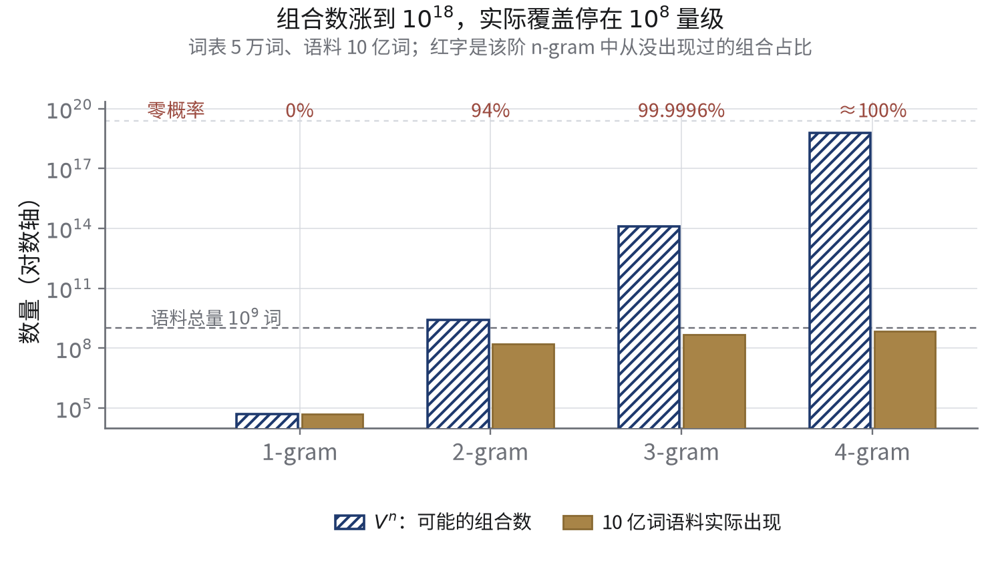

## 语言模型的来路：从计数到神经网络

2009 年，一个做中文输入法的人手上只有两样东西：一份三亿字的新闻语料，和一张从语料里数出来的表。表有三列，第一列是前一个词，第二列是跟在它后面的词，第三列是这个组合出现过多少次。用户敲下“今天天”，程序去表里查“天”这一行，按次数排序，把“气”顶到候选栏第一位。

这张表就是 n-gram 语言模型的全部家当。它不知道“天气”是一个词，不懂主谓宾，也没有一点关于世界的知识，它只是数过。而在深度学习普及之前的二十年里，机器翻译、语音识别、拼写纠错这些系统的心脏，就是成千上万张这样的表。

这一章沿着一条线走：从数数开始，看每一步是被什么问题逼出来的。平滑是被零概率逼出来的，词向量是被稀疏性逼出来的，循环是被定长窗口逼出来的，注意力是被固定向量逼出来的。这条线上的每个零件今天都还在大模型里，只是换了装配方式。

### 一句话缺了下半截

设想你在读“今天的天气真”，后面可能接“好”，也可能接“糟”，但几乎不会接“冰箱”。这个判断不是查字典得来的，它来自你读过的大量句子，以及这些句子在类似场合反复出现的方式。

要把这种直觉变成可算的东西，第一步是把“一句话出现的可能性”拆开。一句长度为 $T$ 的话记作 $w_1,w_2,\dots,w_T$，其中 $w_t$ 是第 $t$ 个位置上的 token，$w_{<t}$ 是它前面所有 token 的简写。它的概率可以写成

$$P(w_1,\dots,w_T)=P(w_1)\,P(w_2\mid w_1)\,P(w_3\mid w_1,w_2)\cdots=\prod_{t=1}^{T}P(w_t\mid w_{<t})$$

这个式子常被当作定义一带而过，其实它没有引入任何假设。它只是把 $P(AB)=P(A)P(B\mid A)$ 反复用 $T-1$ 次。真正的问题在后面：最后那个因子 $P(w_t\mid w_{<t})$ 怎么算。条件里挂着 $t-1$ 个词，穷举所有组合是不可能的——五万词的词表，三个词的组合就有一万二千五百亿种。

所以“设计一个语言模型”，本质上就是回答一个问题：用什么办法，把一长串条件压缩成一个能算的量。n-gram 的回答是砍掉太远的历史，只留最近 $n-1$ 个词；循环网络的回答是把它压进一个向量；Transformer 的回答是让每个位置直接去看它想看的那些位置。三种回答对应三代结构。

还有一个工程细节要先交代。乘积在实际计算里从不直接乘：二十个 0.1 乘起来是 $10^{-20}$，而一条长文本有几千个 token，早就下溢成 0 了。所以实现里一律取对数，把连乘变成连加：

$$\ln P(w_{1:T})=\sum_{t=1}^{T}\ln P(w_t\mid w_{<t})$$

对数是单调的，谁大谁小不变，所以这个改写不影响任何结论。后面讲损失和困惑度时，用的都是这个和式。

### 数出来的概率

最简单的压缩方式是只留前一个词：

$$P(w_t\mid w_{<t})\approx P(w_t\mid w_{t-1})$$

这就是二元语法（bigram），$n=2$。它假设下一个词只跟上一个词有关，更远的历史一概不看。三元语法（trigram）看前两个词，四元语法看前三个，通称 n-gram。

假设定下来，概率就可以数出来。给定前一个词 $v$，语料里它后面跟过哪些词、各跟过多少次，这些计数构成一个多项分布。用 $c(v,w)$ 表示二元组 $(v,w)$ 在语料里出现的次数，$c(v)=\sum_{w'}c(v,w')$ 是 $v$ 作为前项出现的总次数，最合理的估计是

$$\hat P(w\mid v)=\frac{c(v,w)}{c(v)}$$

这个“最合理”不是随口说的。把这 $V$ 个候选词看成 $V$ 个抽屉，每次观测相当于从某个抽屉里抽出一个球。观测到计数 $c(v,w)$ 的似然是 $\prod_w p_w^{c(v,w)}$，在 $\sum_w p_w=1$ 的约束下求最大，拉格朗日乘子给出 $c(v,w)/p_w$ 处处相等，也就是 $p_w$ 正比于计数，归一化之后就是相对频率。白话：在没有其他信息的情况下，出现比例就是最好的猜测，任何偏离都会让已经观测到的数据显得更不可能。

拿三句话的玩具语料试一下：

> 我 喝 咖啡
>
> 我 喝 茶
>
> 他 喝 水

“喝”出现了三次，后面分别是咖啡、茶、水，各一次。于是 $\hat P(\text{咖啡}\mid\text{喝})=1/3$，茶和水也是 $1/3$。三元语法同理，分子换成 $c(v,u,w)$，分母换成 $c(v,u)$。

阶数越高，条件越具体，预测越准，这是它当年能用的原因。在几亿词的语料上，调好的三元、四元模型已经能生成语法上过得去的句子，在语音识别里把词错率压到几个百分点。

代价写在参数量上。五万词的词表，二元语法要存 $5\times10^4$ 的平方，二十五亿个格子；三元语法是它的五万倍，$1.25\times10^{14}$，一百二十五万亿个格子。而一份十亿词的语料，即使每个相邻对都不重复，最多也只能填满十亿个格子，占三元表的三亿分之一。剩下的格子全是空的。

### 零的代价

空格子不是“暂时还不知道”，在公式里它就是概率 0。

严重性容易被低估。语言模型算的是整句概率，而整句是连乘：二十个因子里只要有一个是 0，整句就是 0，取对数之后是负无穷。一句完全正常的话，只因为里面有一个语料里没出现过的搭配，就被判成“不可能”。前面那个“我喝牛奶”就是例子，牛奶在玩具语料里没出现过，$\hat P(\text{牛奶}\mid\text{喝})=0/3=0$，整句概率归零。

平滑（smoothing）就是来改这个 0 的。思路很朴素：不把全部概率都分给见过的组合，留出一小块给没见过的。像切蛋糕，先给到场的人每人一块，再从每块上削一点，留给没来的人。

最直白的做法是加一平滑（add-one），也叫拉普拉斯平滑：给每个候选的计数都加 1，

$$P_{\text{add-}1}(w\mid v)=\frac{c(v,w)+1}{c(v)+V}$$

分母里加的是 $V$ 而不是加 1，因为每个候选都被虚构了一次出现。在玩具语料上，$c(\text{喝})=3$、$V=50000$，“牛奶”的概率从 0 变成 $1/50003\approx2\times10^{-5}$。

0 确实没了，但这个数字荒唐得刺眼。三个真实观测，五万个虚拟计数，等于把 99.99% 的概率质量分给了从没出现过的词，真正见过的咖啡只剩 $2/50003$。语料大一些会好一点：“喝”出现一百万次时，五万个虚拟计数只占 5%，勉强能接受。这说明加一平滑的误差不取决于算法优不优雅，而取决于词表和计数的比例——词表越大、数据越稀，它错得越离谱。

还有一个更根本的毛病：所有没见过的词拿到的都是同一个 1。“牛奶”和“冰箱”跟在“喝”后面，概率完全一样，可前者显然更可能。加一平滑没有任何机制表达这种差别，因为它只看计数，而这两者的计数都是零。

真正要解决的问题是：没见过的组合，凭什么给出不同的概率。答案只能来自词本身的性质，而计数表里恰好没有这个信息。这个问题要等到词向量才被真正解决。

### 折扣与接续计数

Kneser-Ney 平滑是 n-gram 时代的最后一站，也是最好的一站。它把“留一块给没见过的”这件事拆成了两步。

第一步是折扣（discounting）。与其给所有候选加 1，不如把出现过的组合各自扣掉一个固定的少量 $D$，扣下来的总量正好留给没见过的组合：

$$P_{\text{abs}}(w\mid v)=\frac{\max\bigl(c(v,w)-D,\,0\bigr)}{c(v)}$$

“喝咖啡”出现 40 次，就按 39.25 算；“喝茶”出现 1 次，按 0.25 算，那个 $\max$ 是防止计数小于 $D$ 时出现负数。$D$ 不随计数变化，这个选择有依据：自然语言的计数分布极度偏斜，只出现一次的组合占了类型的绝大多数，而它们合起来携带的概率质量大致是一个固定比例。Good-Turing 估计给出的正是这个结论，$D\approx0.75$ 是它在实践中的常用近似值，靠调参确定，不是推导出来的。

先检查质量守恒。设“喝”后面一共出现过 $N_{1+}(v,\cdot)$ 种不同的词，下标 $1+$ 的意思是“至少出现过一次的类型数”；每种扣掉 $D$，总扣除量占 $c(v)$ 的比例是

$$\lambda(v)=\frac{D\cdot N_{1+}(v,\cdot)}{c(v)}$$

这就是留给未见组合的份额，剩下的 $1-\lambda(v)$ 按折扣后的计数分给见过的词。两块加起来正好是 1，概率既没多也没少。

第二步是回退，把 $\lambda(v)$ 这份质量按什么比例分给未见组合。直觉做法是按词频分：牛奶常见就多分一点。这里有个陷阱。“San Francisco”里的 Francisco 总频率不低，但它几乎只出现在 San 后面；按词频给它高权重，那么在“喝 __”这种位置它也会拿到可观的概率，明显不对。

正确的判据不是“这个词多常见”，而是“这个词能在多少种不同的上下文里出现”。这就是接续计数（continuation count），

$$N_{1+}(\cdot,w)=\bigl|\{v: c(v,w)>0\}\bigr|$$

也就是 $w$ 前面出现过多少种不同的词。Francisco 的这个数接近 1，“吃”的这个数很大——我吃、你吃、他吃、爱吃、想吃、能吃、敢吃、别吃，几十上百种。用接续计数归一化，得到回退分布

$$P_{\text{cont}}(w)=\frac{N_{1+}(\cdot,w)}{\sum_{w'}N_{1+}(\cdot,w')}$$

分母是所有词的接续计数之和，保证它自己也是合法的分布。两段合起来就是 Kneser-Ney：

$$P_{\mathrm{KN}}(w\mid v)=\frac{\max\bigl(c(v,w)-D,\,0\bigr)}{c(v)}+\lambda(v)\,P_{\text{cont}}(w)$$

拿具体数字走一遍。设 $c(\text{喝})=100$，后面跟过四个词：咖啡 40、茶 25、水 20、酒 15，$D=0.75$。四个折扣后的概率是 $39.25/100$、$24.25/100$、$19.25/100$、$14.25/100$，加起来 0.97，剩下 $\lambda=3/100=0.03$。

现在问“喝牛奶”的概率。第一项是 0，第二项是 $0.03\times P_{\text{cont}}(\text{牛奶})$。假设牛奶前面出现过 200 种不同的词，而全部词的接续计数之和是四百万，那么 $P_{\text{cont}}(\text{牛奶})=200/4\times10^{6}=5\times10^{-5}$，乘上 0.03 得 $1.5\times10^{-6}$。如果冰箱前面只有 30 种词，它的概率是 $2.3\times10^{-7}$，低了六倍多。这个六倍完全来自“牛奶能被多少种词引导”，与牛奶本身出现多少次无关。

一句话概括：见过的组合按打折后的次数算，没见过的组合按“这个词能被多少种上下文引导”分剩下的概率。这两句话背后是两种不同的信息，前者是搭配强度，后者是组合自由度。Kneser-Ney 在语音识别里统治了十几年，就是因为它把这两者分开了。

实际系统里这套东西是递归的。三元模型回退到二元，二元再回退到一元，每一层用自己的 $D$ 和 $\lambda$，最后一层兜底用词频。这种逐级回退和插值（把高低阶的概率直接加权平均）在实践里差别不大，都能用，但回退实现起来更省内存：你只需要在低阶表里存一份接续计数，不必为每个高阶上下文单独存一份混合权重。

但补丁终归是补丁。平滑只处理“没见过的组合”，模型的视野仍然被阶数锁死：三元模型看不到跨越四个词以上的依赖，语料再大也没用。而语言里到处都是长距离依赖，“我昨天在图书馆借的那本讲罗马帝国的书，到现在还没”后面该接“看完”，这个判断要跨过二十多个词。

### 困惑度：把犹豫变成一个数

要比较两个模型，得先有一把尺子。最自然的尺子是“模型给真实语料打了多高的分”：把测试集里每个位置真实下一个词的概率取出来，连乘，越接近 1 越好。但连乘的数值太小，长度不同的文本之间也无法比较，所以取对数、取平均、再取指数：

$$\mathrm{PPL}=\exp\left(-\frac{1}{N}\sum_{t=1}^{N}\ln P(w_t\mid w_{<t})\right)$$

$N$ 是测试集的 token 数，括号里那一项是平均负对数似然，单位是 nat，也就是以 $e$ 为底的信息量单位。取指数是为了把它变回一个能读的量：困惑度（perplexity，PPL）等于“模型平均每一步要在多少个等概率的候选里挑选”。

验算两个极端。如果模型对五万个词一视同仁，每步给 $1/50000$，那么 $-\ln(1/50000)=10.82$，取指数正好回到 50000，等于候选数本身。如果模型每次都给正确答案 0.2 的概率，PPL 就是 $1/0.2=5$，相当于每步只在五个词里犹豫。这也说明 PPL 有个绝对下界 1：只有把全部概率押在一个词上、并且每次都押对，才能取到。

换个底数就换一种说法。用 2 为底，括号里变成平均每个 token 要花多少比特，叫交叉熵；困惑度是它的指数，$\mathrm{PPL}=2^{H}$。PPL 5 对应 2.32 比特每 token，PPL 100 对应 6.64 比特。这个换算把一个语言学指标接回了信息论：语言模型在做的事就是压缩，困惑度低就是压缩率高。这条线索在讲缩放定律时会重新出现——损失下降 0.1，对应的是实打实的比特数下降。

给几个量级，方便对照。在 Penn Treebank 这个只有百万词的老基准上，调好的 5-gram 模型困惑度在 80 以上，LSTM 语言模型能压到 60 附近，而今天的大模型在英文通用文本上早已是个位数。差距看着不大，但 PPL 是指数尺度：从 80 降到 8，等于每个 token 少花 3.3 个比特，编码效率提高了十倍。

用 PPL 有两个必须留神的地方。它只在同一个词表、同一个测试集上可比：分词器一换，token 总数变了，分母变了，两个数字就没有共同语言，这也是跨模型比较 PPL 经常得出荒谬结论的原因。它也不等于能力：PPL 衡量的是对文本的预测，一个把网文背得很熟的模型可以在某个测试集上 PPL 很低，同时在需要推理的任务上一塌糊涂。

还有一类细节会把数字弄脏。测试集里出现词表外的词时，所有模型都只能把它替换成一个特殊符号，这一步已经把一部分不确定性预先抹平了，所以两个 PPL 之间那点差距，可能全部来自未登录词怎么处理。论文报 PPL 时要连词表大小和未登录词比例一起报，否则数字没法复现。

### 2003：先给词一个向量

到 2003 年，n-gram 的两条路都走到头了：阶数加上去参数量爆炸，平滑做得再好也救不回“没见过的组合之间没有相似性”这件事。

Bengio 等人那篇神经概率语言模型（Neural Probabilistic Language Model）换了起点。他们注意到，n-gram 把词当成互不相干的符号，所以“猫在垫子上睡觉”和“狗在垫子上睡觉”在计数表里是两个毫不相干的格子，可人知道这两句话几乎一样。如果模型能给每个词一个稠密向量，让猫和狗的向量接近，那么从前者学到的规律就能迁移到后者。

结构很直接。把前 $n-1$ 个词的向量首尾相接成一个长向量 $x$，过一层隐藏层，再输出词表上的分数：

$$y=b+Wx+U\tanh(d+Hx)$$

$x\in\mathbb{R}^{(n-1)m}$ 是 $n-1$ 个 $m$ 维词向量拼起来的结果；$H\in\mathbb{R}^{h\times(n-1)m}$ 把拼接向量投到 $h$ 维隐藏层，$d\in\mathbb{R}^{h}$ 是隐藏层偏置；$U\in\mathbb{R}^{V\times h}$ 把隐藏层投到词表；$W\in\mathbb{R}^{V\times(n-1)m}$ 是一条从输入直连输出的线性通路，$b\in\mathbb{R}^{V}$ 是输出偏置。$y$ 的每一维对应一个词的分数，过 softmax 得到概率，训练目标是最大化语料的对数似然。

那条直连的 $Wx$ 容易被当成多余。它的作用是让模型能表达“这个词后面常接那个词”这种纯共现关系，不必把所有东西都挤过 $\tanh$ 那个窄口。去掉它模型也能学，但要多花很多参数和训练步数。

参数账是这一节的重点。把词向量矩阵也算进去，总参数是

$$\underbrace{Vm}_{\text{词向量}}+\underbrace{V(n-1)m}_{W}+\underbrace{Vh}_{U}+\underbrace{V}_{b}+\underbrace{h(n-1)m}_{H}+\underbrace{h}_{d}=V\bigl(1+nm+h\bigr)+h\bigl(1+(n-1)m\bigr)$$

前三项是词向量表、从输入到输出的直连通路、从隐藏层到输出的投影，形状分别是 $V\times m$、$V\times(n-1)m$、$V\times h$，可见输出侧的两块就占了大头。取 $V=50000$、$m=300$、$h=512$、$n=4$（看前三个词），第一项是 $50000\times1713\approx8.6\times10^{7}$，第二项是 $512\times901\approx4.6\times10^{5}$，合计八千六百万左右。同样词表的三元语法要一百二十五万亿个格子。八千六百万对一百二十五万亿，差六个数量级，而神经模型还能靠向量相似性泛化到没见过的组合。

代价在算力上。2003 年训练这样一个模型跑完一遍语料要几周，而 n-gram 只需要数一遍，几分钟。这才是它当时没有立刻取代 n-gram 的真实原因——不是想法不好，是硬件不够。这个模式在深度学习史上反复出现：一个方法要等十几年，才等到能跑它的机器。

这篇论文里已经埋下了后来大模型的三个零件：用稠密向量代替 one-hot、用共享的嵌入矩阵查表、用神经网络代替条件概率表。第 2 章把第一个零件单独拆开。

### 循环、注意力，以及一次分岔

Bengio 的模型仍然留着 n-gram 的尾巴：窗口固定。看前三个词，就永远只看前三个词。

循环神经网络（Recurrent Neural Network，RNN）把这个窗口拆了。它不再一次吃固定个数的词，而是一个一个读，每读一个就更新一个隐状态：

$$h_t=\tanh\bigl(W_h h_{t-1}+W_x x_t+b\bigr)$$

$h_t\in\mathbb{R}^{d_h}$ 是读完第 $t$ 个词之后的隐状态，$x_t$ 是第 $t$ 个词的向量，$W_h\in\mathbb{R}^{d_h\times d_h}$ 与 $W_x\in\mathbb{R}^{d_h\times d_{\text{in}}}$ 是权重，$d_{\text{in}}$ 是嵌入维度，$b$ 是偏置。注意 $W_h$ 在每个时刻都是同一个矩阵：这既是“参数不随长度增长”的来源，也是它后来所有麻烦的来源。

用一句话说，$h_t$ 是对“读到目前为止的全部内容”的压缩。维度固定，压缩必然有损；但至少它能装下任意长的历史，而不像 n-gram 那样一刀切断。

RNN 的细节留到第 3 章。这里只需要看它在 2014 年前后被推到了什么位置：编码器-解码器结构用两个 RNN 做机器翻译，编码器把整句源语言读完，最后那个隐状态当作解码器的初始状态，解码器从它出发逐词生成译文。整个源句被压成一个向量，句子越长丢的东西越多，译文质量随长度明显下滑。

Bahdanau 等人在 2014 年底给了一个针对性的修补：让解码器每一步自己回源句里看一遍，而不是只依赖那个被压扁的向量。做法是给解码器的当前状态和每个源词算一个相关性分数，归一化成权重，再对源词向量加权求和，得到这一步的上下文向量：

$$e_{tj}=v_a^{\top}\tanh\bigl(W_a s_{t-1}+U_a h_j\bigr),\qquad \alpha_{tj}=\frac{\exp(e_{tj})}{\sum_{k}\exp(e_{tk})},\qquad c_t=\sum_j\alpha_{tj}h_j$$

$s_{t-1}$ 是解码器上一步的状态，$h_j$ 是编码器第 $j$ 个位置的状态，$v_a$、$W_a$、$U_a$ 是可训练参数，$e_{tj}$ 是打分，$\alpha_{tj}$ 是归一化后的权重，$c_t$ 是这一步取回的上下文。这套打分叫加性注意力，因为两个变换是先相加、再过 $\tanh$。

它解决的不只是长句问题。权重矩阵本身就是一张对齐表：译到某个词时，权重会集中到源句里对应的位置，其余位置几乎不看。从梯度角度看，解码器和源句之间的距离也从“穿过几十个时间步”变成了“一步直达”，长程依赖的传播路径被大幅缩短。

注意力最初只是挂在 RNN 上的一个附件。回头看，它是通往 Transformer 的最后一级台阶：既然信息路由的主要工作已经可以由注意力承担，循环还有必要吗。这个问题在 2017 年被回答，代价是整个领域的设计重心从结构换到了别处。

而在那之前，路线已经分岔了。2018 年，BERT 用 Transformer 的编码器，把句子里的词随机遮住一部分让模型去猜，学到的表示在分类、抽取、问答上刷新了一圈纪录，把“预训练加微调”变成了标准做法。同年 GPT 用解码器，只做一件事：根据前文预测下一个词。两条路的分歧不在网络结构，而在目标函数怎么用数据。BERT 能看左右两侧，因此擅长判断；GPT 只能看左侧，因此必须学会把一切任务写成续写。

2019 年 GPT-2 用 15 亿参数、40GB 网页文本训练，展示了不微调、只把任务写进提示就能工作的苗头。2020 年 GPT-3 把参数推到 1750 亿，系统性地表明：只要目标足够简单、数据足够多，规模本身就能带来能力。它没有发明新结构，用的是 2017 年那个 Transformer。

从数数走到 1750 亿参数，这条线上有一个东西从头到尾被当作黑盒：每换一次结构，我们都说“把词变成向量”，却从没解释那串数长什么样、从哪里来、为什么能表示意思。整条线索里它出现得最早，也最没被交代清楚。下一章就停在这一步上。
