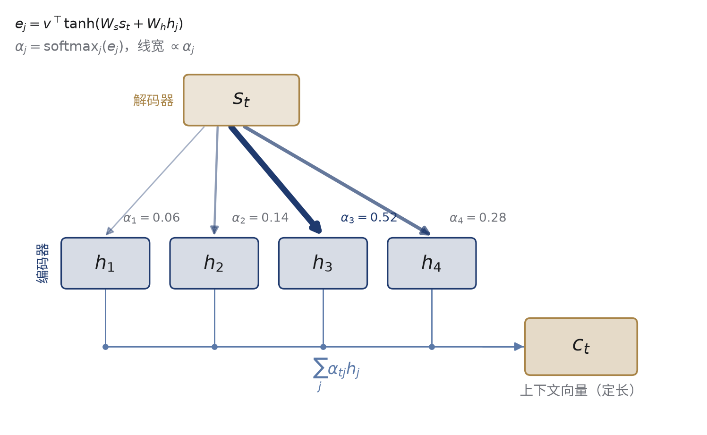

## 注意力：一次对症的修补

2014 年的一组翻译实验留下了一条很难看的曲线：源句三十个词以内，译文还算通顺；超过四十个词，BLEU 开始往下掉；到六十个词，模型会漏掉整段修饰语，或者把主语和宾语调个个儿。同一套模型、同一批数据，唯一变化的是句子长度。这不是训练不足，因为短句上的表现已经很好；也不是词表不够，因为漏掉的词都在词表里。

问题出在结构上。整个源句被读进一个固定长度的向量，解码器每一步拿到的都是这同一个向量。句子越长，这个向量要装的东西越多，能分给每件东西的份额越少。

### 一个向量装不下一句话

先把这个结构写清楚。编码器是一个循环网络，源句 $x_1,\dots,x_{T_s}$ 依次送进去，每读一个词更新一次隐状态：

$$h_j=f_{\mathrm{enc}}(h_{j-1},x_j),\qquad h_j\in\mathbb{R}^{n}$$

$T_s$ 是源句长度，$n$ 是隐状态宽度，Bahdanau 的实验里取 1000。读完最后一个词，得到的 $h_{T_s}$ 就是整句的表示，通常直接叫作上下文向量 $c$，因为解码器之后只能看到它：

$$c=h_{T_s}$$

解码器是另一个循环网络。生成第 $t$ 个目标词时，它读三样东西：上一步的隐状态 $s_{t-1}$、上一个生成的词 $y_{t-1}$、以及那个固定的 $c$。

$$s_t=f_{\mathrm{dec}}(s_{t-1},y_{t-1},c),\qquad s_t\in\mathbb{R}^{n}$$

然后 $s_t$ 经过一个输出投影和 softmax，得到目标词表上的分布，取一个词出来。整个过程里，源句的信息只有一条通道进入解码器，就是 $c$。

拿一个具体句子看这条通道有多窄：

> The agreement on the European Economic Area was signed in August 1992.

译到“签署”这个词时，解码器需要的信息只藏在 signed 这一个位置；译“1992 年 8 月”时，需要的是最后两个词；而译开头的“欧洲经济区协定”时，需要的是前六个词。三个时刻需要三块不同的信息，但它们拿到的都是同一个 $c$。更要命的是，$c$ 是读完最后一个词之后的状态，越靠前的内容被覆盖的次数越多。编码器每读一个词，隐状态就被整体重写一遍，前面写进去的东西要靠“没被冲掉”留下来。读到 signed 的时候，the agreement 已经被重写了七遍。

所以瓶颈不是“容量不够”这么含糊的一句话。一个 1000 维的 FP32 向量是 4KB，装下几十个词的词义绰绰有余。它的问题是**没有选择**：这个向量必须同时承担五件事——每个源词对应哪个目标词、源句的语序、时态与人称、还有哪些部分没译、以及“我读到哪了”。这五件事争同一块地方，任何一件表达得细一点，其余四件就得粗一点。

长度效应因此是必然的。Sutskever 等人在 2014 年报告过一个转折点：句子在 35 个词以内，加不加这套结构的变体差别不大；超过 35 个词，BLEU 开始随长度单调下降。他们的解释是“固定向量无法压缩长句的全部信息”，这个说法对，但还可以更具体：不是信息总量不够，是信息没有被组织。

值得先排除一种想当然的修法：把向量加宽。宽度 $n$ 从 1000 加到 2000，参数量按平方涨四倍，显存和训练时间跟着涨，但能换来的只是“每一份宽一点”。Sutskever 当年的配置是 4 层、1000 维，这已经是当时算力下能跑得动的上限；更根本的问题是，句子里的词数是变量，而向量的宽度是常量，加宽不改变“哪一份现在要用”这个困难。加宽解决容量，解决不了寻址。

这里还要交代一句训练方式，否则后面算代价时会缺一块。训练时解码器每一步的输入是标准答案里的上一个词，不是它自己上一步生成的结果，这叫 teacher forcing。于是一条长度为 $T_t$ 的译文可以一次给出 $T_t$ 个预测任务，全部并行算损失。推理时没有标准答案，只能把自己刚生成的词喂回去，一步一词。这个错位在注意力引入之后会变得更明显：训练时每一步的 $c_t$ 只依赖 $s_{t-1}$，而 $s_{t-1}$ 依赖的是标准答案的前缀；推理时依赖的是模型自己的前缀。前缀一旦走偏，后面每一步取到的 $c_t$ 也跟着偏。

### 解码器每一步想知道的事不一样

换一个角度看这件事。翻译一句话，人的做法不是先把整句背下来，再闭着眼睛往外写。人是一边写一边回头看的：写到“签署”时，眼睛会跳到 signed；写到年份时，眼睛回到句尾。回看的落点随写到的位置变化，而且落点通常只有一两个词。

这个动作里有两个要素：一是“现在需要什么”，由已经写出的译文决定；二是“原文哪里能提供”，由原文内容决定。把这两者对上，就有了“这一步该看哪”。

规则化的做法很快会撞墙。语序不同，对应关系就不是平移；一个源词可能对应多个目标词，反过来也一样；有些词（冠词、量词）在另一种语言里干脆不存在。写不出一套通用规则，那就让模型自己学。

学的方式是这样：不再给解码器一个固定的 $c$，而是每一步现算一个 $c_t$。算的依据是当前解码器状态 $s_{t-1}$——它编码了“我已经译到哪、还需要什么”。用 $s_{t-1}$ 去和每一个源位置 $h_j$ 比对，比出一个相关性分数，分数高的位置多取一点，分数低的位置少取一点。这样，“看哪”就变成了一个由数据和梯度决定的数，而不是由人写死的规则。

按什么来定位，这件事本身有几种选法。一种按位置：假定源句和目标句大致对齐，第 $t$ 步就重点看第 $t$ 个源位置附近，权重由一个以 $t$ 为中心的高斯窗给出。这种做法的参数极少，在语序接近的语言对上工作得不错，但遇到动词位置相反的语言对（比如英语和日语）就失效。另一种按内容：用当前状态去和每个源位置的实际内容比对，位置只作为内容的一部分被动带入。Bahdanau 选的是后者，代价是每一步都要重新算一遍全句的相关性，收益是“看哪”不受语序假设约束。

这个选择还有一层副作用，当时未必是设计意图。按内容定位意味着权重是连续可微的，而位置固定的窗函数几乎不带可学参数；一个不携带可学参数的机制，梯度没有理由去调整它，它也就无法适应数据。注意力之所以能被端到端训练，前提是“看哪”这个决定由网络自己做出。

### 打分：给每个源词算一个相关性

Bahdanau 给出的打分函数叫加性注意力（additive attention），名字来自它的形式：两路变换先相加，再过一个非线性。

$$e_{tj}=v_a^{\top}\tanh\bigl(W_a s_{t-1}+U_a h_j\bigr)$$

$e_{tj}$ 是一个标量，读作“解码第 $t$ 步时，源位置 $j$ 的相关性分数”。逐个符号拆开：

$s_{t-1}\in\mathbb{R}^{n}$ 是解码器上一步的隐状态，宽 $n=1000$。$h_j\in\mathbb{R}^{2n}$ 是编码器在位置 $j$ 的输出，宽 $2n$，因为 Bahdanau 用了双向循环网络，把正读和反读的两个 $n$ 维状态拼在一起。$W_a\in\mathbb{R}^{n\times n}$ 把解码状态投到 $n$ 维，$U_a\in\mathbb{R}^{n\times 2n}$ 把源位置投到同一个 $n$ 维空间。两者相加，得到一个 $n$ 维向量；$\tanh$ 逐元素作用，把每个分量压到 $-1$ 和 $1$ 之间；最后 $v_a\in\mathbb{R}^{n}$ 与它做内积，$n$ 个数加权求和成一个数。

这四步各有分工。

两次线性变换的作用是把两边的向量搬到同一个坐标系里。解码状态说的是“我需要一个动词”，源位置说的是“我是一个动词”，这两句话在各自的原始空间里没法直接比较；先各投一次，才谈得上逐维相加。相加这个动作本身就是比较：如果两路在某一维上一个正一个负，和就接近零；如果同号，和就变大。$\tanh$ 再把这种逐维的比较结果压进一个有界区间，顺便引入非线性——去掉 $\tanh$，整个式子会退化成一个双线性型 $s^{\top}W h$，表达能力弱一档，这是消融实验里能测出来的差别。

最后的 $v_a$ 决定“哪些维度算数”。$n$ 维的比较结果里，有的维度重要，有的是噪声；用一个可学的向量做加权和，等于让模型自己挑维度。这也解释了为什么不能简单地把 $n$ 个数加起来：求和把每个维度的权重定死成 1。

整个 $a(\cdot)$ 就是一个小型前馈网络，参数是 $W_a$、$U_a$、$v_a$，和翻译模型的其他部分一起端到端训练。参数量大约 $n^2+2n^2+n\approx 3n^{2}$，$n=1000$ 时是三百万，跟整个模型比不算小，这是后面要算的账之一。

换个说法理解这个打分函数在几何上做什么。$W_a s_{t-1}$ 和 $U_a h_j$ 各自是一个 $n$ 维点，相加得到第三个点；$	anh$ 把这个点逐维压缩，再和 $v_a$ 做内积。如果把 $	anh$ 暂时看成恒等，整个分数就是 $v_a^{\top}(W_a s_{t-1}+U_a h_j)$，可以拆成两项：$v_a^{\top}W_a s_{t-1}$ 只与解码状态有关，对同一行的所有 $j$ 是同一个常数；$v_a^{\top}U_a h_j$ 只与源位置有关，对所有 $t$ 是同一个常数。两项相加，说明在去掉非线性之后，这个打分退化成“查表加法”——每个源位置有一个固定分数，每个解码步只是给它加一个偏移，排序完全由源位置决定。这就是为什么 $\tanh$ 不能省：真正的匹配必须是双向的、逐维的，不能让分数塌成两个独立项的和。

顺手把形状记全。一个 batch 里有若干句子，源句长度各不相同，所以 $E$ 不是整齐的张量，实际实现里按 batch 内最长句补齐，再用掩码把补齐的位置排掉。$E$ 的元素个数是 $T_t	imes T_s$，一句 50 词译成 50 词，就是 2500 个数，每个数背后是一次 $n$ 维的小网络。

一个长度为 $T_s$ 的源句、长度为 $T_t$ 的译文，把所有 $e_{tj}$ 排成矩阵，得到一个 $T_t\times T_s$ 的表：

$$E=\begin{pmatrix}e_{1,1}&\cdots&e_{1,T_s}\\ \vdots&&\vdots\\ e_{T_t,1}&\cdots&e_{T_t,T_s}\end{pmatrix}$$

第 $t$ 行是“生成第 $t$ 个词时，对源句每个位置的兴趣”。这张表是整个机制的中间产物，后面所有分析都从它出发。

### 从分数到配额：softmax 在做什么

分数有了，但不能直接用。$e_{tj}$ 可以是负数，可以大于一，量级随句子和步数变化；而接下来要做的是“按比例取信息”，比例必须非负、加起来等于一。中间这一步就是 softmax。

给定一行分数 $e_{t,1},\dots,e_{t,T_s}$，softmax 分两步。先取指数：

$$\tilde\alpha_{tj}=\exp(e_{tj})$$

指数把任意实数变成正数（$e^{-3}\approx0.05$，$e^{0}=1$，$e^{3}\approx20$），而且放大了差距：分数相差 1，指数后相差 2.7 倍；相差 3，相差 20 倍。再归一化：

$$\alpha_{tj}=\frac{\exp(e_{tj})}{\sum_{k=1}^{T_s}\exp(e_{tk})}$$

分母是这一行所有指数值的和，除完之后每个 $\alpha_{tj}$ 落在 0 和 1 之间，整行加起来正好是 1。$\alpha_{tj}$ 就是“第 $t$ 步分给源位置 $j$ 的注意力权重”。

算一个具体的例子。假设某一步对四个源位置的分数是 $2.0,\ 1.0,\ 0.1,\ -1.0$，取指数、求和、再除：

$$[2.0,\ 1.0,\ 0.1,\ -1.0]\;\xrightarrow{\exp}\;[7.39,\ 2.72,\ 1.11,\ 0.37]$$
$$[7.39,\ 2.72,\ 1.11,\ 0.37]\;\xrightarrow{\div\,11.58}\;[0.638,\ 0.235,\ 0.095,\ 0.032]$$

分数最高那位拿到六成多的配额，最低那位只剩百分之三。如果分数换成 $4.0,\ 1.0,\ 0.1,\ -1.0$，第一个位置的权重会升到 $0.93$。这就是“放大差距”的实际效果：分数上领先两个点，配额上就压倒性领先。

softmax 有三个性质值得记住，后面都会用到。

它是单调的：分数高的位置权重一定不低于分数低的位置，排序不变。它是平移不变的：给整行同时加一个常数，分子分母同乘 $e^{c}$，结果不变。这条在讲掩码时会用到——把某些位置设成负无穷，等价于把它们的配额压到零，而其余位置的相对比例不受影响。它是可微的：权重对分数的导数有闭式，

$$\frac{\partial\alpha_{tj}}{\partial e_{tk}}=\alpha_{tj}\bigl(\delta_{jk}-\alpha_{tk}\bigr)$$

$\delta_{jk}$ 在 $j=k$ 时为 1、否则为 0。这个式子的意思是：某一行的权重已经接近 one-hot 时（某个 $\alpha$ 接近 1，其余接近 0），导数接近零，梯度传不回去。这个隐患在下一章会变成一个必须补的因子。

工程上还有一个细节必须提。指数函数增长很快，分数到 100 就溢出了单精度能表示的范围，而注意力里的分数在训练初期完全可能到几十。所以实现里不会直接取指数，而是先减掉这一行的最大值：

$$\alpha_{tj}=\frac{\exp\bigl(e_{tj}-m_t\bigr)}{\sum_k\exp\bigl(e_{tk}-m_t\bigr)},\qquad m_t=\max_k e_{tk}$$

减去 $m_t$ 之后，最大的那一项变成 $\exp(0)=1$，其余都小于 1，既不会上溢，分母也至少是 1，不会除零。结果的数值和原来完全一样——这就是前面那条平移不变性的用处：它保证了这个“防溢出”的改写不改变语义。这也是为什么“把右边位置的分数设成负无穷”这种写法在代码里可以放心用：负无穷减最大值还是负无穷，指数是 0，不参与归一化。

一句白话总结：softmax 把“谁更相关”这张分数表，翻译成“注意力怎么分配”这张配额表。

### 汇总：把加权平均变成上下文

有了配额，取信息就是一件线性的事：

$$c_t=\sum_{j=1}^{T_s}\alpha_{tj}h_j$$

$c_t$ 是一个 $2n$ 维向量，和 $h_j$ 同宽。它是所有源位置向量的加权平均，权重非负且和为 1，所以落在这堆向量的凸包里面——不会跑到源句没表达过的方向上去。权重集中在哪几个位置，$c_t$ 就靠近哪几个位置的混合。

解码器的更新式相应改成：

$$s_t=f_{\mathrm{dec}}\bigl(s_{t-1},\,y_{t-1},\,c_t\bigr)$$

实际实现里 $c_t$ 是 $2n$ 维、$s_{t-1}$ 是 $n$ 维，两者不能直接拼进同一个门控单元，中间还要乘一个 $C\in\mathbb{R}^{n\times2n}$ 投回 $n$ 维。这个矩阵也是训练出来的，作用是决定“取回来的信息里，哪些维度该进入状态更新”。

把加权平均具体算一遍，会更容易看清它的性质。假设某一步的权重是 $0.6,\ 0.3,\ 0.1$，三个源位置在某个二维子空间里的表示是 $(1,0)$、$(0,1)$、$(1,1)$。加权和是 $(0.6\times1+0.3\times0+0.1\times1,\ 0.6\times0+0.3\times1+0.1\times1)=(0.7,\ 0.4)$。这个点落在三个点围成的三角形内部，靠近 $(1,0)$ 一侧。它不可能跑到 $(5,-3)$ 那种地方去，因为权重非负且和为 1。这个性质叫凸组合，它是注意力与“拼接”“相加”最实质的区别：拼接会扩张维度、允许任意组合，加权平均只在已有表示的范围内插值。

这也解释了为什么注意力擅长“搬运”而不擅长“创造”。它能把源句里分散在几个位置的信息混成一份，但混出来的东西不会超出这些位置已经表达过的内容。真正的新特征要靠后面的前馈网络去造，这一点在讲一层的结构时会看得更清楚。

改动看起来只是把一个固定的 $c$ 换成一个每步重算的 $c_t$，但性质变了三处。

解码器不再需要“记住整句”。它只需要维护“我译到哪了”和“我还需要什么”，具体的源文内容每次现取。记忆的负担从“存储”转成了“寻址”。

编码器不必再把所有信息挤进最后一个状态。每个位置都保留自己的 $h_j$，谁有用谁被取；最后一个状态的重要性下降了，长句早期的信息不必靠“没被覆盖”活下来。

梯度路径变短了。原来从解码器第 $t$ 步回到编码器第 $j$ 步，要穿过 $|t-j|$ 个时间步的循环连接；现在 $c_t$ 对 $h_j$ 的依赖是一条直接的加权边，长度是 1。这条变化对长句尤其关键：反向传播不必再走那条会衰减的链。

### 对齐是训练逼出来的副产品

把 $E$ 或 $\alpha$ 矩阵画成热力图，会看到一条不太整齐的对角线：目标词所在的行，权重最大的列通常就是它对应的源词。英法和英德语序接近，对角线明显；语序差别大的语言对之间，这条线会扭曲、交叉，但连接关系仍然看得出来。

这件事在方法上有分量。统计机器翻译时代，词对齐是一个单独的、需要无监督训练的隐变量问题，IBM 模型用 EM 算法一轮轮估。注意力把这个隐变量变成了网络内部的连续权重，“对齐”和“翻译”在同一个损失下一起被优化，不需要任何对齐标注。Bahdanau 论文里最值得记的一句结论就是这个：对齐不是输入，是输出。

但要克制一种解读。权重高，说明这一步从这里取了较多信息；它不等于“模型是因为这个位置才译对的”。后来的反事实实验发现，把权重最高的位置换掉，输出有时几乎不变——模型可以从别的位置凑出同样的信息。所以注意力图适合用来观察，不适合用来当证据。这个提醒在讲可解释性时还会回来。

还有一类现象值得记下来。英语的冠词 the 在法语里可能对应两个词，法语的反身动词在英语里可能落在一个短语上，这类一对多、多对一的对应会在热力图上摊成一片模糊的区域，而不是一个点。权重行的熵可以当作“模型有多确定”的粗略指标：熵低说明它盯着一个位置，熵高说明它在几个位置之间犹豫。在噪声大的语料上，熵高的行往往对应译文里最可疑的部分。

顺带记一个当年的工程技巧。Sutskever 等人在 2014 年发现，把源句倒序输入编码器，翻译质量会明显提升。原因是倒序让“源句开头”和“译文开头”在时间上靠近，缓解了固定向量“最后读到的词占优”的偏差。注意力把这个偏差直接消掉了，之后这个 trick 基本没人再提。一个技巧的失效，往往标志着它当初在补的漏洞已经被填上。

### 代价，以及它没解决的事

注意力不是免费的。解码每一步要算 $T_s$ 个分数，每个分数是一次 $n$ 维的小网络：$W_a s_{t-1}$ 是 $n^2$ 次乘加，$U_a h_j$ 是 $2n^2$ 次，$\tanh$ 之后与 $v_a$ 的内积是 $n$ 次，合计约 $3n^2$。整句译完，光是打分就是 $3n^{2}T_sT_t$ 次乘加。取 $n=1000$、$T_s=T_t=50$，是 $7.5\times10^{9}$ 次，比解码器本身的计算量大两个数量级。原来每步只读一个向量，现在每步要读 $T_s$ 个位置，复杂度从 $O(T_t)$ 变成 $O(T_sT_t)$。

还有一层隐性代价：这些计算是小块的。每一步是“一个向量对 $T_s$ 个向量”的循环，落到显卡上是一堆小的矩阵向量乘，每次只喂得动一小部分计算单元。数量上去了，效率下来了。

这些代价换来的，是把长句问题从“断崖”变成“缓坡”。论文的对照表里，50 词的句子上注意力模型拿到 26.75 BLEU，固定向量模型是 17.82，差了将近九个点；句子越短差距越小，但即使 30 词也还差七个多。更关键的是曲线的形状：固定向量模型的 BLEU 随句子变长单调下滑，注意力模型的曲线基本平。这正是“对症”两个字的含义——它没有让模型更聪明，它只是把长句从不可用变成了可用。

缓坡不等于上坡。循环结构还在：编码器仍要一个词一个词读，解码器仍要一个词一个词写，训练时一条长度为 $T$ 的序列必须走 $T$ 次串行计算，序列里的位置无法并行。梯度路径虽然短了，编码器内部那条长链仍然存在。

一年后 Luong 等人把这套机制整理成一套更统一的写法，给出了“全局注意力”和“局部注意力”两种变体，并把打分函数从加性换成乘性（也就是内积），这是通往下一章的最后一步。

所以 2014 年的这个补丁留下的是一张清单，上面有两件事：打分这件事太贵，因为它是逐对算的小网络；顺序这件事太慢，因为它必须串行。2017 年那篇论文针对的正是这两条——把打分换成一次大的矩阵乘法，把循环整个删掉。第一步是把打分函数从“加性”换成“点积”，这个替换看起来只是换了公式，实际上改变了整个操作在硬件上的形状。
