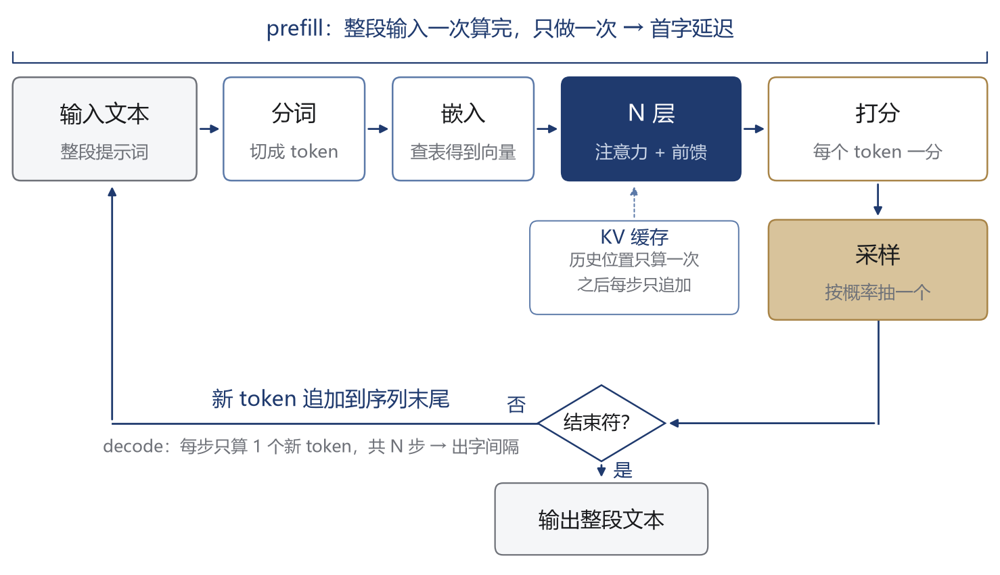

## 一次生成的全过程

凌晨一点，你在输入框里敲下一行字：“帮我把这段话改得更客气一些，但别太生硬。”按下回车。

光标闪了一下，屏幕空白了半秒，然后文字开始一个一个出现，速度跟你朗读差不多。中途它停了一下，像是在斟酌，接着继续。整段话写完，用了不到十秒。

那半秒里没有人在看你的句子。机房里没有人拿起你的文字读一遍，也没有一个程序在“理解”你想表达什么。有的只是一串固定顺序的计算，原料是你的文字，成品是下一个字。

### 按下回车的那一秒

你的请求先离开这台机器：文字被装进一个结构化请求，带上模型的名字和几个参数，送到机房；如果同时有很多人在用，还要在队列里等一会儿。

轮到你的时候，真正的工作才开始。你的文字会被切成一段一段的碎片，每个碎片换成一个编号，每个编号换成一组数字，这组数字往上传几十层，最后在十万个候选里算出谁更合适，抽一个出来接在后面。这个字接上去之后，整段文字变长了，于是从头再来一遍，产出下一个字。

所以“生成一段话”不是一次计算，而是几十次同样的计算首尾相接。每一次只产出一个 token，产出之后立刻回到起点重新走一遍。理解大模型，很大程度上就是理解这个循环里每一步在做什么，以及哪些步骤可以省、哪些省不掉。

### 文字先被切成 token

模型不认识汉字，也不认识字母。它认识的只有整数编号，所以第一步是把文字翻译成编号。

这件事由分词器完成，它和模型是两样东西。分词器是一段规则固定的程序，训练开始前就定好，之后不再改动。它的做法是反复合并：从单个字符出发，统计语料里哪两个相邻片段最常一起出现，合成一个新片段，再在新区间上重复。这个过程做几万次，得到一个十万量级的词表。

合并的结果很有意思。频率高的片段被合成整块，频率低的仍是碎片。英文里 the、and、ing 各占一个 token，unbelievable 会被拆成 un、believ、able 三段。中文里“人工智能”可能整块保留，一个生僻字则可能被拆成两三个字节级的碎片。多数分词器还把空格算进后一个词，“ the”和“the”是两个不同的 token，所以在提示词里多加一个空格，模型的反应会微妙地变化。

数字是最反直觉的地方。2024 这样的四位数，通常被切成“20”和“24”；再长一点的数字会被切成三位一组。所以模型看“1234”的时候，看到的不是一千二百三十四，而是两块碎片。它做算术容易在进位的地方出错，根源就在这里：它没有“位”这个概念，只有碎片。

词表大小可以直接查：主流模型公开的分词器配置文件里，条目数是几万到二十万之间的一个整数，十万量级这个说法就是这么来的。分词器一旦确定，同一个意思用不同语言写的成本差异也就确定了。中文一个汉字通常落在一到两个 token，同样的意思用英文写，token 数往往少一些。这就是为什么按 token 计费时，中文请求常常比英文贵。

切完之后，你的句子变成了一串整数。开头那句“帮我把这段话改得更客气一些，但别太生硬”，二十多个字，大约二十六个 token：常见的词整块保留，比如“客气”“一些”，而“生硬”这种不大常用的词可能被拆成两半。一段八百字的中文，大约一千多个 token，估算方法就是一个汉字按一到两个算。这个数字决定了后面所有的账：显存、延迟、价格。

### 每个 token 变成一个坐标

拿到编号之后，模型去查一张表。这张表有十万行，每行几千个数，行号就是 token 的编号。查出来的这组数，叫这个词的向量表示，或者嵌入。

为什么要用几千个数，而不是一个编号？因为编号只能表示“是哪个词”，表示不了“这个词怎么用”。几千个数相当于几千个可以调的旋钮：有的管“是不是名词”，有的管“褒义还是贬义”。旋钮的名字没人指定，是训练时自己形成的。

这组数不是人写的，是训练出来的。训练结束后，意思相近的词坐标也相近：猫、狗、宠物挤在一起，星期几的几个词排成一小簇。

一个词只有一个坐标，麻烦就来了。英文的 bank 既是河岸也是银行，中文的“打”既是击打也是打车。一个坐标装不下这么多意思，模型必须靠上下文来区分，而这件事在后面那几十层里做。

还有一件事要补上：光有编号不够，还得知道先后。“狗咬人”和“人咬狗”用的是同一批 token，顺序不同，意思相反。所以每个位置还会混入一个随位置变化的标记，效果是给每个位置盖一个“第几个”的戳。

到这里，输入变成了一串向量：长度等于 token 数，每个位置几千个数。接下来这串东西要往上传。

### 几十层：每个词都在回头看

模型的主体是几十层相同的结构叠在一起。常见是三十到一百层，具体数字在模型的配置文件里写着，不需要猜。每一层做两件事，一件叫注意力，一件叫前馈。

注意力解决的是“这个词该参考谁”。每个位置会算出三样东西：一个“我在找什么”，一个“我能被什么找到”，一个“我携带什么信息”。第一样拿去和前面每个位置的第二样比对，比得越合，说明那个位置越相关，于是从那个位置取走更多第三样。说白了，每个词都在向前面的所有词取证，取证的多少由相关性决定。

举个具体的句子：“小明把书递给小刚，因为他要考试了。”这个“他”指谁？模型在处理“他”这个位置时，会拿它的“我在找什么”去和前面每个位置比对，发现“小刚”和“考试”两处的匹配度更高，于是主要从小刚那里取信息。前面的层多看相邻词和语法搭配，中间的层多看指代，后面的层才处理“谁对谁做了什么”。这种分层不是设计出来的，是训练中自己长出来的。

注意力有一个硬性限制：只能看左边。训练时整句话一次性喂进去，第 t 个位置本来能看到右边，但那等于考试时把答案摆在桌上，所以把右边位置的分数设成负无穷，归一化后权重精确等于零。这叫因果遮罩，效果是每个位置看到的世界只到它自己为止。

这套取证会并行做几十遍，叫多头：有的头只盯前一个词，有的头找动词和它的宾语，有的头在人名之间来回看。分工是训练出来的。

注意力之后是前馈：每个位置单独过一个小网络，先变宽再变窄，只加工自己刚收集到的信息。一种比较被接受的理解是，注意力负责搬运汇总，前馈负责把汇总结果对应到具体的模式上。

每做完这两件事，输出会加回到输入上，这叫残差，作用像在草稿上批注而不是每层重写一张纸。层与层之间还有归一化，把数值拉回稳定范围。这两样不产生智能，但没有它们，几十层就叠不起来。

走完最后一层，每个位置都有一个向量。要预测下一个词，只需要最后一个位置的向量，因为它是唯一“看完了全部前文”的位置。

### 十万个分数，一次抽签

最后一个位置的向量，还要再换一次：乘上输出那张表，得到十万个分数，词表里每个词一个。

这些分数叫 logits，有正有负，本身没有意义，只有相对大小有意义。分数高，表示在这个上下文里这个 token 更搭。

分数要变成概率，中间过一道 softmax：先把每个分数取指数，让差距被放大；再按总和归一，使它们加起来等于一。放大的效果很关键，原来只领先一点点的候选，变成概率上领先很多。模型有时候显得“斩钉截铁”，不是因为证据强，而是因为这一步把微小的领先放大了。

到这里，模型的一次前向计算就结束了。它的全部产出是十万个数构成的一个分布，它没有“选”任何东西，只是给出每个候选的权重。

选，是下一步的事。系统按这个分布抽一次签：权重大的更容易被抽中，但权重小的也有机会。如果永远取最大的那个，输出会极其呆板，同一句话永远接同一个词。抽样带来多样性，也带来不确定性，同一个问题两次得到两个答案，根源就在这一次抽签。

抽签之前通常还有两个旋钮，温度和截断，前者管随机的幅度，后者砍掉长尾，第 1 章已经说过。

抽出来的是一个 token 编号。这个编号被送回分词器，翻成文字，接在屏幕上的句子上。然后整段文字，包括刚加上的这个字，重新作为输入，走一遍刚才的全过程。

### 第一个字为什么慢，后面的为什么快

用秒表量会发现一个规律：第一字出来得慢，后面越出越快。原因是两个阶段的计算方式完全不同。你输入的整段文字一次性送进模型，所有位置同时计算，因为注意力只依赖左边的位置，而这些位置都已经存在。这一整批计算可以并行铺开，把显卡的计算单元喂满。这一步叫预填充，输入越长它越久，但摊到每个字上其实很便宜。

生成第二个 token 时，情况变了：前面那些位置的计算结果一点都没变。它们的向量只依赖左边的内容，而左边已经固定。既然没变，就不必重算，存下来后面直接查。

存下来的东西叫 KV 缓存，也就是每个位置在每一层算出的“我能被什么找到”和“我携带的信息”。打个比方：一屋子人开会，第一次每个人做完自我介绍，把要点写在白板上；后面每来一个新话题，只带着问题去白板上查，不必让所有人重新自我介绍一遍。

有了缓存，解码每步只处理新来的那一个 token。但每步都要把整个模型的参数从显存里读一遍，几百亿到上千亿个数，算出来的只是一个 token。所以瓶颈不在算力，在搬运速度。同样的模型，换一张带宽更高的卡，出字明显变快；换一张算力更强、带宽没提升的卡，出字几乎没变化。这两件事的账，第 16 章会一笔一笔算。

### 算一遍：一段回答要等多久

把刚才两段拼起来算一次完整的时间。假设输入一千二百 token，预填充每 token 约 0.13 毫秒，首字延迟就是 1200 × 0.13 ≈ 0.16 秒——这正是你按下回车后看到的那段空白。

接着解码。八卡部署的实测水平大致是每秒四十个 token，也就是每个 25 毫秒。中文三百字大约四百五十个 token，450 × 25 毫秒 ≈ 11.3 秒。加上首字，从回车到最后一个字出现，约 11.5 秒。

把这个数字放到人的尺度上看：中文阅读速度大致每分钟三百字，读完这三百字要一分钟。也就是说，你等它写完的时间，只有你读它所需时间的五分之一。这就是“流式输出”的价值：不是让总时间变短，而是把等待切成很多小段，你在第一秒就能开始读，边读边等。

反过来说，长度是线性收费的。同一段话，让它写成六百字，时间翻倍；写成一千二百字，你在屏幕前坐半分钟。这也是为什么“请用三句话回答”不只是省钱，它真的会让交互变快。

还有一处不对称：输入变长只影响首字，不影响出字速度。你把一份两万字的文档塞进去，首字可能等三秒，但后面每个字还是一样快。所以“读长文档”这件事的体验瓶颈在开头，而“写长回答”的瓶颈在整个过程。

### 它在哪里停下

生成不会自己“想完”。停下来，是因为某个条件被触发。

最常见的是模型自己给出一个特殊符号。训练语料里每段文本的结尾都有一个结束标记，模型见得多了，学会在该结束的地方给这个标记高分。这个标记不会显示在屏幕上，它一出现，循环就终止。这是学出来的行为，不是硬编码的规则。

还有几种外部条件。接口通常有一个最大生成长度，到点直接截断，可能出现半句话。也可以设置停止词，程序匹配到某个字符串就切断，这时候模型并不知道自己被切了。上下文窗口满了也会停。

| 停止方式 | 谁决定 | 典型症状 |
|---|---|---|
| 结束符 | 模型自己 | 自然收尾 |
| 达到长度上限 | 接口参数 | 半句话、括号不闭合 |
| 命中停止词 | 调用方 | 突然断在某个词上 |
| 窗口满 | 上下文长度 | 输入被截、回答变短 |

这张表值得记住，因为四类“回答不正常”在用户看来长得差不多，排查方向却完全不同。看到话说到一半就停，先看长度上限是不是设得太小；看到格式烂尾，往往是长度到了；看到回答突然变短、还答非所问，可能是上下文被截断了。

知道机制，就能解释几种常见故障。

一种是停不下来。它每产出一个 token，这个 token 就变成下一轮的前文；前文越来越像它自己刚写的东西，于是它越来越确信“接下来还是这个”。走偏了很难自己拐回来。

还有一种更根本的限制：它不会回头改。已经抽出来的 token 立刻变成下一轮的前文，覆水难收。所以前面某个判断错了，后面会一路顺着错下去，而且越写越自信。这也是为什么让它先列提纲再展开有用，提纲是它给自己造的前文约束，把后面的自由度收窄了。

到这里，一次生成的链条就走完了：切分、查表、叠层、打分、抽样、拼接，再从头来一遍。每一步都由同一批数字决定，这批数字叫权重，几百亿到上万亿个。

### 那十一秒里，机器在忙什么

把上一节的时间拆开，会看到一件不太好意思的事。

假设模型 70B、按 16 位存，权重 140 GB，切到八张卡上每张 17.5 GB。一张卡的带宽是 3.35 TB/s，一步读一遍是 17.5 除以 3350，约 5.2 毫秒。450 个 token 的理论下限就是 450 乘 5.2，2.3 秒。

实际用掉 11.3 秒，效率约两成。剩下的八成花在三个地方：卡与卡之间每层都要同步一次，80 层乘 450 步是三万六千次集合通信；同一批里别人的请求在抢同一份带宽；上下游的排队、网络往返、前端渲染，每一项几十毫秒，加起来也不是零头。

这条账能解释两件日常事。同一家模型换个产品可能快一倍，不是模型换了，是批大小和调度策略换了。更实用的一条：想让交互变快，缩短输出比升级硬件有效。少写一百字直接省 2.5 秒；而换一张带宽翻倍的卡，只把 5.2 毫秒变成 2.6 毫秒，还被通信吃掉大半。

所以“这个模型很快”这句话，八成说的不是模型，是部署。

反过来说，压测一个模型时，用一批长度不同的输入各跑一次，比只跑一个平均值有用得多。长度 500 和长度 8000 的请求，首字差十几倍，混在一起取平均，得到的数字谁也不像。

还有一个校准值：首字 0.2 秒、出字每秒六十个，是当前中档部署的常见水平。如果两个数都达标而用户仍嫌慢，问题多半不在模型这一侧，在前端或网络。

### 四个常见的误解

第一个误解是“它一次就把整段写好了，只是慢慢显示出来”。不是。它在写第一个字的时候，后面那些字还不存在；改一个字，后面全变。所以对话中途按停止再继续，结果和一次写完不一样。

第二个误解是“温度调到零，结果就一定固定”。多数情况下确实稳定，但同一批输入在不同显卡、不同批大小下可能因为浮点求和顺序不同而产生微小差异，偶尔会在两个几乎持平的候选之间跳到另一边，然后一路分化。要求完全可复现，得靠固定的部署环境。

第三个误解是“首字慢是网络慢”。网络往返通常几十毫秒，而长输入的首字延迟可以到几秒，因为那一整段文字要在显卡上跑一遍。把两万字的文档换成一个短问题，如果首字立刻变快，就说明瓶颈在预填充，不在网络。

第四个误解是“设了最大长度，它就会在长度内好好收尾”。不会。到点就砍，模型不知道自己要撞线了。要它收尾，得在提示里写清“用三句话”“不超过一百字”，让它自己把长度控制住。

::: {.keypoint}
**记住这三件事**

一、生成一段话是几百次小计算首尾相接，每次只产出下一个 token，然后整段重新过一遍。

二、第一个字慢、后面快，是因为前一段能并行算，后一段要一个字一个字地出，而且每步都要把权重读一遍。

三、它不会回头改已经写出的字，所以前面的错会被后面的内容接着说下去。
:::

这些环节没有一个是“天生的”。下一章要回答的是另一件事：为什么这么简单的机制，会长出看起来像“懂了”的行为。
