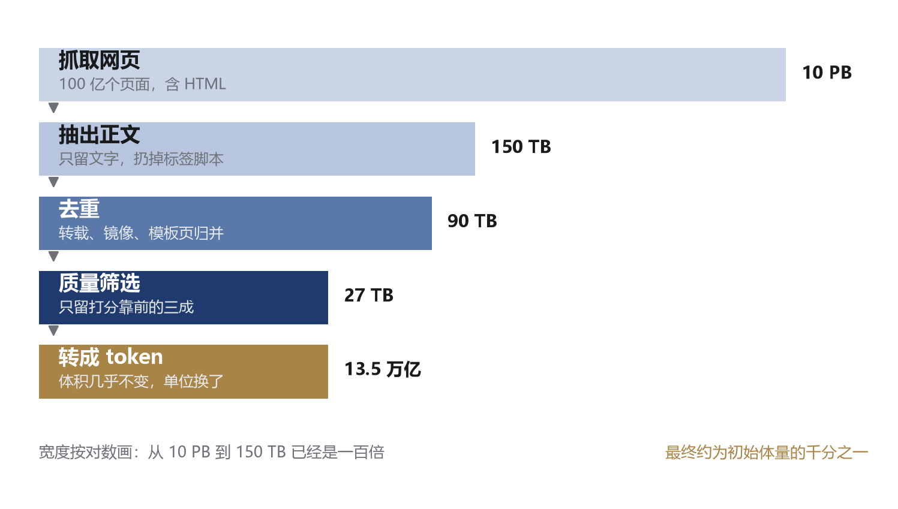

## 它读过什么

一家做工业阀门的外贸公司想试试大模型写产品说明。他们挑了三个型号，让模型按欧洲客户的习惯写英文描述，要求提到材质、压力等级、适用介质。

前两个型号写得不错，第三个出了问题：模型写“适用于饮用水系统”，而这家公司的这个型号明确不能用于饮用水——密封材料不达标。业务员一看就笑了，说这东西要是发出去，客户投诉都算轻的。

这个错误不是随机的。同类阀门在欧洲确实大量用于饮用水，语料里这样的搭配成千上万，而“这一款不能用”这条信息只存在于公司内部的技术手册里，从来没有上过网。

这一章讲的就是这件事：模型读过什么，决定了它在哪儿靠谱、在哪儿会想当然。它的知识不是普查来的，是从能被抓到的文本里长出来的，而这份文本有很多洞。

### 一份拼起来的语料

预训练的原料是文本，来源大致可以分成几类。

最大的一块是网页。有一类公开项目专门抓取全网页面，每月新增几十亿个，累积下来是 PB 量级的原始数据。一个 PB 大致相当于几十万张光盘，估算方法是网页总数乘以平均页面大小。这些页面里有新闻、博客、论坛、产品页、教程、政府公告，也有大量垃圾。

第二块是书。公开的电子书库、版权过期的经典、扫描后 OCR 出来的旧书。书提供长程的连贯叙述，一个人物可以从第 3 页活到第 300 页，这种连贯性在网页里很少见。

第三块是代码。开源仓库里有过亿个项目，从一行脚本到几十万行的系统都有。代码的价值不只是让模型会写代码，还在于它提供了严格的层次结构和逻辑关系：括号必须配对，变量必须先定义。

第四块是论文与百科。它们密度高、格式规整、术语准确，但量相对小。百科还有一个特殊价值：它是少数被人反复校对过的文本。

第五块是问答社区和字幕。前者提供口语化的提问方式和简短回答，后者提供对话的节奏。

这些来源的性质差别很大。网页多但脏，书少但连贯，代码结构强但和自然语言不同，问答口语化但常有错。把它们按比例混在一起，是训练前最重要的决定之一。

### 洗一遍要过几道工序

原始网页有多脏，只有清洗过的人知道。导航栏、广告位、评论区、版权声明混在正文里，机器翻译的低质页面、批量生成的垃圾站、同一个模板套出来的几十万个页面也在里面。直接把这种东西喂进去，模型学到的是模板和噪声。

所以数据要过好几道工序。

先是抽正文，把网页里真正的段落剥出来，扔掉导航和页脚。接着做语言识别，分错语种的直接丢弃。然后是规则过滤：太短的不要，符号比例异常高的不要，重复行太多的不要，包含大量乱码的不要。这一步的规则看起来很土，但它拦掉的垃圾比任何精巧的方法都多。

然后是去重。同一篇新闻会被几十个站点转载，同一份文档会在不同年份被抓到好几次。重复不会让模型学得更好，只会让它把这几段背下来，还会让配比失真——你以为中文占了一定份额，其实里面大半是同一篇稿子。做法是给每篇文档算一个指纹，近似相同的归为一组，只留一份。

质量筛选更进一层。有人会训练一个小分类器，用百科、书籍、获奖文章当正例，用垃圾站当反例，让它学会给“像正经文章”的文档打高分，再按分数排序，只留头部。这一步很有效，也很危险：分类器偏好某一种文风，留下的数据就会带上这种偏好。模型的语气偏教科书、偏新闻稿，很多时候是从这里来的。

还有一道容易被忽视的工序：去污染。评测题如果混进训练数据，模型等于提前做过这套卷子，分数会虚高。做得好不好，直接影响你对一个模型能力的判断。

最后一步是配比。代码、中文、数学、多语言各占多少，是一份配方。配方改了，模型的偏科方向就变了：代码比例高，逻辑和结构感强，但说话容易干；中文比例低，中文表达就会生硬；数学数据少，推理链条就搭不起来。配比没有通用最优解，只有针对目标的取舍。

图里的五根横条用的是对数尺，否则后面的条根本看不见。这也正是这一节最重要的一件事：清洗不是“微调”，它是把绝大部分原料扔掉。

### 算一遍：一 PB 网页剩下多少 token

把上面的工序串成一条链，数字会很坑。

假设这一轮拓了一百亿个页面，含 HTML 平均一百 KB，原始体量就是 10 PB。抽完正文，剩下的纯文本大约只有原始体量的百分之一点五，也就是 150 TB；中文在其中占百分之几，大约 7.5 TB。

去重会再砍掉四成——转载、镜像、模板页太多了，剩下 90 TB。质量筛选只留头部的三成，剩 27 TB。

27 TB 文本换成 token：1 GB 中文大约三亿三千万字，按一字一点五 token 算，是五亿 token；27 TB 就是 27000 GB 乘五亿，约十三万亿 token。

再换成书：一本三十万字的书约四十五万 token，十三万亿除以四十五万，大约三亿本。

这条链有两个容易被忽略的推论。第一，任何一道工序拧紧了，后面的量就跟着塌：质量筛从三成提到一成，语料就从十三万亿降到四万多亿，训练时要么多跑几轮，要么换个更小的模型。第二，配比是在最后这一步做的，而各语种在清洗过程中的损耗率不一样，所以“网页里中文占一成”不等于“语料里中文占一成”。

### 到底有多少字

筛完之后，剩下的量级是几万亿到几十万亿个 token。这个数字可以在各家公开的技术报告里查到，不同版本差别不小。

换成书来感受一下：一本三十万字的书大约几十万 token，几万亿 token 就是上亿本书。一个人一辈子读几千本，这个差距不是靠勤奋能补的。

但“读得多”和“读得深”是两件事。上亿本书里，绝大多数内容模型只过了一遍，而且过的时候是在做填空题，不是在做精读。真正被反复见到、被压得最紧的，是那些在语料里出现几百万次的说法和事实。所以它对大众常识很熟，对冷门专业的细节很生。

有一个和直觉相反的现象：同一批数据反复训练很多轮，过了某个点效果反而变差。模型开始死记，泛化能力下降。所以现在的做法更倾向于“见更多不同的数据，每份只过一遍”，而不是把一份好书读十遍。这有点像人：读一百本不同的书，比把一本背下来更有用。

### 被删掉的那部分

前面的工序都在决定“留什么”，还有一道工序在决定“删什么”。

成人内容、暴力细节、仇恨言论、个人隐私信息、明显的盗版内容，通常会被单独过滤。理由很实在：法律风险、产品形象、下游应用的合规要求。多数团队不会把这一步写得很细，但它确实发生在清洗阶段，而不是等到模型训完再去“纠正”。

删除会留下两种痕迹。

一种是知识上的空洞。模型对某些正当话题也会变得生疏：性教育、创伤处理、成瘾、家庭暴力、某些疾病的通俗说法。这些内容夹在被删的材料里，一起被切掉了。你问它一个本该正常回答的医学问题，它答得含糊，一部分原因在这里，不在对齐阶段。

另一种是行为上的过敏。它知道这类话题存在（语料里到处有指涉），但对细节缺少正常的语料，于是遇到相关提问时，它只能靠“小心处理”这类通用套路应付，表现出来就是生硬、绕圈子、或者干脆不答。

还有一种更隐蔽的后果：删除让语料对世界的描述变得更“干净”，而真实世界不是。模型因此容易低估某些现象的普遍程度，也容易在涉及这些现象的判断上给出过于乐观或者过于天真的答案。这一点在风控、审核、未成年人保护这类场景里要特别注意。

### 截止日期是怎么来的

你在某个时间点问它“现在最新的稳定版本是多少”，它给一个版本号，语气笃定，可能是两年前的。

原因是它的参数是训练截止那天的快照。一次训练从数据采集到模型上线要几个月：抓数据、洗数据、训练、评测、调优、部署，每一段都拖着时间。所以“知识截止日期”通常比模型发布日早半年到一年，具体早多少，各家会在文档里写，也可能不写。

更麻烦的是它往往不知道自己不知道。训练时通常会给它注入一句“今天的日期是某年某月某日”，但这句话本身可能已经过时，而且它并不总是拿这句话去校正自己的回答。于是它会把两年前的版本号，用一个当下的语气说出来。

这一类错误在几种问题上最明显：版本号、价格、人事变动、政策条款、赛事结果、股价、汇率。共同点是“变化快”且“没有稳定规律可循”。

缓解的方式不是“再训一下”。往参数里塞新事实的效率极低，一次微调可能让模型记住一百条新知识，同时忘掉一批旧的判断。正确的做法是把新信息放进上下文：检索、搜索工具、数据库查询，任何一种能把外部最新信息拉进前文的手段都行。

算一笔小账。要把一千条新政策塞进模型，整理成问答对大约五万 token，微调三轮是十五万 token 的计算量，钱几乎可以忽略。但问题不在钱，在容量和遗忘：这一千条会和已有知识抢参数，微调之后模型可能在别的领域明显变差，而且你没法测出它忘了什么。同一个需求改成检索：把一千条切成两千个片段建索引，每次查询取三条，成本是每次多几百 token 的输入费。前者一次投入、不可控；后者每次付钱，但随时可改、可审计。

### 版权：一个还没有答案的问题

训练数据里的大部分内容是有版权的，而训练是一种使用。这是过去几年最激烈的法律争论之一。

争论的焦点是“合理使用”：在有些司法辖区，如果使用是转换性的、不替代原作市场，就可能被允许。几起大案在 2023 到 2025 年间走向了不同结果：有的诉讼被大部分驳回，只在一小部分请求上继续；有的以巨额和解收场，按作品计价；有的还在审。到今天没有一条通用规则，说“训练可以”或者“训练不可以”。

对使用模型的人来说，法律上的不确定性反而不那么重要，因为你能控制的是输出那一端。真正会出事的是模型吐出跟原作实质相似的内容：整段歌词、整章小说、某段开源代码但去掉了许可证声明、某位插画师标志性的构图。第 20 章会讲具体怎么防。

对行业来说，这场争论正在改变数据本身。越来越多的站点在协议里声明禁止抓取，越来越多的出版商在卖授权，也越来越多的团队在用“合成数据”补缺口：让一个强模型生成训练材料，再筛一遍。这条路能绕开一部分版权问题，但会带来新的问题：模型教模型，错误会被继承和放大。

### 数据里的洞

语料不是世界的抽样，而是“被写下来的东西”的抽样。这中间的偏差很大。

写的人不均衡。会上网、会写长文、会维护文档的人，本来就集中在某些地区、某些职业、某些年龄段。他们的关注点、用词、默认常识，都会成为模型的默认常识。

语言的份额不均衡。英文内容在公开网页里占比极高，中文、阿拉伯语、非洲各语言的份额小得多。结果是同一个模型，英文任务上的表现常常明显好于其他语言，而这不是因为英文更“适合”大模型，只是数据多。

被写下来的东西也不均衡。日常经验里最重要的一部分——怎么跟人打交道、怎么判断一件事靠不靠谱、车间里的手感——很少被写成文字。写得最多的是新闻、教程、争论和营销文案。所以模型对“如何写一段宣传语”很在行，对“这批货到底该不该发”没有判断力。

时间上也不均衡。网页语料里越靠近采集日的内容越多，十年前的页面要么已经下线，要么权重很低。所以它对近几年的术语很熟，对更早的事情往往是从别人的转述里学来的，而转述会走形。

还有一层：企业内部的东西基本不在里面。流程文档、技术手册、工单记录、客户名单，都关在防火墙后面。这就是开头那家阀门公司遇到的洞。填这个洞的办法不是等下一代模型，而是把材料放到它眼前——检索、上传、接内部系统。

| 工序 | 丢掉多少 | 副作用 |
|---|---|---|
| 抽正文 | 体积的九成以上 | 表格、公式容易丢 |
| 去重 | 三到五成 | 小众但真实的表述被归并 |
| 质量筛 | 剩下的六七成 | 文风趋同，口语变少 |
| 安全过滤 | 少量但集中 | 正当的敏感话题变生硬 |

这张表值得看一眼第三列：每一道工序都有代价，而这些代价会以你看得见的方式留在模型身上——它写不出活泼的口语，它对某些医学问题答得含糊，它把同一件事说得像新闻稿。这些都不是“模型不够大”，是数据被剪过的形状。

### 四个常见的误解

第一个误解是“数据当然是越多越好”。多而脏不如少而净。同一批算力下，把质量筛拧紧一点、把重复数据去掉，往往比再多抓一倍网页有效。现在的公开讨论里，“数据枯竭”这个说法指的是高质量文本快用完了，不是网页快没了。

第二个误解是“清洗就是删广告”。删广告只是第一步。真正花时间的是去重、质量打分、去污染和三十二种边角情况的规则——比如一个页面里正文只有两行、剩下全是推荐位，算不算有效样本。

第三个误解是“它把整个互联网读过了”。它读的是被拓到、被抽出来、被筛完的那一小部分，而且很多站点明确禁止拓取。你搜不到的东西，它基本也没见过。

第四个误解是“去重只是为了省存储”。去重的主要目的是防止背词：同一段文本出现一百次，模型会把这段字面记住，而不是学会它背后的规律，还会让配比失真。省存储只是顺手的好处。

::: {.keypoint}
**记住这三件事**

一、它的知识来自能被抓到的公开文本，网页最多、书最少但最连贯，企业内部的东西基本不在里面。

二、清洗、去重、质量筛选和配比，决定了它偏科的方向；这些工序的副作用会留在模型的语气和习惯里。

三、知识有一个截止日期，比模型发布日早半年到一年；时间敏感的问题，先查再答。
:::

下一章看这些数据是怎么被用掉的：一场持续几个月的训练，几千张卡同时转，中间出一次错就得回滚重来。
