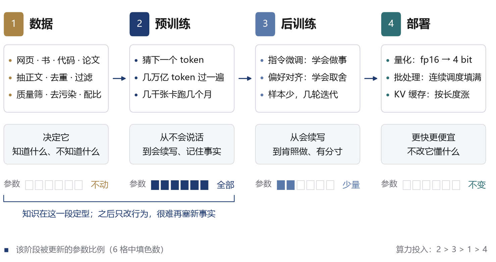

## 一场几千张卡的马拉松

第 11 天凌晨，监控室里有人注意到损失曲线抖了一下，然后开始往上走。不是常见的那种小噪声，是一路爬升，二十多分钟后仍然没有回落。

值班的人先做了两件事：把当前状态存下来，然后回滚到第 9 天晚上的检查点。跳过出问题的那一批数据，把学习率调低一点，重新往前跑。

两天半的计算白费了。几千张卡在那两天里烧掉的电和机时，不会有人退给你。

这就是预训练的样子。它不是“把数据喂进去，等结果出来”，而是一场持续几个月、随时可能被打断的长跑，跑的人大部分时间在处理异常。

### 三个月的日程

先看时间怎么分配。一个模型从零到能上线，预训练只占其中一段，但这一段最长、最贵。

数据准备通常要几个月，和训练并行进行。抓取、清洗、去重、配比，每一步都要产出可以复现的版本。这部分不显眼，但它决定了训练能不能重跑：如果数据版本没锁死，出了问题你连“同样的输入再跑一遍”都做不到。

预训练本身，按公开报告的常见量级是几周到几个月。用几千张卡，训练几万亿个 token。具体多久取决于卡的数量、模型大小和数据量，也要看中途出多少次故障。

预训练之后是后训练，通常几天到几周。再往后是评测、调优、部署，又是一些星期。

真正占大头的成本在预训练这一段。一张高端加速卡每小时的租金是几美元，几千张卡乘几个月，加上电费、机房、网络、人力，总数在几千万美元的量级。失败的尝试也要付钱，所以真实投入往往比公开数字更高。

### 几千张卡怎么一起干活

一张卡装不下一个大模型，也跑不完这么多数据。所以要把工作切开。切法有三种，通常会同时用。

一种是把数据切开：每张卡拿不同的批次，各算各的，算完之后把各自的调整量汇总。这叫数据并行。汇总那一步要通信，卡越多，通信占比越高，效率越低。

一种是把模型切开：不同的层放在不同的卡上，像流水线一样，第一张卡算完交给第二张。这叫流水线并行。它的麻烦是流水线有气泡：开始和结束的时候，总有一些卡在等。

一种是把一层内部切开：同一大块乘加运算拆到多张卡上算，再把结果拼起来。这叫张量并行。它要求卡之间通信极快，所以通常只在同一台机器内部做。

三种切法叠在一起，几千张卡才能连成一个“大计算机”。这时候真正的敌人不是数学，是工程：一根线缆松了、一张卡降频了、一个进程卡住了，整个任务都可能停摆。

### 每一步在做什么

抛开规模，每一步的逻辑其实很朴素。

把清洗后的语料拼成一条极长的 token 流，从中随机截取一段，比如几千个 token，送进模型。模型对这一段里的每个位置都给出一个预测：第一万个位置猜第一万零一个，第一万零一个位置猜第一万零二个。所以一段几千 token 的文本，等于几千道填空题同时做。每道题都有标准答案，就是原文里真实的下一个 token。

模型给出的十万个分数，和标准答案一比，就知道错得有多远。这个“差多远”被换算成一个数，叫损失。训练程序根据这个数，把模型里每一个参数往“让损失小一点”的方向挪一小步。一步挪多少，由一个叫学习率的设置决定：步子太大容易跨过好位置，步子太小则训不完。

一次处理几千段这样的文本，叫一个批次。一个批次算完，参数更新一次。这样的更新要做几十万到几百万次。

值得一提的是，损失不是一次算一个位置。几千个 token 的序列，每个位置都在贡献误差，所以一次前向就产生几千个训练信号。这是这套机制效率高的原因：同一批计算，被用到了极致。

### 参数和数据要配着来

有一个问题在预训练开始前必须回答：给定一笔算力预算，是训一个更大的模型，还是给同样的模型喂更多数据？

直觉上应该堆参数：参数越多越聪明。但算过账之后会发现不是这么简单。参数多，每一步计算更贵；数据多，步数更多。同一个预算下，两者是此消彼长的关系。

经验上的结论是：参数和数据要大致匹配，比例大约在“每个参数配二十个 token”这个量级。参数远超数据，模型容量浪费，训出来像一个记不住东西的大脑袋；数据远超参数，模型见得多但装不下，能力提前饱和。

这条经验改过行业做法。在它被普遍接受之前，大家倾向于把模型做得极大、数据给得相对少；之后几年的主流做法是模型小一些、数据多得多。同样的预算，后者的效果通常更好，而且推理时更便宜，因为参数少了。

这个比例不是物理常数，它随数据质量、训练目标、以及你更在意训练成本还是推理成本而变。但它说明一件事：预训练不是“越大越好”，是一道配比题。

### 训练过程中能看到什么

跑起来之后，团队靠几条曲线判断一切是否正常。

损失曲线是最主要的。健康的曲线一路缓慢下降，斜率逐渐变缓。抖一两下正常，抖完不回来就要查。曲线突然变成一条水平线，通常意味着学习率出了问题或者数据管道断了。

更新幅度是另一条。它是“参数这一步挪多远”的读数，正常情况下稳定在一个范围。如果突然变大很多，说明某批数据把模型推得太狠，接下来很可能发散。

评测分数要定期跑。损失降不等于能力涨：有时候损失在降，评测却在退，说明模型在拟合训练数据的表达方式，而不是学到你要的能力。这种情况在大规模训练里并不罕见，尤其当数据里有大量重复模板时。

吞吐是第四条。每秒处理多少 token，应该稳定。掉下去通常是通信或者某张卡出了问题。

这四条曲线放在一起看，才能判断“这次训练是不是在往对的方向走”。单看损失，容易被骗。

### 四件最容易出事的事

跑了几个月，出事是常态。常见的故障有四类。

第一类是损失尖峰。曲线本来一路缓慢下降，突然跳起来。原因可能是某批数据有问题（比如一大段乱码、重复了上万次的模板），也可能是数值算飞了（某些中间结果变得极大或极小）。处理办法是回滚到之前保存的检查点，跳过那批数据，调低学习率再往前走。如果尖峰之后能自己恢复，也有人选择继续跑，赌它能缓过来。

第二类是硬件。几千张卡同时跑几个月，每天都有坏的可能。内存出错、温度过高降频、网络抖动。最麻烦的是“静默错误”：卡没报错，但算出来的数是错的，你看不出来，只有损失曲线变得古怪时才可能察觉。所以大规模训练要定期做自检，重算一小段已知结果，比对是否一致。

第三类是通信。几千张卡要不停地交换信息，任何一处拥塞都会让所有卡一起等。表现出来是吞吐突然下降，而损失曲线看不出问题。这类故障最难定位，因为它不在计算里，在连接里。

第四类是人。配置写错一个参数、数据版本用错一个、恢复训练时漏掉一个状态，都可能让前面几周的工作变成一次“看起来正常但结果不对”的训练。所以严肃的团队会把整个流程脚本化，任何手动步骤都要留记录。

### 为什么失败往往要重跑

因为训练是一个不可逆的过程。

参数是一步一步挪出来的，每一步都依赖上一步的状态。如果第 11 天的某一步算错了，这个错误已经进了参数，后面所有的计算都建立在它之上。你不能“把错误抠出来”，只能退回到错误发生之前的状态，也就是检查点。

检查点就是定期保存的完整快照：参数、优化器状态、数据读取位置、随机数状态。保存一次要写几百 GB 到几 TB，耗时几分钟，这段时间计算是停的。所以保存频率是个权衡：存得勤，浪费算力；存得疏，回滚时损失大。常见做法是几小时一次。

有些故障可以“跳过”，有些不能。数据脏导致的尖峰，跳过那批数据通常有效。数值不稳定导致的发散，调低学习率可能救回来。但如果模型已经训歪了（比如损失降得很低但评测全面变差），唯一的办法是从更早的检查点重来，或者改配置重新开一次。

这也解释了为什么预训练团队里，最有经验的往往不是调模型的人，而是运维这套流水线的人。他们的工作是把“出事”变成“可恢复”。

### 为什么敢花这笔钱

几千万美元投进去，赌的是一个不确定的结果。敢赌，是因为有一条规律撑着。

这条规律说：模型的损失随着参数、数据、算力的增加平滑下降，而且这种下降可以从小规模实验外推。先花小钱训一批小模型，画出曲线，就能估计大模型能达到什么水平。

它的具体形式是一条幂律：损失随参数量、数据量、计算量各自按负幂次下降，常数因子靠小实验拟合。这条规律的细节这里不展开，记住它能外推就够了。没有它，没人敢签那张支票。

这条规律还带来一个实践上的变化：预训练变成了一件可以排期、可以写进预算的事。给定预算，能估出该训多大的模型、用多少数据、跑多久；给定目标，能估出大概要花多少钱。在这之前，训练大模型更像赌博；在这之后，它成了一项工程。

但规律只保证“平均情况下”的走势。具体到一次训练，能不能跑到那个水平，还要看数据质量、超参数、以及中途出多少次事故。同一个预算，两个团队做出来的模型可以差出很多，差别大半在这些不性感的地方。

### 训练结束时得到什么

跑完最后一个批次，你得到一个基座模型。

它会续写。给它一段新闻，它接着写新闻；给它一段代码，它接着写代码；给它一个问题，它可能接着写更多问题，因为网页上的问答列表就是那个样子。

它不知道什么时候该停。你给的一段文本可能在句子中间被截断，它就顺着往下写。它不会按指令行事，因为它没有被教过“指令”和“回答”是两种不同的东西。它不会拒绝，因为它没有“该不该”的概念。它也不会说“我不知道”，因为在它的训练里，每个位置都有一个正确答案。

它知道的东西，在这个阶段基本定型。训练数据有采集截止时间，之后发生的事它不知道。后面两个阶段能改变它的说话方式和取舍倾向，但很难往它脑子里塞进大量新事实。

::: {.keypoint}
**记住这三件事**

一、预训练是一场几个月的长跑，几千张卡同时算，成本在几千万美元的量级，失败的部分也要付钱。

二、出错是常态，因为训练不可逆，只能定期存快照，出问题回滚到之前的状态重跑。

三、跑完之后你得到的是一个只会续写的基座模型，它博学但不好用，还需要两步改造。
:::

那两步改造，就是下一章的内容：怎么让它听话，以及怎么让它知道在几种都说得通的回答里，该挑哪一种。
