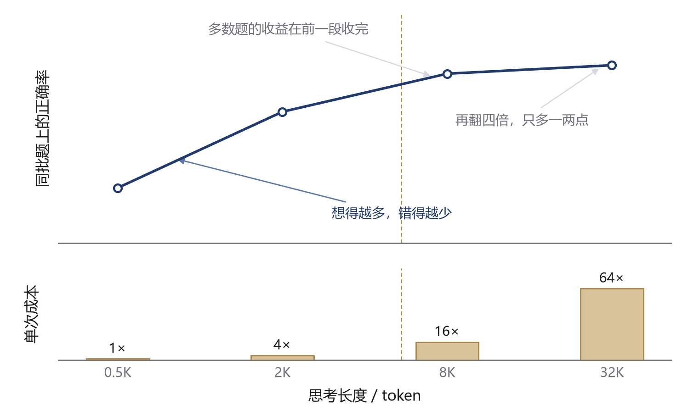

## 会思考的模型

同一道题，问两遍。

第一次：“一个班有 40 人，60% 是女生，女生里四分之一参加合唱团，合唱团有多少人？”它答“6 人”。

第二次，你加一句“先写计算过程，再给答案”。它写：女生 40 乘 0.6 等于 24 人，其中四分之一是 6 人。答案是 6 人。

两次答案一样，但你第二次才敢信。第一次它可能算对了，也可能猜对了，你分不清。而如果题目再绕一层，第一次的答案就常常是错的。

这一章讲的就是中间那段文字：为什么把步骤写出来会让它更准，为什么现在的模型开始自己写这段文字，以及为什么“多想一会儿”不是免费的。

### 一次计算装不下多步推理

第 2 章说过，模型的一次前向计算深度是固定的：几十层，每层做固定量的运算。给定一段前文，它在这么多层之内算出下一个 token 的分布。

这个结构擅长什么？擅长把已经见过无数遍的模式一次映射出来。看到“法国的首都是”，几十层足够把“巴黎”顶上来。看到“这段代码有一个未定义的变量”，几十层也够。

它不擅长什么？不擅长串联。要算四步代数，每一步的结果都得传给下一步；一次固定深度的计算里没有“传给下一步”这回事，它只能把四步压进一次映射里，而这次映射没有足够多的中间层可用。

让它把中间步骤写出来，情况就变了。写出的每一个 token 都要重新过一遍网络，前面算出的中间结果成了后面的输入。四步计算被摊到几百个 token 上，每一步都有一次完整的计算预算。这就是思维链有效的原因。不是因为“思考”这个动作有什么魔力，而是因为它把一次固定预算的计算，换成了按步骤累加的计算。

这个机制的推论很重要：步骤写得越细，它能算的题越难。同一个模型，要求“只给答案”和“写出完整推导”，正确率能差出一大截，在需要多步的题目上尤其明显。

代价同样明显：写步骤要输出 token，而输出是最贵的那一段。一道题原来 20 个 token 就答完，现在要 800 个，成本涨几十倍，等待时间也涨几十倍。

### 从“请你一步步想”到“它自己会想”

最早的做法是提示。加一句“让我们一步一步思考”，正确率就能明显上升。这句咒语之所以有效，是因为它在语料里常常出现在推导过程之前，模型顺着这个模式往下写，就写出了步骤。

这种做法有个明显的问题：模型写不写步骤、写多细，全靠提示。你不提，它就省；题目难，它也不会自己加长。

后来的做法是训练。用第 6 章讲的“可验证奖励”：给它一批有标准答案的题，让它生成多个解答，答对的那些强化。训练久了，模型自己发现了一件事：写步骤的解答更容易被判对。于是它开始自发地写步骤，而且遇到难题会写得更长。

这就是 2024 年之后那批“推理模型”的核心变化。它们不是换了架构，是在后训练里把“想久一点”变成了习惯。有的模型还会在给出答案前生成一大段内部推理，用户看到的是一个总结，看不到中间过程。

这个变化带来一个新的旋钮：想多久，是可以调的。产品上一般表现为“思考强度”或者“思考预算”，低档位快而便宜，高档位慢而准。

### 三种形态，三种取舍

“想”在工程上有几种不同的实现，对用户的影响完全不一样。

第一种是短步骤。让它在答案前面写三五句推导，几十到几百个 token。这种方式开销小、延迟低，用户也能看见过程，方便核对。多数“请分步回答”的场景属于这一类。

第二种是长推理。几千到几万个 token，中间会有反复检查、尝试不同路径、否定自己之前的想法。这类输出如果全给用户看，体验很差：一大段自我纠错，读起来像草稿。所以产品上通常只展示结论，或者展示一段压缩过的摘要。

第三种是把推理藏起来。模型内部生成一大段，对外只给结果。这样做的好处是界面干净，坏处是你失去了核对的抓手，只能选择信或者不信。有些产品会在需要时提供“展开思考过程”，但要注意，展开的可能是一段重写的叙述，不一定等于它内部真正走过的路径。

| 形态 | 典型长度 | 用户看到什么 | 适合什么 |
|---|---|---|---|
| 短步骤 | 几十到几百 token | 全部过程 | 讲题、审核、需要核对 |
| 长推理 | 几千到几万 token | 结论加摘要 | 难题、一次性任务 |
| 内部思考 | 不固定 | 只有结果 | 交互频繁、要求快 |

三种形态在能力上没有本质差别，差别在于把预算花在哪里，以及愿不愿意把过程暴露出来。选哪一种，取决于你的场景更怕“答错”还是更怕“等太久”和“看不懂”。

### 想得越久，是不是越准

大方向上是。但曲线不是直线。

把同一批题在不同思考长度下的正确率画出来，形状通常是：前一段陡升，中段变缓，后段几乎平。图里那条蓝线就是这个形状，横轴是思考长度，纵轴是正确率。

陡升的那一段，是因为模型在学“把题读完、把条件列全、别急着算”。很多错题不是不会，是漏了条件。变缓的那一段，是因为剩下的题真的难，多写几百字也补不上。几乎平的那一段，是因为它开始绕圈：反复检查同一步，或者把同一段话换个说法再写一遍。

而成本是一条直线。输出 token 数翻四倍，账单就翻四倍，等待时间也翻四倍。图下半部分的柱子是同一批题的单次成本，从最短到最长差了六十多倍。

等待时间可以换算得更具体。按每秒四十个 token 的出字速度，三千 token 的思考就是七十五秒。多数人在对话框里能忍的上限是十几秒，这意味着一千 token 以内必须收住。超过这个长度，产品就得改成“先给一句进度提示”或者“后台跑完再通知”，否则用户会在第三十秒关掉页面。

于是就有了另一种用法：同题多解。让它对一道题生成五遍，取出现最多的那个答案。代价是五倍的钱和五倍的时间，收益在难题上比较明显，因为五次独立走错同一个地方的概率低于一次。但它不是万能的：如果五次都在同一个错误前提上打转，投票只会把这个错答案选得更坚决。所以投票能消掉随机错误，消不掉系统性错误。

所以“多想”有一个明显的性价比拐点。多数题的收益在前一段就收完了，再往上加，钱花得比准确率涨得快得多。

### 想得多，也可能想歪

思考变长还有一个副作用：错误的自我强化。

模型写下的每一句话都会变成下一句的前文。如果它在第三步算错了一个数，后面的推导会基于这个错数继续，而且越推越自信，因为它看到的前文里，那个错数已经被“确认”过好几次了。这就是所谓的“错误雪崩”：过程看起来严密，结论完全错。

举个例子，看得更清楚。题目是“一件商品先涨价 20%，再打八折，最后比原价高还是低”。它在第二步写：原价 100，涨后 120，打八折是 120 减 20 等于 100——这一步错了，八折该乘 0.8，得 96。但它写下的“120 减 20 等于 100”在下一句被引用为“已算出 100”，于是结论变成“持平”。三步推导，每步都读得通，只有一个错，结论就反了。

还有一种更难发现的情况：推理是事后补的。它先有一个直觉答案，再补一段看起来合理的推导。你看到步骤完整，以为它真的一步步算过来，其实那段推导只是在为已有结论找理由。判断方法是换一个数字重问一次，看推导是否跟着变；如果两次推导的骨架一模一样，只是数字对上了，那多半是补的。

第三种：步骤对了，建模错了。它列了一个漂亮的方程，方程解得很对，但方程本身不是题目描述的那个关系，漏了一个约束，或者把一个“至少”当成了“恰好”。这类错误在应用题里最隐蔽，因为算式看起来完全正常。

还有一类反直觉的现象：在很简单的题上，长思考反而更差。模型会给自己找麻烦，把一个直接的问题拆成五个子问题，然后在某个子问题上引入本来不存在的复杂性。所以“思考强度”不是越高越好，要看题。

### 怎么读它写出来的推理

一段推理摆在面前，读什么？

不要读文采。写得好不好看和算得对不对没有关系，流畅的推导一样可以建立在错误的假设上。也不要读长度，长度只说明它花了多少预算。

要读三样东西。

第一，题目里的条件是不是都在。它会漏条件，尤其是“至少”“不超过”“除……之外”这类限定。把它的推导和原题逐条对一遍，漏掉的那条通常就是错的地方。

第二，关键数字有没有变。中间结果被抄错一位、单位被吞掉一个“万”，这类错误在长推导里很常见，而且一旦发生，后面全错。挑两三个中间结果自己算一遍，成本很低。

第三，结论和问题是不是同一件事。它有时会答一个相关问题，而那个问题不是你要问的。比如你问“这个方案的成本”，它算的是“这个方案的人力成本”。推导全对，回答的却不是你的问题。

这三条检查花不了两分钟，能挡掉大部分“看起来很有道理”的错误答案。它们不需要你懂它的内部机制，只需要你会读题。

### 它开始绕圈的三个信号

长推理最常见的失效不是算错，是原地打转。三个信号肉眼可辨。

一是同一句检查话反复出现。“让我再验证一下前面的计算”出现第二次，基本可以判定进了循环；出现第三次，后面多半不会再有新东西。

二是数字不动。中间结果连着三段一模一样，而题目还要求继续往下推，说明它在复述而不是在推进。

三是反复自我否定。“等一下，不对”每隔几百 token 出现一次，每次否掉的都是自己刚写对的步骤。这时候它不是在纠错，是在消耗预算。

看到其中任何一个，最省事的处置不是等它想完，而是中断，并要求“不要再检查，直接给出最终结论和理由”。这样常常能救回一个正确答案，还省掉剩下的几千 token。

按每百万输出三美元算，三千 token 的绕圈是 0.009 美元，单次不值一提；但一天十万次就是 900 美元，一个月两万七。所以“绕圈检测”不是洁癖，它是一条能进预算的规则。

还有一个更省的做法：先让它只给结论和三个关键中间量，不写完整推导。这样一次省掉七成输出，正确率通常只掉几个点——多数错误发生在最后一步，而不是推导的全过程中。

落到配置上，思考预算通常分三档：五百 token 上下用于改写、抽取、简单问答，成本约 0.0015 美元一次；两千 token 用于多步计算和代码调试，约 0.006 美元；八千以上只留给一次性难题，约 0.024 美元。三档的选择不该由用户点，该由任务类型定——让用户在“快”和“准”之间选，等于把成本决策推给了不知情的人。

### 四个常见的误解

第一个误解：它在心里默念，只是我们看不到。不是。它的“想”就是生成 token，一个一个字地写出来，只不过这些字可能不显示给你。没有 token，就没有思考。这也意味着思考的长度是可以用 token 量的，成本也是。

第二个误解：思考过程是它真实的推理轨迹。不一定。它写出来的步骤和它内部的计算不是一一对应的。内部是几十层的向量运算，写出来的是文字。文字是对过程的一种叙述，叙述可能如实，也可能是事后合理化。所以看到一段漂亮的推导，不能直接推断“它真的这么想的”。

第三个误解：思考越长，模型越聪明。长度只是预算，不是能力。同样的预算，有的模型用来检查条件，有的用来绕圈。决定效果的是训练时有没有教会它“怎么用这段预算”，而不只是“用多久”。

第四个误解：思考过程里它不会看提示词里的错误前提。会的。如果提示里写着“某公司 2023 年营收 5 亿”，而这个数字是错的，它多半会拿这个错数一路算下去，还会在推导里反复引用它。看到它把前提当既定事实用，要先怀疑前提。

### 这笔钱值不值

算一下就知道，长思考不是免费的午餐。

假设一个模型的输出价格是每百万 token 几美元，取 3 美元这个量级。一道题原本输出 50 个 token，成本是 0.00015 美元；加上 800 个 token 的推导，成本变成 0.00255 美元，涨了十七倍。

单看一道题，这点钱不算什么。但如果这是一个每天十万次调用的产品，一天就是 255 美元，一个月七千多美元，一年多八万多。而准确率可能只从 78% 提到 85%。

这 7 个百分点值不值，取决于错一次的成本。如果是给学生讲题，错一次只是体验差；如果是给财务做对账，错一次要人花两小时返工，那就非常值。这个判断没有通用答案，只有把两边的账都算出来才能定。

换一个行业的数：一家公司用推理模型审报销单，每单平均思考两千 token、输出三百 token。一天五百单，就是一百万 token 的思考加十五万 token 的输出。按输出每百万三美元算，一天约三块五美元，一个月一百美元出头。原来两个人各花三小时审单，现在一个人花一小时看它标出的疑点。这笔账是划算的，前提是它标出的疑点里有一半是真的。

还有一条更省的路：把长思考“教”给小模型。让大模型在难题上生成大量带推导的解答，只保留答对的那些，拿来训练一个更小的模型。小模型学的不只是答案，还有“该在哪里停下来检查”的习惯。这条路让小模型在特定题型上接近大模型，代价是它只在那类题上像，换个领域就退回原样。

还有一种更细的做法：分级。先用便宜的模型或者低思考档位答一遍，让它自己判断“这题我有多大把握”；没把握的再升级到长思考。这叫路由。它能把平均成本压下来一大截，代价是要有一个还算可靠的“自知之明”信号，而这个信号本身并不总是可靠。

### 什么时候该让它想，什么时候不该

有几条实用的判断。

题目需要多步、需要精确、需要权衡多个条件时，让它写步骤。数学、逻辑、代码调试、复杂排期都属于这类。要求它“先列出已知条件”“写出中间结果”“最后再给结论”，这三句话很便宜，效果明显。

题目是检索、改写、分类、抽取时，不用让它想。这类任务的答案由输入决定，多写几百字只会增加出错的机会和账单。第 14 章会讲这条谱。

对时间敏感的场景，用低思考档位。客服对话、实时补全、批量处理，用户等不了三十秒。这时候准确率的边际收益抵不过体验的损失。

需要核对的场景，要求它把关键中间结果单独列出来。不是为了看它“怎么想的”，是为了给你几个可以独立验算的点。它把 27 乘 13 算成 341，如果中间结果列出来了，你一眼能看到；如果只有一句结论，你只能选择信或者不信。

::: {.keypoint}
**记住这三件事**

一、写步骤之所以有用，是因为把一次固定深度的计算，摊成了多步计算，每一步都能重新用一遍整个模型。

二、推理模型是自己学会了这件事：用可验证的奖励训练，让它发现写步骤更容易答对。

三、思考长度可以调，收益前陡后平，成本一路直线；简单题上多想反而更差。
:::

下一章讲另一个方向：不是让模型想得更久，而是让它变得更小、更便宜，小到能装在手机里。
