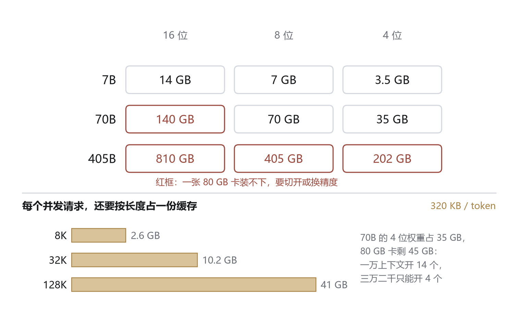

## 变小与变便宜

一家做 SaaS 的公司把客服机器人从大模型换成了小模型。

换的理由很朴素：账单。原来每月的模型调用费比两个客服的工资还高，而他们做的事情并不复杂——回答产品功能问题、判断该转给哪个队列、把用户描述整理成工单标题。

他们拿一千条真实对话做了对比。小模型在大模型答对的那些问题上，答对了九成二；在“需要引用具体条款”的那部分上，差距明显，但在“判断意图”和“整理格式”上几乎一样。换过去之后，成本降到原来的十分之一，延迟也低了一半。

后来他们又试着让小模型做另一件事：帮客户分析合同风险。结果很惨，小模型把三条关键条款全漏了。同一家公司，同一个模型，一件事能顶，一件事不能。

这一章讲的就是这条界线在哪里：模型怎么变小，变小之后丢的是什么，以及为什么小模型在某些任务上真的能顶大模型。

### 一条很宽的尺寸谱系

今天能拿到的模型，参数量从几亿到上万亿，跨了三个数量级。

参数量指的是模型里可调的数字有多少个。它是一个粗略的容量指标：参数越多，能装下的规律越多，但也越吃显存、越慢、越贵。

常见的分档大致是：不到十亿的，能跑在手机和浏览器里；一百亿上下的，一张消费级显卡能跑；几百亿的，需要几张专业卡；上千亿的，通常只以 API 的形式出现，或者以“混合专家”的方式只激活其中一部分。

能力不是随参数量线性增长的。从 7B 到 70B，参数涨十倍，多数评测上的分数只涨几个点到十几个点，而且题型越难，差距越大；题型越简单，差距越小。有些任务上两者几乎没差别。

这就给了一个空间：如果你的任务落在“没差别”的那一类，用小的；落在“差距明显”的那一类，用大的。

### 量化：把每个数存得更省

最直接的变小办法是量化。

模型的权重默认用 16 位浮点数存，一个参数两个字节。700 亿参数就是 140 GB，四张 80 GB 的卡才装得下。如果把每个数换成 8 位整数，权重降到 70 GB；换成 4 位，降到 35 GB，一张卡就够。

为什么可以这么压？因为权重的分布很有特点：绝大多数值集中在零附近，极端值很少。用一套固定的刻度去表示这些值，会浪费大量精度在那些几乎不出现的范围上。量化的做法是先统计每一组权重的范围，定一个缩放系数，再把每个值映射到整数格子上。格子密的地方精度高，稀的地方精度低，但那些地方本来就没几个值。

代价是精度损失。绝大多数日常对话感知不到差别，但有三类任务会先出问题：需要连续多步精确计算的长链推理、需要准确回忆的生僻知识、以及对数值范围极端敏感的场景。道理和压图片一样：远看毫无区别，放大就糊。

所以同一个模型常有多个量化版本。便宜的那个不是假的，只是更容易露馅。所以“同一个模型”在不同平台上的表现会有细微差别：量化版本可能不同。

### 算一遍：一张卡能装几个用户

图能说明一半，另一半要算。拿 70B 模型、一张 80 GB 的卡。

fp16 权重 140 GB，一张卡装都装不下，直接排除。int8 是 70 GB，装进去只剩 10 GB，KV 缓存一涨就爆。int4 是 35 GB，剩 45 GB 可用。

再看每个用户要多少。上下文一万 token，按每 token 320 KB 算，是 3.2 GB；上下文三万二千 token，是 10.5 GB。

于是 45 GB 能开几个并发就清楚了：一万上下文能开十四个，三万二千上下文只够四个。这就是“长上下文很贵”的具体含义——它不是贵在权重，是贵在每个同时在线的用户都要占一份缓存。

这也解释了为什么同一个模型，早上回答得快、下午要排队。不是模型变慢了，是并发数撞到了显存上限，新请求只能在队列里等别人释放缓存。

现实里还有更紧的约束。一个团队想用四张 24 GB 的消费级卡跑 70B 的 4 位版：35 GB 权重塞不进一张，只好切到两张上，两张共 48 GB，剩 13 GB。按八千上下文算，每个请求 2.56 GB，理论上五个并发，实际因为中间结果和碎片，跑到三个就开始拒绝。

他们最后的方案是把上下文上限压到四千，并发才回到六个。这件事的教训不是“卡不够”，是“显存预算要把三样都算进去”：权重、缓存、临时工作区，缺一项都会在上线第二天暴露。

### 剪枝：删掉不用的部分

另一条路是剪枝：把模型里贡献小的部分删掉。

做法有粗有细。粗的是整层删、整个注意力头删；细的是逐个权重删，把接近零的连接去掉。粗的能真的省时间和显存，但会让能力明显下降，需要再训一段补回来；细的省不了多少实际开销，因为算的时候还是得把整块权重读一遍，零也要读。

所以真正有用的剪枝是结构化的：删掉整个头、整个通道，让权重的形状真的变小。这件事比量化难做，效果也更依赖具体的模型和任务，业内的做法通常是“剪一点，再训一点”，反复几轮。

还有一类相关的手法是“稀疏化”：不删，但让大部分权重是零，再用专门的硬件和内核跳过零。理论上能省，实际上取决于硬件支不支持，以及稀疏的规律性够不够好。

对使用者来说，这一段的结论是：剪枝不像量化那样即插即用。你在 API 上看到的“小模型”，多半是重新训出来的，而不是从大模型上剪下来的。

| 办法 | 省什么 | 代价 | 难度 |
|---|---|---|---|
| 量化 | 显存、带宽 | 长推理与生僻知识先坏 | 低，即插即用 |
| 剪枝 | 显存，结构化还省时间 | 要重训补回 | 中，看结构 |
| 蒸馏 | 换成更小的模型 | 只像老师 | 高，要重训 |

### 蒸馏：让大模型教小模型

第三条路更彻底：不压缩原来的模型，而是训练一个新的小模型，让它的行为模仿大模型。

做法是给小模型看同一批输入，但要求它模仿的不是“正确答案”，而是大模型输出的整个概率分布。这个区别很关键。正确答案只告诉你“这个 token 是对的”，分布告诉你“这个 token 有 0.8 的概率，那个有 0.15，还有 0.05 分给了几个近义说法”。后者的信息量大得多，小模型从中学到的是“哪些说法算对”“哪些错误更接近正确”，这就是所谓的软标签。

用老师教学生打比方：只给答案，学生只能死记；给了思路和“为什么别的答案不行”，学生才能举一反三。

蒸馏的效果常常出人意料。一个 7B 的学生，在某些任务上能接近 70B 的老师，尤其是任务格式固定、答案分布集中的那些。原因不难理解：这些任务不需要模型“知道很多”，只需要它“按老师的习惯做判断”。老师的那套判断，可以被压缩进小得多的参数里。

但蒸馏有天花板。学生的容量摆在那里，老师知道的广博知识装不进去。所以蒸馏出来的小模型往往“很会做某几件事，别的都不会”，这也是它的定位：专才，不是通才。

### 另一种小：从零训的小模型

上面三条路都是“从大变小”。还有一条路是反过来：一开始就训一个小模型，但把数据给足。

这件事几年前不成立。那时大家相信“参数越多越好”，小模型拿不到多少训练预算。后来发现，同样的算力，把模型做小、数据做多，效果常常更好。于是一批“小但读得多”的模型出现了：参数量只有几十亿，训练数据却是几万亿 token。

它们和蒸馏出来的小模型不一样。蒸馏出来的模型像某个老师的复印件，强在模仿；从零训的小模型是独立的，知识面更均衡，但也不会在某个特定任务上特别像谁。

这条路打破了一个直觉：小模型不一定等于“阉割版”。一个读了三万亿 token 的 3B 模型，在很多任务上能打赢两年前读得少的 13B 模型。所以比较模型时，参数量只能和同一代的比，跨代比较没有意义。

### 混合专家：大而不贵

还有一条路，让模型“总参数很大，每次只算一小部分”。

做法是把模型里的一层换成很多个并列的“专家”，每个专家是一小份网络。每次来一个 token，由一个路由网络决定把它送到哪两三个专家去算，其余的专家不动。

这样一来，模型的总参数可以做到很大（知识容量大），但每个 token 实际参与计算的参数只有一小部分（计算量小）。这就是所谓的混合专家，英文缩写 MoE。

它解决的是一个具体的矛盾：想让模型更聪明，得加参数；加了参数，每个 token 的计算量和显存读取量都涨，贵得受不了。MoE 把“容量”和“计算”拆开了。

代价在显存。总参数还是得全部装进显存，因为不同 token 会用到不同专家，你没法预知哪些用不上。所以一个“总参数一千亿、每 token 只用两百亿”的模型，计算量像两百亿的，显存占用却像一千亿的。这让它在大规模服务里划算（计算省了），在小规模部署里不划算（显存浪费）。

MoE 还有一个工程上的麻烦：负载均衡。如果路由总把 token 送到同几个专家，其他专家就白养了，训练时要专门加约束逼它把活分匀。第 16 章会讲它对单价的影响。

### 端侧：装在手机里的模型

还有一类小模型是冲着“装进设备”去的。

约束很硬：手机能给模型的内存是几 GB，功耗有个位数瓦，发热不能让人握不住，响应要在一秒内开始。这些约束决定了端侧模型通常只有几亿到几十亿参数，而且必须量化到 4 位甚至更低。

它能做的事很具体：输入法联想、语音助手唤醒、通知摘要、图片里的文字识别、离线翻译、隐私敏感的文本处理。共同点是任务窄、输入短、结果可以立即验证。

它的好处也很具体。一是隐私：数据不出设备，这对医疗、法务、企业内部场景很重要。二是离线：没网也能用。三是延迟：不用往返机房，几十毫秒就能开始出字。四是成本：推理的边际成本几乎为零。

它的局限同样明显：知识面窄、上下文短、复杂任务做不了。所以真实的产品形态通常是“端侧先处理，搞不定再上云”。这个分工本身就是一笔账：把能本地做的做掉，云端的调用量就下来了。

### 一条务实的选型顺序

如果你手上有一个任务，想找个性价比最高的模型，一个不容易出错的顺序是这样的。

先用最强的那一档做基线。不是为了上线，是为了知道“这件事最好能做到什么程度”。拿它跑一百条真实数据，记下分数和错误类型。这条基线后面所有比较都要用。

再试小一号的。同一百条，同样的提示。如果分数差距在你能接受的范围（比如错误率从 8% 涨到 11%，而成本降八成），就用小的。这一步能省掉大部分钱，而且经常一次就成。

还不行，再考虑中间档，或者大模型加便宜模型的组合：简单的请求走小的，难的升级到大的。这个组合的效果通常接近全用大的，成本接近全用小的。

只有在必须离线、必须隐私、必须极低延迟时，才考虑端侧。端侧的门槛不在模型，在工程：内存、功耗、更新、多平台适配，每一项都比调用 API 麻烦。

最后才考虑自己蒸馏或者微调一个小模型。它适合的场景很具体：任务固定、流量大、对成本敏感、而且你已经有一批高质量样本。这三条缺一条，投入多半收不回来。

### 为什么 7B 能顶 70B 的某些活

回到开头那家公司。为什么同一个 7B，在客服问答上能顶，在合同分析上不行？

差别在于任务对“知识广度”的依赖程度。

客服问答的答案，八成落在产品文档里。模型不需要记住这些内容，它只需要：理解用户在问什么，从给出的材料里找到对应段落，用合适的语气复述。这三件事都不需要广博的知识，只需要稳定的语言能力和格式感。小模型在这三件事上和大模型差距很小。

合同分析不一样。判断“这条违约金条款是否对甲方不利”，需要的不只是语言能力，还需要知道这类条款的常见写法、常见陷阱、以及行业惯例。这些知识散在大量专业文本里，小模型的容量装不下。它会把条款读得很顺，然后给出一个“看起来专业”的错误判断。

所以选模型的判断标准不是“多大”，而是“这个任务需要它自己知道多少”。需要它知道很多的，用大的；只需要它理解和搬运的，用小的。这条判断可以再细一层。

- 答案完全由输入决定（改写、翻译、抽取、格式转换）：小的常常够用。
- 需要领域常识但不需要广博（分类、路由、简单问答）：小的加上好的提示和样例，多数够用。
- 需要广博知识或长链推理（合同风险、多步诊断、跨文档综合）：大的明显更稳。
- 需要最新信息：跟大小无关，得有检索。

最后一条经常被忽略：如果任务失败的主要原因是“不知道最新的事”，换多大的模型都没用，得换数据来源。

### 量化之后，哪类任务先掉

不要问“4 位行不行”，要问“哪一桶先掉”。

拿同一批一百条任务、同一个提示，跑 16 位版和 4 位版，分三桶记分。经验上的形状是这样：改写、抽取、格式转换这一桶，掉一到两个点，肉眼几乎看不出；多步算术和带约束的推理，掉五到十个点；生僻人名、编号、条款号的准确回忆，掉十到二十个点。

处置按桶来，不按整体分数。前两桶用 4 位，够用且便宜；第三桶不改模型，改做法——把编号从“让它回忆”换成“从材料里抄出来”，或者把这一类请求路由到 8 位、16 位那一档。

一个反例：某团队看到整体只差两个点就全量上了 4 位，上线后投诉集中在“报价单编号老错一位”。整体两个点，在那一桶里是十八个点。分桶之后他们只把报价这一类路由走，成本多了百分之八，投诉清零。

分桶不只适用于量化。剪枝、蒸馏、换小模型，掉的地方几乎都在同一桶里。

还要提醒一点：量化会改延迟的形状。权重小、读得快，出字能快两三倍；首字几乎不变，因为预填充的瓶颈是算力不是带宽。用户感觉到的“快”，多数来自出字。

### 四个常见的误解

第一个误解是“量化一定掉智商”。4 位量化在对话、改写、分类这类任务上通常看不出差别，掉的是长尾。真正该警惕的是“同一份提示在量化版上时好时坏”，那说明某些输入刚好踩到了精度边界。

第二个误解是“MoE 总参数大，所以一定慢”。MoE 每个 token 只算一小部分参数，速度看的是激活量，不是总量。它慢的地方在显存和通信，不在算术。

第三个误解是“参数量可以跨代比较”。三年前 175B 的模型，今天可能打不过一个 30B 的新模型。“30B 不如 175B”这种话，在跨代比较时经常是错的。

第四个误解是“端侧模型只是玩具”。它做的都是窄任务，但窄任务占了日常使用的很大一块。输入法联想、通知摘要、离线翻译，这些活交给云端反而是浪费。

::: {.keypoint}
**记住这三件事**

一、变小有三条路：量化（把每个数存得更省）、剪枝（删掉不用的部分）、蒸馏（让大模型教一个小模型）。

二、量化几乎不损失日常能力，但先坏在长链推理和生僻知识上；蒸馏能让小模型学会某几类判断，装不下广博知识。

三、选模型看任务需要它“自己知道多少”，不看参数大小；答案由输入决定的任务，小模型常常够用。
:::

下一章换一个方向：不是让模型变小，而是让它一次能读进更多东西，并且记住之前发生过什么。
