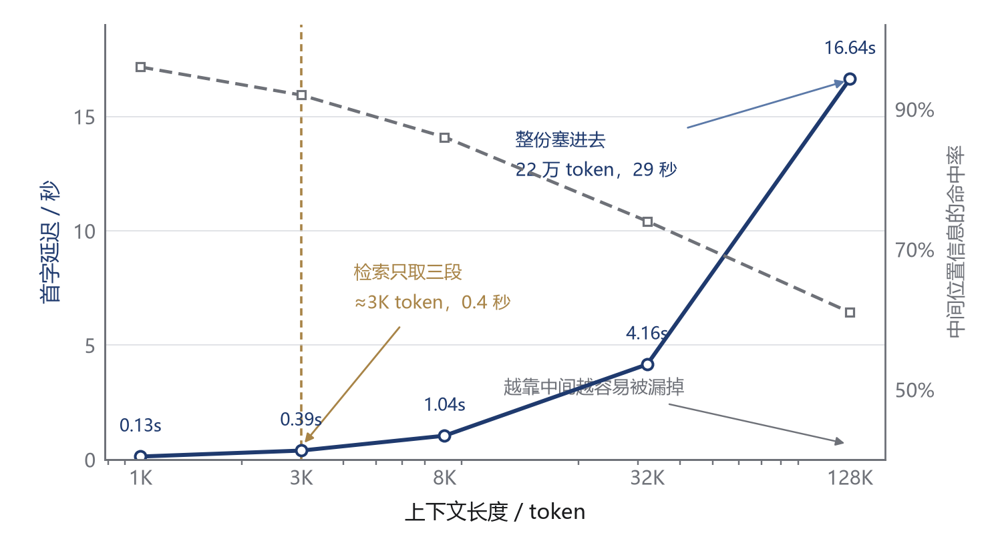

## 读长文与记忆

法务拿到一份三百页的并购协议，要回答老板三个问题：控制权变更条款在第几页；对方的赔偿上限是多少；如果交易被监管否决，分手费怎么算。

她试了三种做法。

第一种，把整份协议上传，让模型自己找。模型说“控制权变更条款主要规定在第七部分”，页号给错了，条款内容基本对。赔偿上限那个问题，它答了一个数字，法务翻原文发现那是另一条的下限。

第二种，先把协议按章节切开，做进一个可检索的库，问的时候让系统先找出相关段落，再让模型基于段落回答。这次每个答案都带了页码和原文，法务核了两条，对得上。

第三种，把前两个问题的结论记下来，第三个问题接着问。模型这次记得“赔偿上限是 3 倍交易额”，但把“分手费”和“反向分手费”搞混了。

同一份文档，三种做法，三种失败。这一章讲这三样东西的区别：长上下文、检索、记忆。它们经常被混着说，其实是三件不同的事，解决的问题也不同。

### 长上下文：一次能装多少

先说装。

模型的上下文窗口指的是它一次能看多少个 token。早年的窗口是两千，后来涨到八千、十二万八、一百万。数字涨得很快，但要看懂这个数字，得知道三件事。

第一，窗口大小不等于有效范围。把一条关键信息放在一份长文档的正中间，模型的召回率往往明显低于放在开头或结尾。这个现象有个名字，叫“中间失忆”。原因在于注意力要在所有位置之间分配，位置越靠中间，越容易被两头的强信号压过去。所以“支持一百万 token”和“一百万个 token 里任何位置的信息都能找到”是两件事。

第二，窗口越大越贵。每个 token 在每一层都要留一份缓存，缓存大小和上下文长度成正比。第 16 章会算这笔账，这里只需要记住量级：上下文翻四倍，显存占用也翻四倍，能同时服务的人数掉到四分之一。

### 算一遍：把三百页塞进去要多少钱

一份三百页的协议，按每页五百字算，十五万字，大约二十二万 token。模型窗口装得下，那就装。

首字延迟：预填充按每 token 0.13 毫秒算，220000 × 0.13 ≈ 29 秒。你按下回车，先等半分钟。

输入费：按每百万 token 三美元算，0.22 × 3 = 0.66 美元。一次提问六毛六，问十个问题就是六块六。

显存：220000 × 320 KB ≈ 70 GB。这张卡基本被一个用户占满了。

改成检索：切块之后每次只取三段，每段八百字，加问题一共三千 token 左右。首字 0.4 秒，输入费 0.009 美元，显存 1 GB。

三个数字一比，是七十倍的钱、七十倍的首字、七十倍的显存，换来的只是“省掉建索引这一步”。如果这份文档只问一次，塞进去划算；如果它会被问一百次，检索的建库成本两天就摊平了。

第三，装进去的东西会互相干扰。一份文档里如果有十处提到“上限”，模型要判断你问的是哪一处，靠的是上下文里的线索。线索不够明确时，它可能把两处的数字混起来，就像开头那个赔偿上限的例子。

所以长上下文的正确用法是：把最相关的东西放在开头或结尾，把问题问得具体，不要指望它在三百页里自己做完检索和比对。

### 窗口是怎么被撑大的

窗口从两千涨到一百万，靠的不是一句“把上限调大”。有几件事必须同时解决。

第一件是位置信息。模型要知道每个 token 在第几位，而早期的做法是给每个位置一个固定的编号。编号在训练时见过多少，就只能用到多少；超过这个范围，编号进入没见过的区域，模型的表现会突然崩掉。后来的做法换了一种编码，让“第几”变成一种可以按相对距离推算的量，外推性好一些，但也不能无限外推。

第二件是计算量。注意力要在所有位置之间两两比对，序列翻倍，比对数量翻四倍。一百万 token 的两两比对，是万亿级的量级，直接算不动。所以长上下文模型通常要用稀疏注意力：不是每个位置都看全部历史，而是看最近的若干段加上若干被选中的远距离位置。这是一种取舍，它放弃了“任意两个位置都能直接关联”，换来了可算。

第三件是缓存。每个 token 的缓存都要留在显存里，长度一长就装不下。业内的做法包括让多个查询头共用一份缓存、把缓存压到更低精度、以及把不常用的部分挪到更慢的存储上。这些做法都在牺牲一点精度换空间。

还有一个容易被忽略的事实：模型在训练时见过多少长度的文本，决定了它真正擅长多长。训练时只见过八千 token 的模型，硬把窗口扩到十二万八，它在长文上的表现往往不如标称。所以“支持”和“擅长”是两个数字，厂商宣传的是前者，你该关心的是后者。

### 检索：先找，再读

检索解决的是“装不下”和“找不到”。

做法不复杂：把文档切成几百字的片段，每段算成一个向量存进索引；用户提问时，把问题也变成向量，找出最相近的十几段，连同问题一起放进提示，让模型照着这些材料回答。

关键在“模型没变，变的是每次送进去的材料”。政策今天改，明天就生效，只要索引重建过；答案可以带出处，第几页第几条，法务能核对，客户也能核对；权限还能分级，不同等级的客户检索到不同的片段。

它最合适的地方，是知识又多又变、而且必须能指出出处的场景。合同条款、内部规章、产品手册、法规条文，都属此类。答错的时候，你能顺着引用的那一段找到是文档写错了还是检索错了，这在专业场景里比准确率还重要。

失效的方式也很具体。切块切坏了：一条政策被切成上下两半，只检索到上半句，答出相反的意思。召回没找到：用户说“赔偿上限”，文档里写的是“责任限额”，字面不重合，向量距离也可能不够近。需要跨文档推理：赔偿在合同里，限额在附件里，模型只拿到一份，答得理直气壮却漏了条件。

有两处工程细节决定了它的上限。切块大小是一次权衡：切得太碎，一段话没有上下文，模型看不懂“它”指什么；切得太大，一段里混了三件事，检索命中了也用不上。常见做法是几百字一段，段落之间留一点重叠。召回之后还要重排：先粗找出几十段，再用一个更小的模型按“这段能不能回答问题”重新打分。少了这一步，最相关的那段经常排在第七八位，被挤在窗口边缘。

### 记忆：跨轮次留下什么

第三样东西是记忆，它管的是“这次对话之外还记得什么”。

模型本身没有记忆。权重训练完就冻结，你和它的对话不会写回权重。所谓“它记得”，只是那段文字还在当前输入里。

所以工程上的记忆，都是在这件事上做文章：想办法把重要的东西留在上下文里。

最轻的一种是摘要。对话变长时，把前面几十轮压成一段“到目前为止发生了什么”，替换掉原文。省 token，但会丢细节。

第二种是事实表。把对话里确定的键值对抽出来，单独维护：客户名、订单号、预算、截止日期。每轮都带上这张表，模型就不用从几百轮对话里自己找。

第三种是跨会话的用户偏好。你告诉它“以后都用简体中文，不要用表情”，这条被存进一个外部存储，下次对话开始时注入提示。这不是模型学会了，是系统在每次开场时替它把这段话补上。

一个具体的麻烦：客户先说预算五十万，聊到第十轮改成八十万。事实表更新了，但前面那段“五十万”的对话还在上下文里。模型这时要判断哪条有效，而它手里没有“时间戳”这种结构，只有一段混杂的文本。它可能引用旧的，也可能含糊其辞。工程上的解法是显式写一句“以下数字覆盖之前所有说法”，或者在更新事实表时把它放在提示的最末端。这类小技巧听起来琐碎，但它们决定了记忆到底有没有用。

### 记忆最难的不是记住，是打扫

前三种做法都在回答“怎么存”，真实系统里更难的是“怎么清”。

一个典型场景：客服智能体跟同一个用户聊了三十轮。中间改了三次收货地址、撤了一个订单、换过两次需求（“先开发票”改成“先不开发票”）。到第三十轮，上下文里有至少五种地址：第一次填的、改过的、用户随口举例的（“比如寄到上海的话”）、系统查出来的默认地址、以及最后确认的那个。

模型分不清“说过的”和“定了的”。它看到五段文字都长得像地址，只能猜，猜错的概率不低。

工程上的打扫分三步。

第一步，每轮结束把状态写成一条结构化的记录：当前有效的地址、已撤销的操作、待确认的事项。下一次只带这条记录，不带历史原文。三十轮、每轮四百 token，原文一万二；而真正还有效的信息，往往不到五百 token。

第二步，旧值不删，标成失效。直接覆盖会丢掉“他曾经说要寄到北京”这条信息，而用户可能下一句就是“还是按原来的吧”。做法是保留一条“已失效，被 X 取代”的记录，而不是抹掉。

第三步，子任务结束就压成结论。一段“查订单—改地址—确认运费”的来回，最后只留“地址已改为 X，运费 Y 元，已确认”一句进上下文。过程只存在日志里。

不做这三步的系统有个固定的坏法：前五轮一切正常，越到后面越容易自信地引用一个已经作废的值。用户看到的不是“它忘了”，而是“它记错了”，后者更伤信任。

怎么知道自己打扫得好不好？造三类冲突去测。“直接覆盖”：用户改口后，它用的是新的还是旧的；“条件冲突”：“预算够就买 A、不够就买 B”，它会不会把两个都当成已定；“时间冲突”：“上个月说过”和“刚才说的”，它分不分先后。三类各五十条，正确率低于八成，说明打扫策略有问题。

还有一类最隐蔽：把“讨论过但没同意”的当成“已同意”。测法是让它复述当前已确认的事项，看它有没有把假设写进去。

这三种做法的共同点是：记忆在模型外面，不在参数里。这个认识很重要，因为它决定了记忆的三个性质：可以随时改（改存储就行）、可以审计（能看到存了什么）、可能不一致（存储和当前对话冲突时，模型未必知道该信哪个）。

### 一个真实的组合

把三者拼起来，是一个文档问答系统的典型形态。

第一步，离线建库。把文档切成几百字的片段，每段算一个向量，连同原文、页码、章节号一起存进索引。这一步的失败点最多：扫描件要先做文字识别，表格要单独处理，页眉页脚要剔掉。

第二步，在线检索。用户提问，先算问题的向量，找出最相近的几十段，再用一个更小的模型重排，取前五段。这一步的失败点是“问题问得含糊”：用户说“那个条款”，检索不知道该找哪一条，所以系统通常要先做一次改写，把含糊的问题补全。

第三步，装进上下文。五段材料加上对话历史，加上一份写清楚要求的系统提示：只根据材料回答，材料里没有就说没有，每条结论后面标页码。这一步的失败点是材料互相矛盾，模型可能挑一个看起来顺的，而不是最新的。

第四步，生成。模型给答案，同时给引用。引用要能被机械校验：页码存在、原文确实有那句话。不能校验的引用等于没有。

第五步，反馈。用户点“这个答案不对”，这条记录进日志，用来补文档、调切块、换重排模型。

这一套跑起来，效果通常比“直接上传整份文档”好一大截，成本还更低。代价是工程量：建库、维护、监控、更新，每一项都要人。所以只有“这份知识会被反复问”时，这套投入才划算。

### 三者摆在一张表上

| | 长上下文 | 检索 | 记忆 |
|:------------|:------------------|:------------------|:------------------|
| 解决什么 | 一次装更多 | 从大量材料里找相关 | 跨轮次、跨会话保留 |
| 材料在哪 | 就在输入里 | 在外部索引里，按需取 | 在外部存储里，按需注入 |
| 更新方式 | 每次重新上传 | 重建索引 | 改写存储 |
| 能否追溯 | 能，但可能定位错 | 能，可带页码 | 取决于怎么存 |
| 主要成本 | 显存，随长度线性涨 | 一次检索往返 + 输入 token | 存储与注入的 token |
| 典型失败 | 中间失忆、互相干扰 | 切块与召回失败 | 记错、冲突、过期 |

这张表能挡掉三种常见误用。

第一种：以为长上下文可以取代检索。装得下不代表找得到，也不代表便宜。一份每天都要问十个问题的文档，用检索每次只送三段，比每次送三百页便宜一个数量级。

第二种：以为检索等于理解。检索只是把材料摆到模型面前，模型仍然可能读错、漏读、把两段混起来。所以检索系统要有引用、要能核对，不能只给一段自然语言答案。

第三种：把记忆当数据库。记忆是“让模型看到”，不是“让系统查到”。需要精确查询的，应该用真正的数据库，把结果作为材料交给模型，而不是指望它从记忆里翻。

### 四个常见的误解

第一个误解是“窗口越大越强”。窗口只是一个容积，装满之后能不能找到东西是另一回事。一个八万 token 的窗口配好检索，常常比一百万的窗口直接硬塞更准、更便宜。

第二个误解是“文件上传给它，它就记住了”。上传只是把内容放进了这一次的上下文。换个会话、或者对话长到被截断，它就没有了。要它“下次还记得”，得有外部的存储和注入机制。

第三个误解是“检索就是接个搜索框”。检索的质量八成取决于切块、召回和重排这三件脏活。同一份文档，切块方式改一改，答案的准确率能差出一大截，而模型一个字都没换。

第四个误解是“长上下文可以不要检索”。装得下确实省事，但每问一次都要重新付一遍全部输入的钱，还要重新等一遍首字。反复问同一批材料时，这个差价会大到不可接受。

### 怎么选

三个问题可以定下来。

这份材料是一次性的，还是要反复问？一次性的（比如读完一份报告写个总结），用长上下文最省事。反复问的，做检索。

内容会变吗？每周改的，只能检索。一年改一次的，塞进提示或者微调都可以考虑。

答案需要出处吗？需要，就必须做检索，并且要求模型给出可核对的引用。不需要，长上下文也够。

真实系统里三者常常一起用：检索把相关段落找出来，长上下文装下这几段加上对话历史，记忆维护跨轮次的事实表。它们不冲突，各自负责一段。

::: {.keypoint}
**记住这三件事**

一、长上下文是“一次装更多”，装得下不等于找得到，中间位置的信息最容易被漏掉。

二、检索是“先找再读”，它带来的是可更新、可追溯、可限权，代价是切块和召回都可能出错。

三、记忆在模型外面，不在参数里；改存储不等于模型学会了，冲突时它未必知道该信谁。
:::

下一章换一种输入：不是文字，而是图片、声音和视频。
