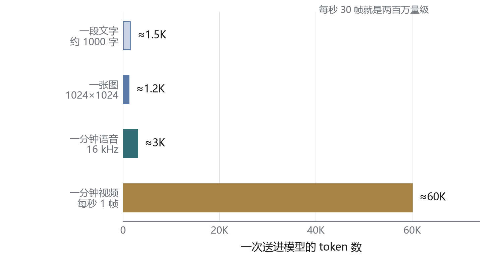

## 看图、听声、说话

一个做报销的同事拍了张发票照片，丢进对话框，问三件事：价税合计多少，税号是多少，开票日期是哪天。

价税合计对了。税号错了一位，把 0 认成了 8。开票日期它答了“2026 年 3 月”，实际是 2026 年 5 月，因为那张发票上的日期印在二维码旁边，字很小，还斜着。

这不是它不认真。它把整张图压成了一批数字，在压缩的过程中，小字的笔画丢了，而它不会告诉你“这里看不清”，它会按形状最像的那个填上去。

这一章讲三件事：图像、声音、以及“实时说话”这三样东西是怎么进到同一个模型里的，各自能做到什么程度。

### 图像怎么变成 token

图像进入模型的方式，比想象中粗暴。

一张图被切成固定大小的小方格，比如 16 乘 16 像素一块。每个小方块的像素值经过一个视觉编码器，变成一串数字。这些数字被当成“视觉 token”，和文字 token 拼在同一个序列里，前面加一句“下面这张图”，后面接你的问题。

所以模型处理一张图，和处理一段描述这张图的文字，走的是同一套流程。它没有专门的“视觉模块”在后台分析，只是在同一个序列里多了一批来自图像的 token。

分辨率决定一切。一张 1024 乘 1024 的图，按 16 像素一块切，是 64 乘 64 共 4096 块，压缩之后常见的量级是一千多个 token。一张 A4 扫描件如果按同样密度切，八号字可能只占几个像素，几个像素的信息在编码之后就基本没了。所以有些模型支持“高清模式”：把图切成更多块，每块单独编码，token 数涨几倍，小字才读得出来。

这也解释了为什么它读大字很稳、读小字容易错：不是它的眼睛不好，是那些笔画在变成 token 的时候就没剩下什么。

把开头的发票算一遍就明白了。一张 300 dpi 的 A4 扫描件是 2480 乘 3508 像素。模型入口通常先把长边压到 1024 左右，缩放系数约 0.29。发票上八号字原本约三毫米高，也就是三十五像素，压完剩下十像素。再按十六像素一块切，一个字还摊不满一块，它看到的是一小块灰度的平均值。

所以“税号错一位”不是粗心，是那个位置的信息在缩放那一步就损失了。要它读准，要么用高清模式把图切块分别编码，要么先过一遍专门的识别工具，把文字拿出来再问。

### 它能看什么，看不住什么

能做的事情比多数人想的多。

读表格。一张财务报表截图，问“第三季度毛利率”，它能找到行和列的交叉点。读界面。一张软件截图，问“导出按钮在哪”，它能指出大致位置，甚至能说出旁边的菜单项。读手写。一份手写笔记，它能转录个八九成，连笔多的地方会错。比两张图。问“这两版设计稿的差别在哪”，它能说出布局、颜色、元素的变化。描述场景。一张现场照片，问“有什么安全隐患”，它能指出没戴安全帽、线缆横穿通道这类问题，也会漏掉一些。

失败也有固定形状。

数数最不可靠。图里站着七个人，它说五个。数数需要逐个定位并维持计数状态，而它是把整张图压成一批数字之后做整体判断，没有“数到第几个”这个过程。

小字读不出来，前面说过了。

空间关系容易错。左边还是右边、上面还是下面、在容器的内部还是外部，这类判断在纯文本语料里很少需要精确表达，在图上却处处要用。它会说“在按钮旁边”，但旁边是哪边，不一定对。

图表读数会取整。柱子的高度差很小时，它读的是“趋势”而不是数值，给出的数字往往是它觉得“应该是”的那个。

这四种失败指向同一件事：视觉能力的可靠性，取决于任务是否只需要“识别”而不需要“精确计量”。描述一张图里发生了什么，它很稳；从图里抽出一个精确数字并保证不错，它不稳。

### 图里的字，为什么要单独拿出来说

扫描件、截图、发票、报表、身份证，这类“以图的形式出现的文字”，是实际业务里最常见也最容易出错的输入。

它难在三处。

一是密度。一页 A4 上可能有八百个字，每个字十几个像素。压缩成一千多个 token，等于每个字分到一个多 token，笔画细节基本丢了。所以同一页文档，用专门的文字识别工具先转成文字再交给模型，效果往往比直接喂图好一个档次。

二是结构。表格不只是字，还有行列关系。文字识别能给出“单元格里写了什么”，但谁和谁同一行、跨行合并了没有，需要额外的版式分析。通用模型看整张图，能猜对大部分简单表格，复杂的合并单元格就开始错位。

三是多页。一份二十页的合同，逐页喂图，模型看不到第 3 页和第 15 页之间的矛盾。要它比对，得先把关键页挑出来，或者做成检索。

所以业内的常见架构是分工：专门的工具负责“把图变成结构化的文字”，模型负责“读懂这些文字并回答”。通用模型直接读图，适合那些“看一眼就够”的场景，比如判断这张照片拍的是什么、这个界面大概在做什么。

### 语音：从波形到文字

语音识别是另一条线，技术上和后一条线不太一样。

做法是把声音切成很短的帧，每 20 毫秒左右一帧，每帧算出一组特征，再把这些特征序列送进模型，输出文字。中间要处理几件事：声音长短和文字长短对不上（说一句话两秒，写出来十个字），同音字要消歧，标点要自己加，谁在说话要分开。

它的准确率这几年涨得很快。安静的录音、标准的普通话、常见话题，错字率可以低到几个百分点，比多数人手动转录快得多。

难点集中在几处。

一是噪声。会议室空调、街道、多人同时说话，都会让特征变糊。降噪能救一部分，但降噪本身也会削掉语音里的细节。

二是口音和专业词。同一个词在不同地区读法不同，模型见得多就认得，见得少就按最像的写。专业词更麻烦：一个内部系统的名字，在训练数据里根本不存在，它一定会写成某个常见词。

三是数字和编号。电话号码、订单号、金额，这些没有语言上下文的字符串，识别错一位的代价很大，而它错得毫无征兆。

四是实时性。要在说话人还没说完时就出字，模型只能看有限的前文，准确率会比整段转录低一些。产品上通常用“边说边出，最后再修一遍”的两段式做法。

会议记录是这类能力的典型场景，也是典型失败场景：整体可读，人名、数字、术语错得需要人工校一遍。所以真实产品都会提供“说话人分离”“术语表”“一键替换”这些工具，因为纯靠模型做不到。

### 说话：合成与实时对话

让模型“说”出来，是另一半。

最早的语音合成是把录音片段拼起来，听起来像机器人。后来的做法是从文本直接生成声学特征，再转成波形，自然度高很多。现在的主流是端到端：文本进去，波形出来，中间不显式经过音素。

听起来像人的关键不在音色，在韵律：哪里停顿、哪个字重读、语气词怎么拖。这些东西在文字里没有标记，得靠模型自己判断。它判断得好的时候，你听不出是合成的；判断得不好的时候，句子全对但听着别扭。

真正的难点是“实时对话”。人对延迟极其敏感：超过一秒的空白，人会以为断了；超过两秒，人会开始重复自己说的话。所以实时语音的系统要解决三件事。

一是延迟预算。从你说完到它开口，要在一秒以内。这意味着识别、理解、生成、合成四步要压进一个很短的窗口里，通常做法是流式：你还在说，它已经开始识别；它还在生成，合成已经开始。

二是打断。人说话会插话，会“嗯”“对”，会在对方说到一半时改变主意。系统要能判断这是“打断”还是“附和”，前者要停，后者要继续。这个判断做不好，对话会变得很难受：要么它一直说个不停，要么你一“嗯”它就停。

三是轮次判断。它得知道你说完了没有。中文里一句话说完不一定有停顿，停顿时也不一定说完。所以要用语义加韵律一起判断，还会加一个“等 300 毫秒再决定”的策略。

还有一件很少被提起、但免提场景避不开的事：回声。

手机开免提，扬声器正在放它的回答，麦克风同时也在收音，于是它听到了自己。如果不做处理，会出现两种尴尬：一是自问自答（把“好的，已为您下单”再识别一遍，当成用户说的话，于是又下一单），二是把自己当成打断（用户刚开口，它因为听到自己的尾音而停下来）。

标准解法叫回声消除：把“我刚刚播出去的声音”当作参考信号，从麦克风采到的声音里减掉。听上去简单，难点在“双讲”，双方同时说话的时候。这时麦克风里既有用户的真声音，又有残留的回声，减多了会把用户的开头减掉，减少了会留下残余。

工程上的几条经验：播放期间把语音检测的阀值提高一档（宁可漏掉开头，不要触发第二次下单）；把“正在播放”这个状态告诉后续环节，让它知道这段识别结果可能带回声；打断的判定不要只看音量，要同时看“是不是人声、说的是不是一句话”。

这条坑在实验室里几乎碰不到，因为测试时通常是安静房间、插耳机；上了真机、开了免提、旁边还有人说话，问题才出来。

### 几条实用的用法

这类能力用得好不好，差别常常在输入的准备上。

第一，把精确值单独核。金额、编号、日期、身份证号，这几类东西只要出现在图里，就一定人工对一遍。不是因为它一定错，是因为它错了不会告诉你。要求它把读到的数字单独列成一行，你核起来也快。

第二，给它更清楚的输入。能扫描就不要拍照，能正面拍就不要斜着拍，能截屏就不要翻拍屏幕。分辨率、角度、反光，这三样决定了它能不能看清。

第三，要求结构化输出。让它按固定字段返回，而不是写一段话。结构化之后，缺字段、格式不对、数字位数不对，都能被程序挡住。

第四，复杂文档先拆。二十页的合同，不要一次全塞进去。先按章节拆，或者先做检索，把相关几页找出来再问。这样既省钱，也减少“看了后面忘了前面”的概率。

第五，别指望它做精确计数和测量。图里有几个人、这条裂缝多长、这个色差有多大，这类问题它答得很快，但你得自己数一遍。

### 一笔 token 账

多模态最实际的约束是钱，而钱的单位还是 token。

一段一千字的文字，大约一千五百个 token。一张 1024 乘 1024 的图，压缩后一千多个 token，和一段文字差不多。一分钟语音，按每秒几十帧、每帧一个 token 估，是三千个 token 上下。一分钟视频，如果每秒取一帧、每帧一千 token，是六万个 token；如果按每秒三十帧取，是两百万个 token。

这就是为什么视频最贵，也是为什么所有视频模型都在做“抽帧”和“压缩”：不是它们不想看全，是看全了付不起。抽帧的代价是丢失动作细节，一秒里发生的事可能被抽掉。

换成钱看更刺激。按每百万输入 token 三美元算：

- 一张图，一千二百 token，0.004 美元，不到三分钱。
- 一分钟语音，三千 token，0.009 美元。
- 一分钟视频，每秒一帧，六万 token，0.18 美元。
- 一分钟视频，每秒三十帧，两百万 token，六美元；一小时就是三百六十美元。

最后一行解释了为什么“让模型看完整段监控”至今不现实。它不是因为看不懂，是看一遍的成本比请人盯着还贵。

### 一个容易混淆的地方

很多人以为“多模态”是一个模型同时会好几种本事。更准确的说法是：它把几种输入都翻译成了同一种东西（token），然后用同一套机制处理。

这个说法的推论是：它在某一种模态上的强弱，取决于那种模态的数据有多少、那种 token 的表达有多细。图像数据比文字少得多，所以它的视觉能力整体弱于语言能力；语音数据更少，所以语音上的“理解”往往不如“转写”。

还有一个细节值得知道：视觉 token 和文字 token 虽然排在同一个序列里，它们的“含义”本来就是两套系统。图像经过编码器出来的一千多个数，和“猫”这个字对应的数，在训练之前毫无关系。之所以能对齐，是因为训练时见过大量“图—文”配对，模型被逼着把两边调到能互相解释的位置。对齐得好，它就能看图答题；对齐得不好，就会出现那种“图里明明没有这个东西，它却说有”的错。所以视觉能力的上限，很大程度取决于配对数据有多少、有多准。

| 任务 | 可靠度 | 原因 |
|---|---|---|
| 描述图里发生了什么 | 高 | 只需要整体识别 |
| 读表格交叉点 | 中 | 行列关系靠推断 |
| 数个数、量长度 | 低 | 没有逐个计数的过程 |
| 读密集小字 | 低 | 缩放时笔画已丢失 |

另一个推论：跨模态的能力是可以拼的。你可以让它看着一张图回答一个文字问题，也可以让它读一段文字然后画一张图，只要两边都能变成 token。这种拼接很强大，也很容易出意料之外的错：图里的信息没读准，后面所有推理都建立在错的前提上，而它不会提醒你。

### 四个常见的误解

第一个误解是“它在看图，和人看图差不多”。它看的是压过、切过、编码过的一批数字，没有眼睛的连续扫描，也没有“这里看不清”的自觉。所以它会看不清却照样回答。

第二个误解是“多模态模型可以替代专门的识别工具”。发票、合同、报表这类高密度文字，专用工具通常仍然更稳，因为它的目标就是“把字抠准”。通用模型的长处是读懂之后再判断。

第三个误解是“语音识别准确率够高，可以直接进会议纪要”。安静环境下的字准率确实很高，但会议里最要紧的是人名、数字、术语和谁在说话，这四样恰好是最容易错的部分。所以真实产品都带术语表和人工校对环节。

第四个误解是“它能看图，所以也能看懂图表里的数据”。读趋势可以，读精确值不行。柱状图上两根柱子差一点点，它给的数字往往是它觉得合理的那个，而不是量出来的那个。

::: {.keypoint}
**记住这三件事**

一、图像、声音、视频都是先变成 token，再走和文字一样的流程；分辨率决定小字能不能读出来。

二、视觉的可靠性取决于任务要不要“精确计量”：描述很稳，数数、读小字、判空间关系不稳。

三、多模态的瓶颈是 token 成本：一分钟视频的 token 是一分钟语音的二十倍，是同样长度文字的四十倍。
:::

下一章讲另一类生成：不是理解图像，而是从文字造出图像和视频。
