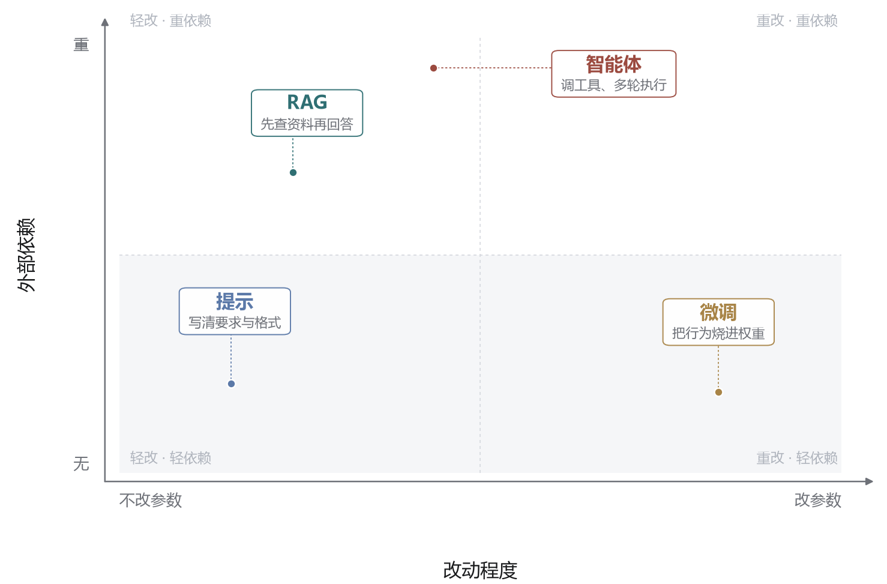

## 三种用法

一家做净水器的公司，售后团队二十来人，每天接三千多条咨询：滤芯多久换一次、上门安装怎么约、机器报警灯闪三下是什么意思。

主管让人把产品手册和常见问题整理成一份文档，两百多页，每次提问时整份贴进去，让模型照着答。演示很成功，挑十个典型问题问过去，答得比新人清楚。

一周后内部试用，三个问题冒出来。

第一件是装不下。两百多页手册，按一页五百字、一个字一到两个 token 估，十几万 token。便宜模型的窗口没那么长，只能截断，截断的位置正好切在保修条款中间。

第二件是答不准。手册写“滤芯建议六到十二个月更换，视水质而定”，客户问“我家这个用了两年，要不要换”，模型答“建议十二个月更换”，把“建议”读成了“必须”，漏了“视水质而定”。

第三件是它自己加戏。有客户问滤芯能不能退，它很热情地回“七天无理由，运费我们承担”。公司政策是耗材拆封不退。这条回复被截图发到了社交平台上。

这三件事看着都是“模型不行”，其实是三种不同的病：装不下是容量问题，答不准是知识问题，加戏是行为问题。后来试过的做法有四种，它们分别对付这几种病，但不是一味药对一种病。

### 提示：只改你送进去的那段话

提示是最轻的一种用法：模型一个参数都不动，你只是把要求写得更清楚。

它为什么有用，回到第 1 章就明白了。模型做的事是根据前文续写，前文的模式决定后文的走向。你在提示里放三个“客户问题—归类—理由”的例子，它就会沿着这个模式往下写第四组；你要求“先判断属于哪类问题，再给答复”，它就会先输出判断。

提示擅长的是“怎么说”，不是“知道什么”。定格式最见效：要求每次输出固定的几个字段，它会照做。定语气也有效：给两段范例，它能模仿那种克制、不带推销腔的措辞。定流程同样有效：让它先复述客户诉求、再判断类型、再给方案、最后说明什么情况下需要转人工，这一串写进提示，执行率相当高。

还有一条容易被忽略的用法：把隐含要求说出来。比如“手册里没有写的，就说不知道，并建议转人工”。这句话本身不增加知识，但它改变模型在不确定时的行为倾向。

边界也很清楚。你在提示里列十条规矩，它能守住八条，剩下两条在长对话里会慢慢漂掉；提示越长，每一条被认真执行的概率越低。它压不住编造：写一句“不许编造”，模型编得反而更像真的，因为它把“不要编”理解成了“要显得可信”。它也没法给你手册里没有的东西。至于容量，提示越长越贵，把两百页文档塞进每次请求，等于每问一句都重新买一遍这本书。

代价低得几乎可以忽略：一个人几天到两周，边际成本只是多出来的那点输入 token。门槛不在技术，在于肯不肯拿真实问题反复试，看哪条规矩没被守住，改措辞，再试。

### 微调：动一点点参数

微调是拿一批“输入—理想输出”的样本，在已有模型上再训练一小段。学习率调得很小，训练步数不多，目标是让某种行为模式变稳，不是把知识灌进去。

它擅长那些“说不清、但一看就知道”的判断。比如工单分类：一条客户留言该归到“安装问题”“水质问题”“退换货”“投诉”，界限只有干了三年的老员工分得清，写成规则总有漏网的。给八百条标好的样本，模型能学到那种手感。它也擅长把格式钉死：每个字段的顺序、措辞、空值怎么填，微调比提示稳，因为它不是“被要求”这么写，而是“习惯”这么写。品牌语气同理。

它不擅长加知识。你在样本里写“滤芯保修两年”，模型确实可能记住，但换个问法就可能忘，追问细节就开始编。更麻烦的是政策会变：条款一改，你得重新造样本、重新训练、重新评测。

成本的大头是数据，不是算力。几百条能起步，但要有代表性，要覆盖真实长尾，还得留一批不参与训练的做评测。整理一千条干净样本，两个人干两三周是常见节奏。算力方面，轻量做法一张消费级显卡跑几小时到一天；也可以直接买云服务，按次计费。

风险有三个。一是灾难性遗忘：在窄任务上训久了，通用能力会掉。二是过拟合到措辞：样本里客户都说“出水小”，真实客户说“水龙头没劲”，它就分不出来。三是可解释性变差：改之前你能指着提示说“是这条规矩在起作用”，改之后你只有一个权重文件。

### 检索：先查资料，再回答

检索解决的是“装不下”和“不知道”。做法不复杂：把文档切成几百字的片段，每段算成一个向量存进索引；用户提问时，把问题也变成向量，找出最相近的十几段，连同问题一起放进提示，让模型照着材料回答。

关键在“模型没变，变的是每次送进去的材料”。政策今天改，明天就生效，只要索引重建过；答案可以带出处，第几页第几条，客服能核对，客户也能核对；权限还能分级，不同等级的客户检索到不同的片段。这几点是微调做不到的。

它最合适的地方，是知识又多又变、而且必须能指出出处的场景。产品手册、内部规章、合同条款、法规条文，都属此类。答错的时候，你能顺着引用的那一段找到是文档写错了还是检索错了，这在客服场景里比准确率还重要。

失效的方式也很具体。切块切坏了：一条政策被切成上下两半，只检索到上半句，答出相反的意思。召回没找到：客户说“水有异味”，文档里写的是“口感异常”，字面不重合，向量距离也可能不够近。需要跨文档推理：退货政策在一份文件，运费规则在另一份，模型只拿到一份，答得理直气壮却漏了条件。

工程量大头在数据侧。清洗、切块、建索引、定期重建，第一版两三周，之后是持续的维护：新手册进来要重新切，旧条款下架要从索引里删干净，否则模型会拿三年前的条款回答今天的问题。调用费比纯提示高，因为每次多送十几段材料。

### 智能体：让它自己决定下一步

智能体和前面几种用法的区别，是它不只说话，还能做事。查订单、改地址、发补寄、预约上门、退款、转人工。

它的运行方式是一个循环：模型看到客户诉求，决定调用哪个工具；工具返回结果，结果进入下一轮的输入；模型据此决定下一步，直到能给出答复，或者判断需要转人工。

它适合步骤多、要碰真实系统、而且每一步的结果能被系统确认的事。查订单查没查到，接口会返回；改地址改没改成，接口也会返回。

它出问题的方式也好预测。错误会累积：单步九成五正确，十步连起来只剩六成，而客户感受到的是那四成。它会自信地调错工具，或者在缺参数时自己编一个订单号。延迟和成本都上去了。最麻烦的是权限：给了退款权限，就要防它被一句话骗着退款。

所以智能体的设计重点不在“让它更聪明”，在“让它出错时不出大事”。工具白名单，只开必要的几个；参数做校验；金额设上限，超过就转人工；不可逆的动作要人确认；每一步留日志。

### 摆在桌上比

| 做法 | 最擅长 | 明显不适合 | 起步成本 | 主要失效方式 |
|:---------|:---------------------|:-------------------|:---------------|:------------------|
| 提示 | 格式、语气、流程、边界声明 | 补充知识、纠正系统性行为 | 几天到两周人力 | 长对话里规矩漂移 |
| 微调 | 稳定格式、细粒度分类、品牌语气 | 频繁变动的知识 | 千条级样本，两三周起 | 遗忘、过拟合措辞 |
| 检索 | 私有文档、时效性、可追溯 | 跨多文档推理、图表 | 两三周工程，长期维护 | 切块与召回失败 |
| 智能体 | 多步任务、真实系统操作 | 高风险不可逆动作 | 一两个月，含联调 | 错误累积、权限越界 |

值得说一句的是，微调经常是可以省掉的。很多团队一开始就想微调，因为“听起来更专业”，结果发现提示改三轮就能达到八成的效果，剩下的两成不值得为它维护一套训练数据管道。真正需要微调的时刻通常很具体：提示已经改到极致，格式还是偶尔跑偏；或者你想用一个小模型代替大模型来省钱，而小模型听不懂那么长的指令；或者你要把一种只有老员工分得清的判断固定下来。

这家公司最后跑起来的形态是这样：提示负责格式和边界，规定“手册里没有的就说不知道，退款类问题一律转人工”；检索负责政策与手册，答案带页码；分类用一个小模型做初筛，把三千条分到八个队列，这一步用微调比提示稳，也便宜；智能体只负责查订单和预约上门，退款仍然走人工确认。四块拼起来，人工介入量降了一半多，而所有对外承诺都能追到一条具体条款。

### 先问三个问题再动手

这件事的难点是“不知道”还是“不会做”？如果模型缺的是知识，提示写破天也没用，该上检索；如果它知道但做得不稳，格式总跑偏、分类总差一点，那才轮到微调。判断方法很土：手动把正确资料贴进提示里，如果答对了，说明是知识问题；贴了资料还答不对，才是行为问题。

这些知识多久变一次？一年改一次的制度文件，微调也许可以；每周调价的商品信息，只能检索。变动频率决定了你把知识放在哪。

错了会怎样？答错一句推荐语，用户笑一下就过去了；答错一句退款承诺，公司要认。错误代价决定了你需要多少护栏、要不要人确认、要不要留日志。这一条经常被跳过，然后在上线第一周被客户教一遍。

还有第四个问题，容易被忘掉：谁来维护？检索要维护索引，微调要维护样本集，智能体要维护工具和权限。这些都不是一次性的活。一个没人维护的检索库，三个月后就会拿过期的条款回答客户；一个没人维护的微调模型，换个产品线就不准了。所以选做法的时候，要连维护成本一起算：提示的维护是改文字，检索的维护是重建索引，微调的维护是重造样本，智能体的维护是改代码。越往后越贵，这也是“先用便宜的”这条建议的另一半理由。

顺序上，提示、检索、微调、智能体，不是因为后者更高级，而是因为前者更便宜、更可逆、见效更快。一个常见的错误是先搭智能体，发现它总答错，再去补检索，最后发现其实一句提示就能解决大半。另一个常见错误是把四种做法同时上，出了问题不知道是哪一块。每加一层，都要能单独关掉它做对比。

::: {.keypoint}
**记住这三件事**

一、四种做法动的不是同一个地方：提示改输入，微调改参数，检索改材料，智能体改它能做的事。

二、先判断病在哪：缺知识上检索，行为不稳才微调，多步任务才要智能体。

三、顺序按成本和可逆性排：提示 → 检索 → 微调 → 智能体；每加一层都要能单独关掉。
:::

下一章算账：同样一次调用，钱到底花在哪些字节上。
