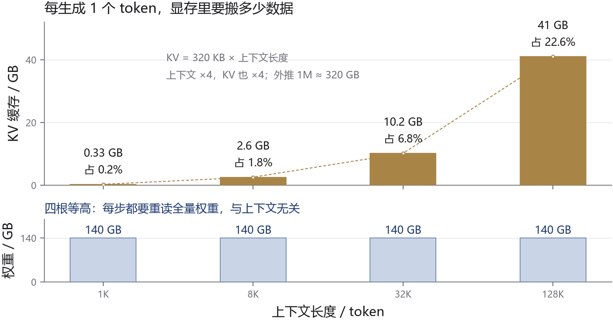
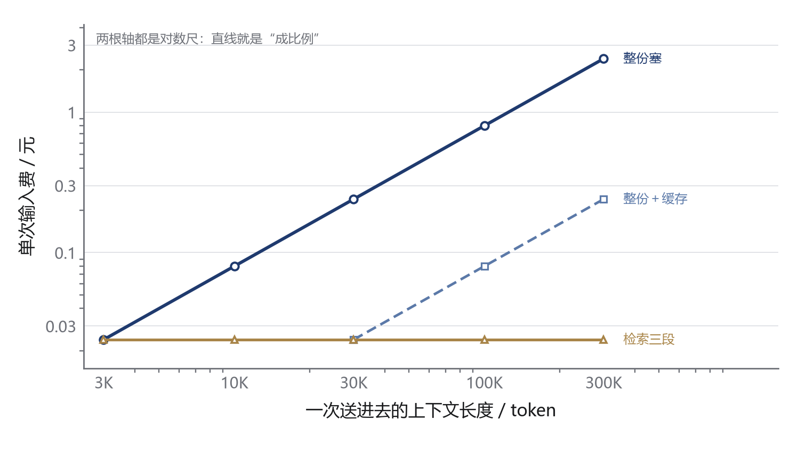

## 一张账单

一个十二人的团队给一家电商做客服机器人，七月上线。上线前他们算过账：一天两万次对话，每次调用按一分钱算，一个月六千块，写进了预算表。

八月结账，两万三千块。

差了近四倍。团队第一反应是“供应商是不是涨价了”，查了报价单，没有。第二反应是“是不是有人在刷”，查了调用日志，也没有。真实的原因是两条缓慢的曲线。

第一条：平均输入从 800 个 token 涨到了 4000 个。上线时提示里只有一段客服话术，后来为了答得准，他们往里加了历史对话、用户订单摘要、知识库检索出来的五段文档、一份三百行的退换货政策。每加一样，都只是几百个 token，没人觉得是钱。

第二条：平均输出从 150 个 token 涨到了 400 个。因为模型换了新版本，回答变得更详细，他们还加了“请解释原因”的要求。

输入涨了五倍，输出涨了不到三倍，账单涨了四倍。这两条曲线乘在一起，就是那张账单。

### 算一遍：把那张账单倒推出来

从两个数字能倒推出单价。上线前：输入 800 token、输出 150，单次一分钱；上线后：输入 4000、输出 400，单次三点九分。

解这组方程，输入价大致是每百万 token 八元，输出价每百万十八元。这和公开定价里中档模型的量级吻合，输出比输入贵两倍多，正是上一节算出来的物理比例。

再看总额。两万次一天，乘 0.039 元，是一天七百八十元；一个月三十天，两万三千四，和故事里的数字对上了。

倒推这条账有用处：它告诉你哪一项是主因。输入占 0.032 元，输出占 0.0072 元，也就是说八成二的钱花在你送进去的那段文字上，而不是它写出来的字。

这和直觉相反。多数人以为“回答越长越贵”，实际上长的是提示，回答只是零头。所以省钱的第一个动作不是让它少说，而是看你每次到底送了什么进去。

这一章把这笔钱拆开。一个 700 亿参数的模型，服务一次请求，到底在花什么。

### 700 亿参数，落在显存里是多少

先说参数。700 亿，写作 70B，指的是模型里可调的数字有 700 亿个。这些数字训练完就固定了，推理时只需要读，不需要改。

每个参数的精度决定它占多少空间。最常见的推理精度是 16 位浮点，每个参数 2 字节。700 亿乘 2 字节，是 1400 亿字节，也就是 140 GB。

这个数字决定了第一件事：一张 80 GB 的显卡装不下。至少要两张，而两张一共 160 GB，装完权重只剩 20 GB，什么都干不了。所以 70B 模型的常见部署是四张 80 GB 的卡，总显存 320 GB。

如果换成 4 位量化，每个参数 0.5 字节，权重降到 35 GB，一张卡就能装下，还余 45 GB。这是量化最直接的收益：把“四张卡”变成“一张卡”，硬件成本降到四分之一。代价是精度损失，通常体现在长尾知识、复杂推理和格式稳定性上，简单的问答和抽取几乎看不出差别。

显存不止装权重。推理时还有两块开销。

一块叫 KV 缓存。模型生成每个 token 时，都要回头看前面所有的 token，为了避免重复计算，前面算过的东西会被缓存下来。这部分大小和上下文长度成正比，后面单独算。

另一块是临时工作区。每一层计算都要产生中间结果，这些结果用完就扔，但同时存在的量不小。上下文越长、并发越多，这块越大。

这三块加起来才是真实占用。很多人以为“70B 模型需要 140 GB 显存”，这只说对了三分之一。

顺带说一个对比：训练时的显存需求和推理完全不是一个量级。训练要存中间结果，还要存优化器状态。常见的优化器每个参数要额外占 8 字节左右，70B 模型光是优化器状态就是 560 GB，加上权重和临时数据，一张卡根本放不下，必须切开放到几十张卡上。推理只需要读，所以两张卡起步；训练要写，所以要一个集群。这也是为什么微调比推理贵得多，而全量预训练只有少数团队做得起。

### 每吐一个字，要搬多少数据

模型生成一个 token，要做多少次运算？

粗略的算法是：每个参数参与一次乘法和一次加法。70B 参数，就是 1400 亿次运算。这个数字听着大，但对 GPU 来说不算什么，一张高端卡每秒能做上千万亿次运算，1400 亿次只占它万分之几秒。

真正的瓶颈不在算，在搬。

生成是逐字进行的。要算下一个 token，必须把全部 140 GB 权重从显存读进计算单元。这里容易误会：权重没有被改，也没有被丢掉，它们一直躺在显存里；只是计算单元的片上缓存装不下 140 GB，所以每算一个 token，都要把同一份权重重新搬一遍。

搬运速度由显存带宽决定。假设一张卡的带宽是每秒 3.35 TB，140 GB 除以 3.35 TB，约等于 42 毫秒。也就是说，单卡、不做任何并行的情况下，每生成一个 token 至少要 42 毫秒，一秒最多 24 个字。这是物理上限，跟模型多聪明、代码写得多好都没关系。

把权重切到 8 张卡上，每张卡只读自己的 17.5 GB，理论上 5.2 毫秒一个 token，一秒 190 个字。实际达不到，因为卡与卡之间要通信、要同步，实际能到 50 到 90 个字每秒，已经算不错。

这里有一个反直觉的结论：大模型推理的瓶颈是显存带宽，不是算力。提高算力对生成速度帮助有限，提高带宽才有用。这也是为什么新一代加速卡拼命堆显存带宽，而不是只堆浮点性能。

这条判断有边界。它成立的前提是“一次只算一个 token”。批量变大之后，同一份权重一次要跟几十个输入做运算，计算量随批量线性上涨，而权重只读一遍，天平就往算力那边倒。所以一个服务集群里，小批量时是带宽瓶颈，大批量时是算力瓶颈。第 18 章会讲调度怎么在这两者之间找平衡。

### 上下文为什么按长度收费

上下文贵，有两个来源，性质完全不同。

第一个来源是注意力的计算量。模型在处理一个 token 时，要跟前面每一个 token 做一次相关性计算。序列长度翻倍，两两之间的配对数量翻四倍。这就是所谓的平方增长。4000 个 token 的输入，注意力部分要做大约 1600 万次配对；8000 个 token，是 6400 万次。

这个平方只影响“读入”阶段。模型一次性处理你给的全部输入时，要把所有位置两两算一遍，所以输入越长，这一段的计算量涨得越快。这就是为什么上传一份两百页的 PDF，等首字要等很久。

等到开始逐字生成，情况变了。生成第 N 个字时，前面的内容已经在缓存里，只需要拿当前这个字去跟缓存里的 N 个位置各算一次，是线性增长，不是平方。

第二个来源是 KV 缓存，这个更持久，也更占地方。算法是这样的：每一层、每一个 KV 头，都要为每个 token 存一份键和一份值。以一个 70B 级的常见配置为例，80 层，8 个 KV 头，每个头的维度是 128，每个数 2 字节。

算一下：2 乘 80 层，乘 8 个头，乘 128 维，乘 2 字节，等于 327680 字节，大约 320 KB。

一个 token 的缓存是 320 KB。这个数字要记住，后面全靠它。

8000 个 token 的上下文，缓存是 8000 乘 320 KB，等于 2.56 GB。一次请求就吃掉 2.5 GB 显存。128K 上下文，是 41 GB，已经超过一张 80 GB 卡的一半。一百万 token 上下文，是 320 GB，比模型权重还大一倍多。

这就解释了一件事：为什么“支持一百万 token”是一个很贵的承诺。它不是把窗口调大一点那么简单，它意味着每来一个请求，显存里就要多留出几百 GB。能这么干的系统，要么并发压得极低，要么硬件堆得极多。

### 价格是怎么标出来的

现在可以把所有东西换成钱。

一台八卡机器的租用价格大致是每小时 25 美元，也就是每张卡每小时 3 美元左右。这个价格波动很大，从 2 美元到 8 美元都出现过，取 3 美元是一个中间值。

这台机器在良好批处理下，综合吞吐大约是每秒 5000 个 token。这是个量级估计：八张卡，每张每秒六百多个 token，输入输出混算。

一小时 3600 秒，产出 1800 万个 token。25 美元除以 1800 万，再乘一百万，得到每百万 token 约 1.4 美元。

这个数字和市面上 70B 级模型的实际报价在同一个量级。差距来自几个地方：有的厂商自己有卡，折旧算得低；有的用的是更便宜的卡或者更小的模型；有的靠极高的利用率把成本压下去；也有的在亏本换市场。

把这条账反过来用，能得到几个判断。

第一，价格和模型大小大致成正比。参数量翻倍，权重翻倍，每 token 要搬的数据翻倍，成本大致翻倍。这是为什么小模型便宜得离谱：一个 7B 模型，权重只有 14 GB，一张卡能装，吞吐是 70B 的十倍以上，价格能差一个数量级。

第二，输入和输出的价差有物理原因。读入阶段算力利用率高、可大批量并行；生成阶段受带宽限制、批处理规模受显存限制。所以输出贵 3 到 4 倍是合理的。如果某家输出只比输入贵一点，要么它在补贴，要么它把输入价格抬高了。

第三，长上下文该单独收费。128K 上下文的请求，KV 缓存是 8K 的 16 倍，并发掉到十六分之一，单位成本涨了一个数量级。按同样的单价卖，是亏的。

### MoE 与缓存：两个改变单价的开关

前面算的是一个“稠密”模型：每个 token 都要把所有参数过一遍。现在主流的模型不少是另一种结构，叫混合专家，它对单价的影响很直接。

MoE 的做法是把模型里的一层换成很多个并列的“专家”，每次来一个 token，由路由网络决定送到其中两三个去算。几千亿总参数的模型，每个 token 可能只用到几百亿。计算量按“用到的”算，所以生成同样多的 token，它的算力成本接近一个几百亿的模型。

但显存不能省。所有专家都得装进显存，因为不同 token 会用到不同专家。所以一个“总参数一千亿、每 token 只用两百亿”的模型，计算成本像两百亿的，显存占用像一千亿的。这决定了它的适用场景：流量大、并发高的服务里，它很划算，因为算力省下来了；小规模私有部署里，它不划算，因为显存浪费，一张卡装不下。

这对定价的影响是：MoE 模型的输入输出单价往往比同参数量的稠密模型低得多，但它对并发和显存的要求更高。所以你会看到“某个千亿模型比另一个千亿模型便宜一半”这种事，不一定是它在补贴，可能是它的结构不一样。

另一个开关是缓存。如果你的多次请求共享同一段长前缀（比如同一份系统提示、同一份文档），很多系统支持前缀缓存：这段内容只算一次，后面的请求直接复用，价格常常只有标准输入价的一成到五成。

对于“同一份长文档问十个问题”这种场景，前缀缓存能省掉九成的输入成本。这也是为什么提示的写法会影响账单：把不变的内容放前面，把变化的内容放后面，缓存才能命中。反过来，如果你每次都在提示开头加一句时间戳，缓存就永远不命中，钱就白花了。

### 自己部署还是买 API

这笔账算到最后，会落到一个实际决定上。

自己买卡的固定成本很高，而利用率很难做满：白天忙、夜里闲，平均下来可能只有三成。API 提供方把几千个客户的请求混在一起，利用率能到七八成，这个差距比硬件差价大得多。

所以只有当天均 token 量足够大、且流量足够平稳时，自建才划得来；量小的时候，自建的单价一定高于 API，哪怕卡是你自己的。

中间还有一个选项：租用按小时的 GPU，自己部署开源模型。它适合“数据不能出内网”或者“要做很定制的事”的场景，代价是你得自己维护推理服务、监控、扩容。

| 成本项 | 随什么变 | 怎么省 |
|---|---|---|
| 权重搬运 | 参数量、精度 | 换小模型、量化 |
| KV 缓存 | 上下文长度、并发 | 缩短历史、检索代替全文 |
| 输入 token | 提示长度、检索段数 | 前缀缓存、按需取段 |
| 输出 token | 回答长度 | 限制字数、去掉解释要求 |

### 同一份文档，三种送法

图里三条线是同一次提问的三种送法，纵轴是这一问的输入费，两根轴都取了对数。

整份塞进去，钱和长度成正比：长度翻十倍，钱也翻十倍，画出来是一条斜线。三百千 token 的那一问，按每百万八元算是 2.4 元。

同样的整份，如果命中前缀缓存，只按一成计价，是 0.24 元。缓存有生存期，常见是几分钟到一小时，所以它奖励的是“连续追问同一份材料”，不是“今天问一次、明天问一次”。这一条决定了产品的交互设计：把追问做成同一个会话里的连续动作，钱能省一个数量级。

检索三段是那条横线：不管文档多长，只送三千 token，0.024 元。和前两条差了一百倍。这也是为什么“支持一百万 token”和“每次都塞一百万 token”是两件完全不同的事——前者是能力，后者是账单。

还有一处容易忽略：命中要求前缀完全一致。同一段系统提示，你在末尾加一句“今天是几号”，后面所有缓存失效，而这一句只值几个 token。把会变的部分放到最后，是不花钱的优化。

缓存还有两个前提：命中按前缀逐段比对，改一个字，从那个字之后全部失效；缓存只在同一台机器、同一份权重上有效，换一个副本等于从零开始。所以做负载均衡时，把长前缀相同的请求尽量打到同一组副本上，这一条常常比换模型更省钱。

MoE 的账要分两栏算。总参数一千亿、每个 token 只用两百亿，四位存权重是 50 GB，一张 80 GB 卡装得下；但每 token 的计算量按两百亿算，出字能到每秒八十个。它的贵不在算力，在显存：装得下不等于开得出并发。

### 四个常见的误解

第一个误解是“按 token 计费就是按字数计费”。中英混排时差得很远，同一段意思中文可能比英文多三成 token；代码和数字切得更碎，一页代码常常比一页文字更贵。

第二个误解是“输出越长越贵，所以让它简短就行”。多数账单里输入才是大头。一段三千 token 的检索材料，比多写两百字贵得多。

第三个误解是“缓存会自动生效”。前缀缓存要求每次请求的开头完全相同。你在系统提示最前面加一句当前时间，缓存就永远不命中，一分钱也省不下来。

第四个误解是“报价单上的单价就是实际成本”。实际成本还要乘上重试、工具调用、失败的请求。一个成功率九成的系统，真实单价是标价的 1.1 倍；如果失败后要重试三次，就更贵。

回到开头那个团队。他们的账单涨了四倍，现在可以拆开了：输入从 800 涨到 4000，多出来的 3200 个 token 里，有多少是知识库检索塞进来的、有多少是历史对话、有多少是那份三百行的政策文档。如果政策文档每次都全文塞进去，改成按需检索三段，输入能砍掉一多半。如果历史对话只保留最近五轮加一个摘要，又能砍一截。输出从 150 涨到 400，如果去掉“请解释原因”，或者要求“三句话以内”，账单立刻下来。

这些都不是模型能力问题，是用法问题。

::: {.keypoint}
**记住这三件事**

一、显存要装三样东西：权重、KV 缓存、临时工作区；70B 模型光权重就 140 GB，四张卡起步。

二、生成一个字要把全部权重读一遍，所以瓶颈在显存带宽；输出比输入贵三到四倍，原因是物理的，不是定价策略。

三、单价还被两件事改写：MoE 让算力成本按“用到的参数”算，前缀缓存让重复的长输入几乎免费。
:::

下一章接着算另一笔账，但换一个角度：不是花多少钱，而是同样的钱，为什么有的产品快、有的产品慢。
