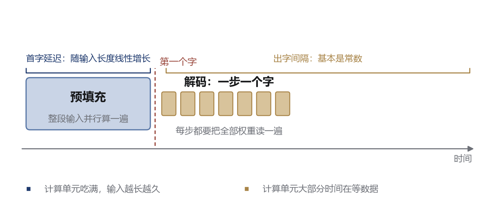

## 跑起来才知道

同一个模型，两个产品。

在 A 产品里，你按下回车，半秒后文字开始出现，读起来跟得上你的眼睛。在 B 产品里，同样的提示，白屏三秒，然后一下子涌出一大段。

模型是同一个，价格也差不多。差的不是模型，是部署。

这一章讲这件事：一次调用在机房里到底经历了什么，为什么快慢差这么多，以及为什么“同一个模型”这个说法在性能上根本站不住。

### 两个阶段，两种瓶颈

第 2 章说过，一次生成分两段。现在把这两段摊开算。

第一段叫预填充。你输入的整段文字一次性送进模型，所有位置同时计算。因为注意力只依赖左边的位置，而这些位置都已经存在，所以这一整批计算可以并行铺开，把显卡的计算单元喂满。这一段是算力密集的：卡越强、卡越多，它越快。它的耗时大致和输入长度成正比，注意力的部分还要再乘一个长度因子。

第二段叫解码。从第一个字开始，每步只产出一个 token。前面那些位置的计算结果已经存进缓存，不必重算。所以每一步的计算量很小，但有一个绕不过去的动作：把整个模型的参数从显存读一遍。几百亿个数，就为了算一个 token。

所以第二段是带宽密集的：计算单元大部分时间在等数据。换一张带宽更高的卡，出字明显变快；换一张算力更强、带宽没提升的卡，几乎没变化。

这两个阶段的差别，直接决定了用户感受到的两个指标。

首字延迟，是从你按下回车到第一个字出现的时间。它主要由预填充决定，所以输入越长，它越久。上传一份两百页的 PDF，等十几秒很常见。

出字速度，是第一个字之后，每秒能出几个字。它由解码决定，和输入长度关系不大，和模型大小、卡的数量、带宽关系很大。人阅读中文的速度大概是每秒五到八个字，出字速度到二十以上，体验上就“跟得上”了。

这两个指标要分开看。一个产品首字慢、出字快，你会觉得“启动慢但流畅”；首字快、出字慢，你会觉得“反应快但打字慢”。多数产品优化的是前者，因为等待开始比等待过程更难受。

### 批处理：吞吐和延迟的交换

一台八卡的机器，如果一次只服务一个请求，绝大多数时间在等显存。这是巨大的浪费。

批处理解决的就是这个。把同时到达的多个请求拼成一批，一次读权重，给所有请求各算一个 token。批越大，权重读取被摊得越薄，单位成本越低。

假设批大小是 32，一次读 140 GB 权重，同时推进 32 个请求。权重成本摊到三十二分之一，单位算力成本降了一个数量级。这就是为什么 API 能卖到每百万 token 一两美元，而你自己拿一张卡跑单请求，算下来要贵几十倍。

代价是延迟。一批里的请求要一起走，谁的输出长，谁就把别人的时间占了。最简单的做法是攒够一批一起跑，等这一批全部结束再收下一批。问题是请求长短不一：一个只要三十个字的请求，得陪着一个要三千字的请求等到最后。

真实系统用的是连续批处理：每生成一个 token 就看一眼队列，谁结束了就把它踢出去，把空位让给排队的人。这样显存里始终是满的，吞吐能接近理论上限，单个请求的等待也不会被特别长的请求拖住。这是工程细节，但它决定了同样的硬件能服务多少用户，也就直接决定了价格。

批大小不能无限大，卡在显存上。前面算过，权重 140 GB 固定不动，剩下的全给 KV 缓存。上下文 8000 token 时每个请求占 2.5 GB，四张卡剩下的 160 GB 大约能容纳六十来个并发；上下文提到 128K，每个请求占 41 GB，只能容纳三四个。

所以长上下文和高并发不能同时便宜，因为它们在抢同一块显存。这不是商业策略，是显存账本的直接翻译。

### 同一个模型，为什么快慢不同

现在可以回答开头的问题了。同一个模型在两个产品里表现不同，通常是这几件事的差别。

第一，量化版本不同。4 位量化的权重只有 16 位版本的四分之一，每步要搬的数据也少四分之三，出字速度能快两三倍。代价是精度。所以“同一个模型”在一个产品里跑的是 16 位，在另一个里跑的是 4 位，速度差一倍多很正常。

第二，卡型不同。带宽差一倍，出字速度就差一半。这件事和模型无关，和机房采购有关。

第三，批大小不同。服务方为了吞吐，会把批开大；批越大，单个请求的等待越长。所以高峰期同一个产品的响应会变慢，不是因为模型累了，是因为排队的人多了。

第四，上下文长度不同。A 产品可能只把你的问题和最近五轮对话送进去，B 产品把整份文档加全部历史都送进去。后者的预填充时间长好几倍，首字自然慢。

第五，路由和限流。同一个界面背后可能有好几个模型，简单的请求走小的，复杂的走大的。你遇到的快慢，取决于这次请求被分到哪一档。

第六，缓存命中。如果你的请求前缀和之前某个请求相同，服务方可以直接复用那一段的计算结果，首字快很多。这就是为什么同样的提示，第一次慢、第二次快。

### 为什么第一次特别慢

很多人有过这种体验：早上第一个请求特别慢，之后就好了。或者刚上传完一份文档，第一问等了很久，第二问很快。

原因有几个。

一是冷启动。模型权重有几十到几百 GB，得从硬盘读进显存。这件事在服务刚启动时做一次，耗时几十秒到几分钟。之后权重一直在显存里，不再读。所以“第一个用户”替所有人付了这笔钱。

二是编译与预热。推理引擎在第一次跑某个形状的输入时，会做一些优化和编译，之后的请求复用这些结果。第一个请求因此慢一些。

三是缓存未命中。前缀缓存只有在“这段前缀之前算过”时才有效。新的一天、新的会话、新的系统提示，缓存都是空的。

四是路由冷启动。有些系统会把请求分配给多个副本，新扩容出来的副本还没预热，第一批请求会落在它身上。

这些延迟对单个用户来说是随机的，对系统来说是可预测的。所以成熟的服务会做“预热”：启动后先跑几个假请求，把缓存和编译都热起来，再接入流量。

### 自己部署要盯的四个指标

如果你真的自己部署一套，监控这四个数就够了。

第一个，首字延迟。它的分位数比平均值重要，p50 和 p95 都要看。它涨了，通常是输入变长了、并发上来了、或者某张卡出了问题。

第二个，每 token 耗时。也就是出字间隔的倒数。它基本是常数，一旦变大，多半是带宽被打满，或者有人在跑长上下文把显存挤住了。

第三个，吞吐。每秒处理多少 token，或者每秒完成多少次请求。它决定了单位成本。

第四个，显存水位。权重是固定的，KV 缓存是浮动的。水位长期在九成以上，说明并发已经到顶，再加流量就会开始排队甚至报错。

这四个数放在一张图上，能看出很多事：吞吐上去了但首字延迟也上去了，说明批开得太大；吞吐上不去但显存满了，说明上下文太长、并发上不来；四个数都正常但用户抱怨慢，说明问题在网络或者前端。

### 流式输出改变了什么

有一个优化不改变任何硬件，但体验差别巨大：流式输出。

不流式的时候，模型要把整段话生成完，才一次性返回。用户看到的是：等待 N 秒，然后整段出现。等待时间里没有任何反馈，超过三秒，人就开始怀疑是不是卡了。

流式的时候，每生成一个 token 就推给前端。首字时间不变，但用户在第一个字出现时就知道“它在工作”，接下来的等待被阅读填满了。总的完成时间一样，感受完全不同。

这件事的代价在工程上：连接要保持长、要处理中断、要处理“用户看到一半就关了”的情况。所以早期很多产品不做，现在几乎都做。

还有一个相关的技巧：先把“思考”藏起来，只流式输出正文。用户看到的是正文在出，而不是一大段推理在滚。这既是体验问题，也是信息呈现问题。

### 引擎在下面悄悄做的事

模型装进显卡之后，还要一套推理引擎来调度。它做三件事，用户感知不到，但它们决定了同样硬件的实际表现。

连续批处理：不等一整批请求都结束才换下一批，而是谁先写完谁先走，空出的位置立刻补上新请求。没有这个，短请求会被长请求拖住。

分页式的缓存管理：把 KV 缓存切成固定大小的块，像操作系统管理内存那样按需分配。没有这个，显存会被碎片浪费掉一大截，能同时服务的人数就上不去。

前缀缓存：很多请求共享同一段系统提示，这段的计算结果只算一次，后面直接复用。没有这个，同一个应用里每个人的请求都要把那段长提示重算一遍。

这三样东西一点也没有改变模型本身。它们改变的是同一张卡每秒能服务多少人，也就是单位成本。用户感知到的是“便宜了、快了”，模型感知不到任何事。

### 延迟的尾巴

平均值会骗人。

一个系统平均响应两秒，听起来可以。但如果 p95 是八秒，意味着每二十个用户里有一个等了八秒。而这一个人，很可能就是当天最不满意的那个。

延迟的分布通常长这样：大部分请求很快，少数请求很慢。慢的原因有几种：赶上了大批、赶上了长输入、赶上了服务方的扩容延迟、赶上了网络抖动。

所以要看的指标不是平均，是分位数。p50 看典型体验，p95 看坏体验有多坏，p99 看极端情况。做容量规划时，通常按 p95 来定，因为用户记住的是最慢的那次。

还有一个反直觉的现象：系统越接近满载，延迟越非线性。利用率七成时，加一点流量，延迟涨一点；利用率九成时，加同样的流量，延迟可能翻倍。原因是排队。所以容量规划要留余量，不能按“刚好够”来算。

### 一条粗略的容量算式

如果你要估一台机器能服务多少人，可以这样算。

假设模型 70B，16 位权重 140 GB，四张 80 GB 卡。留给 KV 缓存的显存按 160 GB 算。平均上下文 8000 token，每个请求占 2.5 GB，能容纳约 60 个并发。

每个并发每秒出 30 个字，总吞吐是每秒 1800 字。如果一次对话平均输出 300 字，那么每秒能完成 6 次对话；一天八小时高峰，大约 17 万次。

这个数字是理论上限，实际要打对折，因为要留余量、要处理长请求、要应对突发。

把这条账反过来用，也能看出成本从哪里降：上下文减半，并发翻倍；量化到 4 位，权重从 140 GB 降到 35 GB，留给缓存的显存多了 105 GB，并发能翻一倍多；换带宽更高的卡，出字速度上去，同样的并发能在更短时间内完成更多请求。

这些都不是模型能力问题，是部署问题。但用户感受到的，恰恰是这些。

::: {.keypoint}
**记住这三件事**

一、一次生成分两段：预填充算力密集、随输入变长；解码带宽密集、每步读一遍权重。

二、首字延迟和出字速度是两个指标，前者看预填充，后者看带宽；流式输出不改变总时间，但改变了感受。

三、同一个模型快慢不同，多半是量化版本、卡型、批大小、上下文长度和缓存命中在起作用，不是模型本身。
:::

下一章讲另一个让模型“看起来不一样”的因素：怎么判断它到底好不好。
