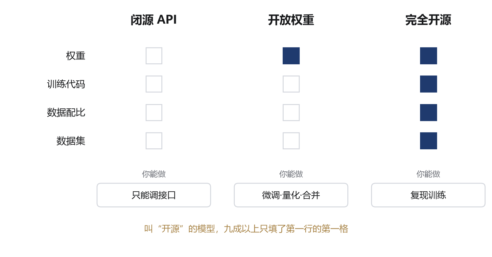
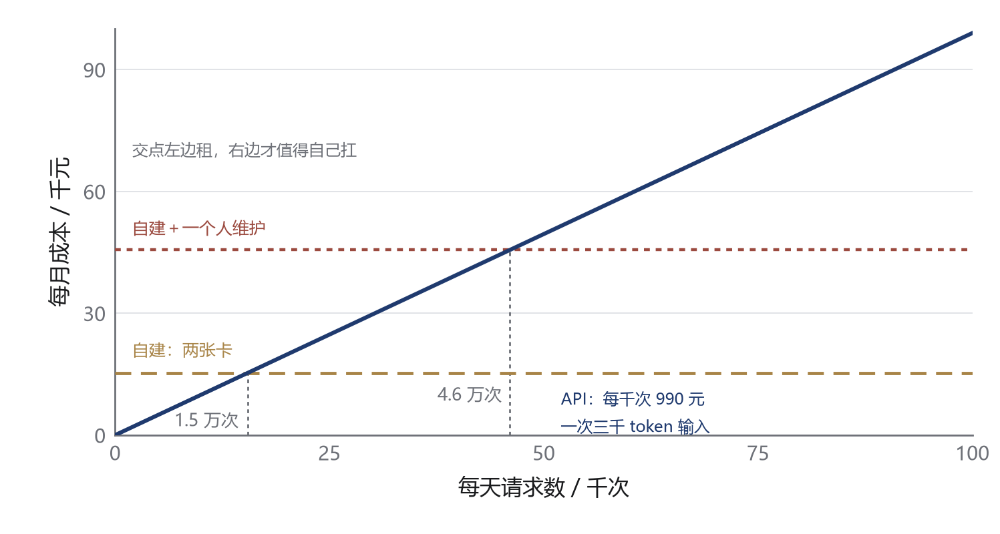

## 模型从哪来

一家做医疗器械的公司要上 AI 辅助功能。立项会上，法务问了三个问题，把技术方案砍掉了一半。

第一个，病人的数据能不能出医院。答案是基本上不能。

第二个，能不能私有部署。答案是可以，但只能部署开放权重的模型。

第三个，用的那个模型许可证，允许商用吗，有没有用户量门槛。技术负责人当场答不上来，回去查了半小时，发现他们原本打算用的那个模型，许可证里有一条“月活超过七亿需要单独申请授权”。

这三个问题决定了选项集，而它们和模型聪明不聪明完全无关。

这一章讲模型从哪来：有哪几种获取形态，许可证到底约束了什么，以及“开源”这个词在这里为什么特别容易误解。

### 三种形态

按你能拿到什么，大致分三种。

第一种是闭源 API。你调接口，拿结果。模型的权重、结构、训练数据你都看不到，也拿不到。好处是最省事，模型最强的那一档往往只以这种形式提供；坏处是你被绑在供应商身上：价格会变、模型会下架、接口会改、数据要出你的机房。

第二种是开放权重。你能下载到一份权重文件，能自己在自己的机器上跑，能微调，能量化。但训练数据、训练代码、中间检查点通常不给。这是今天最常见的一种“开源”，严格说是“开放权重”，不是开源软件意义上的开源。

第三种是完全开源。权重、训练代码、数据配比、甚至部分数据集都给。这种很少，因为训练成本高、数据有版权争议、而且开放之后很难收回。它的价值主要在研究和可复现性上，商业上反而不是主流。

这三者的差别不在于“能不能用”，在于“你能不能控制它”。控制包括：能不能私有部署、能不能改、能不能审计、供应商停止服务时你还能不能用。

图里的实心块表示“给了你”。三列从上往下看，很快能看出那个关键事实：绝大多数被叫作“开源”的模型，第一行有，后三行空。这就是为什么业内更愿意说“开放权重”——它给的是成品，不是配方。

### 为什么有人愿意开放权重

这件事一开始不好理解：训一个模型花几千万美元，为什么把成果免费放出来？

理由有几层。

一层是竞争。当一个领先者的模型只能通过接口调用时，后来者无法在其上做应用；开放权重能让整个生态围绕自己的技术栈生长，长期收益大于短期授权费。

一层是信任。金融、医疗、政府这类客户，要求模型能部署在自己的机房里、能被审计。不开放权重，这部分市场就进不去。

一层是人才和标准。一个被广泛使用的模型家族，会成为事实上的接口标准：工具链围着它写，教程围着它讲，新人围着它学。这种影响力和授权收入是两条不同的曲线。

还有一层是纯粹的研究价值：开放权重让外面的人能研究它的行为、找它的缺陷，这反过来推动整个领域。

但“开放”是有程度的。最保守的是只放权重和推理代码，训练数据和方法完全不公开；中间的是公布数据配比、训练技巧、评测细节；最激进的是连数据集一起放。绝大多数所谓“开源模型”落在最保守那一档，所以业内更愿意叫它“开放权重”。

这个区别对使用者的影响很实际：只放权重，意味着你无法复现它的训练、无法审计它的数据来源、也无法自己继续预训练。你能做的只有二次加工。

### 许可证到底约束什么

开放权重不等于随便用。每一份权重都带一份许可证，条款差别很大。

宽松的一类（比如 Apache 2.0、MIT）基本只要求保留版权声明，商用、修改、再分发都可以。这类最省心，很多小模型和早期的开放模型用这种。

社区许可更复杂，常见几类条款：一是用户量门槛，比如月活超过某个数字要单独申请；二是用途限制，比如禁止用于某些特定领域；三是署名要求，比如产品里要标注使用了谁的模型；四是“衍生模型必须同名许可”，也就是你微调出来的模型也要按同样的条款开放。

还有一类是“可商用但有限制”的中间态：研究可以随便用，商用要申请；或者小规模商用可以，超过规模要谈。

这些条款的实际影响，往往在项目后期才暴露。一个常见的坑是：团队早期用一个许可证宽松的小模型做原型，效果不错，转到生产时换成一个大一点的模型，没注意许可证变了，上线三个月后被要求整改。

所以选型的第一步不是比分数，是把许可证读一遍，重点看四条：能不能商用、有没有用户量门槛、改完之后能不能闭源、要不要署名。这四条决定了你的产品形态。

### 权重能改什么，不能改什么

拿到权重之后，能做的事比想象的多，但有一条硬边界。

能做的：微调。用你自己的数据调整参数，让它在你的任务上更准，或者学会你的格式和语气。量化。把 16 位压到 8 位、4 位，让它能跑在更小的机器上。蒸馏。用它当老师，训一个更小的学生。剪枝。删掉一部分结构，再补训。合并。把两个同架构的微调模型按参数加权平均，常常能兼得两边的一部分能力。

不能做的：改架构。层数、维度、注意力头的排布，在训练时就和权重绑定了。你想加一层、想换一种注意力，只能重新训练，不能“改一改”。

这条边界决定了开放权重的实际价值：它给你的是“在别人训好的基础上做二次加工”的能力，不是“从零造一个模型”的能力。二次加工能解决很多问题，但解决不了“这个模型的底子不够”的问题。

### 微调生态：一个真实的集市

开放权重催生了一个很大的生态。

最活跃的是轻量微调。一张消费级显卡，几小时到一天，就能在自己的数据上训一个“适配器”。适配器文件很小，几十到几百 MB，加载时叠在基础模型上。这让人人都能做定制模型，成本从几万美元降到几十美元。

然后是分享。有人把适配器传到公共仓库，别人下载即用：二次元画风、某个行业的术语、某种写作风格、某种编程语言的习惯。数量以十万计。

再有是合并。把几个适配器或者几个微调模型按权重平均，常常能得到一个“什么都会一点”的版本。这件事在社区里很流行，效果时好时坏，取决于参与合并的模型是不是同源。

这个集市有真实的价值：很多细分需求，社区里已经有人做过，你下载来改改就能用。也有真实的风险：你不知道那个适配器是怎么训的，用了什么数据，有没有被塞进奇怪的行为。有些模型被专门“去对齐”过，去掉了安全限制，用它们做产品会带来合规风险。

所以用社区模型的规矩和用开源软件类似：看来源、看下载量、看有没有人审计过、自己在测试集上跑一遍。不同的是，软件的问题能被扫描工具发现，模型的行为很难被自动检查。

### 自建一套要多少工程量

很多人以为开放权重的意思是“下载下来就能用”。能跑起来和能上线，中间隔着一段工程。

第一段是推理服务。你要选一个推理引擎，把权重加载进去，配好批处理、缓存、并发上限，接一个 HTTP 接口。这一步有现成的方案，一两天能跑通。

第二段是硬件。模型多大决定卡多少张。70B 的 16 位版本要四张 80 GB 卡；4 位量化能压到一张。租还是买，取决于利用率。这一段的账第 16 章算过。

第三段是稳定性。要监控显存、延迟、错误率，要处理模型进程崩溃、卡掉线、请求排队。要有限流，否则一个用户的长请求能把所有人拖住。要有降级方案，比如高峰期自动切到小模型。

第四段是更新。新版本出来要不要跟？跟了要重新评测、重新调提示、可能要重新微调。不跟，半年后你的模型就落后一代。这件事没有一劳永逸的解法，只能排期。

第五段是安全。模型本身的安全策略、输入输出的过滤、日志与审计、以及“用户能不能用自己的数据微调”这类权限问题。

这五段加起来，通常是一个小团队几个月的活，之后是持续的维护。所以“开放权重省钱”这句话要加一个前提：你的量足够大，大到能把这份固定成本摊薄。量小的时候，API 的单价里其实包含了别人的这份成本，而你省下的只是账面数字。

### 家族与代际：怎么读一个名字

今天的模型大多以“家族”的形式发布：同一个系列里有大小几档，还有针对代码、数学、视觉的专用版本，以及从大模型蒸馏出来的小版本。

名字里通常包含几段信息：家族名、参数量、版本号、变体标记。参数量是最容易读的，比如 7B、70B。变体标记表示它是基础模型、指令微调版、还是推理版。版本号最容易被忽略，而它最重要：同一个名字，隔半年可能就是另一个模型。

这带来两个实际问题。

一是横向比较必须有日期。你看到一张表说“A 比 B 强”，先看它是哪个月做的。半年前的结论，今天可能反过来了。

二是同家族内部的选择反而更清晰。如果你已经决定用某个家族，选大小就是选成本：先用小的，不够再升一档；同一家族的提示写法、格式要求、工具调用方式基本一致，迁移成本低。这也是很多团队的做法：不追最强的，追一个稳定的家族，跟着升级。

### 一个小团队的实际路径

把上面的东西套进一个具体场景：五个人的团队，做面向中小企业的合同初审，客户三百家，每天处理一千份文档。

第一步，他们先用最大的闭源 API 做基线。不是为了上线，是为了知道“这件事最好能做到什么程度”，以及自己的一百条评测集能拿多少分。这一周花几百美元。

第二步，他们把同样的评测跑在几个开放权重的模型上。发现一个中档的模型分数只低三个点，但在“条款定位”上更稳，因为它能装下整份合同。

第三步，算账。每天一千份、每份三千 token 输入、五百 token 输出，一天是三百五十万输入、五十万输出。用 API 一个月几百美元；自己部署一张卡，租金一个月也是几百美元，但要多一个人的维护时间。

第四步，看数据要求。客户合同属于敏感数据，多数客户要求不出境、不留存。这一条把 API 排除了。

第五步，落地。租两张卡，部署那个中档模型，前面加检索，后面加一个格式校验。评测集每月更新一次，模型每季度评估一次要不要升级。

这个路径不是唯一正确的，但它的顺序值得参考：先用最强的定基线，再用自己的数据比，再算账，最后看约束。反过来做（先选一个便宜的，再想办法证明它够用）通常会走很多弯路。

### 算一遍：自建比 API 贵多少

把第三步的账算细。一天一千份，每份输入三千 token、输出五百。

一个月按三十天算：输入九千万 token，输出一千五百万。

按输入每百万八元、输出每百万十八元算，API 的费用是 720 元加 270 元，一共九百九十元，一个月不到一千块。

自建：两张 80 GB 的卡，按每卡每小时三美元租金，一个月七百三十小时，是 4380 美元。折成人民币三万一。这还没算那个维护的人。

差了三十倍。

所以“开放权重更便宜”在中小规模上是反的。你真正买到的不是便宜，是“数据不出机房”和“随时能改”。对医疗器械这类客户，这两样值三万一个月；对一家电商的客服机器人，它们一文不值。

这条账还有一个推论：量越小，越该用 API；量越大，差价越窄，因为自建的固定成本被摊薄。拐点大致在“一张卡常年跑满”的位置——到了那一步，自建的单价比 API 低，之前都不是。

### 怎么选：五个问题

把这一章收成五个问题，按顺序问。

数据能不能出去？不能，就只能在开放权重里选，或者要求供应商提供私有部署。

量有多大？量小，用 API 最省事；量大且稳定，自建或租卡才划得来。

需要多深的定制？只是格式和语气，提示加微调就够；需要模型“长成你的业务形状”，才值得投入训练。

许可证允许你的产品形态吗？商用、用户量门槛、能否闭源、要不要署名，这四条先过一遍。

长期谁来维护？开放权重意味着模型、推理服务、安全补丁、版本升级都要你自己管。没有这个人力，API 的“贵”其实是把运维成本打包进了单价。

这五个问题答完，选项集通常只剩两三个，剩下的才是比分数。

### 拐点不是一个固定数字

图里那条斜线是 API 的月账单，两条横线是自建的月成本：只算两张卡是一万五，加上一个人是四万六。斜线与横线的交点，就是“自己扛机器”的门槛。

交点会移动，被三件事推着走。单价谈下来了，斜线变平，交点右移——这也是大客户最后往往还是用 API 的原因：量大到能谈价，自建的优势就没了。缓存命中率高，等效单价降一半，同样右移。自建那两张卡常年只有三成利用率，横线不变但分母变小，交点左移——量不稳定的时候，自建看着便宜，算上闲置就贵。

一个常见的算错法：只算卡租金，不算人。上面那个例子里，卡是一万五，人是三万，后者是前者的两倍。漏掉这一项，拐点会算小一半，然后在真实账单上补回来。

所以“自建还是 API”不该问一次，该每季度问一次：量变了、价变了、人变了，答案都会变。多数团队踩的坑不是选错，是选完就不再回头看。

一个可以照抄的做法：把“我们为什么选这条路”写成一页纸，写清量、价、约束、维护人四件事，每季度对一遍。半年后回看，这页纸比任何选型报告都有用，因为它是唯一记录了当时假设的东西。

许可证上真正会咬人的通常只有三句：能不能商用、月活超过某个数要不要另签、衍生模型是否必须同许可。第三句最容易被忽略，它决定了你的微调成果能不能闭源卖。签之前把这三句抄进项目说明，比事后找律师便宜。

### 四个常见的误解

第一个误解是“开源就是免费”。权重免费，硬件、带宽、运维、评测、升级都不免费。一份能上线的自建服务，真实成本里算力只占一半。

第二个误解是“开放权重意味着能复现”。没有数据配比和训练代码，你复现不出它的能力。你能做的是二次加工，不是重走一遍它的路。

第三个误解是“许可证只看能不能商用”。用户量门槛、署名要求、衍生模型是否必须同许可，这三条经常在项目后期咬人。上线三个月被要求整改的案例，多半栽在这里。

第四个误解是“社区模型下载量高就靠谱”。下载量说明它流行，不说明它干净。有没有被去过安全对齐、训练数据从哪来，这两件事必须自己查一遍。

::: {.keypoint}
**记住这三件事**

一、模型有三种拿法：闭源 API、开放权重、完全开源；差别不在能不能用，在你能不能控制它。

二、开放权重不等于随便用，许可证要看四条：能否商用、有无用户量门槛、改完能否闭源、要不要署名。

三、权重能微调、量化、蒸馏、合并，但不能改架构；社区模型好用，但要自己审一遍。
:::

下一章讲最后一组问题：把这些东西放进真实业务里，会在哪些地方出事。
