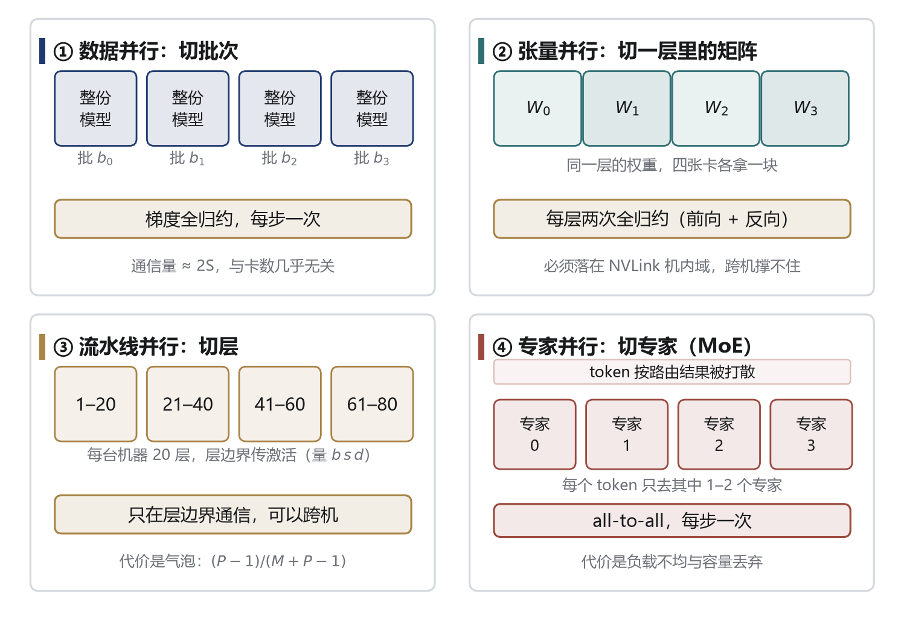
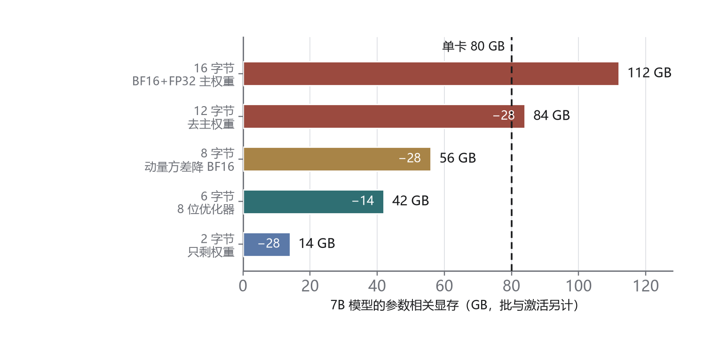
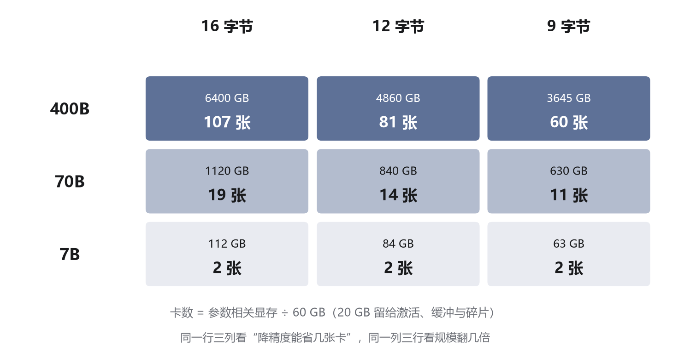

## 四种切法的全景

一个七人小组买了八张 A100，兴冲冲地把 7B 模型的训练脚本改成 8 卡启动，第一步就 OOM 了。他们的第一反应是"卡是不是没挂上"，第二反应是"把批改小一点"，第三反应才是"去查显存都花在哪了"。

批改到 1，还是 OOM。把模型换成 1.3B，能跑了，但八张卡的吞吐只有单卡的 5.2 倍，扩了八倍硬件，只拿到五倍速度。他们又试着把优化器从 Adam 换成 SGD，能跑 7B 了，可损失曲线抖得没法用。

这一连串尝试其实都在同一个平面上打转：动的是批大小、模型大小、优化器类型，没有动"模型怎么摊到卡上"这件事。查完显存账单他们才发现，光是权重、梯度和优化器状态就要 112 GB，而一张卡只有 80 GB。这不是把批调小能解决的问题，因为批大小只影响激活值那一块，参数那一块一分不少。

这类困惑很常见，因为"多卡训练"这四个字把两件不同的事混在一起了。一件事是让八张卡分担计算，另一件事是让八张卡分担存储。前者只要求模型能装进一张卡，后者要求把模型切开。切有很多种切法，每种切法把不同的东西分摊出去，换来的是不同的通信账单。选错了，卡是挂上了，速度却比单卡还慢。

这一章把四种切法放在同一张桌子上对比，并给出一个可操作的判断流程。后面七章逐个展开细节。

### 先算一张卡到底能装多少

在讨论切法之前，得先知道"装不下"是装不下多少。

训练时的显存不是一个数，是几块加起来。权重和梯度各占参数的 2 字节（BF16）；优化器状态要存一阶动量和二阶方差，各 4 字节；如果再做一份 FP32 的主权重（混合精度训练的标准做法，避免更新时精度丢失），又是 4 字节。于是每个参数平均要吃掉

$$2 + 2 + 4 + 4 + 4 = 16\ \text{字节}$$

这个 16 是后面所有账目的基础。它说的是：一个 10 亿参数的模型，训练时要占 16 GB 的"参数相关"显存，是它推理时（2 GB）的八倍。

拿它去除一张 80 GB 的卡：

$$80\ \text{GB} \div 16\ \text{字节} \approx 5\times10^{9}\ \text{参数}$$

一张 80 GB 卡的理论上限是 50 亿参数，而且这还是把显存全给参数、一点不留的算法。真实训练还要放激活值（前向时保存的中间结果，反向要用）、通信缓冲、CUDA 上下文和显存碎片，这些加起来通常要留 20 GB 以上。所以一张 80 GB 卡实际能"完整地"训练的模型，大约在 30 亿参数上下。

7B 模型的参数账是 $7\times10^9 \times 16 = 112\ \text{GB}$。这个数字一摆出来，"八张卡该怎么用"就变成一个明确的问题了：不是 8 张卡分 112 GB（那只要 1.4 张卡），而是这 112 GB 该怎么摊到 8 张卡上，以及摊完还剩多少给激活。

顺带解释一下为什么换 SGD 就能跑：SGD 不需要动量和方差，每个参数的优化器状态从 12 字节降到 4 字节，7B 的账从 112 GB 变成 $7\times10^9 \times 8 = 56$ GB。能塞进 80 GB，但余量只有 24 GB，激活一涨就崩。这也说明了后面反复出现的一件事：优化器状态是显存账单里最大的一块，动它收益最直接。

### 四种切法各自切什么

分摊的方式有四种，区别在于它们切的是模型的哪个维度。

| 切法 | 切什么 | 通信发生在哪 | 每步通信量 | 能跨机吗 |
|------|--------|---------------|------------------|--------|
| 数据并行 | 批次 | 每步末尾一次梯度全归约 | $\approx 2S$（$S$ 为梯度字节数） | 可以，代价小 |
| 张量并行 | 层内的权重矩阵 | 每一层，前向两次、反向两次 | $4S_{\text{层}}$，与层数成正比 | 基本不行 |
| 流水线并行 | 层 | 阶段边界 | $b\,s\,d$ 字节，与层数无关 | 可以，代价小 |
| 专家并行 | 专家（MoE） | 每步一次 all-to-all | 与 token 数和专家数有关 | 可以，但流量大 |

这张表里最容易被忽略的是"通信发生在哪"这一列。数据并行的通信每步只有一次，位置固定在末尾；张量并行的通信发生在每一层内部，层数越多总量越大；流水线并行的通信次数最少，只在层的分界处；专家并行的通信次数也不多，但一次的量很大。频率和量级决定了它们各自能放在什么网络里。

还有一处差别在"切完之后还剩什么"。数据并行切完，每张卡上仍然是完整的一个模型；张量并行切完，每张卡上是每一层的八分之一，必须八张卡凑齐才能算出一层；流水线并行切完，每张卡上是若干完整的层；专家并行切完，每张卡上是若干完整的专家。这个差别决定了它们能不能单独使用：数据并行可以单独用，其余三种都必须和别的一起凑。

### 数据并行：切批次，不切模型

数据并行的前提是模型能放进一张卡。每张卡都持有一份完整的模型副本，各自读一批不同的数据，前向、反向各算一遍，然后把自己算出的梯度求和取平均，让所有副本保持一致。

它之所以是最常用的默认选择，是因为它的通信量跟模型大小成正比、跟卡数几乎无关。$N$ 张卡做一次全归约，每张卡实际搬运的字节数是

$$2S\cdot\frac{N-1}{N}$$

$S$ 是梯度的大小。$N=8$ 时这个系数是 0.875，$N=512$ 时是 0.998，几乎一样。也就是说，从 8 卡扩到 512 卡，每张卡的通信负担没有变，而每张卡的计算量降到了 1/64。这是它扩展性好的根本原因：并行度上去，账不跟着涨。

它的失效条件也明确：模型装不进一张卡，它就没有意义。八张卡各持一份 112 GB 的副本，而每张卡只有 80 GB，第一份就放不下。

第二个失效条件没那么明显，但更常遇到：即使模型勉强装得下，剩下的余量也未必够放激活值。7B 模型如果靠 SGD 挤进了 80 GB，余下 24 GB 给激活和缓冲，序列一拉长到 8192 就没了。这时数据并行的表现是"批只能是 1、序列不能超过 4096"，能跑，但吞吐低得可怜，GPU 大部分时间在等数据。

这也是后面要讲的 ZeRO 存在的原因：既然每张卡上的副本完全一样，把副本本身切开就能腾出空间，而不用换切法。

### 张量并行：切一层里的矩阵

当单独一层就大到放不下时，只能在层内部动手。

一层里做的运算是矩阵乘 $Y = XA$。把权重矩阵 $A$ 按列切成 $p$ 份，每张卡拿一份算出 $Y$ 的一部分列，拼起来就是完整的 $Y$，中间不需要任何通信。把 $A$ 按行切成 $p$ 份，每张卡算出一个"部分和"，必须把 $p$ 个部分和加起来才能得到 $Y$，这一步需要一次全归约。

一个 Transformer 层有四块大的投影：注意力的 QKV 投影、注意力的输出投影、前馈的第一层、前馈的第二层。排法是这样的：QKV 投影按列切（每个注意力头天然独立，切完各算各的头），输出投影按行切（需要归约）；前馈第一层按列切（中间维度独立），第二层按行切（需要归约）。于是每层正好两次全归约，前向一次、反向一次的量级相当。

这个排法不是巧合，而是被"两头都必须接到残差流上"这个约束逼出来的。残差流是一个全量的 $b \times s \times d$ 张量，每张卡都得有一份完整的；从残差流出来进第一层时按列切，分头算；算完必须回到完整的形状，于是用行切把它加回来。列和行交替，通信点就落在两处。

它解决的是"单层放不下"，不解决"总参数放不下"。反过来也成立：如果模型整体放得下、只是某层特别胖，张量并行是对的；如果模型整体就放不下，张量并行也能帮你摊薄，但通常要跟别的切法一起用。

一个实际限制是整除。头数是 32，张量并行度就只能取 1、2、4、8、16、32；隐层是 8192，前馈中间层是 28672，都要能被并行度整除。取 8 是最常见的，因为一层里有 8 的倍数关系，而且机内通常正好 8 张卡。

### 流水线并行：切层

层与层之间是串行的，这个顺序不能改，但可以按顺序把层分给不同的机器：机器 0 算第 1 到 20 层，机器 1 算第 21 到 40 层，依此类推。前向时激活值沿着机器往下传，反向时梯度往回传。

它的通信量小得几乎可以忽略：每次只在阶段边界传一个 $b \times s \times d$ 的激活张量。70B 模型、批 1、序列 4096、隐层 8192，这个张量是 $4096 \times 8192 \times 2 = 67$ MB，在 25 GB/s 的跨机链路上要 2.7 毫秒，而这一段的计算要几秒钟。所以流水线并行天生适合跨机，它是跨机扩展的主力。

它还必须配一个东西才能工作：微批。如果一次只送一整批数据进去，那么在任意时刻只有一台机器在算，其余全在等，效率是 $1/P$。把一批切成 $M$ 个微批，让它们像流水线一样依次进入，机器之间才能并行起来。代价是每台机器要同时保存若干个微批的激活值，显存换效率。

气泡是它的主要损失来源。第一台机器在前向时后面几台在等，反向时反过来；这段等待时间占总时间的比例，在微批数 $M$、阶段数 $P$ 时是

$$\frac{P-1}{M+P-1}$$

$P=4$、$M=8$ 时是 $3/11 \approx 27\%$。公式的含义很直白：斜边的长度由阶段数决定，总长度由微批数决定，微批越多，斜边占比越小。

### 专家并行：切专家

MoE（混合专家）模型的每一层里有若干个前馈"专家"，每个 token 只被路由到其中一两个。既然大部分专家对每个 token 都是闲着的，就可以把它们分散到不同卡上，每张卡只负责一部分专家。

它值得单独算一笔账，因为 MoE 的显存和计算是脱钩的。一个总参数 400B、每 token 激活 40B 的 MoE，显存要按 400B 算（所有专家都要存着），计算只按 40B 算（每 token 只走两个专家）。这意味着它既需要大集群来存放，又只需要小计算量来运行，性价比全靠这个比例。反过来，如果只有 8 张卡，400B 的 MoE 连存都存不下，激活参数再少也没用。

每步的通信是一次 all-to-all：每张卡把 token 按路由结果发给持有对应专家的卡，算完再收回来。这个通信不能省，因为路由结果是数据相关的，谁也不知道哪个 token 会去哪个专家。

它的难点不是通信量，是均衡。如果路由塌缩——模型学会了只用少数几个专家——那么持有这些专家的卡会被挤爆，其余的卡闲着。工程上的对策是容量因子和负载均衡损失，后面会详细讲。

### 通信占比怎么估

选切法时最实用的一个估算，是把每步的通信时间和计算时间比一下。

通信时间等于每卡搬运的字节数除以链路带宽，计算时间等于每步的浮点运算量除以有效算力。两者的比值

$$r = \frac{B_{\text{comm}} / W_{\text{bw}}}{F_{\text{step}} / (F_{\text{peak}}\cdot \eta)}$$

$B_{\text{comm}}$ 是每卡每步的通信字节数，$W_{\text{bw}}$ 是链路带宽，$F_{\text{step}}$ 是每步的浮点运算次数（约 $6NT$，$T$ 是这一步处理的 token 数），$\eta$ 是算力利用率。这个比值的读法是"等通信的时间相当于算的时间的几成"。

算一个数据并行的例子。7B 模型，8 卡，全局批 512 条序列、每条 4096 token，所以一步处理 $512 \times 4096 = 2.1\times10^6$ 个 token。

计算量：$6 \times 7\times10^9 \times 2.1\times10^6 = 8.8\times10^{16}$ FLOPs。8 张 A100 的 BF16 稠密算力各 312 TFLOPS，按 50% 的利用率算，合计 $1.25\times10^{15}$ FLOP/s，需要 70 秒。

通信量：梯度 14 GB，每卡搬运 $2 \times 14 \times 7/8 = 24.5$ GB，NVLink 按 300 GB/s 算，82 毫秒。

比值是 $0.082 / 70 \approx 0.001$。数据并行的通信在这么大的批下几乎不构成问题，这也解释了为什么大家默认先上数据并行。

再算一个张量并行的例子。70B 模型，8 卡做张量并行，批 1、序列 4096。每层每次全归约的数据量 $S = 1 \times 4096 \times 8192 \times 2 = 67$ MB，每卡搬运 $2S \times 7/8 = 117$ MB；前向每层两次，共 235 MB。一层占 70B 参数量的 1/80，计算量是 $6 \times 70\times10^9 \times 4096 / 80 = 2.1\times10^{13}$ FLOPs，分到 8 张卡是 $2.7\times10^{12}$，按 45% 利用率约 $1.4\times10^{14}$ FLOP/s，19 毫秒。通信 235 MB / 300 GB/s = 0.78 毫秒，比值 4%。

把同样的张量并行放到跨机链路上：0.78 毫秒变成 9.4 毫秒，比值涨到 50%。这就是"张量并行不能跨机"这句话的全部内容，它不神秘，就是带宽差了一个数量级。

第三个例子，流水线并行。还是 70B，$P=4$，每阶段 20 层。每次边界传 67 MB，25 GB/s 下 2.7 毫秒；一个微批在一个阶段上的计算是 $6 \times 70\times10^9 \times 4096/4 = 4.3\times10^{14}$ FLOPs，按 45% 利用率算 3.1 秒。比值 0.001。通信完全不是约束，约束是气泡那 27%。

三个例子放在一起看，会发现一个规律：通信是否昂贵，取决于"每次通信要传多少"和"两次通信之间算了多久"的比例。数据并行的两次通信之间是一整步的计算，张量并行的两次通信之间只有一层的计算，流水线的两次通信之间是 20 层。这个间隔决定了它们对带宽的敏感程度。

### 组合：三层叠起来怎么分

真实的大规模训练不会只用一种切法。一个 400B 稠密模型、512 张卡的作业，典型划分是这样的：

- 机内 8 卡做张量并行，把每层的矩阵切成 8 份；
- 8 台机器做流水线并行，每台负责 96 层里的 12 层；
- 剩下的一维做数据并行，$512 \div 8 \div 8 = 8$ 路。

三个数相乘正好是 512。每张卡持有的参数量是 $400\times10^9 / 512 = 7.8\times10^8$，参数相关显存 $7.8\times10^8 \times 16 = 12.5$ GB，剩下的 60 多 GB 留给激活值和缓冲。这个配置成立。

如果换一种分法，比如流水线只切 2 段、数据并行做 32 路，每张卡的参数相关显存还是 $6400/512 = 12.5$ GB。只要三个维度乘起来等于总卡数、参数被完全切开，每卡的参数显存就只取决于总卡数，不取决于怎么分。区别在于通信和气泡：切法决定了每张卡要把多少数据搬来搬去、要空转多久。

所以划分时先定"必须的维度"，再用剩下的自由度填数据并行。必须的维度有两个：张量并行受限于单机 8 卡，不能超过；流水线段数受限于层数，每段至少留四到八层，否则一段的活太少，气泡占的比例太大。填满之后剩下的全部给数据并行，因为它的通信最便宜。

这里有个容易犯的错：为了"让每台机器的负载更均匀"，把流水线切得很细，比如 16 段。结果是每段只有 6 层，气泡占比 $(16-1)/(M+15)$，即使 $M=32$ 也有 32%，而如果改成 4 段、每段 24 层，同样微批数下气泡只有 11%。层切得越细，边界越多，空转越多。

### 给定模型和集群，怎么选

把上面的讨论收成一个可以照着走的流程。

第一步，算参数相关显存：$16N$ 字节。7B 是 112 GB，70B 是 1120 GB，400B 是 6400 GB。

第二步，算最少需要多少张卡：用总量除以单卡可用显存（80 GB 卡按 60 GB 可用算，留 20 GB 给激活和缓冲）。7B 需要 2 张，70B 需要 19 张，400B 需要 107 张。这是"能不能跑起来"的下限，不是"跑得好"的配置。

第三步，定张量并行的度：不超过单机卡数，且要能整除注意力头数和隐层维度。通常是 8，模型较小时用 4 或 2。

第四步，看每卡还剩多少，不够就叠流水线并行。流水线段数一般取 2、4、8，太大气泡吃不消。

第五步，剩下的全部做数据并行，并把全局批调到能让数据并行"喂饱"卡的数量。

第六步，如果模型是 MoE，把专家并行插进来，通常放在机内或者同一个交换机域内。

按这个流程，几种常见规模的配置大致是：

| 模型 | 集群 | 配置 | 每卡状态 | 关键约束 |
|----|---------|-------------------|--------|-----------------|
| 1.5B | 单机 8 卡 | 纯数据并行 | 24 GB | 无 |
| 7B | 单机 8 卡 | 数据并行 + ZeRO-2 | 26 GB | 优化器状态放不下 |
| 13B | 单机 8 卡 | 数据并行 + ZeRO-3 | 26 GB | 同上，且激活要重计算 |
| 70B | 2 机 16 卡 | 张量 8 × 流水线 2 | 70 GB | 单机 8 卡只有 140 GB，不够 |
| 400B | 512 卡 | 张量 8 × 流水线 8 × 数据 8 | 12.5 GB | 层数要能被 8 整除 |
| 1T MoE | 1024 卡 | 张量 4 × 专家 8 × 流水线 4 × 数据 8 | 约 16 GB | 专家要放在同一交换机域 |

（表中“每卡状态”指权重、梯度与优化器状态之和，按 16 字节/参数、参数被完全切开计算，不含激活；集群一列只写卡数，机数按每机 8 卡折算。）

拿 13B 在 4 张卡上走一遍这个流程，看看它怎么被约束推着走。参数显存 $13\times10^9 \times 16 = 208$ GB，除以 4 张卡是 52 GB，加上激活勉强能进 80 GB，但一点余量都没有，序列一长就崩。于是有两个方向：加卡，或者切得更细。加卡到 8 张，每卡 26 GB，余量 50 GB，舒服。如果不许加卡，就得用 ZeRO-3 把权重也切开，代价是每层前向都要把权重收集一遍，在机内 NVLink 上还行，跨机就没法看。这里的选择不是"哪个更先进"，而是"手上有没有更多卡"。

这张表最值得看的是 70B 那一行。1120 GB 除以 16 张卡是 70 GB，正好卡在 80 GB 的边缘，一点都不宽裕。这就是为什么 70B 这个规模在工程上特别尴尬：单机 8 卡绝对放不下，两机 16 卡刚好放下但没有余量，三机以上又浪费。很多团队在这个规模上改用"单机 8 卡 + 大量重计算 + FP8"，或者干脆等更好的硬件。

### 卡越多越快是个误解

有一种直觉：算力是线性叠加的，卡翻倍速度就翻倍。实际曲线差得远。

原因有三个，都在前面出现过。一是通信量不随卡数下降。数据并行的每卡通信量几乎是常数，而每卡的计算量按 $1/N$ 下降，所以通信占比随卡数线性上升。二是批不能无限放大。全局批到了几百万 token 之后，再增大对收敛没有帮助，于是每卡分到的计算量继续缩小，而通信量不变。三是并行的层数越多，气泡和调度开销越大。

一条常被引用的经验曲线是：8 卡到 64 卡，扩展效率从 90% 掉到 70%；64 卡到 512 卡，掉到 50%；再往上，能维持 40% 就算不错。这里说的"扩展效率"是 $N$ 卡的吞吐除以单卡吞吐的 $N$ 倍。它不是定律，同一个集群换个模型、换个序列长度都会变，但量级是可靠的。

拿它做成本换算：假设一张 A100 每小时 2 美元，512 卡跑 30 天，账单是 $512 \times 720 \times 2 = 73.7$ 万美元。效率 50% 意味着其中 37 万美元买的是等待。这个数字比"效率多少个百分点"有说服力得多，也是所有并行方案讨论最终要落到的地方。

它带来的直接结论是：规划时要问的不是"能加多少卡"，而是"加到多少卡之后，新增的卡带来的吞吐增量已经抵不上它的租用成本"。这个拐点通常在 30%–40% 效率附近。

### 显存全表：三档规模，三档精度

前面那个 16 字节是"一种"口径，不是唯一的口径。真实的显存账单有五个可以单独调的项：权重、梯度、一阶动量、二阶方差、主权重。它们各自的字节数决定了同一张卡能装多大的模型。

| 方案 | 权重 | 梯度 | 动量+方差 | 主权重 | 合计 |
|------------------|----|----|-------|-----|-----|
| FP16 混合精度 | 2 | 2 | 8 | — | 12 |
| BF16 + FP32 主权重 | 2 | 2 | 8 | 4 | 16 |
| FP8 权重 + BF16 主权重 | 1 | 2 | 4 | 2 | 9 |
| FP8 权重 + FP32 主权重 | 1 | 2 | 8 | 4 | 15 |

第一行是最省的"老式"混合精度：只有一份 FP16 权重，更新时直接把它减去更新量。它的问题在数值上——FP16 在 1 附近的间隔是 $2^{-10}\approx 10^{-3}$，而学习率 $10^{-4}$ 时的更新量比这个间隔还小，减法做完等于没减。这就是主权重存在的原因：更新在 FP32 上做，做完再把低精度的权重覆盖掉。

第二行是标准配置，也是前面所有账目用的 16。第三行是 FP8 训练的常见配方：动量和方差存在 BF16 里而不是 FP32。这一刀省 4 字节，理由是动量是梯度的指数滑动平均，误差会被 0.9 的衰减压住，不会随步数线性累积。这是经验做法，不是定理：真要做，得看你在第 7 章那三个检查点上观察到什么。

三档规模乘三档口径，得到一张总量表（单位 GB）：

| 规模 | 12 字节 | 16 字节 | 9 字节 |
|------|-------|-------|------|
| 7B | 84 | 112 | 63 |
| 70B | 840 | 1120 | 630 |
| 405B | 4860 | 6480 | 3645 |

405B 这一行按 126 层、隐层 16384 算，参数量 $12 \times 126 \times 16384^2 \approx 4.1\times10^{11}$，和公开的 405B 稠密模型对得上。它在这一列里的意义很直接：把所有能砍的都砍完，仍然要 3.6 TB，比 7B 的标准口径大 32 倍。显存优化的上限就在这张表里——你能省掉的是 16 减 9 这 7 个字节，省不掉的是 9。

激活值不在上表里，因为它跟批和序列长度成正比，和模型规模也是超线性关系。按第五章要推的系数（每层每 token 约 $34.5d$ 字节），批 1、序列 4096 时的激活总量是：

| 规模 | 层数 $L$ | 隐层 $d$ | 每 token | 4096 token |
|------|-----|-------|-------|--------|
| 7B | 32 | 4096 | 4.5 MB | 18.5 GB |
| 70B | 80 | 8192 | 22.6 MB | 92.6 GB |
| 405B | 126 | 16384 | 71.2 MB | 291 GB |

注意这三行的前提：不做重计算，也不把注意力概率矩阵回存到显存。第二条尤其重要——注意力分数是 $s \times s$ 的，按层按头存下来，4096 序列时每层每 token 就多出 0.5 MB，比整个前馈的激活还大。回存与不回存的差别，是同一份模型差三倍显存。

还有两块不能忘：通信缓冲和框架开销。数据并行的全归约桶通常 2 个、每个 256 MB 上下；张量并行的归约缓冲是 $2 \times s \cdot d \cdot 2$ 字节，4096 序列、8192 隐层时是 134 MB；NCCL 的内部缓冲、CUDA 上下文、cuBLAS 的工作区加起来 1.5–2 GB；显存碎片再吃掉 5%–10%。这些项单个都不大，加起来 4–6 GB，正好相当于一个小模型的全部权重。

于是"一卡能不能装下"的完整判据是

$$\underbrace{16N}_{\text{状态}}+\underbrace{A(b,s)}_{\text{激活}}+\underbrace{C}_{\text{缓冲}}+\underbrace{F}_{\text{碎片}}\le 80\ \text{GB}$$

四个项里只有第一项和模型规模成正比，也只有第一项能被切分改变。后三项是选型时最容易被忘掉、又最先在长序列上翻脸的。

### 减哪一项，能把哪个规模塞进 80 GB

规划时最有用的一个动作，是把"减项"排成阶梯，看哪一级跨过 80 GB 这条线。以 7B 在单卡上为例，从最贵的口径开始往下降：

- 16 字节、112 GB：起点，装不下。
- 去掉主权重、12 字节、84 GB：省 28 GB，仍然装不下，而且精度有代价。
- 动量方差改 BF16、8 字节、56 GB：跨过 80 GB 线，装得下。
- 8 位优化器、6 字节、42 GB：省得更多，需要块级量化实现。
- 只剩 FP16 权重、2 字节、14 GB：这是推理口径，训练用不到。

这张阶梯说明一件事：**7B 想上单卡，靠的不是把批调小，而是把优化器状态降精度**。批只影响激活，而激活在 18.5 GB 这个量级，动它省不出 32 GB 的缺口。很多团队的调参顺序恰好是反的——先砍批，砍到 1 还是 OOM，才开始怀疑优化器。

同样的阶梯放到 8 卡上，问题就变成"哪个规模能进 80 GB"。按 ZeRO-3（状态全部按 8 卡切分）计算每卡：

| 措施 | 字节/参数 | 70B 每卡 | 405B 每卡 |
|--------------------|-------|--------|--------|
| BF16 + FP32 主权重 | 16 | 140 | 810 |
| 去主权重 | 12 | 105 | 608 |
| FP8 权重 + BF16 动量 | 9 | 79 | 456 |
| 换 16 卡（405B 用 64 卡） | 9 | 39 | 57 |

第三行是这张表里最有信息量的一行：70B 用 FP8 加 ZeRO-3 挤进 8 张卡，79 GB，只剩 1 GB。这 1 GB 连 CUDA 上下文都放不下，所以"能进 80 GB"和"能训练"之间还差着激活、缓冲和碎片。真实的结论是：8 卡装 70B 只在纸面上成立，实践里要么加卡，要么把序列压到 1024 以内。

405B 那一行更干脆：9 字节口径下每卡 456 GB，无论怎么调优化器都进不了 80 GB。它必须靠加卡，而且不是加两三张——要 64 张才降到 57 GB。这就是为什么 400B 级别的训练起步就是几百张卡，而不是"优化一下显存就能单机跑"。

还有一条阶梯上没画的项：把权重切给 CPU。它的效果相当于把权重那一列搬到内存里，显存账立刻好看，但每步都要把权重搬进来再搬出去。PCIe 4.0 单向 32 GB/s，一张卡的权重 14 GB，一个来回 0.9 秒；而 7B 在 8 卡上一步的计算是 8.8 秒，占比一成。规模再大一档，这笔搬运就压不住了。

### 给定集群的选型算例：两机 16 卡训 70B

前面都是单点判断，把它串成一个完整的选型过程。手上的资源是两机 16 张 80 GB 卡，机内 NVLink 300 GB/s，机间 4 条 200 Gb/s InfiniBand（每卡有效 25 GB/s）。目标模型是 70B。

第一步，算每卡状态。参数量被完全切开时，每卡 $1120/16 = 70$ GB。这一步和怎么切无关，只和总卡数有关——这是前面反复出现的那个结论。

第二步，算每卡激活。70B 在批 1、序列 4096 时激活 92.6 GB，张量并行度 8 把它切成 11.6 GB；如果流水线再切 2 段，每段只算 40 层，再减半到 5.8 GB。

第三步，把候选配置摆开（都按 16 卡）：

| 配置 | 每卡状态 | 每卡激活 | 合计 | 结论 |
|------------------|-------|-------|------|--------|
| 张量 8 × 数据 2 | 70 | 11.6 | 81.6 | 超了 |
| 张量 8 × 流水 2 | 70 | 5.8 | 75.8 | 贴边 |
| 张量 8 × 流水 2 + 重计算 | 70 | 3.1 | 73.1 | 可行 |
| 张量 8 × 流水 4（跨机 4 段） | 70 | 2.9 | 72.9 | 可行但气泡大 |

第一行是最容易犯的错：数据并行看起来最简单，每卡参数也确实是 70 GB，但激活要按全部 80 层算，一加就过线。同样的 16 张卡，只把"数据 2"换成"流水 2"，每卡就省下 5.8 GB 激活——因为流水线把层也分开了，而数据并行不会。

第二行 75.8 GB 看上去能跑，但没算缓冲和碎片。加上 4–6 GB 就是 80 GB 以上，实际表现是启动能过、跑几十步之后在一次检查点保存或一条超长样本上崩。第三行把激活压到 3.1 GB（重计算把大部分中间结果丢掉，只留层边界），留出 7 GB 余量，这才是能连续跑几天的配置。

第四步，看气泡值不值。流水 2 段、微批 16 时气泡 $(2-1)/(16+2-1) = 5.9\%$；流水 4 段时 $(4-1)/(16+4-1) = 15.8\%$。前者多花 5.8 GB 显存换 10 个点的效率，在 16 卡的规模上明显更划算。流水段数不是越多越好，它换来的显存收益会被气泡抵掉一部分，而气泡是按比例扣吞吐的。

第五步，检查跨机流量。张量并行 8 全部落在机内，跨机的只有流水线边界的那个激活张量：$1 \times 4096 \times 8192 \times 2 = 67$ MB，25 GB/s 下 2.7 毫秒，一个微批在一个阶段上的计算是 3.1 秒。这部分通信的时间占比不到千分之一，可以忽略。反过来说，如果第一步就选了"张量 16 跨机"，每层的两次全归约都要过 IB，一层 0.78 毫秒变 9.4 毫秒，80 层前向就是 0.75 秒，而这一层的计算只有几十毫秒——直接把 GPU 泡在通信里。

这个算例的结论可以搬到一个更一般的判断上：**同样的卡数下，切法决定的不是每卡参数，而是每卡激活和每步通信**。参数只跟卡数有关，所以"卡够不够"是个除法；激活和通信才跟切法有关，所以"配置好不好"是个乘法。两个问题分开算，选型就不会乱。

### 四种切法的显存与通信权衡

把前面几节的数字堆到一张表上，才能看出它们彼此的取舍关系。为了让对比有意义，只看一个模型：70B，稠密，80 层，隐层 8192。四种切法各自取一个能跑得起来的度，每卡状态尽量压到同一个量级。

| 切法 | 度 | 每卡状态 | 每卡激活 |
|--------------|-----|-------|-------|
| 数据并行 + ZeRO-3 | 64 | 17.5 | 92.6 |
| 张量并行 | 64（不可行） | 17.5 | 1.45 |
| 流水线并行 | 8 | 140 | 11.6 |
| 专家并行（MoE） | 8 | 依总参数 | 依 token 数 |

三行稠密模型的数字要看清楚：数据并行把状态切了但没切激活，所以激活还是全量 92.6 GB；张量并行把状态和激活都切了，但度只能到 8（受机内卡数限制），64 那一行只是告诉你"如果可以"会怎样；流水线并行度 8 时状态没被切（每卡仍持有一份完整参数），只有激活被切开。

通信那一栏的差距比显存大得多：

| 切法 | 每步每卡通信 | 能放哪 |
|--------------|--------|------------|
| 数据并行（64 卡） | 276 GB | 跨机可以 |
| 张量并行（64 卡） | 42 GB | 只能机内 |
| 流水线并行（8 段） | 0.47 GB | 跨机最好 |

流水线的 0.47 GB 是 $(P-1)\times 2 \times b\,s\,d$，$P=8$ 时为 7 个边界、每个边界前后向各传一次 67 MB。它比数据并行少 600 倍，而需要同步的次数又只有 14 次。这就是"流水线天生适合跨机"的全部依据：不是因为它聪明，而是因为它传的东西按层数算、不按参数量算。

张量并行的 42 GB 是在 BVLink 上算的：$4 \times 80 \times 2 \times 67 \times 63/64$ MB。它看起来比数据并行少，但需要同步的次数是 $4 \times 80 = 320$ 次，平均每次只有 132 MB。次数多、单次小，这种模式对延迟最敏感——每一次全归约都要等一个往返，带宽高也救不了固定延迟。

这张表还解释了一个反直觉的现象：数据并行的通信量最大，却是扩展性最好的。因为它把通信挂在"步"上，一步一次，而步的计算量又随卡数下降得比通信慢。其它三种把通信挂在"层"上，层数不变、卡数一多，每层的计算量降下去，通信时间却不降。

### 一个失败案例：换个切法，OOM 没消失

一个团队要在两机 16 卡上训 70B，看了几份公开配置，决定用张量 8 乘数据 2。理由听上去无懈可击：数据并行通信便宜，张量并行放在机内，两个维度都符合同一套经验。

启动后第 3 步 OOM。他们的第一反应是数据有问题（第 3 步正好换了一个数据分片），于是把数据重新打散；第二反应是 flash attention 的实现有 bug，于是换了个版本；第三反应是框架没把激活释放干净，于是把 `torch.cuda.empty_cache()` 加进了循环。三件事做完，OOM 挪到了第 7 步。

真实的账很简单：每卡状态 $1120/16 = 70$ GB，激活按全部 80 层算、只被张量并行切 8 份，$92.6/8 = 11.6$ GB，加缓冲 4 GB，一共 85.6 GB。而同样 16 卡换成"张量 8 乘流水 2"，激活再除以 2 变成 5.8 GB，总量 79.8 GB——恰好卡在边缘，配上重计算就有 7 GB 余量。

两行配置的差别只在一个字：数据换流水。前者切的是批，后者切的是层。在每卡状态相同的条件下，切层连激活一起切了，切批没有。这个区别在 8 卡以内看不出来（那时激活本身就不大），一旦上到 70B 这种激活占十几 GB 的规模，它就变成了 OOM 与能跑的分界线。

值得记下的是那个被浪费掉的下午：三个猜测都指向"数据"或"实现"，而真正的变量是他们自己刚改过的"切法"。排除法应该倒着走——先问"上一次能跑是什么配置、这次改了什么"，再问"框架有没有 bug"。

### 算一遍：三档规模各要几张卡

前面两张表给的是总量，规划时真正要回答的是"买几张"。把 80 GB 的卡按 60 GB 可用算（留 20 GB 给激活、缓冲和碎片），最小卡数是

$$N_{\min}=\left\lceil\frac{b\,N_{\text{param}}}{60\times10^{9}}\right\rceil$$

$b$ 是每参数字节数。三个规模乘三个口径，得到九格：

这张表的读法比数字本身重要。7B 那一行三格都是 2：112 GB 要 2 张，63 GB 也要 2 张，因为一张卡只肯给 60 GB。**在 7B 上降精度一张卡都省不下来**，它省下的只是那两张卡上的余量。有团队在小模型上切 FP8 想省机器，最后省的是电费，不是卡。

70B 那一行是 19 / 14 / 11，每降一档省四到五张。这才是"降精度换机器"的区间：从 16 字节走到 9 字节，机器数砍掉四成。400B 是 107 / 81 / 60，一档二十张，省得最多，也最贵——它的每一档都要动优化器状态或引入分块缩放。

算出来的数不能直接用，中间隔着一道整除的坎。70B 的 9 字节口径算出 11 张，但 11 是质数：$11=TP\times PP\times DP$ 分解不出整数解，80 层也没法按 11 段切。真实的最小可行配置还是 16 张，TP8 × PP2，每卡 $630/16=39.4$ GB。也就是说，11 到 16 这五张卡是被"整除"吃掉的，不是被显存吃掉的。

400B 的 9 字节口径算出 60 张，同样不成立：$60=8\times7.5$，而 96 层除以 7.5 得 12.8。向上取到 64 张（TP8 × PP8，每段 12 层），每卡权重 57 GB，加激活 0.5 GB、缓冲 4 GB，共 61.5 GB，还剩 18 GB。

所以规划时要算两个数：一个是下限 $N_{\min}$，一个是"下限向上取到能分解、能整除"的可行值。两者的差通常在 10%–30%，且规模越怪（层数不是 8 的整数倍、头数不是 2 的幂）差得越大。按 $N_{\min}$ 报预算，多半要在采购后第一次启动时补卡。

### 三种精度口径值不值得用

九个格里最贵的一格是"16 字节"，最省的一格是"9 字节"。它们不是同一个东西换个精度，而是四套不同的实现要求：

| 口径 | 70B 每卡（16 卡） | 代价 | 什么时候选 |
|------------|-------------|----------------------------|----------------|
| 16 字节 | 70.0 GB | 无 | 默认，先按它算 |
| 12 字节 | 52.5 GB | 学习率低于 $10^{-3}$ 时更新被吃掉 | 权重本来就用 FP32 训 |
| 9 字节 | 39.4 GB | 要分块缩放，要做收敛验证 | 卡数正好差四张 |
| 8 字节 | 35.0 GB | 状态量化到 int8，步长不匀 | 卡数正好差一半 |

第三行的 9 字节是"FP8 权重 + BF16 梯度 + BF16 动量方差 + BF16 主权重"。它能在 70B 上把每卡压到 39.4 GB，加上激活 0.4 GB、缓冲 4 GB，共 43.8 GB，剩 36 GB——这个余量足够把序列从 4096 拉到 32K（激活涨到 1.3 GB），也能把微批加到 4。对"只有 16 张卡、想跑长上下文"的场景，这一档是唯一解。

第四行的 8 字节是 8 位优化器：动量和方差各占 1 字节，其余照旧。它的额外存储很好算——每 2048 个元素一个 FP32 缩放因子，$4/2048=0.2\%$，560 GB 变 561 GB，可以忽略。真正的代价在别处：更新量被量化成 256 级，不同参数的步长不再等比，梯度小的层降得多、梯度大的层降得少，训练会变慢。

这里有一个容易搞反的算式。很多人以为"字节数减半，卡数就减半"，实际上 8 卡跑 70B 需要每参数不超过 $60\times8/70=6.9$ 字节。8 字节口径算出来是 70 GB，还是超。要真进 8 卡，得把梯度也压到 8 位（2+1+1+1=5 字节，350 GB，每卡 43.75 GB），而梯度量化又会引入新的收敛风险。**字节数每减 2，8 卡上的上限只降 12.5 GB**，这就是为什么 70B 的最小可行配置始终是 16 张而不是 8 张。

### 带宽能顶几张卡

带宽和卡数是两种可以互相替代的资源，但它们的兑换率不是线性的。用 70B、64 卡、一步 98 秒、每卡梯度全归约 275 GB 来算：

| 带宽 | 每步通信 | 再加 1 GB/s 省下 | 折算成卡 |
|--------|--------|-------------|--------|
| 10 GB/s | 27.5 秒 | 2.5 秒 | 1.6 张 |
| 20 GB/s | 13.75 秒 | 0.66 秒 | 0.43 张 |
| 25 GB/s | 11 秒 | 0.42 秒 | 0.28 张 |
| 50 GB/s | 5.5 秒 | 0.11 秒 | 0.07 张 |
| 100 GB/s | 2.75 秒 | 0.03 秒 | 0.02 张 |

第四列是“省下的时间占比乘 64”，意思是“这 1 GB/s 相当于免费得到多少张卡”。

这张表解释了为什么很多集群升级网络之后“感觉没变快”：他们的链路本来就在 50 GB/s 以上，每加 1 GB/s 只值 0.07 张卡，升到 100 GB/s 总共也就值 2 张卡。反过来，一条 10 GB/s 的旧链路上，每 1 GB/s 值 1.6 张卡，升级到 20 GB/s 就相当于白得 8 张卡。

它还有一个更实用的推论：**减少跳数比提升单跳带宽更划算**。从“跨 spine”换到“同 leaf”相当于带宽从 7.5 涨到 20，值十几张卡；而同样的钱如果花在把 50 GB/s 换到 100 GB/s，只值两张。排布是免费的，带宽是要钱的。

### 一句话的取舍

四种切法对应四种不同的"贵"。数据并行贵在每步一次的全局同步，但同步次数少、量可控；张量并行贵在每层都要同步，只能靠机内高带宽硬扛；流水线并行贵在空转，通信几乎免费；专家并行贵在均衡，通信量取决于路由的分散程度。

它们的组合不是随意的堆叠，而是被三个硬约束挤出来的：单卡显存放不下就切参数，单层放不下就用张量并行，机内放不下就跨机切层。剩下的自由度才用来做数据并行。

理解了这三层挤压，看到任何一个大模型的并行配置，都能反推出它为什么这么配：先看参数总量除以卡数得到每卡负担，再看张量并行度是否等于单机卡数（说明它撞到了机内带宽的墙），最后看流水线段数（说明层切了几刀）。三种信息凑起来，基本能猜到这台集群的带宽和显存各是多少。后面的章节把这四种切法逐个拆开，从显存和通信两个角度算清楚它们的成本。
