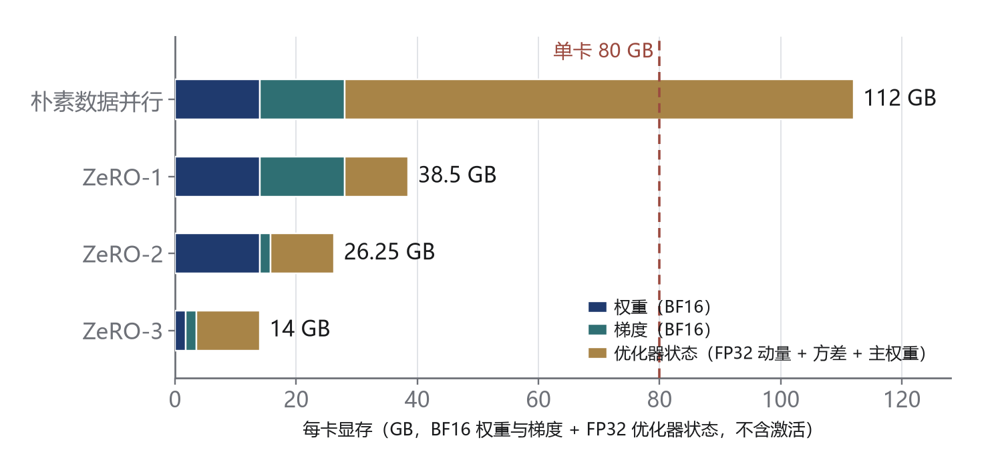

## 数据并行与 ZeRO

上一章那个 7B 的 OOM，最容易被误判成"激活值太大"。真实的报错位置往往能说明问题：如果崩在前向的第一层，是权重放不下；如果前向能过、反向也能过，崩在 `optimizer.step()` 里，那就是优化器状态放不下。

这两种崩法的区别很关键。前者说明模型本身太大，怎么调批都没用；后者说明参数放得下，但"陪参数一起住"的东西太多。7B 模型 BF16 权重 14 GB，一张 80 GB 卡放得下；梯度又 14 GB，还放得下；优化器再要 84 GB，一共 112 GB，这就崩了。而且崩的时机很刁钻——前向反向都跑完了，你以为马上就能出 loss，结果在更新那一步挂掉。

这一章讲怎么在不换切法的前提下把这块显存腾出来。办法只有一个：既然每张卡上的副本完全一样，就把副本本身切开。

### 朴素的账，和它崩在哪

先把三种口径列清楚，后面所有讨论都在这三种之间换算。

| 口径 | 字节/参数 | 7B 的账 | 说明 |
|----------------------|--------|------|--------------------|
| 只有权重和梯度 | 4 | 28 GB | 推理或纯前向 |
| 加优化器状态（无主权重） | 12 | 84 GB | 一些框架的默认实现 |
| 加 FP32 主权重 | 16 | 112 GB | 混合精度训练的完整口径 |

三种口径对应的"能不能装进 80 GB"完全不同。12 字节时 7B 装得进（84 GB），16 字节时装不进（112 GB）。这解释了一个常见现象：同一份代码在两个团队那里，一个能跑一个不能跑，差别可能只是主权重存在哪、用不用 `bf16` 的优化器状态。

16 字节这一档的构成是：BF16 权重 2、BF16 梯度 2、FP32 主权重 4、FP32 一阶动量 4、FP32 二阶方差 4。其中后三项加起来 12 字节，是参数本身的三倍。这就是为什么"只切优化器状态"这一级（下一节的 ZeRO-1）收益最大——它切的是那 12 字节里的大头。

数据并行还有一笔开销不体现在显存上，体现在时间上：每步末尾要把所有卡的梯度加起来。这个操作叫全归约，$N$ 张卡时每张卡搬运

$$2S\cdot\frac{N-1}{N}\ \text{字节}$$

$S$ 是梯度的大小。7B 的梯度是 14 GB，8 卡时每卡搬 $2\times14\times7/8 = 24.5$ GB。NVLink 按 300 GB/s 算要 82 毫秒；如果这 8 张卡分散在两个机箱、靠 25 GB/s 的 InfiniBand 相连，就要 0.98 秒。

对比一下计算时间：8 卡跑全局批 512 条 4096 长度的序列，一步 70 秒。82 毫秒占 0.1%，0.98 秒占 1.4%。都还不算糟。所以数据并行的通信从来不是主要矛盾，主要矛盾是它要求每张卡都装下一份完整副本。

### ZeRO 的核心：把副本切开

ZeRO 的想法一句话就能说完：既然 $N$ 张卡上的副本一模一样，那就别存 $N$ 份，每张卡存 $1/N$，用的时候再拼起来。

三级的区别在于"切到哪一层"。

- ZeRO-1 只切优化器状态。权重和梯度仍然每卡一份全量，但在更新参数的那一步，每张卡只负责更新自己那一段参数，用完就把别人的状态丢掉。因为优化器状态只在 step 时用，平时不存在，所以切它几乎不影响计算流程。
- ZeRO-2 再切梯度。反向算完的梯度立刻被规约并切分，每张卡只留下自己负责的那一段。因为梯度也只在该段参数更新时用到，所以切它也不影响前向。
- ZeRO-3 连权重一起切。这就麻烦了：前向要算某一层，必须先把这一层的完整权重收集起来；算完要扔掉，否则显存又满了。于是每一层都要做一次"收集—计算—释放"。

三级对应的每卡显存（$N$ 为参数总量，$Z$ 为数据并行度）：

$$\text{ZeRO-1}:\ 4N + \frac{12N}{Z},\qquad \text{ZeRO-2}:\ 2N + \frac{14N}{Z},\qquad \text{ZeRO-3}:\ \frac{16N}{Z}$$

第一个式子的意思是：权重和梯度还是全量（$4N$），只有优化器状态被切成 $1/Z$。第二个把梯度也切了，所以前面的 $4N$ 变成 $2N$（只剩权重）。第三个全切，连权重都只剩 $1/Z$。

代入 7B、8 卡：

代入 7B、8 卡算一遍：ZeRO-1 是 $28 + 84/8 = 38.5$ GB，ZeRO-2 是 $14 + 112/8 = 26.25$ GB，ZeRO-3 是 $112/8 = 14$ GB。中间的除法都是“除以 8”，对应 8 张卡把这个状态切成 8 份。

从 112 GB 降到 38.5 GB 只做了一件事：把优化器状态切成八份，省下 73.5 GB。这一步的收益是最大的，也是为什么几乎所有框架都建议"先把 ZeRO-1 打开"。

从 38.5 降到 26.25 是切梯度，省 12.25 GB；从 26.25 降到 14 是切权重，省 12.25 GB。后两级加起来省的，还没有第一级多。

### 分片不是免费的：通信账

切得越狠，通信越多。三级的通信量可以精确地写出来。

ZeRO-1 和 ZeRO-2 的每步通信量跟朴素数据并行一样，都是 $2S(N-1)/N$。这不是巧合：全归约在实现上就是"先规约散射、再全收集"两步，ZeRO-1 只是把其中一步的中间结果留下来当分片，总字节数没变。ZeRO-2 更进一步，把梯度分片直接当成了规约的中间结果，通信量还是一样。

ZeRO-3 不一样。它每步要走三趟：前向收集权重（全收集，$S$ 字节）、反向收集权重（又一次全收集）、反向规约梯度（规约散射，$S$ 字节）。合计约 $3S$，是前两级的 1.5 倍。

用 70B、64 卡算一下。权重大小 $S = 140$ GB。

ZeRO-1 与 ZeRO-2：每卡 $2\times140\times63/64 = 276$ GB。跑在 400G InfiniBand（50 GB/s 单向）上要 5.5 秒。

ZeRO-3：$3\times140 = 420$ GB，要 8.4 秒。

计算那边，70B 在 64 卡上跑全局批 512 条 4096 序列，一步 $6\times70\times10^9\times2.1\times10^6 = 8.8\times10^{17}$ FLOPs，64 张 A100 按 45% 利用率是 $9\times10^{15}$ FLOP/s，98 秒。

ZeRO-3 的通信占 8.6%，ZeRO-1 占 5.6%。看起来都能接受。

但把规模再放大一档，结论就变了。400B、512 卡：参数 800 GB，ZeRO-3 每步每卡要搬 $3\times800 = 2400$ GB，50 GB/s 下 48 秒；而一步的计算量是 $6\times400\times10^9\times2.1\times10^6 = 5\times10^{18}$，512 卡按 45% 是 $7.2\times10^{16}$ FLOP/s，70 秒。通信占了 69%，几乎吃掉一半的有效算力。

如果把这条链路换成 25 GB/s 的老 InfiniBand：2400 GB 要 96 秒，比 70 秒的计算还长。训练就退化成了"以通信为主、计算插空"，GPU 利用率跌到 40% 以下。

这就是那条工程经验的定量来源：**ZeRO-3 只在机内使用，跨机只用 ZeRO-1**。机内 NVLink 300 GB/s，同样的 2400 GB 只要 8 秒，占比降到 11%，完全可接受。

### 全归约其实是两步

上面反复用到"全归约"这个词，值得拆开看一眼，因为 ZeRO 的显存收益正是从它的中间结果里挤出来的。

$N$ 张卡、每张卡有一份 $S$ 字节的数据，要求所有卡的和。朴素做法是每张卡把自己的数据发给其他所有卡，通信量 $S(N-1)$，$N$ 大起来会爆。环形算法把它拆成两阶段。

第一阶段叫规约散射：数据切成 $N$ 块，沿环传 $N-1$ 步，每步每张卡把一块发出去、把收到的一块加上自己那份再传下去。走完 $N-1$ 步，每张卡手里正好有一块的完整和，其余 $N-1$ 块都是残的。第二阶段叫全收集：这 $N$ 块完整结果再沿环传 $N-1$ 步，让每张卡都拿到全部 $N$ 块。

每张卡两阶段各搬 $S(N-1)/N$ 字节，合计 $2S(N-1)/N$——这就是前面那个公式。关键在第一阶段的输出：它已经是"分好片的完整结果"了。如果下游只需要自己那一片，就不必做第二阶段。

ZeRO-1 和 ZeRO-2 干的就是这件事：不收集，只留自己那片去更新参数。所以它们省了显存而没多花通信——本来就要传那么多，只是不把结果收全。ZeRO-3 反过来，它需要的是完整的权重，所以不得不把全收集做满，还做了两次（前向一次、反向一次）。

### 分片的时间成本：收集、计算、释放

ZeRO-3 的实现细节里有一件事值得单独说，因为它经常成为"跑得比别人慢一倍"的原因。

每一层前向要先把完整权重收集起来，算完再释放。如果严格按"收一层、算一层"来做，每次收集都会产生一个延迟尖峰：收集是通信，计算要等它完成。80 层的模型就有 80 次这样的等待，每次哪怕只等 100 微秒，也是 8 毫秒，听上去不多，但它会打乱流水。

工程上的解法是**预取**：在算第 $L$ 层的时候，就开始收集第 $L+1$ 层的权重。这样收集的延迟被第 $L$ 层的计算盖住，下一层开始时权重已经就位。代价是要多留一层的显存放收集结果——70B 的一层权重是 $140/80 = 1.75$ GB，80 GB 卡上不算多。

预取的反面是**桶大小**。如果一层太大，一次收集不完，就切成若干桶，边收边用。桶太小则每次通信的有效载荷太少，被固定延迟吃掉；桶太大则预取提前量不够。

多大的桶才不亏，可以算。通信一次有一个固定延迟，机内集合通信大约十几微秒；带宽是 300 GB/s。要让延迟占比不超过一成，桶要满足 $B/300\text{ GB/s} \ge 10 \times 15\ \mu\text{s}$，即 $B \ge 45$ MB。跨机链路 25 GB/s、延迟 50 微秒时，这个下限变成 12 MB。所以"桶取 25–100 MB"不是拍定的，它是带宽和延迟乘出来的。

这也解释了一个常见现象：同样开 ZeRO-3，在小模型上把桶调到 1 MB"省显存"，结果速度直接鱘斩。不是通信量大，是每次只发 1 MB，带宽根本喂不饱。

这些机制都不改变总通信量，只改变它出现的时刻。所以判断"ZeRO-3 能不能用"，看的是总通信量与计算量的比值；判断"ZeRO-3 调得好不好"，看的是这些收集有没有被计算盖住。

这三步里，前两步账上都是赚的：显存减小，通信不变或只多一半，计算量完全不变。第三步不一样，它开始拿通信换显存。

很多文献把 offload 算成"第四级"，把优化器状态放到 CPU 内存。它不是同一个维度上的"再切一刀"，而是把切出去的那一块搬到了另一层存储上。搬东西是要时间的，而且比 GPU 显存慢两个数量级，所以它只在特定情形下合理。

### 参数卸载：把状态放到 CPU

还有一条路：既然优化器状态只在 step 时用，那就把它放到 CPU 内存里，用的时候再传过来。这叫 offload，DeepSpeed 的 ZeRO-Offload 就是这么做的。

账很好算。7B 的优化器状态 84 GB，走 PCIe 4.0 的 32 GB/s 单向带宽，一步要传两次（读出来算、算完写回去），共 168 GB，5.3 秒。这一步的计算是 8.8 秒（8 卡）。占比 60%，也就是说吞吐会掉到原来的六成多一点。

小模型上这笔账还能接受，因为 CPU 内存便宜（一台机器 1 TB 内存的价格远低于 8 张卡）。大模型上就不行了：70B 的状态 840 GB，一步要传 1.7 TB，53 秒，而计算只有 98 秒。加上 CPU 侧的更新本身也要时间，通常是亏的。

所以 offload 的合理位置是"模型不大、但想省卡"的场景，不是"模型很大、想跑起来"的场景。还有一个隐性成本常被忽略：CPU 侧的优化器更新是单线程或少量线程做的，7B 的 84 GB 状态在 CPU 上算一遍要好几百毫秒，比 GPU 慢一个量级。

### 怎么确认它真的生效了

配置项写上了不等于生效了。三种验证手段，从粗到细。

看日志里的每卡显存峰值。大多数框架会在启动时打印"模型参数量 / 每卡可训练参数量"，如果 ZeRO-2 开了，每卡可训练参数量应该约为总量的 $1/Z$——注意是"可训练"的参数量而不是"持有"的参数量，这两个数在 ZeRO-3 下才相等。

看 `nvidia-smi` 的稳态占用。7B + ZeRO-2 + 8 卡，稳态应该在 30 GB 上下；如果看到 100 GB 以上，说明分片没生效，或者优化器状态还在用 FP32 全量存。这个数字最好在训练跑了 100 步之后再看，因为启动阶段有一次性的分配尖峰。

最可靠的是做一次消融：同一个配置跑 ZeRO-1 和 ZeRO-2，比较每卡显存峰值。差值应该约等于 $12N/Z$（7B、8 卡时是 12.25 GB）。如果差值远小于这个数，多半是某个张量没被分片——常见的原因是某些自定义模块把参数注册在了分片逻辑之外。

### 一个容易忽略的前提：分片只在同一组内有效

还有一个实现层面的事实，它解释了为什么很多配置表里的数字对不上。

ZeRO 的分片是在"数据并行组"里做的，不是在全部卡上做的。一个 512 卡的作业，如果是张量 8 × 数据 64，那么 ZeRO 最多只能把状态切成 64 份，不是 512 份。因为张量并行的那 8 张卡各自持有的是不同的参数切片，彼此不能互相代替，没有"重复"可以消除。

于是每卡的参数显存是

$$\frac{4N}{TP} + \frac{12N}{TP\cdot DP}$$

前一项是权重与梯度（被张量并行切开，不被 ZeRO 切），后一项是优化器状态（两个维度都切）。代入 70B、张量 8 × 数据 8（共 64 卡）：$4\times70/8 = 35$ GB，加 $12\times70/64 = 13.1$ GB，合计 48 GB。而如果错误地按"除以 64"去估，会得到 17.5 GB，差了快三倍。规划时把这两个除法搞混，后果是买少了一半的机器。

### 梯度累积：不增加通信的等效大批

显存不够时还有一个办法，完全不涉及切分：把一个大批拆成若干小批，逐个前向反向、把梯度累加起来，等攒够了一起重做一次更新。

它等效于大批，但不占额外显存。7B、8 卡、目标全局批 512 条序列：每卡微批 8 条、累积 8 次，$8\times8\times8 = 512$。每卡一次微批的计算是 $6\times7\times10^9\times8\times4096 = 1.4\times10^{15}$ FLOPs，8 卡按 50% 利用率 1.1 秒；8 次累积 8.8 秒，然后做一次 82 毫秒的全归约。

梯度累积唯一需要注意的是它和批归一化的冲突。Transformer 里没有批归一化，所以基本不受影响。真正的坑在别处：换了累积步数，全局批就变了，学习率和预热步数都要跟着调。这一条在工程上造成的损失比任何并行配置都大，因为它不报错，只是收敛变差。

批大小和学习率的关系没有精确定律，但有一个被广泛使用的经验区间：全局批放大 $k$ 倍时，学习率放大 $\sqrt{k}$ 到 $k$ 倍，配合更长的预热。举个具体数：基准配置是全局批 50 万 token、学习率 $1.5\times10^{-4}$、预热 2000 步。为了提吞吐把批放大到 200 万 token（4 倍），学习率应该落在 $3\times10^{-4}$ 到 $6\times10^{-4}$ 之间，预热延长到 4000–8000 步。取区间下界更保守，收敛更稳；取上界收敛更快，但前期容易发散。

真正要防的是另一种情况：改并行配置的时候，全局批被动地变了而没人注意。比如为了省显存把微批从 16 降到 4，累积步数忘了改，全局批就缩到了四分之一，学习率还是原来那个——这时模型会明显训得更差，而日志里一切正常。

### 三个常见的失败案例

**第一个：ZeRO-3 开到跨机。** 一个团队在 32 台机器上开 ZeRO-3，想着"显存最省"，结果吞吐只有预期的三分之一。算一下就知道原因：400B 的参数 800 GB，跨机链路 25 GB/s，每步 2400 GB 要 96 秒，而计算只要 70 秒。改成"机内 ZeRO-3 + 机间 ZeRO-1"之后，跨机流量从 2400 GB 降到 276 GB，吞吐回到了预期的八成。教训是：分片度要和链路带宽匹配，带宽越窄，分片应该越浅。

**第二个：只开了数据并行，忘了 ZeRO。** 症状是训练能启动、前向反向都过、在第一次 `step()` 时 OOM。这种崩法很有欺骗性，因为日志里看到的是"训练开始"之后几十秒才出错，容易被当成偶发。判断方法是看崩的位置：如果显存是在 step 时突然涨上去的，那就是优化器状态。解决只要加一个配置项。

**第三个：累积步数和学习率一起改了。** 有人为了让显存够用，把累积从 1 调到 8，等效批放大了八倍，学习率没动。结果损失曲线前几百步看着还行，后面明显不如基线。这类问题最难查，因为它不崩、不报错，只是最终效果差一点。对策是把"全局批大小"当成一个显式配置项写进实验记录，改任何一个并行参数都重新核对它。

**第四个：每张卡读到的是同一批数据。** 数据并行靠"每卡不同数据"成立，而这件事是由数据加载器保证的。如果用了固定种子的采样器、或者自己写的分片逻辑少了一个 `rank` 偏移，八张卡就会读到完全一样的样本，梯度也一样，八张卡退化成一卡，只是多花了八倍电。

这种故障的症状很诡异：损失曲线平滑得过分，比单卡还平滑，因为等效批其实没变，但吞吐上不去。检查方法很土但有效——在第一个 step 打印每个 rank 第一条样本的 id，八个 id 应该互不相同。

还有一个同源的问题：数据集大小不能被卡数整除时，有的实现会复制尾部样本凑整，于是每个 epoch 里有几个样本被重复训练。数据量小时这会明显影响效果，而且很难从损失曲线上看出来。

### 一个能跑的配置

把上面的东西拼起来，7B 模型在单机 8 张 80 GB 卡上的一个稳妥配置：

- 并行：纯数据并行，8 路，ZeRO-2 打开；
- 每卡参数相关显存 26.25 GB；
- 激活：每卡微批 8 条、序列 4096，开全量重计算，约 2.5 GB；
- 通信缓冲与碎片：约 3 GB；
- 合计约 32 GB，余量 48 GB，可以放心把序列拉到 8192 或者把微批加到 16。

这套配置每步的实际耗时：8 次微批累积 8.8 秒，加一次全归约 82 毫秒，加优化器更新（26 GB 的状态读写，HBM 上约 40 毫秒），总共约 9 秒。GPU 利用率能到 50% 上下，剩下的损耗主要是激活重计算带来的额外前向。

如果想把余量用满，把微批提到 16、累积降到 4，同样是全局批 512，但每步只有 4 次累积，通信次数减半。代价是激活显存翻倍到 5 GB，仍然在余量之内。这种调整没有对错，取决于你更在意显存还是更在意同步次数。

如果是四张卡而不是八张，账就不同了。7B 在 4 卡上：ZeRO-2 的每卡参数显存是 $14 + 112/4 = 42$ GB，激活 2.5 GB，加缓冲 3 GB，一共 47.5 GB，装得进 80 GB。看上去四卡完全够用。但通信量变了：全归约每卡搬 $2\times14\times3/4 = 21$ GB，机内只要 70 毫秒，一步的计算却变成了 141 秒（同样的全局批分到四张卡）。通信占比 0.05%，仍然无所谓。真正的代价是时间，同样一步从 70 秒变成 141 秒。

这个例子说明一件事：小集群上数据并行不会遇到通信问题，只会遇到时间问题。所以“要不要加卡”在小规模下永远是个简单的是非题；一旦上了八卡以上、开始叠张量并行，才变成真正的取舍。

### 数据并行的边界

数据并行加上 ZeRO，能覆盖到"每卡参数显存装得下"的所有情形。7B 在 8 卡上是 14 GB，13B 是 26 GB，30B 是 60 GB。

30B 这个数字值得停一下。表面上 60 GB 还在 80 GB 之内，但激活值要占十几 GB，通信缓冲和碎片再吃掉几 GB，实际已经贴边。而且这个"装得下"是靠 ZeRO-3 换来的，每层都要收集一次权重，80 层的模型就是每步 160 次前向收集加 80 次反向收集。每次收集的延迟再小，累起来也是可观的。所以 30B 通常被认为是"单机 ZeRO-3 的实际上限"，再大就该考虑张量并行了。

再往上就必须换切法：要么切层内矩阵（张量并行），要么切层（流水线并行）。它们的通信模式完全不同，下面两章分别讲。一条有用的判断是：如果你的模型在 ZeRO-3 下每卡显存已经低于 15 GB，但吞吐却上不去，那不是显存的问题，是收集权重太频繁——这时候换张量并行往往能同时改善显存和速度。

最后说一个反复出现的现象。翻开任何一份大模型训练的配置表，你会看到绝大多数都开着 ZeRO-1，即使它们的显存看上去很宽裕。原因不在显存，而在"开它几乎不要钱"：通信量与不开一样，实现上只是不把归约结果收全，收益却是立竿见影的 12 字节/参数。这种"成本为零、收益确定"的优化，在任何系统里都该默认打开。而 ZeRO-3 恰好相反，它用确定的通信成本换显存，所以只有在真的装不下时才值得用。这两级之间那条线，就是工程判断的所在。

一句话总结这一章：ZeRO 做的是"把重复的东西去掉"，它不改变计算流程，只改变状态存在哪。这也决定了它的上限——当重复的东西已经去完（每卡只剩 $1/Z$），还想再省，就只能切模型本身了。
