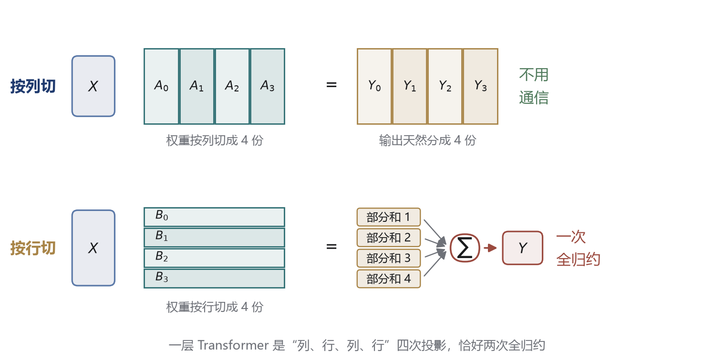

## 张量并行与序列并行

有一类 OOM 很特别：模型的参数总量并不大，几十亿参数，八张卡怎么算都该装得下，但一跑就崩，而且崩在第一层的矩阵乘上。

原因是单独一层太胖。70B 模型的一层里，前馈的三个矩阵加起来是 $3 \times 8192 \times 28672 = 7.0\times10^8$ 个参数，BF16 下 1.4 GB；加注意力的四个投影，一层接近 1.7 GB。这个数字本身不可怕，可怕的是它不能拆开——一张卡要算这一层，就得同时持有这一层的全部权重和它产生的中间激活。当上下文拉到 32K 时，一层的激活就能吃掉十几 GB，加上权重，单层逼近一张卡的容量。

数据并行对这种问题是无效的。它把批次切开，可每一层还是要完整地算一遍，权重一点不少。要解决"单层放不下"，只能在层的内部动手。

还有一个信号也能提示同一件事：显存随序列长度烧得很快。批 1、序列 4096 时一切正常，把序列拉到 32768，突然就 OOM，而权重一点没变。这说明吃显存的不是参数，是随序列线性甚至平方增长的那一块。层内切分恰好能同时缓解这两件事，因为切完之后每张卡只需要一部分权重和一部分激活。

### 一层里发生了什么

先看一个最普通的线性层：输入 $X$ 是 $b \times s \times d$ 的张量（批、序列、隐层），权重 $A$ 是 $d \times d'$，输出 $Y = XA$。

把 $A$ 按列切成 $p$ 份，记作 $A_1, \dots, A_p$，每份 $d \times d'/p$。第 $i$ 张卡算

$$Y_i = X A_i$$

$Y_i$ 是完整输出的第 $i$ 段列。因为 $[Y_1, \dots, Y_p] = X[A_1, \dots, A_p] = XA$，把这些列拼起来就是 $Y$。整个过程没有任何一张卡需要别人的数据，所以**按列切不需要通信**。

把 $A$ 按行切成 $p$ 份，记作 $A_1, \dots, A_p$，每份 $d/p \times d'$。第 $i$ 张卡拿到的输入也只能是 $X$ 的对应那一段列（$X_i$，$b \times s \times d/p$），算出来的是

$$Y_i = X_i A_i$$

这个 $Y_i$ 不是 $Y$ 的一部分，而是一个"部分和"——完整的输出是 $\sum_{i=1}^{p} Y_i$。想得到 $Y$，必须把这 $p$ 个部分和加起来，也就是**一次全归约**。

两种切法的差别就一句话：列切把"输出的不同部分"分给不同卡，行切把"同一个输出的不同贡献"分给不同卡。前者各干各的，后者必须汇合。

### 一个 Transformer 层怎么排成列行交替

如果每一层都按行切，那么每层都要归约一次，通信量翻倍；如果都按列切，输出的列分在不同卡上，下一层没法接着算——因为下一层需要完整的输入。

真实的排法是让列切和行切交替，让"分开算"和"合起来"各出现一次。以一个注意力加前馈的层为例：

- QKV 投影按列切。64 个注意力头分到 8 张卡上，每张卡算 8 个头。注意力本身是每个头独立的，所以这一步不需要通信。
- 注意力的输出投影按行切。每个头算出的结果要合并回完整的隐层，这一步需要一次全归约。
- 前馈的第一层按列切。中间维度 28672 分成 8 份，各算各的。
- 前馈的第二层按行切。把中间结果压回 8192 维，又是一次全归约。

于是每层正好两次归约：一次在注意力之后，一次在前馈之后。前向两次，反向再来两次，一个训练步里每层共四次。

反向的两次和正向的一一对应，但传的东西不同。前向传的是激活的**部分和**（各卡算出的列段相加得到完整输出）；反向传的是**梯度的部分和**：完整输出上的梯度要从行切的那一侧回传到列切的那一侧，同样是一次全归约。两边的字节数一样，都是 $b\,s\,d$ 个元素，所以算通信量时前向和反向直接乘二即可。

有一处容易算错：反向要算权重的梯度（wgrad），它需要“输入激活 × 输出梯度”，而这个乘积在每张卡上只覆盖一部分，也需要汇总。一个训练良好的实现会把这一步和上面的归约合并，不额外多一次通信；如果实现得粗糙，一层可能出现三到四次归约，通信量直接多一半。看一个框架的通信量是否“正常”，可以用这个数对一下：每层前向 2 次、（反向 2 次），总计 4 次，多出来就是实现问题。

这个结构是被残差连接逼出来的。残差流是一个完整的 $b \times s \times d$ 张量，每张卡上都得有一份完整副本（否则下一步的加法对不上）。从残差流出发，第一刀只能按列切，因为输出要分开；算完必须回到完整的残差流，所以最后一刀只能按行切。列进、行出，中间的通信点就固定了。

### 每层通信量的完整推导

现在把这笔账算到底。设批 $b$、序列 $s$、隐层 $d$、并行度 $p$，数据用 BF16。

一次全归约的数据量是 $b \cdot s \cdot d$ 个元素，即

$$S = b\,s\,d \times 2\ \text{字节}$$

70B 模型、批 1、序列 4096、隐层 8192：$S = 1 \times 4096 \times 8192 \times 2 = 67$ MB。

环形全归约下，每张卡实际搬运的字节数是 $2S(p-1)/p$。$p=8$ 时系数是 1.75，即 117 MB。

一层前向有两次归约，共 235 MB；反向对称，也是 235 MB。一层合计 470 MB。

80 层走一遍，每张卡搬运 $470 \times 80 = 37.6$ GB。

时间上，机内 NVLink 按 300 GB/s 算，$37.6/300 = 125$ 毫秒。

计算那边，一个微批的前向加反向是 $6 \times 70\times10^9 \times 4096 = 1.7\times10^{15}$ FLOPs，8 张 A100 按 45% 利用率是 $1.1\times10^{15}$ FLOP/s，需要 1.5 秒。

通信占 8%。这就是张量并行能在机内跑起来的原因——不是通信便宜，是计算足够多，把通信盖住了。

现在把同样的配置搬到跨机链路上。25 GB/s 下 37.6 GB 要 1.5 秒，正好等于计算时间，通信占比 100%：算一步、等一步，GPU 利用率跌到 50% 以下。

有人会想，那并行度取 16、跨两个机箱呢？账是这样的：16 张卡做环，每步传 $S/16 = 4.2$ MB。如果拓扑排得整齐，16 步里有 14 步在机内（每步 0.014 毫秒），2 步跨机（每步 0.17 毫秒），一次归约约 0.53 毫秒，比纯机内的 0.42 毫秒慢 2.5 倍。一层四次 2.1 毫秒，80 层 170 毫秒，占 1.5 秒的 11%。

单看这个数还行。但实际跑起来通常远差于此，原因有三：环是串行的，两步慢跳会把整个环的节奏钉住，任何一次网络抖动都直接变成全组等待；消息降到 4 MB 级，固定延迟开始占大头；跨机的两跳和别处的流量（数据并行的梯度同步）会争抢同一条链路。

所以业界的做法很统一：张量并行度等于机内卡数，一般就是 8。这不是保守，是把"慢跳"彻底排除掉。

### 切割之后，一层到底小了多少

把一层拆开看显存，能看清张量并行到底买到了什么。

70B 的一层权重 1.7 GB，切 8 份后每卡 214 MB；一层在批 1、序列 4096 下的激活（不重计算）约 1.2 GB，切 8 份后每卡 147 MB。两项加起来不到 400 MB，40 层（两机 16 卡、流水线 2 段）就是 15 GB。

序列拉到 32768 再看。按每 token 每层约 34 个隐层向量估算，一层激活是 $32768 \times 34 \times 8192 / 10^9 = 9.1$ GB，切 8 份后每卡 1.14 GB，40 层就是 46 GB——已经占了半张卡。开重计算后每 token 每层只存一个隐层向量，一层降到 537 MB，每卡 67 MB，40 层 2.7 GB，又能跑了。

这两个数字连起来看，能得出一个很实用的结论：长上下文训练里，激活才是主要矛盾，而对付激活最有效的手段是重计算，不是加卡。切分只是把激活摊到多张卡上，每张卡仍然随序列线性增长；重计算则直接把那个系数从三十几降到 1。

### 为什么并行度卡在 8

除了网络拓扑，还有两个原因让它不能更大。

一是算术强度会掉。一张卡上的矩阵乘从 $8192\times8192$ 变成 $1024\times8192$，矩阵变瘦，每次从显存读进来的数据算得更少，算力利用率下降。A100 的 BF16 峰值要靠足够大的矩阵才能喂满，1024 宽已经很勉强。

二是同步点的数量。每层两个同步点，80 层就是 160 个；每个同步点都是一次全组等待，任何一张卡慢一点，所有卡都等。8 张卡的抖动还容易控制，16 张、32 张就开始出现"总有一张卡在拖后腿"的情况。

这两条加起来，使得"张量并行 8"成为一个稳定的经验值，从 2020 年到现在没怎么变过，尽管卡的算力涨了十倍。

赶上一个变小的情况也值得说：如果是小模型（比如 7B）开张量并行 8，每张卡一层只分到几十 MB 权重，矩阵乘的规模降到 1024 宽以下，算力利用率可能只有 20%。这时张量并行不但不提速，反而比单卡慢。判断依据很简单：跑一个微批，看 GPU 利用率和通信占比；如果通信占比超过 30%，说明模型太小、切得太碎，应该退回数据并行。

把不同并行度放在一张表里，能看清这条曲线的形状。仍然是 70B、批 1、序列 4096、每层 4 次归约：

| 张量并行度 | 每卡权重 | 每卡每步通信 | 通信时间 | 计算时间 | 占比 |
|-------------|---------|-------------|---------|---------|----|
| 1 | 140 GB | 0 | 0 | 12 秒 | 0 |
| 2 | 70 GB | 21.4 GB | 71 毫秒 | 6.1 秒 | 1.2% |
| 4 | 35 GB | 32 GB | 107 毫秒 | 3.0 秒 | 3.6% |
| 8 | 17.5 GB | 37.6 GB | 125 毫秒 | 1.5 秒 | 8.3% |
| 16（跨两机） | 8.75 GB | 40 GB | 333 毫秒 | 0.76 秒 | 44% |

前四行的规律很明显：并行度翻倍，通信量几乎不变，计算量减半，占比翻倍。到 8 时还是 8%，还能接受；到 16 时一旦有两跳跳出了机箱，占比直接跳到四成以上。如果把 16 卡全放在一个 NVSwitch 域里（有些机型真的支持），占比回落到 17%，仍然明显变差——所以即使带宽无限，张量并行也不会无限制地用，因为它的扩展效率每天都在随并行度下降。

### 序列并行：把仍然重复的那部分也切掉

张量并行解决了一层的权重，但激活里还有一块没被切开。

看一层里那些"逐元素"的操作：LayerNorm、Dropout、残差的加法。它们作用在完整的 $b \times s \times d$ 张量上，不区分列。张量并行之后，权重切了，但每个 token 的隐状态在每个卡上仍然存着一份完整的 $b \times s \times d$——因为 LayerNorm 需要对整行求均值方差，行被切开了就没法算。

这部分重复有多大？70B、批 1、序列 4096，一个 $b\,s\,d$ 的 BF16 张量是 67 MB。一层里 LayerNorm 的输入输出、Dropout 的掩码，加起来大约两到三份，算 134 MB。80 层就是 10.7 GB，每张卡都白存了这么多。

序列并行的做法是：把这些逐元素操作的张量沿序列维度切成 $p$ 份，每张卡只存 $s/p$ 个 token 的那一段。LayerNorm 对每个 token 独立计算（它沿隐层求统计），所以切序列完全不影响正确性。需要完整张量的地方只有两处：注意力的分数计算和前馈的矩阵乘，而这两处本来就在张量并行下按列切好了。

通信上它几乎不花钱。原本的两次全归约被拆成"规约散射 + 全收集"两段，序列并行正好把这两段之间的数据格式对齐了，字节数和原来一样。所以工程上常说"序列并行是免费的"，更准确的说法是"不增加通信量"。

效果是把那 10.7 GB 降到 1.34 GB，省下 9.4 GB。在 80 GB 卡上这是实打实的一成多显存。

实现上还要处理一个细节：哪些张量是真的被重复存的。注意力分数（$b \times h \times s \times s$）在张量并行下已经按头切开了，不需要再切；而 LayerNorm 的输入输出、残差的两路、dropout 的掩码，这些是完整的 $b\,s\,d$，需要切。如果实现把所有激活一律按序列切，而在某些需要完整序列的地方（比如位置编码的构造、因果掩码的生成）又得拼回去，反而多出几次通信。这也是为什么序列并行通常由框架统一开，而不是让使用者自己写。

### 一个具体配置：30B 与 70B

先看 30B 在单机 8 卡上。参数相关显存是 $30\times10^9 \times 16 / 8 = 60$ GB。听起来还有 20 GB 余量，但激活要占 10 GB 上下，通信缓冲 2 GB，碎片 2 GB，实际只剩 6 GB 的呼吸空间。开重计算能把激活压到 3 GB，余量回到 13 GB，可以用。

再看 70B。同样是单机 8 卡，参数相关显存 $70\times10^9 \times 16 / 8 = 140$ GB，直接超过 80 GB。这里要说清一件事：**70B 在单机 8 张 80 GB 卡上训练不了**，无论怎么开张量并行、序列并行、重计算都不行，因为参数相关的 16 字节/参数除以 8 就是 140 GB，这是硬下限，和激活无关。

所以 70B 的最小可行配置是 16 张卡，两个机箱，每个机箱内 8 卡做张量并行，机箱之间做流水线并行 2 段。这时每卡参数显存 $140/2 = 70$ GB，加激活（流水线切开层数，每卡只算 40 层）约 3 GB，加缓冲，刚好 75 GB 上下。这个"刚好"就是 70B 在工程上出名的原因——它卡在 8 卡与 16 卡之间，没有舒适的档位。

| 模型 | 卡数 | 张量×流水线×数据 | 每卡状态 | 激活 | 合计 |
|-----|-----|---------------------|----------|--------|-------|
| 13B | 8 | 8×1×1 | 26 GB | 2 GB | 30 GB |
| 30B | 8 | 8×1×1 | 60 GB | 3 GB | 66 GB |
| 70B | 16 | 8×2×1 | 70 GB | 3 GB | 76 GB |
| 70B | 64 | 8×4×2 | 17.5 GB | 1.5 GB | 21 GB |

最后一行值得看：同样 70B，64 卡时每卡只要 17.5 GB，显存完全不是问题，问题变成了通信和气泡。这也是大规模训练的真实状态——显存问题在小集群上是主要矛盾，在大集群上退居次要。

400B 的情形更极端。512 卡、张量 8 × 流水线 8 × 数据 8，每卡参数相关显存 $6400/512 = 12.5$ GB。激活那边，一层在批 1、序列 4096 下约 2.2 GB，被张量 8 × 流水线 8 切成 64 份，每卡 34 MB，乘上 12 层（96 层除以 8 段）还不到 0.5 GB。这样算下来，每卡只用了 13 GB，剩下的 67 GB 全是空的。

这引出一个反直觉的事实：到了千亿参数以上，显存往往不是约束，带宽和气泡才是。卡多的意义从“装得下”变成了“算得快”，而“算得快”取决于通信能不能被盖住。所以 400B 这类规模的调优重点在流水线段数与微批数的配比、以及桶大小与预取，不在“再省几个 GB”。

### 一层的五段时间线

前面把通信量算成了总数，看一层内部怎么排，能看出优化的位置。70B、TP8、批 1、序列 4096，一层的时间大致分五段：

| 段 | 做什么 | 时长 |
|--------|------------------|-------|
| ① | 前向的列切 GEMM（QKV、FFN1） | 4.2 毫秒 |
| ② | 前向的两次全归约 | 0.8 毫秒 |
| ③ | 前向的行切 GEMM（O、FFN2） | 2.1 毫秒 |
| ④ | 反向的 dgrad 与 wgrad | 12.6 毫秒 |
| ⑤ | 反向的两次全归约 | 0.8 毫秒 |

①和③合计 6.3 毫秒，是前向；④是 12.6 毫秒，正好两倍，因为反向要对输入和权重各算一遍梯度。②和⑤各 0.8 毫秒，对应前面算过的每层两次归约（前向）和两次（反向），$2 \times 117$ MB 除 300 GB/s。

这张表最直接的含义：同步点落在 0.8 毫秒的短段上，而不是均匀分布在 18.5 毫秒里。这就解释了为什么张量并行对延迟敏感而不仅仅对带宽敏感：②和⑤是两个硬屏障，前面 4.2 毫秒的 GEMM 算得再快，也得等这 0.8 毫秒的全组同步。如果某张卡慢了 1 毫秒，整层就慢 1 毫秒。

由此得出两个不太直观的结论。第一，**提高张量并行的度不会缩短②⑤**，因为这两段的字节数 $2S(p-1)/p$ 在 $p \ge 8$ 后几乎饱和。切得更细只缩短①③④，而屏障不变，占比自然升高。第二，**能让②⑤变小的是批和序列**：如果全局批从 1 提到 2，①③④翻倍而②⑤不变，占比直接减半。这就是为什么张量并行在大批上比小批上好看，也是为什么“把批调大”总是比“把并行度调大”更划算。

### 三十二张卡上的两种排法

同样 32 张卡、同样 70B，排法不同，每卡负担和每步时间完全不同。四种候选：

| 排法 | 每卡状态 | 每卡激活 | 合计 |
|------------------|-------|-------|------|
| 张量 8 × 数据 4 | 35 | 11.6 | 49.6 |
| 张量 8 × 流水 2 × 数据 2 | 35 | 2.9 | 41 |
| 张量 4 × 数据 8 | 35 | 23.1 | 61 |
| 张量 8 × 流水 4 | 35 | 2.9 | 41 |

每卡状态都是 $1120/32 = 35$ GB，这一列不随排法变。变的是激活：张量并行只切层内，层数不变，所以第一行要背全部 80 层的激活；流水线把层也切了，第二行只剩 40 层、第四行只剩 20 层，再算上数据并行分走了批，又除一次 2。

第三行是一个典型的错误选择。张量 4 × 数据 8 看上去“机内只切 4 份、通信更少”，但层内激活只能除 4，每卡 23.1 GB，总共 61 GB，加缓冲和碎片就到了 65 GB，批一加大就崩。而它省下的通信只值几十毫秒。拿显存换通信，在这个规模上是最差的一种交换。

每步时间也能算。总计算量 $6 \times 70\times10^9 \times 2.1\times10^6 = 8.8\times10^{17}$ FLOPs，32 卡按 45% 利用率是 $4.5\times10^{15}$ FLOP/s，196 秒。张量那部分每卡搬 37.6 GB（机内，125 毫秒）；数据那部分要搬 $2 \times 17.5 \times 3/4 = 26$ GB，如果数据组跨了机箱，25 GB/s 下要 1.05 秒。两项合计占比 0.6%。

所以第二行和第四行的差别不在通信，而在气泡。流水 2 段、微批 16 时气泡 $1/17 = 5.9\%$；流水 4 段时 $3/19 = 15.8\%$。前者等效多花 11 秒，后者多花 31 秒——而这 20 秒的差距，相比它们带来的显存差异（两者都是 2.9 GB 激活）完全不值。选段数的依据是“够用就好”，不是“越多越好”。

### 序列并行的前提：批内形状必须一致

序列并行有一个不太被提起的前置条件：一个批里的每个样本，在序列维度上必须能被均匀切开。如果批里有不同长度的样本，而又没有 padding，那么 $s/p$ 对每条样本都不一样，切完之后各卡拿到的工作量也不同，最慢的那张卡决定全组速度。

举一个具体的批：四条样本，长度 8192、4096、2048、1024，共 15,360 个 token。张量并行 8 份、序列并行 8 份时，如果不 padding，每张卡分到的 token 数是 $8192/8$、$4096/8$、$2048/8$、$1024/8$，即 1024、512、256、128，各卡不等。前向的矩阵乘是按最大长度排的，所以实际耗时按 1024 算，效率是 $15{,}360 / (4 \times 8192) = 47\%$。

如果 padding 到 8192，每张卡均匀拿 1024 个位置，效率仍然是 47%，但至少不浪费通信。如果先按长度组批（四条都是 8192 左右），效率能到 95% 以上。

这件事把序列并行和一个数据侧的决定绑在一起：**要开序列并行，就得让批的形状尽量均匀**。变长批配上序列并行，省下的显存会被低效计算抵消。

还有一个更隐蔽的冲突。序列并行要求每张卡上的 token 数是 $s/p$，而“拼段”（packing）会把多条短样本拼成一条 4096 的序列。拼段本身不影响序列并行（拼完就是定长），但它会影响注意力掩码：段与段之间不能互相看见。如果注意力实现不支持变长的段掩码，拼段就会把不相关的文档混在一起。所以序列并行 + 拼段的组合，必须配一个支持变长段掩码的注意力 kernel，否则就要在“省显存”和“正确性”之间选一个。

### 模型结构决定的并行度上限

张量并行的度不是一个可以随便取的自由参数，它被三个整除关系锁住：注意力头数、键值头数、隐层维度。

| 模型 | 头数 / KV 头 | 隐层 | 可用张量并行度 |
|------|----------|-------|--------------|
| 7B | 32 / 32 | 4096 | 1, 2, 4, 8, 16, 32 |
| 13B | 40 / 40 | 5120 | 1, 2, 4, 8 |
| 70B（GQA） | 64 / 8 | 8192 | 1, 2, 4, 8 |
| 405B（GQA） | 128 / 8 | 16384 | 1, 2, 4, 8 |

两列数字的约束强度不一样。头数决定“能不能分”，隐层决定“分完还够不够算”。13B 的头数是 40，只有 1、2、4、5、8 这几个因数，所以 16 就直接不可用（除非实现允许“头复制”）。70B 的查询头有 64 个、键值头只有 8 个，所以它的并行度上限是 8——这是比带宽更硬的理由：第 9 张卡没有键值头可分。

405B 也一样。它有 128 个查询头，理论上能切 16 份，但键值头只有 8 个，切 16 时每张卡只能拿到半个键值头。实现只能把键值复制两份，于是每张卡的键值缓存翻倍，而长上下文下这部分本身就占几 GB。

启动时的三个断言应该写进代码，而不是写在文档里：头数能被并行度整除、键值头数能被并行度整除、隐层能被并行度整除。三个条件都成立，才能避免“训练能跑但效果差”那种最难查的故障。

### 小模型上的张量并行：13B 的账

张量并行不是越大越好，小模型上它会反过来变慢。以 13B、8 卡为例，三种选法：

| 选法 | 每卡权重 | 每卡每步通信 | 矩阵宽度 |
|------|--------|---------|--------|
| 张量 1（纯数据） | 26 GB | 45.5 GB | 5120 |
| 张量 4 × 数据 2 | 6.5 GB | 12 GB + 22 GB | 1280 |
| 张量 8 | 3.25 GB | 14 GB | 640 |

第二列的通信是两笔：张量那部分的每层归约（$4 \times 40$ 层 $\times 2 \times 5$ MB $\times 3/4$），加上数据那部分的梯度全归约。第三列是切完之后每个矩阵的宽度，而它直接决定算力利用率——A100 的 BF16 峰值要靠足够宽的矩阵才能喂满，640 宽时大概只能跑到峰值的四成，1280 宽能到六成多。

把这两件事乘起来：纯数据并行通信 45.5 GB，但矩阵宽 5120，算力效率最高；张量 8 的通信只有 14 GB，但矩阵只剩 640 宽，每卡的有效算力掉了一半多。前者的每步时间反而更短。这就是“小模型不要开张量并行”的定量理由。

判断的分界线在参数规模上大致是：单层前馈的中间维度除以并行度后小于 2048，就不划算。7B 的中间维度是 11008，除 8 是 1376，已经在边缘；13B 的 13824 除 8 是 1728，也很勉强；70B 的 28672 除 8 是 3584，很宽裕。所以张量并行从 30B 以上才真正划算，这不是惯例，是算术强度决定的。

### 上下文拉到 32K：激活的账重算

前向的激活里有两类项：与序列成正比的（每个 token 的隐状态、中间层输出），与序列平方成正比的（注意力分数）。短上下文时后者可以忽略，长上下文时它压倒一切。

| 序列 | 不重计算（每卡） | 开重计算（每卡） | 注意力矩阵 |
|------|----------|----------|--------|
| 4096 | 11.6 GB | 0.7 GB | 134 MB |
| 32768 | 92.5 GB | 5.4 GB | 8.6 GB |
| 131072 | 370 GB | 21.5 GB | 138 GB |

第三列是 $2 \times h \times s \times 2$ 字节（一个头、一条序列的分数矩阵），$h=64$、BF16。它在 4K 时只有 134 MB，在 128K 时到 138 GB——**已经超过一张卡**，还没乘层数。所以 128K 上不用 flash attention 是根本跑不起来的，而且不是因为算力不够，是因为存不下。

第二列是开了全量重计算的账：只存每层的输入（一个 $b\,s\,d$ 张量）。70B 在 128K 下是 $126$ 字节每 token 乘层数再除并行度，算出来 21.5 GB，在 80 GB 卡上放得下。于是长上下文训练的标配变成三件套：张量并行 8、序列并行、全量重计算。缺一件，128K 就进不去。

这也解释了一个常见困惑：为什么同样的模型，4K 时 TP8 能跑、32K 时 OOM，而权重一点没变。因为权重是常量，激活是变量，而激活随序列线性增长、随重计算的选择断崖式下降。没开重计算的团队在 32K 上遇到的那次 OOM，实际上是一个 92.5 GB 对 80 GB 的差值问题，而不是“卡坏了”。

还有一个容易被忽略的项：重计算本身要花时间。全量重计算相当于把前向多算一遍，对一个前向:反向 = 1:2 的作业，总计算量从 3 变成 4，多花 33%。所以长上下文训练的每 token 成本天然比短上下文高——不仅是注意力本身变贵，还为了装得下而多算一遍。

### 批与序列：两个旋钮的不同后果

显存不够时，调批和调序列是最容易想到的两个动作，但它们的效果完全不一样：批是线性的，序列在注意力那项上是平方的。

把 7B、ZeRO-2、TP8 的作业摆出来：状态 26 GB，缓冲 4 GB，留给激活的预算是 50 GB。每卡每 token 的激活是 $4.52\ \text{MB} / 8 = 565$ KB（不重计算）。于是可行区域是

$$b \cdot s \le \frac{50\times10^9}{565\times10^3} \approx 88{,}000\ \text{token}$$

| 序列 | 批上限 | 可行？ |
|--------|-----|------|
| 1024 | 86 | 是 |
| 4096 | 21 | 是 |
| 8192 | 10 | 是 |
| 32768 | 2 | 是（但注意力矩阰） |
| 65536 | 1 | 勉强 |

这张表的口径是“不重计算”。如果把重计算打开，系数从 565 KB 降到 32 KB，同样 50 GB 能装 156 万 token，批与序列的组合一下子宽裕了很多。但注意最后一行那个括注：序列超过 16K 以后，真正先撞上的不一定是这张表，而是注意力分数的存储。它的增长速度是 $s^2$，而这张表的乘法是 $s$。

所以调参时应该先问“序列有多长”。短序列（≤8K）下调批是安全的，调多少都是线性收益；长序列下先把重计算和 flash attention 打开，再谈批——否则会在批很小的情况下就被一个与批无关的项撞死。

### 一次真实的回退：从 TP8 退到 TP4

一个 13B 的微调作业，单机 8 卡，最初配的是纯张量并行 8。显存很宽松（每卡 26 GB 状态 + 3 GB 激活），但吞吐只有预期的六成。

查下来的顺序是：先看 GPU 利用率，只有 35%；再看通信占比，集合通信占 28%；最后看 kernel 时间线，发现每层的矩阵乘被切成了很多小块，单块耗时里有一半是启动开销。

改法是把张量并行退到 4，剩下的两路做数据并行。每卡状态从 3.25 GB 增到 6.5 GB（张量那部分），加数据并行分得的优化器状态，总量还是 26 GB；矩阵宽度从 640 变成 1280，单块的有效算力提高了一倍多；通信从每层两次全归约变成每层两次（但只跨 4 卡）加一步一次的梯度同步。

改完吞吐到预期的九成，每步耗时从 18 秒降到 12 秒。这个案例的教训不是“TP 越小越好”，而是“当模型小到矩阵被切碎时，TP 是个负收益的旋钮”。它的两个代价（屏障与碎片）都不随显存收益等比缩小。

判断自己是否处在这个区间，有一个很快的测法：把一个微批跑十步，看每层的 kernel 时长。如果矩阵乘的时长里启动开销占了三成以上，说明切得太碎了，降并行度就能拿回速度。

### 调优的顺序

把一个张量并行的作业调到能跑、再调到跑得快，有固定的顺序，顺序错了会白花很多时间。

先算参数账。$16N$ 除以总卡数，如果结果已经超过 60 GB，不要再试了，加卡或者换更大范围的切分。这一步能用纸算完，不用上机。

再定并行度。取机内卡数，通常是 8，并确认能整除头数和隐层。这一步错了后面全错。

然后开序列并行。它不改通信量，只省激活，没有副作用，应该默认打开。

接着开重计算。先从“只重算注意力”开始，显存降不下来再改成全量重计算。每加一档，量一下每卡显存峰值和每步耗时，拿这两个数做取舍。

最后调批与序列。显存还剩很多就先把序列拉长（长序列对训练效果帮助更大），还剩再加大批。这两项的优先级不要搞反：批变大主要提吞吐，序列变长才提能力。

测什么也有讲究。只看每步耗时看不出问题，要看三样：每卡显存峰值、集合通信耗时占比、GPU 忙闲比例。第一样告诉你还能不能再加，后两样告诉你通信有没有变成瓶颈。

### 四个失败案例

**张量并行跨机。** 一个团队想在 16 张卡上训 70B，把张量并行开到 16，跨两个机箱。跑起来吞吐只有预期的四成。原因前面算过：环里两步慢跳把节奏钉住，而且每层两个同步点，一层两次归约变成一层两次跨机往返。改成"机内 8 卡张量并行 + 机间流水线 2 段"之后，跨机流量从每步 37.6 GB 降到每步 67 MB，吞吐回到了七成以上。

**头数不能整除。** 一个自定义模型有 40 个注意力头，团队把张量并行设成 8，程序没报错，但训练出来的模型效果差。原因是实现里把 40 个头按 8 份切成了 5 个一组，而 GQA 的 KV 头只有 8 个，切完每张卡拿 1 个，Query 头却拿了 5 个，多头注意力的分组对不上，注意力计算静默地算错了。这类错误不会崩，只会让效果变差，事后极难定位。对策是在启动时断言"头数 % 并行度 == 0"且"KV 头数 % 并行度 == 0"。

**算子太碎。** 切到 8 份之后，一层的矩阵乘从 1 个变成 8 个小矩阵乘，每个都带一次 kernel 启动。如果实现里没有把 QKV 的三个投影融合成一个 kernel，一层里的启动开销能从几十微秒涨到几百微秒，80 层就是几十毫秒，占了一步时间的几个百分点。这就是为什么张量并行的实现要和融合算子一起看，单看通信量会低估它的成本。

**误以为序列并行省的是权重。** 有人看到"序列并行省显存"就去开，发现显存只降了几个 GB，觉得没用。它省的是激活里重复的那部分，本来就只有十几个 GB 的量级；权重根本没被它碰。如果显存瓶颈是权重，该做的是提高张量并行度或者加流水线，不是开序列并行。

**GQA 的头数对不上。** 70B 这类模型用分组查询注意力，64 个查询头只配 8 个键值头。张量并行取 8 时，每张卡分到 8 个查询头、1 个键值头，正好；取 16 时每张卡只有半个键值头，实现就得把键值复制到两张卡上——复制完之后每张卡的键值缓存翻倍，长上下文下这部分能吃掉好几 GB。这也是一条把张量并行度钉在 8 的理由，而且它比带宽的理由更硬：半个头是切不开的。

### 算一遍：30B 单机 8 卡、序列 8192 的一步

前几节都是单项的账，拼起来看一个完整的配置：30B、48 层、隐层 7168、单机 8 卡纯张量并行、微批 2、序列 8192。

计算量：$6\times30\times10^9\times2\times8192=2.95\times10^{15}$ FLOPs，8 张 A100 按 45% 利用率是 $1.1\times10^{15}$ FLOP/s，得 2.68 秒。

通信量：一次全归约的原始数据是 $2\times8192\times7168\times2=235$ MB，环形 8 卡的系数 1.75，每卡每层 411 MB；一层前向两次、反向两次，共 1.64 GB；48 层是 79 GB；300 GB/s 下 264 毫秒。

两数相除，通信占 9.9%。把这个比值写成公式，能看出它到底由什么决定：

$$\frac{t_{\text{comm}}}{t_{\text{calc}}}=\frac{14\,p\,F}{72\,d\,W}$$

$p$ 是张量并行度、$F$ 是单卡有效算力、$d$ 是隐层、$W$ 是带宽。推导只用了一件事：每层计算量正比于 $d^2$，每层通信量正比于 $d$。

这个式子里没有批，也没有序列长度。批或序列翻倍，通信字节和计算量同比例涨，比值不变。这跟“批加大就能摊薄通信”的直觉相反——能被摊薄的是固定延迟，不是字节。把这句话换成可操作的：想降张量并行的通信占比，只能改 $p$（降并行度）、改 $W$（换链路）或改 $d$（换模型），动批和序列是无效的。

代入数字验一下：$14\times8\times1.4\times10^{14}/(72\times7168\times3\times10^{11})=10.1\%$，和上面算的 9.9% 对得上。再把 70B（$d=8192$）代进去，是 8.8%；把 7B（$d=4096$）代进去，是 17.7%。同一个集群上，**小模型的张量并行通信占比是大模型的两倍**，因为通信量按 $d$ 走、计算量按 $d^2$ 走。

这张账还有一个实用推论：既然比值只跟 $pF/(dW)$ 有关，那么“把 $p$ 从 8 降到 4”能把占比直接减半，而每卡显存翻倍。在显存有富余、通信是瓶颈的作业上，这是最直接的一个旋钮，比调桶、调微批都有效。

### 序列并行不碰的四样东西

序列并行省的是“被重复存储的那部分激活”，但它对四样东西完全无效，而这四样在长上下文里恰好是最大的。

| 项 | 由什么决定 | 7B、序列 32K 的量 | 序列并行能否缩 |
|--------------|----------------|-------------|------------|
| 权重与优化器状态 | 参数量 | 112 GB | 不能 |
| 注意力分数矩阵 | $b\,h\,s^{2}$ | 不落地（靠重算） | 已按头切 |
| logits | $b\,s\,V$ | 16.8 GB（FP32） | 不能 |
| 通信与预取缓冲 | 桶大小 | 1–3 GB | 不能 |

第三行最容易被忘。$V=12.8$ 万、序列 32768、批 1，logits 是 $32768\times128000\times4=16.8$ GB，比整个模型的权重还大。它不随序列并行缩小，因为每一张卡都要算出自己那些 token 对全部词表的分数。对策不是切分，是分块：每次只算 1024 个 token 的 logits，算完立即算交叉熵并丢掉，峰值从 16.8 GB 降到 0.5 GB。

第二行是一个常见的误解。有人以为“序列并行把注意力也切了”，实际上切的是序列维度上的 token，而分数矩阵在张量并行下已经按头切开了。序列并行不需要再动它，也没能力再动——$s^2$ 那一项只能靠 flash attention 不落地、靠重算。

四样里只有第一样能靠“加卡”解决（ZeRO 或流水线），剩下的只能靠“不存”。所以长上下文训练的显存优化清单，项永远是“重计算 → 分块 logits → 序列并行”，而不是反过来。序列并行排在最后，因为它能省的只有十几 GB，而前两项动辄几十 GB。

### 一层切八份的代价

张量并行的本质是"用通信换单层显存"，而这个交换的比例很不好：每层都要同步，同步的量与 $b\,s\,d$ 成正比，与并行度几乎无关（$2S(p-1)/p$ 在 $p=8$ 时已经是 $1.75S$，$p=16$ 时是 $1.875S$）。也就是说，并行度翻倍，每卡的通信量几乎不变，而每卡的计算量减半——通信占比直接翻倍。

这是它被锁在机内的数学原因。8 卡时通信占 8%，16 卡时占 16%（还没算慢跳），32 卡时超过 30%。而机内带宽是固定的，唯一的出路是让每次通信传更多数据、或者让两次通信之间算更久——前者靠增大批，后者靠增大模型。这就是为什么张量并行在大模型上比在小模型上好用：模型越大，一层的计算越多，同样的通信量被摊得越薄。

序列并行则是这个交换里少见的"净赚"：它不增加通信，只改变激活的存放方式。任何用张量并行的训练都该顺手打开它，代价几乎为零，收益是十几个 GB 的显存。

最后说一个组合上的细节。真实的大作业里，张量并行很少单独存在，它总是被数据并行包着：32 张卡可能是“机内张量 8 × 机间数据 4”。这时梯度同步发生在数据组的四个副本之间，每卡要搬 $2S \times 3/4$，其中 $S$ 是每卡持有的那份参数切片对应的梯度（140/8 = 17.5 GB），即 26 GB。两笔账不能相加成一个数，因为它们重叠在同一段时间里，但也不能忽略任何一个——如果两者争抢同一条链路，实际的通信时间会是它们之和。这就是为什么拓扑感知的排布很重要：把张量并行的流量关在机箱内，让它和数据并行的流量走不同的线。

把这一章收成一句：张量并行是唯一一种“每层都要同步”的切法，它把单层拆小，代价是把同步点密度提到最高。因此它的并行度被机内带宽和头数整除性双重钉在 8 上，再往上推进的收益会被慢跳和碎片化算子吃掉。序列并行则是它的免费附件，把那些按逐元素算的激活也沿序列切开。两者一起构成“机内那一层并行”的完整形态，再往外扩张就得靠流水线了。如果拿不准该不该开张量并行，就看两件事：每卡参数显存是不是已经越过 60 GB，以及通信占比是不是还在 15% 以内。两个条件都成立才值得开，否则退回纯数据并行反而更快。
