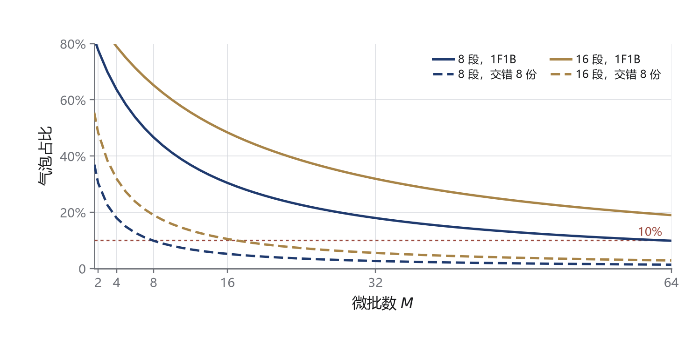

## 流水线与专家并行

有一件事在机内解决不了：模型大到八张卡也装不下。70B 就是一个例子，16 字节每参数除以 8 是 140 GB，而一张卡只有 80 GB。这时候只能跨机，而跨机不能做张量并行，因为每层都要同步的通信模型在 25 GB/s 的链路上撑不住。

剩下的选择是切层。层的顺序不能变，但可以按顺序分给不同的机器：第一台算前 20 层，第二台算接着的 20 层。这个思路简单得像废话，可它把两个难题一起解决了——权重按层摊开了，激活也按层摊开了，而且跨机只传一个张量。它带来的新问题是空转，而空转的账可以精确算出来。

这一章讲两种跨机的切法：切层的流水线并行，和切专家的专家并行。前者的核心是气泡，后者的核心是均衡。

### 流水线怎么工作

先把机制说清楚。$P$ 台机器，每台负责 $L/P$ 层。一批数据从第一台进去，前向算完把激活传给第二台，第二台接着算，一直到最后一台算出损失。反向从最后一台开始，梯度沿着相反的方向往回传。

如果一次只送一整批进去，那么任意时刻只有一台机器在算，其余 $P-1$ 台在等。效率是 $1/P$，四台机器只有 25%，显然不能用。

所以要切成微批。把一批数据分成 $M$ 份，让它们像流水线一样依次进入：第一台算微批 1 的前向时，第二台在等；第一台算微批 2 时，第二台算微批 1，第三台在等。这样在稳定状态下，所有机器都在算不同的微批。

跨机传的东西只有一个：阶段边界的激活张量，大小是 $b\,s\,d$ 个元素。70B、微批 1、序列 4096、隐层 8192，就是 $4096 \times 8192 \times 2 = 67$ MB。25 GB/s 的链路上传 2.7 毫秒，而这一段的计算是 3.1 秒（20 层，$6\times70\times10^9\times4096/4$ FLOPs 除以 8 卡的算力）。通信占 0.09%。

这个比例解释了为什么流水线并行可以跨机：它的通信量大但不频繁，每次传一点点，两次之间算很久。真正的代价在别处。

### 气泡：公式与推导

空转的那段时间叫气泡。它有多大，可以画一张时间线数出来。

$P$ 个阶段、$M$ 个微批，先做完所有前向再做所有反向（这种最简单的调度叫 GPipe）。时间轴上，每个阶段的前向从第 $s$ 拍开始，连续 $M$ 拍；所有前向一共占 $M + P - 1$ 拍。反向对称，再占 $M + P - 1$ 拍。总时长

$$T_{\text{total}} = 2(M + P - 1)$$

每个阶段真正干活的时间是 $2M$ 拍（$M$ 次前向加 $M$ 次反向）。于是空转比例

$$\text{bubble} = \frac{2(M+P-1) - 2M}{2(M+P-1)} = \frac{P-1}{M+P-1}$$

这个式子在说什么：分子是斜边的长度（$P-1$ 拍），分母是总长度。斜边只由阶段数决定，总长度由微批数决定，所以微批越多，斜边占比越小。

代入两组数。$P=4$、$M=8$：$3/11 = 27\%$。$P=4$、$M=32$：$3/35 = 8.6\%$。$P=8$、$M=16$：$7/23 = 30\%$。

注意 $P$ 和 $M$ 的地位不对等：$P$ 变大气泡变大，$M$ 变大气泡变小。这意味着“想少空转就多切微批”，而微批数量受显存限制。这就是流水线并行的核心矛盾。

还有一个容易混淆的地方：改成 1F1B 调度之后，总时长和气泡比例都不变，变的是显存。因为 1F1B 只是把“每个阶段后面的反向”提前，填进前向之间的空隙，时间线被排得更紧凑但首尾的斜边还在。所以如果有人告诉你“换 1F1B 能把气泡减半”，那是不对的，它减的是显存，气泡要靠加微批或者交错调度才降得下来。

### 微批换显存：一笔很贵的兑换

微批越多，同时在飞的微批越多，每台机器要保存的激活也越多。

算一下 70B 在 4 段流水线、每段 20 层上的情况。开重计算后，每个微批每层的激活是 $s \times 2d = 4096 \times 16384 = 67$ MB，20 层就是 1.34 GB 每个微批。

GPipe 式调度要保存所有在飞微批的激活，$M=16$ 时是 $16 \times 1.34 = 21.4$ GB。这个数字不小，但还放得下（每卡参数 70 GB，加 21.4 GB 就 91 GB，超了）。

改成 1F1B 调度（一前一后交替），同时在飞的微批从 $M$ 个降到 $P$ 个：$4 \times 1.34 = 5.4$ GB。同样的气泡比例，显存只要四分之一。这就是 1F1B 被广泛采用的原因——它不改善气泡，只改善显存，而显存正是限制微批数的那个东西。

换句话说，气泡公式里的 $M$ 不是随便能调大的。你想要的 $M$ 由气泡决定，你能要的 $M$ 由显存决定。1F1B 的价值在于把这两个数的差距拉近了 $M/P$ 倍。

### 微批数实际上怎么定

工程上很少“选”微批数，而是从显存倒推出来的。步骤只有三步。

先算出每卡可以给激活的显存：80 GB 减去参数相关显存，再减 3 GB 缓冲。70B、16 卡时是 $80 - 70 - 3 = 7$ GB。

再算一个微批占多少：每卡层数 × 每层每 token 激活 × 序列 × 批。开重计算后每层每 token 是 $2d$ 字节，40 层、$d=8192$、序列 4096，得 $40 \times 16384 \times 4096 = 2.7$ GB。哦，这个数比前面算的 1.34 GB 大了一倍，因为我前面按 20 层算的；实际每卡 40 层就是 2.7 GB。

然后除：$7 / 2.7 = 2.6$，取 2。在飞微批不能超过 2 个，这就是硬上限。$P=2$ 时 1F1B 的在飞微批数就是 $P=2$，刚好用满；想把 $M$ 提到 16，得先把序列降到 2048 或者再加一段流水线。

这个计算顺序很重要。很多人先定一个“好看”的 $M$（比如 32），再去调显存，结果只能靠降序列或者加卡，绕了一大圈。正确的做法是先算显存能给几个微批，再回头看气泡能不能接受；不能接受就去加流水线阶段或者换交错调度，而不是硬推 $M$。

### 三种填气泡的办法

**加微批。** 最直接。$P=4$ 时把 $M$ 从 8 加到 32，气泡从 27% 降到 8.6%。代价是激活显存，用 1F1B 可以缓解。这条路的极限是显存，通常能到 $M/P$ 等于 4 到 8 之间。

**交错调度。** 把每台机器负责的层分成 $v$ 段，让它交替计算不同段的微批。比如 4 台机器各负责 20 层，把它切成两段各 10 层，于是逻辑上有 8 个阶段，但物理上还是 4 台机器。气泡变成

$$\frac{P-1}{M\cdot v + P - 1}$$

$P=4$、$v=2$、$M=16$ 时是 $3/35 = 8.6\%$，正好等于 $M=32$ 不分段的效果，而显存只按 $M=16$ 算。这是"用调度换显存"的典型手法。代价是通信次数翻倍（$v$ 段就多 $v-1$ 倍的边界传递），以及实现复杂。

**零气泡。** 把反向拆成两半：算输入梯度的部分（$B_d$，必须等下游）和算权重梯度的部分（$B_w$，不依赖下游，可以提前做）。把 $B_w$ 填进气泡里，理论上总时长从 $2(M+P-1)$ 降到接近 $2M + (P-1)$，气泡只剩 $1/3$ 左右。公开文献报告的近似是 $(P-1)/(3M)$ 量级。代价是权重梯度的显存要多留一份，实现也更绕。

实际工程里，多数团队停在第一和第二种。第三种能拿到的额外收益通常在五个百分点以内，而实现风险和调参成本不低。

把三种办法的数放在一起：

| 配置 | 气泡 | 在飞微批 | 相对显存 |
|------------------------------|------|----------|----------|
| $P=4$, $M=8$, GPipe | 27% | 8 | 8 |
| $P=4$, $M=16$, 1F1B | 15.8% | 4 | 4 |
| $P=4$, $M=32$, 1F1B | 8.6% | 4 | 4 |
| $P=4$, $M=16$, 交错 $v=2$ | 8.6% | 4 | 4 |
| $P=4$, $M=16$, 零气泡 | 约 5% | 5 | 5 |

这张表最值得记住的是第三行和第四行：它们的气泡一样，显存一样，区别只在调度复杂度。如果框架已经支持交错调度，它几乎是免费的两个百分点；如果不支持，把 $M$ 加倍也能拿到同样效果，前提是显存够。

### 一个实例的时间分解

70B、16 卡（张量 8 × 流水线 2）、微批 1、序列 4096、$M=16$。

每台机器负责 40 层，一个微批的前向加反向是 $6\times70\times10^9\times4096/2 = 8.6\times10^{14}$ FLOPs，8 卡按 45% 利用率 $1.1\times10^{15}$ FLOP/s，0.78 秒。

16 个微批的纯计算是 12.5 秒。气泡是 $(2-1)/(16+1) = 5.9\%$，加 0.74 秒。跨机传 16 次激活，每次 67 MB，2.7 毫秒一次，共 43 毫秒。张量并行的通信是每层都有的，这部分已经算在利用率里了。

所以一步约 13.3 秒，效率 94%。看起来流水线并行很划算——确实，在段数少的时候它是所有并行方式里效率最高的。

但段数不能一直少下去，因为段数少就摊不开权重。$P=2$ 时每卡 70 GB，加激活就贴边；要上 400B 这种规模，$P$ 得取 8 甚至 16，气泡就变成 $(8-1)/(16+7) = 30\%$ 和 $(16-1)/(16+15) = 48\%$。这就是为什么大规模训练里微批数 $M$ 会被推到 32、64，甚至上百。

### 阶段划分不均的代价

上面的公式假设每个阶段的计算量一样。现实中很难做到：层数不一定能整除，而且第一段和最后一段还多了一个嵌入层和输出层。

假设 4 段分别拿到 20、20、20、21 层，最后一段慢 5%。整个流水线的节拍由最慢的那一段决定，所以整体效率直接降 5%——不是平均降 1.25%，是降 5%，因为其他段会等它。

层数不好整除时，常见的做法是把多出来的层放到中间段，而不是第一段或最后一段。因为第一段和最后一段本来就有嵌入与输出层的额外开销，再给它们多分几层，差距会放大。

比层数更麻烦的是算子差异。如果某几层是 MoE、其余是稠密层，两类的计算量和通信量都不同，按层数均分就不再合理，得按实测耗时均分。这也是大模型训练里“阶段划分”需要跑一次基准测试才能定的原因：纸面上算不准。

### 专家并行：显存和计算脱钩

MoE 的结构值得先说清楚。普通 Transformer 的前馈层是一个大矩阵；MoE 把它换成 $E$ 个小矩阵（专家）加一个路由器。每个 token 过路由，被分配到其中 $k$ 个专家（通常 $k=2$），只有这 $k$ 个专家参与计算。

这带来一个很奇怪的账：一个总参数 1T、每 token 只激活 40B 的 MoE，显存要按 1T 算（所有专家都得存着），计算只按 40B 算（每个 token 只走两个专家）。存和算的比例是 25:1。

专家并行就是顺着这个结构切：把 $E$ 个专家分到不同卡上，每张卡只存一部分专家。路由决定了 token 要去哪张卡，所以每步都要做一次 all-to-all：把 token 发到持有目标专家的卡上，算完再收回来。

这笔通信量可以算。设全局每步 $T$ 个 token，专家数 $E$，每 token 选 $k$ 个，隐层 $d$，BF16。

每张卡发出的 token 副本数是 $k\,T/E$，每份 $d$ 个元素、2 字节。分发一次、收回一次，所以

$$B_{\text{a2a}} = 2 \times \frac{k\,T}{E} \times d \times 2 = \frac{4k\,T\,d}{E}\ \text{字节}$$

$T = 8192$、$k=2$、$E=8$、$d=4096$：$4\times2\times8192\times4096/8 = 33.6$ MB，每层。

计算那边，每张卡处理 $k\,T/E = 2048$ 个 token-专家对，每个专家是 $3 \times 4096 \times 14336$ 个参数，浮点运算 $6 \times 1.76\times10^8 = 1.06\times10^9$，合计 $2.2\times10^{12}$ FLOPs。按 35% 利用率（MoE 的利用率通常低于稠密，因为专家小、算子碎），20 毫秒。

all-to-all 33.6 MB 在 25 GB/s 上是 1.34 毫秒，占 6.3%。

把这两个式子相除，会发现一个有意思的结果：

$$\frac{t_{\text{a2a}}}{t_{\text{compute}}} = \frac{4F}{18\,f_{\text{ffn}}\,W_{\text{bw}}}$$

$F$ 是有效算力，$f_{\text{ffn}}$ 是每个专家的中间维度，$W_{\text{bw}}$ 是带宽。这个比值和 token 数、专家数、激活比例都无关，只取决于"每个专家多胖"和"链路多宽"。

它的用处是判断一个 MoE 设计的通信风险。专家越细（$f_{\text{ffn}}$ 越小），通信占比越高：$f_{\text{ffn}}$ 从 14336 降到 1792（八分之一的细粒度专家），比值从 6% 涨到 50%；如果 EP 再跨出交换机域、有效带宽掉到 5 GB/s，比值变成 250%——完全跑不动。

这解释了一个工程事实：MoE 的专家不能切得太细，而且专家并行要尽量放在同一个交换机域内。反过来说，如果网络够宽（机内 NVLink 或者全互联的交换域），把专家切细反而是划算的——它让每个 token 的计算更少、显存更省，而通信占比仍然可控。所以“MoE 好不好用”这件事，在模型结构定下来之后，很大程度上是一个网络问题。

### MoE 的显存账

MoE 的显存算法和稠密模型一样，只是“参数总量”和“激活参数量”要分开看。

总参数 1T 的 MoE，按 16 字节/参数算要 16 TB 显存。1024 张 80 GB 卡一共 80 TB，看起来宽裕，但除去激活、缓冲、碎片，实际能用的不到 55 TB——所以每卡 15.6 GB 的参数显存在这个规模上是合适的，余量大约三成。

如果看错了数，把“激活参数 40B”当成总参数去规划，会算出只要 640 GB、八张卡就够——相差 25 倍。这是 MoE 规划里最常见的一个错误，而且报错时的现象很迷惑：模型能启动、能前向，直到第一次反向要存所有专家的梯度时才 OOM。

还有一处容易被忽略：路由器的参数和 all-to-all 的缓冲。前者很小（$d \times E$ 量级），后者不小——为了接收其他卡发来的 token，每张卡要预留一块与容量成正比的缓冲，按容量 2560、$d=4096$、2 字节算是 20 MB 每层，几十层下来也有几百 MB。这个数字不影响大局，但如果显存已经卡得很紧，它就是压垮的那一块。

### 容量因子：硬性上限与丢弃

all-to-all 有个麻烦：每张卡要处理的 token 数是数据相关的，事先不知道。如果所有 token 都涌向同一个专家，那张卡就要处理 $T$ 个 token，显存和时间都会爆。

解法是给每个专家设一个硬上限，叫容量：

$$\text{capacity} = \left\lceil c_f \cdot \frac{k\,T}{E} \right\rceil$$

$c_f$ 是容量因子。$T=8192$、$k=2$、$E=8$ 时，平均每个专家 2048 个 token；$c_f=1.25$ 时容量 2560。

超过容量的 token 会被丢弃——不是丢掉不算，而是跳过这个专家，直接从残差送过去。代价是这些 token 在这一层没有经过前馈，模型少学了一点。

丢多少取决于路由的均衡程度。理想均匀分布下，2560 的容量对 2048 的均值有 25% 余量，按二项分布估算，被丢的比例在千分之几。但如果路由塌缩，某些专家收到 3400 个 token，那个专家的丢弃率就是 $(3400-2560)/3400 = 25\%$。

丢弃率上升的后果不是崩，是效果变差：一批 token 里有一部分在若干层里"什么都没学到"，等效于训练数据的利用率下降。经验上丢弃率超过 5% 就该调整，超过 15% 基本训不出好模型。

控制手段有两类。一类是辅助损失：在总损失里加一项 $\alpha \cdot E \sum_i f_i P_i$，$f_i$ 是分到专家 $i$ 的 token 比例，$P_i$ 是路由器给专家 $i$ 的平均概率，这一项在分配不均时变大，逼着路由器摊平。系数 $\alpha$ 通常取 0.01 量级，取大了会损害模型质量，因为它在强迫模型做它不想做的分配。

另一类是无辅助损失的做法：给每个专家一个可调的偏置，每步按历史负载微调——某个专家过载就把它的偏置调低一点，欠载就调高。它不进入梯度，所以不影响主损失，收敛更干净。这类做法在近两年的 MoE 里用得越来越多。

容量因子本身也有一个消长。取 1.0 意味着按均值卡死，一半以上的专家会超容（因为分布总有波动），丢弃率能到两三成；取 2.0 则显存和通信都按两倍预留，浪费。常见的取值在 1.1 到 1.5 之间，而且会随着训练进行逐步提高——前期路由混乱、分布不均，系数要宽；后期路由稳定，可以收紧。把它当成一个训练超参而不是一个固定常数，是工程上比较稳妥的做法。

### 交错调度的账：边界翻倍换一半显存

交错调度（interleaved 1F1B）的做法是：每台机器拿到的 $L/P$ 层再切成 $v$ 小段，前向时不是把自己那一段全部算完，而是算完一小段就让出去，等下一轮再算第二小段。逻辑上的阶段数从 $P$ 变成 $P\cdot v$，而物理机器数不变。

先算它买到了什么。$P=2$、$M=16$、$v=2$：气泡从 $(2-1)/(16+1) = 5.9\%$ 降到 $(2-1)/(16\times2+1) = 3.0\%$，省下 2.9 个点。一步 12.5 秒的纯计算，相当于拿回 0.36 秒。

再算它花了什么。边界数从 $P-1 = 1$ 变成 $P\cdot v - 1 = 3$，前向的跨机次数从 16 次变成 48 次，每次 67 MB。多出的 32 次是 $2.1$ GB，在 25 GB/s 上 86 毫秒。用 86 毫秒的通信换 360 毫秒的气泡，仍然划算。

但账不是永远划算。把 $P$ 和 $v$ 一起放大：$P=8$、$v=4$，边界数从 7 变成 31，通信量是 4.4 倍。这时如果链路只有 25 GB/s，多出的 24 次边界每步要多传 1.6 GB，即 64 毫秒×16 个微批 ≈ 1 秒，而气泡省下的可能只有半个多秒。**交错的收益与链路带宽成正比**，跨机带宽越窄，它越不值。

还有一个实现上的隐成本：交错要求层能均匀分给 $P\cdot v$ 个逻辑阶段。$L=80$、$P=8$、$v=4$ 时每段只有 2.5 层，除了不整除，每段只有两三层也意味着张量并行的启动开销占比变高。所以交错调度在小段数时好用，段数一多样样变差。

### 零气泡：把 wgrad 填进缝里

反向算两件事：对输入的梯度（让上游能继续反传）和对权重的梯度（只用于更新参数）。后者不依赖上游，理论上可以推迟到任何空闲时隙。

零气泡调度就是利用这个自由度：把权重梯度那部分提前算，填进气泡里。总时长从 $2(M+P-1)$ 降到接近 $2M + (P-1)$，气泡占比从 $(P-1)/(M+P-1)$ 降到大约 $(P-1)/(3M)$ 的量级。

代价是显存。权重梯度必须提前算，就必须提前存——原本在飞 $P$ 个微批、每个微批存一份层输入，现在还要存若干份权重梯度缓冲。对 70B、张量并行 8：一个阶段的权重是 $140/8 = 17.5$ GB，再多存一份就多 17.5 GB。在 80 GB 卡上，这一刀砍下去往往直接把配置从“能跑”变成“装不下”。

部分方案把反向再拆细（只提前一个子集），能在显存与气泡之间取中间值，但收益也从“归零”退回“减半”。实际工程里能看到的落地案例，零气泡多用在层数多、每层小、显存有富余的模型上；层数少、每层大的模型上，它省下的几秒抵不过多存的十几 GB。

所以“三种填法”的优先级其实很清楚：先加微批（有限度），再上交错（看带宽），最后才是零气泡（看显存）。跳着用的后果通常是“噪了很久，发现要退回”。

### all-to-all 落在什么网络上

专家并行的通信全部是 all-to-all，而 all-to-all 的耗时几乎完全由“多少对卡在互相发”决定。同一个消息大小，落在不同层级的网络上，差两个数量级。

| 范围 | 有效带宽 | 8 MB 消息耗时 |
|------------|---------|-----------|
| 机内 NVLink | 300 GB/s | 0.03 毫秒 |
| 单 leaf 交换机 | 25 GB/s | 0.32 毫秒 |
| 跨 spine | 8 GB/s | 1.0 毫秒 |
| 跨集群 | 3 GB/s | 2.7 毫秒 |

这张表的一个重要含义是：EP 的度不应该超过一个 leaf 交换机下的卡数，否则每次 all-to-all 都会走到最慢的那一档。而 all-to-all 是每层一次，80 层就是每步 80 次——不是 80 次里偶尔一次慢，而是每次都慢。

把具体数代进去：8 MB 的消息，在 leaf 交换机上 0.32 毫秒，跨 spine 是 1 毫秒；叠加 80 层，相差 54 毫秒每步。如果一步计算是 4 秒，这就是 1.4% 的差别——听上去不多，但如果 EP 跨了 spine 之后带宽还伴随擁塞和长尾延迟，实测差别会远大于这个估算。

还有一件不显眼的事：all-to-all 的流量是“快进快出”的，不像梯度全归约那样有稳定的环。它对交换机缓存的压力更大，多对多同时发的时候容易触发丢包重传。所以同一个硬件上，跑稠密模型很稳的集群，换成 MoE 后可能出现难以复现的偶发超时。

### 一百二十八卡、八个专家：EP 怎么摆

手上有 128 张卡（16 台机器，每台 8 卡），模型是 8 专家的 MoE。最直接的想法是 EP=8（每卡一个专家），剩下的维度做数据并行 16 路。

但“EP=8”有两种完全不同的摆法：专家 0–7 分布在同一个机箱的 8 张卡上，或者分布到 8 个机箱的各一张卡上。前者的 all-to-all 全在 NVLink 上（300 GB/s），后者全部跨机（8–25 GB/s）。同一个数字，差两个数量级。

| 摆法 | all-to-all 路径 | 8 MB 耗时 | 对 80 层的累计 |
|------------------|-------------|---------|------------|
| 一机 8 卡 | 机内 | 0.03 毫秒 | 2.4 毫秒 |
| 八机各 1 卡 | 跨 spine | 1.0 毫秒 | 80 毫秒 |

第一行是标准做法：专家并行放在机内，数据并行跨机。它的代价是每张卡的专家恰好占一个机箱，模型并行度与硬件拓扑对齐了。

第二行是一个常见的诱饵：把专家按“每个机箱一个”摆，看上去“专家分布均匀”，实际上每次 all-to-all 都要跨机，而且 8 个专家之间是 8 对 8 全连接，一跳不落。这个错在一百卡的规模上仍然能跑（只是慢），到一千卡时就会成为主要瓶颈。

把每卡状态重新算一遍：1T 总参数、128 卡完整切分是 $16\times10^{12}/128 = 125$ GB，装不下。所以 128 卡上的 1T MoE 还要靠流水线和 ZeRO，或者把模型缩到 400B（$16 \times 400\times10^9/128 = 50$ GB）。这个例子说明另一件事：MoE 的“参数总量”和“卡数”之间的关系比稠密模型更紧，因为它的激活参数只占很小一部分，省不了多少激活显存。

### 阶段划分：按实测耗时，不按层数

层数能整除不代表负载均衕。首尾两个阶段天生多东西：第一段要算嵌入、位置编码、可能还有图像或音频的投影；最后一段要算输出投影、交叉熵、还有损失的反向。

一个实测的典型值：4 段各 20 层，首段比中间段慢 6%，末段慢 9%。于是整条流水线的节拍由末段决定，有效效率直接从 94% 降到 86%——而层数分配看上去完全均衕。

对策是倒过来做：先跑一个单阶段基准（每个阶段单独前向反向 10 次），拿到实测耗时，再按耗时比例分层。20/20/20/20 可能变成 19/21/21/21，首段少一层。这听起来很土，但它是大模型训练里必须做的一步，因为差 8% 就是几十万美元。

还有一个更细的版本：如果模型里混了 MoE 层和稠密层，两类层的耗时差三倍以上，按层数分更不合理。这时要么把 MoE 层均匀摊到每段（让每段都有同样比例的 MoE），要么按实测时间做整数规划。前者简单且足够好，后者只在层数很少、不均匀影响很大时才值得。

### 气泡曲线：微批到底要加到多少

把公式画成曲线，才能看出“微批要加到多少”这个问题的真实难度。

$P=8$、普通 1F1B：要气泡降到 10%，需要 $(8-1)/(M+7) = 0.1$，即 $M = 63$。这是个很硬的要求：63 个微批意味着序列和批被切得很碎，每碎一次都多一次边界传递，也多一份调度开销。

同一张图上，交错 8 份的曲线在 $M=8$ 时就已经低于 10%。也就是说，“多花一点通信”把微批需求从 63 降到 8，降了将近八倍。这就是交错调度在大规模训练里几乎必开的原因：它换来的不是几个百分点的气泡，而是一个数量级的显存与调度余量。

图里还有一条值得注意的细节：$P=16$ 的普通 1F1B 在 $M=64$ 时仍有 19% 的气泡，而它的交错版本在 $M=16$ 时已经降到 5.9%。段数越多，交错的价值越大——因为气泡的分子是 $P-1$，而交错把分母乘了 $v$。

### EP 与 DP 的网格：四种组合

专家并行和数据并行会同时在两个维度上切，四维网格里的排布不是只有一种。以一个 8 专家、每 token 选 2 的 MoE、128 卡为例：

| 组合 | 每卡专家数 | all-to-all 路径 | 梯度同步 |
|------------|--------|-------------|--------|
| EP=8, DP=16 | 1 | 机内 | 跨机 16 路 |
| EP=16, DP=8 | 0.5 | 跨机 | 跨机 8 路 |
| EP=8, DP=8, TP=2 | 1 | 机内 | 跨机 8 路 |
| EP=4, DP=16, TP=2 | 2 | 机内 | 跨机 16 路 |

第二行那个 0.5 个专家是个真实存在但很少被讨论的配置：专家数 8、EP 取 16，意味着每个专家被切成两半放在两张卡上，每张卡算一半的中间维度。这在技术上可行（专家也是矩阵），但它让每一层多了一次归约，而且 all-to-all 跨了机。代价与收益不成比例。

第三行和第四行是小模型上常见的“三维网格”。它们的共同点是把张量并行插入机内，把 EP 留在机内，把 DP 放到机间。这样的排列下，三类通信各自走不同的线：张量归约和专家 all-to-all 在线内，梯度同步在线间。**排布的目标就是让这三类流量不抢同一条链路**，而不是把某一类优化到极致。

每卡状态可以统一算：总参数 $N$ 除以总卡数就是每卡参数量（只要三个维度乘起来等于总数），MoE 的特殊之处只在激活参数与通信。比如 400B 总参数、40B 激活、128 卡：每卡 $16 \times 400\times10^9/128 = 50$ GB，加激活与 all-to-all 缓冲，刚好卡在 80 GB。

### 专家不均：显存与时间的双重浪费

专家并行有一个特殊的不均等：同一层里的 8 个专家，参数量可能不一样（路由负载驱动了训练，热门专家会变得更胖？实际上专家尺寸通常固定，但**负载**不均）。

负载不均同时伤两处。显存上，容量缓冲要按最大可能负载预留，如果路由真实的峰值是最均值的 1.7 倍，缓冲就要多留 70%，而平均情况下这 70% 是空的。时间上，每张卡要等最忙的那张卡，而 all-to-all 是全局同步点，一张卡满了，全组就等它。

量化一下：每步 8192 token、8 专家、$k=2$，均值负载 2048。如果分布的标准差是均值的 25%，那么最忙的专家会到 2048 + 2×512 ≈ 3070，容量因子取 1.25（2560）时就要丢掉 17%。丢 17% 的 token 意味着这一层只能给 83% 的 token 提供前馈，效果上等于白算了一部分。

对策是三层：路由偏置（无辅助损失的那种，收敛更干净）、容量因子随训练阶段收紧、以及监控每个专家的 token 数。第三层最容易被忘：先不做前两层，先把这个指标画出来，看它到底偏到什么程度。很多时候“模型训不好”的真实原因是路由塌缩，而不是学习率。

### 一个 512 卡的 400B 配置

把所有约束摆到一张表上：400B 稠密、512 卡、层数 96、隐层 16384、头数 128、批 1024 条 4096 序列。

第一步定维度。张量并行不能超机内 8，取 8；每卡参数状态 $16\times400\times10^9/512 = 12.5$ GB。

第二步看激活。一层在批 1、序列 4096 下是 $34.5 \times 16384 \times 4096 = 2.3$ GB；张量并行 8 份除以 8 是 290 MB；若不做流水线，96 层就是 27.8 GB，加 12.5 GB 状态与 4 GB 缓冲，44 GB，勉强能跑。

第三步看是什么卡住了它。不是显存，是微批。$P=8$、要气泡 ≤10%，需 $M \ge 63$；而一步的全局批是 1024 条，$M=64$ 时每个微批只有 16 条，每条 4096 token，刚好。四个维度乘起来：$8 \times 8 \times 8 = 512$，数据并行 8 路。

第四步校核气泡与跨机流量。气泡 $(8-1)/(64+7) = 9.9\%$；每步跨机传 $64 \times 7 \times 67\text{ MB} = 30$ GB，按 50 GB/s 是 0.6 秒；而一步纯计算是 $6\times400\times10^9\times1024\times4096 = 1\times10^{19}$ FLOPs，512 卡按 45% 是 $7.2\times10^{16}$ FLOP/s，139 秒。跨机只占 0.4%。

总数拼起来：139 秒纯计算，加 9.9% 气泡（13.8 秒），加通信 0.6 秒，约 154 秒一步。有效算力占比 90%，但这是理想值；实际还要扣掉 all-reduce、检查点、故障重启，这就是后面几章的内容。

这张表最值得看的是第三步：真正决定配置的不是显存，而是“气泡要求 $M \ge 63$”和“全局批只有 1024 条”这两个约束的碰撞。如果全局批只有 256 条，$M$ 就只能取 32，气泡升到 16%，性价比直接掉一个档。**全局批大小是先决条件**，而不是可以事后调的参数。

### all-to-all 为什么难重叠

稠密模型的梯度全归约可以重叠，因为它与计算是“独立的两件事”：第 $L$ 层的梯度算完，可以一边传它、一边算第 $L-1$ 层。MoE 的 all-to-all 不具备这个性质，它卡在计算的中间。

一层 MoE 的顺序是：算路由 → 按路由把 token 发出去（dispatch）→ 本地专家计算 → 把结果收回来（combine）。dispatch 必须在路由之后，专家计算必须在 dispatch 之后，combine 必须在计算之后。四个步骤严格串行，中间没有可以拿计算去垫的空隙。

所以 MoE 层的时间是“计算 + 两次 all-to-all”，不是“max(计算, 通信)”。举个例子：一层专家计算 20 毫秒，dispatch 1.3 毫秒，combine 1.3 毫秒，那么这层就是 22.6 毫秒，而不是 20 毫秒——后面那 13% 是真实损失，不是可以优化的空间。

能做的是跨层重叠：第 $L$ 层的 combine 可以与第 $L+1$ 层的路由并行（路由是轻量的），或者与下一层的前置 LayerNorm 并行。但这两处的计算量都很小，能盖住的部分有限。这就是 MoE 在大规模上比稠密模型更难提高利用率的结构性原因。

还有一个常被忽略的细节：dispatch 出去的数据是无序的，因为每个专家收到的 token 来自不同卡、顺序被打乱。计算前要按专家分组重排，算完还要按原顺序放回。这两次重排是纯内存操作，在 $d=4096$、每卡 2048 个 token 时是 $2048 \times 4096 \times 2 = 16$ MB 的读写，看起来不大，但它是随机访问，实际带宽利用率很低，几百微秒就没了。

### 流水线的通信为什么可以“几乎免费”

同样跨机，流水线每次传 67 MB，张量并行每次传 117 MB，看起来差不多，但两者的频率差了两个数量级：流水线每步 14 次，张量并行每步 320 次。

频率低带来两个好处。一是固定延迟被摊薄：一次跨机传输的固定开销（建链、同步、拷贝）约 20–50 微秒，占 67 MB 传输时间（2.7 毫秒）的 1%–2%；而在张量并行里，117 MB 只要 4.7 毫秒，同样的固定开销占 0.4%–1%，但同步点是 320 个，任何一个的超时都会放大到全步。

二是它不需要桶。数据并行的梯度归约要把 14 GB 切成很多桶才能重叠，而流水线每步只有 14 个 67 MB 的完整张量，天然就是“一大块”的形状，直接发即可。这意味着流水线的通信实现简单得多，也更容易预测。

代价是它把成本换成了气泡。同样是 14 次传输，如果 14 次里有一半在等，那就是 50% 的浪费；而气泡是确定性的，能精确算出来。这也是流水线在工程上受欢迎的原因：它的代价可预测，而不是“看网络脸色”。

这张对比可以概括成一句话：**张量并行把通信切得很碎，靠带宽硬扛；流水线并行把通信坐得很齐，靠调度容忍**。两者在同一个作业里并存时，前者占机内、后者占机间，正好互补。

### 三种失败

**路由塌缩。** 训练到几万步时，某个专家吃掉了四成的 token，容量丢弃率升到 30%，损失卡在某个值上不再下降。原因是路由器的偏好被自我强化：某个专家早期偶然表现好，拿到更多 token，训练得更充分，于是更好。对策是加辅助损失或者用偏置调整，并在监控里盯住每个专家的 token 数分布——这个指标应该在看板上，不能只在出问题时才去查。

**专家并行跨了交换机。** 一个 8 专家、EP=8 的配置，专家恰好分在跨两台交换机的机器上。名义带宽 25 GB/s，但跨 spine 的实际吞吐只有 6 GB/s，all-to-all 时间变成 5.6 毫秒，占了计算的 28%。更糟的是它不稳定：跨 spine 的链路和别处的流量共享，抖动大，all-to-all 的尾延迟能把整步拖慢。解决办法是把 EP 组限制在同一个 leaf 交换机下，代价是 EP 度最多等于单台交换机能连的机器数。

**all-to-all 和梯度同步撞车。** MoE 层做完 all-to-all 之后紧接着要做数据并行的梯度归约，两者如果落在同一时刻，会争抢同一条链路，实际带宽只有一半。这不是配置错误，是调度问题：有的框架提供通信流优先级，让 all-to-all 先走；有的通过调整微批顺序错开。判断方法是看 NCCL 时间线，如果两类通信有重叠段，就该调。

**把 GPipe 式调度用在长序列上。** 有人为了让气泡小，把微批加到 32，用的还是“先全部前向、再全部反向”的调度。结果是 32 个微批的激活同时存在，显存直接爆掉，而报错信息指向的是反向的第一层，让人以为问题在反向。实际上问题在调度：换成 1F1B，在飞微批从 32 降到 $P$，显存回到可控范围，气泡一点没变。这个坑很典型，因为它把“显存不够”和“并行配置不对”混在了一起。

### 三层叠起来的样子

一个 1T 参数的 MoE、1024 张卡，典型划分是：

- 张量并行 4，把每层的矩阵切四份；
- 专家并行 8，把专家分到 8 张卡上；
- 流水线并行 4，把层分四段；
- 数据并行 8，填满剩下的维度。

四个数相乘是 $4 \times 8 \times 4 \times 8 = 1024$。每卡参数相关显存 $10^{12} \times 16 / 1024 = 15.6$ GB，剩下的显存留给激活和 all-to-all 的缓冲。

这个配置里，三种通信同时存在：张量并行每层两次归约（机内）、专家并行每层一次 all-to-all（同交换机域）、数据并行每步一次梯度归约（跨机）。它们的频率和量级都不同，调度时要让它们尽量错开。这也是大规模训练里"通信时间占比"这个指标难以单看的原因——它由三种流量叠加而成，优化一种可能只是让另一种占了空出来的带宽。

### 算一遍：128 卡上微批数被谁卡住

前面说过“微批数是从显存倒推的”，这里把它算完。目标：70B、128 卡、TP8 × PP4 × DP4、序列 4096、微批 1。

第一步，每卡状态：$1120/128=8.75$ GB（权重、梯度、优化器状态都按 128 卡切），加缓冲 4 GB，留给激活的预算是 $80-8.75-4=67$ GB。

第二步，一个微批占多少：每段 $96/4=24$ 层，开重计算后每层每 token 存 $2d=16384$ 字节，所以

$$24\times16384\times1\times4096=1.34\ \text{GB}$$

第三步除一下，$67/1.34=50$，而 1F1B 的在飞微批数是 $P=4$ 而不是 $M$，所以真正的上限不是 50——50 是“GPipe 式把 M 个微批全存着”的上限。1F1B 下 M 只影响气泡，不再吃显存：

$$M\ge\frac{P-1}{0.1}-(P-1)=27$$

取 $M=32$，气泡 $3/35=8.6\%$，全局批 $32\times4=128$ 条序列。这个配置的每一步：纯计算 $6\times70\times10^9\times128\times4096/1.8\times10^{16}=12.2$ 秒（128 卡按 45% 是 $1.8\times10^{16}$ FLOP/s），气泡加 1.05 秒；跨机传 $32\times3\times2=192$ 次激活张量，每次 $4096\times8192\times2=67$ MB，共 12.9 GB，50 GB/s 下 0.26 秒。

四路算完，得到一个反直觉的结论：**128 卡上限制微批数的不是显存，是“全局批只有 128 条”**。想让 $M$ 到 64，微批就得降到 0.5 条——做不到。所以在这个规模上，降气泡的手段只剩两个：交错调度（把 $P$ 乘上 $v$），或者把序列切开做“序列微批”（每条样本只算一半长度，代价是注意力变短）。

把它和 512 卡的配置对比一下就能看出差别：400B、512 卡、全局批 1024 条时，$M$ 能取 64（每微批 16 条），气泡 9.9%。**卡越多，全局批相对越小，微批数越紧**——这就是大集群上“气泡降不下去”的真正原因，不是公式不对，是分子不够大。

### 多一段流水线，换回多少显存

400B、512 卡。TP8 固定，剩下的 64 路分配给 PP 和 DP。三个候选，都不开 ZeRO-3：

| PP 段数 | 每卡权重+梯度 | 每卡状态 | 气泡（$M=32$） |
|--------|-------------|--------|-------------|
| 2 | 100 GB | 109 GB | 3.0% |
| 4 | 50 GB | 59 GB | 8.6% |
| 8 | 25 GB | 34 GB | 17.9% |

第二列是 $800/(8\cdot PP)$ 再加一份等大的梯度。第三列再加上优化器状态：4800 GB 按 TP8 × PP × DP 三层切完，每卡 $4800/512=9.4$ GB，三个方案一样。

PP2 那一行直接超了，所以真正的选择在 4 和 8 之间：多切一段，每卡省 25 GB，气泡从 8.6% 涨到 17.9%。一步纯计算 140 秒，那 9.3 个点就是 13 秒。也就是说，**每省 1 GB 显存要付 0.5 秒一步的代价**，而这 25 GB 能换来什么？能把序列从 4096 拉到 8192，或者把微批从 1 加到 2。

这笔兑换划不划算，取决于当前卡在哪。如果序列 4096 已经够用、微批也上不去（全局批不够），那 PP8 省的 25 GB 是白省，只多花了 13 秒。反过来，如果现在因为显存不够只能跑 2K 序列，那 PP8 换来的 8K 序列是硬收益。这也是为什么大集群上 PP 段数往往比“显存需要的最小值”多一档：预留的那一档是给序列长度的。

还有一个容易被忽略的第三选项：交错调度（$v=2$）在 PP4 上能把气泡从 8.6% 降到 $(4-1)/(32\times2+3)=4.5\%$，显存不变，代价是边界数从 3 变 7、每步多传 $32\times4\times2=256$ 次、每次 67 MB，共 17 GB，50 GB/s 下 0.34 秒，而省下的 4.1 个点是 5.7 秒。**先上交错，再考虑加 PP**，因为前者的兑换率高一个数量级以上。

### 专家并行开多大：一张权衡表

EP 的显存收益是线性的：EP 度每翻一倍，每卡专家数减半，专家那部分参数就减半。但通信不是。固定 token 总量 $T=8192$、$k=2$、$d=4096$，把 EP 从 8 推到 32：

| EP 度 | 每卡专家 | 每层 all-to-all | 占本层计算 |
|--------|--------|-------------|--------|
| 8（机内） | 1 | 33.6 MB | 0.6% |
| 16（跨 2 机） | 0.5 | 16.8 MB | 6.7% |
| 32（跨 4 机） | 0.25 | 8.4 MB | 21% |

第三列按 $B_{\text{a2a}}=4kTd/E$ 算，EP 翻倍它就减半。但第四列反而涨了三十多倍：每卡处理的 token 数从 2048 降到 512，本层计算从 20 毫秒降到 5 毫秒，而通信时间从 0.11 毫秒涨到 1.05 毫秒（字节少了一半，带宽却从 300 GB/s 掉到 8 GB/s）。

把这个变化写成一句话：**EP 的收益是“存得下”，代价是“算得少”**。在显存真的不够时，这笔交易必须先做；但在显存够的时候把 EP 推大，只会把一层 20 毫秒的计算摊成 5 毫秒的计算加 1 毫秒的通信，有效算力从 99% 掉到 83%。

所以 EP 的度存在一个“天花板”，而它由拓扑定，不由显存定：单 leaf 交换机下的卡数。超过这个数，每次 all-to-all 都要跳一跳 spine，而这条链路同时还要跑梯度同步。把 EP 固定在“不跨交换机”的那一档，剩下的显存缺口用流水线和 ZeRO 补，是大规模 MoE 训练里最稳的一条默认规则。

### 四个真实规模的配置表

把前几节的式子套到四个常见规模上，得到一张可以直接对照的表（都开重计算、都开 1F1B）：

| 规模与卡数 | 并行度 | 微批 $M$ | 气泡 |
|--------------|-------------|--------|--------|
| 7B / 8 卡 | TP8×PP1×DP1 | 8 | — |
| 13B / 16 卡 | TP8×PP1×DP2 | 16 | — |
| 70B / 64 卡 | TP8×PP2×DP4 | 16 | 5.9% |
| 400B / 512 卡 | TP8×PP8×DP8 | 64 | 9.9% |

前两行没有气泡，因为 PP=1；它们的约束是显存，不是调度。后两行的气泡恰好都在 6%–10%，不是巧合：它俩的 $M$ 都是被“每段激活能装下几个微批”和“全局批够不够分”同时卡住的。

这张表里最容易被误读的是 400B 那一行。64 个微批看着很多，但全局批是 1024 条，每个微批只有 16 条，而每条 4096 token——也就是每个微批 65 536 个 token，已经快到“矩阵够不够胖”的下限。再把 $M$ 往上推，微批就只有 8 条，矩阵的 M 维降到 32768，算力利用率会从 45% 掉到 40% 以下，气泡省下的 2 个点会被利用率吃回去。

所以调流水线的顺序是：先算显存能给几个微批，再看全局批能分几个微批，取两者的小值，最后看气泡能不能接受。三步里任何一步报“不够”，要动的是卡数或序列，不是调度。

### 跨机这一层的取舍

把三个规模的总账摆在一起，能看清每一层切法各自抽走多少。

| 配置 | 纯计算 | 气泡 | 跨机通信 | 其它 | 有效比例 |
|----------------------|--------|-------|--------|----------|--------|
| 70B，16 卡（8×2） | 12.5 秒 | 5.9% | 0.3% | 优化器 0.3% | 约 94% |
| 400B，512 卡（8×8×8） | 4.4 秒 | 18% | 1% | 数据全归约 1% | 约 80% |
| 1T MoE，1024 卡（4×8×4×8） | 4 秒量级 | 16% | 6% | 数据全归约 1% | 约 75% |

（括号里是各并行维度的度，顺序为张量 × 流水线 × 数据；MoE 那一行多一维，是张量 × 专家 × 流水线 × 数据。表中百分比都相对纯计算时间，“有效比例”是实际吞吐除以纯计算对应的吞吐，已经把算力利用率算进去了。）

表格里最明显的一行是 400B：它的气泡一下子到了 18%，因为流水线必须切到 8 段才能把权重摊开。这时“加微批”是唯一不动结构就能提效的手段，而微批又受显存限制——所以大模型训练里把序列长度、微批数、流水线段数三个旋钮一起调，是常态而不是例外。

流水线和专家并行的共同点是"尽量少通信"，代价各不相同：一个付空转，一个付均衡。

流水线的空转是确定的，可以精确算出来，也可以靠调度压到 10% 以内；它的隐藏成本是显存，微批数和气泡率是一对绑在一起的旋钮。

专家并行的通信和计算有一个不随规模变化的比例，这个比例由"每个专家多胖"和"链路多宽"决定。所以 MoE 的设计不只是模型问题，也是网络问题：专家切得越细，越依赖高带宽和低延迟的互联，也就越难跨机。

一个实用的判断是看“没有并行的时候，一步要多久”。如果单卡一步要几十秒，那么加卡之后即使有三成气泡和三成通信，也还能拿到七成以上的收益；如果单卡一步只要一两秒，任何跨机切分都不划算，因为同步和空转的固定开销会把收益吃光。这也是小模型上大规模并行常常失败的原因——不是配置错，是固定开销的比例太高。

这两者往往一起出现：大模型既需要切层来摊开权重，又需要切专家来摊开稀疏参数。三层叠加之后，每张卡上的显存已经不是问题（十几 GB），真正决定吞吐的是三种通信能不能被计算盖住。下一章开始算显存，把前面几章反复提到的"参数 16 字节、激活随序列涨"逐个拆开。
