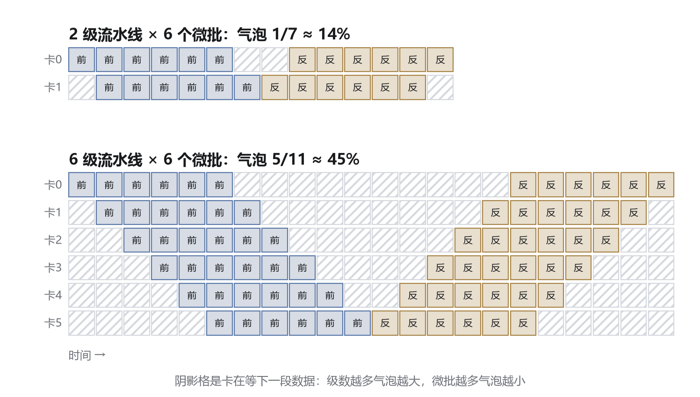

## 流水线与专家并行

有一件事在机内解决不了：模型大到八张卡也装不下。70B 就是一个例子，16 字节每参数除以 8 是 140 GB，而一张卡只有 80 GB。这时候只能跨机，而跨机不能做张量并行，因为每层都要同步的通信模型在 25 GB/s 的链路上撑不住。

剩下的选择是切层。层的顺序不能变，但可以按顺序分给不同的机器：第一台算前 20 层，第二台算接着的 20 层。这个思路简单得像废话，可它把两个难题一起解决了——权重按层摊开了，激活也按层摊开了，而且跨机只传一个张量。它带来的新问题是空转，而空转的账可以精确算出来。

这一章讲两种跨机的切法：切层的流水线并行，和切专家的专家并行。前者的核心是气泡，后者的核心是均衡。

### 流水线怎么工作

先把机制说清楚。$P$ 台机器，每台负责 $L/P$ 层。一批数据从第一台进去，前向算完把激活传给第二台，第二台接着算，一直到最后一台算出损失。反向从最后一台开始，梯度沿着相反的方向往回传。

如果一次只送一整批进去，那么任意时刻只有一台机器在算，其余 $P-1$ 台在等。效率是 $1/P$，四台机器只有 25%，显然不能用。

所以要切成微批。把一批数据分成 $M$ 份，让它们像流水线一样依次进入：第一台算微批 1 的前向时，第二台在等；第一台算微批 2 时，第二台算微批 1，第三台在等。这样在稳定状态下，所有机器都在算不同的微批。

跨机传的东西只有一个：阶段边界的激活张量，大小是 $b\,s\,d$ 个元素。70B、微批 1、序列 4096、隐层 8192，就是 $4096 \times 8192 \times 2 = 67$ MB。25 GB/s 的链路上传 2.7 毫秒，而这一段的计算是 3.1 秒（20 层，$6\times70\times10^9\times4096/4$ FLOPs 除以 8 卡的算力）。通信占 0.09%。

这个比例解释了为什么流水线并行可以跨机：它的通信量大但不频繁，每次传一点点，两次之间算很久。真正的代价在别处。

### 气泡：公式与推导

空转的那段时间叫气泡。它有多大，可以画一张时间线数出来。

$P$ 个阶段、$M$ 个微批，先做完所有前向再做所有反向（这种最简单的调度叫 GPipe）。时间轴上，每个阶段的前向从第 $s$ 拍开始，连续 $M$ 拍；所有前向一共占 $M + P - 1$ 拍。反向对称，再占 $M + P - 1$ 拍。总时长

$$T_{\text{total}} = 2(M + P - 1)$$

每个阶段真正干活的时间是 $2M$ 拍（$M$ 次前向加 $M$ 次反向）。于是空转比例

$$\text{bubble} = \frac{2(M+P-1) - 2M}{2(M+P-1)} = \frac{P-1}{M+P-1}$$

这个式子在说什么：分子是斜边的长度（$P-1$ 拍），分母是总长度。斜边只由阶段数决定，总长度由微批数决定，所以微批越多，斜边占比越小。

代入两组数。$P=4$、$M=8$：$3/11 = 27\%$。$P=4$、$M=32$：$3/35 = 8.6\%$。$P=8$、$M=16$：$7/23 = 30\%$。

注意 $P$ 和 $M$ 的地位不对等：$P$ 变大气泡变大，$M$ 变大气泡变小。这意味着“想少空转就多切微批”，而微批数量受显存限制。这就是流水线并行的核心矛盾。

还有一个容易混淆的地方：改成 1F1B 调度之后，总时长和气泡比例都不变，变的是显存。因为 1F1B 只是把“每个阶段后面的反向”提前，填进前向之间的空隙，时间线被排得更紧凑但首尾的斜边还在。所以如果有人告诉你“换 1F1B 能把气泡减半”，那是不对的，它减的是显存，气泡要靠加微批或者交错调度才降得下来。

### 微批换显存：一笔很贵的兑换

微批越多，同时在飞的微批越多，每台机器要保存的激活也越多。

算一下 70B 在 4 段流水线、每段 20 层上的情况。开重计算后，每个微批每层的激活是 $s \times 2d = 4096 \times 16384 = 67$ MB，20 层就是 1.34 GB 每个微批。

GPipe 式调度要保存所有在飞微批的激活，$M=16$ 时是 $16 \times 1.34 = 21.4$ GB。这个数字不小，但还放得下（每卡参数 70 GB，加 21.4 GB 就 91 GB，超了）。

改成 1F1B 调度（一前一后交替），同时在飞的微批从 $M$ 个降到 $P$ 个：$4 \times 1.34 = 5.4$ GB。同样的气泡比例，显存只要四分之一。这就是 1F1B 被广泛采用的原因——它不改善气泡，只改善显存，而显存正是限制微批数的那个东西。

换句话说，气泡公式里的 $M$ 不是随便能调大的。你想要的 $M$ 由气泡决定，你能要的 $M$ 由显存决定。1F1B 的价值在于把这两个数的差距拉近了 $M/P$ 倍。

### 微批数实际上怎么定

工程上很少“选”微批数，而是从显存倒推出来的。步骤只有三步。

先算出每卡可以给激活的显存：80 GB 减去参数相关显存，再减 3 GB 缓冲。70B、16 卡时是 $80 - 70 - 3 = 7$ GB。

再算一个微批占多少：每卡层数 × 每层每 token 激活 × 序列 × 批。开重计算后每层每 token 是 $2d$ 字节，40 层、$d=8192$、序列 4096，得 $40 \times 16384 \times 4096 = 2.7$ GB。哦，这个数比前面算的 1.34 GB 大了一倍，因为我前面按 20 层算的；实际每卡 40 层就是 2.7 GB。

然后除：$7 / 2.7 = 2.6$，取 2。在飞微批不能超过 2 个，这就是硬上限。$P=2$ 时 1F1B 的在飞微批数就是 $P=2$，刚好用满；想把 $M$ 提到 16，得先把序列降到 2048 或者再加一段流水线。

这个计算顺序很重要。很多人先定一个“好看”的 $M$（比如 32），再去调显存，结果只能靠降序列或者加卡，绕了一大圈。正确的做法是先算显存能给几个微批，再回头看气泡能不能接受；不能接受就去加流水线阶段或者换交错调度，而不是硬推 $M$。

### 三种填气泡的办法

**加微批。** 最直接。$P=4$ 时把 $M$ 从 8 加到 32，气泡从 27% 降到 8.6%。代价是激活显存，用 1F1B 可以缓解。这条路的极限是显存，通常能到 $M/P$ 等于 4 到 8 之间。

**交错调度。** 把每台机器负责的层分成 $v$ 段，让它交替计算不同段的微批。比如 4 台机器各负责 20 层，把它切成两段各 10 层，于是逻辑上有 8 个阶段，但物理上还是 4 台机器。气泡变成

$$\frac{P-1}{M\cdot v + P - 1}$$

$P=4$、$v=2$、$M=16$ 时是 $3/35 = 8.6\%$，正好等于 $M=32$ 不分段的效果，而显存只按 $M=16$ 算。这是"用调度换显存"的典型手法。代价是通信次数翻倍（$v$ 段就多 $v-1$ 倍的边界传递），以及实现复杂。

**零气泡。** 把反向拆成两半：算输入梯度的部分（$B_d$，必须等下游）和算权重梯度的部分（$B_w$，不依赖下游，可以提前做）。把 $B_w$ 填进气泡里，理论上总时长从 $2(M+P-1)$ 降到接近 $2M + (P-1)$，气泡只剩 $1/3$ 左右。公开文献报告的近似是 $(P-1)/(3M)$ 量级。代价是权重梯度的显存要多留一份，实现也更绕。

实际工程里，多数团队停在第一和第二种。第三种能拿到的额外收益通常在五个百分点以内，而实现风险和调参成本不低。

把三种办法的数放在一起：

| 配置 | 气泡 | 在飞微批 | 相对显存 |
|------------------------------|------|----------|----------|
| $P=4$, $M=8$, GPipe | 27% | 8 | 8 |
| $P=4$, $M=16$, 1F1B | 15.8% | 4 | 4 |
| $P=4$, $M=32$, 1F1B | 8.6% | 4 | 4 |
| $P=4$, $M=16$, 交错 $v=2$ | 8.6% | 4 | 4 |
| $P=4$, $M=16$, 零气泡 | 约 5% | 5 | 5 |

这张表最值得记住的是第三行和第四行：它们的气泡一样，显存一样，区别只在调度复杂度。如果框架已经支持交错调度，它几乎是免费的两个百分点；如果不支持，把 $M$ 加倍也能拿到同样效果，前提是显存够。

### 一个实例的时间分解

70B、16 卡（张量 8 × 流水线 2）、微批 1、序列 4096、$M=16$。

每台机器负责 40 层，一个微批的前向加反向是 $6\times70\times10^9\times4096/2 = 8.6\times10^{14}$ FLOPs，8 卡按 45% 利用率 $1.1\times10^{15}$ FLOP/s，0.78 秒。

16 个微批的纯计算是 12.5 秒。气泡是 $(2-1)/(16+1) = 5.9\%$，加 0.74 秒。跨机传 16 次激活，每次 67 MB，2.7 毫秒一次，共 43 毫秒。张量并行的通信是每层都有的，这部分已经算在利用率里了。

所以一步约 13.3 秒，效率 94%。看起来流水线并行很划算——确实，在段数少的时候它是所有并行方式里效率最高的。

但段数不能一直少下去，因为段数少就摊不开权重。$P=2$ 时每卡 70 GB，加激活就贴边；要上 400B 这种规模，$P$ 得取 8 甚至 16，气泡就变成 $(8-1)/(16+7) = 30\%$ 和 $(16-1)/(16+15) = 48\%$。这就是为什么大规模训练里微批数 $M$ 会被推到 32、64，甚至上百。

### 阶段划分不均的代价

上面的公式假设每个阶段的计算量一样。现实中很难做到：层数不一定能整除，而且第一段和最后一段还多了一个嵌入层和输出层。

假设 4 段分别拿到 20、20、20、21 层，最后一段慢 5%。整个流水线的节拍由最慢的那一段决定，所以整体效率直接降 5%——不是平均降 1.25%，是降 5%，因为其他段会等它。

层数不好整除时，常见的做法是把多出来的层放到中间段，而不是第一段或最后一段。因为第一段和最后一段本来就有嵌入与输出层的额外开销，再给它们多分几层，差距会放大。

比层数更麻烦的是算子差异。如果某几层是 MoE、其余是稠密层，两类的计算量和通信量都不同，按层数均分就不再合理，得按实测耗时均分。这也是大模型训练里“阶段划分”需要跑一次基准测试才能定的原因：纸面上算不准。

### 专家并行：显存和计算脱钩

MoE 的结构值得先说清楚。普通 Transformer 的前馈层是一个大矩阵；MoE 把它换成 $E$ 个小矩阵（专家）加一个路由器。每个 token 过路由，被分配到其中 $k$ 个专家（通常 $k=2$），只有这 $k$ 个专家参与计算。

这带来一个很奇怪的账：一个总参数 1T、每 token 只激活 40B 的 MoE，显存要按 1T 算（所有专家都得存着），计算只按 40B 算（每个 token 只走两个专家）。存和算的比例是 25:1。

专家并行就是顺着这个结构切：把 $E$ 个专家分到不同卡上，每张卡只存一部分专家。路由决定了 token 要去哪张卡，所以每步都要做一次 all-to-all：把 token 发到持有目标专家的卡上，算完再收回来。

这笔通信量可以算。设全局每步 $T$ 个 token，专家数 $E$，每 token 选 $k$ 个，隐层 $d$，BF16。

每张卡发出的 token 副本数是 $k\,T/E$，每份 $d$ 个元素、2 字节。分发一次、收回一次，所以

$$B_{\text{a2a}} = 2 \times \frac{k\,T}{E} \times d \times 2 = \frac{4k\,T\,d}{E}\ \text{字节}$$

$T = 8192$、$k=2$、$E=8$、$d=4096$：$4\times2\times8192\times4096/8 = 33.6$ MB，每层。

计算那边，每张卡处理 $k\,T/E = 2048$ 个 token-专家对，每个专家是 $3 \times 4096 \times 14336$ 个参数，浮点运算 $6 \times 1.76\times10^8 = 1.06\times10^9$，合计 $2.2\times10^{12}$ FLOPs。按 35% 利用率（MoE 的利用率通常低于稠密，因为专家小、算子碎），20 毫秒。

all-to-all 33.6 MB 在 25 GB/s 上是 1.34 毫秒，占 6.3%。

把这两个式子相除，会发现一个有意思的结果：

$$\frac{t_{\text{a2a}}}{t_{\text{compute}}} = \frac{4F}{18\,f_{\text{ffn}}\,W_{\text{bw}}}$$

$F$ 是有效算力，$f_{\text{ffn}}$ 是每个专家的中间维度，$W_{\text{bw}}$ 是带宽。这个比值和 token 数、专家数、激活比例都无关，只取决于"每个专家多胖"和"链路多宽"。

它的用处是判断一个 MoE 设计的通信风险。专家越细（$f_{\text{ffn}}$ 越小），通信占比越高：$f_{\text{ffn}}$ 从 14336 降到 1792（八分之一的细粒度专家），比值从 6% 涨到 50%；如果 EP 再跨出交换机域、有效带宽掉到 5 GB/s，比值变成 250%——完全跑不动。

这解释了一个工程事实：MoE 的专家不能切得太细，而且专家并行要尽量放在同一个交换机域内。反过来说，如果网络够宽（机内 NVLink 或者全互联的交换域），把专家切细反而是划算的——它让每个 token 的计算更少、显存更省，而通信占比仍然可控。所以“MoE 好不好用”这件事，在模型结构定下来之后，很大程度上是一个网络问题。

### MoE 的显存账

MoE 的显存算法和稠密模型一样，只是“参数总量”和“激活参数量”要分开看。

总参数 1T 的 MoE，按 16 字节/参数算要 16 TB 显存。1024 张 80 GB 卡一共 80 TB，看起来宽裕，但除去激活、缓冲、碎片，实际能用的不到 55 TB——所以每卡 15.6 GB 的参数显存在这个规模上是合适的，余量大约三成。

如果看错了数，把“激活参数 40B”当成总参数去规划，会算出只要 640 GB、八张卡就够——相差 25 倍。这是 MoE 规划里最常见的一个错误，而且报错时的现象很迷惑：模型能启动、能前向，直到第一次反向要存所有专家的梯度时才 OOM。

还有一处容易被忽略：路由器的参数和 all-to-all 的缓冲。前者很小（$d \times E$ 量级），后者不小——为了接收其他卡发来的 token，每张卡要预留一块与容量成正比的缓冲，按容量 2560、$d=4096$、2 字节算是 20 MB 每层，几十层下来也有几百 MB。这个数字不影响大局，但如果显存已经卡得很紧，它就是压垮的那一块。

### 容量因子：硬性上限与丢弃

all-to-all 有个麻烦：每张卡要处理的 token 数是数据相关的，事先不知道。如果所有 token 都涌向同一个专家，那张卡就要处理 $T$ 个 token，显存和时间都会爆。

解法是给每个专家设一个硬上限，叫容量：

$$\text{capacity} = \left\lceil c_f \cdot \frac{k\,T}{E} \right\rceil$$

$c_f$ 是容量因子。$T=8192$、$k=2$、$E=8$ 时，平均每个专家 2048 个 token；$c_f=1.25$ 时容量 2560。

超过容量的 token 会被丢弃——不是丢掉不算，而是跳过这个专家，直接从残差送过去。代价是这些 token 在这一层没有经过前馈，模型少学了一点。

丢多少取决于路由的均衡程度。理想均匀分布下，2560 的容量对 2048 的均值有 25% 余量，按二项分布估算，被丢的比例在千分之几。但如果路由塌缩，某些专家收到 3400 个 token，那个专家的丢弃率就是 $(3400-2560)/3400 = 25\%$。

丢弃率上升的后果不是崩，是效果变差：一批 token 里有一部分在若干层里"什么都没学到"，等效于训练数据的利用率下降。经验上丢弃率超过 5% 就该调整，超过 15% 基本训不出好模型。

控制手段有两类。一类是辅助损失：在总损失里加一项 $\alpha \cdot E \sum_i f_i P_i$，$f_i$ 是分到专家 $i$ 的 token 比例，$P_i$ 是路由器给专家 $i$ 的平均概率，这一项在分配不均时变大，逼着路由器摊平。系数 $\alpha$ 通常取 0.01 量级，取大了会损害模型质量，因为它在强迫模型做它不想做的分配。

另一类是无辅助损失的做法：给每个专家一个可调的偏置，每步按历史负载微调——某个专家过载就把它的偏置调低一点，欠载就调高。它不进入梯度，所以不影响主损失，收敛更干净。这类做法在近两年的 MoE 里用得越来越多。

容量因子本身也有一个消长。取 1.0 意味着按均值卡死，一半以上的专家会超容（因为分布总有波动），丢弃率能到两三成；取 2.0 则显存和通信都按两倍预留，浪费。常见的取值在 1.1 到 1.5 之间，而且会随着训练进行逐步提高——前期路由混乱、分布不均，系数要宽；后期路由稳定，可以收紧。把它当成一个训练超参而不是一个固定常数，是工程上比较稳妥的做法。

### 三种失败

**路由塌缩。** 训练到几万步时，某个专家吃掉了四成的 token，容量丢弃率升到 30%，损失卡在某个值上不再下降。原因是路由器的偏好被自我强化：某个专家早期偶然表现好，拿到更多 token，训练得更充分，于是更好。对策是加辅助损失或者用偏置调整，并在监控里盯住每个专家的 token 数分布——这个指标应该在看板上，不能只在出问题时才去查。

**专家并行跨了交换机。** 一个 8 专家、EP=8 的配置，专家恰好分在跨两台交换机的机器上。名义带宽 25 GB/s，但跨 spine 的实际吞吐只有 6 GB/s，all-to-all 时间变成 5.6 毫秒，占了计算的 28%。更糟的是它不稳定：跨 spine 的链路和别处的流量共享，抖动大，all-to-all 的尾延迟能把整步拖慢。解决办法是把 EP 组限制在同一个 leaf 交换机下，代价是 EP 度最多等于单台交换机能连的机器数。

**all-to-all 和梯度同步撞车。** MoE 层做完 all-to-all 之后紧接着要做数据并行的梯度归约，两者如果落在同一时刻，会争抢同一条链路，实际带宽只有一半。这不是配置错误，是调度问题：有的框架提供通信流优先级，让 all-to-all 先走；有的通过调整微批顺序错开。判断方法是看 NCCL 时间线，如果两类通信有重叠段，就该调。

**把 GPipe 式调度用在长序列上。** 有人为了让气泡小，把微批加到 32，用的还是“先全部前向、再全部反向”的调度。结果是 32 个微批的激活同时存在，显存直接爆掉，而报错信息指向的是反向的第一层，让人以为问题在反向。实际上问题在调度：换成 1F1B，在飞微批从 32 降到 $P$，显存回到可控范围，气泡一点没变。这个坑很典型，因为它把“显存不够”和“并行配置不对”混在了一起。

### 三层叠起来的样子

一个 1T 参数的 MoE、1024 张卡，典型划分是：

- 张量并行 4，把每层的矩阵切四份；
- 专家并行 8，把专家分到 8 张卡上；
- 流水线并行 4，把层分四段；
- 数据并行 8，填满剩下的维度。

四个数相乘是 $4 \times 8 \times 4 \times 8 = 1024$。每卡参数相关显存 $10^{12} \times 16 / 1024 = 15.6$ GB，剩下的显存留给激活和 all-to-all 的缓冲。

这个配置里，三种通信同时存在：张量并行每层两次归约（机内）、专家并行每层一次 all-to-all（同交换机域）、数据并行每步一次梯度归约（跨机）。它们的频率和量级都不同，调度时要让它们尽量错开。这也是大规模训练里"通信时间占比"这个指标难以单看的原因——它由三种流量叠加而成，优化一种可能只是让另一种占了空出来的带宽。

### 跨机这一层的取舍

把三个规模的总账摆在一起，能看清每一层切法各自抽走多少。

| 配置 | 纯计算 | 气泡 | 跨机通信 | 其它 | 有效比例 |
|----------------------|--------|-------|--------|----------|--------|
| 70B，16 卡（8×2） | 12.5 秒 | 5.9% | 0.3% | 优化器 0.3% | 约 94% |
| 400B，512 卡（8×8×8） | 4.4 秒 | 18% | 1% | 数据全归约 1% | 约 80% |
| 1T MoE，1024 卡（4×8×4×8） | 4 秒量级 | 16% | 6% | 数据全归约 1% | 约 75% |

（括号里是各并行维度的度，顺序为张量 × 流水线 × 数据；MoE 那一行多一维，是张量 × 专家 × 流水线 × 数据。表中百分比都相对纯计算时间，“有效比例”是实际吞吐除以纯计算对应的吞吐，已经把算力利用率算进去了。）

表格里最明显的一行是 400B：它的气泡一下子到了 18%，因为流水线必须切到 8 段才能把权重摊开。这时“加微批”是唯一不动结构就能提效的手段，而微批又受显存限制——所以大模型训练里把序列长度、微批数、流水线段数三个旋钮一起调，是常态而不是例外。

流水线和专家并行的共同点是"尽量少通信"，代价各不相同：一个付空转，一个付均衡。

流水线的空转是确定的，可以精确算出来，也可以靠调度压到 10% 以内；它的隐藏成本是显存，微批数和气泡率是一对绑在一起的旋钮。

专家并行的通信和计算有一个不随规模变化的比例，这个比例由"每个专家多胖"和"链路多宽"决定。所以 MoE 的设计不只是模型问题，也是网络问题：专家切得越细，越依赖高带宽和低延迟的互联，也就越难跨机。

一个实用的判断是看“没有并行的时候，一步要多久”。如果单卡一步要几十秒，那么加卡之后即使有三成气泡和三成通信，也还能拿到七成以上的收益；如果单卡一步只要一两秒，任何跨机切分都不划算，因为同步和空转的固定开销会把收益吃光。这也是小模型上大规模并行常常失败的原因——不是配置错，是固定开销的比例太高。

这两者往往一起出现：大模型既需要切层来摊开权重，又需要切专家来摊开稀疏参数。三层叠加之后，每张卡上的显存已经不是问题（十几 GB），真正决定吞吐的是三种通信能不能被计算盖住。下一章开始算显存，把前面几章反复提到的"参数 16 字节、激活随序列涨"逐个拆开。
