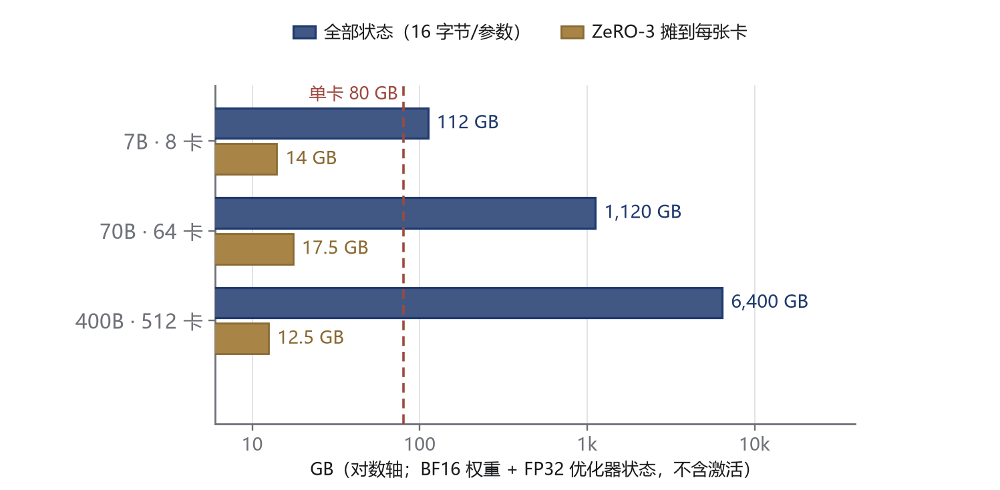

## 显存账：权重、状态与激活

有一个团队的训练脚本在第 37 步 OOM，重跑一遍，还是第 37 步。换个随机种子，变成第 52 步。批大小没改，序列长度也没改，前 36 步的显存曲线看上去平平稳稳。

他们最初的判断是"显存泄漏"，查了两天没查出泄漏。后来的真相有两条：第 37 步是数据里第一次出现超长文档的那一步，也是保存检查点的那个步数；两件事撞在一起，瞬时显存多出了十几 GB。

这个案例说明一件事：显存不是"够不够"的二元问题，它是几块不同性质的东西加起来的和，每一块的增长方式不同。权重是个常数，激活随批次和序列变，碎片随运行时间变，检查点会在某几步突然翻倍。只看"权重有多大"来判断能不能跑，几乎一定会出错。

这一章把这些块逐个拆开算清楚，然后回答一个具体问题：想让某个规模的模型塞进 80 GB，该动哪一项。

### 一共六块

训练时的显存放在六个地方。

这六块的脾气完全不同：前四块是“张量”，你能在代码里找到对应的变量；后两块是“环境”，你不主动申请，它们也会自己长出来。混在一起看，很容易把“参数太多”和“批太大”搞成一团，然后对着一个错的方向调半天。先分开列一遍，再逐块算。

| 块 | 与什么有关 | 7B 的量级 |
|---------------|-----------------------------|-----------|
| 权重 | 参数量 × 精度 | 14 GB |
| 梯度 | 参数量 × 精度 | 14 GB |
| 优化器状态 | 参数量 × 12 字节 | 84 GB |
| 激活 | 批 × 序列 × 层数 × 隐层 | 2–94 GB |
| 通信缓冲 | 并行度 × 桶大小 | 1–3 GB |
| 碎片与上下文 | 分配器行为 | 2–8 GB |

前三块只跟模型有关，加起来是"参数相关显存"，也就是那个 16 字节/参数。后三块只跟"怎么跑"有关，前三块不变的情况下，它们可以从 3 GB 涨到上百 GB。

这个划分很有用：如果显存不够，先看问题落在哪个区间。前三块超了，只能切分或者降精度；后三块超了，调批、调序列、开重计算就行，不用动结构。

7B 模型的账单是：112 GB 参数相关，加上 19 GB 激活（批 1、序列 4096、不重计算），加 2 GB 缓冲，加 5 GB 碎片，一共 138 GB。参数占了 81%，所以这个规模下切分是唯一出路。

### 前三块：三个常数

**权重**是 $N \times b_w$，$b_w$ 是每个参数的字节数。BF16 是 2，FP8 是 1，FP32 是 4。7B 用 BF16 是 14 GB，70B 是 140 GB，400B 是 800 GB。

**梯度**一般和权重同精度，所以也是 $N \times 2$。有一个例外：如果优化器要求梯度用 FP32（少数实现如此），这块会翻倍。

**优化器状态**是最大的一块，也是最容易被低估的。Adam 需要一阶动量和二阶方差，各 4 字节；混合精度训练还需要一份 FP32 的主权重，也是 4 字节。三项合计 12 字节每个参数：

$$12 \times 7\times10^9 = 84\ \text{GB}$$

这个式子在说什么：优化器状态是权重的六倍那么大。7B 的权重 14 GB 看起来轻松，84 GB 的状态才是真正的门槛。

到这里可以把"参数相关显存"写成一句话：

$$\text{state} = N\,(b_w + b_g + 12)$$

BF16 时是 $16N$，FP8 时是 $15N$。注意 FP8 只把 $b_w$ 从 2 降到 1，括号里的 12 一分没动，所以总量只降了 6%。这一点后面还会用到，它是很多人对 FP8 失望的原因。

### 激活：一份逐项清单

激活是唯一随"跑法"变化的块，也是最难估的。它由前向时保存的中间结果构成，反向要用它们算梯度。

一个 Transformer 层在批 $b$、序列 $s$、隐层 $d$ 下，每个 token 每层要保存这些东西（都按 BF16 计）：

| 张量 | 大小 | 说明 |
|------------------------|------|---------------------------|
| 残差流输入 | $2d$ | 层的输入，反向要用 |
| LayerNorm 1 输出 | $2d$ | 归一化后的输入 |
| QKV 投影输出 | $6d$ | 三个 $2d$ 的投影 |
| 注意力输出 | $2d$ | 投影回隐层之前 |
| LayerNorm 2 输入 | $2d$ | 注意力之后的残差 |
| LayerNorm 2 输出 | $2d$ | |
| 前馈第一层输出 | $8d$ | 中间维度按 $4d$ 算 |
| 激活函数输出 | $8d$ | |
| 前馈第二层输出 | $2d$ | |

加起来 $34d$ 字节每个 token 每层。再加上注意力分数矩阵：它是 $s \times s$ 的，但按"每 token"折算就是 $2s$ 字节。

于是整个模型的激活是

$$\text{act} = b\,s\,L\,(34d + 2s)\ \text{字节}$$

这个式子在说什么：三个因子分别是"批"、"序列乘层数"和"每个 token 每层的字节数"。括号里的两项一个是常数（和隐层有关），一个随序列线性增长。因为外面还乘了一个 $s$，序列翻倍时第二项会翻四倍。

代入三个规模（批 1、序列 4096）：

- 7B（$L=32$、$d=4096$）：$4096 \times 32 \times (34\times4096 + 8192) = 19.3$ GB
- 70B（$L=80$、$d=8192$）：$4096 \times 80 \times (34\times8192 + 8192) = 93.9$ GB
- 400B（$L=96$、$d=16384$）：$4096 \times 96 \times (34\times16384 + 8192) = 222$ GB

这个数字很难看。70B 单卡要 94 GB 激活，比权重四个还多。所以真实训练一定要开重计算。

重计算的原理是不保存中间结果，反向时用层的输入重新算一遍。最彻底的版本只保存每层的输入，每 token 每层 $2d$ 字节，于是系数从 34 降到 1：

- 7B：$4096 \times 32 \times 8192 = 1.07$ GB（不完全精确，实际实现还要保存少量张量）
- 70B：$4096 \times 80 \times 16384 = 5.4$ GB
- 400B：$4096 \times 96 \times 32768 = 12.9$ GB

代价是前向多算一次，训练时间增加 30% 左右。这是所有省显存手段里最划算的一笔：显存降 17 倍，时间只多三成。

还有两处激活不在这个公式里，量却不小。

一是词表投影。输入嵌入和输出层都是 $V \times d$ 的矩阵，$V$ 是词表大小。一个 12.8 万词表、隐层 8192 的模型，光这一层权重就是 $128000 \times 8192 \times 2 = 2.1$ GB；400B 那种隐层 16384 的，是 4.2 GB。这部分在参数账里算过，但如果实现里把 logits 也当激活存（$b \times s \times V$ 个元素），代价会非常惊人——批 1、序列 4096、词表 12.8 万，是 $4096 \times 128000 \times 4 = 2.1$ GB 的 FP32 张量。所以几乎所有实现都用融合的交叉熵，算完立刻丢掉。

二是 MoE 的专家激活。稠密层每个 token 都过同一个前馈，MoE 层每个 token 过两个不同的专家，两路的中间结果都要存。于是 MoE 层的激活是稠密层的两倍左右，即使激活参数只占很小一部分。规划 MoE 的显存时，这一项经常被漏掉。

中间还有一档叫选择性重计算，只重算注意力那部分（分数矩阵是显存大户），前馈不重算。它能省掉六七成的激活，只多花 5% 的时间，是工程上最常用的配置。

### 长上下文为什么贵得不成比例

上面的公式里有一项 $2s$，它在序列短的时候微不足道，长了就变成主角。

7B、序列 4096 时，每 token 每层的 147456 字节里，分数项只占 8192，5.6%。序列拉到 32768，固定项还是 139264，分数项变成 65536，占了 32%；总量是 $32768 \times 32 \times 204800 = 215$ GB。这个数字已经超过了单卡的容量，不开重计算根本跑不起来。

开重计算之后是 $32768 \times 32 \times 8192 = 8.6$ GB，能跑了。但代价是要重算 32 层的注意力，多花的时间从 30% 涨到 40% 以上。

所以长上下文训练有三个绕不开的手段：重计算、分块注意力（不保存完整分数矩阵，反向重算）、以及把序列切开做并行。前者省显存、中者省显存也省带宽、后者把显存摊到多张卡上。三条都用上，32K 上下文才在工程上可行。

### 激活与批：一条兑换曲线

激活是唯一能通过"少算点"直接换掉的块，所以值得知道它的兑换率。

7B、序列 4096，改批大小：

| 批 | 激活（不重算） | 激活（全重算） | 8 卡 ZeRO-2 下的合计 |
|----|---------------|---------------|----------------------|
| 1 | 19 GB | 1.1 GB | 30 GB |
| 2 | 39 GB | 2.1 GB | 31 GB |
| 4 | 77 GB | 4.3 GB | 33 GB |
| 8 | 154 GB | 8.6 GB | 38 GB |
| 16 | 309 GB | 17 GB | 47 GB |

（"合计"按每卡 26.25 GB 状态、2 GB 缓冲、3 GB 碎片算。）

这张表说明两件事。一是重计算的兑换率是 18 倍，批越大绝对收益越大——批 16 时不重算要 309 GB（根本放不下），重算只要 17 GB。二是开了重计算之后，批从 1 加到 16，显存只涨 16 GB，而吞吐能涨十几倍。所以在显存允许的前提下，把批做大几乎总是对的。

但要注意"批"在这里指的是每卡的微批，不是全局批。全局批由微批乘以累积步数乘以数据并行度得到。显存只受微批影响，全局批影响的是收敛。这两个概念经常被混着说，规划时一定要分清：想提吞吐，先看微批能不能加；想稳收敛，调的是全局批。

### 优化器状态为什么不能省

有人会问：既然优化器状态占了 75%，为什么不把它也换成 BF16？84 GB 能变成 42 GB。

能换，但有代价。Adam 的更新式里有 $\sqrt{v}$ 和除法，二阶方差在训练早期很小（$10^{-8}$ 量级），BF16 的最小正规数也在 $10^{-38}$ 量级，看起来放得下。问题在于累积：$v$ 是梯度平方的滑动平均，长期在 $10^{-8}$ 附近小幅波动，而 BF16 只有 7 位尾数，相对误差 0.4%——这个误差会直接进入步长，表现为更新量抖动。

实践中如果非要省，可行的做法是"动量用 BF16、方差用 FP32"，省 28 GB，代价是收敛略慢。更常见的做法是用 8 位优化器（把状态量化到 int8 加一个缩放因子），能省 75%，但需要更仔细的实现和更多的调参。这类方案的收益只有在"卡数刚好差一点"时才值得。

一个反例值得说：SGD 没有动量和方差，状态只有 4 字节每参数，7B 只要 28 GB。如果任务对优化器不敏感（比如某些微调场景），换 SGD 省下的显存比任何切分都多。这也是开头那个团队"换成 SGD 就能跑 7B"的原因。

### 后三块：缓冲与碎片

**通信缓冲**包括集合通信的桶、all-gather 的临时空间、NCCL 内部的缓冲区。它的大小和并行度、桶大小有关，典型是 1–3 GB。ZeRO-3 要额外留一层权重的空间做预取，70B 的一层是 1.75 GB。

**碎片**来自显存分配器。PyTorch 的缓存分配器会保留已经释放的块，等待同样大小的请求复用。训练的显存请求大小随时间变化，于是保留的块越来越碎，可用总量可能只有标称的 90%。长训练里这个数字会慢慢恶化，表现就是"同样的配置，跑到后面 OOM"。

**上下文**是 CUDA 运行时、cuBLAS 工作区、cuDNN 句柄这些，1–2 GB，和模型无关。

三项加起来，在一张 80 GB 卡上通常要预留 6–8 GB 的"非模型开销"。这就是为什么前面反复说"80 GB 卡按 60 GB 可用算"。

### 分片对哪一项有效

切分不是万能的，每一种切法只对特定的项起作用。这张表值得贴在墙上：

| 并行方式 | 权重 | 梯度 | 优化器状态 | 激活 |
|----------|------|------|----------|-----------------------|
| 数据并行 | 不变 | 不变 | 不变 | 不变 |
| ZeRO-1 | 不变 | 不变 | $1/DP$ | 不变 |
| ZeRO-2 | 不变 | $1/DP$ | $1/DP$ | 不变 |
| ZeRO-3 | $1/DP$ | $1/DP$ | $1/DP$ | 不变 |
| 张量并行 | $1/TP$ | $1/TP$ | $1/TP$ | $1/TP$（大部分） |
| 序列并行 | 不变 | 不变 | 不变 | $1/TP$（重复的那部分） |
| 流水线并行 | $1/PP$ | $1/PP$ | $1/PP$ | $1/PP$ |

看这张表能得出两个结论。

第一，ZeRO 完全不碰激活。这是最常见的误解：有人显存不够就使劲调 ZeRO 的级数，结果一点效果没有，因为瓶颈在激活。判断方法是看崩的位置——崩在前向第一层，多半是权重或激活；崩在 step，是优化器状态。

第二，只有张量并行、序列并行、流水线并行能动激活。其中张量并行和序列并行效果最好（把每张卡的激活按 $1/TP$ 降），流水线并行也能降（按 $1/PP$），但它同时带来气泡。

所以显存优化的正确顺序是：先判断瓶颈在哪一项，再选对应的切法。参数相关超了就切参数（ZeRO、TP、PP），激活超了就切激活（TP、SP、PP）或者重计算，两者都超就一起动。

### 一张完整的明细表

把上面所有项放在一起，三个规模、两种精度：

| 项目 | 7B | 70B | 400B |
|------------------------------|--------|---------|---------|
| 权重（BF16） | 14 GB | 140 GB | 800 GB |
| 梯度（BF16） | 14 GB | 140 GB | 800 GB |
| 优化器状态（FP32 三项） | 84 GB | 840 GB | 4800 GB |
| 参数相关合计 | 112 GB | 1120 GB | 6400 GB |
| 激活（不重计算） | 19 GB | 94 GB | 222 GB |
| 激活（全量重计算） | 1.1 GB | 5.4 GB | 12.9 GB |
| 权重换 FP8 后的合计 | 105 GB | 1050 GB | 6000 GB |
| 通信缓冲（典型） | 1–2 GB | 2–3 GB | 3–5 GB |
| 碎片与上下文 | 3–5 GB | 4–8 GB | 6–10 GB |

这张表最反直觉的一行是"权重换 FP8 后的合计"。很多人以为 FP8 能把显存砍一半，实际上从 112 GB 到 105 GB，只省了 6%。原因在前面提过：FP8 只影响权重那 2 字节，优化器状态那 12 字节还是 FP32。FP8 真正的收益在算力（吞吐翻倍）和带宽（同样参数传的字节少一半），不在显存总量。

### 减哪一项，能把哪个规模塞进 80 GB

现在回答那个具体问题。每次只动一项，看结果。

**7B 单卡。** 起点 112 + 19 = 131 GB，超 51 GB。

开全量重计算，激活从 19 降到 1.1，合计 113 GB，还超 33 GB。这一项不够。

把优化器状态卸载到 CPU，参数相关从 112 降到 28，加激活 1.1，加缓冲，约 31 GB。塞进去了。代价是每步要把 84 GB 的状态在 PCIe 上搬两个来回，按 32 GB/s 算是 5.3 秒，而这一步的计算约 8.8 秒，吞吐掉到六成。

换一种做法：不卸载，而是把状态切开。8 张卡 ZeRO-2，每卡 26.25 GB，加激活 2.4 GB（批被切成 1/8），加缓冲，约 31 GB。也塞进去了，而且更快。

这两个方案的结果都是 31 GB，区别在"用不用多买七张卡"和"每一步多等 5 秒"。这就是工程上所有显存问题的基本形状：你总能在"加卡"和"变慢"之间选一个。

**70B 单机 8 卡。** 起点 140 + 12 = 152 GB（激活按张量并行切成 1/8）。

这条路走不通，而且不是"差一点"。140 GB 是硬下限：16 字节每参数乘以 700 亿，再除以 8 张卡。它和激活、批、重计算都无关。想让它变小，只能增加卡数、降低精度到 FP8（135 GB，还是超）、或者把状态放到 CPU（35 GB，但每步要搬 840 GB，48 秒，完全不可行）。

所以 70B 在单机 8 张 80 GB 卡上训练不了。这句话值得记住，因为它是很多配置表出错的根源——有人按"7B 能跑，那 70B 加十倍卡就行"来推，得出 80 张卡的结论，而正确的下限算法是 $16N/80$。

**70B 两机 16 卡。** 张量 8 × 流水线 2。参数相关 $1120/16 = 70$ GB，激活被张量 8 和流水线 2 切成 1/16，$5.4/16 = 0.34$ GB，加缓冲 3 GB，合计 73.4 GB。塞进去了，余量 6.6 GB。

这个余量意味着序列最长只能到 4096 左右。想上 8192，激活翻倍到 0.68 GB，还是够；想上 32K，就得再加卡。

**70B 四机 32 卡。** 张量 8 × 流水线 2 × 数据 2，并开 ZeRO-1。每卡权重 8.75 GB、梯度 8.75 GB、优化器 $840/32 = 26.25$ GB，合计 43.75 GB，加激活 0.34 GB 和缓冲，约 47 GB。余量 33 GB，可以上长序列、大批。

注意这 32 卡里，数据并行只有 2 路，ZeRO 只能切两刀。如果想让每卡再低，得增加数据并行的维度（也就是继续加卡）。

**MoE 的情形。** 稀疏模型的账要算两遍，一遍按总参数、一遍按激活参数。

总参数 1T、每 token 激活 40B 的 MoE，参数相关显存按 1T 算是 16 TB，按激活参数算是 640 GB。前者决定要多少卡，后者决定每卡要多少算力。如果按 16 TB 规划，1024 张 80 GB 卡（共 80 TB）是合适的；如果错按 640 GB 规划，会觉得八张卡就够，然后在第一次反向存梯度时崩掉。

MoE 还有一个额外的显存项：all-to-all 的接收缓冲。它的容量正比于"每卡要收多少 token"，而容量因子又把这个数放大了 1.25 倍。1T MoE、序列 8192、容量因子 1.25 时，每层的缓冲是几十 MB，几十层加起来一两千兆字节。这一项不影响大局，但在显存已经贴边的时候，它是压垮的那一块。

**400B。** 下限是 $6400/80 = 80$ 张卡，而且这 80 张要"每张卡分到 80 GB"，加上激活和缓冲一定超。实际可行的是 96 张：张量 8 × 流水线 4 × 数据 3，每卡参数 $6400/96 = 66.7$ GB，激活 $12.9/32 = 0.4$ GB，加缓冲 5 GB，约 72 GB。贴边但不崩。要宽裕就上 512 卡，每卡 15 GB。

把这些整理成一张表：

| 场景 | 状态 | 激活 | 缓冲 | 合计 | 结论 |
|--------------------------|------|-----|-----|-----|----------|
| 7B 单卡 不重算 | 112 | 19 | 6 | 137 | 不行 |
| 7B 单卡 重计算 | 112 | 1.1 | 6 | 119 | 不行 |
| 7B 单卡 卸载优化器 | 28 | 1.1 | 2 | 31 | 可以但慢 |
| 7B 8 卡 ZeRO-2 | 26.25 | 2.4 | 2 | 31 | 可以 |
| 70B 8 卡 TP8 | 140 | 12 | 6 | 158 | 不行 |
| 70B 16 卡 TP8×PP2 | 70 | 0.34 | 3 | 73 | 贴边 |
| 70B 32 卡 TP8×PP2×DP2 | 43.75 | 0.34 | 3 | 47 | 舒适 |
| 400B 96 卡 | 66.7 | 0.4 | 5 | 72 | 贴边 |
| 400B 512 卡 | 12.5 | 0.1 | 5 | 18 | 宽裕 |

（表中的 TP、PP、DP 分别是张量并行、流水线并行、数据并行的度，例如 TP8×PP2×DP2 表示总共 32 张卡；“状态”指权重、梯度与优化器状态之和，“激活”按开重计算后计算。）

这张表可以直接当规划工具用：给定模型和卡数，查一列就知道能不能跑；跑不动就沿着"加卡 / 切更深 / 开重计算 / 降精度"四条路试，看哪一条能把合计压到 60 GB 以下。

### 一次完整的"从超到不超"

把 70B 的调参过程完整走一遍，能看清每一项的实际作用。

第一步，8 卡张量并行，不重计算：140 + 12 + 6 = 158 GB。超 78。

第二步，开全量重计算：140 + 1.5 + 6 = 147.5。超 67.5。重计算省了 10.5 GB，杯水车薪，因为大头是权重和状态。

第三步，开 ZeRO-1。这一步是无效的：单机 8 卡做张量并行，数据并行度是 1，ZeRO 无组可切。很多人在这里卡住，反复调 `zero_stage` 却没反应，原因就是这个——分片的分母是数据并行度，不是总卡数。

第四步，加一台机器，变成 16 卡张量 8 × 流水线 2。权重和梯度被流水线切开，每卡 70 GB；激活也减半，0.7 GB；合计 76.7。还超一点点，把桶大小调到 25 MB，缓冲降到 2 GB，75 GB，进得去了。

第五步，如果还想更宽松，加数据并行到 2 路（32 卡），开 ZeRO-1，每卡 47 GB。这时可以把序列从 4096 拉到 8192 甚至 16K，也可以把微批从 1 加到 2。

这个过程中每一步省下多少，是可以事先算出来的：重计算省的是 $34d \to 2d$ 那一项（对 70B 约 10 GB/卡），流水线省的是"参数除以段数"（35 GB/卡），数据并行加 ZeRO 省的是"状态除以数据并行度"（26 GB/卡）。只有算清这三笔，才知道该动哪个旋钮。

### 如果坚持单机

还有一种常见诉求：只有一台 8 卡机器，非要训 70B。这条路理论上存在，实际上不划算，值得把账算一遍让人死心。

方案是把优化器状态全部放到 CPU（840 GB，需要一台 1 TB 内存的机器），GPU 上只留权重和梯度，每卡 $140/8 = 17.5$ GB 权重、17.5 GB 梯度，加激活，约 40 GB，装得下。

每步的开销：要把 840 GB 的状态从 CPU 读上来算更新，再写回去。PCIe 4.0 单向 32 GB/s，一次 26 秒，来回 52 秒。而这一步的计算只有约 12 秒（16 卡的情形是 6 秒，8 卡翻倍到 12 秒）。也就是说，GPU 有 80% 的时间在等内存。

再叠一层：CPU 上算 Adam 更新本身也要时间。840 GB 的状态，按每核每秒几 GB 的吞吐，几十个核并行也要几十秒。这一项往往比传输还慢。

结论是这套方案能跑，但有效算力只有理论值的 15% 左右。同一笔钱租 16 张卡的两台机器，能拿到 90% 以上的效率。除了"必须复现某个特定硬件环境"这种情形，没有理由选前者。

### 为什么偏偏是第 37 步

回到开头的案例。既然显存在第 1 步就够用，为什么第 37 步会崩？

三个原因叠在一起。

**数据里有长尾。** 训练数据经过长度过滤，但仍然存在比平均值长几倍的文档。批 1、序列上限 4096 时，短样本会被 padding 到批内最长，所以一步的实际序列长度取决于这一批里最长的那条。前 36 步最长 2100，第 37 步碰到一条 4000 的，激活直接涨了 1.9 倍。

**检查点。** 保存检查点时要把分片的参数和状态聚合起来写盘。如果实现里先做一次 all-gather 拼成完整张量再写，显存会瞬时多出一份完整的参数。70B 的一份是 140 GB，即使只拼一小块，几个 GB 是常态。第 37 步正好是保存点。

**碎片。** 缓存分配器在前面 36 步里已经攒下了一堆不能复用的小块。同样的峰值需求，可用空间比第 1 步少了 8%。

三者相加，本来还剩 6 GB 余量的一步，突然需要多 8 GB，于是 OOM。

对策也是三条，都不复杂：把序列长度设成硬上限并过滤超长样本（不要依赖 padding）；检查点用分片直接写（每张卡写自己那块，不做聚合）；调大分配器的 `max_split_size_mb` 减少碎片，或者定期清空缓存。

### 怎么实测，而不是靠算

公式给的是量级，真实的数字要测。三个手段，从粗到细。

第一步，在关键位置打印 `torch.cuda.max_memory_allocated()`。它给的是"张量实际占用"的峰值，不含缓存块，所以比 `nvidia-smi` 的数小，也更稳定。在四个位置打：训练开始前、第一次前向后、第一次反向后、第一次 step 后。四个数一对比，就知道哪一块超了。

第二步，配合 `torch.cuda.memory_reserved()` 看碎片。两个数相差 15% 以上，就该调分配器参数或者改成更小的批。这个差值在长训练里会缓慢上升，是"跑到后面崩"的直接原因。

第三步，用显存快照。PyTorch 提供的 `memory_snapshot` 能把每块分配的调用栈都记下来，可视化之后能直接看到"哪个张量一直没释放"。这个方法适合排查真正的泄漏（比如把 loss 存进了列表里），不适合排查容量不足。

一个实操细节：测的时候要把 `reset_peak_memory_stats()` 放在每个阶段的开头，否则峰值会被前面的阶段污染。很多人测出来的数比实际大，就是忘了重置。

### 四个常见误解

**"模型才 14 GB，80 GB 卡很轻松。"** 这句话只对了权重那一项。加上梯度、优化器状态和激活，7B 要 137 GB。判断能不能跑，一定要用 16 字节/参数那个数，不是权重大小。

**"换 FP8 能省一半显存。"** 只省 6%。FP8 的价值在算力和带宽，不在显存总量。真想省显存，要么切分，要么重计算，要么卸载。

**"按平均序列长度算。"** 训练时一步的实际序列长度由批内最长样本决定，不是平均值。数据里只要有 5% 的长文档，峰值就会按长文档算。规划时要按"99 分位长度"算，不是按均值。

**"批设成 1 就不会 OOM。"** 批 1 只把激活降到最小，参数相关那 112 GB 一分不少。7B 在单卡上批 1 也会 OOM，因为 112 > 80。

**"碎片只是小问题。"** 在短训练里确实如此，5% 的损耗感知不到。但显存贴着上限跑的时候，5% 就是生死线。更麻烦的是它随时间恶化：跑 24 小时之后碎片率可能从 3% 涨到 10%，于是"昨天还能跑的配置今天崩了"。对抗它的办法是留足余量（至少 10%）和控制分配大小（把 `max_split_size_mb` 设成一个不太小的值，让大块能复用）。

**"多卡以后显存自然就够了。"** 数据并行不会减少每卡的权重和状态，它只让每卡处理更少的数据。8 卡数据并行训 7B，每卡还是要 112 GB 的状态——除非开 ZeRO。这条误解导致的最典型现象是：从 1 卡扩到 8 卡，OOM 依旧，只是崩得晚了一点。

### 余量该花在哪

算出合计之后，剩下的余量怎么用，有一个优先级。

先给序列长度。序列从 4096 拉到 8192，激活翻倍，7B 在重计算下从 1.1 GB 涨到 2.2 GB，很便宜；但它对模型能力的影响比批大小大得多。能上长序列就上。

再给微批。微批从 1 加到 4，激活涨四倍，但 GPU 的利用率也会明显提升——批 1 时矩阵乘太瘦，算力利用率可能只有 30%；批 4 能到 45%。这是纯粹的吞吐收益。

最后才给检查点的缓冲和通信的桶。这两项对吞吐没有直接帮助，只是为了稳定。

反过来，如果余量是负数，削减的顺序正好相反：先减桶（把通信缓冲压到 1 GB），再减微批，最后才减序列。因为这三项对效果的伤害是倒序的：桶小只影响通信效率，微批小影响吞吐，序列短影响能力。

这条顺序听起来像常识，但实际调参时经常被违反——很多人第一反应是"序列降一半"，一举腾出大半显存，然后发现模型效果掉了，再慢慢加回去，来回折腾几轮。按顺序削，一次就能到位。

### 显存是约束，不是指标

这一章的账可以用一句话概括：参数相关显存是常数，激活是变量，缓冲和碎片是税。

常数决定能不能跑，变量决定能跑多快，税决定跑多久会崩。三者里最容易被忽视的是税——它不会在第一次运行时出现，而是在第几十步、第几百步出现，让人以为代码有问题。

把这一章的公式记住两个就够了：参数相关按 16 字节每参数算（FP8 按 15），激活按 $b\,s\,L\,(34d+2s)$ 算，再乘上重计算的折扣。有了这两个数，任何一张卡能不能装下某个配置，五分钟内就能算清楚，不用反复试。

下一章讲通信。在显存算清楚之后，剩下的问题几乎都是"卡在等卡"，而等待的时间同样可以算。
