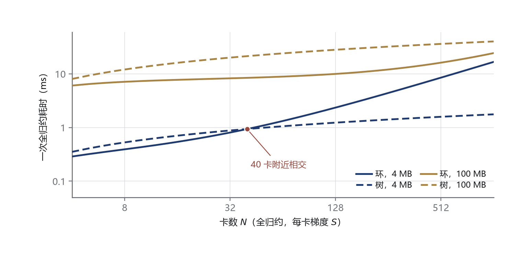
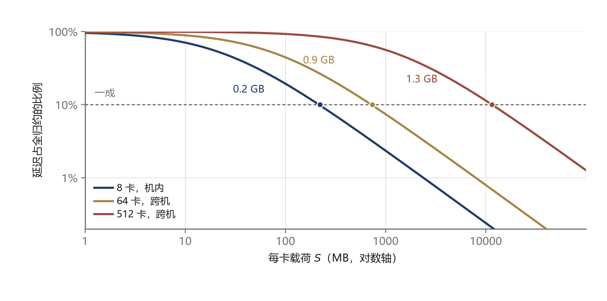

## 通信与重叠

一个 512 卡的作业，GPU 利用率稳定在 62%，训练能跑但比预期慢四成。翻 NCCL 的时间线，发现集合通信占了 38% 的时间，而且每次都是"算完再传"——计算 kernel 结束后，GPU 空转等通信，通信结束后再开始下一段计算，两段严格串行。

物理上这笔通信并不该这么贵。按上一章的算法，70B 在 64 卡上做数据并行，每卡每步要搬 275 GB，5.5 秒；而一步计算要 98 秒。通信只占 5.6%，理论上完全可以藏进计算里。

问题不在带宽，在顺序。通信如果排在计算之后，那它就是纯粹额外的时间；只有让它和计算同时进行，那 5.5 秒才会变成零。这一章讲两件事：通信量怎么算，以及怎么让它藏起来。

### 三种原语，三个公式

并行训练里所有的通信都能归到几个原语上。

**全归约（all-reduce）。** 每张卡有一份数据，求所有卡的和，结果发给每张卡。用在数据并行的梯度同步。

**全收集（all-gather）。** 每张卡有一块数据，把所有块拼起来，结果发给每张卡。用在 ZeRO-3 收集权重、张量并行拼接。

**规约散射（reduce-scatter）。** 每张卡有一份数据，求和之后把结果按块分给各卡，每卡只拿一块。它是全归约的前半段，ZeRO-1 用它。

**全交换（all-to-all）。** 每张卡有一份数据，按目的地分给各卡，每卡收到来自所有卡的一片。用在专家并行的路由。

**广播（broadcast）。** 一张卡的数据发给所有卡。用在参数初始化、检查点恢复。

设数据量 $S$ 字节、卡数 $N$，环形实现下每张卡的实际搬运量是：

| 原语 | 每卡搬运 | $N=8$ 时的系数 |
|--------------|-------------------|------------------------|
| 全归约 | $2S(N-1)/N$ | 1.75 |
| 规约散射 | $S(N-1)/N$ | 0.875 |
| 全收集 | $S(N-1)/N$ | 0.875 |
| 全交换 | $S(N-1)/N$ | 0.875 |
| 广播 | $S$ | 1 |

这些系数怎么来的，值得看一眼全归约。环形全归约分两个阶段，每阶段 $N-1$ 步，每步每张卡发出 $S/N$ 的数据，所以每卡每阶段搬 $S(N-1)/N$，两阶段合计 $2S(N-1)/N$。当 $N$ 很大时接近 $2S$——这就是那句"全归约的代价是数据量的两倍"的来源。

注意一个反直觉的地方：这些系数都随 $N$ 增大而略增，但增幅很小（$N=8$ 是 0.875，$N=512$ 是 0.998）。所以**并行度翻倍不会让每卡的通信量翻倍**，真正的成本在时间上——数据量不变，带宽不变，时间就不变，而计算量减半，占比翻倍。

### 环与树：延迟和带宽的取舍

同样的数据量，不同的算法差别很大。这一节是很多人搞不清的地方。

环算法每张卡只和左右两个邻居通信，带宽利用最充分——理论上能把链路的全部带宽用满。代价是步数多：$2(N-1)$ 步。8 卡是 14 步，512 卡是 1022 步。

树算法（或者叫递归倍增）把卡组织成二叉树，先两两归约，再四四归约，步数是 $2\log_2 N$。512 卡只要 18 步，延迟小得多。代价是带宽利用不充分：树上的中间节点既要接收又要转发，上下行不对称，实际吞吐通常只有链路带宽的一半左右。

用 α-β 模型算一下交叉点。一次通信的时间可以写成

$$t = \alpha \cdot \text{步数} + \beta \cdot \text{字节数}$$

$\alpha$ 是每步的固定延迟（机内集合通信约 10 微秒，跨机约 50 微秒），$\beta$ 是每字节的时间（带宽的倒数）。

8 卡、机内、300 GB/s、$S = 67$ MB：

- 环：$14 \times 10\ \mu s + 117\ \text{MB} \times 3.3\ \mu s/\text{MB} = 140 + 390 = 530\ \mu s$
- 树：$6 \times 10\ \mu s + 2 \times 117\ \text{MB} \times 6.6\ \mu s/\text{MB} = 60 + 1540 = 1600\ \mu s$

大消息下环快三倍。反过来，如果 $S$ 只有 0.5 MB：

- 环：$140 + 2.9 = 143\ \mu s$
- 树：$60 + 11 = 71\ \mu s$

小消息下树快一倍。

交叉点大致在"传输时间等于延迟差"的位置，也就是 $S$ 在几十 MB 量级。所以 NCCL 之类的库会自动在两种算法间切换：小消息用树，大消息用环。这个切换是自动的，但知道它的存在很重要——它解释了一个现象：同样是把通信量减半，有时候时间几乎不变，因为你跨过了算法的切换点。

### 把通信时间算到底

现在把前面几章的四个通信场景放在一张表里，都用 70B、BF16 的参数。

**数据并行梯度同步。** 每卡梯度 140 GB（ZeRO-1 下仍是全量），64 卡。每卡搬运 $2 \times 140 \times 63/64 = 275$ GB。跨机 50 GB/s（400G InfiniBand）要 5.5 秒；机内 300 GB/s 要 0.82 秒。

**ZeRO-3 的权重收集。** 每步两次全收集，约 $2 \times 140 = 280$ GB，加梯度的规约散射 140 GB，合计 420 GB。50 GB/s 下 8.4 秒。

**张量并行的层内归约。** 每层 4 次，每次每卡 117 MB，80 层共 37.6 GB。机内 300 GB/s 下 125 毫秒。

**专家并行的 all-to-all。** 每层 33.6 MB，16 层共 537 MB。25 GB/s 下 21 毫秒。

四种场景的量级差得很远：从 21 毫秒到 8.4 秒，差 400 倍。这就是为什么不能笼统地说"通信是瓶颈"——必须说清楚是哪一种。

它们对应的计算时间也不同。数据并行那 5.5 秒对的是 98 秒计算，占 5.6%；ZeRO-3 那 8.4 秒对的是同样的 98 秒，占 8.6%；张量并行那 125 毫秒对的是 1.5 秒的微批计算，占 8%；all-to-all 那 21 毫秒对的是 320 毫秒的 MoE 计算，占 6.5%。

四个数字都在 5%–9% 之间，看起来很接近。但它们的性质完全不同：前两个是"每步一次、量很大"，可以整段藏进计算；后两个是"每层一次、量很小"，必须逐层藏，而且对延迟更敏感。

### 一次 step 的完整通信清单

把四种场景合起来看一个真实作业：70B、64 卡（张量 8 × 数据 8）、ZeRO-1、开序列并行。

| 通信 | 频率 | 每步字节 | 链路 | 时间 |
|-----------------|--------|-------|--------------|----------|
| 张量并行归约 | 每层 4 次 | 37.6 GB | NVLink 300 GB/s | 125 ms |
| 序列并行归约 | 每层 2 次 | 与上合并 | NVLink | 含在上面 |
| 数据并行梯度归约 | 每步 1 次 | 275 GB | IB 50 GB/s | 5.5 s |
| 参数广播（初始化） | 一次 | 17.5 GB | IB | 一次 0.35 s |

合计每步 5.6 秒，对 98 秒的计算，占 5.7%。

这张清单有两个用处。一是规划时估算"这套配置能不能跑出效率"，二是排查时对照"实测的通信时间和这个表差多少"。差得多，就是实现或配置问题。

顺便澄清一个常见误解：张量并行的通信量（37.6 GB）比数据并行（275 GB）小得多，但前者更"贵"。因为张量并行的每一份都要等，80 层就是 320 个同步点；数据并行只有一个同步点，可以整段藏起来。所以看通信开销不能只看字节数，还要看"分成多少次"——次数决定了有多少个无法重叠的同步点。

### 压缩与异步：两个省通信的老办法

如果算下来通信确实超了，除了改并行方式，还有两条路。

**梯度压缩。** 传之前把梯度量化成 8 位，字节数降到四分之一；或者只传绝对值最大的 0.1%（top-k），字节数降到千分之一。代价是精度损失，需要配合误差补偿——把这次没传的梯度留着，下次一起传。压缩率 4 倍时，通常需要 1%–2% 的额外迭代步数才能追平不压缩的收敛。

算一笔账：70B、64 卡，275 GB 压到 69 GB，时间从 5.5 秒降到 1.4 秒。但前面算过，通信只占 5.7%，压到四分之一也只省 4 秒，而多跑 1% 的步数是 1 秒乘以总步数——几千步就是几十秒。所以在通信不是瓶颈的时候，压缩是亏的。它只在"通信占比超过 30%"的场景下划算，比如跨地域训练或者带宽极窄的集群。

**异步更新。** 不等所有卡同步，各卡用略微过期的梯度更新（叫 stale gradient）。省掉了同步等待，但收敛会受影响：过期的梯度方向不一致，等效于引入了噪声。通常只在大规模、同步成本极高的场景下用，而且需要调小学习率补偿。

这两条路都有明确的适用边界，不是"更先进"的方案。大多数情况下，把桶调对、把并行度配对，比压缩和异步更有效。

### 交叉点随卡数移动

上一节固定了 8 卡、改消息大小。反过来固定消息、改卡数，结论会不一样，因为环的步数随 $N$ 线性涨，而树的步数只随 $\log N$ 涨。

读这张图能拿到两个数。第一，4 MB 的消息在 40 卡左右相交：卡数少时环快，卡数多时树快。40 这个数不是普适的，它由延迟和带宽的比决定，但这个量级很有代表性——NCCL 在小消息上默认用树，阈值就在这个区间。

第二，100 MB 的消息到 512 卡仍然是环快。因为大消息的时间由带宽项主导，而环的带宽利用率最高（每卡只跟两个邻居说，链路能跑满），树的中间节点上下行不对称，实际只能跑到一半。

这张图的实用价值在“桶大小该怎么选”。桶 25 MB、512 卡，环要 1022 步 × 15 微秒 = 15 毫秒的延迟，加 50 MB 的传输 2 毫秒，共 17 毫秒；树只要 18 步 × 15 微秒 = 0.3 毫秒，加 9 毫秒传输，共 9.3 毫秒。同样的数据，差近一倍。**卡数越多，桶就应该越大**——因为小桶在环上会被延迟吃光。这也是为什么大规模训练里桶常常调到 100 MB 以上，而单机 8 卡时 25 MB 就够。

### 一次全归约在时间线上长什么样

把全归约当成一个黑盒，会误判很多事。它在 GPU 上实际是三段 kernel：读输入并规约、按块交换、写回用户缓冲。

| 阶段 | 做什么 | 带宽利用率 |
|----------------|--------------------|--------|
| copy-in | 把输入搬进 NCCL 的内部缓冲 | 80%–90% |
| 规约 + 交换 | 沿环跑两个阶段 | 75%–85% |
| copy-out | 把结果写回用户张量 | 80%–90% |

三段里只有中间那段在走网络，前后两段是 HBM 读写。如果输入张量不连续（比如梯度是多个张量拼成的视图），copy-in 会多一次重排，带宽掉到 40% 以下。这就是为什么框架要把参数展平成连续缓冲区再通信——不是为了省字节，是为了让 copy-in 能跑满。

一个具体数字：512 卡、275 GB 的全归约，按 50 GB/s 算纯传输 5.5 秒。两段 copy 各 275 GB，HBM 2 TB/s 下各 0.14 秒。加起来 5.8 秒，比纯传输多 5%。如果输入非连续，两段 copy 可能变成 0.7 秒，多出 25%。

还有一个观测量容易误导人：`nvidia-smi` 的 GPU 利用率显示 90% 时，可能 SM 全空——它算的是“有 kernel 在跑”的时间占比，不是算力占用率。要用 `ncu` 或看 SM 的 active 计数才能分辨“在算”还是“在搬”。这也是排查重叠时常见的一个坑：从监控看 GPU 很忙，实际在搬数据。

### 重叠的三种实现，各自的坑

“让数据在算的时候传”这句话在三种并行里对应三套完全不同的实现，坑也不一样。

| 场景 | 实现 | 典型坑 |
|--------------|----------------------|----------------|
| 数据并行 | 梯度分桶，算满一桶即发 | 桶太小 / 最后一桶暴露 |
| ZeRO-3 | 预取下一层权重 | 预取深度与显存冲突 |
| 张量并行 | 逐层归约，前后向流水 | 同步点太密，无法重叠 |

数据并行的重叠最容易做对，因为它天然是“后向顺序出结果”。只要框架把桶边界与层边界对齐，通信就能被后一层的计算盖住。反过来的坑是“桶跨了层”：一个桶里包含第 10 层的尾巴和第 9 层的开头，那么第 9 层算完时桶还差一点才能发，于是要等到第 8 层算完——重叠变成了延迟。所以桶大小最好取“若干层的整数倍”。

ZeRO-3 的重叠是“向前看”：算第 $L$ 层时收集第 $L+1$ 层的权重。它的坑是预取深度与显存的冲突——预取 $k$ 层就多占 $k$ 层的权重，70B 是每层 1.75 GB，$k=2$ 就是 3.5 GB。显存紧的时候把 $k$ 降到 1，代价是收集延迟暴露一部分。

张量并行的重叠最难。它的同步点在层内，前后向的依赖是“这一层的输出要等这一层的归约”，所以没有“下一层可以先算”的余地。能做的是把归约拆成两半（dgrad 和 wgrad 的归约分别发起），或者用双缓冲把“算第 $i$ 段列”和“归约第 $i-1$ 段”叠起来。这也是为什么张量并行的通信很难完全藏住，能藏一半就算不错。

### all-to-all 为什么更难受

前面几个原语都是"所有卡和所有卡"交换等量数据，而 all-to-all 有一个别的原语没有的性质：接收方是被动的。

全归约里每张卡发多少收多少，节奏一致。all-to-all 里，一张卡可能收到来自 8 张卡的数据，也可能一张都没收到——取决于路由。这种不对称会造成两个问题。

一是不均衡导致的 incast。如果 8 张卡同时向一张卡发数据，那张卡的入口带宽成为瓶颈，队列积压，延迟飙升。这在 MoE 的路由不均衡时很常见：热门专家所在的卡被挤爆。

二是尾延迟。all-to-all 的完成时间由最慢的那条流决定，而不是平均。8 条流里有一条慢了 3 倍，整个 all-to-all 就慢 3 倍。这就是为什么 EP 组要放在同一个 leaf 下——跨 spine 的链路抖动大，尾延迟能差好几倍。

工程上的缓解手段有三个：把容量因子调小（少收一点，换取确定性）、给 all-to-all 单独的通信流和更高的优先级、以及在交换机层面开无损以太网或者自适应路由。前两个在框架里能调，第三个要看集群。

### 重叠：让数据在算的时候传

重叠的原理一句话：反向传播是按层的顺序出结果的，第 $L$ 层的梯度算完就可以发出去，不必等所有层。

工程上的实现叫分桶。把梯度按参数顺序分成若干桶，每算满一桶就发起一次通信。桶与桶之间、桶与计算之间重叠进行。

这里有两个关键的参数，都得算。

**桶的下限由延迟定。** 一次通信有固定延迟，桶太小的话有效载荷太少，时间全花在延迟上。要让延迟占比不超过一成，桶的大小要满足

$$B \ge 10 \times \alpha \times W_{\text{bw}}$$

机内 300 GB/s、延迟 15 微秒：$B \ge 45$ MB。跨机 50 GB/s、延迟 50 微秒：$B \ge 25$ MB。所以"桶至少 25 MB"不是经验值，是算出来的。

**桶的上限由"最后一个桶"定。** 反向算完最后一层之后，最后一个桶还没来得及发，这段通信必然暴露。它的时间必须小于优化器更新的时间，否则这一步的尾巴上会多出一段空转。优化器更新 26 GB 的状态读写，HBM 上约 40 毫秒；按 300 GB/s 算，桶最大可以到 12 GB。

上下限之间差了两个数量级，所以实际选择很自由：一般直接取"一层的大小"或者"若干层"作为一个桶，既满足下限，也不需要精细控制。

**重叠能不能成立，有一个判定式。** 反向过程中，第 $k$ 层算完之后，到 step 结束还有 $(L-k)$ 层的时间可以掩盖它的通信。所以只要总通信时间小于总计算时间乘以 $(L-1)/L$，理论上就能全部藏住：

$$T_{\text{comm}} < T_{\text{compute}} \cdot \frac{L-1}{L}$$

70B、64 卡数据并行：5.5 秒 vs 98 秒，条件远远满足。张量并行：125 毫秒 vs 1.5 秒，也满足。ZeRO-3：8.4 秒 vs 98 秒，满足。

三个都满足，那为什么实测还有 38% 的通信时间？因为重叠不是自动发生的——它需要框架真的把通信和计算排到不同的流上、真的分桶、真的不等前一层。

这也是这一章最实用的一条判断：**如果数据并行的通信成了瓶颈，那几乎一定是配置或实现问题，不是物理限制。** 物理上它只占 5%。

### 有些通信重叠不了

重叠不是万能的，有两处天然重叠不了，规划时要把它们算进固定开销。

**前向的权重收集（ZeRO-3）。** 前向是从第一层往后的，第 1 层要算的时候，它的权重还没收集完，只能等。虽然可以预取第 2 层，但第一层永远要等一次。80 层的模型有 80 次收集，只有第一次是纯等待，其余都被预取盖住——所以 ZeRO-3 的首层延迟是一次性的，可以接受。

**step 边界。** 优化器更新之前必须等所有梯度到齐，这一步没法重叠，因为更新依赖完整的梯度。它的时间是"最后一个桶的通信 + 更新本身"。70B 是 5.5 秒的尾巴加上 40 毫秒的更新——如果桶分得好，尾巴只有最后一个桶的 50 MB 除以带宽，1 毫秒；如果桶分得差（比如只有 4 个大桶），尾巴就是一个桶的时间，几百毫秒。

这两个"重叠不了"的地方，正好解释了为什么"桶要足够多、但每个不能太小"：桶多，尾巴短；桶大，效率高。折中点在 25 MB 到一层大小之间。

### 拓扑：同样的带宽，不同的路

集群不是一块均匀的交换网。一台机器内 8 张卡通过 NVLink 全互联，带宽 300 GB/s（单向）；机器之间通过 InfiniBand 连到 leaf 交换机，再上 spine。同一台 leaf 下的两台机器通信只要一跳，跨 leaf 要三跳。

设计上常见的收敛比是 4:1：下行（到机器）带宽是上行（到 spine）带宽的四倍。这意味着如果所有机器同时向另一台机器发数据，实际能拿到的带宽只有名义值的四分之一。跨 spine 的流量更是如此，实测下来 25 GB/s 的名义链路常常只有 6 GB/s 的有效吞吐。

排布的原则因此很明确：

- **张量并行放机内。** 每层都要同步，只能用 NVLink。
- **专家并行放同一 leaf 下。** all-to-all 的量中等但对延迟敏感，跨 spine 会抖。
- **数据并行跨 spine。** 每步一次，量大但不频繁，对延迟不敏感。
- **流水线并行跨 leaf 或跨 spine 都行。** 每步只传几个小张量。

一个常见的错误是把这三个维度按"顺序"排：卡 0–7 是 TP 组，8–15 是下一个 TP 组，然后按机器编号分 DP 组。这样排下来，TP 组确实在机内，但 DP 组会跨越所有机器，包括跨 spine 的那些。正确做法是先按物理拓扑分组，再按逻辑维度映射：让 TP 组落在机内、EP 组落在同一个 leaf、DP 组落在剩下的维度上。

这件事在调度器层面叫拓扑感知，在训练框架层面叫 rank 映射。它不改任何代码，只改环境变量里的 rank 排列，但效果可能是 20% 的吞吐。

### 诊断：按这个顺序查

通信慢的时候，别急着重写代码，按顺序查六步。

**第一步，测基线。** 用 `nccl-tests` 里的 `all_reduce_perf`，从 8 字节测到 8 GB，看每个消息大小下的 bus bandwidth。这一步给出"这套硬件此刻能跑多快"的基准。同一批机器，昨天测 280 GB/s、今天测 190 GB/s，那就不是代码问题。

**第二步，对比理论值。** bus bandwidth 除以链路峰值，机内应该在 0.8 以上，跨机在 0.7 以上。低于 0.6 说明有硬件或配置问题（比如 PCIe 降速、网卡链路错误计数上升）。

**第三步，看协议和通道。** `NCCL_DEBUG=INFO` 会打印用了哪种协议（LL、LL128、Simple）和几个通道。消息小的时候用 LL，大的用 Simple；通道数太少说明并行度不够。

**第四步，看 GPU 利用率的形状。** 锯齿状且周期与通信一致，说明没重叠；一直 100%，说明通信被藏住了但计算本身效率低；周期性掉到零，那是数据加载在等。

**第五步，用 nsys 看 kernel 间隙。** 把时间线展开，看计算 kernel 和 NCCL kernel 是不是并排的。如果 NCCL kernel 前后有明显空隙，那就是同步点。

**第六步，分维度关掉重测。** 只开数据并行跑一次，只开张量并行跑一次，看哪一种配置的通信占比最高。这一步能定位到具体的并行维度，比看整体时间线有效。

这六步的顺序不是随便排的。前两步花十分钟，能排除掉一半的硬件问题；中间两步不花时间，靠观察就能判断方向；后两步才需要动手改配置或者跑基准。跳过前两步直接去改代码，是最常见的浪费时间的方式——尤其当问题其实是一根光模块的时候。

### 两个容易搞混的带宽

测通信的时候有两个数，名字很像，含义差一倍，用错了会得出完全相反的结论。

**算法带宽（algbw）**是"数据量除以时间"。1 GB 的数据 10 毫秒传完，algbw 就是 100 GB/s。

**总线带宽（busbw）**是"每张卡实际搬运的字节数除以时间"。全归约里每卡搬的是数据量的 $2(N-1)/N$ 倍，所以 8 卡时 busbw 是 algbw 的 1.75 倍。

为什么要区分？因为链路峰值对应的是 busbw。用 8 卡、300 GB/s 的 NVLink，跑一个 1 GB 的全归约，理论时间是 $1.75/300 = 5.8$ 毫秒，对应的 algbw 只有 172 GB/s。如果你拿 algbw 去和 300 GB/s 比，会误以为只跑出了 57% 的效率，实际上已经满负荷了。

NCCL 的测试工具默认打印两个数，就是为了避免这个混淆。看自己的训练脚本时也一样：算理论时间要用 busbw 口径（也就是 $2S(N-1)/N$），不要用数据量直接除以带宽。

### 三个失败案例

**把"通信慢"当成硬件问题。** 有一个作业在换了新网卡之后还是慢，团队怀疑是新网卡的问题，查了两周。实际原因是并行配置改了：数据并行度从 8 加到 16，而张量并行度没变，于是 TP 组从 8 张卡变成了跨机。所有通信都从 NVLink 掉到了 IB，带宽差 12 倍。这类"改了一个数，另一处变慢"的情况很常见，排查时可以先问一句"最近改了什么配置"。

**桶设成 1 MB。** 一个团队为了"降低通信的尖峰"，把梯度桶调到 1 MB。结果是每步发起了十几万次小消息，每次 10 微秒的固定延迟，光延迟就是 1.4 秒，占了计算的百分之几，而且小消息的带宽利用率只有 20%。改成 50 MB 之后，通信时间降到原来的四分之一。这个坑的教训是：桶大小有下限，不是越小越平滑。

**进程组用错。** 一个 512 卡的作业，梯度同步本该在数据并行组（8 卡）里做，代码里却用了默认的全局进程组。结果每次梯度同步都跨了 512 卡，通信量从 275 GB 变成 280 GB 看起来差不多，但同步范围大了 64 倍，任何一张卡慢都要全员等，实际耗时涨了十倍。更隐蔽的是它不报错——集合通信在全局组上也能正确完成，只是慢。排查方法很土：打印进程组的规模，看是不是预期的那个数。

**通信和计算抢 SM。** NCCL 的 kernel 也要占用 SM，如果计算 kernel 已经占满了全部 SM，通信 kernel 只能等，于是"重叠"变成了"排队"。这在开了大通道数（比如 32 个）时更明显。对策是少开几个通道，或者让框架给通信留出显存和 SM 的余量。

### 一个五百卡作业的重叠时间线

把上面的东西落到一条具体的时间线上。70B、64 卡纯数据并行、开 ZeRO-1、批 512 条 4096 序列。每卡梯度 140 GB，全归约要搬 275 GB，在 50 GB/s 链路上是 5.5 秒；一步的计算是 98 秒。

| 阶段 | 时间 | 通信是否能藏 |
|--------------|------|----------|
| 前向 | 33 秒 | 无通信 |
| 反向（含逐桶全归约） | 65 秒 | 5.5 秒全部藏住 |
| 最后一个桶 | 10 毫秒 | 暴露 |
| 优化器更新 | 40 毫秒 | 不可藏 |
| 一步合计 | 98.05 秒 | 暴露仅 50 毫秒 |

前三行的数字要分开看。前向 33 秒没有任何集合通信（纯数据并行不在前向同步），反向 65 秒里要做 5.5 秒的全归约。桶取 256 MB，一共 547 个桶，每个桶传输 10 毫秒，而每层反向要 0.8 秒——**一个桶的传输时间只有一层计算时间的 1.3%**，所以只要桶一填满就发，它永远能被后一层的计算盖住。

第四行的 10 毫秒是最后一个桶：反向算完最后一层，这个桶才凑满，后面没有计算可以盖它了。对策是把它提前——用“最后一桶不等凑满”的策略（最后一层一算完就发），或者把桶边界与层边界对齐，让最后一个桶正好是一层。

这张表最值得对照的是“通信占比 5.6%”与“暴露 0.05%”的差别。前者是物理量，后者才是真正的时间损失。很多团队看到通信占 5.6% 就去优化通信，其实只要重叠做对了，这 5.6% 一分钱也不花。反过来，重叠做错时，这 5.6% 会全部变成额外时间：98 秒变 103.5 秒，吞吐降 5.3%——而这时候再看“通信占比”，会看到 5.6% 变成 11%，但原因不在物理。

### 名义带宽不是有效带宽

规划时用 25 GB/s、50 GB/s 这样的数字，很容易算出“通信只占百分之几”。但实测常常差一个数量级，原因在收敛比。

| 流量类型 | 名义带宽 | 实测有效 |
|----------------|--------|--------|
| 机内 NVLink | 300 GB/s | 240–270 GB/s |
| 同 leaf 交换机 | 25 GB/s | 18–22 GB/s |
| 跨 spine | 25 GB/s | 6–9 GB/s |
| 多对一（incast） | 25 GB/s | 3–5 GB/s |

第二行到第四行的差距不是设备标称错了，是拓扑的形状决定的。典型的集群收敛比是 4:1：每台机器到 leaf 是 400 Gb/s，leaf 到 spine 只有 100 Gb/s。只要有四分之一以上的机器同时往外发，spine 就被嗂满；而集合通信的特点是“全组同时发”，所以跳 spine 的流量几乎总能跑到 4:1 的极限。

第四行是 MoE 特有的。all-to-all 的最后一步是“收”，而收是多方对一方：8 张卡同时向一张卡发，那张卡的入口被 8 条流平分，单流有效带宽只剩 1/8。这就是为什么 EP 组要待在同一个 leaf 下：它能把 8 条流限制在交换机内部，不经过上行的瓶颈。

把具体数代进去：MoE 的 all-to-all 每层 33.6 MB，80 层共 2.7 GB。按名义 25 GB/s 是 0.11 秒，可以忽略；按 incast 后的 3 GB/s 是 0.9 秒；而这一层的计算是 3.2 秒。前者占 3.4%，后者占 28%——同一个配置，一个能跑一个跑不动，区别只在排布。

这件事的推论是：**用名义带宽做规划，只适合“已经确认流量不跨 spine”的场景**。只要有一类通信会跳上 spine，就该用 6–9 GB/s 去算，而不是 25。

### 同一笔全归约，四种落地差 12 倍

前面的表里，70B 在 64 卡上每步要搬 275 GB，按名义 50 GB/s 算 5.5 秒。这个数字只在一种情况下成立：所有流量都走在“名义带宽”上。真实集群里同一笔全归约可能落在四种链路上：

| 链路 | 有效带宽 | 每步通信 | 占 98 秒的比例 |
|--------------|--------|--------|----------------|
| 名义值（纸面） | 50 GB/s | 5.5 秒 | 5.6% |
| 同 leaf 交换机 | 20 GB/s | 13.8 秒 | 14% |
| 跨 spine | 7.5 GB/s | 36.7 秒 | 37% |
| 多对一 incast | 4 GB/s | 69 秒 | 70% |

四行是同一笔数据、同一个公式，只是链路不同。最大的与最小的差 12.5 倍，而它们在规划文档里往往都写成“50 GB/s”。

第二行到第四行是怎么来的：一台 leaf 交换机下挂 4 台机（32 卡），32 卡内部互通能跑到 20 GB/s 上下；两台上行端口共享，跨 leaf 就掉到 7.5；如果多张卡同时向一张卡发（比如收集检查点、或者 all-to-all 的 receive 段），入口被平分成多流，单流只剩 4。

这张表的用法不是“记住四个数”，而是“先确认自己的流量走哪一行”。确认方法只有两个：看 rank 映射（哪几个 rank 在同一个进程组里），或者直接测：在训练脚本里把全归约换成一个独立的小测试，从 8 卡到全量逐层测一遍，把带宽填进表里。

如果测出来落在第三、四行，先改的是排布而不是带宽：把数据并行组限制在 leaf 内（32 卡），超出的部分用流水线补。同样的 512 卡，$TP8\times PP8\times DP8$ 比 $TP8\times PP4\times DP16$ 的跳 spine 流量少一半，代价是气泡从 8.6% 涨到 17.9%——但比 70% 的通信占比便宜得多。

### 消息多大才不被延迟吃掉

同一个环、同一张网，只改消息大小，延迟的占比能从 1% 变到 99%。按 512 卡、单跳 50 微秒、50 GB/s 算：

$$t=2(N-1)\alpha+\frac{2S(N-1)}{NW}$$

| 每卡载荷 $S$ | 传输时间 | 延迟时间 | 延迟占比 |
|--------------|--------|--------|--------|
| 1 MB | 0.04 毫秒 | 51 毫秒 | 99.9% |
| 100 MB | 4 毫秒 | 51 毫秒 | 93% |
| 1 GB | 40 毫秒 | 51 毫秒 | 56% |
| 10 GB | 400 毫秒 | 51 毫秒 | 11% |
| 140 GB | 5.5 秒 | 51 毫秒 | 0.9% |

延迟项是 $2\times511\times50\ \mu s=51$ 毫秒，与消息大小无关；传输项按 $2S(N-1)/N$ 除带宽。两列交叉一下就得到第四列。

这张表把“桶大小”的直觉翻过来了。把它画成曲线，看得更清楚：

8 卡机内，延迟项只有 0.14 毫秒，桶要到 0.2 GB 时延迟占比才降到一成；64 卡跨机是 0.9 GB；512 卡跨机是 1.3 GB。卡数涨了 64 倍，门槛只涨 6.5 倍，因为延迟随 $N$ 线性涨、而每卡传输量按 $(N-1)/N$ 补回来。

顺带修正一个前面用过的粗估。$B\ge10\alpha W$ 给出 25 到 45 MB，那是把“一次通信只有一步延迟、传输按 $B/W$ 算”的简化；按环形展开成 $2(N-1)$ 步、每卡实际搬 $2B(N-1)/N$，8 卡的 10% 门槛就变成 0.2 GB。粗估偏小了四倍。方向没错——桶越大延迟占比越低——但量级要乘回来，否则在 512 卡上会把桶设小一个数量级。

这也解释了为什么大规模训练里的桶常常是 GB 级而不是 MB 级——不是他们浪费显存，是延迟随卡数线性涨、而桶的下限也跟着涨。

上限依然存在，但不在显存，在“能不能被计算盖住”。一个桶的传输时间必须小于一层反向的时间，否则最后一个桶要等。70B 在 512 卡上一层反向约 0.8 秒，对应桶上隄 40 GB，这个上限对 1.3 GB 而言很宽松。

所以调桶的完整规矩是三句话：卡数少时按显存取，卡数多时按延迟取，两者都满足时取“一层的大小”。

### 一次 rank 映射的具体排法

拓扑感知听起来抽象，落到配置里就是一行 rank 公式。以 512 卡（64 台机、每台 8 卡、4 台一个 leaf、共 16 个 leaf）、TP8 × PP4 × DP16 为例，全局 rank 排成

$$r=(dp\cdot PP+pp)\cdot TP+tp$$

$tp$ 是最快变化的维度，所以连续 8 个 rank 就是一张机。由 $r$ 反推物理位置：$\text{node}=\lfloor r/8\rfloor$，$\text{leaf}=\lfloor\text{node}/4\rfloor$。于是：

| 进程组 | rank 跨度 | 物理跨度 | 链路 |
|--------|--------|------------|----------|
| 张量并行（8） | 同一组 8 个 | 1 台机 | NVLink |
| 流水线并行（4） | 跨 4 组 | 同 1 个 leaf | leaf 交换机 |
| 数据并行（16） | 跨 16 段 | 16 个 leaf | spine |

第二行是这套公式的关键：$PP=4$ 而每个 leaf 恰好 4 台机，所以流水线的 3 个边界全部落在 leaf 内，它们传的 67 MB 激活不需要跳 spine。如果机箱换成每 leaf 2 台机，PP4 就会跨 leaf，那时要么改成 PP2，要么接受边界流 spine。

反过来排也能跑，但代价很高：如果写成 $r=(tp\cdot PP+pp)\cdot DP+dp$，让 $dp$ 最快变化，那么张量并行的 8 张卡会落在 8 个不同 leaf 上，每层四次的归约全走 spine。同样的硬件、同样的卡数，一层从 2 毫秒变成 22 毫秒，整步慢一倍以上。

检查方法很土，但必做：启动时把每个进程组的物理节点列表打出来（`torch.distributed` 里遍历组内 rank 取 `rank_to_node` 即可），断言三件事——TP 组的节点数等于 1、PP 组的节点数不超过一台 leaf、DP 组的节点数等于全集群节点数。三条断言一上，排错就从“慢得莫名其妙”变成启动时就报错。

### 降通信的三类手段，谁先谁后

通信真的成了瓶颈时，可选的手段有四五种，效果和代价差很多。

| 手段 | 通信降幅 | 代价 | 何时用 |
|------------------|-------|---------------|----------|
| 换算法与桶（环/树） | 1.5–2 倍 | 无 | 总是先做 |
| 改并行结构（TP→PP） | 5–10 倍 | 气泡 | 跨机时 |
| 降通信精度（BF16→FP8） | 2 倍 | 数值风险 | 带宽极紧 |
| 梯度压缩（量化/top-k） | 4–1000 倍 | 收敛变差 | 占比>30% |

第一行是免费的：NCCL 本来就会切算法，你只需要把桶调到适合卡数的大小（上一节算过，卡越多桶越大），再确认没人在代码里关掉它。很多“通信慢”的案例最后都落在这个上。

第二行是最彻底的：把跨机的那一维从张量并行换成流水线，每步从 37.6 GB 降到 67 MB，降 560 倍。代价是气泡，而气泡是可以算的。所以“跨机用流水线”这条经验背后是一个 500 倍的差距，不是风格偏好。

第三行把梯度从 BF16 换成 FP8，通信减半。它的风险不在精度本身（梯度对量化比激活宽容），而在溢出：梯度的动态范围跨好几个数量级，需要块级缩放。它只在“带宽真的不够”时用，因为省下的那一半往往不到总时间的 3%。

第四行降得最多，代价也最大。它在通信占比超过三成时才划算——那时候省一半通信就是省 15% 的总时间，抵得上多跑 1% 的步数。占比只有 5% 时，它连自己的调参成本都富不回来。

### 一个反例：通信只占 5%，却成了瓶颈

有一类作业很让人困惑：按公式算，通信只占 5%，但每步比纯计算慢了 20%，而且 GPU 利用率在 80% 上下波动。

三个真实原因都能造成这个现象。

第一种是**同步点太多**。全归约本身只 5 秒，但它被拆成了 547 个桶，每个桶都是一次集合通信，每次都要全组到齐。只要某张卡在某个桶上慢了 2 毫秒，其他 63 张卡就等 2 毫秒；547 个桶累起来，是 1.1 秒——而单个桶的“亏损”只有 0.3%。这种放大效应是集合通信特有的：损失不是相加，而是“最慢者决定每一次”。

第二种是**与数据加载抢**。很多实现里，数据加载线程和通信线程共享同一个 NUMA 节点的内存带宽。梯度全归约要从 HBM 读 140 GB、写回 140 GB，而数据预处理也要读写内存；两者撞在一起，全归约的有效带宽从 50 GB/s 掉到 35 GB/s。

第三种是**agger 与 barrier 的位置**不对。有些框架在每个微批后做一次 barrier，本意是“对齐”，实际上是拿掉了重叠。把 barrier 去掉、改成只在一 step 末尾同步，冲突就消失了。

三种原因的共同点是：它们都不改变“通信量”，只改变“通信的时机与次数”。所以“通信占比”这个指标在诊断时几乎没用，更有用的是“每次同步的等待时间分布”——如果 99 分位远高于均值，那就不是带宽问题，是同步问题。

### 通道数：通信也在吃算力

集合通信不是“免费的传送带”，它自己在 GPU 上跑 kernel，占 SM。一个通道（channel）通常占 1–2 个 SM，NCCL 默认会根据拓扑开多个通道，常见是 8–32 个。

A100 有 108 个 SM。32 通道 × 2 SM = 64 个，占了 59%——如果计算 kernel 同时也在跑，两边会抢 SM。实测的影响大约是计算慢 3%–8%，具体取决于计算 kernel 对 SM 的敏感度。

| 通道数 | 占用 SM | 全归约带宽 | 计算损失 |
|-------|-------|---------|-------|
| 4 | 8 | 120 GB/s | <1% |
| 8 | 16 | 210 GB/s | 1%–2% |
| 16 | 32 | 260 GB/s | 3%–4% |
| 32 | 64 | 275 GB/s | 6%–8% |

这张表的读法是“边际收益递减”：从 8 通道加到 16，带宽涨 24%，计算损失涨 2 个点；加到 32，带宽只再涨 6%，损失再涨 4 个点。所以最优不在最大处，而在 8–16 之间。

这也解释了一个现象：为什么在通信占比很低（<10%）的作业里，把 `NCCL_MAX_NCHANNELS` 调小反而整体更快。因为省下的算力比多等的通信更值钱。反过来，在通信占比 30% 以上的作业里，通道越多越好，哪怕计算慢一点。

### 跨机比机内慢多少：逐层拆开

“张量并行不能跨机”这句话经常被当成教条，把它拆成数字更清楚。相同 8 卡、相同消息，只把拓扑从 NVLink 换成 IB。

| 项 | 机内 | 跨机 |
|--------------|----------|---------|
| 延迟项（14 步 × α） | 0.14 ms | 0.70 ms |
| 带宽项（117 MB / W） | 0.39 ms | 4.7 ms |
| 一次全归约 | 0.53 ms | 5.4 ms |
| 一层（4 次） | 2.1 ms | 21.6 ms |
| 80 层 | 170 ms | 1.73 s |

延迟项按 $\alpha = 10\ \mu s$（机内）和 $50\ \mu s$（跨机）算，带宽项按 300 GB/s 和 25 GB/s。两者叠加后，跨机一次全归约慢 10 倍。

这张表的第二行是重点：慢的 90% 来自带宽，不是延迟。所以“把延迟优化好就能跨机做张量并行”是错的——带宽差 12 倍，延迟再好也补不回来。反过来，如果链路带宽能提到 100 GB/s 以上（比如用多个网口绑定或者新的机间互联），差值会缩到 3–4 倍，那时张量并行跨机才变得可讨论。

把这张表与计算对比：80 层的前向加反向是 1.5 秒，机内通信 170 毫秒（占 11%），跨机 1.73 秒（占 115%）。这就是“跨机张量并行不可行”的完整说法：它让通信时间超过计算时间。

### 重叠是有条件的

通信优化的全部内容可以概括成一句话：让数据在算的时候传。

这句话要成立，需要三个条件同时具备：通信时间小于计算时间（物理条件）、通信被拆成能逐层发的小块（实现条件）、通信和计算排在不同的流上（调度条件）。三个条件里任何一个不成立，重叠就不会发生，通信就变成纯等待。

而这三种失败的表现是一样的：GPU 利用率掉下来、时间线上有间隙、总时间比预期长。区别在于排查的方向：物理条件不够就减少通信量（改并行方式、降精度、压缩），实现条件不够就调桶大小，调度条件不够就查框架的通信流配置。

最后回到开头那个 62% 利用率的作业。他们的通信占 38%，而理论上只该占 5%，所以问题一定在后两个条件上。实际查下来是第一个：桶只有 2 MB，每步发了几万条消息。改成 64 MB 之后，利用率回到 85%。

这个案例值得记住的地方不是"桶要调大"，而是"先算理论上该是多少"。算过之后，38% 和 5% 的差距会立刻告诉你这不是物理限制，不用去换网卡。

把这一章压成三句话：通信量可以精确算（四个公式，系数都在 0.875 到 2 之间），通信时间可以精确估（数据量除以带宽，再加步数乘以延迟），通信能不能藏住可以精确判断（总通信时间是否小于总计算时间）。三件事都算清楚之后，"通信是瓶颈"这句话才有意义——否则它只是一个感觉。

下一章讲精度。它和通信的关系比看上去紧：把权重从 BF16 换成 FP8，通信量直接减半，这是省通信最彻底的一招——它不改任何并行结构，只把每个字节的负载压小，代价转移到数值稳定性上，而稳定性是下一章的全部主题。最后补一句：所有关于通信的讨论，最终都要落到“这一步的时间都花在哪”上，因为那才是可优化的东西。
