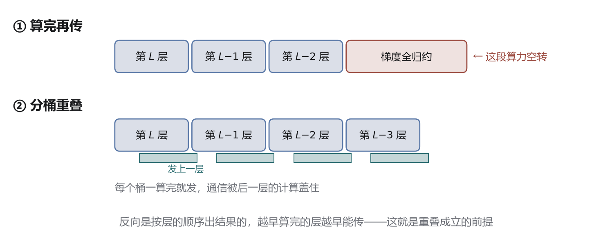

## 通信与重叠

一个 512 卡的作业，GPU 利用率稳定在 62%，训练能跑但比预期慢四成。翻 NCCL 的时间线，发现集合通信占了 38% 的时间，而且每次都是"算完再传"——计算 kernel 结束后，GPU 空转等通信，通信结束后再开始下一段计算，两段严格串行。

物理上这笔通信并不该这么贵。按上一章的算法，70B 在 64 卡上做数据并行，每卡每步要搬 275 GB，5.5 秒；而一步计算要 98 秒。通信只占 5.6%，理论上完全可以藏进计算里。

问题不在带宽，在顺序。通信如果排在计算之后，那它就是纯粹额外的时间；只有让它和计算同时进行，那 5.5 秒才会变成零。这一章讲两件事：通信量怎么算，以及怎么让它藏起来。

### 三种原语，三个公式

并行训练里所有的通信都能归到几个原语上。

**全归约（all-reduce）。** 每张卡有一份数据，求所有卡的和，结果发给每张卡。用在数据并行的梯度同步。

**全收集（all-gather）。** 每张卡有一块数据，把所有块拼起来，结果发给每张卡。用在 ZeRO-3 收集权重、张量并行拼接。

**规约散射（reduce-scatter）。** 每张卡有一份数据，求和之后把结果按块分给各卡，每卡只拿一块。它是全归约的前半段，ZeRO-1 用它。

**全交换（all-to-all）。** 每张卡有一份数据，按目的地分给各卡，每卡收到来自所有卡的一片。用在专家并行的路由。

**广播（broadcast）。** 一张卡的数据发给所有卡。用在参数初始化、检查点恢复。

设数据量 $S$ 字节、卡数 $N$，环形实现下每张卡的实际搬运量是：

| 原语 | 每卡搬运 | $N=8$ 时的系数 |
|--------------|-------------------|------------------------|
| 全归约 | $2S(N-1)/N$ | 1.75 |
| 规约散射 | $S(N-1)/N$ | 0.875 |
| 全收集 | $S(N-1)/N$ | 0.875 |
| 全交换 | $S(N-1)/N$ | 0.875 |
| 广播 | $S$ | 1 |

这些系数怎么来的，值得看一眼全归约。环形全归约分两个阶段，每阶段 $N-1$ 步，每步每张卡发出 $S/N$ 的数据，所以每卡每阶段搬 $S(N-1)/N$，两阶段合计 $2S(N-1)/N$。当 $N$ 很大时接近 $2S$——这就是那句"全归约的代价是数据量的两倍"的来源。

注意一个反直觉的地方：这些系数都随 $N$ 增大而略增，但增幅很小（$N=8$ 是 0.875，$N=512$ 是 0.998）。所以**并行度翻倍不会让每卡的通信量翻倍**，真正的成本在时间上——数据量不变，带宽不变，时间就不变，而计算量减半，占比翻倍。

### 环与树：延迟和带宽的取舍

同样的数据量，不同的算法差别很大。这一节是很多人搞不清的地方。

环算法每张卡只和左右两个邻居通信，带宽利用最充分——理论上能把链路的全部带宽用满。代价是步数多：$2(N-1)$ 步。8 卡是 14 步，512 卡是 1022 步。

树算法（或者叫递归倍增）把卡组织成二叉树，先两两归约，再四四归约，步数是 $2\log_2 N$。512 卡只要 18 步，延迟小得多。代价是带宽利用不充分：树上的中间节点既要接收又要转发，上下行不对称，实际吞吐通常只有链路带宽的一半左右。

用 α-β 模型算一下交叉点。一次通信的时间可以写成

$$t = \alpha \cdot \text{步数} + \beta \cdot \text{字节数}$$

$\alpha$ 是每步的固定延迟（机内集合通信约 10 微秒，跨机约 50 微秒），$\beta$ 是每字节的时间（带宽的倒数）。

8 卡、机内、300 GB/s、$S = 67$ MB：

- 环：$14 \times 10\ \mu s + 117\ \text{MB} \times 3.3\ \mu s/\text{MB} = 140 + 390 = 530\ \mu s$
- 树：$6 \times 10\ \mu s + 2 \times 117\ \text{MB} \times 6.6\ \mu s/\text{MB} = 60 + 1540 = 1600\ \mu s$

大消息下环快三倍。反过来，如果 $S$ 只有 0.5 MB：

- 环：$140 + 2.9 = 143\ \mu s$
- 树：$60 + 11 = 71\ \mu s$

小消息下树快一倍。

交叉点大致在"传输时间等于延迟差"的位置，也就是 $S$ 在几十 MB 量级。所以 NCCL 之类的库会自动在两种算法间切换：小消息用树，大消息用环。这个切换是自动的，但知道它的存在很重要——它解释了一个现象：同样是把通信量减半，有时候时间几乎不变，因为你跨过了算法的切换点。

### 把通信时间算到底

现在把前面几章的四个通信场景放在一张表里，都用 70B、BF16 的参数。

**数据并行梯度同步。** 每卡梯度 140 GB（ZeRO-1 下仍是全量），64 卡。每卡搬运 $2 \times 140 \times 63/64 = 275$ GB。跨机 50 GB/s（400G InfiniBand）要 5.5 秒；机内 300 GB/s 要 0.82 秒。

**ZeRO-3 的权重收集。** 每步两次全收集，约 $2 \times 140 = 280$ GB，加梯度的规约散射 140 GB，合计 420 GB。50 GB/s 下 8.4 秒。

**张量并行的层内归约。** 每层 4 次，每次每卡 117 MB，80 层共 37.6 GB。机内 300 GB/s 下 125 毫秒。

**专家并行的 all-to-all。** 每层 33.6 MB，16 层共 537 MB。25 GB/s 下 21 毫秒。

四种场景的量级差得很远：从 21 毫秒到 8.4 秒，差 400 倍。这就是为什么不能笼统地说"通信是瓶颈"——必须说清楚是哪一种。

它们对应的计算时间也不同。数据并行那 5.5 秒对的是 98 秒计算，占 5.6%；ZeRO-3 那 8.4 秒对的是同样的 98 秒，占 8.6%；张量并行那 125 毫秒对的是 1.5 秒的微批计算，占 8%；all-to-all 那 21 毫秒对的是 320 毫秒的 MoE 计算，占 6.5%。

四个数字都在 5%–9% 之间，看起来很接近。但它们的性质完全不同：前两个是"每步一次、量很大"，可以整段藏进计算；后两个是"每层一次、量很小"，必须逐层藏，而且对延迟更敏感。

### 一次 step 的完整通信清单

把四种场景合起来看一个真实作业：70B、64 卡（张量 8 × 数据 8）、ZeRO-1、开序列并行。

| 通信 | 频率 | 每步字节 | 链路 | 时间 |
|-----------------|--------|-------|--------------|----------|
| 张量并行归约 | 每层 4 次 | 37.6 GB | NVLink 300 GB/s | 125 ms |
| 序列并行归约 | 每层 2 次 | 与上合并 | NVLink | 含在上面 |
| 数据并行梯度归约 | 每步 1 次 | 275 GB | IB 50 GB/s | 5.5 s |
| 参数广播（初始化） | 一次 | 17.5 GB | IB | 一次 0.35 s |

合计每步 5.6 秒，对 98 秒的计算，占 5.7%。

这张清单有两个用处。一是规划时估算"这套配置能不能跑出效率"，二是排查时对照"实测的通信时间和这个表差多少"。差得多，就是实现或配置问题。

顺便澄清一个常见误解：张量并行的通信量（37.6 GB）比数据并行（275 GB）小得多，但前者更"贵"。因为张量并行的每一份都要等，80 层就是 320 个同步点；数据并行只有一个同步点，可以整段藏起来。所以看通信开销不能只看字节数，还要看"分成多少次"——次数决定了有多少个无法重叠的同步点。

### 压缩与异步：两个省通信的老办法

如果算下来通信确实超了，除了改并行方式，还有两条路。

**梯度压缩。** 传之前把梯度量化成 8 位，字节数降到四分之一；或者只传绝对值最大的 0.1%（top-k），字节数降到千分之一。代价是精度损失，需要配合误差补偿——把这次没传的梯度留着，下次一起传。压缩率 4 倍时，通常需要 1%–2% 的额外迭代步数才能追平不压缩的收敛。

算一笔账：70B、64 卡，275 GB 压到 69 GB，时间从 5.5 秒降到 1.4 秒。但前面算过，通信只占 5.7%，压到四分之一也只省 4 秒，而多跑 1% 的步数是 1 秒乘以总步数——几千步就是几十秒。所以在通信不是瓶颈的时候，压缩是亏的。它只在"通信占比超过 30%"的场景下划算，比如跨地域训练或者带宽极窄的集群。

**异步更新。** 不等所有卡同步，各卡用略微过期的梯度更新（叫 stale gradient）。省掉了同步等待，但收敛会受影响：过期的梯度方向不一致，等效于引入了噪声。通常只在大规模、同步成本极高的场景下用，而且需要调小学习率补偿。

这两条路都有明确的适用边界，不是"更先进"的方案。大多数情况下，把桶调对、把并行度配对，比压缩和异步更有效。

### all-to-all 为什么更难受

前面几个原语都是"所有卡和所有卡"交换等量数据，而 all-to-all 有一个别的原语没有的性质：接收方是被动的。

全归约里每张卡发多少收多少，节奏一致。all-to-all 里，一张卡可能收到来自 8 张卡的数据，也可能一张都没收到——取决于路由。这种不对称会造成两个问题。

一是不均衡导致的 incast。如果 8 张卡同时向一张卡发数据，那张卡的入口带宽成为瓶颈，队列积压，延迟飙升。这在 MoE 的路由不均衡时很常见：热门专家所在的卡被挤爆。

二是尾延迟。all-to-all 的完成时间由最慢的那条流决定，而不是平均。8 条流里有一条慢了 3 倍，整个 all-to-all 就慢 3 倍。这就是为什么 EP 组要放在同一个 leaf 下——跨 spine 的链路抖动大，尾延迟能差好几倍。

工程上的缓解手段有三个：把容量因子调小（少收一点，换取确定性）、给 all-to-all 单独的通信流和更高的优先级、以及在交换机层面开无损以太网或者自适应路由。前两个在框架里能调，第三个要看集群。

### 重叠：让数据在算的时候传

重叠的原理一句话：反向传播是按层的顺序出结果的，第 $L$ 层的梯度算完就可以发出去，不必等所有层。

工程上的实现叫分桶。把梯度按参数顺序分成若干桶，每算满一桶就发起一次通信。桶与桶之间、桶与计算之间重叠进行。

这里有两个关键的参数，都得算。

**桶的下限由延迟定。** 一次通信有固定延迟，桶太小的话有效载荷太少，时间全花在延迟上。要让延迟占比不超过一成，桶的大小要满足

$$B \ge 10 \times \alpha \times W_{\text{bw}}$$

机内 300 GB/s、延迟 15 微秒：$B \ge 45$ MB。跨机 50 GB/s、延迟 50 微秒：$B \ge 25$ MB。所以"桶至少 25 MB"不是经验值，是算出来的。

**桶的上限由"最后一个桶"定。** 反向算完最后一层之后，最后一个桶还没来得及发，这段通信必然暴露。它的时间必须小于优化器更新的时间，否则这一步的尾巴上会多出一段空转。优化器更新 26 GB 的状态读写，HBM 上约 40 毫秒；按 300 GB/s 算，桶最大可以到 12 GB。

上下限之间差了两个数量级，所以实际选择很自由：一般直接取"一层的大小"或者"若干层"作为一个桶，既满足下限，也不需要精细控制。

**重叠能不能成立，有一个判定式。** 反向过程中，第 $k$ 层算完之后，到 step 结束还有 $(L-k)$ 层的时间可以掩盖它的通信。所以只要总通信时间小于总计算时间乘以 $(L-1)/L$，理论上就能全部藏住：

$$T_{\text{comm}} < T_{\text{compute}} \cdot \frac{L-1}{L}$$

70B、64 卡数据并行：5.5 秒 vs 98 秒，条件远远满足。张量并行：125 毫秒 vs 1.5 秒，也满足。ZeRO-3：8.4 秒 vs 98 秒，满足。

三个都满足，那为什么实测还有 38% 的通信时间？因为重叠不是自动发生的——它需要框架真的把通信和计算排到不同的流上、真的分桶、真的不等前一层。

这也是这一章最实用的一条判断：**如果数据并行的通信成了瓶颈，那几乎一定是配置或实现问题，不是物理限制。** 物理上它只占 5%。

### 有些通信重叠不了

重叠不是万能的，有两处天然重叠不了，规划时要把它们算进固定开销。

**前向的权重收集（ZeRO-3）。** 前向是从第一层往后的，第 1 层要算的时候，它的权重还没收集完，只能等。虽然可以预取第 2 层，但第一层永远要等一次。80 层的模型有 80 次收集，只有第一次是纯等待，其余都被预取盖住——所以 ZeRO-3 的首层延迟是一次性的，可以接受。

**step 边界。** 优化器更新之前必须等所有梯度到齐，这一步没法重叠，因为更新依赖完整的梯度。它的时间是"最后一个桶的通信 + 更新本身"。70B 是 5.5 秒的尾巴加上 40 毫秒的更新——如果桶分得好，尾巴只有最后一个桶的 50 MB 除以带宽，1 毫秒；如果桶分得差（比如只有 4 个大桶），尾巴就是一个桶的时间，几百毫秒。

这两个"重叠不了"的地方，正好解释了为什么"桶要足够多、但每个不能太小"：桶多，尾巴短；桶大，效率高。折中点在 25 MB 到一层大小之间。

### 拓扑：同样的带宽，不同的路

集群不是一块均匀的交换网。一台机器内 8 张卡通过 NVLink 全互联，带宽 300 GB/s（单向）；机器之间通过 InfiniBand 连到 leaf 交换机，再上 spine。同一台 leaf 下的两台机器通信只要一跳，跨 leaf 要三跳。

设计上常见的收敛比是 4:1：下行（到机器）带宽是上行（到 spine）带宽的四倍。这意味着如果所有机器同时向另一台机器发数据，实际能拿到的带宽只有名义值的四分之一。跨 spine 的流量更是如此，实测下来 25 GB/s 的名义链路常常只有 6 GB/s 的有效吞吐。

排布的原则因此很明确：

- **张量并行放机内。** 每层都要同步，只能用 NVLink。
- **专家并行放同一 leaf 下。** all-to-all 的量中等但对延迟敏感，跨 spine 会抖。
- **数据并行跨 spine。** 每步一次，量大但不频繁，对延迟不敏感。
- **流水线并行跨 leaf 或跨 spine 都行。** 每步只传几个小张量。

一个常见的错误是把这三个维度按"顺序"排：卡 0–7 是 TP 组，8–15 是下一个 TP 组，然后按机器编号分 DP 组。这样排下来，TP 组确实在机内，但 DP 组会跨越所有机器，包括跨 spine 的那些。正确做法是先按物理拓扑分组，再按逻辑维度映射：让 TP 组落在机内、EP 组落在同一个 leaf、DP 组落在剩下的维度上。

这件事在调度器层面叫拓扑感知，在训练框架层面叫 rank 映射。它不改任何代码，只改环境变量里的 rank 排列，但效果可能是 20% 的吞吐。

### 诊断：按这个顺序查

通信慢的时候，别急着重写代码，按顺序查六步。

**第一步，测基线。** 用 `nccl-tests` 里的 `all_reduce_perf`，从 8 字节测到 8 GB，看每个消息大小下的 bus bandwidth。这一步给出"这套硬件此刻能跑多快"的基准。同一批机器，昨天测 280 GB/s、今天测 190 GB/s，那就不是代码问题。

**第二步，对比理论值。** bus bandwidth 除以链路峰值，机内应该在 0.8 以上，跨机在 0.7 以上。低于 0.6 说明有硬件或配置问题（比如 PCIe 降速、网卡链路错误计数上升）。

**第三步，看协议和通道。** `NCCL_DEBUG=INFO` 会打印用了哪种协议（LL、LL128、Simple）和几个通道。消息小的时候用 LL，大的用 Simple；通道数太少说明并行度不够。

**第四步，看 GPU 利用率的形状。** 锯齿状且周期与通信一致，说明没重叠；一直 100%，说明通信被藏住了但计算本身效率低；周期性掉到零，那是数据加载在等。

**第五步，用 nsys 看 kernel 间隙。** 把时间线展开，看计算 kernel 和 NCCL kernel 是不是并排的。如果 NCCL kernel 前后有明显空隙，那就是同步点。

**第六步，分维度关掉重测。** 只开数据并行跑一次，只开张量并行跑一次，看哪一种配置的通信占比最高。这一步能定位到具体的并行维度，比看整体时间线有效。

这六步的顺序不是随便排的。前两步花十分钟，能排除掉一半的硬件问题；中间两步不花时间，靠观察就能判断方向；后两步才需要动手改配置或者跑基准。跳过前两步直接去改代码，是最常见的浪费时间的方式——尤其当问题其实是一根光模块的时候。

### 两个容易搞混的带宽

测通信的时候有两个数，名字很像，含义差一倍，用错了会得出完全相反的结论。

**算法带宽（algbw）**是"数据量除以时间"。1 GB 的数据 10 毫秒传完，algbw 就是 100 GB/s。

**总线带宽（busbw）**是"每张卡实际搬运的字节数除以时间"。全归约里每卡搬的是数据量的 $2(N-1)/N$ 倍，所以 8 卡时 busbw 是 algbw 的 1.75 倍。

为什么要区分？因为链路峰值对应的是 busbw。用 8 卡、300 GB/s 的 NVLink，跑一个 1 GB 的全归约，理论时间是 $1.75/300 = 5.8$ 毫秒，对应的 algbw 只有 172 GB/s。如果你拿 algbw 去和 300 GB/s 比，会误以为只跑出了 57% 的效率，实际上已经满负荷了。

NCCL 的测试工具默认打印两个数，就是为了避免这个混淆。看自己的训练脚本时也一样：算理论时间要用 busbw 口径（也就是 $2S(N-1)/N$），不要用数据量直接除以带宽。

### 三个失败案例

**把"通信慢"当成硬件问题。** 有一个作业在换了新网卡之后还是慢，团队怀疑是新网卡的问题，查了两周。实际原因是并行配置改了：数据并行度从 8 加到 16，而张量并行度没变，于是 TP 组从 8 张卡变成了跨机。所有通信都从 NVLink 掉到了 IB，带宽差 12 倍。这类"改了一个数，另一处变慢"的情况很常见，排查时可以先问一句"最近改了什么配置"。

**桶设成 1 MB。** 一个团队为了"降低通信的尖峰"，把梯度桶调到 1 MB。结果是每步发起了十几万次小消息，每次 10 微秒的固定延迟，光延迟就是 1.4 秒，占了计算的百分之几，而且小消息的带宽利用率只有 20%。改成 50 MB 之后，通信时间降到原来的四分之一。这个坑的教训是：桶大小有下限，不是越小越平滑。

**进程组用错。** 一个 512 卡的作业，梯度同步本该在数据并行组（8 卡）里做，代码里却用了默认的全局进程组。结果每次梯度同步都跨了 512 卡，通信量从 275 GB 变成 280 GB 看起来差不多，但同步范围大了 64 倍，任何一张卡慢都要全员等，实际耗时涨了十倍。更隐蔽的是它不报错——集合通信在全局组上也能正确完成，只是慢。排查方法很土：打印进程组的规模，看是不是预期的那个数。

**通信和计算抢 SM。** NCCL 的 kernel 也要占用 SM，如果计算 kernel 已经占满了全部 SM，通信 kernel 只能等，于是"重叠"变成了"排队"。这在开了大通道数（比如 32 个）时更明显。对策是少开几个通道，或者让框架给通信留出显存和 SM 的余量。

### 重叠是有条件的

通信优化的全部内容可以概括成一句话：让数据在算的时候传。

这句话要成立，需要三个条件同时具备：通信时间小于计算时间（物理条件）、通信被拆成能逐层发的小块（实现条件）、通信和计算排在不同的流上（调度条件）。三个条件里任何一个不成立，重叠就不会发生，通信就变成纯等待。

而这三种失败的表现是一样的：GPU 利用率掉下来、时间线上有间隙、总时间比预期长。区别在于排查的方向：物理条件不够就减少通信量（改并行方式、降精度、压缩），实现条件不够就调桶大小，调度条件不够就查框架的通信流配置。

最后回到开头那个 62% 利用率的作业。他们的通信占 38%，而理论上只该占 5%，所以问题一定在后两个条件上。实际查下来是第一个：桶只有 2 MB，每步发了几万条消息。改成 64 MB 之后，利用率回到 85%。

这个案例值得记住的地方不是"桶要调大"，而是"先算理论上该是多少"。算过之后，38% 和 5% 的差距会立刻告诉你这不是物理限制，不用去换网卡。

把这一章压成三句话：通信量可以精确算（四个公式，系数都在 0.875 到 2 之间），通信时间可以精确估（数据量除以带宽，再加步数乘以延迟），通信能不能藏住可以精确判断（总通信时间是否小于总计算时间）。三件事都算清楚之后，"通信是瓶颈"这句话才有意义——否则它只是一个感觉。

下一章讲精度。它和通信的关系比看上去紧：把权重从 BF16 换成 FP8，通信量直接减半，这是省通信最彻底的一招——它不改任何并行结构，只把每个字节的负载压小，代价转移到数值稳定性上，而稳定性是下一章的全部主题。最后补一句：所有关于通信的讨论，最终都要落到“这一步的时间都花在哪”上，因为那才是可优化的东西。
