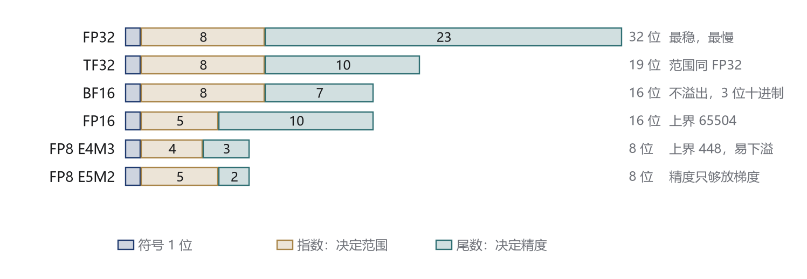

## 精度：从 FP32 到 FP8

一个团队把训练从 BF16 切到 FP8，吞吐翻了一倍多，损失曲线前 180 步看着和 BF16 几乎重合。第 190 步，损失突然变成 `nan`。回滚到最后一次检查点，把学习率调小，又在差不多的位置崩了。

他们换了三种初始化、四种学习率、两个数据配比，都没能绕过去。最后发现问题出在一个很小的实现细节：某一层的激活里有一个异常大的值（来自一条极长的重复文本），把这一层的量化缩放因子压得很低，其余 99% 的正常数值被压到 FP8 的最小可表示范围以下，变成了零。梯度里对应这些位置的分量也就成了零，几步之后权重开始发散。

低精度训练的问题几乎都是这种形状：不是"精度不够所以效果差一点"，而是"某些数值被整体推到表示范围之外，然后一切失控"。要防住它，得先知道每种格式的边界在哪。

### 一个数由三部分组成

浮点数的位宽分成三块：符号位、指数位、尾数位。

指数位决定动态范围。$e$ 位指数能表示的范围大约是 $2^{-2^{e-1}}$ 到 $2^{2^{e-1}}$。FP32 和 BF16 都是 8 位指数，范围一样，从 $10^{-38}$ 到 $10^{38}$。FP16 只有 5 位指数，范围缩到 $6\times10^{-5}$ 到 $65504$。

尾数位决定精度。$m$ 位尾数意味着同一个数量级里有 $2^m$ 个可表示的值，相对精度是 $2^{-(m+1)}$。

算一下三种常用格式：

- BF16：7 位尾数，相对精度 $2^{-8} = 0.39\%$，约两位十进制有效数字。
- FP16：10 位尾数，相对精度 $2^{-11} = 0.049\%$，约三位十进制。
- FP32：23 位尾数，相对精度 $2^{-24} = 6\times10^{-8}$，约七位十进制。

BF16 的精度只有 FP16 的三分之一，但它成了训练的默认格式。原因是那 8 位指数：神经网络里最常见的故障不是"精度不够"，是"数值溢出"。梯度里偶尔出现的 $10^{5}$ 量级尖峰，在 FP16 下直接变 `inf`，一个 `inf` 就能污染整批梯度；在 BF16 下它只是一个大数，下一层还会把它压回去。

具体感受一下两者的差别。在 BF16 里，$1 + 0.005$ 的答案不是 $1.005$，而是 $1$：因为 1.0 附近的步长是 $2^{-7} = 0.0078$，比 0.005 还大，这个加法被整个吃掉。在 FP16 里同样的加法能得到 $1.005$（步长 $2^{-10} \approx 0.001$）。但如果你要表示 $10^{-8}$，FP16 会给出 0，BF16 能正常表示。

### 为什么是 BF16 胜出

这段历史值得说一句，因为它解释了现在所有框架的默认值。

2018 年前后，混合精度训练的主流是 FP16 加损失缩放：精度高（10 位尾数）、硬件支持早，代价是要维护一套动态缩放的逻辑。那时候训练崩掉的原因里有相当一部分是缩放参数没调好。

BF16 是后来才被硬件支持的。它的优势不是精度，而是"不需要特殊照顾"：指数和 FP32 一样，梯度再小也不用缩放，训练脚本里那套 `GradScaler` 可以整段删掉。对工程团队来说，少一个会出问题的环节比多一点精度更有价值。

代价是精度只有 7 位尾数。这个代价在大多数情况下可以接受，因为神经网络的梯度本身噪声就很大，0.4% 的表示误差淹没在随机性里。但有两处会露出来：一是长时间的累加（前面那个 1024 个 0.001 的例子），二是需要精确对齐的任务（比如某些数值敏感的强化学习奖励）。所以混合精度里累加器永远是 FP32，这一条不能省。

### 混合精度：三处用不同的精度

既然各有短板，实际训练就用"混合"：存储用低精度，计算的关键环节用高精度。

标准的做法是：权重存 BF16，前向反向的矩阵乘用 BF16，但梯度累加、优化器更新、以及那份主权重都用 FP32。

为什么累加一定要 FP32？算一笔。1024 个 $0.001$ 相加，真值是 $1.024$。

在 BF16 里，累加到 $1.0$ 之后，下一步要加 $0.001$，而 $1.0$ 附近的步长是 $0.0078$，$0.001$ 小于半个步长，直接被舍掉。于是累加停在了 $1.0$，误差 $2.3\%$。

在 FP32 里，$1.0$ 附近的步长是 $6\times10^{-8}$，$0.001$ 加得进去，结果是 $1.024$，误差可以忽略。

这个例子的量级不大，但它在模型里发生了上亿次。每一次都丢掉一点，累积起来就是"训练能收敛，但比 FP32 差一两个点"。这也是低精度训练最典型的症状：不崩，只是差一点。

### 损失缩放：把梯度搬到能表示的区间

FP16 有一个特有的问题：下溢。

梯度的典型量级是 $10^{-5}$ 到 $10^{-7}$，而 FP16 的最小正规数是 $6\times10^{-5}$，更小的值掉进次正规区，精度急剧下降；再小就变成 0。梯度一旦变成 0，这一层就不再更新。

损失缩放的思路很直白：把损失乘一个大数 $2^{k}$，反向传播时所有梯度同比放大，于是不再下溢；更新参数之前再除回去。

动态缩放的实现在工程上是这样的：初始 $k = 16$（放大 65536 倍），每一步检查梯度里有没有 `inf`；有就把 $k$ 减半，跳过这一步；连续 2000 步没有溢出就把 $k$ 翻倍。这样它自己会稳定在一个"刚好不溢出"的位置。

算一下为什么 $2^{16}$ 是合适的起点。假设某层梯度是 $10^{-8}$，乘 65536 之后是 $6.5\times10^{-4}$，在 FP16 的正常范围内；如果梯度里有 $10^{0}$ 量级的尖峰，乘完之后是 $65536$，正好在 FP16 的上界附近，再大就溢出。所以 $2^{16}$ 是"小梯度刚好救回来、大梯度刚好不炸"的折中点。

BF16 不需要这个技巧，因为它的指数范围和 FP32 一样，$10^{-8}$ 本来就能表示。这一点常被误解为"BF16 更先进"，其实只是格式选择的副作用——用 BF16 就没有下溢问题，也就不需要那套动态调整的逻辑。

FP8 又需要了，而且比 FP16 更敏感，因为它的范围更窄。

### FP8：两种格式，两种用途

FP8 有两个变体，分工明确。

**E4M3**：4 位指数、3 位尾数、1 位符号。最大 448，最小正规 $2^{-6} = 0.0156$。相对精度 $2^{-4} = 6.25\%$。

**E5M2**：5 位指数、2 位尾数。最大 57344，范围大得多，但相对精度只有 12.5%。

常用的分工是：前向的权重和激活用 E4M3（数值小、需要精度），反向的梯度用 E5M2（可能出现大值、需要范围）。

精度只有 6%？这听起来完全不能用。但实际能用的原因在别处：矩阵乘是一个 $K$ 维的点积，每个输出元素是 $K$ 个乘积的和。每个乘积有 6% 的随机误差，加起来的相对误差不是 6%，而是按 $\sqrt{K}$ 缩小：

$$\text{误差} \approx \frac{6\%}{\sqrt{K}}$$

$K = 4096$ 时是 $0.09\%$，$K = 128$ 时是 $0.55\%$。这解释了为什么 FP8 的矩阵乘能用、而 FP8 的逐元素加法不能用——前者有上千个元素平均误差，后者没有。

### 缩放因子：FP8 的命门

即便有 $\sqrt{K}$ 平均，FP8 也不能直接用。E4M3 的上界是 448，一个正常的激活张量里如果有元素到了 500，整个张量就溢出。

解法是给每个张量配一个缩放因子，把数值映射到 FP8 能表示的范围里：

$$s = \frac{448}{\max|X|},\qquad X_{\text{fp8}} = \text{round}(X \cdot s)$$

用的时候再除回去。缩放因子本身用 FP32 存，不占多少空间。

这套做法有一个致命弱点：$\max|X|$ 是全局的最大值，一个异常大的元素会把所有正常元素压扁。

算一个具体的例子。一层激活的绝大多数值在 $[-0.5, 0.5]$，但有一个值是 12.5。缩放因子 $s = 448/12.5 = 35.8$。那些 0.01 量级的正常值乘完之后是 0.358，落在 E4M3 的 $[0.25, 0.5]$ 区间里。这个区间的步长是 $0.5/8 = 0.0625$，所以 0.358 会被量化到 0.375，相对误差 4.7%。更小的值（0.001）乘完是 0.036，落在更细的区间，误差反而更大。

如果那个 12.5 变成 500（一个异常 token），$s = 0.9$，正常值 $0.5$ 乘完是 $0.45$，落在 $[0.25,0.5]$，还行；但 $0.01$ 乘完是 $0.009$，低于最小正规数 $0.0156$，直接变成 0。整层的细节全丢了。

这就是**分块缩放**存在的原因：不是给整个张量一个缩放因子，而是每 32 个或 128 个元素一个。这样异常值只影响它所在的那一块，其余块按自己的动态范围缩放。

块大小是一个取舍。块越小，动态范围越贴合，但缩放因子本身的存储开销越大（每 128 个元素存一个 FP32，是 3% 的额外开销；每 32 个是 12.5%）；块越大，开销小但异常值的影响范围大。128 是一个常见的折中，也是很多加速器硬件直接支持的分块粒度。

### 缩放因子怎么定：静态、动态、延迟

$s$ 需要知道 $\max|X|$，而前向时这个值要等张量算出来才知道。于是有三种做法。

**静态校准。** 训练前用一批数据跑一遍，统计每层的最大值，固定下来。实现最简单，但对分布变化不鲁棒——训练到后面激活分布变了，固定的 $s$ 就不合适了。

**动态。** 每次前向都统计当前张量的最大值，算出 $s$。最准确，但要在 GPU 上做一次全局归约，有额外开销，而且在分布式训练里还要跨卡同步。

**延迟缩放。** 用上一步的最大值算这一步的 $s$。因为相邻两步的激活分布很接近，这个近似几乎无损。它不需要额外的同步，是目前最常用的做法，代价是遇到突变（比如突然出现长文本）时会有一到两步的不准。

延迟缩放还有一个细节：统计最大值时通常不是用上一步的瞬时值，而是用最近若干步的滑动最大值，取一个略大于它的数。这样对异常值有一点缓冲，代价是正常值的精度略降。

### 四处必须用高精度的位置

不管用哪种低精度格式，有四处不能省。

**Softmax 的输入。** 必须先减最大值再取指数，否则 $e^{30}$ 就溢出。这是实现常识，但自己写 kernel 时最容易漏。

**LayerNorm 的方差。** 公式里要除以 $\sqrt{\sigma^2 + \epsilon}$，$\epsilon$ 取 $10^{-5}$ 或 $10^{-6}$。如果 $\sigma^2$ 在 FP16 里算出来是 0（序列短、值接近），除零就得到 `inf`。

**残差累加。** 大量小数值累加会丢精度，必须用 FP32 累加。这也是为什么"混合精度"里累加器总是 FP32。

**交叉熵。** 要用 `log_softmax` 而不是 `log(softmax(...))`，后者在概率很小时会取到 $\log(0)$。同理，算 loss 时避免先算概率再取对数。

这四处的共同点是：它们的输出会直接进入下一步的指数或除法，一旦溢出或者下溢，错误会被放大，而不是被平均掉。

### 三种 FP8 方案

工程上"上 FP8"不是一个开关，而是三档，风险和收益递增。

**只有前向用 FP8。** 权重和激活在矩阵乘时量化到 FP8，累加仍是 BF16/FP32，反向用 BF16。省的是前向的算力和一部分带宽，显存几乎不变。风险最低，收益也最小，大约快 1.2 倍。适合作为第一步验证。

**前向 FP8、反向 BF16。** 反向的梯度计算保留 BF16，因为梯度对精度更敏感（它的量级跨好几个数量级）。这一档能拿到 1.4 倍左右的速度，显存省一点。多数团队的落地配置在这一档。

**全 FP8。** 反向的矩阵乘也用 FP8，梯度用 E5M2 存。速度能到 1.6 倍以上，但需要更细的缩放策略、更小的学习率、以及更多的异常监控。研究阶段常见，生产上要谨慎。

三档的共同前提是：第一层和最后一层保留高精度。输入层直接接触原始数据，数值范围可能很怪；输出层直接产生 logits，误差会进损失。这两层只占参数量的很小一部分（词表投影是大头，但层数只有两层），保留 BF16 对速度影响不到 2%，对稳定性帮助很大。

### 出问题的时候怎么查

低精度的故障几乎都是"不报错"的，所以排查要靠对照，不能靠读代码。

**第一步，跑一个短程对照。** 同样的种子、同样的数据、同样的批顺序，BF16 跑 500 步，FP8 跑 500 步，逐点比较损失。差值在 $10^{-3}$ 以内算正常；某一处突然跳开，那一步就是问题发生的时刻。

**第二步，盯梯度范数。** 每层打印梯度范数。健康的训练里它应该平滑波动，量级在 $10^{-2}$ 到 $10^{0}$ 之间。如果某一层的范数在几步内涨了两个数量级，说明那里有数值问题；如果它一直是 0，说明梯度被压没了。

**第三步，看激活的分布。** 每层记录 $\max|X|$ 和分位数。重点看两件事：有没有哪一层的最大值比同级别层大一个数量级以上；有没有哪一层的 1% 分位数接近 0（说明大量值被压没了）。这两件事都指向缩放因子不合适。

**第四步，二分定位。** 把模型的前一半用 BF16、后一半用 FP8，看是否复现；再对半分。四到五轮就能定位到具体的层。这个方法笨但可靠，比读实现快。

**第五步，查数据。** 有相当一部分"精度问题"其实是数据问题：某条样本特别长，或者包含大量重复字符，导致激活出现异常值。定位到具体层之后，把那一步的输入样本打印出来，常常能直接看到原因。

这五步的顺序是有讲究的：前两步十分钟能做完，能判断"是不是精度问题"；中间两步定位到层；最后一步定位到数据。跳过前面直接改实现，往往是在改一个没问题的东西。

### 精度与并行方式的相互作用

精度不是孤立的选择，它和并行方式互相影响，这一点很少被讲。

**张量并行的归约精度。** 行切的那一刀需要把各卡的部分和相加。如果部分和以 BF16 传输再相加，误差会随并行度累积——8 张卡相加，最坏情况误差是单卡的 8 倍。所以归约通常用 FP32 累加，传的时候可以是 BF16，但加起来必须在高精度。这也是为什么"通信量减半"和"精度不变"不能同时成立。

**流水线的激活传递。** 阶段之间传激活，如果以 FP8 传，接收端的误差会逐段累积：4 段流水线，每段都有一次量化，总误差约为单次的 2 倍（按 $\sqrt{4}$ 增长）。这也是为什么跨阶段的激活一般保留 BF16。

**专家并行的路由。** 路由的打分通常是 FP32 算的，因为 top-k 的选择对微小的分数差异敏感。如果打分用 FP8，两个接近的专家可能被随机选中，训练会不稳。

一个实用的结论：低精度应该用在"矩阵乘"上，不要用在"归约、路由、归一化"上。前者有 $\sqrt{K}$ 的平均效应，后者没有。

### 收益与代价的账

把 FP8 的收益算清楚，能避免不切实际的期待。

**算力。** 同样一张卡，FP8 的矩阵乘吞吐是 BF16 的两倍。理论上训练能快一倍，实际因为还有非矩阵乘的部分（归一化、激活函数、通信），通常快 1.4 到 1.7 倍。

**显存。** 权重从 2 字节变 1 字节，激活也减半。但优化器状态那 12 字节不变。70B 的参数相关显存从 1120 GB 降到 1050 GB，只省 6%。激活从 5.4 GB 降到 2.7 GB（按每卡切分后更少）。所以 FP8 省显存的效果，远不如它省算力的效果。

**通信。** 如果权重和激活以 FP8 传输，张量并行的归约量减半，数据并行的梯度如果也量化则同样减半。这是 FP8 最被低估的收益——它同时缓解了带宽压力。

综合下来，FP8 的合理期待是"训练快 1.5 倍左右，显存省 10%–20%"，不是"快一倍、省一半"。这个差距来自那些必须用高精度的部分，它们不随格式变化。

### 低精度下学习率的调整

换成 FP8 之后，经常需要把学习率调小一点，原因有两层。

表层的原因是噪声。FP8 的梯度有量化噪声，等效于在梯度上叠了一层随机扰动。学习率越大，这个扰动被放大得越多，更新的方向越不稳。经验上 FP8 的学习率取 BF16 的 0.7 到 1.0 倍，具体看任务的敏感度。

深层的原因是"有效步长"。Adam 的更新量是 $g/\sqrt{v}$，其中 $v$ 是梯度平方的滑动平均。量化噪声会让 $v$ 的系统性偏大（噪声也会贡献方差），于是分母变大，有效步长变小。这相当于自动降低了学习率，但降得不均匀——梯度小的参数降得多，梯度大的降得少。结果是不同层的更新速度不一致，训练会变慢。

补偿的办法有两个：把 $\epsilon$ 调大一点（减小 $v$ 的影响），或者把 $\beta_2$ 调高（让 $v$ 更平滑，减少噪声的影响）。两者都是"用平滑度换响应速度"，在大模型上通常取 $\beta_2 = 0.95$ 到 $0.99$。

### 两个失败案例

**异常值把整层压平。** 这就是开头那个案例。症状是损失正常了几百步后突然 `nan`，回滚也复现。诊断方法是打印每层激活的 $\max|X|$ 分布：如果某一层的最大值比同级别层大两个数量级，问题就在这里。修法是改用分块缩放，或者在数据侧过滤掉那些异常长的文本。

**用 BF16 的配置直接跑 FP8。** 有人把 `bf16=True` 改成 FP8，其他一点没动，结果训练能跑但效果差三个点。原因是 FP8 需要配套的三样东西：分块或延迟缩放、部分层保留高精度（比如第一层和最后一层）、以及更小的学习率。少任何一样都会掉点。低精度不是"换个 dtype"，它是一套配置。

**分块缩放粒度设错。** 有人把分块设成"每个 token 一块"，想着更贴合语义，结果发现速度掉了三成。原因是块大小是 4096 个元素时，缩放因子的计算是一次很小的归约；块大小是单个 token（8192 个元素里的一小段）时，缩放因子数量暴涨，光算缩放因子和反量化的开销就吃掉了 FP8 的收益。分块是为了应对异常值，不是为了语义，粒度应该由硬件支持的形状决定（通常是 128），而不是由数据的语义边界决定。

**忘记关掉自动混合精度。** 一个脚本里同时写了 `autocast` 和 FP8 的量化，两层精度叠加，实际算的是"FP8 量化之后又用 BF16 算"，性能没提升，精度还更差。这类问题很难从日志里看出来，只能看 kernel 名——用 profiler 看实际执行的矩阵乘是什么数据类型，是最直接的验证方式。

### 精度是一笔交易

每一种精度的选择都是"用数值稳定性换吞吐和显存"。

FP32 最稳，最慢，没人用它训练大模型。BF16 是甜点：指数范围够宽，不需要损失缩放，精度虽然只有两位十进制但配合 FP32 累加足够。FP16 精度更高但范围窄，需要损失缩放，现在已经少见。FP8 是趋势：算力翻倍、带宽减半，代价是一整套缩放和异常值处理。

还有一处经常被忽略的地方：精度问题很少单独出现，它往往和规模一起恶化。同样一份 FP8 实现，7B 上跑得很稳，70B 上第 3000 步开始出现尖峰。原因是层数越多、参数越多，异常值的出现概率越高，而缩放因子又是全局或分块统计的，一处异常能影响的范围更大。所以低精度的验证不能只在小模型上做，至少在目标规模的一定比例上跑过一次完整训练。

选哪一档，取决于你能接受多少“不报错的损失”。BF16 的损失几乎为零，FP8 的损失取决于实现质量——做得好，最终效果差不到 1%；做得糙，可能差几个点，而且查不出来。

这也是这一章和前面几章的区别：显存和通信的问题会崩、会慢，都是可见的；精度的问题往往不可见，它安静地让模型差一点。所以低精度训练必须配一套对照实验——同样的种子、同样的数据，用 BF16 跑一千步，和 FP8 的损失曲线逐点对比。差值在 $10^{-3}$ 量级以内算正常，超过就该查实现。这条对照跑通了，才说明低精度真的没伤害模型，而不只是没让程序崩溃；前者是工程验收标准，后者只是能跑——这两件事在汇报里经常被混为一谈，实际差着一整轮验证工作。
