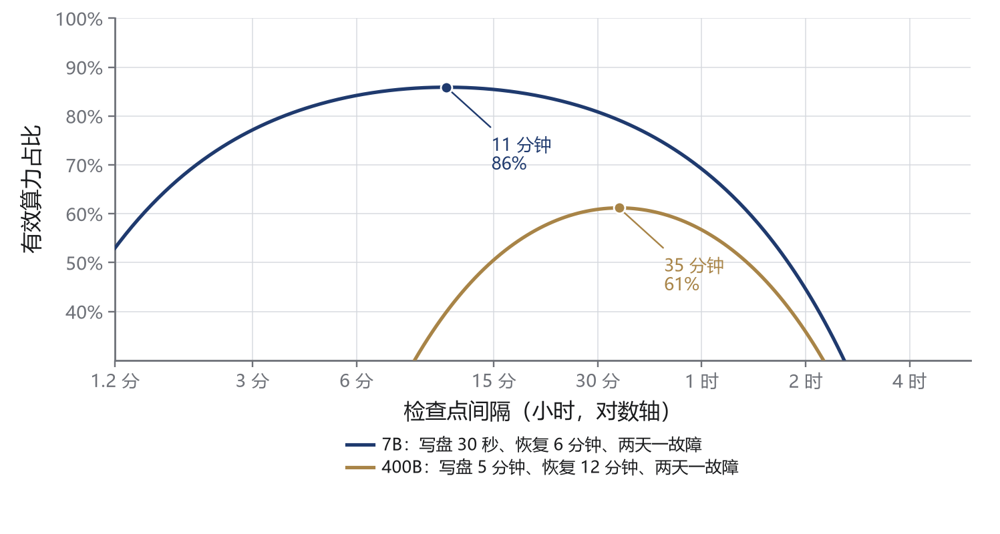
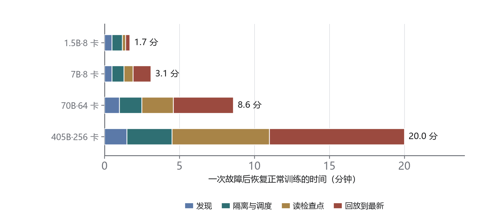
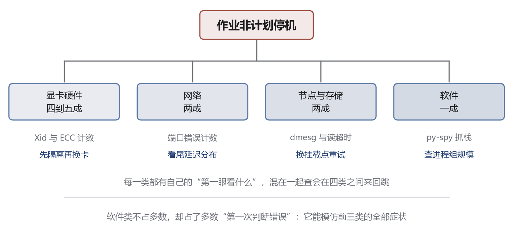

## 故障、检查点与弹性

一个 1000 卡的训练跑了一个月，日志里记着 41 次重启：其中 26 次是显卡或节点故障，7 次是网络抖动导致的超时，5 次是存储读取卡住，3 次查不出原因。最后一次统计，有效算力是 71%。

这个数字听起来还行，但换算成钱很刺眼。1000 张卡按每小时 2 美元算，一个月是 144 万美元，其中 42 万买的是"重启和重算"。而这还是运气不错的一个月——没有遇到静默数据损坏，也没有遇到需要换整机柜的大故障。

这一章讲怎么把这个数字往上抬：故障率怎么估、检查点怎么设、恢复要多久、以及卡住不动的时候按什么顺序查。

### 故障率随规模线性上升

单张卡的可靠性用平均无故障时间（MTBF）衡量。一张卡单独跑，几万小时不出问题很正常；1000 张卡一起跑，任何一张出问题都要停整个作业，所以整个作业的故障间隔是单卡的 $1/1000$。

用经验值算一下。业界公开报告的量级是：千卡规模的集群，平均每天会遇到一次需要重启的故障。反过来推，单卡的 MTBF 是

$$1000\ \text{卡} \times 24\ \text{小时} = 24000\ \text{卡时/次}$$

也就是单卡平均 2.4 万小时（约 2.7 年）出一次故障。这个数字和硬件的实际寿命是吻合的。

把它外推到万卡：

$$10000\ \text{卡} \div 24000\ \text{卡时} = 0.42\ \text{次/小时} \approx \text{每 2.4 小时一次}$$

这就是为什么万卡训练的报告里总是在讲检查点——平均每两三个小时就要重启一次，如果每次重启都从头开始，那什么都训不出来。

规模再往上，这个数会让人绝望：10 万卡是每 15 分钟一次。所以超大集群的训练框架，核心能力不是并行效率，而是"故障恢复得足够快"。

### 故障的几种面孔

按经验分布，故障大致分五类。

| 类型 | 表现 | 经验占比 | 处理方式 |
|--------|--------------------------|--------|--------------|
| 显卡硬件 | ECC 报错、Xid、掉卡 | 四到五成 | 隔离节点、换卡 |
| 网络 | 链路抖动、光模块、超时 | 两成 | 降速运行或隔离 |
| 节点 | 过热、掉电、内核崩溃 | 一成 | 重启节点 |
| 存储 | 读超时、元数据不可用 | 一成 | 等待或换挂载点 |
| 软件 | 死锁、通信组错乱、管线卡住 | 一成 | 重启作业 |

前四类是硬件，最后一类是软件，但它们的表现经常混淆：网络抖动会让 NCCL 超时，看起来像死锁；存储卡顿会让数据管线停住，看起来像计算卡死。所以排查的第一步永远是"确认到底是哪一类"，而不是直接重启。

还有一类不在表里，但最麻烦：静默数据损坏（SDC）。某张卡算错了，程序不报错，损失曲线也看不出来，几周后模型效果不对，才发现某段训练用的是错的数据。它的概率很低（公开报告的量级是每几千卡时一次），但在万卡规模上就意味着每天都有可能发生。

检测 SDC 的手段有三种。一是定期跑一个已知答案的小矩阵乘，比对结果；二是把同一批数据在两份不同的卡上各算一次，比对梯度；三是在训练里加一层校验，比如每周从检查点恢复一次，用固定的一批数据算损失，看是否和记录一致。三种都有开销，通常只用第一种和第三种。

### 故障之前的信号

大部分故障不是突然发生的，它在发生前几小时就有信号。抓住信号主动重启，比被动等崩要省时间。

值得盯的指标有四个。

**每卡 step 耗时的离散度。** 如果某张卡的耗时从 100 毫秒涨到 130 毫秒，而其他卡没变，那张卡的散热或者显存可能已经开始退化。这个指标在正常的作业里应该稳定在 2% 以内，超过 5% 就该查。

**可纠正的 ECC 错误计数。** 显存报"可纠正错误"意味着硬件自己修好了，但计数上升说明这块显存正在坏。公开建议是：单卡可纠正错误数超过几十次/小时，就安排换卡。等到变成不可纠正错误时，作业已经崩了。

**网络的重传率和链路错误。** IB 的端口计数器里有 `port_rcv_errors` 和 `symbol_error` 这类字段。缓慢增长的数值意味着光模块在退化。它不会立刻断，但会让延迟分布变差，表现为 all-reduce 的尾延迟越来越长。

**检查点的写入速度。** 同一个检查点，昨天写 15 秒，今天写 25 秒，说明存储侧有了压力。存储故障之前通常有一段时间的性能下降。

这四个指标的共同点是：它们都在正常范围内波动，只有趋势才有意义。所以要做的是记录并画曲线，而不是设一个阈值报警——阈值报警在故障前从不响，故障后才响。

### 检查点的存储成本

检查点要占存储，而大模型的检查点非常占地方。

70B 的一份完整检查点是 1120 GB（参数加优化器状态）。如果保留最近三份，是 3.4 TB。400B 的一份是 6400 GB，三份就是 19 TB。按对象存储每 TB 每月十几美元算，一个月几百美元，不算贵；但如果每天写一次、保留三十天，就是 30 份，成本翻十倍。

更重要的是写入带宽。并行文件系统通常按"每客户端多少 GB/s"来限制，1000 张卡同时写，即使每张卡只写 1 GB/s，总量也是 1 TB/s，远超存储的承受能力。所以实际做法是限制并发或者分批写，而这就把写盘时间拉长了。

有一个折中值得知道：优化器状态不必每次都写。参数和优化器状态里，参数是恢复必需、状态是可选的——如果没有状态，可以用"重新预热"来近似：加载参数、跳过优化器状态、用一个小学习率跑几百步把状态重新"养"出来。代价是收敛略差，收益是检查点体积减半（1120 GB 变 140 GB），写盘时间从 15 秒降到 2 秒。

### 检查点：三种写法

检查点是唯一能对抗故障的东西，它的写法直接决定了恢复要多久。

**同步检查点。** 所有卡停下来，把状态写到存储，再继续。实现最简单，一致性最好；代价是停机时间等于写盘时间。70B 的状态是 1120 GB，写到 100 GB/s 的并行文件系统要 11 秒，加上元数据和 flush，实际 15 秒左右。400B 是 6400 GB，要 64 秒，实际 80 秒以上。

**异步检查点。** 先把状态拷到 CPU 内存（或者本地 NVMe），训练立即继续，后台慢慢写盘。停机时间接近零，代价是需要一块和状态等大的存储（1120 GB 内存不便宜），以及实现复杂——要保证拷贝期间状态不被更新覆盖，通常是拷贝到一个独立的缓冲区，但这又占一份显存。

**分层检查点。** 先写本地 NVMe（几 GB/s 到十几 GB/s，快），再异步同步到远端对象存储。恢复时优先读本地，本地没有才读远端。这是大规模集群的常见做法，因为它把"写盘"和"可靠存储"两件事分开了。

还有两个实现细节值得说。一是分片写：每张卡直接写自己负责的那一块，不要先聚合成完整张量——聚合会让显存瞬时翻倍，也会让写盘变成串行。二是原子性：先写到临时文件名，写完再 rename，否则写到一半崩了会留下一个坏检查点，恢复时读它比不读更糟。

### 间隔与有效算力

检查点不是越密越好，它的账可以精确算。

设检查点间隔 $T$ 小时，写一次检查点耗时 $t_w$ 小时，恢复一次耗时 $t_r$ 小时（含读检查点、重建通信组、预热数据管线），故障间隔 $F$ 小时。

每 $F$ 小时会遇到一次故障，平均丢掉的进度是 $T/2$（均匀分布下，故障发生在两次检查点之间的任意位置），加上恢复时间 $t_r$。而每小时的检查点开销是 $t_w/T$。于是有效算力占比

$$\eta = 1 - \left[\frac{t_w}{T} + \frac{T/2 + t_r}{F}\right]$$

这个式子在说什么：方括号里是"浪费掉的时间比例"，它由两项组成——检查点本身的写盘开销（$t_w/T$，间隔越密越大），以及故障导致的损失（$(T/2 + t_r)/F$，间隔越稀越大）。两项一个涨一个落，所以有一个最优点。

对 $T$ 求导置零，得到

$$T^{*} = \sqrt{2\,t_w\,F}$$

代入 7B 的数：$t_w = 30$ 秒 $= 0.0083$ 小时，$F = 2$ 小时（换成 1000 卡的故障率，实际更短，这里取两天一故障的小集群）：

$$T^{*} = \sqrt{2 \times 0.0083 \times 2} = 0.18\ \text{小时} \approx 11\ \text{分钟}$$

此时 $\eta = 1 - [0.046 + 0.095] = 86\%$。

换 400B：$t_w = 0.083$ 小时，$t_r = 0.2$ 小时，$F = 2$ 小时：

$$T^{*} = \sqrt{2 \times 0.083 \times 2} = 0.58\ \text{小时} \approx 35\ \text{分钟}$$

此时 $\eta = 1 - [0.143 + 0.245] = 61\%$。

这张图上有两个要点。第一，曲线是单峰的，最优点很清楚，凭感觉设间隔通常离最优点不远，但方向常常搞反——大模型的写盘成本高，间隔应该更长，而很多人因为"怕丢工作"反而设得更短，于是写盘把算力吃掉了。

第二，400B 那条曲线的峰值只有 61%，比 7B 低了 25 个百分点。这个差距不是因为它更脆弱，而是因为它每次写盘更贵、每次恢复更久。也就是说，大模型训练的有效算力天然比小模型低，这部分损失是"规模的税"，不是实现问题。

### 换算成钱

把 $\eta$ 换成钱，能让决策变得具体。

1024 卡、每卡每小时 2 美元、跑 30 天：总账单 $1024 \times 720 \times 2 = 147$ 万美元。$\eta = 71\%$ 意味着其中 43 万是浪费的。

如果通过优化检查点策略把 $\eta$ 从 71% 提到 80%，省下 13 万。这个数字通常远大于"把写盘优化一下"的工程成本——而反过来，如果为了省事把检查点设成 4 小时一次，$\eta$ 可能掉到 55%，一个月多花 30 万。

还有一笔常被忽略的账：恢复时间不只是读检查点。一次完整恢复的分解是：调度器分配节点 20–60 秒、进程启动与 CUDA 初始化 30 秒、读检查点（1120 GB 按 20 GB/s 是 56 秒）、重建通信组 20 秒、数据管线预热 60 秒。合计三到四分钟。这解释了为什么 $t_r$ 取 0.1 小时（6 分钟）是合理的——它包含了那些"不算在恢复里但实际要等"的部分。

### 重启之后，训练还能接得上吗

这一节讲的是"恢复了但没完全恢复"的问题，它比崩溃更难发现。

**学习率调度。** 如果调度器按"当前步数"算学习率，恢复时步数从检查点里读回来，没问题。但很多实现用的是"进程启动以来的步数"，一重启就归零，学习率重新走一遍预热——模型会经历一次不该有的学习率骤降再上升，损失曲线出现一个坑。这个坑在几千步之后会自己长平，所以很少有人发现。

**数据顺序。** 数据加载器的随机种子如果按进程编号初始化，重启之后每个 rank 拿到的数据顺序就变了。更糟的是，如果按"当前步数"恢复，而步数没存准，会有几百个样本被训练两次或者跳过。数据量小的时候无所谓，数据量精心配比过的时候（比如课程学习），这会直接影响效果。

**梯度累积的中间状态。** 如果检查点是在累积到一半的时候保存的，那半个累积的梯度要不要存？多数实现不存，恢复时丢掉。这会让"有效批"在那一步偏小，影响微乎其微，但如果刚好碰上学习率调度的关键点，也可能有影响。

**随机数状态。** Dropout 的掩码依赖随机数。如果恢复时随机数状态没还原，后续的 dropout 模式和中断前不一致。这在统计上没什么问题，但如果两次跑的结果需要严格可复现（比如做消融实验），就会对不上。

这四件事的共同点是：它们都不会导致报错，只会让"恢复后的训练"和"没中断的训练"产生细微差异。要做严格的对照实验，就得把这些状态都存进检查点；要只是正常训练，知道它们存在就够了，不用过度设计。

### 一个能用的恢复流程

把恢复拆成五步，每一步都可以脚本化。

**第一步，确认故障范围。** 是单卡、单节点、还是整个机柜。单卡的故障可以只隔离那个节点，其余继续；机柜级的（比如交换机挂了）要隔离一批。

**第二步，找到最新的可用检查点。** 不是"最新的"，是"最新的可用的"。要检查文件完整性（大小、校验和）、检查步数是否合理（不能比上次记录的步数还小）。

**第三步，重建拓扑。** 卡数变了，rank 映射要重算；张量并行度、流水线段数可能都要调整。这一步最容易出错，因为改了并行度之后，检查点的分片格式可能对不上，需要做一次"重分片"。

**第四步，预热。** 加载完参数之后不要立刻用大学习率跑，先跑几十步小学习率，让优化器状态和激活统计重新稳定。这一步能把"恢复后损失跳一下"的概率降低不少。

**第五步，核对。** 恢复后的前 10 步，打印损失和梯度范数，和检查点里记录的值对比。差得太多说明恢复有问题，早发现比晚发现好。

### 弹性训练为什么难

理想状态是：一个节点坏了，自动换一个进来，训练继续，从最近的检查点开始，只重算几分钟。

这需要三件事同时成立。

**动态通信组。** 节点数变了，集合通信的组也要重建。重建本身要几十秒，而且所有卡都要同步到同一个状态，任何一张卡没跟上就会挂住整个组。

**状态可迁移。** 新来的节点要拿到它该负责的那一份参数和优化器状态。在 ZeRO-3 下，这份状态是"第 k 个分片"，而分片的映射关系依赖总卡数——总卡数变了，映射就变了，每个节点都要重新算自己该拿哪一份。

**数据管线可重排。** 数据是按 rank 分片的，卡数变了要重新划分。如果划分不当，某些样本会被重复训练或者跳过，影响收敛。

三件事都不难单独实现，难的是它们要在"训练不中断"的前提下同时完成。现有框架里，有的支持"缩容"（节点坏了就少用几张卡，继续跑），有的支持"换节点后重启"，真正意义上的"无感弹性"还很少。

多数团队的折中方案是：整作业重启 + 从检查点恢复，但把恢复时间压到最短（本地 NVMe 缓存、并行读、预热数据管线）。这套方案的实际恢复时间是三分钟量级，对两小时一次的故障来说，损失约 2.5%，可以接受。

### 卡住不动的时候按什么顺序查

训练不报错但不动了，这是最常见也最耗时的故障。按下面的顺序查，通常三分钟内能定性。

**第一分钟，看 GPU 利用率。** `nvidia-smi` 里如果所有卡都是 0%，是死锁或者进程挂了；如果都是 100% 但 step 不走，是计算在循环（通常是 NaN 触发了某种重试）；如果周期性掉到 0，是数据管线在等。

**第二分钟，看进程状态和通信。** 用 `py-spy dump` 抓一下各进程的栈，看它们卡在哪个调用上。如果都在 `ncclAllReduce` 里，是集合通信的死锁——最常见的原因是某个 rank 提前退出了，或者不同 rank 走了不同的分支（比如有条件判断依赖了只在部分卡上为真的数据）。

**第三分钟，看日志和硬件。** `dmesg` 里的 Xid、NCCL 的 WARN、存储客户端的超时。如果有一张卡报过 Xid，那它就是原因，即使报错是几分钟前的。

这三步的顺序不能颠倒。先看硬件日志会浪费时间，因为 90% 的"卡住"是软件问题；先改代码会浪费更多时间，因为很多"死锁"其实是某张卡已经挂了。

再补一个常被忽略的现象：慢节点。它不报错、不卡住，只是比别的卡慢 10%，整个作业就被它拖慢 10%。检测方法是打印每张卡的 step 耗时分布，看最大值和最小值的差距。超过 5% 就该查——通常是那张卡的散热有问题、或者它所在的机器上有别的进程在抢资源。

### 检查点和并行度是绑在一起的

有一个容易被忽略的耦合：**检查点的分片格式依赖并行度**。

如果检查点按"每张卡写自己那一片"的方式存，那么分片数量和切分方式就写在了文件里。恢复到 32 卡没问题，改到 64 卡就要重新分片——因为原来 32 份参数切片现在得摊成 64 份，而张量并行的切分方式（按列还是按行、切在第几维）必须对得上。

这件事的后果是：并行度不能在重启时随便改。想从 16 卡扩到 32 卡，要么做一次离线的重分片（读进来、重新切、写出去，几十 TB 的读写），要么从一开始就按"逻辑分片"存（比如按层存，每层一个文件，恢复时按当前并行度重新切），代价是写盘慢一些、文件多一些。

常见做法是后者：检查点按层存，参数的切分在加载时做。这样并行度可以在恢复时调整，代价是加载时要多一步重排。对经常改配置的实验阶段，这个选择很值；对稳定跑几个月的正式训练，按卡存更省事。

### 故障也是要成本的

除了直接的算力浪费，故障还有几笔隐性成本，规划时常被漏掉。

**调试时间。** 一次查不出原因的崩溃，两三个工程师查一天，是三个人日。如果一个月有五次这种，就是十五个人日，比一个月的租卡钱还贵。这就是为什么要建监控和自动化恢复——不是为了省算力，是为了省人力。

**重跑实验。** 一次训练中断可能让整个实验的有效性受影响：跑了两周、在 60% 处崩了，恢复后训完，结果比预期差，你无法判断是"中断导致的"还是"本来就这样"。稳妥的做法是记下中断点，在分析和报告里注明。如果没有记，事后完全没法追。

**机会成本。** 集群被一个反复崩的作业占着，别的实验排不上。这在共享集群里很常见，也是"作业失败要尽快判定"的原因——与其挂着等它自己好，不如杀掉重排。

**硬件损耗。** 故障节点往往不是一次性的，而是"反复出问题"。隔离之后要真的去修，不要过两天又放回池子里，否则同一个坑会踩很多次。

这四笔加起来，通常和算力浪费本身是同一个量级。所以"可靠性"这件事的投入产出比，比它看起来高得多。

### 恢复时间花在哪四段

“恢复三分钟”这个结论太粗，拆开看才知道哪一段可以压。

| 规模 | 发现 | 隔离与调度 | 读检查点 | 回放 | 合计 |
|------|-----|--------|-------|-----|------|
| 1.5B | 0.5 | 0.7 | 0.2 | 0.3 | 1.7 分 |
| 7B | 0.5 | 0.8 | 0.6 | 1.2 | 3.1 分 |
| 70B | 1.0 | 1.5 | 2.1 | 4.0 | 8.6 分 |
| 405B | 1.5 | 3.0 | 6.5 | 9.0 | 20.0 分 |

四段的性质完全不同。

“发现”靠心跳超时，典型 30 秒到 90 秒。它由监控的粒度决定，调快一点很容易，但太敏感会误报。

“隔离与调度”是集群管理器把坏节点排出、重新分配一批健康节点给作业。这一步在共享集群上波动很大，从 30 秒到几分钟都有。它不在训练框架的控制范围内，但它是最大的不确定项。

“读检查点”是把状态从存储拉回显存。405B 的 6.5 TB 按 10 GB/s 的有效带宽（集群存储被多人共享，实际只能拿到局部分额）是 650 秒，占了总共 6.5 分钟中的大部分。这一项能优化的手段只有两个：读本地 NVMe 缓存（快十倍），或者并行读（每卡直接从自己那份分片读）。

“回放”是从检查点到崩溃点的那段进度重算。它的期望值是检查点间隔的一半，所以是与检查点策略做交换的那一项：间隔越短，回放越少，但写盘越多。

这张图最有用的读法是“算一下自己该压哪一项”。7B 的恢复里，“回放”占四成，那就该把间隔调短；405B 的恢复里，“读检查点”占三分之一，那就该上本地缓存。同一套恢复流程，在两个规模上的瓶颈不一样。

### 检查点的三种坏法

检查点被当成“保险”，但保险本身会坏，而且它的坏法有三种，严重程度递增。

| 坏法 | 现象 | 能否发现 |
|--------------|------------------------|------------------|
| 写到一半 | 文件大小不对、读不进去 | 容易 |
| 分片不一致 | 能读，但不同分片的步数不同 | 需校验 |
| 静默损坏 | 能读、校验和也对，数值错了 | 很难 |

第一种最常见，成因是写盘不是原子的：文件已创建、内容写了一半，节点掉电。修法是写临时文件再重命名，并保留最近三份。

第二种最隐蔽。每张卡写自己那一份分片，而“哪一步”这个信息是各自记录的。如果某张卡在写到一半时挂掉、重启后又写了一份新的，就可能出现“一半分片是 1200 步、一半是 1100 步”。这类检查点能加载、能跑，但参数是拼接的，效果会莫名其妙地差。对策是在分片文件头里写步数和全局校验和，加载时先对齐。

第三种概率最低但代价最大：存储的位翻转或者传输错误，让某一块数值变了，而校验和是存盘时算的，所以对不上——除非校验和是在读的时候重算。工程上的做法是存两份校验：一份随数据（检测传输错误），一份在元数据里（检测存储损坏），并且保留前两代检查点，出问题时可以回退。

一个反例值得记：有团队为了省空间只保留最新一份，结果那份正好在传输时坏了，只能从头训。多留一代的成本是存储翻倍，收益是“永不归零”。

### 有效算力的一本细账

“有效算力 71%”这个数字很少被拆开，但拆开才知道钱花在哪。

| 项 | 损失 | 折算 |
|------------------|------|--------|
| 硬件故障与重算 | 12% | 17 万美元 |
| 检查点写盘 | 5% | 7 万 |
| 排队与调度 | 6% | 9 万 |
| 慢节点与数据管线 | 4% | 6 万 |
| 实测有效 | 71% | — |

（按 1000 卡、每卡每小时 2 美元、跑 30 天算，总账单約 144 万美元；百分比是相对名义算力的占比。）

第一行是故障与重算，它就是前面那个 $(T/2 + t_r)/F$ 的实测版。把 41 次重启、每次平均丢 12 分钟进度加 8 分钟恢复，共 820 分钟，占一个月 43200 分钟的 1.9%——但实测损失是 12%，差了大倍。差额在哪？在“重算的不只是检查点之后的那一段”：故障往往让整个作业回退到一个更早的稳定点，而且第一次恢复常常失败（拓扑对不上、检查点版本不对），要试两三次。**实测值总是比公式差，因为公式假设恢复一次成功。**

第二行是检查点写盘。它看起来小，但它是确定性的损失，可以精确算：400B 每 35 分钟写一次、每次 80 秒，占 3.8%；加上元数据与 flush，就是 5%。

第三行是排队。在共享集群上，作业重启后不一定立刻拿到同样多的节点，可能要等。这一项在小集群上为零，在大集群上能到一成。

第四行是慢节点与数据管线。它不造成崩溃，只造成“全组等最慢”。前面那个温度导致降频的案例就是这一项，它能把 78% 拉到 61%。

四行里只有第一和第二行是训练框架能控的，后两行要靠集群管理和硬件运维。这也是为什么同样的代码在两个集群上跑出不同效率——差的往往不是框架，是后两行。

### 故障注入：主动把恢复路径跑一遍

恢复路径的问题是它很少被执行，所以它坏了你也不知道。每周主动注入一次小故障，是性价比最高的一个习惯。

具体做法：选一个固定时间，`kill -9` 掉一个 rank（不是主节点），观察作业能否自动重拉、从检查点恢复、并且损失曲线接上。记录三个数：从 kill 到重新开始算的时间、重算的步数、恢复后的损失与之前最后一个值的差。

成本可以算：每周一次、每次 9 分钟（以 70B 为例），占一周 10080 分钟的 0.09%。收益是“第一次真故障时不靠运气”。

三次演练之后你会得到一张自己集群的真实恢复时间表，而这张表比本章的任何估值都准。很多团队在真故障发生时才发现：检查点目录的权限变了、分片文件数对不上、自动重拉脚本引用的镜像已经被删了。这些都能在演练里提前现形。

还有一个反向用法：把演练当作“检查点间隔”的实验。同一周里用两个不同的间隔，比较“总损失时间”——包括写盘、回放和恢复。两个数一对比，就能验证前面那个 $\sqrt{2t_wF}$ 在你集群上是否成立。

### 两个案例

**检查点写到一半崩了。** 一个作业在第 1200 步保存检查点时遇到节点掉电，恢复时读那个检查点，读出来的权重里有一部分是零。原因是写盘不是原子的：文件已经创建，内容只写了一半。修法是写临时文件再 rename，并保留最近三份，读的时候先校验大小和校验和。这件事的教训是：检查点本身也会坏，而它坏的时候，你会以为问题在别处。

**静默错误跑了两周。** 一个 3000 卡的作业，训练到第三周发现验证集指标比预期低，查了两周没找到原因。最后用"从检查点恢复、固定数据重算损失"的方法，发现某个时间段的损失和记录值对不上。定位到那段时间的日志，发现有一张卡在那几天报过 ECC 可纠正错误——它没挂，但算错了。这类故障的代价最大，因为它不中断训练，只是让你白跑。

**一个反复出现的慢节点。** 一个 2000 卡的作业，吞吐在两周里缓慢下降，从 78% 降到 61%，中间没有崩溃、没有报错。查到最后发现有三台机器的 GPU 温度偏高，触发了降频；它们的 step 耗时比别的机器长 18%，而所有卡都要等它们。修完散热之后吞吐回到 76%。这个案例的教训是：可靠性的对手不只有"崩溃"，还有"慢性退化"，而后者只能靠指标的趋势发现。

### 算一遍：万卡规模的检查点间隔

前面用 7B 和 400B 算过两个点，完整地扫一遍能看出一个趋势：规模越大，最优间隔越长，有效算力越低。假设万卡集群平均 2.4 小时一次故障（前文的 0.42 次/小时），写盘带宽 100 GB/s：

| 规模 | 写一次（秒） | 最优间隔 | 有效算力 |
|--------|--------|--------|--------|
| 1.5B | 3.2 | 3.9 分 | 95% |
| 7B | 4.0 | 4.4 分 | 95% |
| 70B | 15 | 8.5 分 | 90% |
| 400B | 80 | 20 分 | 73% |

第二列是“一份检查点体积除 100 GB/s”再加约 2 秒的元数据与 flush。第三列用 $T^{*}=\sqrt{2t_wF}$，$F=2.4$ 小时。第四列代回 $\eta=1-[t_w/T+(T/2+t_r)/F]$，恢复时间 $t_r$ 分别取 0.05、0.05、0.1、0.33 小时。

四行的形状值得说清。1.5B 和 7B 的有效算力几乎一样，因为两者的检查点都很小（24 GB 与 112 GB），写盘只要几秒，损失主要来自恢复本身；3.9 分与 4.4 分的区别只是 $\sqrt{t_w}$ 的差别。到 70B，写一次 15 秒，最优间隔跳到 8.5 分钟，有效算力掉 5 个点。到 400B，写一次 80 秒，间隔必须拉到 20 分钟，而恢复一次要 20 分钟，两项一夹，有效算力只有 73%。

这个表有一个很实用的推论：**如果观测到的有效算力比表里的值低 10 个点以上，先查恢复时间，不要先查检查点间隔**。因为 400B 那一行的 73% 里，损失的 27 个点中有 20 个来自恢复（读盘与回放各一半），写盘只占 7 个点。很多团队把间隔从 20 分钟改到 10 分钟想提效率，结果反而掉了两个点——写盘翻倍换来的回放减少不成比例。

换算成钱：万卡 30 天的账单是 $10^4\times720\times2=1440$ 万美元。73% 意味着其中 390 万买的是“重启与重算”。把有效算力从 73% 抬到 80% 是省 126 万——这个数字大到值得专门为自己的集群做一次“间隔扫描”实验，而不是沿用论文里的默认值。

### 故障树：三层追到底

把“作业挂了”当一个事件，往上追三个层次，能避免在四类原因之间反复跳：

第一层是顶事件（非计划停机），第二层是四类原因，第三层是每一类的第一个观测点。树的价值在“层与层之间不能跳”：从顶事件直接跳到“重启作业”是最常见的浪费，因为四类原因里只有一类能靠重启解决。

把占比乘上故障率，能得到每一类的绝对频率。千卡 0.42 次/小时、四类占比按表：显卡 0.19、网络 0.084、节点 0.042、存储 0.042、软件 0.042 次/小时。换算成天：显卡 4.5 次、网络 2 次、后三类各 1 次。

| 类别 | 占比 | 次/天（千卡） | 第一观测点 |
|--------|------|------------|----------------|
| 显卡硬件 | 四到五成 | 4.5 | Xid 与 ECC 计数 |
| 网络 | 两成 | 2.0 | 端口错误与尾延迟 |
| 节点与存储 | 两成 | 2.0 | dmesg 与读超时 |
| 软件 | 一成 | 1.0 | 进程栈与进程组规模 |

第三列的数字每一条都对应一个运维动作：显卡那 4.5 次里，大部分是“隔离节点后继续跑”，只有少部分需要换卡；网络那 2 次往往不需要停机，降速或者绕开就行；后三类各 1 次里，存储那一次靠“换挂载点”能自愈，而软件那一次必须改代码或改配置。

这也是为什么软件只占一成、却占了多数误判：它的症状可以与前三类一模一样——看起来像掉卡（进程卡死）、像网络（集合通信超时）、像存储（数据加载不动）。区分的方法是看“可见性”：前三类能在硬件计数器或 dmesg 里找到痕迹，软件类找不到。找不到痕迹的时候，就应该往软件想，而不是继续换卡。

还有一个数值得算：把“发现”从 90 秒压到 30 秒，能换回多少？万卡下每天 10 次故障，每次省 60 秒，一天省 10 分钟，占 1440 分钟的 0.7%。而把恢复时间从 20 分钟压到 10 分钟，同样的 10 次故障每天省 100 分钟，占 7%。**同样是优化可靠性，后者的收益是前者的 10 倍**，但前者往往更先被做——因为它简单。

### 检查点放哪里：三层存储的账

同样的 6400 GB（400B 一份完整状态），写到哪里，停机和恢复时间完全不同：

| 介质 | 聚合带宽 | 写一份 | 可靠性 |
|--------------|--------|--------|--------|
| 远端对象存储 | 100 GB/s | 64 秒 | 高 |
| 并行文件系统 | 300 GB/s | 21 秒 | 中 |
| 本地 NVMe（64 台） | 768 GB/s | 8.3 秒 | 低 |

第一行的 100 GB/s 是全集群共享的额度，千卡同时写也超不过它。第二行是专用并行文件系统，聚合带宽高一个档，但 quota 和元数据服务往往是瓶颈。第三行是每台机 12 GB/s 的本地盘乘 64 台——它看着最快，实际上有两个硬伤：容量有限（每台只能留一两份）、节点坏了就一起没了。

所以工程上用的是分层：先写本地 NVMe，8.3 秒停机后立即继续训练，后台再异步同步到对象存储。恢复时优先读本地；本地那份不在（节点换了），才回退到远端。

这个做法有一个不太直观的副作用：恢复时间从“一个数”变成了“两个峰”。本地命中时 6.5 分钟，不命中时 11 分钟，而具体落哪个峰取决于坏的是哪台机。所以在容量规划时要把“本地副本的命中率”当成一个指标列出来——它每降 10 个点，平均恢复时间就多 27 秒，一年下来是几百次重启的差距。

还有一笔账很少算：写本地不占网络，但它占盘。6400 GB 一份、留两份就是 12.8 TB，而一台机的本地盘常常只有几 TB。因此在大规模上，“本地只存优化器状态、参数与主权重进远端”是一个常见折中：体积减半，恢复时多一次拼接，但能存下两份。

### 把这一册收在一句话里

训练系统的全部工作，可以概括成三件事：让模型装得下（并行与显存）、让卡不空等（通信与重叠）、让训练跑得完（精度与可靠性）。

三件事的约束是硬的，都能算出来：装得下取决于 16 字节每参数除以卡数，不空等取决于通信量除以带宽再和计算时间比，跑得完取决于故障间隔、检查点开销和恢复时间三者的比值。算过之后，很多"优化"会立刻显出本来面目——有的根本没有空间，有的空间大得惊人。

这一册里出现的所有数字都带着假设：A100 的 312 TFLOPS、NVLink 的 300 GB/s、InfiniBand 的 25 或 50 GB/s、16 字节每参数。换一套硬件，数字会变，但算式不变。真正可迁移的能力不是记住这些数，是随时能把它们代进去重算一遍——包括在你手上的集群和别人的不一样的时候。
